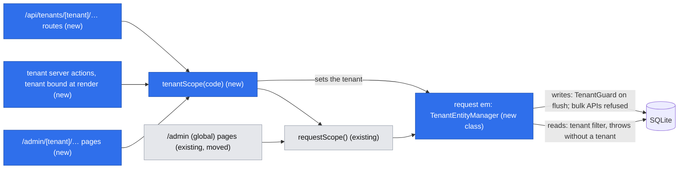
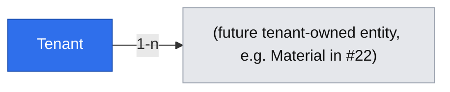
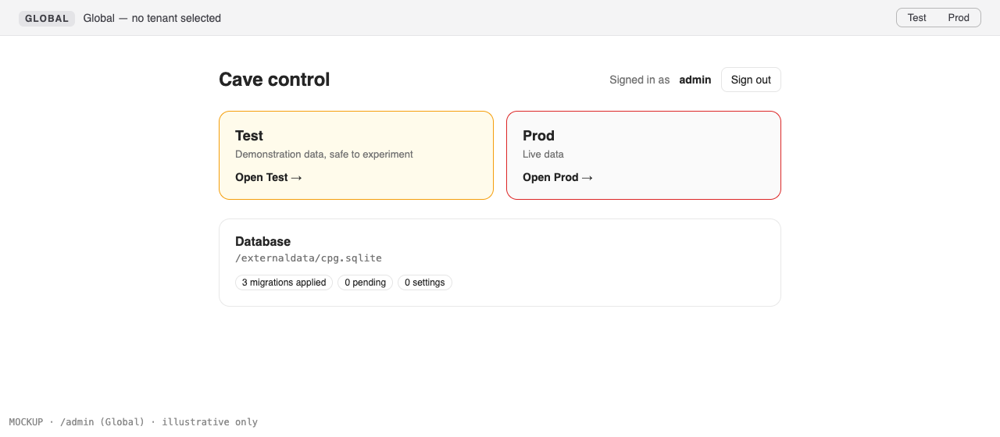
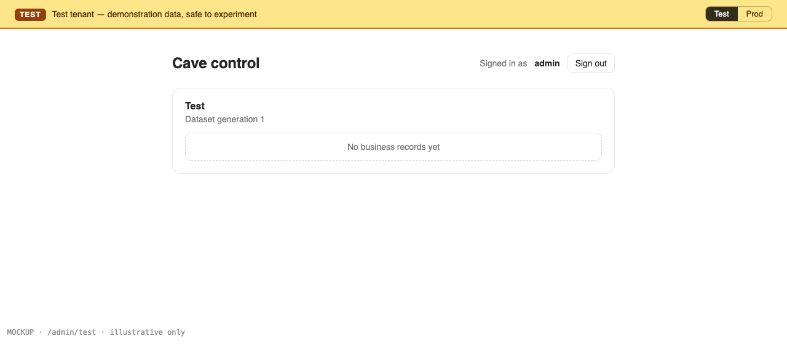
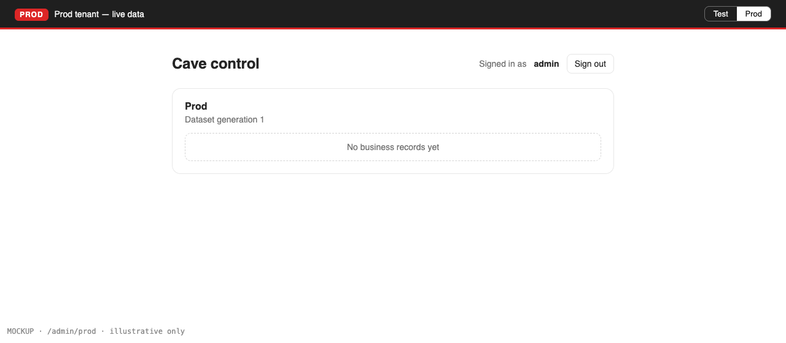

# Test and Prod tenants: selection, a visible indicator and strict isolation

**Status:** ready
**Created:** 2026-10-19 09:13 UTC
**Issue:** #19 (E02-S01), epic #10 · **Depends on:** E01-S01 (#15, shipped in #29) · **Design authority:** `.ai/specs/product-brief.md` (R05, D03, D06, N05), `.ai/specs/research/CPG-prd001.pdf` §05–§06, `.ai/specs/research/CPG-prd-datamodel.pdf` (Tenant; "Tenant generation → all business objects"), `.ai/specs/research/CPG-acceptance.md` TEN-001, TEN-010, TEN-011, TEN-014, API-013

## 📝 TLDR

Today CPG has no tenant: every table is global, and nothing stops a future material or order from being visible everywhere. This spec proposes two fixed tenants, Test and Prod, created by a migration.

- Every `/admin` screen that shows business data would live under `/admin/{test|prod}/…`, with a loud Test/Prod strip and a switcher. Every other admin screen would show a "Global" strip.
- The API would name the tenant in the path (`/api/tenants/{tenant}/…`), and tenant-scoped server actions would carry it as a bound argument.
- Underneath, every tenant-owned entity would carry a `tenant` reference, enforced in three places, all failing closed when no tenant is selected:
  - a default-on MikroORM filter on every read;
  - a flush guard plus a tenant-aware `EntityManager` on every write;
  - ESLint rules against the remaining bypasses.

Business entities in later stories (materials first, #22) get isolation by declaring themselves tenant-owned, rather than each service re-implementing it (D03).

## Resolved assumptions (autonomous defaults)

| # | Question | Chosen answer | Rationale |
|---|---|---|---|
| Q1 | How are tenants isolated: one SQLite database with a `tenant` column on every business row, or one database file per tenant? | One database. Every tenant-owned entity has a `tenant` reference, enforced in `db` by a default-on `tenant` filter, a flush guard and a tenant-aware `EntityManager`, and in source by ESLint rules. | It reuses the single ORM, migration set and request-scoped `em`. A file per tenant would need a second ORM, two migration sets and cross-database lookups for audit and users, a much larger and harder-to-reverse change. |
| Q2 | How does a request say which tenant it targets? | Explicitly, on every request. UI pages: `/admin/{tenant}/…`. API: `/api/tenants/{tenant}/…`. Server actions: the tenant code is bound as the action's first argument when the page renders. There is no tenant cookie and no tenant on the session. | Each tab then shows and writes exactly the tenant it was rendered for, so switching in one tab can never redirect a form that is open in another tab into the other tenant (TEN-011: "unambiguous before entry or posting"). An API call can't leave the tenant out (API-013). Links and bookmarks say which data they show. |
| Q3 | What identifies a tenant? | The `tenant` table, keyed by its code: `test` or `prod`. A migration inserts both rows with `generation = 1`. The codes are lowercase in URLs and data and are shown as "Test" and "Prod". | The standards allow a natural key for small configuration tables (like `Setting.key`). The two tenants are fixed by the PRD (N05), and rows created by a migration exist on a fresh install with no startup code (TEN-001). The generation is metadata the PRD keeps on the tenant. It stays 1 until the slice 2 reset, and E02-S03 (#21) consumes it (API-034). |
| Q4 | What demonstration records does Test get in this story, and how will they be created? | None yet, because this story ships no business entity. The contract is fixed here: demo records are created by code, through a seeder that runs inside a Test `tenantScope` and uses the normal services, never by a migration. E03-S01 materials (#22, whose criteria already say "Test is seeded with demonstration materials") builds the seeder. Each later master-data story adds its records to it, and the slice 2 reset reruns it. | AC1 says "the demonstration records the slice provides", and so far the slice provides none. A migration can't reseed after the slice 2 reset (TEN-022, TEN-029), so the seed has to be code. Inventing a demo entity here would add business scope (D04). |
| Q5 | Which API ships now, given bearer tokens arrive in E01-S03 (#17)? | `GET /api/tenants` (both tenants' metadata) and `GET /api/tenants/{tenant}` (one tenant's metadata), behind the browser session for now. They are the first route handlers, so they also build the shared `api-handler` wrapper. #17 adds bearer authentication in the one helper that authenticates API calls. | Tenant metadata is in the PRD (API-034: "current generation is available from tenant metadata"). It is the smallest API that makes the tenant path contract real and testable. Cookie-authenticated `GET`s need no CSRF header (standards). |
| Q6 | How is "a record created in Test is not in Prod" (AC4, R05) verified when no business record exists yet? | At the layer that every UI page, action and API route goes through. Unit tests declare fixture tenant-owned entities inside the test file, create a record in a Test scope, and prove that a Prod scope can't read, update, delete or reference it, and that a scope with no tenant can't touch it at all. The first end-to-end UI/API check of AC4 is TEN-012 in #22's acceptance criteria. | Without a business entity, an end-to-end test would need throwaway product code. The fixture tests exercise the real filter, guard, `EntityManager` and `tenantScope`, so #22 only declares its entity as tenant-owned. |
| Q7 | What does a page that belongs to no tenant show, such as `/admin` itself or the future users, tokens and Global audit screens? | All of them sit in the `app/admin/(global)/` route group, whose layout renders the strip as "Global — no tenant selected" with links to both tenants. `/admin` becomes the tenant chooser, plus the existing database status card. After sign-in the admin still lands on `/admin`. CPG does not remember the last-used tenant. | The scope is shown on every page, including "none" (AC2), and a layout enforces it the same way the tenant strip is enforced. The admin picks a tenant deliberately, which is the safe direction for Prod. Remembering the last tenant would need a cookie or a column for one saved click. |
| Q8 | What does the switcher do on a deeper page, such as a record page? | With JavaScript, it keeps the section and drops everything below it: `/admin/test/materials/00000005` switches to `/admin/prod/materials`. Without JavaScript, it links to the other tenant's home. | IDs are tenant-local (TEN-012). The same ID in the other tenant is a different record, so landing on it would be misleading. A layout doesn't know the current path, so only the client part can keep the section. |
| Q9 | Who may open tenant pages in this story? | Signed-in accounts, through the existing `requireAdmin()`, because the admin is the only account so far. E01-S02 (#16) introduces normal users and relaxes tenant pages to any active account, keeping both tenants open to everyone (TEN-010). | There are no other accounts to grant access to yet. The tenant gate adds no role check of its own, so #16 changes one helper. |
| Q10 | Split the issue? | No. Selection, the indicator and isolation are one capability: an indicator without isolation would mislead, and isolation without selection is unusable. | No part works without the others. |

None of these needs human confirmation before merge. The schema change is additive: one new table that the previous release ignores.

## 📝 Problem Statement

R05 and PRD §05 ("Strict tenant isolation", "Roles and tenant access") require:

- two business datasets, Test and Prod, that share no master data, transactions, inventory, MRP results, audit or ID sequences;
- every active account can select either one, and the current one is clearly visible ("contextual tenant indicator", §06);
- Test starts with demonstration records and Prod starts empty;
- the API scopes every call to an explicitly named tenant (API-013).

Today every table is global, and nothing in the code knows what a tenant is. D03 puts tenants in slice 1 because every business service written without them would have to be reworked. Materials (#22) is the next story and must be tenant-local from its first line.

Acceptance:
- TEN-001: both tenants exist and are selectable, and Prod is empty;
- TEN-010 and TEN-011;
- API-013;
- R05 and TEN-014 at the data layer (Q6).

## 📝 Proposed Solution

- **Tenants as data.** A `Tenant` entity (`test`, `prod`) is inserted by its migration. `TenantService` lists and reads tenant metadata.
- **Tenant-owned entities.** A business entity declares itself tenant-owned through one helper in `db`, `tenantOwned()`, which adds:
  - a required `tenant` reference, filled automatically on create from the scope's tenant (`onCreate((_, em) => …)`), so services never set it;
  - the default-on `tenant` filter.

  A repo-wide test fails when an entity is neither tenant-owned nor on the explicit `GLOBAL_ENTITIES` list (`Setting`, `User`, `Session`, `Tenant`, and later `UserPreference`, tokens and the Global audit). Isolation is therefore the default for anything new.
- **Selecting a tenant.** `tenantScope(code)` in `core` builds the request scope for one tenant:
  - it validates the code, and an unknown one gives `NotFoundError` `TENANT_NOT_FOUND`;
  - it sets the tenant on the scope's `em` (`setFilterParams`, the only call site);
  - it registers `tenant` (the active tenant's metadata) in that scope.

  A plain `requestScope()` has no tenant.
- **Reads.**
  - The filter's condition ignores per-call arguments and reads the tenant from the `em` it runs on. With no tenant it throws, so a global page can't read business data by mistake, and a call can't pass `filters: { tenant: { code: "prod" } }` to peek.
  - The filter covers `find*`, `count`, populate, `nativeUpdate` and `nativeDelete`.
  - ESLint forbids the remaining read bypasses: any `filters` option, and `setFilterParams` outside `tenant-scope.ts`.
- **Writes.** Every write to a tenant-owned entity goes through the unit of work (`em.create`/`assign`/`remove` + flush), or through `nativeUpdate`/`nativeDelete`, which the filter scopes. Enforced at runtime by:
  - **`TenantEntityManager`**, the ORM's `entityManager` class, which forks keep. For tenant-owned entities it throws `TenantViolationError` on:
    - `insert`, `insertMany`, `upsert`, `upsertMany`, `clone`, `createQueryBuilder` and `qb`, which skip both the flush and the filter;
    - a `nativeUpdate` whose data contains `tenant`.
  - **`TenantGuard`**, a flush subscriber, which rejects the whole flush before any SQL when it contains a tenant-owned entity and any of these hold:
    - there is no scope tenant;
    - the entity's `tenant` differs from the scope's, or isn't loaded;
    - an update changes `tenant`;
    - a to-one reference or collection item set in the change points at a tenant-owned entity of another tenant;
    - a reference points at a tenant-owned entity that wasn't loaded through the scope (an uninitialized reference whose tenant can't be checked).

  Flushes that touch only global entities (sign-in sessions, preferences) pass untouched. Services therefore resolve every client-supplied reference with a filtered `findOneOrFail`, so a Prod ID used in Test is simply "not found" (TEN-014).
- **Raw SQL.** `getConnection().execute` is allowed by ESLint only in an explicit allowlist of files that touch global state (`db/src/orm.ts`, `core/src/services/system/system-status.service.ts`).
- **UI.**
  - `app/admin/[tenant]/layout.tsx` is static for `test` and `prod` through `generateStaticParams`; any other value gives `notFound()`. It renders the `TenantStrip`: the tenant name, a colour, a short description and the switcher. Every page under it reads through `tenantScope(tenant)`.
  - `app/admin/(global)/layout.tsx` renders the Global strip for every other admin page. `/admin` (`(global)/page.tsx`) is the chooser.
- **Server actions.** `tenantServerAction(schema, handler)` in `core` sits next to `serverAction`. It returns `(tenantCode, raw) => Promise<Result>` and runs the handler with the `tenantScope(tenantCode)` container. Pages pass `action.bind(null, tenant)` using the URL param.
  - The bound code is visible to the client, and that's fine: it isn't a secret, every account may use both tenants (TEN-010), and the server re-validates it.
  - A repo-wide test fails when an `actions.ts` under `admin/[tenant]/` doesn't use `tenantServerAction`.
- **API.**
  - Every tenant-scoped route lives under `app/api/tenants/[tenant]/` and runs inside `tenantScope`.
  - The new `apiHandler` wrapper maps each `AppError` to its own HTTP status, keeping its code. Anything else becomes 500 `INTERNAL`.
  - A repo-wide test fails when a route handler outside `api/tenants/[tenant]/` calls `tenantScope`, or one inside it doesn't.

**Alternatives considered:**

- **A database file per tenant.** Rejected (Q1). It gives the strongest physical isolation and a trivially atomic Test reset (swap a file), but it doubles the ORM, migration and connection machinery, and every audit or user lookup would cross databases. It stays possible later: services reach tenant data only through `tenantScope`, so the storage behind it can change without touching them.
- **A database trigger that makes `tenant` immutable.** Not needed now. With `TenantEntityManager` and `TenantGuard` covering every ORM write path, a per-table trigger would add a migration step to every tenant-owned entity. It is the next layer to add if raw SQL ever becomes necessary.
- **The active tenant on the session row or in a cookie.** Rejected (Q2). Two tabs would share one hidden state, so a form rendered for Test could post into Prod after a switch in another tab.
- **A `CPG-Tenant` request header for the API.** Rejected. One URL would then mean different data depending on a header that is easy to forget. Proxies and logs wouldn't show it.
- **Each service adding `where: { tenant }` itself.** Rejected. One forgotten condition leaks data.

**Market check.** Most multi-tenant frameworks use a discriminator column enforced by a default scope or filter rather than by each query: Rails' `acts_as_tenant`, `django-multitenant`, Hibernate's `@TenantId`. That is the model here.
- **Their known gap:** bulk writes and raw SQL bypass the scope. That is what `TenantEntityManager`, the guard and the ESLint rules close.
- **Sandbox/production products** (Salesforce, Stripe's test mode, AWS console colour themes) show the environment as a persistent, colour-coded banner, and keep the mode in the URL or API key rather than a hidden setting. CPG copies the banner and the explicit mode.
- **Skipped:** per-tenant theming, tenant creation and tenant-level permissions, which N05 excludes.

## 📝 Architecture

- **`db`:**
  - `entities/tenants/tenant.entity.ts` (`Tenant`, `TENANT_CODES`, `TenantCode`).
  - `entities/tenants/tenant-owned.ts`: `TENANT_FILTER = "tenant"` and `tenantOwned()`, which returns the `tenant` property and the filter to spread into a `defineEntity` call. Also `isTenantOwned(meta)` and `GLOBAL_ENTITIES`.
  - `tenants/tenant-entity-manager.ts` (`TenantEntityManager`) and `tenants/tenant-guard.ts` (`TenantGuard`, an `EventSubscriber` with `onFlush`), both registered in `createOrmConfig` (`entityManager`, `subscribers`), plus `TenantViolationError`.
  - One migration, `tenants`, which creates the table and inserts both rows.
- **`core`:**
  - `services/tenants/tenant.service.ts` (`TenantService`, scoped): `list()` and `get(code)` return `TenantInfo { code, name, generation }`.
  - `container/tenant-scope.ts`: `tenantScope(code)`. The cradle gains `tenant: TenantInfo`, registered only in tenant scopes, so resolving it from a global scope fails in Awilix strict mode.
  - `validators/tenants/tenant-code.schema.ts`: `TENANT_CODES` re-declared as a literal, so the client subpath never pulls in `@cpg/db`, plus `tenantCodeSchema`. A unit test asserts that it equals the `db` constant.
  - `http/errors.ts`: every `AppError` gets an HTTP `status`, plus `NotFoundError`.
  - `http/api-handler.ts` (`apiHandler`) and `http/tenant-server-action.ts` (`tenantServerAction`).
- **`app`:**
  - `src/app/admin/(global)/{layout.tsx,page.tsx}` (the existing `/admin` page moves here; the URL is unchanged) and `src/app/admin/[tenant]/{layout.tsx,page.tsx}`.
  - `src/components/tenants/{tenant-strip.tsx,tenant-switcher.tsx}`.
  - `src/app/api/tenants/route.ts` and `src/app/api/tenants/[tenant]/route.ts`.
  - `src/auth/require-api-user.ts`: the session for route handlers. It throws `UnauthorizedError`, and #17 adds bearer tokens there.
- **Tooling:**
  - `eslint.config.mjs` gains `no-restricted-syntax` rules for `packages/core/**` and `packages/app/**`: no `filters` option keys; no `setFilterParams` outside `tenant-scope.ts`; no `getConnection().execute` outside the allowlist.
  - Two repo-wide tests: `tests/tenant-ownership.test.ts` and `tests/tenant-entry-points.test.ts`.

Takeaway: the tenant is decided once per request, from the URL or the bound action argument, in `tenantScope`. Everything below it enforces that one value, and the global path has no tenant at all, so tenant data is unreachable from it.

## 📝 Data Model

| Entity | Field | Type | Notes |
|---|---|---|---|
| `Tenant` (`tenant`) | `code` | string PK, `test` \| `prod` | natural key (Q3); inserted by the migration, never created or deleted at runtime |
| | `generation` | integer, default 1 | dataset generation; changes only with the slice 2 Test reset |
| *every future tenant-owned entity* | `tenant` | FK → `Tenant.code`, required, indexed, immutable | added and filled by `tenantOwned()`. Tenant-local unique keys include it, e.g. `unique(tenant, materialNumber)` in #22 |

- Display names ("Test", "Prod") and colours live in code, not in the table: they are presentation, and the two codes are fixed.
- Global entities get no `tenant` column.
- Per-tenant ID sequences (R01, R05) arrive with the first sequential ID, materials in #22, keyed by tenant and generation.
- Sensitive data: none.

No existing entity references `Tenant`: `Setting`, `User` and `Session` are global by design.

## 📝 API Contracts

Every response uses the existing envelope (`{ ok: true, data }` / `{ ok: false, error: { code, message } }`). Once merged, these become protected surfaces (`BACKWARD_COMPATIBILITY.md` §4).

| Method and path | Auth | Success | Errors |
|---|---|---|---|
| `GET /api/tenants` | signed-in session (bearer token from #17) | 200 `{ ok: true, data: [{ code: "test", name: "Test", generation: 1 }, { code: "prod", name: "Prod", generation: 1 }] }` | 401 `UNAUTHORIZED` |
| `GET /api/tenants/{tenant}` | same | 200 `{ ok: true, data: { code, name, generation } }` | 401 `UNAUTHORIZED`; 404 `TENANT_NOT_FOUND` for any value other than `test` or `prod`, including case variants |

- **Tenant contract (API-013).** Every tenant-scoped endpoint, now and later, lives under `/api/tenants/{tenant}/`, and its handler runs inside `tenantScope(tenant)`. No endpoint reads or writes tenant data without a tenant in its path.
- **Authentication comes before the tenant.** An unauthenticated caller gets 401 whatever the path.
- **`apiHandler(handler)`** (in `core`) returns `(request, context) => Promise<Response>`:
  - an `AppError` becomes `Response.json(envelope, { status: error.status })`, keeping its code. The statuses: `ValidationError` 400, `UnauthorizedError` 401, `NotFoundError` 404, `TooManyRequestsError` 429, and a plain `AppError` defaults to 400. Later errors (`ConflictError` 409, the 428 precondition in #21) declare their own;
  - anything else is logged without details and becomes 500 `INTERNAL`;
  - every response carries `Cache-Control: no-store`.
- **`tenantServerAction(schema, handler)`** (in `core`) returns `(tenantCode, raw) => Promise<Result<T>>`. It resolves `tenantScope(tenantCode)` first; an unknown code gives the `TENANT_NOT_FOUND` envelope. Then it behaves exactly like `serverAction` (Zod parse, `AppError` → envelope). The handler receives `(input, container)`.
- **`tenantScope(code)`** (in `core`) parses the code with `tenantCodeSchema` (failure: `NotFoundError("TENANT_NOT_FOUND", "Unknown tenant.")`), loads the row (missing → the same error), forks the request scope, sets the tenant on its `em`, and registers `tenant`.

## 📝 UI/UX

- **Tenant strip.** A full-width strip at the top of every `/admin/[tenant]/…` page, rendered by the layout, so a page can't forget it. It is part of the static shell, because the tenant comes from the URL and both values are prerendered.
  - **Test:** an amber background, the label "TEST", and "Test tenant — demonstration data, safe to experiment".
  - **Prod:** a dark background with a red accent, the label "PROD", and "Prod tenant — live data".
  - **Global** (the `(global)` layout): neutral, the label "GLOBAL", and "Global — no tenant selected".
  - The colour is never the only signal: the label text is always there, and the strip is a `role="region"` landmark named "Active tenant".
- **Switcher.** On the right of the strip, a two-option segmented control ("Test" / "Prod"). The current option is marked `aria-current="page"`, and the other is a link.
  - The server renders links to the tenant homes inside a `<Suspense>` fallback.
  - The client component (`usePathname`) replaces them with section-preserving links (Q8).
  - Without JavaScript, or before hydration, switching lands on the other tenant's home.
- **Page title.** The tenant layout sets `title: { template: "Test · %s", default: "Test · Admin · Caveman Planning Good" }`, so child pages keep the prefix. Tabs and the history list then show the scope too.
- **`/admin/[tenant]` (tenant home).** The signed-in header from E01-S01, a card "Test" or "Prod" with its dataset generation, and "No business records yet". Later stories add their sections here.
- **`/admin` (Global).** Two large links, "Open Test" and "Open Prod", above the existing database status card.
- English only. Polish strings for the strip and switcher are added by E01-S04 (#18) if it merges first. If not, whichever of the two stories merges second adds them.

Prototype: `.ai/specs/assets/test-prod-tenants/`. Static mockups, illustrative only; the shadcn components decide the final look:
- `mockup-01-global-chooser.png`: `/admin` with the Global strip and the tenant chooser;
- `mockup-02-test-home.png`: `/admin/test` with the amber Test strip;
- `mockup-03-prod-home.png`: `/admin/prod` with the Prod strip.

Today, for comparison: `current-01-admin.png` (`/admin` after sign-in, with no tenant anywhere).

## 📝 Edge Cases & Failure Scenarios

| Case | Behaviour |
|---|---|
| `/admin/staging`, `/admin/TEST` or any unknown tenant segment | The layout calls `notFound()` before rendering anything: a 404 page with no strip and no data |
| `GET /api/tenants/staging`, or a tenant action called with an unknown code | 404 `TENANT_NOT_FOUND` envelope, or a failed action result; nothing runs |
| A service queries a tenant-owned entity from `requestScope()` (no tenant) | The filter throws. The page's error path, or 500 `INTERNAL` from the API. Nothing is read |
| A flush includes a tenant-owned entity of another tenant, changes `tenant`, or has no scope tenant | `TenantGuard` throws `TenantViolationError` before any SQL, so nothing is written. This is a programming error, logged and returned as `INTERNAL` |
| A tenant-owned entity is written through `insert`, `upsert`, `clone`, the QueryBuilder, or `nativeUpdate` setting `tenant` | `TenantEntityManager` throws `TenantViolationError`; nothing is written |
| A Test record references a Prod record (TEN-014) | Loading the Prod ID through the Test scope finds nothing (`NotFoundError`). A hand-built reference (`getReference`) is rejected by the guard because it isn't loaded |
| Code tries to widen or switch the scope (`filters: false`, `filters: { tenant: … }`, `setFilterParams`, raw `execute`) | `npm run lint` fails. A per-call `filters: { tenant: { code } }` would be ignored anyway, because the condition reads the `em`'s own tenant |
| Two tabs, one on Test and one on Prod | Each shows and acts on its own URL's tenant, and actions carry the tenant they were rendered with |
| Switching tenant on a record page | Lands on the same section's list in the other tenant (Q8); without JavaScript, on its home |
| A `tenant` row is missing (manual database edit) while its URL is valid | The strip has already been sent with the static shell. The data child's `tenantScope` throws `TENANT_NOT_FOUND`, and the page shows the shared error state instead of data (HTTP 200, since the shell is already streamed). The API answers 404 |
| A migration on a database that already has data | Additive: one new table and two inserts. No existing table changes |

## 📝 Risks & Impact Review

- **The tenant contract becomes the pattern for every later story.** These are hard to change once materials, BOMs and documents build on them, which is the main reason to review this spec closely before #22 starts:
  - the URLs (`/admin/{tenant}/…`, `/api/tenants/{tenant}/…`);
  - the bound action argument;
  - `tenantOwned()`, `tenantScope` and the demo seeder contract (Q4).
- **Enforcement depends on MikroORM internals.** `TenantEntityManager` overrides public methods, and the filter and guard use public APIs. A MikroORM upgrade could still add a new write path. The fixture tests pin every covered path, so an upgrade that changes the semantics fails them, but a brand-new API would need a new override. The upgrade checklist: re-read the `EntityManager` write methods.
- **Strict reference checking adds friction.** Services can't `getReference()` a tenant-owned entity in a write; they must load it. This costs one extra query per reference and buys TEN-014 by construction.
- **`/admin` moves into a route group.** The URL is unchanged (`BACKWARD_COMPATIBILITY.md` §4 is unaffected), so `tests/integration/smoke.test.ts` and `auth.test.ts` keep landing on `/admin`. `tests/admin-pages-require-admin.test.ts` already globs `admin/**/page.tsx`.
- **`AppError` gains `status`.** This is additive. `serverAction` ignores it, and existing error codes are unchanged.
- **Overlap with E01-S04 (#18, PRs #31/#32).** Both stories touch the admin header area and the root layout's surroundings. Whichever merges second rebases and adds the Polish strings and the footer to the new layouts.
- **Reversibility.** A revert plus a migration that drops `tenant` undoes all of it, because no other table references it yet. After #22 merges, tenant-owned tables reference it and reverting means migrating them too.
- **Rule vs direction.** Q1 (one database) and Q2 (the tenant explicit on every request) are direction calls for Piotr12 to override, not repository rules. Nothing here contradicts an active brief entry.

## 📝 Decisions in play

- **R05** (strict isolation; owner Piotr12): implemented for reads and writes. Read-only flags are E02-S04 (#25), and the audit split is E02-S02 (#20).
- **D03** (foundations first) and **D04** (no added requirements): the metadata API and the colours present PRD requirements; they are not new features.
- **D06** (demo data in slice 1, reset in slice 2): the demo seed is built by #22 under the seeder contract (Q4), and the generation column exists for the slice 2 reset.
- **N05** (no additional tenants): the two codes are fixed in code and data.

Nothing is superseded.

## 📋 Phasing

- **Phase 1 — Tenant data layer.** The `Tenant` table, `tenantOwned()`, the filter, `TenantEntityManager`, `TenantGuard`, the ESLint rules, `TenantService`, `tenantScope` and `tenantServerAction`, all proved by fixture tests. Nothing visible changes, and this phase ships alone.
- **Phase 2 — Tenant UI.** The `(global)` and `[tenant]` layouts, the strip, the switcher, the tenant home and the chooser.
- **Phase 3 — Tenant API.** `apiHandler`, `requireApiUser` and the two metadata routes.

## 📋 Implementation Plan

### Phase 1 — Tenant data layer

1. **`Tenant` entity and migration.**
   - Add `db/src/entities/tenants/tenant.entity.ts` (`TENANT_CODES`, `TenantCode`) and register it in `entities/index.ts`.
   - Run `npm run db:migration:create -- tenants`, then add the two `insert`s for `test` and `prod` (generation 1) to the generated migration. Commit the migration, snapshot and index together.
   - Tests: the migration applies on a temp SQLite file, and both rows exist with generation 1.
   - Update the existing migration-count assertions (`tests/integration/smoke.test.ts`, and any unit test that pins the count).
2. **`tenantOwned()`, the filter, `TenantEntityManager` and `TenantGuard`.**
   - Add `db/src/entities/tenants/tenant-owned.ts`, `db/src/tenants/{tenant-entity-manager,tenant-guard}.ts` and `TenantViolationError`. Register them in `createOrmConfig`, and export `GLOBAL_ENTITIES`.
   - The filter's `cond` ignores `args` and reads the tenant from the `em` it receives, throwing when none is set.
   - Tests use two fixture tenant-owned entities, a parent and a child with a to-one and a collection, defined in the test file with their tables created on the temp database. They cover:
     - a fork is a `TenantEntityManager`;
     - reads in a scope see only that tenant's rows, and populate is scoped too;
     - a read with no tenant throws, and per-call filter arguments don't change the tenant;
     - `nativeUpdate` and `nativeDelete` are scoped, and `nativeUpdate` with `tenant` in its data throws;
     - `insert`, `insertMany`, `upsert`, `upsertMany`, `clone`, `createQueryBuilder` and `qb` throw for tenant-owned entities and work for a global one;
     - `onCreate` fills `tenant`;
     - every guard rule throws: a foreign entity, a changed `tenant`, no scope tenant, a foreign reference, a foreign collection item, an uninitialized reference, and an entity whose `tenant` isn't loaded. In each case nothing is written;
     - global-only flushes (a `Session`) pass with and without a scope tenant.
3. **Lint and repo-wide guards.**
   - The `eslint.config.mjs` rules from Architecture.
   - `tests/tenant-ownership.test.ts`: every entity in `entities` is either tenant-owned or in `GLOBAL_ENTITIES`.
   - A test that runs ESLint on a fixture source string proves that each new rule fires.
   - Update `.ai/docs/engineering-standards.md`:
     - "Adding a new domain concept": `tenantOwned()`, `tenantScope`, `tenantServerAction`, references loaded through the scope, and tenant-local unique keys including `tenant`;
     - the review checklist: "tenant-owned data only through `tenantScope`; no bypass of the tenant filter".
4. **`TenantService`, `tenantScope`, `tenantServerAction` and errors.**
   - `core/src/services/tenants/tenant.service.ts`, `core/src/container/tenant-scope.ts`, `core/src/validators/tenants/tenant-code.schema.ts` (with the equality test against the `db` constant), and `core/src/http/tenant-server-action.ts`.
   - In `http/errors.ts`: `status` on every `AppError`, and `NotFoundError`.
   - Register `tenantService` in `container.ts` and `cradle.ts` (the cradle also gets `tenant: TenantInfo`), export from `index.ts`, and update `index.test.ts`.
   - Tests against real SQLite:
     - `list` and `get`;
     - an unknown code, a wrong case or a missing row gives `TENANT_NOT_FOUND`;
     - two scopes for different tenants in one process stay apart;
     - resolving `tenant` from a global scope throws;
     - `tenantServerAction`: an unknown tenant, a validation failure, an `AppError`, an unexpected error, and success running in the right tenant.

### Phase 2 — Tenant UI

5. **Strip and switcher.**
   - `app/src/components/tenants/tenant-strip.tsx` (Test, Prod and Global variants).
   - `tenant-switcher.tsx` with a pure `switchTenantPath(pathname, target)` helper, exported and unit-tested: it keeps the section, drops deeper segments, and handles the tenant root and a non-tenant path.
   - Component tests check the labels, the region name, `aria-current`, the server-rendered fallback links and the client links.
6. **Layouts and pages.**
   - Move `app/admin/page.tsx` to `app/admin/(global)/page.tsx` (the URL is unchanged) with `(global)/layout.tsx` rendering the Global strip, and add the chooser.
   - `app/admin/[tenant]/layout.tsx`: `generateStaticParams` over `TENANT_CODES`, `notFound()` on any other value, the strip, and the title template.
   - `page.tsx`: `requireAdmin()` and `tenantScope(tenant)` inside the `<Suspense>` data child, then the tenant card.
   - Add `tests/tenant-entry-points.test.ts`:
     - every `page.tsx` under `admin/[tenant]/` calls `tenantScope`;
     - every `actions.ts` there uses `tenantServerAction`;
     - no page or action outside `admin/[tenant]/` and `api/tenants/[tenant]/` calls either.
   - Unit tests await the async server components per `app/src/app/admin/page.test.tsx`.
7. **Integration test `tests/integration/tenants.test.ts`:**
   - after sign-in, `/admin` shows "Global — no tenant selected" and both links;
   - "Open Test" lands on `/admin/test` with the TEST strip and generation 1;
   - the switcher goes to `/admin/prod` with the PROD strip and back again (TEN-010, TEN-011);
   - the document title starts with the tenant name;
   - `/admin/staging` returns the 404 page;
   - unauthenticated `/admin/test` redirects to `/login`.

### Phase 3 — Tenant API

8. **`apiHandler` and `requireApiUser`.**
   - `core/src/http/api-handler.ts` with the status mapping and `no-store`, unit-tested for every branch.
   - `app/src/auth/require-api-user.ts`: the session cookie via `currentUser()`, otherwise `UnauthorizedError`; it fails closed on errors.
   - Update the engineering standards' adoption status (`api-handler.ts` is now built).
9. **Metadata routes.**
   - `app/src/app/api/tenants/route.ts` and `app/src/app/api/tenants/[tenant]/route.ts`, both through `apiHandler` → `requireApiUser` → `tenantService` (the second one via `tenantScope`). Extend `tenant-entry-points.test.ts` to route handlers.
   - Unit tests for both routes.
   - Integration tests in `tenants.test.ts`, run through the browser's signed-in session (`fetch` from the page):
     - `GET /api/tenants` returns both tenants;
     - `/api/tenants/prod` returns Prod;
     - `/api/tenants/staging` returns 404 `TENANT_NOT_FOUND`;
     - signed out, both return 401 (API-013).
   - Then run the full gate: lint, typecheck, `test:coverage` (100%), build, `test:integration`.

## Implementation notes

- **2026-10-19, E01-S02 (#16, PR #34):** as Q9 anticipated, normal users now exist. So `/admin` (the chooser) and every `admin/[tenant]` page call `requireUser()` instead of `requireAdmin()`, because every active account uses both tenants (TEN-010). Admin-only content stays behind `requireAdmin()` or a role check: the database card, the Users link, and `/admin/users` under `(global)`.
