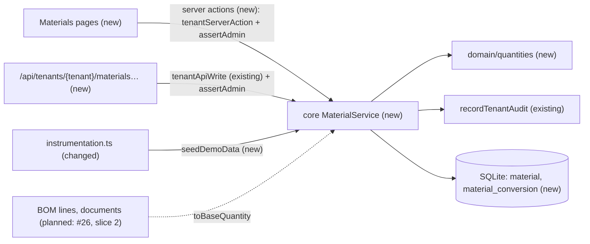
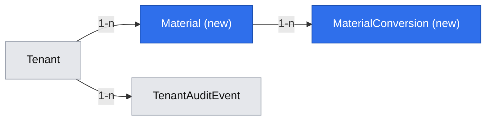
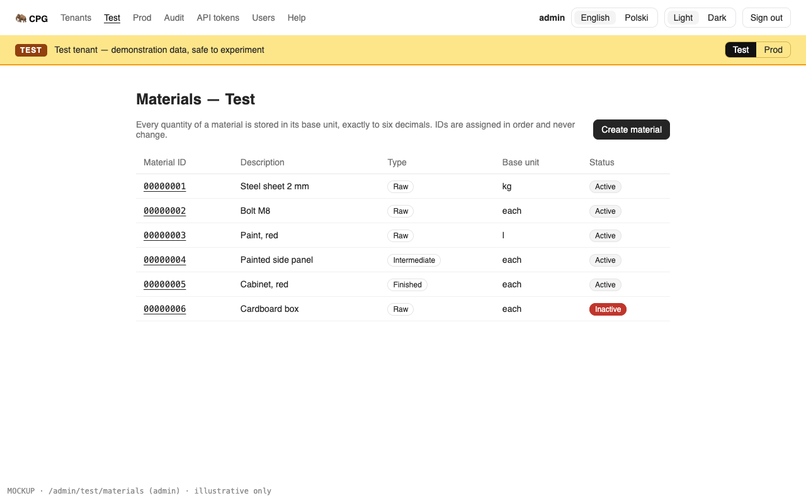
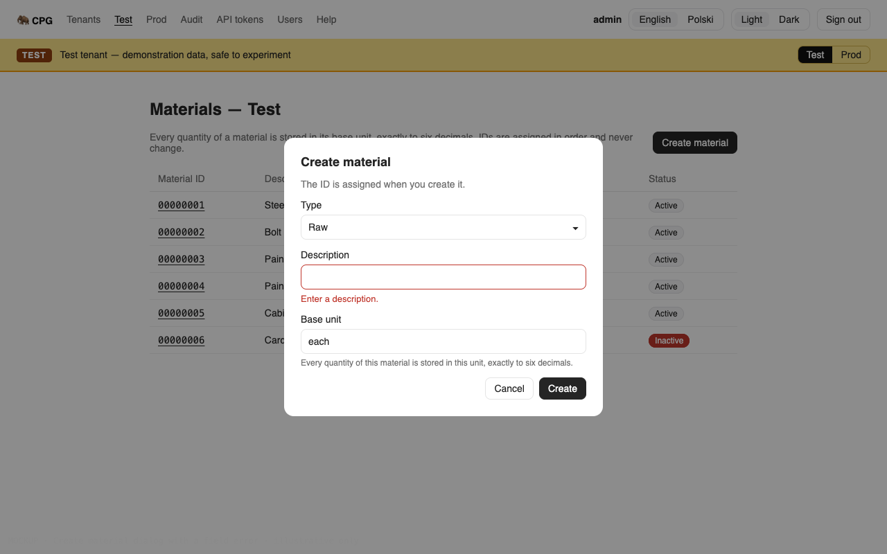
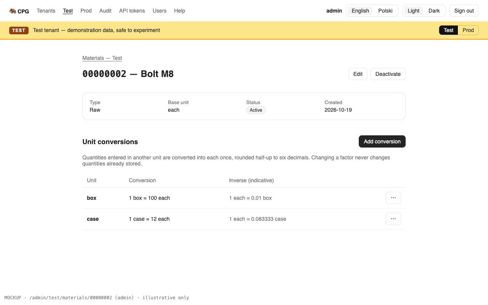

# The admin maintains materials and their unit conversions, and every user can view them

**Status:** ready
**Created:** 2026-10-19 18:58 UTC
**Issue:** #22 (E03-S01), epic #11 · **Builds on:** `implemented/2026-10-19--1050UTC-audit-log.md` (#20), `implemented/2026-10-19--0913UTC-test-prod-tenants.md` (#19), `implemented/2026-10-19--1548UTC-api-idempotency.md` (#21) · **Design authority:** `.ai/specs/product-brief.md` (R01–R03, R05, R07, R08, D06), `.ai/specs/research/CPG-prd001.pdf` §02, `CPG-prd-datamodel.pdf` (Material, UoM conversion), `CPG-acceptance.md` (MAT, TEN-004, TEN-012, AUD-001…003, API-010, API-018)

## 📝 TLDR

CPG has no master data yet, and every BOM and document will need a material. This spec proposes that the admin creates and edits materials in each tenant: an eight-digit ID that the server assigns in sequence per tenant (00000001, 00000002, …), a type (raw, intermediate or finished), a description and a base unit (BUoM), plus exact conversions from other units into the base unit. Every signed-in user can view them, in the UI and through the API. Converting an entered quantity into the base unit (half-up once to six decimals, never binary floating point) becomes one tested function in `core` that the BOM and document stories will call. The Test tenant is seeded with demonstration materials.

## Resolved assumptions (autonomous defaults)

| # | Question | Chosen answer | Rationale |
|---|---|---|---|
| Q1 | Split the issue (materials vs conversions)? | No. One story, one spec. | A conversion can't exist without its material, and the issue's acceptance criteria cover both. |
| Q2 | Is there a unit-of-measure master list? | No. A unit is a short code typed per material (`kg`, `each`, `case`, `szt.`): trimmed, kept exactly as typed (case included), 1–16 characters of letters, digits, `.`, `-` or `_`, starting with a letter or digit. No spaces and no `/`, so a unit is a safe URL path segment. A conversion's unit must differ from the material's base unit and is unique per material; comparisons are exact. | The data model has no UoM entity, only "material · alternative unit" (CPG-prd-datamodel.pdf). A global list would be a new master nobody asked for (D04). Keeping the case avoids merging units that differ only by case (`Mg` megagram, `mg` milligram). |
| Q3 | How is a conversion factor written and exchanged? | `1 <unit> = numerator / denominator <base unit>`, both positive decimals with at most 12 integer and 6 fractional digits. The API sends and returns them as JSON **strings** (`"12"`, `"0.5"`). They are stored as canonical decimal text (`"12.50"` → `"12.5"`). Every quantity, entered or converted, stays within the same range (12 integer digits, 6 decimals); a conversion whose result exceeds it is `QUANTITY_OUT_OF_RANGE`. | The PRD's "positive numerator/denominator". Strings keep JSON's binary floats out of the path (R03). A ratio of two decimals expresses both 1 case = 12 each and 1 lb = 0.453592 kg, and 1/3 (MAT-032). One range for every quantity means a converted value is always storable and re-parseable. |
| Q4 | Decimal arithmetic: library or local code? | Local code: `core/src/domain/quantities/decimal.ts`, fixed-point `bigint` at six decimal places, about 60 lines. | The standards: no dependency for what ~20–60 lines cover. Only parse, multiply/divide with one half-up rounding, compare and format are needed. |
| Q5 | Where is an entered quantity converted and stored in this story, before BOMs or documents exist? | `MaterialService.toBaseQuantity(materialId, { quantity, unit })` returns the record later stories persist: the six-decimal base quantity plus the entered quantity, unit, numerator and denominator. It is unit-tested for MAT-019/020/021/023/024/032. No screen or route converts quantities in this story; the first one is the BOM story (#26), whose lines store that record. Accepted as the default (owner's instruction, 2026-10-19: proceed with reasonable assumptions). | Nothing in this story stores a quantity, so the issue's "24 each is stored" can only be shown end to end once BOM lines exist. A conversion calculator screen or route would be new surface that nothing else uses. Confirm that #26 (and the document stories) own the end-to-end check. |
| Q6 | How is the material ID modelled and assigned? | A UUID primary key stays internal. The business ID is a separate column `code` (`"00000001"`), unique per tenant, and is what the UI, the API paths, the audit and later imports use. A new ID is the tenant's highest + 1, read inside the write transaction. Two creates racing on two connections can't both commit: SQLite refuses the later one's first write (`SQLITE_BUSY_SNAPSHOT`), and that transaction is retried once, so it gets the next ID (see Edge Cases). The unique index is the backstop. There is no counter table. | The standards: UUID keys, business keys as separate unique columns. Materials are never deleted, so "highest + 1" never reuses an ID (R01). The slice-2 Test reset deletes Test's materials, so numbering restarts from 00000001 with no extra code (TEN-029). |
| Q7 | Can a material be deactivated in this story? | Yes: an `active` flag the admin toggles, audited as its own action, `materials.material.deactivated`/`reactivated` (AUD-003), like users. No guard yet, because nothing can reference a material. Later stories reject inactive materials in new entries (MAT-029). | The data model gives Material an active flag, and no other E03 story covers it. The guards (stock, open documents) belong to slice 2 (epic #11). |
| Q8 | What does changing the base unit do to existing conversions (MAT-009 "conversion consistency verified")? | A field counts as changed only when its normalized value differs from the stored one; the no-op rule and this lock apply to that changed set. The base unit can change only while the material has no conversions: `BASE_UNIT_HAS_CONVERSIONS` otherwise. Resending the same base unit (the Edit form always sends it) is not a change. Type and base unit are otherwise freely editable; the locks once a BOM or document references the material come with #26 and slice 2. | A factor is relative to the base unit: keeping it across a base-unit change would silently change its meaning. Rejecting is the simplest consistent rule; removing and re-adding conversions is two clicks. |
| Q9 | How is Test seeded with demonstration materials (D06), and is the seed audited? | At every server start, after the migrations, if Test has no materials, a fixed list of six materials with conversions is created in Test. The seed writes no audit entries. Accepted as the default (owner's instruction, 2026-10-19: proceed with reasonable assumptions). | Materials are never deleted, so "Test has none" is true only once; no marker is needed, and the slice-2 reset can call the same seed. Startup work is unaudited today (the admin session purge), but #44 asks to record it under a "system" actor, and AUD-001 says every create is audited. Auditing the seed needs a system actor the audit doesn't have yet (its channel is `ui` or `api`), so this follows #44's outcome. |
| Q10 | Which screens? | `/admin/[tenant]/materials` (list, Create material) and `/admin/[tenant]/materials/[id]` (details, Edit, Deactivate/Reactivate, conversions with Add, Change and Remove). Every signed-in account opens both; only the admin sees the controls. The tenant home links to Materials. | Follows the tenant-page pattern (`/admin/[tenant]/audit`). One list and one detail page keep conversions next to their material. |
| Q11 | Description rules? | Trimmed, 1–200 characters, not unique. | The PRD gives none (D04). Two materials may share a description; the ID tells them apart. |
| Q12 | API parity (R07)? | Yes, in this story: `GET`/`POST /api/tenants/{tenant}/materials`, `GET`/`PATCH …/materials/{id}`, `POST …/{id}/conversions`, `PATCH`/`DELETE …/{id}/conversions/{unit}`. Writes go through `tenantApiWrite` (idempotency key, generation) and are admin-only (API-010). The new paths are added to `BACKWARD_COMPATIBILITY.md`. | Every operation needs its API equivalent, and the write pipeline exists (#21). |
| Q13 | Which name does the code use (brief Q04, open)? | **materials**, the PRD's term: the concept folder, the entities, the pages and the API paths. Accepted as the default (owner's instruction, 2026-10-19: proceed with reasonable assumptions). | Q04 is still open in the brief, and API paths are a protected contract (`BACKWARD_COMPATIBILITY.md` §4): renaming them later needs a deprecation release. |

Q5, Q9 and Q13 were flagged for human confirmation. On 2026-10-19 the owner told the run to proceed on reasonable assumptions without asking, so they stand as the accepted defaults:
- **Q5** narrows how one acceptance criterion of #22 is shown: the conversion is delivered and tested here, but "stored" becomes observable only with BOM lines.
- **Q9** leaves the seed unaudited against AUD-001's wording.
- **Q13** fixes the public naming that brief Q04 leaves open.

Each can still be overridden before merge. Every other default is reversible and weakens no rule.

## 📝 Problem Statement

Planning starts from master data, and none exists (D02, D05). The PRD's material has an eight-digit tenant-local ID assigned in sequence from 00000001 and never reused within a dataset generation (R01), a type that decides what it may do in BOMs (R02), a description, and a base unit in which every authoritative quantity is stored exactly to six decimals (R03). Quantities entered in another unit are converted once, half-up, and the entered unit and factor are kept for history; a later change to the conversion never revalues anything already stored (PRD §02, MAT-027). Only the admin maintains master data; normal users read it (PRD §05, TEN-004). Test and Prod number their materials independently (R05, MAT-003, TEN-012). Every create and edit lands in the tenant audit with before and after values (R08, AUD-001, AUD-002). Test starts with demonstration records (TEN-001, D06).

## 📝 Proposed Solution

- **Materials.** A tenant-owned `Material` entity and a `MaterialService` (concept `materials`). Create assigns the next code inside a transaction; edit carries the loaded version (optimistic locking, like `UserService`). Each write records a tenant audit entry in the same flush.
- **Conversions.** A tenant-owned `MaterialConversion` per material and alternate unit, with its own version. Add, change the factor, remove. Removing is safe: anything stored later keeps its own copy of the entered unit and factor (Q5), so history never depends on the conversion row (MAT-027, MAT-028).
- **Exact quantities.** `core/src/domain/quantities/` parses decimal strings into `bigint` micro-units, converts `entered × numerator ÷ denominator` with one half-up rounding to six decimals, and formats the result. `MaterialService.toBaseQuantity` applies the material's conversion: the base unit itself converts 1:1, a unit with no conversion is `UNIT_NOT_CONVERTIBLE` (MAT-023), and a positive quantity that rounds to zero is `QUANTITY_ROUNDS_TO_ZERO` (MAT-032).
- **Screens and API.** Two tenant pages and five tenant routes, reusing `tenantServerAction`, `tenantApiWrite`, `CrudForm`, `DataTable` and the `feedback/` components. `CrudForm` gains a select field (shadcn's `native-select`, added with the CLI) and initial values, which the type field and the edit form need.
- **Racing writes converge on both channels.** The first business writes that read before they write (the next ID, a unit's uniqueness) meet SQLite's stale-snapshot refusal when two connections race. `IdempotencyService` already retries that once for API writes. `tenantServerAction` gets the same single retry, using the `isStaleSnapshot` check moved from the idempotency service into `http/request-transaction.ts`, so a page and an API call racing on a create both succeed with consecutive IDs.
- **Demo data.** `seedDemoData(config)` runs at startup next to the existing startup tasks.

**Alternatives considered:**
- **A per-tenant sequence table** (`next_value` incremented in the transaction). Rejected for now: without raw SQL (banned in `core`) the increment is a read-modify-write anyway, and "highest + 1" over an append-only table needs no reset logic. If materials ever become deletable, a sequence table becomes necessary; the unique index keeps that change safe.
- **Storing quantities as SQLite `decimal`/`numeric`.** Rejected: SQLite's NUMERIC affinity stores `0.333333` as a binary REAL. Text columns hold the exact digits.
- **`decimal.js` or `big.js`.** Rejected per Q4.
- **A global UoM list.** Rejected per Q2.

**Market check.** Odoo's units of measure are global categories with a reference unit and ratios, and every product picks units from them; ERPNext keeps a global UOM list plus per-item conversion factors (`UOM Conversion Detail`), stores the stock quantity in the item's stock UOM and keeps the entered UOM and factor on each transaction line. CPG follows ERPNext's per-material factor and its entered-unit snapshot, skips the global unit list and categories (Q2), and uses an exact numerator/denominator rather than one float factor, which is what lets 1/3 round once instead of drifting (MAT-032). Both products allow editing a factor without revaluing existing documents, which is MAT-027.

## 📝 Architecture

- **`db`:** `entities/materials/material.entity.ts` and `material-conversion.entity.ts`, both `tenantOwned()`. One migration: `materials`.
- **`core`:**
  - `domain/quantities/decimal.ts`: `parseDecimal`, `formatDecimal`, `convertToBase`, `inverseFactor` (pure, no database).
  - `domain/materials/material-code.ts`: `formatMaterialCode(n)` → `"00000001"`, `nextMaterialCode(highest)`.
  - `domain/materials/demo-materials.ts`: the fixed Test seed (pure data).
  - `validators/materials/`: `material-create.schema.ts`, `material-update.schema.ts`, `conversion.schema.ts` (create and factor change), and the shared `unit`, `decimal` and `material-id` schemas.
  - `services/materials/material.service.ts` (`MaterialService`, scoped): `list`, `get`, `create`, `update`, `addConversion`, `changeConversion`, `removeConversion`, `toBaseQuantity`, `seedDemo`.
  - `database.ts`: `seedDemoData(config)`, a short-lived ORM like the other startup tasks (never the shared container), running `materialService.seedDemo()` in `scopeForTenant(createAppContainer(config, orm), "test")`.
  - `http/request-transaction.ts`: `isStaleSnapshot` (moved from `idempotency.service.ts`); `http/tenant-server-action.ts` retries its transaction once on it.
  - `container.ts`/`cradle.ts`/`index.ts`: one line each.
- **`ui`:** `components/native-select.tsx` (shadcn CLI); `backend/forms/crud-form.tsx` gains `type: "select"` fields with `options`, and an `initialValues` prop.
- **`app`:**
  - `app/admin/[tenant]/materials/{page.tsx,actions.ts}` and `app/admin/[tenant]/materials/[id]/page.tsx`;
  - `components/materials/`: the materials table, the create and edit dialogs, the active toggle, the conversions table and its dialogs, and `labels.ts`;
  - `app/api/tenants/[tenant]/materials/route.ts`, `…/[id]/route.ts`, `…/[id]/conversions/route.ts`, `…/[id]/conversions/[unit]/route.ts`;
  - the tenant home links to Materials; `instrumentation.ts` calls `seedDemoData`;
  - English and Polish strings, and two help topics.

The cross-cutting effect is small: the first tenant-owned business entity, so the first real user of `tenantServerAction` from a page and of `tenantApiWrite` with a body. The BOM story (#26) will reference `Material` and call `toBaseQuantity` and the type/base-unit locks there.

## 📝 Data Model

| Entity | Field | Type | Notes |
|---|---|---|---|
| `Material` (`material`) | `id` | uuid, PK | Internal only; never in an API response |
| | `tenant` | FK → `tenant` | `tenantOwned()`; filled on create |
| | `code` | string(8) | `"00000001"`…; unique with `tenant`; never changes (MAT-004) |
| | `type` | enum `raw`/`intermediate`/`finished` | Editable in this story (MAT-013) |
| | `description` | string(200) | Trimmed, non-empty |
| | `baseUnit` | string(16) | Unit code, trimmed, as typed (Q2) |
| | `active` | boolean, default `true` | Q7 |
| | `createdAt` | datetime | |
| | `version` | integer, `.version()` | Optimistic lock (AUD-024, API-029) |
| `MaterialConversion` (`material_conversion`) | `id` | uuid, PK | Internal |
| | `tenant` | FK → `tenant` | `tenantOwned()` |
| | `material` | FK → `material` | Loaded in the scope, never from a client-supplied key |
| | `unit` | string(16) | Trimmed, as typed (Q2); unique with `material`; never the base unit |
| | `numerator`, `denominator` | string | Canonical positive decimal text, ≤ 12 integer and ≤ 6 fractional digits |
| | `version` | integer, `.version()` | |

Indexes: `material (tenant, code)` unique; `material_conversion (material, unit)` unique. Nothing is ever deleted from `material`; conversion rows are deleted on Remove. No quantity column exists in this story (Q5).

The record `toBaseQuantity` returns, for later stories to persist: `{ baseQuantity: "24.000000", enteredQuantity: "2", enteredUnit: "case", numerator: "12", denominator: "1" }`.

## 📝 API Contracts

All paths are under `/api/tenants/{tenant}`, read and written in that tenant's scope. Reads accept a bearer token or the session cookie (any signed-in account). Writes use `tenantApiWrite` with `authorize: assertAdmin`: bearer only (401), admin only (403 `FORBIDDEN`, API-010), `Idempotency-Key` required, `Dataset-Generation` required for Test (428/409). A material in a path is its eight-digit ID; anything else is 404 `MATERIAL_NOT_FOUND`. Quantities and factors are JSON strings.

| Method and path | Body | Success | Errors (besides the pipeline's) |
|---|---|---|---|
| `GET /materials` | — | `Material[]` by ID | — |
| `POST /materials` | `{ type, description, baseUnit }` | 200 `Material` with its new `id` | `VALIDATION_FAILED` (type missing or not one of the three, MAT-005/007; description or base unit missing, MAT-008). A create racing another one is retried and gets the next ID |
| `GET /materials/{id}` | — | `MaterialDetail` | `MATERIAL_NOT_FOUND` |
| `PATCH /materials/{id}` | `{ version, description?, type?, baseUnit?, active? }`, at least one field | `Material` | `VALIDATION_FAILED` (including any `id` in the body: "A material's ID can't be changed.", MAT-004); `VERSION_CONFLICT`; `BASE_UNIT_HAS_CONVERSIONS` (409, Q8); `MATERIAL_NOT_FOUND` |
| `POST /materials/{id}/conversions` | `{ unit, numerator, denominator }` | `Conversion` | `VALIDATION_FAILED` (a zero or malformed factor, MAT-022); `UNIT_IS_BASE_UNIT` (400); `CONVERSION_EXISTS` (409); `MATERIAL_NOT_FOUND` |
| `PATCH /materials/{id}/conversions/{unit}` | `{ numerator, denominator, version }` | `Conversion` | as above, plus `CONVERSION_NOT_FOUND`, `VERSION_CONFLICT`; on any error the old factor stays (MAT-022) |
| `DELETE /materials/{id}/conversions/{unit}` | `{ version }` (the first `DELETE` with a JSON body; `keyedWrite` already reads it) | `{ unit }` | `CONVERSION_NOT_FOUND`, `VERSION_CONFLICT` |

Shapes:
- `Material`: `{ id: "00000001", type, description, baseUnit, active, createdAt, version }`.
- `MaterialDetail`: `Material` plus `conversions: Conversion[]`, ordered by unit.
- `Conversion`: `{ unit, numerator, denominator, inverse, version }`, where `inverse` is `denominator ÷ numerator` half-up to six decimals, marked indicative in the UI (MAT-021). When it rounds to `"0.000000"` (a numerator of 10⁷ or more), the UI shows "< 0.000001".

`MaterialService` (core), every write taking `actor: AuditActor` and running in one transaction with its audit entry. A material's audit subject is `{ type: "Material", id: <code>, label: "<code> — <description>" }`.
- `list()`, `get(materialId)`.
- `create({ type, description, baseUnit }, actor)`: code = tenant's highest + 1, formatted to eight digits; action `materials.material.created`, snapshot `{ id, type, description, baseUnit, active }`.
- `update(materialId, changes, version, actor)`: compares `version` with a fresh read. Only fields whose normalized value differs count as changed (Q8); with none, nothing is written or recorded. Changed `description`, `type` or `baseUnit` record `materials.material.updated` with those fields before and after; a changed `active` records `materials.material.deactivated` or `reactivated` with `{ active }`. A request changing both records both entries.
- `addConversion`, `changeConversion`, `removeConversion`: actions `materials.material-conversion.created|updated|removed`, subject `MaterialConversion` with id `<materialId>/<unit>`, snapshot `{ material, unit, numerator, denominator }`.
- `toBaseQuantity(materialId, { quantity, unit })` (Q5): a read, no audit.
- `seedDemo()`: creates the demo materials when the tenant has none; returns how many it created.

The server actions in `app/admin/[tenant]/materials/actions.ts` mirror the writes (`createMaterial`, `updateMaterial`, `addConversion`, `changeConversion`, `removeConversion`), each a `tenantServerAction` bound to the page's tenant and generation, calling `assertAdmin(await currentUser())` inside it, and revalidating the list and the detail page on success or `VERSION_CONFLICT`.

## 📝 UI/UX

- **Tenant home** (`/admin/[tenant]`): the placeholder card gains a **Materials** link next to the audit link.
- **`/admin/[tenant]/materials`**, titled "Materials — Test":
  - A `DataTable`: Material ID (monospaced, links to the material), Description, Type (badge), Base unit, Status (Active / Inactive badge). Ordered by ID.
  - For the admin, **Create material** opens a dialog with a `CrudForm`: Type (select: Raw, Intermediate, Finished), Description, Base unit. The hint under Base unit says that every quantity of this material is stored in it, exactly to six decimals (UX-014). On success the dialog closes and the list shows the new ID.
  - Empty state: "No materials in Test yet." plus, for the admin, "Create the first one."
- **`/admin/[tenant]/materials/[id]`**, titled "00000002 — Bolt M8":
  - A details card: Type, Base unit, Status, Created.
  - For the admin: **Edit** (dialog, prefilled Description, Type and Base unit), and **Deactivate** or **Reactivate** with a confirmation that says an inactive material can't be picked for new entries but stays readable.
  - **Unit conversions**: a `DataTable` of Unit, Conversion ("1 case = 12 each"), and Inverse ("1 each = 0.083333 case", with a hint that the inverse is indicative). The admin gets **Add conversion** (Unit, Base quantity = numerator, Per alternate quantity = denominator defaulting to 1, each with a hint) and per-row **Change factor** and **Remove** (confirmation). The add form says "1 {unit} = {numerator ÷ denominator} {base unit}" in its description.
  - A material ID that doesn't exist in this tenant renders the not-found state.
- **Normal users** see both pages without Create, Edit, Deactivate, Add, Change or Remove (TEN-004). Hiding is cosmetic; every action and route checks `assertAdmin`.
- Translations in English and Polish; help topics "Materials" and "A material and its conversions" for the two routes.

Prototype: `.ai/specs/assets/materials/` — static mockups, illustrative only; the shadcn components decide the final look.
- `current-01-tenant-home.png`: today's Test home.
- `mockup-01-materials-list.png`: the Test list as the admin.
- `mockup-02-create-material.png`: the create dialog with a field error.
- `mockup-03-material-detail.png`: a material with conversions, as the admin.

## 📝 Edge Cases & Failure Scenarios

| Case | Behaviour |
|---|---|
| Two creates in one tenant at the same moment (a page and the API, two connections) | Both read the same highest code. The first to write commits; SQLite refuses the other's first write with `SQLITE_BUSY_SNAPSHOT`, its transaction rolls back, and the wrapper (`IdempotencyService` for the API, `tenantServerAction` for a page) runs it once more: it reads the new highest and gets the next ID. A second refusal is a 500 like any lock timeout. The unique index `(tenant, code)` stays as the backstop and maps to `CONFLICT` "Another material was created at the same moment. Try again." |
| Two conversions for the same new unit at the same moment | The same retry; the retried one finds the unit taken: `CONVERSION_EXISTS` |
| A conversion whose result exceeds 12 integer digits (a huge quantity at a factor like 1/0.000001) | `QUANTITY_OUT_OF_RANGE`; nothing is returned that a later story couldn't store |
| A create in Prod while Test has 50 materials | Prod's next ID follows Prod only (MAT-003); Test's 00000001 and Prod's 00000001 are unrelated records (TEN-012) |
| A Test material ID used in a Prod path | 404 `MATERIAL_NOT_FOUND` unless Prod happens to have that ID, which is then Prod's own record (TEN-012, TEN-014) |
| An edit from a page loaded before someone else's edit | `VERSION_CONFLICT`; the page refreshes and shows the newer values (AUD-024, API-029) |
| An edit that changes nothing | Succeeds, records no audit entry, keeps the version |
| A body that tries to set the ID | `VALIDATION_FAILED` on `id`; the ID never changes (MAT-004) |
| Base unit changed while conversions exist | `BASE_UNIT_HAS_CONVERSIONS`; nothing changes (Q8) |
| A conversion for the base unit itself, or a second one for the same unit | `UNIT_IS_BASE_UNIT` / `CONVERSION_EXISTS` |
| Denominator `0`, `-1`, `1e3` or `0.0000001` | `VALIDATION_FAILED` on that field: a positive decimal with at most six decimal places; the previous factor stays (MAT-022) |
| A number instead of a string in the API body (`"numerator": 12`) | `VALIDATION_FAILED`: factors are strings, so a binary float never enters (R03) |
| `toBaseQuantity` with a unit the material doesn't convert | `UNIT_NOT_CONVERTIBLE`, naming the unit and the material; never 1:1 (MAT-023) |
| `toBaseQuantity` of 1 at factor 1/3 | `"0.333333"`, entered `"1"`, factor `1`/`3` kept (MAT-032); 0.000001 at 1/3 rounds to zero → `QUANTITY_ROUNDS_TO_ZERO` |
| A factor change after quantities were stored (later stories) | Stored records keep their own base quantity and factor; only new entries use the new factor (MAT-027, MAT-028) |
| The seed runs on a database where Test already has materials | Nothing happens. On a fresh database Test gets six materials, Prod none (TEN-001) |
| The seed fails at startup | It runs in one transaction, so Test is left without demo data and the error is logged; the server still starts (the data is a convenience, not a dependency), and the next start tries again |
| Two tabs: one deactivates, the other edits the description | The second gets `VERSION_CONFLICT` |

## 📝 Risks & Impact Review

- **Schema.** Two new tables, no change to existing ones. Reversal is a revert plus a migration dropping both tables; materials created meanwhile are lost.
- **The ID rule is hard to change later.** Once IDs are handed out and imported (#27), changing their format or making materials deletable would be a migration of every reference. "Highest + 1" is correct only while materials are never deleted; the unique index fails loudly if that ever changes.
- **Decimal text.** Comparisons and sums of quantities must go through `domain/quantities`, never SQL or `Number`. The BOM and document stories have to follow that; a later reviewer should reject `Number(quantity)`.
- **Q5 defers the end-to-end check of conversion storage** to #26. If #26 forgets to store the entered unit and factor, MAT-019 fails then; #26's spec must cite this record shape.
- **Parallel stories.** #23 (locations, customers, suppliers) and #24 (planning parameters) will add migrations and lines to the same registration files; whichever merges later regenerates its migration on `main`. #25 (read-only) will wrap the same write paths. #27 (import) will reuse `create`/`update` and the code rule.
- **Seed at startup.** It runs on every deploy against production's database: when Test has no materials there, the next deploy seeds it, as D06 wants. Prod is never touched.
- **No pagination.** `DataTable` has none; a tenant with thousands of materials renders one long table. The demo has six; pagination arrives with the first list that needs it (as the standards say).

## 📝 Decisions in play

- **R01** (material IDs): implemented by Q6.
- **R02** (type rules, locks): types are stored and validated; the BOM rules and the locks are #26's.
- **R03** (exact six-decimal quantities): implemented in `domain/quantities` (Q3, Q4, Q5).
- **R05** (tenant isolation): both entities are tenant-owned; references load in the scope.
- **R07** (API parity, idempotency, generation): Q12.
- **R08** (audit): every create and edit, before and after; the seed is unaudited (Q9).
- **D04** (simplest consistent behaviour): Q2, Q7, Q8, Q11.
- **D06** (demo data now): Q9.
- **Brief Q04** (PRD terms in code): **materials**, the PRD's term, for the concept folder, the entity and the routes (Q13, accepted as the default; owner Piotr12 may still override it before merge).

Nothing is superseded.

## 📋 Phasing

- **Phase 1 — Materials in core.** Entities, migration, exact decimals, `MaterialService`, validators, the racing-write retry and the startup seed, all unit-tested against SQLite. Ships alone: Test gains demo materials nobody can see yet.
- **Phase 2 — API.** The five routes, with their own integration tests. Ships alone: materials are maintainable through the API.
- **Phase 3 — Screens.** `CrudForm` extensions, the two pages, translations, help, integration tests.

## 📋 Implementation Plan

### Phase 1 — Materials in core

1. **Exact decimals.** `core/src/domain/quantities/decimal.ts`: `parseDecimal(text)` (≤ 12 integer, ≤ 6 fractional digits, non-negative) → `bigint` micro-units; `formatDecimal(micro, { fixed })`; `convertToBase(entered, numerator, denominator)` with one half-up rounding and the range check; `inverseFactor(numerator, denominator)`. Unit tests: MAT-019 (2 × 12/1 = 24), MAT-020 (0.25 × 1000/1 = 250), MAT-021 (4 × 3/2 = 6, inverse 0.666667), MAT-024 (0.123456 preserved), MAT-032 (1 × 1/3 = 0.333333; 2 × 1/3 = 0.666667, half-up), rounding to zero, the largest in-range result and the first out-of-range one, malformed strings.
2. **Material codes and the demo list.** `domain/materials/material-code.ts` (format, next) and `demo-materials.ts`. Unit tests: 1 → `"00000001"`, highest `"00000041"` → `"00000042"`, the eight-digit ceiling refused.
3. **Schema.** The two entities with `tenantOwned()`, added to `entities/index.ts`; `npm run db:migration:create -- materials`; commit migration, snapshot and index unedited. Tests: `tests/tenant-ownership.test.ts` passes unchanged; a migration test checks both unique indexes.
4. **Validators.** `validators/materials/`: unit, positive decimal, material ID (`^\d{8}$`), create, update (at least one field; `id` refused with its own message), conversion add and factor change, remove. Unit tests for every rule and message.
5. **Racing writes.** Move `isStaleSnapshot` to `http/request-transaction.ts`; `tenantServerAction` retries its transaction once on it. Unit tests: a stale snapshot on the first attempt succeeds on the second; a second stale snapshot and any other error are not retried; the idempotency service's tests pass unchanged.
6. **`MaterialService`.** Registration in `container.ts`/`cradle.ts`, export from `index.ts`. Unit tests on a real SQLite file, in a Test scope and a Prod scope:
   - first create in an empty tenant is 00000001, then 00000002; Prod numbers independently of Test (MAT-001…003, TEN-012);
   - two ORMs racing a create through `tenantServerAction` both succeed with consecutive IDs; the unique-index backstop maps to `CONFLICT` (covered by stubbing the highest-code read to return a stale value);
   - update by version, `VERSION_CONFLICT`, no-op records nothing, resending the same base unit on a material with conversions succeeds while a real change is `BASE_UNIT_HAS_CONVERSIONS`, type and description edits audited with before/after (AUD-001, AUD-002, MAT-009, MAT-013);
   - deactivate/reactivate audited as their own actions (AUD-003);
   - conversions: add, duplicate, base unit, change factor with version, a failed change keeps the old factor, remove (MAT-022);
   - `toBaseQuantity`: base unit 1:1, case, tonne, 1/3, unknown unit, rounds-to-zero, out of range (MAT-019, 020, 023, 024, 032);
   - a Prod material is not found from Test (TEN-014);
   - `seedDemo` creates six with IDs 00000001…00000006 in an empty tenant (each create flushes before the next reads the highest ID) and nothing on the second run.
7. **Startup seed.** `seedDemoData(config)` in `database.ts`, on a short-lived ORM through `scopeForTenant(createAppContainer(config, orm), "test")`; `instrumentation.ts` calls it after the migrations and logs how many it created, catching and logging a failure. Unit tests: seeds Test only, idempotent, a failure is logged and doesn't stop startup.

### Phase 2 — API

8. **Routes.** `app/api/tenants/[tenant]/materials/…` per the table, reads with `requireApiUser`, writes with `tenantApiWrite(…, { authorize: assertAdmin })` and `apiActor(caller)`. Unit tests with `@cpg/core` mocked: role checks (403 for a normal token, API-010), not-found for a malformed ID, the body passed through the shared schemas, a percent-encoded unit path segment (`szt.`, a Polish letter) decoded. `tests/api-writes.test.ts` and `tests/tenant-entry-points.test.ts` pass with the new routes. Add the routes to `BACKWARD_COMPATIBILITY.md` §4, noting the `DELETE` body.
9. **API integration tests** (`tests/integration/materials-api.test.ts`): an admin token creates in Prod with an idempotency key and gets consecutive IDs; a replay returns the same material; Test without `Dataset-Generation` is 428; a stale `version` on `PATCH` is 409 (API-029); a normal user's token reads but gets 403 on `POST` (API-010); a conversion is added, changed and removed.

### Phase 3 — Screens

10. **`CrudForm`.** `npx shadcn@latest add native-select` in `packages/ui`; `type: "select"` fields with `options` render it, and `initialValues` prefills the form. Unit tests for both, and that existing forms are unchanged.
11. **Actions.** `app/admin/[tenant]/materials/actions.ts`. Unit tests: admin succeeds; normal user `FORBIDDEN`; signed out `UNAUTHORIZED`; revalidation on success and on `VERSION_CONFLICT`; stale generation refused.
12. **Pages and components.** The two pages (`requireUser()` inside `<Suspense>`, `tenantScope`, not-found), `components/materials/*`, the tenant-home link, English and Polish strings, two help topics. Unit tests: admin vs normal user controls, empty state, the conversion and inverse sentences (including "< 0.000001"), field errors translated, not-found.
13. **Screen integration tests** (`tests/integration/materials.test.ts`), scoped to the records this file creates:
    - Test shows the demo materials (TEN-001); two materials created in Prod get consecutive Prod IDs (MAT-001, MAT-002), independently of Test (MAT-003);
    - creating without a description shows the field error (MAT-008);
    - adding `case` = 12 `each` shows "1 case = 12 each" and its inverse; a zero denominator is refused (MAT-019 display, MAT-022);
    - editing the description shows before/after in the tenant audit (AUD-002); deactivating shows Inactive and its own audit entry (AUD-003);
    - a normal user sees the list and the detail without any control (TEN-004).

    Then the full gate: lint, typecheck, `test:coverage` (100%), build, `test:integration`, and `npm audit` (no new package dependency expected: `native-select` uses packages `ui` already has).
