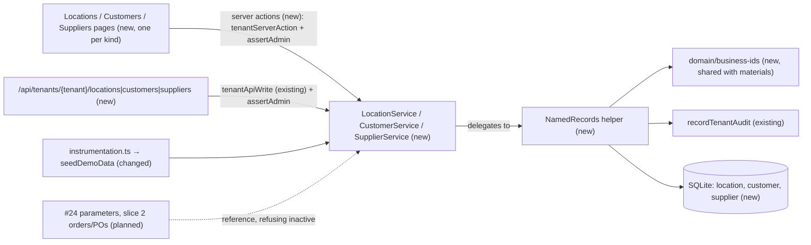
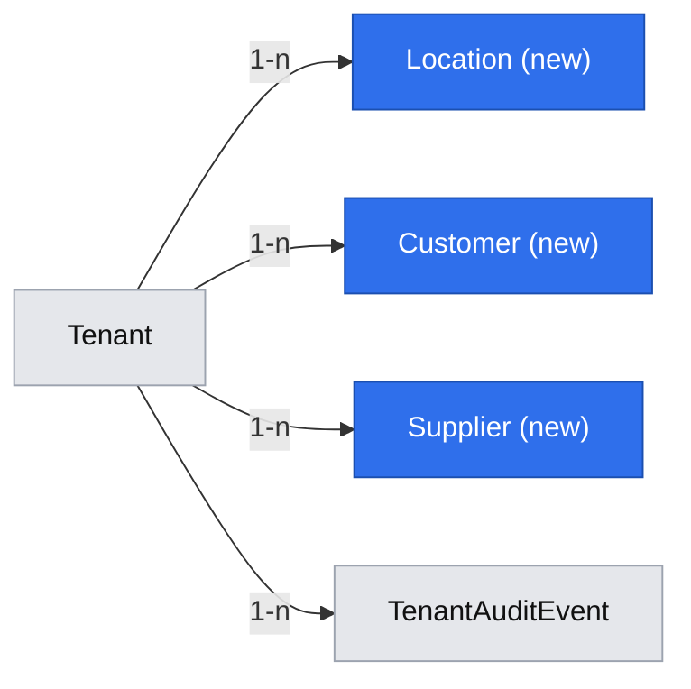
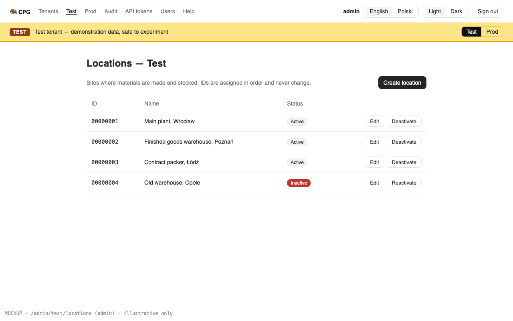
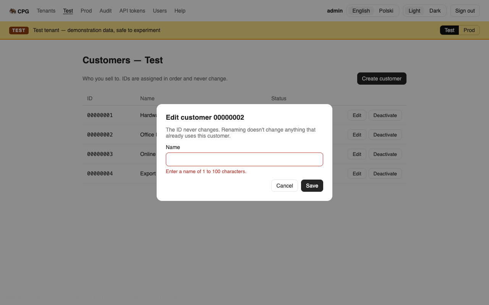
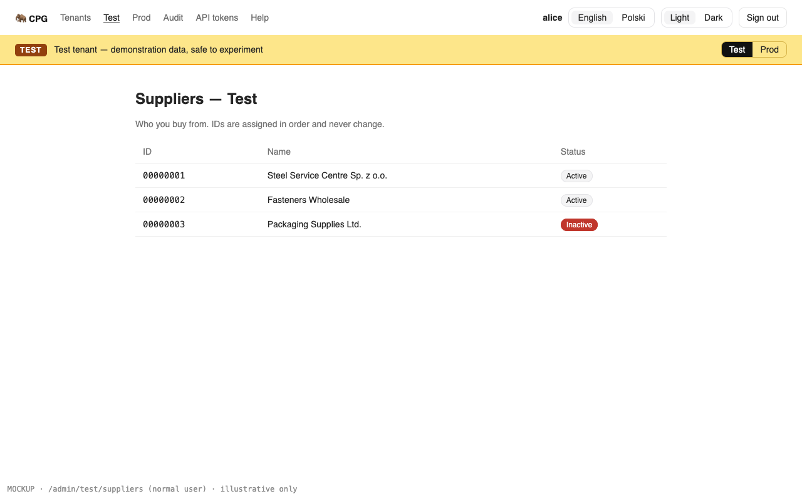

# The admin maintains locations, customers and suppliers, and every user can view them

**Status:** ready
**Created:** 2026-10-19 20:14 UTC
**Issue:** #23 (E03-S02), epic #11 · **Builds on:** `2026-10-19--1858UTC-materials.md` (#22: the sequential ID rule, the tenant list-page pattern, `ConfirmDialog`, `CrudForm` initial values, the startup seed), `2026-10-19--0913UTC-test-prod-tenants.md` (#19), `implemented/2026-10-19--1050UTC-audit-log.md` (#20), `implemented/2026-10-19--1548UTC-api-idempotency.md` (#21) · **Design authority:** `.ai/specs/product-brief.md` (R05, R07, R08, D04–D06), `.ai/specs/research/CPG-prd001.pdf` §02 and §05, `CPG-prd-datamodel.pdf` (Location; Customer / supplier), `CPG-prd-decisions.pdf` §01 (Material/location deactivation; Supplier/customer deactivation), `CPG-acceptance.md` (TEN-001, TEN-004, TEN-012, TEN-014, LFC-019…021, LFC-023, MAT-029, AUD-001…003, API-010, API-029)

## 📝 TLDR

Planning parameters, safety stock, orders and purchase orders all point at a location, a customer or a supplier, and CPG has none of the three yet. This spec proposes that the admin creates them in each tenant, renames them, and deactivates or reactivates them. Each record has an eight-digit ID that the server assigns in sequence per tenant and per kind, a name and an active flag. Every signed-in user can view them, in the UI and through the API. An inactive record stays readable and listed. The stories that first store a reference to one refuse an inactive one, as they do for materials. The guards that block deactivation (stock, open documents) are slice 2's. The Test tenant is seeded with demonstration records.

## Resolved assumptions (autonomous defaults)

| # | Question | Chosen answer | Rationale |
|---|---|---|---|
| Q1 | Split into three specs (locations, customers, suppliers)? | No. One story, one spec, one shared implementation. | Each kind could ship alone, but all three have exactly the same shape (ID, name, active flag) and the same rules. Three specs would review the same design three times, and the issue's acceptance criteria cover all three together. |
| Q2 | What is a location's, customer's or supplier's ID? | Server-assigned, eight digits, zero-padded and sequential from `00000001`, like a material's (R01). Each kind and each tenant has its own sequence: Location 00000001, Customer 00000001 and Supplier 00000001 are three different records. The ID never changes and is never reused (records are never deleted). It appears in the UI, the API paths, the audit and, later, the import. **⚠ NEEDS HUMAN CONFIRMATION**, accepted as the default (owner's instruction, 2026-10-19: proceed with reasonable assumptions). | The PRD only says each has "a tenant-unique ID". The PRD (§05) and the decision register both describe a full Test reset that "restarts **all** Test business IDs from 00000001", and an import of "master data" in which a blank ID creates a record. Both only make sense for server-assigned sequences, so this reuses the material rule and its code (D04). The alternative, a code the admin types (`WRO-1`, `ACME`), is friendlier for locations, but it is a different contract. IDs fixed in API paths and imports are costly to change once handed out. |
| Q3 | Name rules? | Trimmed, 1–100 characters, not unique within its kind. | The PRD gives a name and no rules (D04). The ID tells two records with the same name apart. Adding a uniqueness rule later would need a check for duplicates already stored, so it stays a reversible call before the import (#27) exists. |
| Q4 | Three tables or one "party" table with a kind column? | Three tables (`location`, `customer`, `supplier`) with the same columns. | Later documents hold typed references: a purchase order points at a supplier and a location, a customer order at a customer. Separate tables let the database and MikroORM enforce that. A kind column couldn't stop a PO from pointing at a customer. Locations aren't business partners anyway. |
| Q5 | Deactivation now, and what does "cannot be picked for new entries" (LFC-019, MAT-029) mean before any entry exists? | An audited `active` flag the admin toggles, with no guards yet (out of scope per #23). Nothing in this story picks a location, customer or supplier, so the "no new references" rule ships with the first story that stores one: #24 (planning parameters, safety stock) for locations, and slice 2's orders and POs for customers and suppliers. That story adds one check per referenced kind, for materials too (`…_INACTIVE`, 409). Existing references stay valid after deactivation (LFC-020, LFC-021). | This is the materials story's call (materials spec Q7: no guard until something references a material). The engineering standards say YAGNI: a `requireActive` with no caller would be untested in use, and it would be a second mechanism next to whatever materials get. In this story the rule is visible only as the Inactive status. That narrows how #23's second acceptance criterion is shown, so it was flagged. **⚠ NEEDS HUMAN CONFIRMATION**, accepted as the default (owner's instruction, 2026-10-19). |
| Q6 | Which screens? | One list page per kind: `/admin/[tenant]/locations`, `/customers` and `/suppliers`. There is no detail page: a record has only a name and a flag. The admin gets **Create**, plus per-row **Edit** (name) and **Deactivate**/**Reactivate** (with a confirmation). Every signed-in account opens the pages, but only the admin sees the controls. The tenant home links to all three. | The record is too small for its own page. Row actions keep the screen to one table. They follow the users list's row actions (`components/users/users-table.tsx`) and the materials `ConfirmDialog` (#22). |
| Q7 | API parity (R07)? | Yes, in this story. Per kind: `GET` and `POST /api/tenants/{tenant}/{kind}`, and `GET` and `PATCH …/{kind}/{id}`, where `{kind}` is `locations`, `customers` or `suppliers`. Writes go through `tenantApiWrite` (idempotency key, generation) and are admin-only (API-010). The 12 routes are added to `BACKWARD_COMPATIBILITY.md` §4. | Every operation needs its API equivalent, and the write pipeline exists (#21). The path names are the PRD's terms. Brief Q04 (PRD vs standards terms) has no competing term for these three, so the names don't depend on its outcome. |
| Q8 | Demo data (D06, TEN-001)? | At every server start, after the migrations, each kind that Test has none of gets a fixed list: three locations, four customers and three suppliers. Not audited, same as the demo materials (materials spec Q9, accepted). Prod is never touched. | The same mechanism as materials (`seedDemoData`), one more call per kind. Each kind seeds independently, so an existing database that already has demo materials gains the new kinds on its next start. |
| Q9 | How much code is shared between the three kinds? | Composition, not inheritance. One `NamedRecords` helper in `core` implements the rules once for a `NamedRecordKind` descriptor (the entity, the audit names, the error codes, the demo list). Three small services (`LocationService`, `CustomerService`, `SupplierService`) each hold one helper and delegate to it. There is also one entity-properties helper in `db` and one set of generic list components in `app`. Each kind keeps its own entity, service, routes, actions, page, strings and help topic. The material ID helper is generalized into `domain/business-ids/sequential-id.ts`, and materials keep their behaviour and error code. | Three copies of the same service, table and dialogs would drift. The standards prefer "small services and functions composed together over base classes with template methods". Each service stays the owner of its entity, and is where slice 2 adds its kind's deactivation guards. Tenant entry points (routes, pages, actions) must call `tenantScope` themselves (`tests/tenant-entry-points.test.ts`), so they stay per kind and stay thin. |

Q2 needs the owner's confirmation before **any** part of the implementation merges, not only before the spec PR. Phase 1 can ship alone, and its startup seed would write eight-digit IDs into production's Test tenant at the next deploy. On 2026-10-19 the owner told the run to proceed on reasonable assumptions without asking, so Q2 stands as the accepted default. Q5 narrows how one of #23's acceptance criteria is shown: "cannot be picked" becomes observable only once something picks these records. It follows materials' precedent and, on the same instruction, stands as the accepted default. Both can still be overridden before merge. Every other default is reversible and weakens no rule.

## 📝 Problem Statement

Slice 1 includes every master (D05). The PRD's data model lists a **Location** ("physical production and stock site with active flag") and a **Customer / supplier** ("each has tenant-unique ID/name and active flag; historical open orders allowed after deactivation but no new orders"). Material-location parameters and safety stock (#24) need locations. In slice 2, customer orders need customers and a location, and purchase orders need suppliers and a location. Only the admin maintains master data; normal users read it (PRD §05, TEN-004). Test and Prod are isolated: same IDs in both are unrelated records, and no reference crosses tenants (R05, TEN-012, TEN-014). Every create and edit is audited with before and after values (R08, AUD-001…003). Test starts with demonstration records (TEN-001, D06).

## 📝 Proposed Solution

- **Three tenant-owned entities, one shape.** `Location`, `Customer` and `Supplier` each have an internal UUID, a `code` (the eight-digit business ID), a `name`, an `active` flag, `createdAt` and an optimistic-lock `version`.
- **One shared helper, three services.** The `NamedRecords` helper implements the rules:
  - `list` and `get`;
  - `create`, which assigns the next ID in the write's transaction (the standards' sequential-ID rule);
  - `update`, which renames and/or (de)activates at a version;
  - `seedDemo`.

  Each service builds the helper from its kind's descriptor (entity, audit names, error codes, demo list) and delegates to it. Every write records its tenant audit entry in the same transaction.
- **Screens and API**, one set per kind and thin. Each route, page and action resolves its tenant itself and calls its own service. The table, the dialogs and the row controls are shared generic components, fed the kind's strings.
- **Racing creates** converge as they already do for materials: `tenantServerAction` and `IdempotencyService` retry a stale snapshot once. The unique index `(tenant, code)` is the backstop.
- **Demo data.** `seedDemoData` also seeds each kind (Q8).

**Alternatives considered:**
- **One `party` table with a kind**, rejected per Q4.
- **Admin-typed codes**, rejected per Q2 (pending confirmation).
- **A detail page per record**, rejected per Q6.
- **Three hand-written services**, rejected per Q9.

**Market check.**
- **ERPNext** keeps Warehouse, Customer and Supplier as separate doctypes. Each has a naming series (server-assigned, `CUST-00001`) or a typed name, and a `disabled` flag. A disabled customer can't be selected on new transactions, while existing ones stay valid.
- **Odoo** merges customers and suppliers into one `res.partner` with an `active` flag. That works because Odoo partners carry addresses, contacts and roles. CPG's records carry none of that, so the merge buys nothing and loses typed references (Q4).

Both products treat "inactive" as "hidden from new selections, history intact", which is MAT-029 and LFC-020/021. Both have far more fields (addresses, tax IDs, payment terms), and CPG skips all of them (N01, N06, D04).

## 📝 Architecture

- **`db`:**
  - `entities/named-records/named-record-properties.ts`: the shared property set and the `(tenant, code)` unique, so the three entities can't drift. It also exports the types `core` needs to handle any of the three without casts: a `NamedRecordRow` shape and a `NamedRecordEntity` alias (the union of the three entity handles). `core` can't import `@mikro-orm/*` (ESLint).
  - `entities/locations/location.entity.ts`, `entities/customers/customer.entity.ts`, `entities/suppliers/supplier.entity.ts`, each `tenantOwned()`;
  - one migration: `locations_customers_suppliers`, with a working `down()`.
- **`core`:**
  - `domain/business-ids/sequential-id.ts`: `formatSequentialId(n)` and `nextSequentialId(highest, exhausted: { code, message })`. `domain/materials/material-code.ts` delegates to it, keeping `MATERIAL_IDS_EXHAUSTED` and its message.
  - `domain/locations/demo-locations.ts`, `domain/customers/demo-customers.ts`, `domain/suppliers/demo-suppliers.ts`: the fixed seed lists (pure data).
  - `validators/business-ids/business-id.schema.ts`: `businessIdSchema` (`^\d{8}$`), moved from `materialIdSchema`, which becomes a re-export. It sits beside `domain/business-ids/`, as the shared quantities code sits beside its users.
  - `validators/named-records/`:
    - `named-record-create.schema.ts`: `{ name }`, trimmed, 1–100 characters;
    - `named-record-update.schema.ts`: `{ version, name?, active? }`, at least one field, and an `id` in the body refused with "A record's ID can't be changed."
  - `services/named-records/named-records.ts`: the `NamedRecords` helper and the `NamedRecordKind` descriptor type. It is a cross-cutting helper like `services/audit/audit-recorder.ts`: no DI binding and no entity of its own.
  - `services/locations/location.service.ts`, `services/customers/customer.service.ts` and `services/suppliers/supplier.service.ts`, each about 20 lines: the kind's descriptor, a `NamedRecords` built from `em`, and five delegating methods.
  - `demo-data.ts`: `seedDemoData` seeds every kind, each in its own transaction with its own `try`/`catch`. It returns a per-kind result, `{ seeded: number } | { error: unknown }`.
  - `container.ts`, `cradle.ts` and `index.ts`: one line per service.
- **`app`:**
  - per kind:
    - `app/admin/[tenant]/{locations,customers,suppliers}/{page.tsx,actions.ts}`;
    - `app/api/tenants/[tenant]/{locations,customers,suppliers}/route.ts` and `…/[id]/route.ts`;
  - `components/named-records/`: `named-records-table.tsx` (with the row controls, like `components/users/users-table.tsx`), `create-named-record-dialog.tsx`, `named-record-controls.tsx` (Edit and Deactivate/Reactivate) and `labels.ts`. They receive the kind's strings and the server actions as props, so they never import a kind. The server-rendered table binds each row's update action to its ID and version;
  - `fill`, `TenantContext` and `errorFormatter` move from `components/materials/labels.ts` to a shared `components/forms/` module, and both concepts import them from there;
  - the tenant home links to the three pages;
  - English and Polish strings, including the 12 audit action labels (`audit.actions` in `en.ts`/`pl.ts`), and three help topics;
  - `instrumentation.ts` logs each kind's seed count or error, and still starts on any error.

The only change to existing behaviour is internal: materials take their next ID and their ID schema from the shared code, with the same output and errors. Everything else is additive. Later stories reference these entities through their services.

## 📝 Data Model

The same columns in `location`, `customer` and `supplier`:

| Field | Type | Notes |
|---|---|---|
| `id` | uuid, PK | Internal only; never in an API response |
| `tenant` | FK → `tenant` | `tenantOwned()`; filled on create |
| `code` | string(8) | `"00000001"`…; unique with `tenant`; never changes |
| `name` | string(100) | Trimmed, non-empty, not unique (Q3) |
| `active` | boolean, default `true` | Q5 |
| `createdAt` | datetime | |
| `version` | integer, `.version()` | Optimistic lock (AUD-024, API-029) |

Indexes: `(tenant, code)` unique on each table. Nothing is ever deleted. No other column: addresses, contacts and prices are not in the baseline (N01, N06, D04).

## 📝 API Contracts

`{kind}` is `locations`, `customers` or `suppliers`. All paths are under `/api/tenants/{tenant}` and run in that tenant's scope. Reads accept a bearer token or the session cookie (any signed-in account). Writes use `tenantApiWrite` with `authorize: assertAdmin`:
- bearer only (401);
- admin only (403 `FORBIDDEN`, API-010);
- `Idempotency-Key` required;
- `Dataset-Generation` required for Test (428/409).

A record in a path is its eight-digit ID; anything else is 404 `LOCATION_NOT_FOUND` / `CUSTOMER_NOT_FOUND` / `SUPPLIER_NOT_FOUND`.

| Method and path | Body | Success | Errors (besides the pipeline's) |
|---|---|---|---|
| `GET /{kind}` | — | `NamedRecord[]` by ID | — |
| `POST /{kind}` | `{ name }` | 200 `NamedRecord` with its new `id` | `VALIDATION_FAILED` (name missing, blank or over 100). A create racing another one is retried and gets the next ID |
| `GET /{kind}/{id}` | — | `NamedRecord` | `…_NOT_FOUND` |
| `PATCH /{kind}/{id}` | `{ version, name?, active? }`, at least one field | `NamedRecord` | `VALIDATION_FAILED` (including any `id` in the body); `VERSION_CONFLICT`; `…_NOT_FOUND` |

`NamedRecord`: `{ id: "00000001", name, active, createdAt, version }`.

The three services (core), each delegating to `NamedRecords`. Every write takes `actor: AuditActor` and runs in one transaction with its audit entry. With `{entity}` = `Location`/`Customer`/`Supplier` and `{concept}.{entity}` = `locations.location`, `customers.customer` or `suppliers.supplier`:
- `list()`, `get(id)`.
- `create({ name }, actor)`: code = the kind's highest + 1 in this tenant. Records `{concept}.{entity}.created`, snapshot `{ id, name, active }`, subject `{ type: "{entity}", id: <code>, label: "<code> — <name>" }`.
- `update(id, { name?, active? }, version, actor)`:
  - compares `version` with a fresh read;
  - counts a field as changed only when its trimmed value differs; with no change, nothing is written or recorded and the version is kept;
  - a changed name records `{concept}.{entity}.updated` (`{ name }` before and after);
  - a changed `active` records `{concept}.{entity}.deactivated` or `.reactivated` (AUD-003);
  - a request changing both records both entries.
- `get(id)` of an ID this tenant doesn't have, including another tenant's, is `{ENTITY}_NOT_FOUND` (TEN-014).
- `seedDemo()`: creates the kind's demo list when this tenant has none of that kind, and returns how many.

Server actions, one `actions.ts` per kind. Each has `create{Entity}` and `update{Entity}`, as a `tenantServerAction` bound to the page's tenant and generation (and to the record's ID and version for an update). Each calls `assertAdmin` on the session read before the transaction and revalidates the page on success or on `VERSION_CONFLICT`.

## 📝 UI/UX

- **Tenant home** (`/admin/[tenant]`): the links row becomes Materials, Locations, Customers, Suppliers, then the tenant audit.
- **`/admin/[tenant]/locations`** (and likewise `customers` and `suppliers`), titled "Locations — Test":
  - An intro line. For locations: "Sites where materials are made and stocked." For customers: "Who you sell to." For suppliers: "Who you buy from."
  - A `DataTable`: ID (monospaced), Name (wraps, `wrap-anywhere`), Status (Active / Inactive badge). Ordered by ID. Inactive rows stay listed.
  - For the admin:
    - **Create location** opens a `CrudForm` dialog with one field, Name. On success the dialog closes and the new row shows its ID.
    - Per row, **Edit** opens the same form prefilled.
    - Per row, **Deactivate** or **Reactivate** asks for confirmation through `ConfirmDialog`: "An inactive location stays readable, and nothing that already uses it changes, but it can't be picked for new entries."
  - The empty state: "No locations in Test yet." For the admin it adds "Create the first one."
  - Row actions stay in view at 390 px (lesson: shadcn cells never wrap).
- **Normal users** see the three pages without Create, Edit, Deactivate or Reactivate (TEN-004). Hiding the controls is cosmetic: every action and route checks `assertAdmin`.
- Translations in English and Polish. Three help topics, "Locations", "Customers" and "Suppliers", one per route (`tests/every-page-has-help.test.ts`).

Prototype: `.ai/specs/assets/locations-customers-suppliers/` holds static mockups. They are illustrative only; the shadcn components decide the final look.
- `current-01-tenant-home.png`: today's Test home, with only the Materials and audit links.
- `mockup-01-locations-list.png`: the Test locations list as the admin, one row inactive.
- `mockup-02-edit-customer.png`: the Edit customer dialog with a field error.
- `mockup-03-suppliers-normal-user.png`: the suppliers list as a normal user, with no controls.

## 📝 Edge Cases & Failure Scenarios

| Case | Behaviour |
|---|---|
| Two creates of the same kind in one tenant at the same moment (a page and the API) | The later write meets SQLite's stale-snapshot refusal. Its wrapper (`tenantServerAction` or `IdempotencyService`) retries it once, and it gets the next ID. The unique index maps anything that slips past to `CONFLICT`: "Another location was created at the same moment. Try again." |
| Creates of different kinds at the same moment | Independent sequences. Both may get 00000001 and both are correct (Q2). |
| A create in Prod while Test has records | Prod's next ID follows Prod only. Test's Location 00000001 and Prod's are unrelated (TEN-012). |
| A Test request naming a Prod-only ID (`GET`, `PATCH`) | `…_NOT_FOUND`, no write (TEN-014). |
| Deactivating an already inactive record, or renaming to the same name with surrounding spaces | No change: succeeds, records nothing, keeps the version. |
| An edit from a page loaded before someone else's edit (including a deactivation in another tab) | `VERSION_CONFLICT`; the page refreshes with the newer values (AUD-024, API-029). |
| A body that sets `id` | `VALIDATION_FAILED` on `id`: "A record's ID can't be changed." |
| A body with no `name` and no `active`, or only unknown keys | `VALIDATION_FAILED` on `changes`: "Send at least one of name or active." |
| A name of 101 characters, only spaces, or not a string | `VALIDATION_FAILED` on `name` |
| A normal user's token calls `POST` or `PATCH` | 403 `FORBIDDEN`, checked before the key and the body (API-010) |
| The seed runs where Test already has locations but no customers | Only customers and suppliers are seeded (each kind independently, Q8). Prod gets nothing (TEN-001). |
| One kind's seed fails at startup | Each kind is seeded in its own transaction with its own `catch`, so the other kinds are still seeded. The failure is logged per kind and the server still starts, as with materials; the next start retries only the kinds still empty. |
| A kind reaches 99,999,999 records | `LOCATION_IDS_EXHAUSTED` (and so on), as materials do. Not reachable in practice. |

## 📝 Risks & Impact Review

- **Schema.** Three new tables, no change to existing ones. Reverting means a revert plus a migration that drops them, and records created in the meantime are lost.
- **The ID format (Q2) is hard to change later.** Once IDs appear in API clients, imports (#27) and documents (slice 2), switching to admin-typed codes would mean migrating every reference. This is why Q2 is flagged.
- **Shared materials code.** `nextMaterialCode` now delegates to the shared helper. Its unit tests stay unchanged and must pass as they are, which proves that materials behave the same.
- **Parallel stories.** #24 (planning parameters) adds the first location and material references. Its spec must refuse inactive ones for new entries (Q5). #25 (read-only) wraps these write paths like the materials ones. #27 (import) reuses `create`/`update` and the blank-ID-creates rule. Whichever of #23 and #24 merges later regenerates its migration on `main`.
- **Seed on deploy.** The next deploy seeds production's Test tenant with the three kinds, as D06 wants. Prod is never touched.
- **No pagination.** `DataTable` has none. The demo has 3–4 records per kind, and pagination arrives with the first list that needs it.

## 📝 Decisions in play

- **R05** (tenant isolation): three tenant-owned entities, read and written only in the scope (TEN-012, TEN-014).
- **R07** (API parity, idempotency, generation): Q7.
- **R08** (audit): every create, rename and (de)activation, with before and after. The seed is unaudited (Q8, as materials Q9).
- **D04** (simplest consistent behaviour): Q2, Q3, Q5, Q6.
- **D05** (every master in slice 1): this story.
- **D06** (demo data now): Q8.
- **Brief Q04** (PRD terms in code): not affected. `locations`, `customers` and `suppliers` are the PRD's terms, and the standards name no alternative.
- **Decision register "Supplier/customer deactivation" and "Material/location deactivation"**: the "no new references" half ships with the first story that stores a reference (Q5). The blocking half (stock, open documents) is slice 2's, out of scope per #23.

Nothing is superseded. Q2 extends R01's format to these three masters. It does not change R01.

## 📋 Phasing

- **Phase 1: the masters in core.** Entities, migration, the shared sequential-ID helper, validators, the `NamedRecords` helper and the three services, and the startup seed, all unit-tested against SQLite. It can ship alone once Q2 is confirmed: Test gains demo records nobody can see yet.
- **Phase 2: the API.** The 12 routes, with integration tests. It can ship alone: the masters are maintainable through the API.
- **Phase 3: the screens.** The generic components, three pages and actions, the tenant-home links, translations, help and integration tests.

## 📋 Implementation Plan

### Phase 1: the masters in core

1. **Shared sequential IDs.** Add `core/src/domain/business-ids/sequential-id.ts` (`formatSequentialId`, `nextSequentialId(highest, exhausted: { code, message })`). `material-code.ts` delegates to it.
   - Unit tests: 1 → `"00000001"`; `"00000041"` → `"00000042"`; the ceiling throws the given code and message.
   - The existing `material-code` tests pass unchanged.
2. **Schema.**
   - `entities/named-records/named-record-properties.ts` (the properties, the unique, and the `NamedRecordRow`/`NamedRecordEntity` types), plus the three entities with `tenantOwned()`, added to `entities/index.ts`.
   - Run `npm run db:migration:create -- locations_customers_suppliers`, and commit the migration, the snapshot and the index unedited.
   - Before going further, run a typecheck spike: a `core` function that runs `em.find`, `em.create` and `em.count` on a `NamedRecordEntity`. It must compile with no cast. If MikroORM's generics refuse the union, the fallback is a typed `entity` field in each descriptor, written as a generic `NamedRecordKind<E>`.
   - Tests:
     - `tests/tenant-ownership.test.ts` passes unchanged;
     - the migration list in `packages/db/src/orm.test.ts` gains the new migration, whose up and down run against a real SQLite file (BACKWARD_COMPATIBILITY §1);
     - a migration test checks the three unique indexes.
3. **Validators.** Add `validators/business-ids/business-id.schema.ts` (moved from materials; `materialIdSchema` re-exports it, and its tests pass unchanged) and `validators/named-records/` (create, and update: at least one field, `id` refused with its message). Unit tests for every rule and message.
4. **`NamedRecords` and the three services.** Register the services in `container.ts` and `cradle.ts`, and export them from `index.ts`. Unit tests on a real SQLite file, in a Test scope and a Prod scope, run for each kind through one parametrized suite:
   - the first create in an empty tenant gets 00000001 and the next one 00000002; kinds and tenants number independently (TEN-012);
   - two ORMs racing a create through `tenantServerAction` both succeed with consecutive IDs; the unique-index backstop maps to `CONFLICT`;
   - rename by version and `VERSION_CONFLICT`; an edit with no change records nothing; a trimmed equal name is no change; the rename is audited with before and after (AUD-001, AUD-002);
   - deactivate and reactivate are audited as their own actions (AUD-003);
   - a malformed ID, an unknown ID and a Prod ID read from Test are all `…_NOT_FOUND` (TEN-014);
   - `seedDemo` creates the kind's list with consecutive IDs, and nothing on the second run.
5. **Startup seed.** `seedDemoData` returns `{ materials, locations, customers, suppliers }`, each `{ seeded } | { error }`, and seeds each kind in its own transaction with its own `catch`. `instrumentation.ts` logs each count and each error. Its `if (seeded)` check is rewritten for the object.
   - Unit tests:
     - only Test is seeded;
     - the seed is idempotent per kind;
     - a kind already present doesn't stop the others;
     - a kind that fails (its service stubbed to throw) is reported as `{ error }` while the others are still seeded;
     - `instrumentation` logs that failure and still starts.

### Phase 2: the API

6. **Routes.** Add `app/api/tenants/[tenant]/{locations,customers,suppliers}/route.ts` and `[id]/route.ts`. Reads use `requireApiUser`; writes use `tenantApiWrite(…, { authorize: assertAdmin })` and `apiActor(caller)`.
   - Unit tests, with `@cpg/core` mocked: the route calls its kind's service with the path's ID and the parsed body, passes `assertAdmin` as `authorize`, and rejects an invalid body through the shared schema. Not-found behaviour is tested in the service (step 4) and the integration tests (step 7), not against a mock.
   - `tests/api-writes.test.ts` and `tests/tenant-entry-points.test.ts` pass with the new routes.
   - In `BACKWARD_COMPATIBILITY.md` §4, add:
     - the three page URLs;
     - the 12 API routes with their error codes;
     - the three help topic IDs;
     - the three new kinds in the **Versions** paragraph.
   - The implementation PR is `risk-high` and its body carries the migration's rollback note (§1).
7. **API integration tests** (`tests/integration/named-records-api.test.ts`), for each kind:
   - an admin token creates in Prod and gets consecutive IDs, and a replay with the same key returns the same record;
   - Test without `Dataset-Generation` is 428;
   - a stale `version` on `PATCH` is 409 (API-029);
   - deactivation shows `active: false`;
   - a normal user's token reads, but gets 403 on `POST` (API-010).

### Phase 3: the screens

8. **Generic components.** First move `fill`, `TenantContext` and `errorFormatter` out of `components/materials/labels.ts` into a shared module; the materials tests pass unchanged. Then add `components/named-records/` (table with row controls, create dialog, labels), reusing `DataTable`, `CrudForm` (with `initialValues`) and `ConfirmDialog`.
   - Unit tests: admin and normal-user controls, the empty state, the Inactive badge, the confirmation text, translated field errors, and revalidation after `VERSION_CONFLICT`.
9. **Actions and pages per kind.** The three `actions.ts` files and `page.tsx` files (`requireUser()` inside `<Suspense>`, `tenantScope`, not-found for an unknown tenant), the tenant-home links, English and Polish strings (the 12 audit action labels included), and three help topics.
   - Action unit tests: the admin succeeds; a normal user gets `FORBIDDEN`; a signed-out user gets `UNAUTHORIZED`; a stale generation is refused.
   - Page unit tests: the heading and the controls by role.
10. **Screen integration tests** (`tests/integration/named-records.test.ts`), scoped to the records the file creates:
    - Test shows the demo locations, customers and suppliers (TEN-001);
    - two locations created in Prod get consecutive Prod IDs;
    - creating a customer without a name shows the field error;
    - renaming a supplier shows "Supplier renamed" with before and after in the tenant audit (AUD-002);
    - deactivating a location shows Inactive and its own audit entry, and reactivating it restores Active (AUD-003, LFC-019);
    - a normal user sees the three lists without any control (TEN-004);
    - row actions stay in view at 390 px.

    Then the full gate: lint, typecheck, `test:coverage` (100%), build, `test:integration`. No new package dependency is expected.
