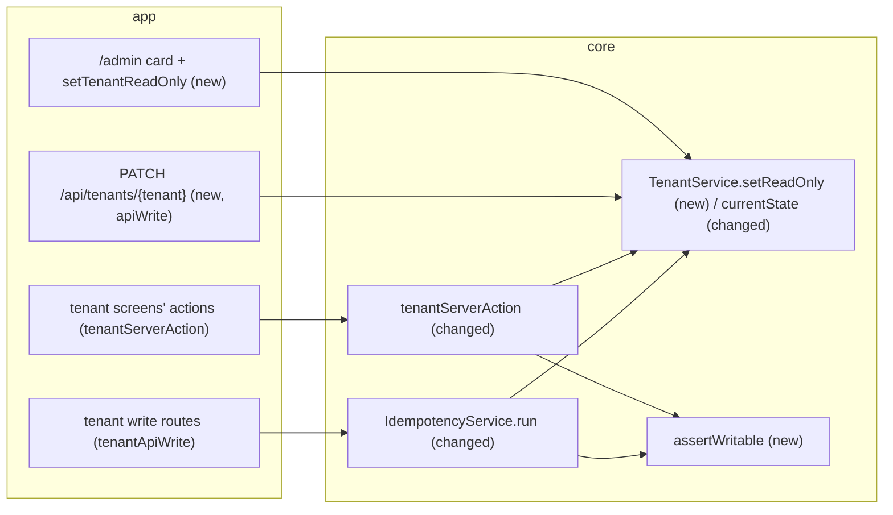

# The admin can make a tenant read-only, which stops every business write, the admin's and the API's included

**Status:** ready
**Created:** 2026-10-19 20:18 UTC
**Issue:** #25 (E02-S04), epic #10 · **Builds on:** `2026-10-19--0913UTC-test-prod-tenants.md` (#19), `implemented/2026-10-19--1050UTC-audit-log.md` (#20), `implemented/2026-10-19--1548UTC-api-idempotency.md` (#21), `2026-10-19--1858UTC-materials.md` (#22) · **Design authority:** `.ai/specs/product-brief.md` (R05, R07, R08, D05), `.ai/specs/research/CPG-prd001.pdf` §05 ("Tenant read-only control", "Read-only gate and global exceptions"), `CPG-prd-decisions.pdf` (A-01), `CPG-acceptance.md` (TEN-015…018, TEN-020, TEN-021, API-030, AUD-016)

## 📝 TLDR

Today nothing stops a write to Prod: the admin and any admin token can change its materials at any time. This spec proposes an admin-set **read-only flag** on each tenant. While a tenant is read-only, the server refuses every business write to it, from the screens and from the API, whoever makes it (409 `TENANT_READ_ONLY`). Reading its data and audit, account work (users, tokens, preferences, sign-in) and the flag itself keep working. Test and Prod have independent flags. Each change of a flag is recorded in the Global audit with its before and after value.

## Resolved assumptions (autonomous defaults)

| # | Question | Chosen answer | Rationale |
|---|---|---|---|
| Q1 | Split the issue (flag and toggle vs the gate)? | No. One story, one spec. | A flag nobody enforces and a gate nobody can switch on are both useless alone. The issue's acceptance criteria cover both. |
| Q2 | Where is the write refused? | In the two tenant write wrappers every tenant write already goes through: `tenantServerAction` (screens) and `IdempotencyService.run` behind `tenantApiWrite` (API). Each reads the tenant fresh **inside the write's transaction**, next to the dataset-generation check, and refuses before the handler runs. `tests/tenant-entry-points.test.ts` and `tests/api-writes.test.ts` already make those wrappers the only way to write tenant data from `app`. No check in `@cpg/db`. | One check in the two places that already gate the generation, with no new mechanism. A flush-time guard in `db` would have to query the tenant inside MikroORM's flush hook, and would also block the slice-2 Test reset, which the PRD lets override the flag internally. Reading inside the transaction makes a concurrent toggle safe (Edge Cases). |
| Q3 | What does a refused write answer? | `ConflictError` with code `TENANT_READ_ONLY`, HTTP 409: "Prod is read-only, so its business data can't be changed. The admin can make it writable on the Admin page." Screens show the translated message. A refused write changes nothing and records nothing, no tenant audit entry and no idempotency key. | 409 is what this API already answers when the tenant's state refuses a write (`GENERATION_STALE`), and clients branch on the code. 403 would wrongly say the caller lacks a permission (the admin has every permission). 423 Locked is WebDAV-specific. A new code and status can still change before this ships. Once shipped they are protected (`BACKWARD_COMPATIBILITY.md` §4). |
| Q4 | An API retry of a write that succeeded before the tenant became read-only? | It replays the stored result, `Idempotent-Replayed: true`, and changes nothing. The read-only check sits after the key lookup and before the handler. The generation check stays before the lookup, as today. | A replay writes nothing, so it doesn't break the rule. Refusing it would tell a client whose response was lost that its write failed, when it is in fact stored. |
| Q5 | Where does the admin switch the flag? | On the Global admin page (`/admin`): an admin-only **Read-only** card lists Test and Prod with their state and a "Make read-only" / "Make writable" button behind a confirmation. The server action lives in `app/admin/(global)/actions.ts`. | The flag is global tenant metadata, not tenant data, and the toggle must keep working while the tenant is read-only (PRD §05). A tenant page's action goes through `tenantServerAction`, which would refuse it. `/admin` is already where both tenants are side by side. |
| Q6 | API parity (R07)? | Yes, in this story. `PATCH /api/tenants/{tenant}` with `{ readOnly: boolean }`, admin only (403 otherwise). It is keyed through `apiWrite` in the **global** key store and takes no `Dataset-Generation`. `readOnly` is added to `GET /api/tenants` and `GET /api/tenants/{tenant}`, and the new route goes into `BACKWARD_COMPATIBILITY.md`. | Every UI operation gets its API equivalent. The flag is global, so the key goes in the global store, and no generation precondition applies, because it isn't a Test data write. `tests/api-writes.test.ts` gets one named exception: the tenant's metadata route uses `apiWrite`. |
| Q7 | Does the flag carry a version (optimistic locking)? | No. The request **sets** the flag, it doesn't toggle it: `{ readOnly: true }` sent twice stays true. Setting the current value succeeds, returns the tenant and records nothing. | A set is idempotent and there is a single admin, so a stale copy can't do harm: the worst case is setting the value that is already stored. The confirmation fixes the target value when it opens, as the material Deactivate does. A `version` would add a protected field for no case it prevents. |
| Q8 | How is the change audited (AUD-016)? | `tenants.tenant.read-only-changed` in the Global audit, subject `{ type: "tenant", id: "prod", label: "Prod" }`, before and after `{ readOnly }`, recorded with the change in one transaction. The action ID is the one the #42 hand-off on #25 named. | The PRD puts tenant-flag administration in the Global audit. The standards: one allowlisted snapshot, and a write that changes nothing records nothing. |
| Q9 | What does a read-only tenant's screen show? | Every tenant page's strip adds a **Read-only** label and the sentence "Business data can't be changed." The Global chooser shows a Read-only badge on that tenant. The admin's write controls (Create material, Edit, Deactivate, conversion Add/Change/Remove) are hidden while the tenant is read-only. A page loaded before the flag was set still has them: its write is refused with the translated message, and the page refreshes, so the controls disappear. | TEN-015 asks for a "clear read-only explanation". Hiding controls is not enforcement, the server is; it just doesn't offer what will fail. One message on the strip explains it on every tenant page, so there is no per-screen copy. |
| Q10 | Is the startup demo seed gated? | No. It writes only into an empty Test, which happens on a fresh database before any request, while both flags are still off. | The seed can't meet a read-only tenant today. The slice-2 Test reset defines how system writes override the flag (PRD: "reset temporarily overrides Test data writes internally with exclusive operation lock"). |
| Q11 | TEN-015 asks for a normal user's write. Which one? | None exists yet: every tenant business write today (materials) is admin-only. The gate doesn't look at the role, so a unit test runs the wrapper with a normal user's handler and expects `TENANT_READ_ONLY`. The scenario is **partially verified** until slice 2 brings documents that normal users write. | Building a normal-user write just for this test would be scope creep (D04). |

No assumption needs human confirmation: each one is reversible before merge, and none weakens isolation, a protected contract or an active decision.

## 📝 Problem Statement

R05: "A read-only tenant blocks every business write and new MRP runs, even for the admin and the API." PRD §05 ("Tenant read-only control"): each tenant independently has an admin-set read-only flag. UI and API, admins included, can't change tenant business data or run MRP while it is set. Data, results and audit can still be viewed. Login, personal preferences and tokens, admin user management, changing the flag and the protected Test reset remain available. Decision A-01 restates it. The owner kept read-only flags in slice 1 (D05). Today a tenant has only a code and a dataset generation (`Tenant`), and nothing can stop a write.

## 📝 Proposed Solution

1. **The flag.** `Tenant.readOnly`, a boolean that defaults to false, added by a migration. `TenantInfo` (what pages and the API show) gains `readOnly`.
2. **The toggle.** `TenantService.setReadOnly(code, readOnly, actor)` writes the flag and its Global audit entry in one transaction. It is called by the admin-only server action on `/admin` and by `PATCH /api/tenants/{tenant}`.
3. **The gate.** `TenantService.currentState(code)` replaces `currentGeneration` and returns `{ generation, readOnly }`, read fresh. `assertWritable(state, name)` (`core/src/domain/tenants/read-only.ts`) throws `TENANT_READ_ONLY`. `tenantServerAction` calls it after the generation check. `IdempotencyService` calls it for a tenant write after the key lookup and before the handler.
4. **The screens.** The strip's read-only label, the chooser badge, write controls hidden while read-only, and the refusal translated.

**Alternatives considered.**
- A guard on every flush in `@cpg/db`: the deepest place, but it has to query inside the flush, and it would also stop the Test reset's sanctioned override (Q2).
- A Next.js middleware/proxy check on the URL: it would miss server actions, whose URL is the page's, and could not read the flag in the write's transaction.
- One flag that freezes both tenants: R05 and TEN-021 require independent flags.

## 📝 Architecture

Every tenant business write already passes through one of the two wrappers. Adding the check there covers today's materials and every later tenant write (documents, postings, imports, manual MRP runs) without touching their code.

- **Reused:** `apiWrite`, `serverAction`, `assertAdmin`, `uiActor`/`apiActor`, `recordGlobalAudit`, `ConfirmDialog`, `Badge`, the strip and the error translation (`errorMessage`).
- **Current consumers:** the materials actions and routes, which change only to hide their controls and refresh after a refusal.
- **Future work this depends on:**
  - A scheduled ("automatic") MRP run, if it is ever started outside a request, must call `assertWritable` itself (TEN-019, slice 3).
  - The Test reset must serialize against flag changes and restore the previous flag (TEN-022…027, slice 2).

## 📝 Data Model

`Tenant` (global, keyed by `code`) gains `readOnly: p.boolean().default(false)`, column `read_only`.

- **Migration** `tenant-read-only`: adds the column `not null default false`, so both existing rows become writable. `down()` drops the column. It is additive: the previous release ignores the column (see Risks).
- **Audit snapshot allowlist:** `{ readOnly }` only.
- No new entity. `tests/tenant-ownership.test.ts` is unchanged: `Tenant` is already in `GLOBAL_ENTITIES`.

## 📝 API Contracts

| Route | Change |
|---|---|
| `GET /api/tenants`, `GET /api/tenants/{tenant}` | Each tenant gains `readOnly: boolean`. Additive. |
| `PATCH /api/tenants/{tenant}` (new) | Body `{ readOnly: boolean }`; any other field, or a missing or non-boolean `readOnly`, is 400 `VALIDATION_FAILED`. Admin only: 403 `FORBIDDEN` for a normal user's token, checked before the key and the body. `Idempotency-Key` required (global store), no `Dataset-Generation`. Unknown tenant: 404 `TENANT_NOT_FOUND`. Answers the tenant `{ code, name, generation, readOnly }`. Setting the current value answers the same and records nothing. |
| Every write under `/api/tenants/{tenant}/` | When the tenant is read-only: 409 `TENANT_READ_ONLY`, after the generation check (428/409 keep their precedence) and after a matching key's replay (Q4). Nothing is written and the key stays unused. |

## 📝 UI/UX

- **`/admin` (Global):**
  - The chooser cards show a **Read-only** badge on a read-only tenant, for every user.
  - The admin also sees a **Read-only** card with one row per tenant: its name, its state ("Writable" / "Read-only") and a button.
  - **Make read-only** opens a confirmation: "Make Prod read-only? Nobody, the admin included, can change Prod's business data until it is made writable again. Reading, the audit and account settings keep working." Confirming sets the flag, and the page refreshes.
  - **Make writable** asks the reverse.
  - A failure shows the translated error in the dialog.
- **Tenant pages:** the strip's streamed sentence is followed by a **Read-only** label and "Business data can't be changed." The admin's write controls on the materials list and detail pages are hidden.
- **A stale page:** a write refused with `TENANT_READ_ONLY` shows its translated message in the form or dialog. The page then refreshes (the same revalidation as `VERSION_CONFLICT`), so the strip and the hidden controls catch up.
- **Help:** the `/admin` topic explains the read-only card, and the tenant-home topic explains what a read-only tenant allows. English and Polish.
- All strings in `en.ts`/`pl.ts`.
- **Accessibility:**
  - the label is text, not only colour;
  - the strip's accessible name includes it;
  - the button names the tenant ("Make Prod read-only").

Prototype: `.ai/specs/assets/read-only-tenants/` (static mockups; see the PR's evidence comment).

## 📝 Edge Cases & Failure Scenarios

- **Flag set while a write is in flight.** The write's transaction read the tenant before the toggle committed.
  - Its first write then fails with `SQLITE_BUSY_SNAPSHOT`. Both wrappers already retry once (`retryingStaleSnapshot`, `IdempotencyService.run`), and the retry reads the flag and refuses.
  - If the write had already taken the write lock, the toggle waits for it to commit: the write happened before the flag.
  - Either way no write lands after the flag is committed. A two-ORM unit test proves the first case.
- **Flag cleared while a refused page is open.** The next write succeeds. The page was refreshed after the refusal, so it shows the controls again.
- **Both tenants read-only (TEN-020).** Users, tokens, preferences, sign-in and sign-out are global writes and never reach the gate.
- **Unknown tenant on the toggle.** 404 `TENANT_NOT_FOUND`, the same as every tenant route.
- **Normal user calls the toggle.** 403 `FORBIDDEN` through the API, `FORBIDDEN` through the action. Nothing changes and nothing is audited.
- **Order of refusals.**
  - On a tenant write route: 401 → 403 → key 400 → tenant 404 → body 400 → generation 428/409 → replay → 409 `TENANT_READ_ONLY` → handler (body validation 400, version 409).
  - On a screen, validation errors come first and the admin check runs inside the handler, so a normal user's refused write reads `TENANT_READ_ONLY`, not `FORBIDDEN`. Both say no, and only the admin sees write controls.

## 📝 Risks & Impact Review

- **Rollback:** `kamal rollback` runs the previous image against the migrated database. It ignores `read_only`, so **while rolled back, read-only flags are not enforced**. The flags stay stored and take effect again on redeploy. The PR body carries this note, and the PR is `risk-high` (schema, BACKWARD_COMPATIBILITY §1).
- **Protected surfaces added:**
  - the `readOnly` field;
  - `PATCH /api/tenants/{tenant}`;
  - `TENANT_READ_ONLY` with HTTP 409.

  All are additive. Removing or renaming any of them later needs a deprecation release.
- **Gate coverage depends on the wrapper tests.** A future tenant write that bypassed `tenantServerAction`/`tenantApiWrite` would bypass the flag. The existing repo tests already fail on that for `app`. A background job in `core` (automatic MRP) needs its own call: noted under Architecture.
- **The `api-writes` exception** (the tenant's own metadata route keyed globally) is named in the test, not a pattern match, so it can't silently widen.

## 📝 Decisions in play

- **R05** (owner Piotr12): implemented for the read-only part. New MRP runs are blocked once MRP exists (TEN-019, slice 3).
- **R07** (API parity, idempotency): the toggle has its keyed API equivalent.
- **R08** (audit): the toggle is recorded in the Global audit.
- **D05**: read-only flags are in slice 1.
- No decision is superseded.

## 📋 Phasing

One phase per layer. Each phase leaves the app working: the flag exists and defaults to off before anything reads it.

## 📋 Implementation Plan

### Phase 1 — The flag and the gate in core

1. **Schema.**
   - Add `readOnly` to `Tenant`, then `npm run db:migration:create -- tenant-read-only`. Commit the migration, the snapshot and the index unedited.
   - Tests: the migration's up/down on a real SQLite file (both rows `read_only = 0` after up, and the column is gone after down); `tenant.entity.test.ts` checks the default.
2. **`assertWritable`** (`core/src/domain/tenants/read-only.ts`) and the `TENANT_READ_ONLY` error.
   - Unit tests: a writable tenant passes; a read-only one throws 409 `TENANT_READ_ONLY` naming the tenant.
3. **`TenantService`.**
   - `TenantInfo.readOnly`, and `currentState(code)` replacing `currentGeneration`, with every caller updated.
   - `setReadOnly(code, readOnly, actor)`.
   - Unit tests on a real SQLite file:
     - set and clear, each recorded with before/after (AUD-016);
     - the same value records nothing;
     - the flags are independent (TEN-021);
     - an unknown code is `TENANT_NOT_FOUND`;
     - `currentState` bypasses the identity map.
4. **Validator.** `validators/tenants/tenant-read-only.schema.ts`: `{ readOnly: z.boolean() }`, strict, plus the action's variant with `tenant`. Unit tests for each rule.
5. **The gate.** `tenantServerAction` and `IdempotencyService` call `assertWritable`. Unit tests:
   - a read-only tenant refuses a screen write and an API write, with nothing stored (no material, no tenant audit entry, no key);
   - the admin's and a normal user's handler are both refused (TEN-015, TEN-016);
   - the other tenant still writes (TEN-021);
   - a replay of a key stored before the flag still replays (Q4);
   - a stale generation still wins over read-only;
   - two ORMs: the flag committed between the write's read and its first write ends in `TENANT_READ_ONLY` after the retry.

### Phase 2 — The API

6. **`PATCH /api/tenants/{tenant}`** with `apiWrite(…, { authorize: assertAdmin })` and `apiActor(caller)`. `tests/api-writes.test.ts` names the metadata route as the one `apiWrite` route under `api/tenants/[tenant]/`.
   - Unit tests with `@cpg/core` mocked: the body is parsed with the shared schema, an unknown tenant is 404, and the tenant comes back.
   - `GET` routes return `readOnly`.
   - Add the route, the field and `TENANT_READ_ONLY` to `BACKWARD_COMPATIBILITY.md` §4.
7. **API integration tests** (`tests/integration/read-only-api.test.ts`). The file restores both flags to writable in `afterAll`.
   - An admin token sets Prod read-only; a normal user's token gets 403.
   - A material `POST`/`PATCH` in Prod with the admin token is 409 `TENANT_READ_ONLY`, and the material is unchanged (TEN-017, API-030).
   - A Test write still succeeds (TEN-021).
   - `GET` of materials and the Prod audit work (TEN-018).
   - Users, tokens and preferences writes succeed with both tenants read-only (TEN-020).
   - Global audit shows both changes with before/after (AUD-016).
   - After clearing the flag, the same write succeeds.

### Phase 3 — The screens

8. **Action and controls.**
   - `setTenantReadOnly` in `app/admin/(global)/actions.ts` (`serverAction`, `assertAdmin`, revalidates `/admin` and both tenant trees).
   - `components/tenants/read-only-controls.tsx` (`ConfirmDialog`, target fixed on open) and the `/admin` card and badges.
   - Unit tests: admin vs normal user (no card), the confirmation copy for both directions, an error shown, signed out `UNAUTHORIZED`.
9. **Tenant pages.**
   - The strip's read-only label (`TenantStripText` reads the tenant).
   - The materials pages hide their controls when read-only.
   - The materials actions refresh after `TENANT_READ_ONLY`.
   - The audit action label, the error text, and both help topics, in English and Polish.
   - Unit tests for each state.
10. **Screen integration test** (`tests/integration/read-only.test.ts`). The file restores the flags in `afterAll`.
    - The admin makes Prod read-only from `/admin`. The Prod strip shows Read-only, and Prod's materials page has no Create material button while Test's does.
    - A Prod materials page opened before the flag was set refuses Create with the read-only message (TEN-016's "previously stored values remain").
    - The Global audit lists the change.
    - Making Prod writable restores the button.

Then the full gate: lint, typecheck, `test:coverage` (100%), build, `test:integration`, and `npm audit`. No new dependency is expected. Update the acceptance catalogue's status for the scenarios this story verifies.
