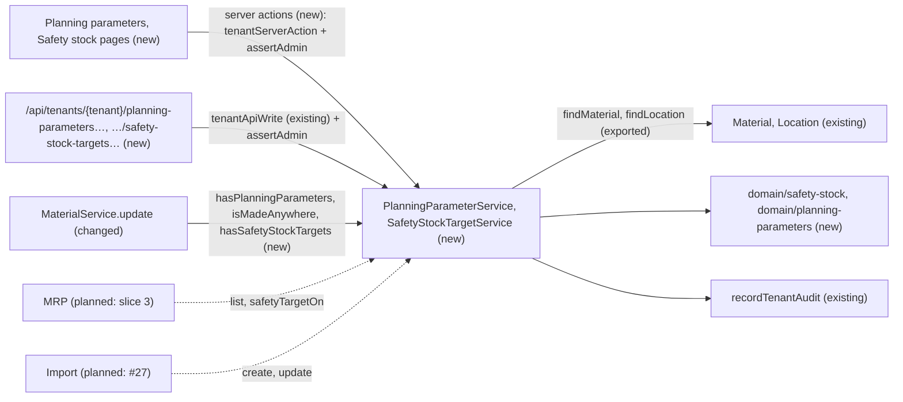
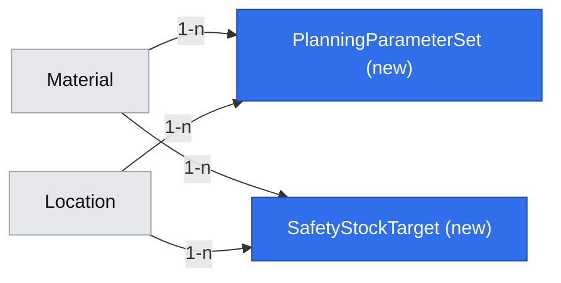
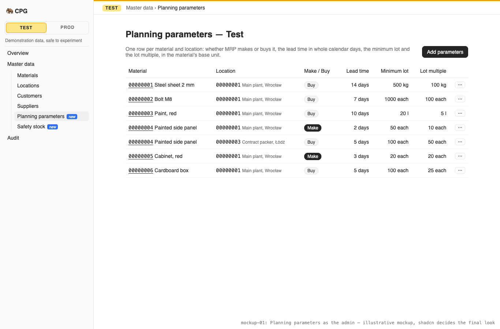
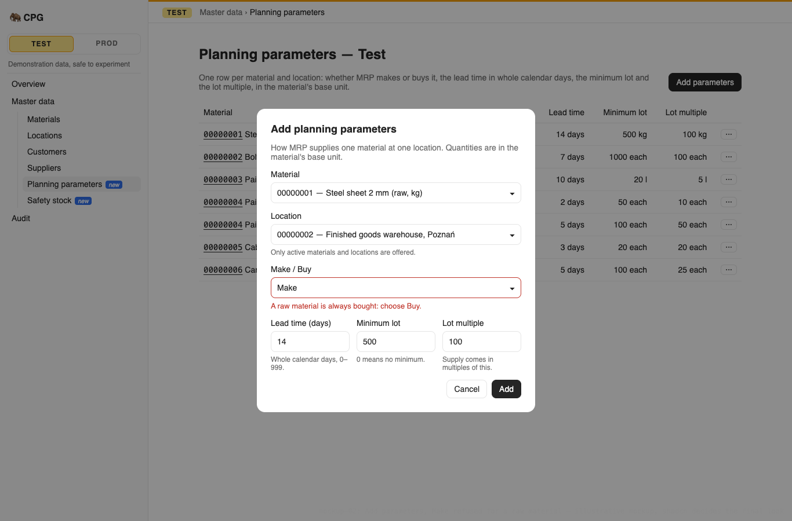
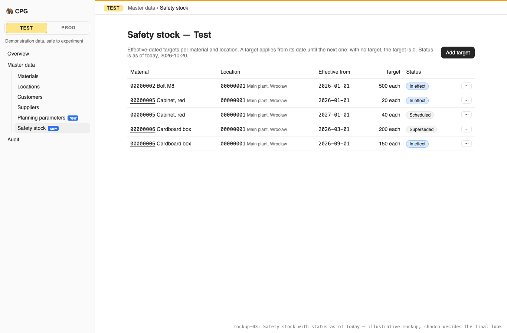

# The admin sets each material's planning parameters per location and its effective-dated safety-stock targets

**Status:** ready
**Created:** 2026-10-20 05:32 UTC
**Issue:** #24 (E03-S03), epic #11 · **Builds on:** `2026-10-19--1858UTC-materials.md` (#22: exact decimals, the material rules, the tenant list-page pattern, the startup seed), `implemented/2026-10-19--2014UTC-locations-customers-suppliers.md` (#23: locations, and its Q5, the "can't be picked once inactive" rule this story ships), `implemented/2026-10-19--2048UTC-sidebar-navigation.md` (#58: the Master data tree), `2026-10-19--2018UTC-read-only-tenants.md` (#25), `implemented/2026-10-19--1548UTC-api-idempotency.md` (#21), `implemented/2026-10-19--1050UTC-audit-log.md` (#20) · **Design authority:** `.ai/specs/product-brief.md` (R02, R03, R05, R07, R08, D05, D06), `.ai/specs/research/CPG-prd001.pdf` §02 ("Locations and planning", "Parameters/precision", "Projection and safety stock"), `CPG-prd-datamodel.pdf` (Material-location parameters; Safety stock target), `CPG-prd-decisions.pdf` §02 (Material-location parameters; Safety targets), `CPG-acceptance.md` (MAT-014…018, MAT-029, DEM-014…017, LFC-019…021, AUD-001…003, API-010, API-029), [mockup 01, the sidebar tree](assets/menu-revamp/01-sidebar-tree/index.html) (its Planning parameters and Safety stock screens, owner-chosen in #58)

## 📝 TLDR

MRP (slice 3) will need to know, for each material at each location, whether it is made or bought, how many whole days that takes, and the minimum and lot multiple a proposal must respect. It will also need the safety stock to keep there, which changes over time. CPG stores none of this yet. This spec proposes two new Master data screens in each tenant, as in the owner's chosen sidebar mockup. **Planning parameters** has one row per material and location: Make or Buy, lead time in whole calendar days, minimum lot and lot multiple, in the material's base unit. A raw material is always Buy. **Safety stock** has targets per material and location, each valid from its date until the next one; with no target the target is zero, and two targets can't share a date. The admin maintains both, every signed-in user reads them, in the UI and through the API, and a new row can't point at an inactive material or location.

## Resolved assumptions (autonomous defaults)

| # | Question | Chosen answer | Rationale |
|---|---|---|---|
| Q1 | Split into two specs (planning parameters, safety stock)? | No. One story, one spec, one PR. | Each could ship alone, but both are keyed by material × location, share the reference rules (Q7) and the screens' pattern, and the issue's acceptance criteria cover both. Two specs would review the same references and screens twice. |
| Q2 | Which screens? | Two tenant list pages under **Master data**, as in mockup 01: `/admin/[tenant]/planning-parameters` and `/admin/[tenant]/safety-stock`, each with one sidebar entry after Suppliers. Admin controls: **Add parameters** / **Add target**, and per row **Change** and **Remove**. The material page doesn't change. | The owner chose mockup 01 (#58), which shows exactly these two screens, and the sidebar spec says "Planning parameters, Safety stock … go into Master data". A flat list is also the shape of the import sheets (#27). A summary on the material page can follow without breaking anything. |
| Q3 | What is stored, and is a partial parameter set allowed? | One `PlanningParameterSet` per material and location with all four values required: Make/Buy, lead time, minimum lot, lot multiple. One `SafetyStockTarget` per material, location and effective-from date. | The data model's "one site-specific parameter set". A set without Make/Buy would be the "missing parameters" case MRP must report (MAT-017), so it is simply absent; the screens never store half of one. |
| Q4 | Value rules? | **Make/Buy:** `make` or `buy`. **Lead time:** whole calendar days, 0–999, a JSON integer (MAT-018). **Minimum lot:** a decimal ≥ 0 (0 means no minimum). **Lot multiple:** a decimal > 0 (`0.000001` means no rounding beyond six decimals). **Safety target:** a decimal ≥ 0 (0 ends a buffer from its date). Every quantity is in the material's base unit: a JSON string with at most 12 integer and 6 fractional digits on input, stored and returned with exactly six decimals (`"10.5"` → `"10.500000"`), the format `toBaseQuantity` gives every base-unit quantity later stories store. Screens show it without trailing zeros. Entering them in another unit is not offered. | R03 and the materials spec's decimal rules. One stored format for every base-unit quantity, so BOM lines (#26) and MRP never compare two spellings of one number. A lot multiple of 0 would need a "no multiple" special case in MRP; any positive multiple, down to the six-decimal step, works with one formula. 999 days is far past the 90-day horizon, so the limit never bites a real lead time. Alternate-unit input would need the `toBaseQuantity` record (entered unit, factor) stored per value: new surface nothing asks for. |
| Q5 | How is "raw is Buy-only" (R02, MAT-014) enforced? | Make for a raw material is refused when a set is added or changed: 400 `VALIDATION_FAILED` on `procurement`, "A raw material is always bought: choose Buy.". Changing a material's type **to raw** while it has a Make set anywhere is refused too: 409 `MATERIAL_MADE_AT_LOCATIONS`. Intermediate and finished materials may be Make or Buy, per location (MAT-015). | Without the second check, editing the material would break the rule the first one keeps. A field error puts the message next to Make/Buy in the form. |
| Q6 | What happens to these quantities when a material's base unit changes? | The base unit can't change while the material has a planning parameter set or a safety-stock target: 409 `BASE_UNIT_IN_USE`. The existing `BASE_UNIT_HAS_CONVERSIONS` is checked first and wins when both apply. `BASE_UNIT_IN_USE` is deliberately generic: BOM lines (#26) will be another reason for it. | The quantities are in the base unit, so keeping them across a change would silently change their meaning: the materials spec's Q8 reasoning. Removing and re-adding a row is the way out. |
| Q7 | What does "an inactive material or location can't be picked for new entries" (MAT-029, LFC-019, locations Q5) mean here? | **Adding** a parameter set or a target for an inactive material is 409 `MATERIAL_INACTIVE`; for an inactive location, 409 `LOCATION_INACTIVE`. Changing or removing an existing row still works, and deactivating a material or location keeps its rows. The add forms offer active materials and locations only. | Locations Q5 committed this story to the check, "one check per referenced kind, for materials too". LFC-019 and MAT-029 block only *future selection* and keep history readable. An existing row is not a new entry: blocking its edit would strand a planner who can't fix a lead time on a site being wound down. |
| Q8 | How is a safety target identified and edited? | By material, location and effective-from date, unique together: a second target on the same date is 409 `SAFETY_STOCK_TARGET_EXISTS` (DEM-017). **Change** sets a new quantity; moving a target to another date is Remove plus Add. Any calendar date is allowed, past or future. The date is stored as ISO text `YYYY-MM-DD`. | The key is the PRD's "material × location × effective-from date". A date in the key that could change would make history and the audit hard to follow. Past dates let the admin record a target already in force. ISO text sorts correctly and has no time zone, unlike a timestamp. |
| Q9 | Where does "with no target it is zero; a target applies from its date until the next" (DEM-014…016) live before MRP exists? | A pure function in `core/src/domain/safety-stock/`: `safetyTargetOn(targets, date)` returns the quantity in force on a date, `"0"` when none is, and `targetStatus(…)` classifies each row as **In effect**, **Scheduled** or **Superseded** on a date. The Safety stock screen shows that status for today. MRP will call the same function. No separate "target on date" API route. | The rule is tested once and used by both. The status column makes it visible end to end. An API route for one date would be new surface no client asks for: the list returns every row, and the rule is documented here. |
| Q10 | Which date is "today" for the status column? | The server's UTC calendar date, as the app already shows dates (`createdAt.toISOString().slice(0, 10)`). | The PRD has no tenant time zone. Only the status label depends on it in this story; MRP's business date is slice 3's decision. |
| Q11 | API parity (R07)? | Yes, in this story: `GET`/`POST /api/tenants/{tenant}/planning-parameters`, `PATCH`/`DELETE …/planning-parameters/{material}/{location}`, `GET`/`POST /api/tenants/{tenant}/safety-stock-targets`, `PATCH`/`DELETE …/safety-stock-targets/{material}/{location}/{effectiveFrom}`. Writes go through `tenantApiWrite` and are admin-only (API-010). Added to `BACKWARD_COMPATIBILITY.md` §4. | Every operation needs its API equivalent, and the paths mirror the two screens. `DELETE` with a `{ version }` body follows the conversions route. |
| Q12 | Demo data (D06, TEN-001)? | Yes. At every start, after the materials and locations seeds, Test gets seven demonstration parameter sets and three targets (the table under Data Model), each kind only when Test has **no row of the kind and no audit entry of the kind**: once anyone has added, changed or removed one, the seed never runs for that kind again. The rows point at the demo IDs, and an entry whose material or location is missing or inactive, or that would be Make on a raw material, is skipped. Not audited, like the other demo records. | D06 is an active decision: Test starts with demonstration records. Unlike materials, these rows can be removed, so "Test has none" alone would bring back rows an admin removed, at the next deploy. The tenant audit already records every removal, so it doubles as the "touched" marker with no new table. Production's Test tenant was seeded by earlier deploys and may have been edited since, so each entry checks the rules instead of assuming the demo state. The slice-2 Test reset owns re-seeding a new generation. |
| Q13 | Code names (brief Q04)? | Concepts `planning-parameters` and `safety-stock`; entities `PlanningParameterSet` and `SafetyStockTarget`; services `PlanningParameterService` and `SafetyStockTargetService`. | The PRD's terms, following #22's accepted Q13. "Parameter set" is the data model's own phrase and keeps the entity name singular. |

Every default is reversible before merge and none weakens a rule: Q5 and Q6 tighten the material edit, and Q7 is the check #23 deferred to this story. No question needs the owner's confirmation before merge.

## 📝 Problem Statement

MRP plans each material at each location (PRD §04). For that it needs, per material and location, whether to make or buy, a lead time in whole calendar days, a minimum quantity and a lot multiple; a raw material is Buy-only and the others may differ by site (PRD §02 "Locations and planning", R02, MAT-014…016, MAT-018). It also needs a safety-stock target that is effective-dated: valid from its date until the next one, zero when undefined, and never two for the same date (PRD §04 "Projection and safety stock", DEM-014…017). Both are slice 1 master data (D05). Only the admin maintains master data; normal users read it (TEN-004). Every change is audited with before and after values (R08). Test and Prod are isolated (R05), a read-only tenant refuses every write (R05, #25), and every operation has an API equivalent (R07).

## 📝 Proposed Solution

- **Planning parameters.** A tenant-owned `PlanningParameterSet` per (material, location), and a `PlanningParameterService` with `list`, `create`, `update` and `remove`. Create loads the material and the location by business ID in the scope, refuses inactive ones and Make for raw, and refuses a second set for the pair.
- **Safety stock.** A tenant-owned `SafetyStockTarget` per (material, location, effective-from date), and a `SafetyStockTargetService` with `list`, `create`, `update` (quantity) and `remove`. The in-force rule is a pure domain function (Q9).
- **Material guards.** `MaterialService.update` refuses a base-unit change while sets or targets exist (Q6) and a change to raw while a Make set exists (Q5).
- **Screens and API.** Two tenant list pages, two sidebar entries, six route handlers, reusing `tenantServerAction`, `tenantApiWrite`, `CrudForm` (select fields; a `date` field type is added), `DataTable`, `ConfirmDialog` and `feedback/`.
- **Demo data.** Two more kinds in `seedDemoData` (Q12).

**Alternatives considered:**
- **Parameters as columns on a material-location row that also holds stock.** The data model keeps stock separately ("stock balance tracked separately"), and stock is slice 2. A parameter-only table now avoids a migration of half-empty rows later.
- **Sections on the material page instead of two screens.** Smaller, but it contradicts the owner-chosen mockup, and a per-location view (what is planned at Main plant?) would need its own screen anyway.
- **Safety targets as a validity range (from–to).** The PRD's "valid until the next record" makes ranges redundant, and ranges could overlap. One date per row can't.

**Market check.** Odoo keeps make/buy as product routes and lead times on the product and supplier, with replenishment rules (min/max, multiple) per product and warehouse. ERPNext stores reorder level and quantity per item and warehouse. SAP's MRP views store procurement type, in-house production time and rounding value per material and plant, and a time-dependent safety stock in its "dynamic safety stock" profiles. CPG follows SAP's per-material-per-plant parameter set (PRD), skips Odoo's routes and supplier-specific lead times (PRD §03: supplier-specific lead times excluded), and keeps time-dependency as dated rows rather than a profile formula.

## 📝 Architecture

- **`db`:** `entities/planning-parameters/planning-parameter-set.entity.ts`, `entities/safety-stock/safety-stock-target.entity.ts`, both `tenantOwned()`. One migration: `planning_parameters_safety_stock`.
- **`core`:**
  - `domain/planning-parameters/procurement.ts`: `PROCUREMENT_MODES`, `LEAD_TIME_DAYS_MAX`, `isProcurementAllowed(type, mode)`.
  - `domain/safety-stock/target-on.ts`: `safetyTargetOn`, `targetStatus` (Q9).
  - `domain/planning-parameters/demo-planning-parameters.ts`, `domain/safety-stock/demo-safety-stock-targets.ts`: the Test seed (pure data).
  - `validators/quantities/quantity.schema.ts` (`quantitySchema` ≥ 0, `positiveQuantitySchema` > 0, both normalized to six decimals), `validators/dates/calendar-date.schema.ts`, and `validators/planning-parameters/…`, `validators/safety-stock/…` (create, change, remove; body and action variants as the conversions schemas).
  - `services/planning-parameters/planning-parameter.service.ts`, `services/safety-stock/safety-stock-target.service.ts`, registered in `container.ts`/`cradle.ts` and exported from `index.ts`.
  - Cross-concept lookups live in **leaf files** that import only `@cpg/db` and `http/errors`, so no two service modules import each other and no constructor depends on another service:
    - `services/materials/find-material.ts`: `findMaterial(em, id)` and `materialNotFound` (moved out of `material.service.ts`, which re-exports `materialNotFound` and uses the moved function);
    - `services/named-records/find-named-record.ts`: `findNamedRecord(em, kind, id)` (moved out of `NamedRecords.find`, same `{KIND}_NOT_FOUND` message), and `services/locations/find-location.ts`: `findLocation(em, id)` with the location kind;
    - `services/planning-parameters/planning-parameter-usage.ts`: `hasPlanningParameters(em, material)`, `isMadeAnywhere(em, material)`; `services/safety-stock/safety-stock-target-usage.ts`: `hasSafetyStockTargets(em, material)`. `MaterialService.update` calls them, the way it already calls `isScopeReadOnly`.
  - `demo-data.ts`: `DEMO_KINDS` gains `planningParameters` and `safetyStockTargets`, after `materials` and `locations`.
- **`ui`:** `CrudForm` fields gain `type: "date"` (a native date input; its value is `YYYY-MM-DD`).
- **`app`:**
  - `app/admin/[tenant]/planning-parameters/{page.tsx,actions.ts}`, `app/admin/[tenant]/safety-stock/{page.tsx,actions.ts}`;
  - `components/planning-parameters/`, `components/safety-stock/`: the tables, the add and change dialogs, and `labels.ts`;
  - `app/api/tenants/[tenant]/planning-parameters/route.ts` and `…/[material]/[location]/route.ts`; `app/api/tenants/[tenant]/safety-stock-targets/route.ts` and `…/[material]/[location]/[effectiveFrom]/route.ts`;
  - `components/layout/nav-tree.ts`: two entries in Master data; English and Polish strings, two help topics, six audit action labels, the new error codes.

The cross-cutting effect is on materials: two new refusals in `MaterialService.update` (Q5, Q6), both new 409 codes on an existing route. Everything else is additive.

## 📝 Data Model

| Entity | Field | Type | Notes |
|---|---|---|---|
| `PlanningParameterSet` (`planning_parameter_set`) | `id` | uuid, PK | Internal |
| | `tenant` | FK → `tenant` | `tenantOwned()` |
| | `material` | FK → `material` | Loaded in the scope by its business ID |
| | `location` | FK → `location` | Loaded in the scope by its business ID |
| | `procurement` | enum `make`/`buy` | `make` never on a raw material (Q5) |
| | `leadTimeDays` | integer | 0–999 whole calendar days (Q4) |
| | `minimumQuantity` | string | Decimal ≥ 0 with six decimals, base unit |
| | `lotMultiple` | string | Decimal > 0 with six decimals, base unit |
| | `version` | integer, `.version()` | Optimistic lock |
| `SafetyStockTarget` (`safety_stock_target`) | `id` | uuid, PK | Internal |
| | `tenant` | FK → `tenant` | `tenantOwned()` |
| | `material`, `location` | FK | As above |
| | `effectiveFrom` | string(10) | ISO date `YYYY-MM-DD` (Q8) |
| | `quantity` | string | Decimal ≥ 0 with six decimals, base unit |
| | `version` | integer, `.version()` | |

Indexes: `planning_parameter_set (material, location)` unique; `safety_stock_target (material, location, effective_from)` unique. Both tables have rows deleted on Remove; the audit keeps their history.

Demo data (Q12), with the demo IDs of #22 and #23 (locations: 00000001 Main plant, Wrocław; 00000002 Finished goods warehouse, Poznań; 00000003 Contract packer, Łódź):

| Material | Location | Make/Buy | Lead time | Minimum | Multiple |
|---|---|---|---|---|---|
| 00000001 Steel sheet 2 mm (raw, kg) | 00000001 | Buy | 14 | 500 | 100 |
| 00000002 Bolt M8 (raw, each) | 00000001 | Buy | 7 | 1000 | 100 |
| 00000003 Paint, red (raw, l) | 00000001 | Buy | 10 | 20 | 5 |
| 00000004 Painted side panel (intermediate, each) | 00000001 | Make | 2 | 50 | 10 |
| 00000004 Painted side panel | 00000003 | Buy | 5 | 100 | 50 |
| 00000005 Cabinet, red (finished, each) | 00000001 | Make | 3 | 20 | 20 |
| 00000006 Cardboard box (raw, each) | 00000001 | Buy | 5 | 100 | 25 |

Safety targets: 00000005 at 00000001, 20 from 2026-01-01 and 40 from 2027-01-01; 00000002 at 00000001, 500 from 2026-01-01.

## 📝 API Contracts

All paths are under `/api/tenants/{tenant}`, read and written in that tenant's scope, with the materials routes' rules: reads accept a bearer token or the session cookie; writes use `tenantApiWrite` with `authorize: assertAdmin` (bearer only, 403 `FORBIDDEN` for a normal user, `Idempotency-Key`, `Dataset-Generation` for Test, 409 `TENANT_READ_ONLY`). `{material}` and `{location}` are eight-digit business IDs; quantities are JSON strings; `leadTimeDays` is a JSON integer.

| Method and path | Body | Success | Errors (besides the pipeline's) |
|---|---|---|---|
| `GET /planning-parameters` | — | `PlanningParameterSet[]` by material, then location | — |
| `POST /planning-parameters` | `{ material, location, procurement, leadTimeDays, minimumQuantity, lotMultiple }` | `PlanningParameterSet` | `VALIDATION_FAILED` (any field; Make on a raw material, MAT-014); `MATERIAL_NOT_FOUND`, `LOCATION_NOT_FOUND` (404); `MATERIAL_INACTIVE`, `LOCATION_INACTIVE`, `PLANNING_PARAMETERS_EXIST` (409) |
| `PATCH /planning-parameters/{material}/{location}` | `{ version, procurement?, leadTimeDays?, minimumQuantity?, lotMultiple? }`, at least one field | `PlanningParameterSet` | `VALIDATION_FAILED`; `PLANNING_PARAMETERS_NOT_FOUND`; `VERSION_CONFLICT` |
| `DELETE /planning-parameters/{material}/{location}` | `{ version }` | `{ material, location }` | `PLANNING_PARAMETERS_NOT_FOUND`; `VERSION_CONFLICT` |
| `GET /safety-stock-targets` | — | `SafetyStockTarget[]` by material, location, then date | — |
| `POST /safety-stock-targets` | `{ material, location, effectiveFrom, quantity }` | `SafetyStockTarget` | `VALIDATION_FAILED` (a malformed or impossible date such as `2026-02-30`, a negative quantity); not-found and inactive as above; `SAFETY_STOCK_TARGET_EXISTS` (409, DEM-017) |
| `PATCH /safety-stock-targets/{material}/{location}/{effectiveFrom}` | `{ quantity, version }` | `SafetyStockTarget` | `VALIDATION_FAILED`; `SAFETY_STOCK_TARGET_NOT_FOUND`; `VERSION_CONFLICT` |
| `DELETE /safety-stock-targets/{material}/{location}/{effectiveFrom}` | `{ version }` | `{ material, location, effectiveFrom }` | `SAFETY_STOCK_TARGET_NOT_FOUND`; `VERSION_CONFLICT` |

A malformed `{material}`, `{location}` or `{effectiveFrom}` in a `PATCH`/`DELETE` path is the row's not-found. `PATCH /materials/{id}` gains 409 `BASE_UNIT_IN_USE` (Q6) and 409 `MATERIAL_MADE_AT_LOCATIONS` (Q5).

Shapes:
- `PlanningParameterSet`: `{ material: "00000004", location: "00000001", procurement: "make", leadTimeDays: 2, minimumQuantity: "50.000000", lotMultiple: "10.000000", version }`.
- `SafetyStockTarget`: `{ material, location, effectiveFrom: "2026-01-01", quantity: "20.000000", version }`.

Rows carry business IDs only. Lists are ordered in memory by those codes after the read, not with a relation `orderBy` (which would join). The pages join them with `materialService.list()` and `locationService.list()`, which they need anyway for the form options, descriptions, names, base units and Inactive badges.

Services (core), every write taking `actor: AuditActor` and recording its tenant audit entry in the same transaction:
- `PlanningParameterService`: `list()`, `create(input, actor)`, `update(material, location, changes, version, actor)`, `remove(material, location, version, actor)`, `seedDemo()`. Actions `planning-parameters.planning-parameter-set.created|updated|removed`; subject `PlanningParameterSet`, id `<material>/<location>`, label in the existing `code — name` style, `00000004 — Painted side panel at 00000001 — Main plant, Wrocław`; snapshot `{ material, location, procurement, leadTimeDays, minimumQuantity, lotMultiple }`. An update records only the fields that changed (compared after normalization); a no-op records nothing and keeps the version.
- `SafetyStockTargetService`: `list()`, `create`, `update(material, location, effectiveFrom, quantity, version, actor)`, `remove(…)`, `seedDemo()`. Actions `safety-stock.safety-stock-target.created|updated|removed`; subject `SafetyStockTarget`, id `<material>/<location>/<effectiveFrom>`, label as above plus ` from 2026-01-01`; snapshot `{ material, location, effectiveFrom, quantity }`.
- The usage checks for `MaterialService` (Architecture): `hasPlanningParameters`, `isMadeAnywhere`, `hasSafetyStockTargets`.

The server actions in each page's `actions.ts` mirror the writes (`addPlanningParameters`, `changePlanningParameters`, `removePlanningParameters`; `addSafetyStockTarget`, `changeSafetyStockTarget`, `removeSafetyStockTarget`): `tenantServerAction` bound to the page's tenant and generation, `assertAdmin(await currentUser())` inside, and `refreshAfterWrite` of the page on success or `VERSION_CONFLICT`.

## 📝 UI/UX

- **Sidebar:** Master data gains **Planning parameters** and **Safety stock** after Suppliers, for every account.
- **`/admin/[tenant]/planning-parameters`**, titled "Planning parameters — Test", with the mockup's intro: one row per material and location, whether MRP makes or buys it, the lead time in days, the minimum lot and the lot multiple.
  - `DataTable`: Material (ID linking to the material, and its description), Location (ID and name), Make/Buy (badge), Lead time ("7 days"), Minimum lot and Lot multiple (with the base unit: "500 kg"). An inactive material or location shows an Inactive badge beside it.
  - Admin: **Add parameters** opens a `CrudForm`: Material and Location (selects of active ones; a material option names its base unit, "00000004 — Painted side panel (each)", because a form hint can't follow the selection), Make/Buy (select), Lead time in days, Minimum lot, Lot multiple, with hints: whole calendar days; quantities in the material's base unit; "a raw material is always bought". Per row **Change** (the four values, prefilled) and **Remove** (confirmation: MRP will report missing parameters for this material at this location).
  - Empty state: "No planning parameters in Test yet." plus, for the admin, "Add the first set."
- **`/admin/[tenant]/safety-stock`**, titled "Safety stock — Test": the mockup's intro, plus "With no target, the target is 0."
  - `DataTable`: Material, Location, Effective from, Target (with the base unit), Status: **In effect** (the row that applies today), **Scheduled** (a later date) or **Superseded** (an earlier date replaced by a later one that is already in effect) (Q9, Q10).
  - Admin: **Add target**: Material, Location, Effective from (date input), Target. Per row **Change target** and **Remove** (confirmation: the previous target applies again from this date).
  - Empty state as above.
- **Normal users** see both pages without any control (TEN-004); a read-only tenant hides them for the admin too (R05). Every action and route still checks.
- **Errors** shown in the reader's language: the new codes and field messages in English and Polish.
- **Help:** topics "Planning parameters" and "Safety stock" for the two routes, in both languages; the Materials topic mentions that the base unit locks while these rows exist.

Prototype: `.ai/specs/assets/planning-parameters-safety-stock/` (static, illustrative; shadcn decides the final look), following mockup 01 (`.ai/specs/assets/menu-revamp/01-sidebar-tree/index.html`):
- `current-01-master-data.png`: today's Master data in Test.
- `mockup-01-planning-parameters.png`: the list as the admin.
- `mockup-02-add-parameters.png`: the add dialog with the raw-material error.
- `mockup-03-safety-stock.png`: targets with their status.

## 📝 Edge Cases & Failure Scenarios

| Case | Behaviour |
|---|---|
| Make for a raw material, added or changed | `VALIDATION_FAILED` on `procurement`; nothing stored (MAT-014) |
| An intermediate made at one location and bought at another | Both sets stored independently (MAT-015) |
| A material made somewhere is changed to raw | 409 `MATERIAL_MADE_AT_LOCATIONS`; the type stays (Q5) |
| A material with sets or targets gets a new base unit | 409 `BASE_UNIT_IN_USE`; resending the same base unit is no change and succeeds (Q6) |
| Lead time `7.5`, `-1`, `"7"` in the API, or `1000` | `VALIDATION_FAILED`: a whole number of days from 0 to 999. The form's text is parsed from digits only |
| Lot multiple `0`, a minimum `-1`, a quantity sent as a JSON number | `VALIDATION_FAILED` (Q4, R03) |
| A second set for the same material and location, or a second target on the same date | 409 `PLANNING_PARAMETERS_EXIST` / `SAFETY_STOCK_TARGET_EXISTS` (DEM-017) |
| Two such creates racing (a page and the API) | The later transaction meets SQLite's stale snapshot, is retried once by its wrapper, and finds the row: the same 409. The unique index is the backstop, mapped to the same code |
| A create racing a deactivation or a change to raw | SQLite serializes the two writes; the retried or later one reads the new state and is refused (Q5, Q7) |
| An inactive material or location in a new set or target | 409 `MATERIAL_INACTIVE` / `LOCATION_INACTIVE`; existing rows stay, and can still be changed and removed (Q7, LFC-019, MAT-029) |
| A Prod material or location ID used in Test | 404 `MATERIAL_NOT_FOUND` / `LOCATION_NOT_FOUND`, unless Test has its own record with that ID (TEN-012, TEN-014) |
| No target for a material and location | `safetyTargetOn` returns `"0"` for any date (DEM-014) |
| Targets 100 from 1 January and 150 from 1 February | 100 on every January day, 150 from 1 February on (DEM-015, DEM-016); on 20 January the first is In effect and the second Scheduled |
| A target dated today | In effect today; the one before it is Superseded |
| `effectiveFrom` `2026-02-30`, `2026-2-1` or `20260201` | `VALIDATION_FAILED`: a real date written `YYYY-MM-DD` |
| An edit from a stale page | `VERSION_CONFLICT`; the page refreshes and shows the newer values |
| A write to a read-only tenant | 409 `TENANT_READ_ONLY`; the page doesn't refresh, so the dialog keeps the explanation |
| The demo seed meets an edited Test tenant (a demo material made raw, a demo location deactivated or missing) | That entry is skipped; the rest are created. A failure rolls back that kind only and is logged; the server still starts and the next start retries |
| The admin removes every demo set in Test, then the app redeploys | Nothing comes back: the audit holds the removals, so the seed skips the kind (Q12) |
| A material has conversions and a parameter set, and its base unit changes | `BASE_UNIT_HAS_CONVERSIONS`, checked first (Q6) |

## 📝 Risks & Impact Review

- **Schema.** Two new tables with foreign keys to `material` and `location`; nothing existing changes. Rollback is a revert plus a migration dropping both tables; rows created meanwhile are lost, and their audit entries stay. A `kamal rollback` to the previous image keeps the tables but runs the old `MaterialService.update`, which lets a base unit or a type change while sets exist: the stored quantities would silently change meaning, and a raw material could keep a Make set. After such a rollback, fix forward rather than editing materials. The PR is `risk-high` (schema migration, `BACKWARD_COMPATIBILITY.md` §1).
- **Two new refusals on an existing route** (`PATCH /materials/{id}`, Q5 and Q6). A client that changed base units or types freely now gets 409 in those cases. They are additive error codes, documented in `BACKWARD_COMPATIBILITY.md`, and they protect R02 and R03.
- **Public URLs and API paths** (`BACKWARD_COMPATIBILITY.md` §4) become protected once merged, and so does the shape the import (#27) will copy.
- **The UTC "today"** (Q10) can label a row one day off between midnight UTC and local midnight. Display only, until MRP decides its business date.
- **The demo seed runs against production's Test tenant at the next deploy** and writes rows referencing materials and locations that were seeded earlier. The skip rules keep it within R02 and Q7; Prod is never touched.
- **Parallel stories.** #25 (read-only, merged) already gates the wrappers these writes use. #26 (BOMs) and #27 (import) add migrations and registration lines; whichever merges later regenerates its migration on `main`. #27 must reuse `create`/`update` and the codes here.
- **No pagination.** Both lists are flat (materials × locations); the demo has seven and three rows. Paging arrives with the first list that needs it.

## 📝 Decisions in play

- **R02** (raw is Buy-only): Q5.
- **R03** (exact six-decimal quantities): Q4, through `domain/quantities`.
- **R05** (isolation, read-only): both entities tenant-owned, references loaded in the scope, writes through the gated wrappers.
- **R07** (API parity): Q11.
- **R08** (audit): every create, change and removal with before and after; the seed is unaudited (Q12, as #22 Q9).
- **D05** (slice 1 includes material-location parameters and safety stock): this spec.
- **D06** (demo data now): Q12.
- **Brief Q04** (PRD terms in code): Q13.

Nothing is superseded.

## Out of scope

- A summary of a material's sets and targets on its own page (mockup 01 shows one line there): it can be added later without changing anything here.
- Entering these quantities in an alternate unit (Q4).
- Using the values: MRP netting, lot rounding and lead-time scheduling are slice 3's (MAT-017, MAT-025, MAT-026, DEM-018…023).
- The spreadsheet import of both sheets (#27).
- Filtering or paging the two lists.

## 📋 Phasing

One PR, built in this order (Q1). The phases are review checkpoints, not separate releases: Phase 1's new material refusals only get their translations in Phase 3.

- **Phase 1 — Core.** Entities and migration, domain rules, validators, the two services, the material guards and the demo seed, unit-tested against SQLite.
- **Phase 2 — API.** The four route files, unit and integration tests, `BACKWARD_COMPATIBILITY.md`.
- **Phase 3 — Screens.** The `date` field, the two pages and their components, sidebar entries, translations, help, audit labels, integration tests.

## 📋 Implementation Plan

### Phase 1 — Core

1. **Domain rules.** `domain/planning-parameters/procurement.ts` and `domain/safety-stock/target-on.ts`. Unit tests: raw allows only Buy, intermediate and finished both (MAT-014, MAT-015); `safetyTargetOn` with no targets is `"0"` (DEM-014), the target in force from its date (DEM-015), across a change (DEM-016), a date before the first target is `"0"`; `targetStatus` for In effect, Scheduled, Superseded and a target dated today.
2. **Schema.** Both entities, `tenantOwned()`, in `entities/index.ts`; `npm run db:migration:create -- planning_parameters_safety_stock`; commit the migration, snapshot and index unedited. Tests: `tests/tenant-ownership.test.ts` unchanged; the migration's up/down test and both unique indexes; the older migrations' rollback tests updated (lesson: `down({ to })`).
3. **Validators.** `validators/quantities/quantity.schema.ts`, `validators/dates/calendar-date.schema.ts`, and the planning-parameter and safety-target create/change/remove schemas (bodies and action variants). Unit tests for every rule and message: lead time bounds and form digits, quantities ≥ 0 and > 0, six-decimal output (`"10.5"` → `"10.500000"`), JSON numbers refused, impossible dates refused, at least one field in a change.
4. **Lookups.** The leaf files from Architecture: `find-material.ts` and `find-named-record.ts` take the existing private lookups (moved, not copied), plus `find-location.ts`. Existing service tests pass unchanged; new tests for each export, including the unchanged not-found messages.
5. **`PlanningParameterService`**, registered and exported. Tests on a real SQLite file in a Test and a Prod scope: create (MAT-016) with the normalized values and its audit entry; Make on raw refused (MAT-014); Make and Buy for one intermediate at two locations (MAT-015); a whole-day lead time stored (MAT-018); duplicate pair 409; inactive material and location refused, existing rows still changeable and removable after deactivation (MAT-029, LFC-019, Q7); quantities stored with six decimals; update by version with only changed fields audited, a no-op recording nothing, `VERSION_CONFLICT`; remove; a Prod ID not found from Test (TEN-014); two ORMs racing a create both end consistently (one created, one 409).
6. **`SafetyStockTargetService`**, registered and exported. Same test structure: create, same-date duplicate 409 (DEM-017), different dates for one pair, quantity change and removal with audit, version conflicts, inactive references, isolation.
7. **Material guards.** The usage leaf files, then `MaterialService.update`: `BASE_UNIT_IN_USE` when a set or a target exists, `BASE_UNIT_HAS_CONVERSIONS` winning when conversions exist too, resending the same base unit still succeeds; `MATERIAL_MADE_AT_LOCATIONS` on a change to raw while a Make set exists, allowed once every set is Buy. Regression tests that fail without the guards.
8. **Demo seed.** The two demo lists and `seedDemo()` on both services; `DEMO_KINDS` extended in order. Tests: a fresh Test gets seven sets and three targets with the IDs in the table; nothing on a second run; nothing after the admin removed every row of the kind (the audit has entries, Q12); Prod untouched; an entry with a missing or inactive material or location, or Make on a material changed to raw, is skipped; a read-only Test seeds nothing.

### Phase 2 — API

9. **Routes.** `planning-parameters/route.ts`, `planning-parameters/[material]/[location]/route.ts`, `safety-stock-targets/route.ts`, `safety-stock-targets/[material]/[location]/[effectiveFrom]/route.ts`: reads with `requireApiUser`, writes with `tenantApiWrite(…, { authorize: assertAdmin })` and `apiActor(caller)`. Unit tests with `@cpg/core` mocked: 403 for a normal token (API-010), malformed path IDs and dates as not-found, bodies through the shared schemas. `tests/api-writes.test.ts` and `tests/tenant-entry-points.test.ts` pass with the new routes. `BACKWARD_COMPATIBILITY.md` §4 gains the paths and the two new `PATCH /materials/{id}` codes.
10. **API integration tests** (`tests/integration/planning-parameters-api.test.ts`): an admin token adds, changes and removes a set in Prod with idempotency keys, and a replay returns the same set; Make on a raw material is 400; a stale version is 409 (API-029); a normal token reads but gets 403 on `POST`; a target added twice on one date is 409; Test without `Dataset-Generation` is 428; the material's base-unit change is 409 while a target exists.

### Phase 3 — Screens

11. **`CrudForm` date field.** `type: "date"` renders a date input. Unit tests: the value round-trips as `YYYY-MM-DD`; existing field types unchanged.
12. **Actions.** Both `actions.ts`. Unit tests: admin succeeds; normal user `FORBIDDEN`; signed out `UNAUTHORIZED`; refresh on success and on `VERSION_CONFLICT`, none on `TENANT_READ_ONLY`; stale generation refused.
13. **Pages and components.** The two pages (`requireUser()` inside `<Suspense>`, `tenantScope`, `await connection()`), `components/planning-parameters/*` and `components/safety-stock/*`, the sidebar entries, English and Polish strings, two help topics, the audit action labels and error translations. Unit tests: admin vs normal user vs read-only controls, empty states, only active materials and locations offered, base units in the quantity cells, the status column for a fixed "today", translated field errors, the raw-material message.
14. **Screen integration tests** (`tests/integration/planning-parameters.test.ts`), scoped to the rows this file creates:
    - Test shows the demo sets and targets (TEN-001);
    - in Prod, the admin creates a raw and an intermediate material and two locations, then: Make on the raw one shows the field error (MAT-014); the intermediate gets Make at one location and Buy at the other (MAT-015); lead time, minimum and multiple show as entered (MAT-016, MAT-018);
    - two targets for one pair on different dates show In effect and Scheduled; a second target on the same date shows the duplicate error (DEM-015…017);
    - changing a lead time shows before and after in the tenant audit (AUD-002);
    - a deactivated location is no longer offered in the add form, and its existing row stays (Q7);
    - a normal user sees both lists without any control (TEN-004).

    Then the full gate: lint, typecheck, `test:coverage` (100%), build, `test:integration`, and `npm audit` (no new dependency expected).
