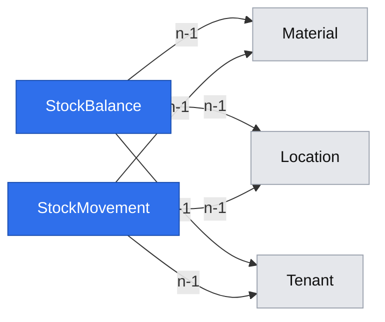

# Physical stock ledger and reasoned corrections

**Status:** ready
**Created:** 2026-10-20 16:34 UTC
**Issue:** #80 (E07-S01)

## 📝 TLDR
Both roles can inspect physical stock for a material/location and post a reasoned signed correction. A tenant-owned ledger preserves each signed six-decimal BUoM movement, its source, actor and entered unit/factor; a balance row changes atomically with it. Operational documents will reuse the posting primitive later.

## Resolved assumptions (autonomous defaults)

The owner explicitly instructed autonomous completion without clarification on 2026-10-20, delegating reasonable choices. These assumptions are published for review, with no remaining confirmation gate.

| # | Decision | Rationale |
|---|----------|-----------|
| Q1 | Manual input is a signed change, not a desired final balance. | #80, INV-006 and the conceptual-model adjustment dictionary agree. The decision-register §03 p6 Manual correction row instead says target balance; this spec records the erratum for the manual path. XLS remains absolute in E07-S02. No second input mode. |
| Q2 | The server's UTC date is the business date, captured once per group. | Matches existing safety-stock today convention. No client posting-date control; extra input date fields are discarded. |
| Q3 | Keep a unique cached balance per material/location, including zero rows. | Bounded pair reads and deactivation checks; ledger remains the history. Missing pairs read as zero without creating rows. |
| Q4 | Startup demo openings are real movements attributed to Demo seed, channel seed, without user audit. | Existing installation seeds are unaudited. Every user/API correction has an audit entry; seed rows are explicitly distinguished, never falsely attributed to a UI session. |
| Q5 | Balance, ledger and correction stay together. | These form one capability: corrections require the balance invariant and ledger evidence. Imports, transfers, reversals and filtered reports remain separate stories. |

## 📝 Problem Statement
No current stock concept exists. Both roles need corrections including opening balances and physically returned customer goods before operational documents can post stock. This is slice 2 under product-brief D02; no scope outside E07-S01 is added.

## 📝 Architecture
New stock entities in db, StockService and stock usage leaf helpers in core, routes/actions/components under stock in app. Explicit DI registration. Reuse exact bigint quantity arithmetic, material/base-quantity conversion, scoped reference lookups, tenantServerAction, tenantApiWrite, request transactions, audit recorder, CrudForm and DataTable.

`StockService.post` accepts a group of at most 100 trusted-source lines plus reason and AuditActor. The current public correction method submits one line with a server-generated source ID and type correction; external callers cannot invent source types. Resolve/validate references and convert all quantities first; aggregate deltas per pair; read fresh balances and validate every final balance before writing. All balance updates, immutable movements and audit entries share one transaction/flush. Repeated pairs are handled cumulatively. Zero deltas are refused. Total balances stay between zero and MAX_QUANTITY. A failing line rolls back the whole group.

SQLite snapshot conflicts are retried once by the existing request wrappers. Services use the supplied scoped em; enclosing services use inRequestTransaction. No network, hashing or filesystem work is allowed while holding the write lock. Two-real-ORM tests must prove competing withdrawals cannot overdraw stock.

## 📝 Data Model
- StockBalance: UUID, tenant, material relation, location relation, quantity text (six decimals), optimistic version. Unique material/location (the referenced UUIDs are tenant-local); index tenant/material/location.
- StockMovement: UUID, tenant, postingId (source/group ID), position, type, material/location relations, businessDate ISO text, occurredAt, signed quantity text, baseUnit snapshot, entered signed quantity/unit/numerator/denominator, balanceBefore/balanceAfter text, reason, actorUserId nullable, actorUsername, channel. Group+position unique per tenant. Type and source ID are always inspectable. No source-document entity is invented for a single correction.
- Movement update-abort triggers protect original history. No application delete/update surface; eventual Test reset owns controlled deletion like immutable BOM revisions. Reversals will append linked movements in their own story, never rewrite originals.
- Migration generated by db:migration:create; commit migration, snapshot and regenerated index together. Test up/down with rows and preserve old migrations' rollback assertions.

Each balance and movement belongs to one tenant and references scoped masters.

## 📝 API Contracts
- GET `/api/tenants/{tenant}/stock?material=00000001&location=00000001`: both references required; returns pair IDs/names, BUoM, quantity (zero when absent) and recent movements, capped at 100, newest first. History ordering uses occurredAt then ID for deterministic ties. Returned ledger rows contain date, signed quantity, type, source ID, reason, entered unit/factor and actor.
- POST `/api/tenants/{tenant}/stock/corrections`: `{ material, location, quantity, unit, reason }`, quantity an optionally signed decimal string, nonzero, max twelve integer/six decimal digits; trimmed reason 1…500 chars. Returns posted movement(s) with new balance. Existing result envelope, bearer identity, key/generation requirements and replay semantics apply unchanged. Extra date/source/actor fields never affect persisted values.
- Both roles read/post. No PATCH/DELETE routes. Inactive masters remain readable but cannot receive new movements. Unknown/other-tenant references are not found. Read-only and stale-generation requests write nothing.
- Negative result → `INSUFFICIENT_STOCK` naming material, location, available and requested BUoM quantities. Overflow → `QUANTITY_OUT_OF_RANGE`. Schema errors identify fields; unit conversion errors use the existing material errors.

## 📝 UI/UX
`/admin/{tenant}/stock`: both roles, EN/PL, tenant strip/read-only banner retained. Material and location selectors include inactive historical masters for reads; GET form selects a pair. The selected pair shows exact physical quantity and BUoM, and recent ledger rows. Missing pair shows zero; no masters prompts creating/selecting masters. Initial choice is the first available pair. Read failure uses existing page error behavior; Suspense fallback is text-free aria-busy.

A writable active pair offers Post correction. Dialog uses CrudForm: signed quantity, unit choice (BUoM and current conversions), required reason, submit/pending/cancel and inline errors. Pair and generation are bound by the page; server repeats every check. Successful correction refreshes the selected pair; a refused write keeps the dialog and explanation. No date/source/actor field. Help explains signed changes, six-decimal conversion, today UTC, no-negative/read-only rules, returns as corrections and immutable history. Stock navigation available to both roles.

Ledger uses DataTable; long reasons wrap, secondary source/entered details remain accessible without pushing actions off narrow viewports. Actor and source remain visible in row details. No edit/delete actions. Read-only/inactive pairs retain balance and history but hide the posting button.

## 📝 Edge Cases & Failure Scenarios
- Convert absolute magnitude through the existing helper, then restore sign, including quantities below one and half-up rounding; reject positive magnitudes rounding to zero. Never use floating-point or SQL numeric sums.
- Any historical movement permanently locks material type and BUoM (MAT-010/012), even at zero. Stock usage leaves are imported by masters rather than importing StockService.
- Nonzero StockBalance blocks material or location deactivation with material/location/quantity context. A NamedRecords before-deactivate callback runs inside its existing transaction; other named masters retain current behavior.
- Demo Test openings run after masters, only while stock is untouched and writable. Missing/inactive demo references are skipped; Prod is never seeded. Ledger records source and explicit seed attribution, with no balance-only injection.
- Failed flush/audit writes, invalid lines and negative balances leave no balance/movement/audit changes. API retries replay once, including the original source ID. A stale identity map cannot bypass balance or master guards.

## 📝 Research & Alternatives
[ERPNext immutable ledger](https://docs.frappe.io/erpnext/immutable-ledger-in-erpnext) preserves original stock entries, and [stock reconciliation](https://docs.frappe.io/erpnext/stock-reconciliation) links changes to item/warehouse and a ledger. CPG adopts traceable immutable movements, but valuation, reposting and backdated periods are outside its baseline. Deriving every balance from all ledger rows was rejected because it expands every posting/deactivation read with history growth. No generic workflow engine or document framework is needed yet.

## 📝 Risks & Impact Review
New additive tenant tables and HTTP paths become protected contracts. Rolling application code back leaves new tables harmless; down migration destroys stock history and must only run on disposable/test data or after a deliberate backup/restore plan. No existing schema data is rewritten. No new dependencies. Inventory history is operational business data; reason is bounded plain text, rendered escaped, tenant-scoped and never logged as diagnostics. Explicit actor snapshots retain audit attribution.

The manual-input decision-register discrepancy remains visible as a documented source erratum, resolved for this implementation by the owner's autonomous delegation. Existing protected surfaces and rules are unchanged. QA remains mandatory for this risk-high user-facing change; author automation never signs it off.

## 📝 Decisions in play
R02/R03/R05/R07/R08/R09, N01/N02/N03/N04/N05/N06, D02/D03/D04/D06. Manual signed input follows #80/INV-006; XLS absolute input remains E07-S02. No customer-return document is created. No transfers, reversals, stock import, filtered reporting or operational documents are implemented here.

## 📋 Implementation Plan
### Phase 1: persistence and posting
1. Add signed quantity parsing/formatting, input schemas and stock entities with migrations and ownership/rollback tests.
2. Add StockService atomic group posting, pair reads, master usage guards and demo seeds with exact quantity, failure, audit, isolation and two-ORM race tests.
### Phase 2: user surfaces
3. Add authenticated UI/API actions/routes using existing write gates and focused tests.
4. Add stock page, correction form, ledger, EN/PL messages, help and navigation with behavior tests.
### Phase 3: verification and publication
5. Exercise UI/API parity, negatives, read-only, roles, idempotency and tenants in integration tests; full lint/typecheck/coverage/build/integration gate.
6. Review diff against engineering standards, fix findings, capture browser evidence, publish reviewed ready implementation PR referencing the separate design PR.
