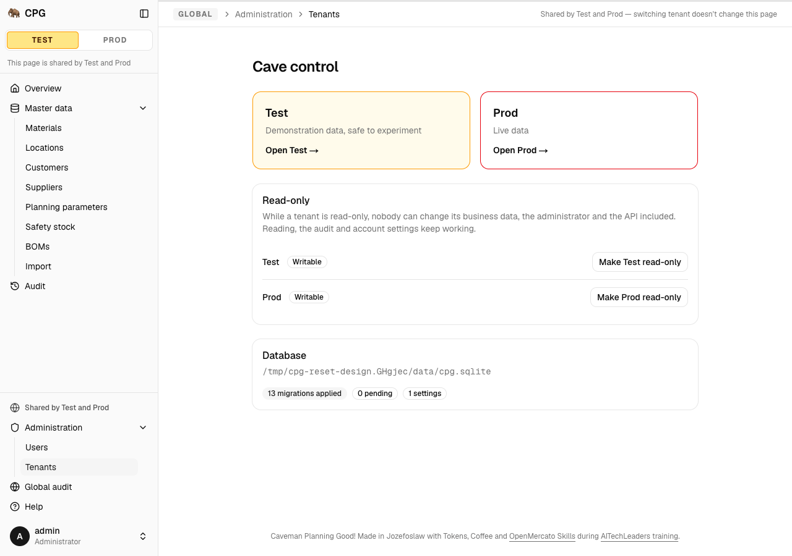
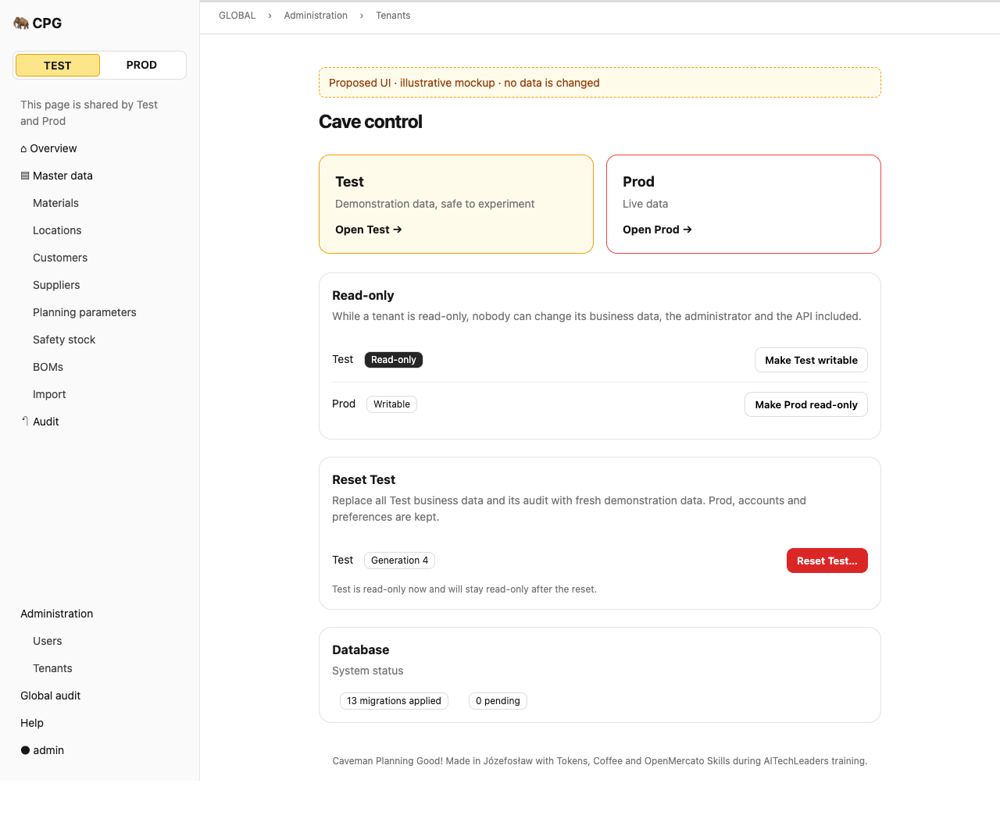
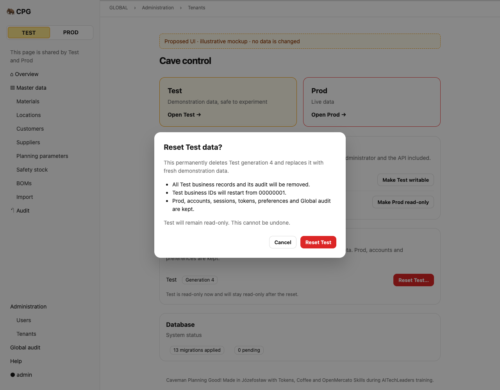
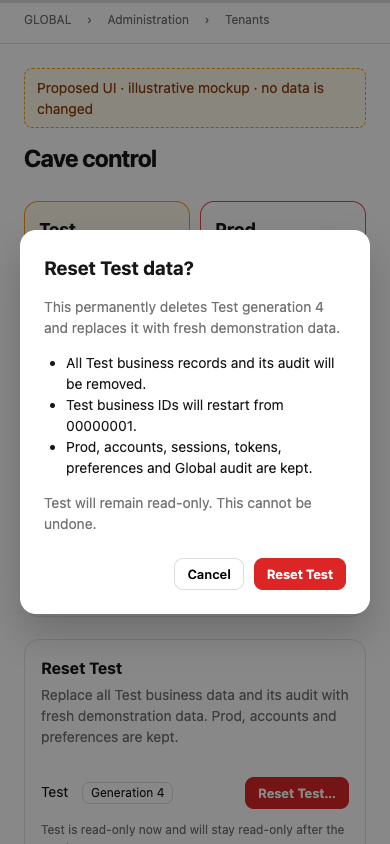

# Atomic Test reset

**Status:** ready (proposal; implementation follows separately)
**Created:** 2026-10-20 16:36 UTC
**Issue:** [#93 — E12-S01](https://github.com/Piotr12/CPG/issues/93)

## 📝 TLDR
The administrator needs to restart demonstrations and experiments. Test currently stays on its initial dataset generation. This proposal adds one atomic Test reset in Cave control and the bearer-token API: remove Test-owned records, reseed the demonstration data, increment the generation, and restore the previous read-only flag. Prod, accounts, sessions, API tokens, preferences and existing Global audit survive.

## Resolved assumptions (autonomous defaults)

| Question | Chosen answer | Reason |
| --- | --- | --- |
| Q1. Is this one capability? | One spec: atomic Test reset, with its UI, API and generation protection. | Neither entry point can deliver the acceptance criteria without the same reset service. Operational documents and slice-3 journeys stay out. |
| Q2. How does a reset replay after changing the generation? | Check the submitted generation before any key lookup, as today. Delete old Test keys, then store the reset's own receipt in the **new** Test generation. A retry with the old generation is 409; fetch current metadata and retry the same key to replay the successful result. | Preserves API-033/TEN-030 precedence and keeps tenant data out of the Global key table. No exception lets an old generation reach a reused ID. |
| Q3. How are existing seeders used when Test was read-only? | One transaction holds SQLite's write lock. Make Test read-only during deletion, set it writable only for the existing seeds within that same uncommitted transaction, and restore the prior flag before commit. | Other connections cannot observe that temporary writable interval or insert into it. Avoids a publicly usable bypass of the normal seeders' read-only gate. |
| Q4. What is in the new Test audit? | Empty. Reuse today's system seeders, which create no user-change audit events. Global gets one reset event. | The old audit must vanish (AUD-012), while the reset itself is a Global event (AUD-013). |
| Q5. Where is the UI? | An admin-only Reset Test card in `/admin` (Cave control), beside the existing tenant read-only controls, in English and Polish. | Reuses the existing global settings surface and confirmation dialog; no new page or navigation item. |

These defaults implement the issue's stated requirements and the existing generation contract. No product decision is superseded. A design review still precedes implementation publication.

## 📝 Problem Statement

Issue #93 records the admin's need to restart a demonstration dataset. Code search finds no reset service or reset route. `Tenant.generation` exists but stays at 1; `demo-data.ts` seeds missing kinds at startup, each in a separate transaction and with errors collected rather than propagated. That startup orchestration cannot provide an all-or-nothing reset.

The source requirements are [product-brief.md](product-brief.md), D06, and [CPG-acceptance.md](research/CPG-acceptance.md): TEN-022…030, AUD-011…013, API-017, API-033 and API-034. End-to-end journeys E2E-010, E2E-018 and E2E-020 belong to slice 3, as the issue states.

## 📝 Proposed Solution

Add `TestResetService`, resolved only from a Test `tenantScope`. Both entry points authenticate and require the admin, then call that service inside the request's own write transaction. All deletion, generation change, seeds, read-only restoration, Global audit event and API receipt commit together. There is no persistent in-progress state and no background job.

The database write lock is the cross-connection operation lock; a process-local mutex would miss other Next.js bundles and processes. A failed reset rolls back everything. The only destructive capability names Test explicitly and rejects a Prod or unscoped EntityManager before doing work.

Alternatives rejected:

- Calling `seedDemoData(config)`: opens another ORM, commits kind by kind, swallows seed errors and can leave partial data.
- A database file swap or database per tenant: would replace the selected architecture and put global identity data at risk.
- Manually listing tables in a reset service: a later tenant-owned entity could survive accidentally.
- Storing the reset receipt globally: avoids deletion, but adds an unnecessary key-scope exception; the receipt can safely live in the new Test generation.

## 📝 Architecture

### One request transaction and one scope

Reuse `tenantScope`, `inRequestTransaction`, `inRequestSavepoint`, `retryingStaleSnapshot`, the existing seven master services and `recordGlobalAudit`. Register `testResetService: asClass(TestResetService).scoped()` explicitly in `container.ts` and its type in `cradle.ts`; export it through `@cpg/core`.

`TestResetService.reset(expectedGeneration, actor)` requires Test scope. When called directly by the UI, the service opens `inRequestTransaction` on its own scoped `em`, with `retryingStaleSnapshot` around the entire attempt. When the API keyed pipeline already owns that request transaction, the service reuses it and lets that pipeline own retries. Its reset work uses a savepoint on **that same** request EntityManager, never a fork carrying a separate outer transaction. Services resolved from that scope keep the same `em`, and their existing `transactional()` calls nest under it. Any error escapes to the request transaction and clears the identity map after rollback.

Within the transaction:

1. Read `TenantService.currentState("test")` fresh and assert the expected generation. Retain the original read-only flag. Reject an increment past `999999999`, the existing generation header parser’s nine-digit limit, with 409 `GENERATION_EXHAUSTED` before deletion.
2. Issue and flush the Test metadata update setting `readOnly = true`. Even if already true, execute a real update: this acquires SQLite's write lock before deletion and holds it to the outer commit. A stale snapshot causes the existing whole-transaction retry, including rechecking the generation.
3. Call the db reset helper to wipe **all** Test-owned rows, including `TenantAuditEvent` and `TenantIdempotencyKey`. Clear the request identity map after the native deletes so old objects cannot be flushed into the new dataset.
4. Reload Test metadata, increment the generation once and set `readOnly = false` inside this uncommitted transaction. Re-read scope metadata through a new plain `TenantInfo` value for the seed runner; never rely on the scope's original generation after this point.
5. Run the existing seeds in `DEMO_KINDS` order, on the same scope and transaction. Propagate any failure at once; a nonempty/partial seed result where the fixed demonstration dataset was expected is an error. Do not call startup's catch-and-continue function.
6. Restore the original read-only flag and flush. Record `tenants.tenant.reset` through `recordGlobalAudit`, subject `{ type: "Tenant", id: "test", label: "Test" }`, snapshots `{ generation, readOnly }` before/after. No business values, secrets or tokens enter the snapshots.
7. Return the fresh `TenantInfo`. For the API only, the keyed pipeline inserts its receipt in the new generation before the outer commit. The UI action creates no API key.

Setting the temporary flag in this transaction is deliberate: WAL readers continue seeing the old committed dataset and flag, then the new committed dataset. The temporary read-only flag is **not** a visible progress banner or a distributed lock by itself. SQLite's writer lock supplies exclusion throughout the temporary writable seed interval. Other write transactions either finish first or fail/retry and discover `GENERATION_STALE`; they cannot commit a write based on the old snapshot after this reset.

### Generic Test-owned deletion

Add `packages/db/src/tenants/reset-test-data.ts` as the only persistence helper for this operation. It takes the request `em`, requires `currentTenant(em) === "test"` and an existing transaction, and derives its footprint from registered ORM metadata using `isTenantOwned`. Core never obtains raw SQL, a driver or an unscoped manager.

Delete through tenant-filtered native deletion, with foreign keys kept enabled. Derive child-before-parent order from owning foreign-key metadata, including tenant-owned pivot tables if any are introduced. For cyclic dependencies, use transaction-local `defer_foreign_keys` in this db helper; still delete every row in the same transaction and let the commit enforce integrity. Any unsupported mapping fails before the first delete rather than silently omitting it. Never alter tables/triggers at runtime, use `schema:update`, disable `foreign_keys`, delete global tables or reset SQLite's internal sequences.

The current owned footprint is: materials, material conversions, locations, customers, suppliers, planning parameter sets, safety-stock targets, BOMs, revisions, components, tenant audit and tenant idempotency keys. The list here explains current reach; **metadata, not this list, drives deletion**. Business IDs are highest-existing-code + 1 today, so deleting all rows before reseeding restarts each sequence at 00000001 without a new counter table. The next user-created record follows the demonstration records, rather than reusing their IDs.

A repo test compares the helper's calculated footprint against **every** registered tenant-owned entity, asserts no global entity enters it, and exercises dependency ordering. Reject a schema with a cascade that could delete global rows from a tenant-owned parent. Future business entities then participate automatically or cause an explicit failing check.

### Shared seeding without partial success

Extract the ordered, scope-bound seed invocation from `demo-data.ts` into `core/src/services/demo/seed-demo-data.ts`. It accepts the existing services by explicit named dependencies; never spread the Awilix PROXY cradle. Provide one fail-fast runner for reset. Startup retains its current per-kind result collection and retry behavior, reusing the same ordered registry rather than duplicating it.

Reset never creates a new ORM, reconnects or reads/writes files. Existing deterministic fixtures and existing seed rules stay authoritative. A test compares the reset dataset with a fresh successful startup dataset, including references, conversions, BOM revisions and all currently seeded kinds.

## 📝 Data Model and migration

No new entity, public metadata field or configuration variable is needed. Generation remains a positive integer within the existing nine-digit API header range; this change does not widen that public parser. Both tenant rows and all global records remain in place.

The [existing audit spec](implemented/2026-10-19--1050UTC-audit-log.md), Q3, explicitly reserves a migration that allows **Test** audit deletion. Change the tenant audit entity's declared delete trigger to abort when `old.tenant_code <> 'test'`; keep its update trigger unconditional. Global audit keeps both unconditional triggers. Generate the migration, `.snapshot.json` and migrations index together. No deployed migration is edited.

This grants a narrow **database** exception for Test audit deletion, not an application audit-delete API. All normal services and audit routes remain append-only. The db reset helper is the sole production caller. Extend source invariants without exempting general core/app mutations. Update standards' append-only wording to name this existing planned Test-reset exception. Real SQLite tests must prove: Test deletion in the reset works; Test update, Prod update/delete and Global update/delete still abort.

Migration rollback reinstates the unconditional tenant-audit delete trigger and changes no stored data. Rolling application code back cannot restore a **successful** reset's deleted Test dataset; an operator backup is the only way to recover it. No backup product feature is added here.

## 📝 API Contracts

### `POST /api/tenants/test/reset`

Fixed Test path: no Prod reset route, tenant selector or tenant in the body. Bearer admin only. Cookie-only writes remain 401; a normal bearer is 403. The body is strictly an empty object `{}` (unknown keys are 400 `VALIDATION_FAILED`). Required headers:

- `Idempotency-Key`: the unchanged 1–255 visible-ASCII contract, 400 `IDEMPOTENCY_KEY_REQUIRED` when absent/malformed.
- `Dataset-Generation`: current Test generation, 428 `GENERATION_REQUIRED` when absent/malformed, 409 `GENERATION_STALE` when different. Check inside the transaction and **before key lookup**, including used or expired keys.

Success: HTTP 200, `{ ok: true, data: { code: "test", name: "Test", generation: G + 1, readOnly: previousReadOnly } }`. Errors use the existing envelope. A seeding/deletion failure is the ordinary sanitized 500; everything rolls back, including the new key and Global reset entry.

Add a narrowly named `testResetApiWrite` in the existing `auth/api-write.ts`, built on the same private keyed pipeline. It always resolves Test scope, enforces `assertAdmin`, reads the generation header, and uses an explicit `test-reset` idempotency scope. It does not expose a request-controlled read-only bypass. Extend `IdempotencyService` only for that scope:

- assert current generation before lookup, as with ordinary tenant writes;
- permit reset while Test is read-only; all ordinary tenant scopes retain `assertWritable`;
- after a successful reset, read the new generation fresh and store the receipt in Test's tenant-key store with that new generation;
- a same-key concurrent reset is replayed only after a successful generation check; stale snapshots retry the complete transaction once.

A lost response leaves the caller's old precondition stale: retrying G is 409, with no reset and no receipt replay. Fetch `GET /api/tenants/test`, then resend the **same key** with that current generation: if no later reset occurred, the matching receipt replays with `Idempotent-Replayed: true`. Do **not** silently fetch a new generation and retry with a new key; that requests another reset. A subsequent intentional reset removes the previous reset receipt with the rest of that generation's keys. After 24 h the ordinary expired-key rule applies; the current generation is still required.

`GET /api/tenants/test` keeps its existing response and exposes the new committed generation (API-034). No existing method, URL, header, status or error meaning changes. Update `BACKWARD_COMPATIBILITY.md` to add this route, its read-only exception and retry behavior. Extend `tests/api-writes.test.ts` with an exact-path allowance for the named reset wrapper; all other routes must still use their existing keyed wrappers and may never resolve a second request scope.

## 📝 UI/UX

On `/admin`, show an admin-only Reset Test card below the read-only card. Describe precisely: “Replace all Test business data and its audit with fresh demonstration data. Prod, accounts and preferences are kept.” Display the loaded Test generation. Keep the action available when Test is read-only. Normal users see no reset card; server-side authorization still rejects crafted actions.

Use the existing `Button` and `ConfirmDialog`. The trigger reads “Reset Test…”. Confirmation title: “Reset Test data?”; include the generation being replaced, permanent deletion of Test business data and audit, reseeding, and preservation of Prod and global account data. Primary action: destructive “Reset Test”; secondary “Cancel”. No typed phrase or additional wizard. Supply equivalent Polish copy through the existing message catalogue and plain-data labels.

The action binds the loaded generation and parses it with a shared positive integer (maximum 999999999) Zod schema. Resolve `tenantScope("test")`, authenticate once, assert admin server-side and call the service, which owns the transaction/retry for this direct invocation. The action never reads `em` or opens a database transaction itself (the app-to-service boundary). Add an exact-file exception for this fixed-Test global action in `tests/tenant-entry-points.test.ts`; every other global page/action retains the current tenant-scope prohibition. Use `serverAction` for the standard envelope. Do not route through ordinary `tenantServerAction`, whose read-only refusal is correct for business edits.

| State | Behavior |
| --- | --- |
| Default | Card names Test and shows generation G; no action on Prod's card. |
| Loading | Existing `/admin` Suspense fallback; no enabled placeholder action. |
| Confirm | Keyboard-accessible existing dialog, cancellation restores focus. |
| Running | Reuse ConfirmDialog’s pending state to disable repeated submission. Add an optional pending-label prop to that shared component so this caller shows “Resetting…”; other callers keep today’s text. Test the shared behavior. Existing Cancel/Escape behavior is retained; closing never cancels a server-side reset. |
| Success | Close dialog, refresh only `/admin`, display an accessible success message with the new generation and retained read-only state. Never revalidate `/admin` layout. |
| Stale generation | Keep a clear error: “Test was reset since this page loaded. Reload before resetting it again.” Refresh metadata without automatically resubmitting or retargeting the open confirmation. |
| Failure | Keep confirmation and error visible; dataset unchanged. Allow a deliberate retry. |
| No permission | No card; crafted action is forbidden. Signed-out access follows existing `/admin` login redirect. |
| Narrow/dark/long copy | Stack card controls, wrap description, retain reachable dialog controls at 390 px and translated text lengths. |

Existing tenant pages are not forcibly navigated or bulk-revalidated. Their already-bound generation continues to protect stale forms, and the existing error message tells the user to reload. Add a short tenants-help paragraph on reset and its irreversible scope. Global audit labels translate `tenants.tenant.reset` as “Test reset” / “Reset środowiska Test”, with before/after generation and the original read-only state.

Prototype: [static proposed UI](assets/atomic-test-reset/mockup-01-cave-control.html) (illustrative only).

Current Cave control, without reset:

Proposed card and destructive confirmation:

## 📝 Edge Cases & Failure Scenarios

| Trigger | Required outcome |
| --- | --- |
| Test starts writable/read-only | Identical deterministic fresh dataset; new generation; original flag restored. |
| Failure after delete, generation change, partial seeds, flag restore, audit creation or receipt insertion | Entire outer transaction rolls back; old dataset, generation, read-only flag, Prod and Global records unchanged; no reset event or consumed key. |
| Old Test UI form or API request targets a reused business ID | 409 `GENERATION_STALE` before key replay or write, even with a stored/expired key. New record untouched. |
| Old import preview token, new generation header | Preview hash includes a **fresh in-transaction** generation, so commit is 409 `IMPORT_STALE`; old header is refused earlier as `GENERATION_STALE`. Fix `ImportService.apply` to read this through `TenantService.currentState`, rather than the scope-captured `tenant.generation`: the scope can predate the reset while the header names the new generation. Test that exact interleaving. |
| A business write commits first | Reset removes it with the old generation; no half-written row survives. |
| Reset commits before a transaction based on the old dataset writes | SQLite refuses the stale snapshot; the whole-transaction retry sees the new generation and refuses the write. Use independent connections/processes in tests to avoid a synchronous better-sqlite3 busy wait blocking its own lock holder. |
| Two reset requests carry G | At most one increments to G+1; the other is stale. Same-key retry at current G+1 replays once. |
| Read-only flag is changed concurrently | Operations serialize at the writer lock; restore the value read for this successful reset attempt, never a pre-transaction cached value. |
| Application restarts after rollback | Startup sees the intact old dataset and does not finish an abandoned partial reset. |
| Process dies during reset | SQLite recovers the uncommitted transaction; no permanent read-only/reset marker exists. |
| Prod writes during reset | They may briefly contend for SQLite's single writer; their data and generation checks remain unchanged. No promise of concurrent writers is made. |
| New tenant-owned entity/relationship | Metadata includes it automatically or coverage/mapping checks fail; never silently leave it behind or cascade into global records. |

## 📝 Research and trade-offs

[Odoo Runbot's own test fixture](https://github.com/odoo/runbot/blob/19.0/conftest.py) builds a clean template and clones it for isolated runs. The useful pattern is a deterministic fresh dataset; its PostgreSQL database clone and filestore machinery do not fit CPG's shared SQLite tenancy. Reuse CPG's fixtures rather than copying a whole database.

[SQLite's isolation documentation](https://www.sqlite.org/isolation.html) explains that WAL readers see committed snapshots and writers serialize; [transaction control](https://www.sqlite.org/lang_transaction.html) documents write-lock acquisition and savepoints. The proposed exclusion is an inference from those guarantees plus CPG's existing generation checks, **not measured evidence**. Implementation must prove both race orderings with real SQLite and two connections. A long reset blocks Prod writes briefly, so it does no hashing, network calls or file I/O while holding the lock.

## 📝 Risks & Impact Review

- **Risk high:** deletion, tenant scoping, a migration and a new mutating public route. Require full isolation/rollback evidence, migration up/down coverage, a second review and independent QA; no self-QA approval.
- **Audit exception:** existing design Q3 already permits Test deletion. Keep it in the db reset helper and leave Prod/Global and every update protected. No generic audit mutation service is introduced.
- **Generation/idempotency:** storing a reset receipt with the pre-reset generation or accepting a stale header before lookup would undermine the central guarantee. Test the exact receipt generation and the stale-header precedence.
- **ORM context:** every seed, audit insert and receipt must use the same request transaction. Replacing that with a child-scope/new connection can deadlock or escape rollback. Inject a middle-seed fault and a receipt-store fault to prove atomicity.
- **Future schema:** tests must fail for missing owned tables, unhandled pivots or a global cascade; production should fail closed rather than turn constraints off.
- **Rollback:** deployment rollback restores code/triggers; it cannot undo a successful intentional reset. The confirmation must say so.

## 📝 Decisions in play

R01: business IDs restart per Test generation, never reused within one generation. R05: Test/Prod isolation and unchanged normal read-only semantics. R07: admin UI/API parity, keyed API writes and current Test generation. R08: clear Test audit on reset, retain Prod and Global indefinitely. D06: reuse slice-1 demo data for the slice-2 reset. D04: add no unrelated business scope. None is superseded.

## 📋 Phasing

One user capability and one implementation PR after this design-only proposal. The following phases are implementation checkpoints; each intermediate commit leaves existing behavior usable. The reset is exposed only once its persistence and transaction tests pass.

## 📋 Implementation Plan

### Phase 1 — persistence and atomic service

1. **Test-audit deletion migration and db helper.** Update tenant audit entity trigger, generate migration/snapshot/index, implement scoped metadata-driven reset deletion in `db/src/tenants/`, add next-to-code tests plus `tests/test-reset-coverage.test.ts`. Prove migration up/down, forbidden Prod/Global audit changes, no global cascade, every owned entity covered, wrong/unscoped manager refused and foreign keys intact. Existing app remains unchanged.
2. **Shared seed invocation.** Extract the ordered seed registry/runner into `core/src/services/demo/`, preserve startup's best-effort behavior in `demo-data.ts`, add deterministic reset/fail-fast behavior tests and compare all currently seeded kinds with existing fixtures. Do not expose reset yet.
3. **Reset service.** Add `core/src/services/tenants/test-reset.service.ts`, bounded generation schema under `validators/tenants/`, explicit DI bindings/exports and behavioral tests on real migrated SQLite. Assert complete rollback after each phase fault, both original flags, empty Test audit, one Global event and byte-for-byte value equality for protected rows (TEN-022…025, TEN-027…029, AUD-011…013). Verify all currently sequenced masters and BOMs restart and their next create follows demo IDs.

### Phase 2 — API and UI

4. **Keyed API.** Add the fixed reset route, named wrapper reusing `api-write.ts`, and explicit reset mode in `IdempotencyService`; update exact-path source invariants. Test stale generation before lookup for missing/used/expired keys, current-generation reset-receipt replay, key conflicts, no key on failure and failure during key store rolling back the reset. Read the fresh generation for import-preview hashing and add a captured-scope/new-header regression. Keep ordinary tenant write/read-only behavior identical.
5. **Cave control and help.** Add the generation-bound action and reset control in `components/tenants/`, compose existing ConfirmDialog, add EN/PL plain labels, success/error feedback, Global audit action text and help. Update page/action/component/message tests to 100%. Verify no permission, cancellation, pending double-submit, stale confirmation and failure states.

### Phase 3 — consuming behavior, review and evidence

6. **Integration and race evidence.** Add `tests/integration/test-reset.test.ts` and `test-reset-api.test.ts`. UI and API must each reset writable and read-only Test; normal user and cookie-only writes are denied. Preserve two users/sessions/tokens/preferences, previous Global events, representative Prod data/audit and flags. Through real requests, create a stale material edit and old import dry run, reset, then assert the old requests cannot touch new data with reused IDs. Include same-key/new-key repeats. Use a real SQLite two-connection or worker test for both write/reset orderings (TEN-026); failure injection stays in unit/service tests, never in a production endpoint.
7. **Contract and source documents.** Add the API to `BACKWARD_COMPATIBILITY.md`, document the bounded Test-reset audit exception in standards and source invariants, update acceptance evidence only for outcomes actually asserted. Record lessons and the run plan; do not relabel the deferred slice-3 E2E journeys as passed.
8. **Full gate and independent review.** Run lint, typecheck, 100% unit coverage, build and integration tests; run the actual UI in a browser in EN/PL, light/dark and 390 px, attach screenshots. Review the complete diff and obtain a fresh review, then publish one ready implementation PR referencing this spec and `Closes #93`, with `feature`, `risk-high`, `priority-medium`, `review`, `needs-qa`. Never self-approve QA. Move the spec to `implemented/` only once fully implemented and verified, fixing relative asset links.

## Verification notes

This is a design proposal, not working reset code. Spec review, baseline checks and UI evidence are recorded in the run log. The configured Docker test environment is currently unavailable (`TEST_ENV_STATUS=failed (docker is not running)`); a production standalone server with a temporary data directory is the documented local fallback. No reset acceptance scenario may be marked passed from these design checks or mockups.
