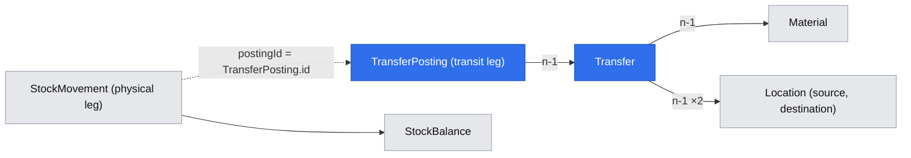

# A user transfers one material between two locations: dispatches move stock into transit, receipts land it, and losses are written off with a reason

**Status:** in progress
**Created:** 2026-10-20 20:46 UTC
**Issue:** #82 (E07-S03), epic #73 · **Builds on:** `implemented/2026-10-20--1634UTC-stock-ledger-corrections.md` (#80: the ledger, the balance and the posting primitive), `implemented/2026-10-20--1933UTC-goods-receipts.md` (#87: a document that posts through `postStockMovements`), `implemented/2026-10-20--1636UTC-purchase-requisitions-orders.md` (a single-material document with dates), `implemented/2026-10-19--2018UTC-read-only-tenants.md`, `implemented/2026-10-19--1548UTC-api-idempotency.md`, `implemented/2026-10-19--1050UTC-audit-log.md` · **Design authority:** `.ai/specs/product-brief.md` (R03, R05, R07, R08, R09, D02, N03, N06), `.ai/specs/research/CPG-prd001.pdf` §03 "Transfers", "Date and integrity", "Transfers are special", §06 "Reference and history integrity", §07 "Current stock report", `CPG-prd-datamodel.pdf` (Stock transfer, Transfer dispatch / receipt posting, In-transit inventory, In-transit write-off), `CPG-acceptance.md` (TRF-001…011, TRF-013, TRF-014, TRF-022…024, TRF-026, INV-009, AUD-019, AUD-020, LFC-001, LFC-017, LFC-018, UX-017)

## 📝 TLDR

Stock can't move between sites, and nothing represents goods on the road. This spec adds the **transfer**: one material from a source location to a different destination, with a planned quantity and planned dispatch and arrival dates. Creating one changes no stock. A **dispatch** takes stock off the source and puts it **in transit**; a **receipt** takes it out of transit and onto the destination; a **write-off** takes a lost quantity out of transit with a reason. Each is one transaction, in the ledger and the audit, dated today. In-transit stock belongs to the transfer, never to a location, so neither site can use it. A transfer whose whole planned quantity is received is **Completed**. Both roles use it, in the UI and the API. Close Early, Cancel, reversals and MRP are other stories.

## Resolved assumptions (autonomous defaults)

The run is autonomous (cezar, `/om-auto-fix-issue 82`); each choice is the most reversible one the sources allow, published here for override.

| # | Question | Chosen answer | Rationale |
|---|---|---|---|
| Q1 | What does a transfer hold? | An eight-digit business ID (`code`, sequential per tenant from `00000001`, never reused), one material, a source and a destination location, the planned quantity (six-decimal base quantity with the entered quantity, unit and factor kept, R03, MAT-019), a planned dispatch and a planned arrival date, and its progress: `dispatched`, `received` and `writtenOff`, all base-unit text. **In transit** is `dispatched − received − writtenOff`, **undispatched** is `quantity − dispatched`; both are derived, never stored, so they can't drift. Status `open` or `completed`. Optimistic version. | The datamodel's Stock transfer and In-transit inventory ("transfer-linked … distinct from site stock"). |
| Q2 | Creation rules (TRF-001, TRF-002, TRF-003, TRF-026, LFC-001)? | Active material, active source and destination, the destination different from the source (field error `destination`), arrival not before dispatch (field error `plannedArrival`), quantity > 0 in a unit the material converts. A transfer has one material: an API body that names `materials` or `lines` is refused (400 on that field), never silently trimmed. A new transfer is Open with nothing dispatched and changes no balance. | PRD §03 "One material, different source/destination locations … arrival never before dispatch". |
| Q3 | Edits? | Only the planned dates, while Open, at the loaded version, audited; the result must keep arrival ≥ dispatch (TRF-026: "creation or edit … leaving previous document unchanged"). Material, source, destination, quantity and unit are refused (`z.never`). | Quantity edits interact with dispatched amounts and Close Early (E11-S01); the smallest edit set that meets TRF-026. |
| Q4 | Dispatch (TRF-004, TRF-005, TRF-008, TRF-009, TRF-023, INV-009)? | A quantity in any unit the material converts, at most the undispatched (409 `TRANSFER_OVER_DISPATCH`, naming what is left), on an Open transfer. One transaction: a `transfer-dispatch` stock movement of −q at the source through `postStockMovements` (so a dispatch above the source's physical stock is `INSUFFICIENT_STOCK` and nothing is written, R09), the transfer posting (+q in transit), `dispatched` += q, and the audit. Dated today; the planned dates never change. | Datamodel: "Partial source goods issue to in-transit". Over-dispatch has no source in the PRD; refusing it keeps "undispatched" and "Completed = planned quantity received" meaningful. |
| Q5 | Receipt (TRF-006, TRF-007)? | At most the in-transit quantity (409 `TRANSFER_OVER_RECEIPT`, naming the in-transit quantity), on an Open transfer. One transaction: the transfer posting (−q in transit), a `transfer-receipt` movement of +q at the destination, `received` += q, the audit. The source is untouched. | "Receipts never exceed dispatched quantity." |
| Q6 | Write-off (TRF-013, TRF-014)? | At most the in-transit quantity (409 `TRANSFER_OVER_WRITE_OFF`), with a required reason (1–500 characters), on an Open transfer. One transaction: the transfer posting (−q in transit) and `writtenOff` += q, with the audit. No location changes. An ordinary stock correction can't reach transit: it addresses a location, and a correction body naming a `transfer` is refused (400 on `transfer`). | "Dedicated audited transfer write-off"; "Ordinary corrections never alter in-transit inventory." |
| Q7 | Status (PRD "Transfers are special", issue criterion 8)? | `completed` when `received` reaches the planned quantity, in the receipt's transaction; since receipts and write-offs never exceed what was dispatched, and dispatches never exceed the plan, that implies nothing in transit and nothing written off. A transfer with a write-off stays Open until Close Early (E11-S01) resolves it as Closed Early. A Completed transfer takes no posting and no edit (409 `TRANSFER_NOT_OPEN`). | Completed "requires 100% planned quantity physically received and zero write-off". |
| Q8 | The ledger (TRF-024, UX-017)? | Every dispatch, receipt and write-off is a `TransferPosting` row, immutable through an update-abort trigger: kind, business date, base and entered quantity, in transit before and after, reason, actor. It is the transit leg. The physical leg is the ordinary `StockMovement`, with the posting's UUID as its `postingId` and a reason naming the transfer. The transfer's page shows the legs of each posting: −60 at A and +60 in transit, then −50 in transit and +50 at B. The stock page labels these movements "Transfer dispatch" and "Transfer receipt", and shows, next to a pair's physical quantity, what is in transit **from** and **to** that location, with links to the transfers. | One ledger for physical stock, as built; transit is "transfer-linked", so its history sits with the transfer. |
| Q9 | Atomicity and races (AUD-019, AUD-020, R09)? | Both legs and the transfer's progress are written in one `em.transactional` and one flush; any failure rolls back both. The transfer is read fresh in the transaction; a concurrent change to it is `VERSION_CONFLICT`, and a racing posting on another connection meets SQLite's stale-snapshot refusal, which the request wrappers retry once against fresh state. | The goods-receipt shape. |
| Q10 | Deactivation (LFC-017, LFC-018)? | A location that is the source or destination of an Open transfer can't be deactivated (409 `LOCATION_HAS_OPEN_TRANSFERS`, naming the lowest-numbered one): that covers in transit from or to it, and undispatched transfers. A material with an Open transfer can't be deactivated either (409 `MATERIAL_IN_OPEN_TRANSFER`), and a material any transfer references keeps its base unit (`BASE_UNIT_IN_USE`: the transfer stores quantities in it). | PRD §06 and datamodel Location: "prevent deactivation with nonzero physical/in-transit stock or open orders/transfers". |
| Q11 | Tenants, roles, API rules (TRF-022, R05, R07)? | Every reference is looked up in the request's tenant, so a Prod location named in Test is `LOCATION_NOT_FOUND` and nothing changes in either tenant. Both roles read and write. A read-only tenant refuses every transfer write. API writes need a bearer token, an idempotency key and, in Test, the dataset generation; a replay returns the original result and posts nothing twice. | The shared write gates. |
| Q12 | Audit (R08)? | `transfers.transfer.created`, `transfers.transfer.updated` (dates), `transfers.transfer.dispatched`, `transfers.transfer.received`, `transfers.transfer.written-off` (each with dispatched, received, written off, in transit and status before and after, the quantity, and the reason for a write-off), plus the ledger's own `stock.movement.posted` for each physical leg, in the same transaction. | Every change is audited with an allowlisted snapshot. |
| Q13 | Screens? | **Transfers** (`/admin/{tenant}/transfers`, in the sidebar's Transactions group): a paged list (50 per page) and a **Create transfer** dialog. **Transfer** (`/admin/{tenant}/transfers/{id}`): the material, both locations, the planned dates and quantities (planned, dispatched, undispatched, in transit, received, written off), the status, **Dispatch**, **Receive** and **Write off** dialogs (each shown only while it can do something, never while the tenant is read-only), **Change dates**, and the ledger. EN/PL, help for both pages. | The PO/requisition screens' patterns. |
| Q14 | API? | `GET|POST /api/tenants/{tenant}/transfers` (`?page=N`), `GET|PATCH …/transfers/{id}`, `POST …/transfers/{id}/dispatches`, `POST …/transfers/{id}/receipts`, `POST …/transfers/{id}/write-offs`. A posting returns `{ transfer, posting }`. The stock `GET` gains `inTransitFrom` and `inTransitTo` (additive); the correction `POST` refuses a `transfer` field. Added to `BACKWARD_COMPATIBILITY.md` §4. | R07. |
| Q15 | Demo data? | None: a demo Open transfer would block deactivating the demo locations, which other flows exercise. | D06 is met by the existing demos. |

## 📝 Architecture

- **db:** `entities/transfers/transfer.entity.ts`, `transfer-posting.entity.ts` (tenant-owned; the posting has an update-abort trigger). One migration `transfers`.
- **core:** `domain/transfers/transfer-quantity.ts` (pure: in transit, undispatched, the after-state of each posting kind and its refusal); `validators/transfers/transfer.schema.ts`; `services/transfers/transfer-records.ts` (find, views) and `transfer-usage.ts` (the leaf the masters and the stock page ask: open transfer at a location or of a material, any transfer of a material, transit from/to a pair); `services/transfers/transfer.service.ts`; container, cradle and index lines. `StockService.get` gains the pair's transit; `LocationService` and `MaterialService` gain the guards; `stockCorrectionSchema` refuses `transfer`.
- **app:** `api/tenants/[tenant]/transfers/…` (five route files); `admin/[tenant]/transfers/page.tsx` + `actions.ts`, `admin/[tenant]/transfers/[id]/page.tsx` + `actions.ts`; `components/transfers/` (list, create form, detail screen, posting dialogs, dates dialog, ledger, labels); the stock screen's transit line and labels; sidebar entry and icon; both dictionaries and help topics.

A dispatch writes one `TransferPosting` and one `StockMovement` (−q at the source); a receipt the same pair (+q at the destination); a write-off only the posting.

## Requirements

- [ ] Create a single-material transfer between two different active locations with planned dates, arrival not before dispatch; it is Open and changes no balance (TRF-001, TRF-002, TRF-003, TRF-026, LFC-001).
- [ ] Partial and further dispatches lower the source and raise transit, never above the undispatched or the source's physical stock; dated today, planned dates kept (TRF-004, TRF-005, TRF-008, TRF-009, TRF-023, INV-009).
- [ ] Receipts lower transit and raise the destination, never above transit (TRF-006, TRF-007); the last receipt of the planned quantity completes the transfer.
- [ ] Transit is usable at neither site: corrections at the source or the destination are limited to physical stock (TRF-010, TRF-011).
- [ ] A reasoned write-off clears lost transit; a correction can't touch transit (TRF-013, TRF-014).
- [ ] The transfer's ledger shows both legs of every posting, and the stock page shows physical and in-transit separately (TRF-024, UX-017).
- [ ] Cross-tenant references are refused and change nothing (TRF-022); both legs of a posting commit together or not at all (AUD-019, AUD-020).
- [ ] A location with an Open transfer from or to it can't be deactivated, nor a material with an Open transfer (LFC-017, LFC-018).
- [ ] Read-only tenants refuse transfer writes; API writes need a key, and a replay posts nothing twice (R05, R07).

## Out of scope

Close Early and Cancel (E11-S01: TRF-012, TRF-015, TRF-025); reversals of transfer postings (E11-S03: TRF-019…021, TRF-027); MRP's view of transfers (TRF-016…018); automatic transfers (N06); quantity edits; demo transfers; goods issues and production consumption (they don't exist yet: TRF-010/011 are asserted through corrections, the only withdrawal that exists).

## Acceptance criteria

The issue's twelve criteria (#82), each covered by a unit test and, for the screens and the API, an integration test.

## 📋 Implementation Plan

1. db: entities, migration, up/down test.
2. core: transfer rules, schema, records and usage leaves, `TransferService`, master guards, stock transit, registration; unit tests against real SQLite, including a two-ORM race.
3. app: routes, actions, pages, components, stock screen, sidebar, messages, help; unit tests.
4. Integration tests (API and UI), `BACKWARD_COMPATIBILITY.md`, standards, full gate.
