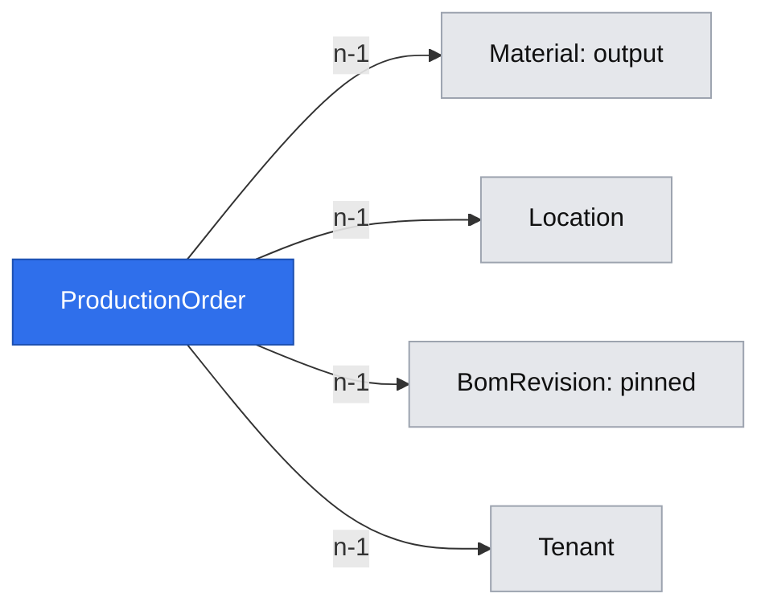

# Production orders

**Status:** ready
**Created:** 2026-10-20 20:47 UTC
**Issue:** #88 (E10-S01)

## 📝 TLDR
Both roles need to record manual production for one Make output at one location. Today the app has recipes, planning parameters and physical balances, but no production order. This proposal adds order creation and quantity/date edits, pins an immutable BOM revision, derives the planned start in calendar days and warns about component shortages without changing stock.

## 📝 Problem Statement
Issue #88 names the missing manual production document in slice 2 (D02). A BOM alone cannot record a production target or retain the recipe chosen for that target. The owner's functional baseline §03 and acceptance PRD-001…009, PRD-022, PRD-025/027 and LFC-018 define this story; completion, lifecycle commands and MRP remain separate work.

## Resolved assumptions (autonomous defaults)
| # | Question | Applied default | Rationale |
|---|---|---|---|
| Q1 | Default when no recipe has enough physical stock? | Highest-priority usable active/date-valid current recipe, with shortages. When feasible alternatives exist, preselect the highest-priority feasible one. An explicit lower-priority choice remains selected. | PRD-002 covers feasible defaulting; PRD-003/004 allow manual shortages. No projected inventory or multilevel planning is implied. |
| Q2 | Which edits and operations ship? | Only planned quantity/unit and planned finish. Output, location and pinned recipe remain fixed after creation. No completion, Cancel, Close Early or delete. | Smallest capability required by #88; future stories can widen the edit contract without replacing historic references. |
| Q3 | How do later BOM/parameter edits affect the order? | Always retain the pinned revision, stored quantity/conversion and captured lead time. Finish-date edits derive start from that captured lead time; no-op edits preserve version/audit. | Avoid silent history revaluation and allow edits when a logical BOM is later inactive or outside its original date range. |
| Q4 | Apply minimum lots/multiples to manual input? | Store the positive user-entered target converted once; scale direct component requirements upward to six decimals. Lot rounding and projected feasibility belong to MRP. | Manual entry records the requested quantity; baseline lot rules are in MRP §04. |

These defaults change no active product decision, permission or existing API. They are surfaced on the issue for owner override before merge.

## 📝 Proposed Solution
Add the `production-orders` concept using existing tenant scopes, exact decimals, audit, optimistic locking, keyed API writes, CrudForm, DataTable and master-reference pickers. An order records one output, one location, one explicitly pinned current BOM revision and its target. A read-only options operation computes usable alternatives, required component quantities and physical shortages; creation rechecks inside its transaction.

Market check (2026-10-20): [ERPNext Work Order](https://docs.frappe.io/erpnext/work-order) combines an output, BOM, target quantity and required-material view; stock changes through separate stock entries. CPG adopts this separation and a visible recipe choice. Workstations, job cards, capacity and costs are excluded by N01/N04; the comparison adds no requirements.

## 📝 Architecture
- `db/src/entities/production-orders/production-order.entity.ts`: tenant-owned document; register/export and generate an additive migration with snapshot/index. Reuse existing DocumentState values; all new orders are Open, with zero produced/abandoned progress.
- `core`: pure scheduling/requirement calculations and fixtures under `domain/production-orders/`; strict schemas under `validators/production-orders/`; scoped `ProductionOrderService` (`list`, `get`, `options`, `create`, `update`, `seedDemo`); leaf recipe/record/usage helpers. No service resolves another service for shared lookups. Use real SQLite tests.
- Integrity: MaterialService's permanent type/BUoM locks include output references; unfinished direct output orders block output deactivation. LocationService refuses deactivation while any Open production order remains. BOM component-only references keep the baseline's existing deactivation policy; no new hard component reservation is added.
- `app`: list/detail pages and actions under `/admin/[tenant]/production-orders`; collection/item/options APIs, components, EN/PL strings, help and an entry in the existing Transactions group with an icon. Database server components use connection() inside Suspense.
- Extend the shared seed registry after materials, locations, planning parameters, BOMs and stock. Startup remains best-effort; atomic Test reset requires the production fixture too. Read-only and edited datasets keep existing seed conventions.

## 📝 Data Model
`ProductionOrder`: UUID id; tenant FK; unique tenant-local eight-digit code; output Material FK; Location FK; BomRevision FK; planned quantity as BUoM text plus enteredQuantity/enteredUnit/numerator/denominator; plannedFinish and plannedStart as ISO dates; captured leadTimeDays; DocumentState status; produced and abandoned six-decimal text initially zero; createdAt, updatedAt, integer version. The stored revision relation supplies the logical BOM/code and revision number; never resolve a current revision when reading an order.

Indexes support tenant+code pagination, tenant+location+status and tenant+output+status usage guards, plus the revision relation. No completion table or MRP source is added prematurely.

The order points to an immutable revision, whose existing component rows retain their own material references. Migration rollback drops only the new table and loses orders, so down is disposable-test-only; production image rollback retains the additive schema. Test reset derives the new owned table from ORM metadata. No new personal or credential data is introduced.

## 📝 Business rules
- New output/location must be active in this tenant; output is intermediate or finished with a Make planning-parameter set at that location. Raw, Buy or missing parameters refuse before writes.
- Usable new recipes are active logical BOMs for the selected output, using their current revisions, with inclusive validity on planned finish. Every component must be active. Priorities use existing 1-is-highest ordering; equal active overlaps are already forbidden by BOM maintenance.
- Requirements are direct pinned component BUoM quantities × target BUoM, rounded upward once to six decimals using bigint arithmetic. Missing balance means zero. No inbound pipeline, cross-location stock, recursive explosion, reservation or capacity check is involved. Overflow refuses before writing. Requirement and shortage values are strings.
- A recipe with shortages is selectable; creating the order moves no balance and writes no StockMovement. Warnings identify component, base unit, required, available and missing quantities. A zero shortage yields an empty warning array.
- Planned start is planned finish minus captured whole-calendar-day lead time using UTC date arithmetic, including weekends and leap days. Reject derived dates outside the four-digit ISO date range; past dates remain allowed for manual planning.
- Creation pins the selected current revision explicitly. Later revisions, logical deactivation or validity changes never repin existing orders. An edit retains that recipe without rechecking new-selection validity. Current physical-shortage display is advisory and labelled as current, not historical stock.
- Edits require Open status and caller version. Quantity-only edits keep captured lead time; changed quantity/unit converts using current factors, unchanged normalized quantity/unit retains its stored conversion. Date-only edits never revalue quantity. Future produced progress is respected: target cannot fall below produced. No-op saves advance neither version nor audit.
- All create/update checks, sequential-code allocation, record writes and allowlisted audit commit atomically. Unknown tenant/master/order references never leak data. Both roles have the same transaction permissions. Shared wrappers enforce writable tenant, key, generation and version rules.

## 📝 API Contracts
Base `/api/tenants/{tenant}/production-orders`; business IDs in URLs/JSON. Shared result envelope; quantities are JSON strings. GET permits existing session/bearer read authentication; writes use tenantApiWrite with bearer, Idempotency-Key, Test Dataset-Generation and writable-tenant checks.

- GET collection `?page=1`: fixed pages of 100 by ascending code, array data; positive integer page capped at 1,000,000, default 1. Unknown/invalid queries refuse. Queries load bounded headers; only item reads include detailed pinned components. UI previous/next follows the existing order pagination pattern.
- GET `/{id}`: detail including pinned recipe components, captured lead time, entered and BUoM target, dates, progress, status/version and current shortages. Missing/malformed/other-tenant code gives `PRODUCTION_ORDER_NOT_FOUND`.
- GET `/options?output=…&location=…&quantity=…&unit=…&plannedFinish=…`: strict validated query. Returns normalized quantity, plannedStart/leadTimeDays, usable alternatives (`bom`, `revision`, priority, validity, components with required/available/shortage) and default selected pair. No mutation or write key required; works in read-only tenants.
- POST `{ output, location, quantity, unit, plannedFinish, bom?, revision? }`: omitted pair selects the service default; supplied pair must include both fields. Returns full created detail through existing HTTP 200 wrapper. Explicit pair must still be a usable current revision at save; a newly superseded choice refuses with `PRODUCTION_BOM_CHANGED` so the caller reviews it again.
- PATCH `/{id}` `{ version, quantity?, unit?, plannedFinish? }`: omitted values retain current fields; quantity and unit may be provided independently using the stored other value. Request is strict, refusing output/location/bom/revision/status/progress/id and unknown fields. Returns detail. Never accepts plannedStart or leadTimeDays from the client.
- Summary view: `{ id, output, location, bom, revision, quantity, enteredQuantity, enteredUnit, numerator, denominator, plannedFinish, plannedStart, leadTimeDays, produced, abandoned, status, version, createdAt, updatedAt }`. Detail adds `components` and `shortages`. Internal UUIDs are not exposed. Component records show material, baseUnit, per-output quantity and calculated requirement/current balance/shortage; revision link targets existing BOM detail `?revision=N`.
- Errors: existing master not-found/inactive codes, `VALIDATION_FAILED` with field errors for dates/quantities/selection; `PRODUCTION_REQUIRES_MAKE` for missing/Buy parameters or raw output, `PRODUCTION_NO_USABLE_BOM`, `PRODUCTION_BOM_CHANGED`, `PRODUCTION_ORDER_LOCKED`, `VERSION_CONFLICT`, `PRODUCTION_ORDER_IDS_EXHAUSTED`, `PRODUCTION_ORDER_ID_RACE`. Usage guards return `MATERIAL_HAS_PRODUCTION_ORDERS` / `LOCATION_HAS_PRODUCTION_ORDERS`, parameters `{order}` and UI links to that document. EN/PL errors retain parameters. Refusals write nothing.
- Audit: `production-orders.production-order.created` / `.updated`, subject ProductionOrder/code with output label. Allowlist scalar snapshots: output, location, BOM code/revision, quantity and conversion record, dates, captured lead time, status/progress. Failed saves/no-ops record nothing; UI/API actor is supplied by shared wrappers.

## 📝 UI/UX
Use the standard tenant list and detail layout. List shows ID link, output, location, target BUoM, finish/start, pinned BOM revision and status; wraps labels, hides secondary columns on narrow screens, provides pagination. Detail shows the pinned-revision link and direct component requirements/current stock/shortages table. An explicit banner says shortages allow planning and stock is checked when posting a completion (future story). No completion button ships here.

Create is a scrollable dialog composed over CrudForm in two steps: enter active Make output/location, target/unit and planned finish; Preview fetches recipe options and derived date. The choice step preselects the default and lets users select another usable alternative. Show selected recipe's shortages and a Create order button even when short. Back edits inputs and discards prior preview; no stale preview can silently overwrite a changed explicit revision. Recheck on save and show translated errors.

Edit uses CrudForm with quantity/unit/finish only and captured lead time displayed. Keep the opening order/version until close; a conflict refresh cannot pair stale form values with a newer version. Save refreshes the screen. Cancel, pending and keyboard behavior follow existing forms. Read-only tenants hide writes and retain readable history/options. Empty states explain how to create an order; no usable Make output or recipe explains what the administrator must configure. Static Suspense fallback has no strings; all strings/help are EN/PL, theme follows existing tokens. Usage refusal identifies and links the blocking order.

Visual evidence: the shared test-env descriptor is absent in this checkout. The spec workflow permits text-only evidence in that case. Live implementation UI verification and screenshots remain required before publication.

## 📝 Edge Cases & Failure Scenarios
- Two orders sharing dates/location both save. No stock movement occurs even when all components are missing.
- Components at another site/tenant never satisfy a shortage; absent balances are zero. Exact tiny positive requirements round upward, not to zero.
- A lead-time change between preview and creation captures the latest value at creation and returns the authoritative dates; the preview labels dates as indicative. New revision/deactivation between preview and create refuses the explicit choice; no silent repin. A lower-priority explicit choice stays chosen.
- Updating finish outside the pinned revision's original validity still keeps that revision; it is an existing order, not a new BOM selection.
- Removing/changing planning parameters cannot silently recalculate an old start. BOM changes cannot alter pinned requirements. Conversion changes affect future changed entries only.
- Material/location guards run in the master's edit transaction. Location refusal links the first Open order. Direct output references permanently lock type/BUoM; component-only links follow existing BOM policy.
- Tenant reset invalidates stale writes before key replay; a fresh reset contains the demo order. Startup seeds idempotently and tolerates edited Test data without overwriting orders.
- Creation races use shared stale-snapshot retry plus tenant/code unique index. Version races map to the shared conflict. Any late audit/flush error rolls the whole write back.

## 📝 Risks & Impact Review
Risk-high: additive persisted document and tenant API contract. Primary risks are revision drift, recalculated historic conversions/lead time, silent locked-field acceptance and cross-tenant stock reads. Behavioural SQLite tests and HTTP/browser journeys cover these. Record new paths/errors in BACKWARD_COMPATIBILITY.md. No new library, financial/capacity workflow, authentication or deployment setting is proposed. Spec publication is design-only; implementation stays on a separate branch/PR referring to this spec and closing #88.

## 📝 Decisions in play
R02 output/type/unit rules; R03 exact quantities; R04 pinned immutable revision; R05 tenant isolation/read-only; R07 UI/API parity/idempotency/generation; R08 audit; D02 manual documents before MRP; D04 smallest consistent baseline; D06 seeded Test. N01/N04 exclude finance and capacity. No product decision is superseded.

## Implementation Plan
### Phase 1 — Domain and persistence
- Step 1.1: Add entity/export/migration/snapshot/index; cover migration up/down, ownership and isolation; update migration-count smoke assertion.
- Step 1.2: Add strict schemas and pure calendar/requirement arithmetic with boundary, leap-day, tiny quantity and overflow tests.
- Step 1.3: Implement options/create/get/paginated list/update with real SQLite tests for selection, shortages/no-stock-change, pinned history, conversion history, no-op, stale version, rollback and tenant scope.
- Step 1.4: Add leaf material/location usage guards and shared seed/reset registry integration with regression tests.
### Phase 2 — Delivery surfaces
- Step 2.1: Add collection/item/options routes and actions, wrapper/auth/forwarding tests and protected-contract documentation.
- Step 2.2: Add EN/PL list/detail/create/edit, navigation/icon/help, responsive layout and behavioural component/page tests.
- Step 2.3: Add focused API/browser integration files covering both roles, default/manual BOM choice, shortages, history, dates/edits, read-only, generation/key/version and master guards.
### Phase 3 — Verification and publication
- Step 3.1: Run lint, typecheck, unit coverage at 100%, build, touched integrations plus migration smoke; live desktop/mobile checks and screenshot evidence. Leave the full integration suite to PR CI.
- Step 3.2: Review against standards and compatibility, fix findings, publish separate implementation PR closing #88 and referencing the design. Check complete CI at the final head; manual QA/approval stays required.
