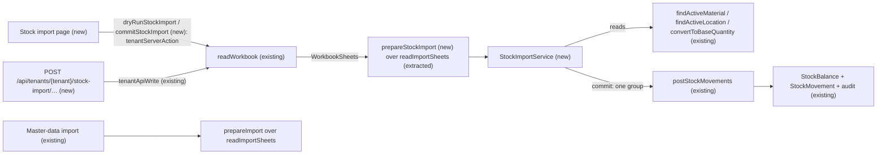
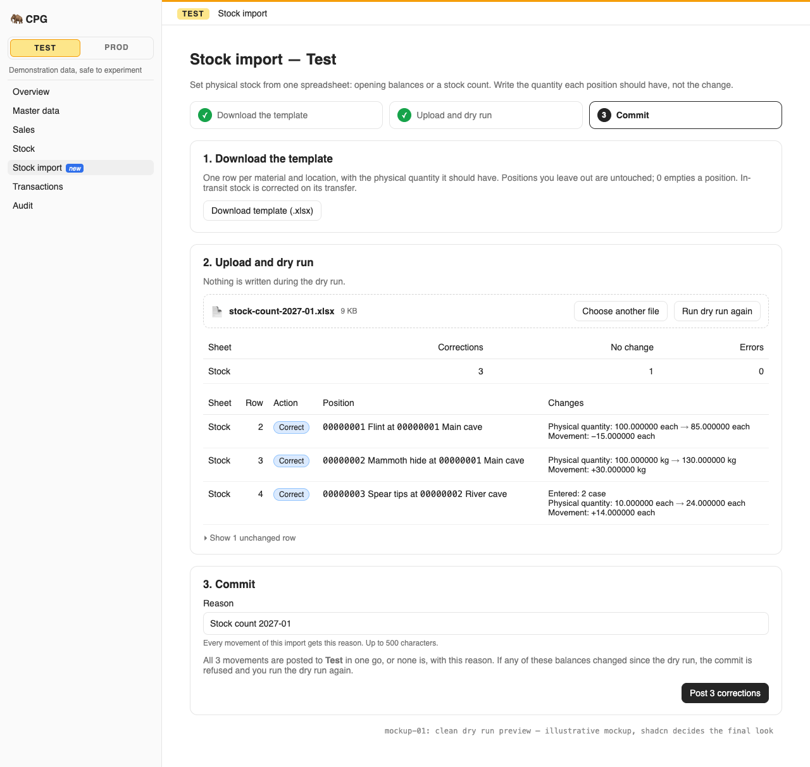
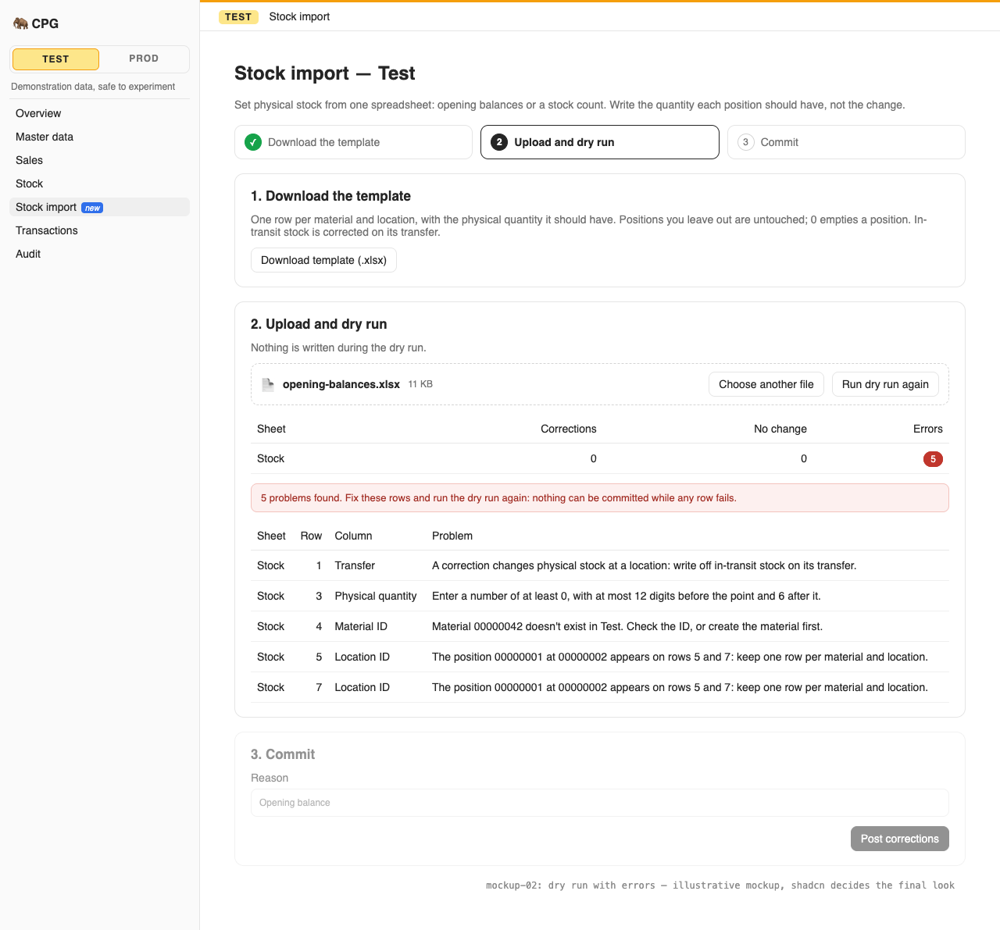
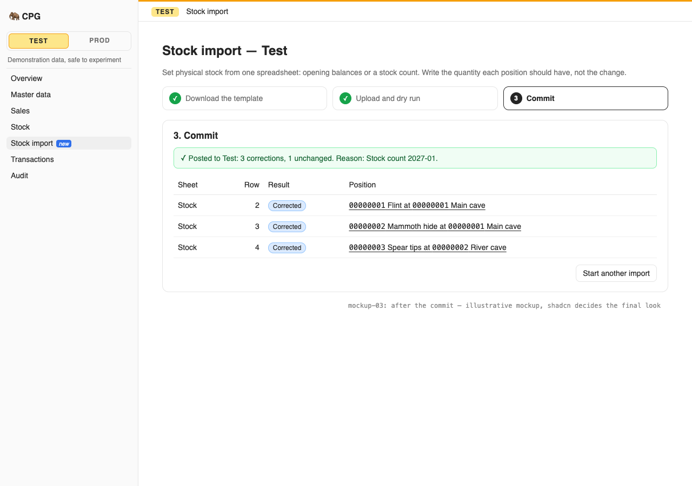

# A user imports desired physical stock from a workbook, as opening balances or corrections, with a dry run and an atomic commit

**Status:** ready
**Created:** 2026-10-20 22:25 UTC
**Issue:** #81 (E07-S02), epic #73 · **Builds on:** `implemented/2026-10-20--0908UTC-master-data-bom-import.md` (#27: the workbook adapter, the layout check, cell normalization, duplicate keys, the preview token, the import report and screen), `implemented/2026-10-20--1634UTC-stock-ledger-corrections.md` (#80: `postStockMovements`, the ledger, the balance row, the transit refusal of manual corrections), `implemented/2026-10-20--2046UTC-transfers.md` (#82: in-transit stock belongs to its transfer) · **Design authority:** `.ai/specs/product-brief.md` (R03, R05, R07, R08, R09, D02, D05), `.ai/specs/research/CPG-prd001.pdf` §05 ("Stock XLS, opening balances and corrections", "Stock movement and correction") and §06, `CPG-prd-decisions.pdf` ("Opening stock and XLS correction", I-02), `CPG-prd-datamodel.pdf` ("Inventory adjustment", "Import dry run"), `CPG-acceptance.md` (STX-001…021, INV-016, TRF-014, API-028, AUD-022), `research/decisions/D07-manual-stock-input.md` (XLS input stays absolute), [mockup 01, the sidebar tree](assets/menu-revamp/01-sidebar-tree/index.html) (Inventory → **Stock import**, for everyone)

## 📝 TLDR

Today stock changes one signed correction at a time, so an opening balance or a stock count of a few hundred positions means hundreds of dialogs. This spec proposes a **Stock import** screen and two API calls for **both roles**. The user downloads a one-sheet `.xlsx` template, fills in the **physical quantity each position should have** (material, location, quantity, unit), and uploads it for a **dry run**. The dry run reads the current balances, computes each row's signed movement, and shows "−15", "+30" or "No change", or every error by sheet, row and column. Only an error-free dry run can be **committed**, with **one reason** for the whole workbook ("Opening balance", "Stock count 2027-01"). The commit re-reads every balance and posts all the movements as one ledger posting, or nothing if any balance changed since the dry run. Positions the workbook doesn't list are untouched, a 0 empties a position, and in-transit stock is never a location balance. The engine, the adapter, the report and the screen are the master-data import's (#27), with a new stock layout. There is no new import engine and no schema change.

## Resolved assumptions (autonomous defaults)

| # | Question | Chosen answer | Rationale |
|---|---|---|---|
| Q1 | Add a Stock sheet to the master-data workbook, or a separate stock workbook? | **A separate workbook on the same engine.** It has its own template (`cpg-stock-template.xlsx`) with one data sheet, **Stock**, plus the Instructions and Instrukcja sheets. It has its own screen, `/admin/[tenant]/stock-import`, and its own two API calls. The master import's layout check, cell normalizers, duplicate pass, adapter, token, report and screen are generalized over a **layout** (a list of sheets with its rules). Each import passes its own layout. | Their audiences differ. The master import is admin only (TEN-004). Stock corrections are for both roles (STX-018, PRD "Users/admins can upload"). One workbook would need per-sheet authorization, and a normal user would be handed a template whose other sheets refuse them. The owner-chosen menu mockup has a separate **Stock import** entry under Inventory, for everyone. The issue asks for "a stock sheet, not a second import engine", and this is that: one engine, two layouts. |
| Q2 | What does a row mean? | **The physical quantity the position should have after the commit**, never a change (PRD §05, D07). Columns: **Material ID**, **Location ID**, **Physical quantity** (at least 0, six decimals), Unit (blank: the material's base unit). The movement is the desired quantity, converted to the base unit, minus the current physical balance. A zero difference is **No change** and posts nothing (STX-005). A 0 posts the balance down to exactly zero (STX-009). Positions the workbook doesn't list are untouched, whatever the site (STX-006…008). | The PRD: "desired physical current stock, not adjustment deltas. System calculates changes … absent rows remain untouched". |
| Q3 | Units (STX-015)? | The desired quantity is converted with the material's **current** conversion through `convertToBaseQuantity`, the helper manual corrections use: six decimals, rounded half up (R03). A 0 converts to exactly 0, but its unit must still be the base unit or a unit the material converts (`UNIT_NOT_CONVERTIBLE` otherwise). 2 cases at 12 each per case is a desired 24 each, so the movement is 24 minus the current balance. The movement is posted **in the base unit**, so its entered quantity is the signed difference, with factor 1/1. The case quantity the user typed is shown in the import report only: the ledger and the audit record the base-unit movement and the balances before and after, which is what STX-021 asks for. | A difference in cases is often not a whole or exact number (14 each = 1.1666… cases). Posting it in cases would round twice. The base-unit movement is exactly what the balance changes by. |
| Q4 | The reason (STX-014)? | **One reason for the whole workbook, given with the commit**: a required field on the screen's commit step, and `reason` in the commit body (1–500 characters, the manual correction's `stockReasonSchema`). The dry run doesn't need it. A commit without one is `VALIDATION_FAILED` on `reason`, before anything is read. Every movement of the commit carries it. The template's instructions explain this, with "Opening balance" and "Stock count 2027-01" as examples (STX-001). | The issue's outcome is "an atomic commit that posts them with one reason", and `postStockMovements` takes one reason per posting. A reason column would allow a different reason on every row. It would also make a valid workbook invalid only for lacking a note, while STX-014 speaks of a valid workbook refused at commit. |
| Q5 | Movement type, and how the commit posts? | One **`correction`** posting: one source ID (a server-generated UUID) for all the commit's movements, with positions in sheet-row order, through `postStockMovements` with a `user` context. Every movement is audited `stock.movement.posted`, with the user's own account, session and channel (`ui` or `api`). An opening balance is an ordinary correction whose reason says so (INV-016, STX-002). The audit's before/after holds the balance before and after (the target), and the signed movement (STX-021). The import adds no summary audit entry. | That is the manual correction's posting, with the same ledger rows and audit, so the stock page and audit show an import exactly as they show a correction. One source ID ties the whole import together in the ledger. A new movement type would be a new contract every ledger reader must learn. |
| Q6 | How does a commit prove nothing changed since its dry run (STX-016)? | The master import's **preview token** (#27 Q7): the SHA-256 of the canonical JSON of the tenant's generation, the import kind (`stock`), the normalized cells, every row's outcome without its display label (the record key, the action, the current and desired balances and the movement) and the **version of every balance row read** (`none` when the pair has no row yet). The version only grows, and only `postStockMovements` writes balances, so even a −10 then +10 between the two calls is caught. Renaming a material in between is not stale. The commit carries the token, re-runs the same reads in its transaction, and posts only when it finds no error and computes the same token. Otherwise it is 409 `IMPORT_STALE`, and nothing is posted. A dry run with errors returns no token. | Any posting to a listed position (another user's goods issue, a receipt, a transfer dispatch) bumps that balance's version, so the old preview can't overwrite it. A changed conversion or a deactivated master changes the outcome or makes an error, so it's caught too. It is the same stateless mechanism as #27, with no table and no cleanup. |
| Q7 | Does the dry run write? | **No stock.** Unlike the master import, a stock row needs no service call to be checked: the dry run only reads materials, locations, conversions and balances, and runs no savepoint. Through the API it still stores its idempotency key and report, a brief write as for every keyed call. The commit does the same reads, clears the identity map, then posts once. Both go through the tenant write wrappers (Q9). | Every stock rule a row can break is checked before writing: it names an active material and location, its unit converts, and its quantity is in range. A desired balance of at least 0 can't go negative (R09). Not writing makes the dry run cheap and leaves other writers alone. |
| Q8 | In-transit stock (STX-020, TRF-014)? | A row always names a **location**, and its quantity is compared with that location's **physical** balance only. Stock in transit from or to the location belongs to its transfer, and is neither counted nor changed. A workbook whose header row has a column named exactly (case-insensitively) **Transfer**, **Transfer ID**, **In transit** or **In-transit** is refused on row 1 with `IMPORT_TRANSIT_COLUMN`: "A correction changes physical stock at a location: write off in-transit stock on its transfer." That is the manual correction's own message (`CORRECTION_TRANSIT_MESSAGE`). Any other extra column is the generic `IMPORT_UNKNOWN_COLUMN`. | The manual correction refuses a `transfer` field outright with that message, rather than ignoring it. The workbook gets the same explicit refusal and points to the transfer write-off, which is the only way to correct transit (PRD §05). |
| Q9 | Who, which tenants, which gates? | **Both roles** (STX-018), in both channels. Dry run and commit go through `tenantServerAction` and `tenantApiWrite`: `Idempotency-Key`, `Dataset-Generation` for Test, and the read-only gate. Both are refused in a read-only tenant with 409 `TENANT_READ_ONLY`, writing no stock and no audit (STX-019). The page shows the lock. Any signed-in account downloads the template. | These are the master import's gates (#27 Q11, Q13), minus the admin check. A dry run in a read-only tenant would be harmless, since it reads only, but it would be a gate exception for no scenario, so it stays blocked as in #27. |
| Q10 | Errors and duplicate keys? | **Cell pass:** each Material ID and Location ID is an eight-digit ID (Q9 of #27). Physical quantity is the non-negative `quantitySchema`, so −1 is `VALIDATION_FAILED` on Physical quantity (STX-010). Unit is the material unit schema. **Key pass:** (material, location), whatever the unit. Every row sharing a key gets `IMPORT_DUPLICATE_KEY`, naming the other rows (STX-013). **Read pass:** an unknown material or location (the lookups' `MATERIAL_NOT_FOUND` / `LOCATION_NOT_FOUND`) becomes `IMPORT_MISSING_REFERENCE` on its column, with the stock wording "Material 00000042 doesn't exist in Test. Check the ID, or create the material first." (STX-011, STX-012). The stock screen's labels override that code's translation, which in the master screen carries the "earlier sheet" advice. An inactive one is `MATERIAL_INACTIVE` / `LOCATION_INACTIVE`. A unit without a conversion is `UNIT_NOT_CONVERTIBLE` on Unit. A desired quantity too large or too small for the base unit gives `QUANTITY_OUT_OF_RANGE` / `QUANTITY_ROUNDS_TO_ZERO` on Physical quantity. Every error is reported at once, and nothing can be committed while any row fails (STX-017, AUD-022). | These are the existing codes and messages, so the screen already translates them, plus the master import's own codes. The "earlier sheet" advice of the master import doesn't fit a one-sheet workbook, so the stock message advises creating the master on its page. |
| Q11 | Limits? | The master import's limits: 512 KB, 2,000 data rows, 20 MB inflated, 200,000 cells. They are checked before any database work: before the transaction opens on the screen, and first in the handler in the API, as in #27. One commit posts at most 2,000 movements in one posting. `postStockMovements`' doc comment is updated: its input comes from `stockPostingSchema` (the public `post`, at most 100 lines) or from the stock import, whose lines are valid by construction (nonzero, base unit, at most `IMPORT_ROWS_MAX`); a test pins that no zero line reaches the post. A 2,000-row dry run and commit are measured in Phase 1. If the commit isn't well under a second, the remedy is posting in chunks of 100 lines within the same transaction, clearing the identity map between them (`postStockMovements` gains a first-position offset so the positions stay unique in the posting). Lowering the cap is the last resort. | They already bound the adapter, and 2,000 positions covers a plant's opening balance. The master import's lesson (an identity map grown over 2,000 rows took 17.9 s instead of 0.4 s) applies to one long posting too. |
| Q12 | API? | `GET /api/stock-import/template` (the `.xlsx`, any signed-in caller). `POST /api/tenants/{tenant}/stock-import/dry-run` with `{ workbook }`. `POST …/stock-import/commit` with `{ workbook, previewToken, reason }`. Both answer the master import's `ImportReport`. A replayed commit returns the first report and posts nothing twice (API-028). Added to `BACKWARD_COMPATIBILITY.md` §4. | This is #27's contract shape, so clients and the screen reuse the report type. `stock-import` keeps the new routes beside `stock`, the page and the help topic under one name. |
| Q13 | Code names? | Concept `imports` (the shared engine) for the core pieces: `domain/imports/stock-layout.ts`, `domain/imports/prepare-stock-import.ts`, `services/imports/stock-import.service.ts` (`StockImportService`, scoped). The routes, page and help topic are `stock-import`, and the sidebar id is `stockImport`. | It is the import engine's second layout, not a new concept. The stock posting stays in `services/stock/stock-posting.ts`, which the import calls as a leaf, as documents do. |

Every default is reversible before merge, and none weakens a rule. No question needs the owner's confirmation. Q1 (a separate workbook and screen) is the call a reviewer should look at first: it follows the owner's menu mockup and the role split, and costs a second, small template.

## 📝 Problem Statement

The PRD's stock workflow is: "Users/admins can upload desired factual on-hand stock, not adjustment deltas, for selected material/location positions including partial locations. System calculates adjustments, requires reason, and posts audited inventory movements; missing positions are untouched. Same complete dry-run/atomic/optimistic checks. No ordinary in-transit correction." (§05). The decision register approves "download templates, dry run then atomic apply of desired balances; partial site/material file leaves omitted inventory untouched", and I-02 asks that "two lines, one invalid → all reported, no stock changes; second clean submit with versions unchanged → atomic apply". The acceptance set is STX-001…021, with INV-016, TRF-014, API-028 and AUD-022. Today the ledger (#80) only takes one signed correction at a time, by dialog or `POST …/stock/corrections`. A plant's opening balance, or a monthly count, can't be entered as a spreadsheet.

## 📝 Proposed Solution

- **Generalize the master import's database-free half over a layout.** `prepareImport` today checks the layout, normalizes cells and finds duplicate keys against the fixed `IMPORT_SHEETS`. Extract that into `readImportSheets(layout, workbook)`, plus the `parseRows` and `unique` passes, parameterized by a layout (its sheets, its instruction-sheet rules, and its refused columns, Q8). The master import passes `MASTER_DATA_LAYOUT`, with unchanged behaviour and its tests unchanged. The stock import passes `STOCK_LAYOUT`. The adapter's `templateWorkbook(layout)` and the help read the same layout. The touch points are: `workbook-layout.ts` (`sheetNamed`, `sheetSpec`, `columnHeader`, `SheetKey`), `prepare-import.ts`, and `instructions()` / `IMPORT_RULES` in `workbook-file.ts`. The master apply pass (`apply-import.ts`'s `ordered` and `summarize`, `apply-context.ts`'s `runRow`) stays master-only: the stock import has one sheet, so it orders its errors by row and builds its one-line summary itself.
- **`prepareStockImport(sheets)`** (pure) gives `PreparedStockImport`: the parsed rows of the Stock sheet, the normalized cells and the errors so far (Q10).
- **`StockImportService.dryRun(prepared, actor)`** and **`commit(prepared, previewToken, reason, actor)`** run one **read pass**. For each row, it loads the active material and location, converts the desired quantity (0 is 0 in any unit), and reads the balance (`refresh: true`) and its version. It computes the signed movement, then the outcome and the token (Q6). The commit then clears the identity map and posts the non-zero movements as one `correction` group with `postStockMovements` (Q5), in the caller's write transaction.
- **App:** the adapter, routes, actions and page reuse `readWorkbook`, `tenantApiWrite`, `tenantServerAction`, `uiActor`/`apiActor` and the generalized `ImportScreen` (its actions, template link, labels, record links and an optional reason field become props).

**Alternatives considered:**
- **A Stock sheet in the master-data workbook.** It would let a new material and its opening balance land in one file. But it needs per-sheet authorization, a reason that only applies to one sheet, and a dry run that writes for stock rows too. It also contradicts the owner's menu mockup. Rejected (Q1). A user can still import masters first, then stock.
- **A reason column per row.** Rejected (Q4).
- **Signed deltas in the workbook.** Forbidden by the PRD and D07: XLS input is the desired balance.
- **Posting each row as its own correction.** That would give 2,000 source IDs for one count, and the ledger couldn't show that they belong together. One group is atomic by construction (`postStockMovements` checks every line before its one flush).

**Market check.** ERPNext's *Stock Reconciliation* takes the counted quantity per item and warehouse, computes the difference, and posts it as one voucher with ledger entries. It is the same "desired balance, not delta" model and one source document, which CPG takes. It also revalues stock, which CPG skips (no valuation, N04). Odoo's inventory adjustment ("Counted quantity" → "Apply") computes the difference per quant, but keeps a persisted, editable count session. CPG's stateless dry run plus a freshness token (Q6) gives the same protection against concurrent moves without a session table. Neither of them lets a count touch in-transit quantities, as Q8 also refuses.

## 📝 Architecture

- **`core`:**
  - `domain/imports/workbook-layout.ts`: `ImportLayout` (`{ kind, sheets, rules, refusedColumns? }`). `MASTER_DATA_LAYOUT` wraps today's `IMPORT_SHEETS` and `IMPORT_RULES`. `sheetNamed`, `sheetSpec` and `columnHeader` take the layout. The existing exports stay, as the master layout's, so no caller breaks.
  - `domain/imports/stock-layout.ts`: `STOCK_LAYOUT`, the **Stock** sheet (Data Model below), its rules in English and Polish (desired balance, untouched positions, zero, units, transit, the reason at commit, the limits), and the transit columns of Q8.
  - `domain/imports/read-sheets.ts`: the layout check, cell normalization, schema pass and duplicate pass, moved out of `prepare-import.ts` and parameterized. `prepare-import.ts` keeps the master-only passes (new-inactive rows, BOM grouping).
  - `domain/imports/prepare-stock-import.ts`: `prepareStockImport(sheets)`. Pure.
  - `validators/imports/import-rows.schema.ts`: `stockRowSchema` (`material`, `location`: IDs; `quantity`: `quantitySchema`; `unit`: blank or `unitSchema`).
  - `validators/imports/import-request.schema.ts`: `stockImportDryRunSchema` (= `importDryRunSchema`) and `stockImportCommitSchema` (`{ workbook, previewToken, reason: stockReasonSchema }`).
  - `services/imports/stock-import.service.ts` (`StockImportService`, scoped, `({ em, tenant, tenantService })`): `dryRun` and `commit`. Registered in `container.ts`/`cradle.ts` and exported from `index.ts`. It imports the leaves `findActiveMaterial`, `findActiveLocation`, `convertToBaseQuantity` and `postStockMovements`, not `StockService`.
- **`app`:**
  - `components/imports/workbook-file.ts`: `templateWorkbook(layout)` (default: the master layout, so its route doesn't change).
  - `app/api/stock-import/template/route.ts` (`GET`), and `app/api/tenants/[tenant]/stock-import/{dry-run,commit}/route.ts` (`POST`, `tenantApiWrite`, no `authorize`).
  - `app/admin/[tenant]/stock-import/{page.tsx,actions.ts}`.
  - `components/imports/import-screen.tsx`, generalized: `actions`, `templateHref`, `pages` (record links), the summary columns and `reason` become props. `components/imports/stock-labels.ts`. The sidebar entry `stockImport`. An **Import from spreadsheet** link on the Stock page. English and Polish strings, the help topic `stock-import`, and translations for the new codes.
- **`db`:** nothing. No entity, no migration.

The change is additive for every contract. The one refactor is internal: the master import's preparation moves behind a layout parameter, and its unchanged test suite pins that.

## 📝 Data Model

No change: no entity, no migration. The dry run's state lives only in its response and token (Q6). The data-model graph is skipped for that reason.

The workbook (`STOCK_LAYOUT`). **Bold** columns are required.

| Sheet | Columns | Key | Applies |
|---|---|---|---|
| Stock | **Material ID**, **Location ID**, **Physical quantity**, Unit (blank: base unit) | material, location | one `correction` movement per changed row, in one posting |

Template examples: `00000001`, `00000001`, `100`, `each`, with a second row for `00000002` at `00000001` of `2` `case`.

## 📝 API Contracts

The three routes answer the shared envelope. Dry run and commit answer the master import's `ImportReport` (#27 API Contracts). For the Stock sheet:
- `rows[].action` is `update` (a movement posts) or `unchanged` ("No change"). `create` never occurs, and `summary[].created` is always 0.
- `record` is `"{material}/{location}"`, and `label` reads `"00000001 — Flint at 00000002 — Main cave"`.
- `changes` on an `update` lists `Physical quantity` (`"100.000000 each"` → `"85.000000 each"`) and `Movement` (`null` → `"-15.000000 each"`). It adds `Entered` (`null` → `"2 case"`) when the row's unit isn't the base unit. An `unchanged` row lists none.

| Method and path | Body | Success | Errors (besides the pipeline's) |
|---|---|---|---|
| `GET /api/stock-import/template` | — | `200`, the `.xlsx` (`Content-Disposition: attachment; filename="cpg-stock-template.xlsx"`) | `UNAUTHORIZED` |
| `POST /api/tenants/{tenant}/stock-import/dry-run` | `{ workbook }` | `ImportReport`, `committed: false`. Workbook errors are in the report | `VALIDATION_FAILED` on `workbook` (as #27), `TENANT_READ_ONLY` |
| `POST /api/tenants/{tenant}/stock-import/commit` | `{ workbook, previewToken, reason }` | `ImportReport`, `committed: true`, `previewToken: null` | as the dry run, plus `VALIDATION_FAILED` on `previewToken` or `reason` (`STOCK_REASON_MESSAGE`), and 409 `IMPORT_STALE` |

Report codes: the master import's `IMPORT_EMPTY`, `IMPORT_UNKNOWN_SHEET`, `IMPORT_DUPLICATE_SHEET`, `IMPORT_MISSING_COLUMN`, `IMPORT_UNKNOWN_COLUMN`, `IMPORT_DUPLICATE_KEY` and `IMPORT_MISSING_REFERENCE`, plus the new `IMPORT_TRANSIT_COLUMN` (Q8). Also the existing `MATERIAL_INACTIVE`, `LOCATION_INACTIVE`, `UNIT_NOT_CONVERTIBLE`, `QUANTITY_OUT_OF_RANGE`, `QUANTITY_ROUNDS_TO_ZERO`, and `VALIDATION_FAILED` on its column.

`StockImportService` (core) must run inside the caller's write transaction:
- `dryRun(prepared, actor)` returns the report. It reads only.
- `commit(prepared, previewToken, reason, actor)` returns the report with `committed: true`, having posted one `correction` group (Q5), or throws `IMPORT_STALE` (Q6). `reason` arrives parsed by the commit schema.

Server actions in `app/admin/[tenant]/stock-import/actions.ts`: `dryRunStockImport(tenant, generation, { workbook })` and `commitStockImport(tenant, generation, { workbook, previewToken, reason })`. Each reads the session (`UNAUTHORIZED` when signed out), parses its input, reads the workbook and calls `prepareStockImport`, all before `tenantServerAction` (as #27 Q10). A commit refreshes `/admin/{tenant}/stock`.

## 📝 UI/UX

- **Sidebar:** **Stock import** right after Stock, for both roles (mockup 01's Inventory → Stock import). The Stock page shows an **Import from spreadsheet** link next to its pair picker.
- **`/admin/[tenant]/stock-import`**, titled "Stock import — Test". The intro: "Set physical stock from one spreadsheet: opening balances or a stock count. Write the quantity each position should have, not the change." It has the master import's three steps:
  1. **Download the template.** One paragraph: one row per material and location; the physical quantity it should have; positions not listed are untouched; 0 empties a position; in-transit stock is corrected on its transfer. Then **Download template (.xlsx)** (`/api/stock-import/template`).
  2. **Upload and dry run.** As #27, except that the summary shows Corrections, No change and Errors (no Created column). Without errors, the preview lists Sheet, Row, Action (**Correct** / **No change**), Position, and Changes ("Physical quantity: 100.000000 each → 85.000000 each", "Movement: −15.000000 each"). No-change rows are folded under "Show N unchanged rows".
  3. **Commit.** A required **Reason** input (placeholder "Opening balance", at most 500 characters), then **Post N corrections**, enabled only after an error-free dry run of the chosen file with a reason filled in. With nothing to change it is disabled, showing "Nothing to change." The note reads: "All N movements are posted to Test in one go, or none is, with this reason." On success: "Posted to Test: 2 corrections, 1 unchanged", with each position linking to its Stock page (`stock?material=…&location=…`). On `IMPORT_STALE`, the translated explanation appears and the screen returns to step 2.
- **Read-only tenant:** the banner, and steps 2–3 disabled with the lock sentence. Step 1 stays available.
- **Help:** the topic `stock-import` in English and Polish covers absolute quantities, untouched positions, zero, units and rounding, transit, the reason, the dry run and stale commits, the limits and the API calls. The Stock topic links to it.

Prototype: `.ai/specs/assets/stock-import/`, static mockups following #27's. They are illustrative only.
- `mockup-01-dry-run-preview.png`: step 2 with a clean preview (−15, +30, a case row, a no-change row folded).
- `mockup-02-dry-run-errors.png`: step 2 with errors (−1, an unknown material, a duplicate position, a Transfer column).
- `mockup-03-committed.png`: step 3 with the reason, after a commit.

## 📝 Edge Cases & Failure Scenarios

| Case | Behaviour |
|---|---|
| The template | One Stock sheet with Material ID, Location ID, Physical quantity, Unit and two example rows. The Instructions and Instrukcja sheets explain desired balances, the reason at commit and the examples (STX-001) |
| Prod empty; row M/X 100 committed with reason "Opening balance" | One `correction` movement +100, balance 100; ledger and audit show the reason, actor and channel (STX-002, INV-016) |
| M/X at 100; row 85 | Preview `Movement: -15`; commit posts −15, balance 85 (STX-003) |
| M/X at 100; row 130 | +30, balance 130 (STX-004) |
| M/X at 100; row 100 | "No change"; no movement, no audit (STX-005) |
| Sites A, B, C with stock; workbook lists only some of A's positions | Only the listed positions move; everything else is untouched (STX-006…008) |
| M/X at 100; row 0 | −100, balance exactly `0.000000` (STX-009) |
| Row −1 | `VALIDATION_FAILED` on Physical quantity; no token (STX-010) |
| Unknown material / location | `IMPORT_MISSING_REFERENCE` on its column, with advice (STX-011, STX-012) |
| Two rows for M at X (in any units) | `IMPORT_DUPLICATE_KEY` on both rows; no token (STX-013) |
| Commit without a reason, or a blank one | `VALIDATION_FAILED` on `reason`; no movement, no audit (STX-014) |
| 2 case, 12 each per case, M/X at 10 | Desired 24 each; movement +14 each; `Entered: 2 case` (STX-015) |
| A dry run sees 100 and target 85; another user then posts −10 | That balance's version changed: the commit is `IMPORT_STALE`, and the −10 is kept (STX-016) |
| Two valid rows and one invalid | The error is listed, there is no token, and nothing commits; a forged token is `IMPORT_STALE` (STX-017, AUD-022) |
| A normal user and the admin commit equivalent workbooks | Both succeed; each movement and audit entry names its own account and session (STX-018) |
| Prod read-only | Dry run and commit 409 `TENANT_READ_ONLY`; no stock or audit write; the page shows the lock (STX-019) |
| A Transfer, Transfer ID, In transit or In-transit column | `IMPORT_TRANSIT_COLUMN` on row 1, pointing to the transfer write-off (STX-020, TRF-014) |
| X holds 50 physical with 10 in transit to it; row 60 | +10 physical; the transfer's 10 in transit is unchanged |
| M/X 90 → 105 | Movement +15, `balanceBefore` 90, `balanceAfter` 105; the audit shows before 90, after 105, movement +15, the reason and the actor (STX-021) |
| A commit retried with its idempotency key | The first report, `Idempotent-Replayed: true`, nothing posted twice (API-028) |
| An inactive material or location | `MATERIAL_INACTIVE` / `LOCATION_INACTIVE` on its column |
| A unit without a conversion | `UNIT_NOT_CONVERTIBLE` on Unit |
| 0.0000001 kg, or a desired quantity past the storable maximum | `VALIDATION_FAILED` / `QUANTITY_OUT_OF_RANGE` on Physical quantity |
| Every row is No change | The commit button is disabled; an API commit returns `committed: true` and posts nothing |
| A master-data workbook uploaded here | Its sheets are `IMPORT_UNKNOWN_SHEET`, and the stock template is suggested in the instructions |
| A stale snapshot when the commit writes | Retried once by its wrapper, which re-runs the reads; a changed balance is then `IMPORT_STALE` |
| A non-`AppError` failure | The request fails as an internal error and rolls back |

## 📝 Risks & Impact Review

- **No schema change.** Rollback is a revert, and the movements an import posted stay ordinary corrections.
- **Refactor of the master import's preparation (Q1).** Moving the layout check behind a parameter could change master behaviour. Its whole existing suite (`prepare-import.test.ts`, the engine and adapter tests, `import.test.ts`) runs unchanged and must pass. Its exported names stay.
- **Write lock.** The dry run writes no stock (Q7). The commit holds SQLite's write lock while it posts at most 2,000 movements, their balances and audit entries. Phase 1 measures a 2,000-row dry run and commit and records the times in the plan, with the chunked-posting remedy of Q11 ready.
- **Strict staleness (Q6).** Any posting to a listed position between dry run and commit makes the commit stale. On a busy site the user re-runs the dry run. That is STX-016's rule, and the message says what to do.
- **New public contracts** (`BACKWARD_COMPATIBILITY.md` §4): three routes, the page URL, the help topic, and the Stock sheet's name, columns and meaning. Later changes must be additive.
- **Both roles bulk-write stock.** That is intended (STX-018), and every movement is audited per user. Masters stay admin-only.
- **`risk-high`** stays on the implementation PR: bulk stock writes behind a shared API contract, and a refactor of the master import.

## 📝 Decisions in play

- **R03** (exact six-decimal base quantities): Q3.
- **R05** (isolation; read-only blocks every write): Q9.
- **R07** (API parity, idempotency, generation): Q12.
- **R08** (audit): Q5.
- **R09** (no negative stock; today's business date): Q2, Q5.
- **D02** (slice 2 stock): this spec.
- **D05** (reuse the slice 1 import): Q1.
- **D07** (XLS input is absolute): Q2.

Nothing is superseded.

## Out of scope

- Master data in the stock workbook (Q1), in-transit quantities (E07-S03), and reversals of imported movements (E11-S02).
- Exporting current balances into the template.
- An inspection-only dry run in a read-only tenant (Q9).
- Historical posting dates: movements are dated today (INV-010).

## 📋 Phasing

One PR, built in this order. The phases are review checkpoints.

- **Phase 1 — Engine.** The layout generalization, the stock layout and schemas, `prepareStockImport`, and `StockImportService`, unit-tested on SQLite.
- **Phase 2 — Workbook and API.** The template for a layout, the three routes, `BACKWARD_COMPATIBILITY.md`, and API integration tests.
- **Phase 3 — Screen.** The actions, the generalized screen, the page, the sidebar entry and Stock page link, translations and help, and screen integration tests.

## 📋 Implementation Plan

### Phase 1 — Engine

1. **Layouts.** Add `ImportLayout` and `MASTER_DATA_LAYOUT` to `workbook-layout.ts`, and move the layout check, normalization, schema and duplicate passes into `read-sheets.ts`, parameterized by layout. `prepareImport` uses them with the master layout. The master tests run unchanged. New tests: a second layout's sheets, unknown sheets and refused columns.
2. **Stock layout and schemas.** `stock-layout.ts` (the sheet, examples, English and Polish rules, the transit columns), `stockRowSchema`, and the stock request schemas. Unit tests: IDs, quantities ≥ 0 (−1 and seven decimals refused), blank unit, reason required (1–500, trimmed), and every message constant.
3. **Prepare.** `prepareStockImport`. Tests: empty, unknown sheet, missing, unknown and transit columns (STX-020), duplicate (material, location) across units (STX-013), −1 (STX-010), blank rows skipped, the instructions sheets ignored.
4. **Service.** `StockImportService` (registered and exported). Tests on a real SQLite file, in Test and Prod scopes:
   - STX-002 (with audit and reason), STX-003, STX-004, STX-005 (no movement, no audit), STX-006…009, STX-011, STX-012, STX-015, and STX-016 (a posting between dry run and commit gives `IMPORT_STALE`, and that posting stays);
   - STX-017 (no token; a forged token `IMPORT_STALE`; nothing written);
   - STX-018 (two actors' attribution) and STX-021 (balance before/after, movement, audit);
   - inactive masters, an unknown unit, rounding and range;
   - transit at the location unchanged (STX-020);
   - one posting ID with positions in row order;
   - an all-unchanged commit posts nothing;
   - the dry run writes nothing at all (no balance row is created for a new pair);
   - 0 in a unit without a conversion is `UNIT_NOT_CONVERTIBLE`; no zero line reaches `postStockMovements`;
   - a rename of a listed material between dry run and commit is not stale; a −10 then +10 is;
   - a non-`AppError` propagates;
   - measure a 2,000-row dry run and commit, record both times in the plan, and apply Q11's chunked posting if the commit isn't well under a second.

### Phase 2 — Workbook and API

5. **Template.** `templateWorkbook(layout)`. Tests: the stock template round-trips through `readWorkbook` and `prepareStockImport` to an empty Stock sheet, and its instructions name the reason, desired balances and examples (STX-001). The master template's bytes are unchanged.
6. **Routes.** `api/stock-import/template`, and `api/tenants/[tenant]/stock-import/{dry-run,commit}`. Unit tests with `@cpg/core` mocked: both roles, body schemas (reason), the report passed through. `tests/api-writes.test.ts` and `tests/tenant-entry-points.test.ts` pass. `BACKWARD_COMPATIBILITY.md` §4 gains the routes, page, help topic and Stock layout.
7. **API integration tests** (`tests/integration/stock-import-api.test.ts`, in Prod, workbooks built with `write-excel-file`):
   - the template downloads;
   - a dry run then a commit sets an opening balance;
   - a second workbook moves it down and up and leaves an unlisted position;
   - a stale commit after a manual correction;
   - a commit without a reason;
   - a replay with the same key (API-028);
   - a normal user's token commits;
   - read-only gives 409;
   - Test without `Dataset-Generation` gives 428.

### Phase 3 — Screen

8. **Actions.** `stock-import/actions.ts`. Unit tests: both roles succeed; signed out `UNAUTHORIZED`; stale generation; read-only; missing reason; `IMPORT_STALE` passed through; the Stock page refreshed after a commit.
9. **Screen.** Generalize `ImportScreen` (actions, template link, record links, optional reason). The master import page passes today's values, and its tests run unchanged. Add `stock-labels.ts`. Unit tests: the reason field and its gating, "Post N corrections", the Correct/No change badges, position links, and stale back to step 2.
10. **Page and navigation.** `stock-import/page.tsx` (`<Suspense>`, `await connection()`, `tenantScope`, any signed-in user), the `stockImport` sidebar entry, the Stock page link, English and Polish strings, the `stock-import` help topic (`tests/every-page-has-help.test.ts`), and error translations for `IMPORT_TRANSIT_COLUMN`.
11. **Screen integration tests** (`tests/integration/stock-import.test.ts`):
    - a normal user opens Stock import from the sidebar and downloads the template;
    - uploads a workbook with −1 and a duplicate, and sees both errors;
    - uploads a clean workbook, sees −15 / +30 / No change, enters a reason, commits, and the Stock page shows the new balances with the reason in the ledger.

    Then the full gate: lint, typecheck, `test:coverage` (100%), build, and the touched integration files. CI runs the full suite.
