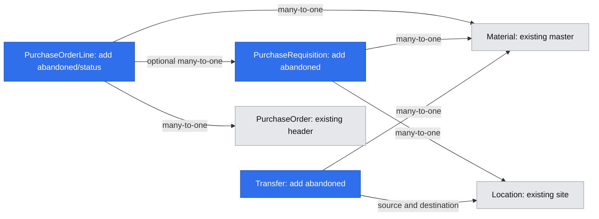

# Document cancellation and early closure

**Status:** ready
**Created:** 2026-10-21 07:07 UTC
**Issue:** #90 (E11-S01)

## TLDR
Both roles need to stop unprocessed documents or abandon an unfinished remainder. Today the five operational document services offer creation, editing and fulfillment. This feature adds Cancel and Close Early with one shared four-state rule, preserving posted quantities and audit history.

## Resolved assumptions (autonomous defaults)

| Question | Resolution | Reason |
| --- | --- | --- |
| Q1: separate deliveries by document type? | One cross-document lifecycle spec and implementation, phased internally. | The issue explicitly requires consistent line/header semantics across five services; splitting would leave competing state calculations. |
| Q2: individual customer/PO line resolution? | Support a selected line or all active lines. Whole-document cancellation checks processing anywhere; a selected line checks that line. | The conceptual model requires individually resolved lines, and LFC-009…011 require mixed line states. |
| Q3: zero-output production waste? | Any recorded completion counts as processing, even when produced is zero. | PRD allows component consumption without output; cancellation is barred after any physical posting. |
| Q4: unprocessed target in a processed aggregate? | A whole-order Close Early abandons every active remainder, including unprocessed lines; selected unprocessed lines use Cancel. | Preserves the distinction between document processing and per-line processing without adding another state. |
| Q5: reason or reopening? | Confirmation explains the abandoned quantities; no new mandatory reason field or reopening action. | The baseline requires audit, not a closure reason; manual reopening is explicitly prohibited. |

## Problem and sources

Issue #90, including the shipment follow-up, records that mistaken orders and abandoned remainders stay Open and would count as demand/supply. Source authority: product brief D02/D04, R03/R05/R07/R08; PRD §03 Four-state lifecycle and Order aggregation; decision register §03; conceptual model Documents/Fulfillment/Transfers; acceptance LFC-001…011, TRF-012/015/025, BUY-017/018, SAL-016/023 and PRD-029. These sources agree on the transition rules; no product decision is superseded.

Existing implementation touchpoints are the five document services under `core/src/services/`, `goods-issues`, `goods-receipts`, `production-orders/production-completion.service.ts`, and `shipments/shipment-usage.ts`. Customer-order and production entities already store abandonment and four states. PO lines, requisitions and transfers need persistent abandonment; PO lines need explicit status to distinguish cancellation from early closure.

## Scope

Cancel and Close Early for customer orders, purchase requisitions, purchase orders, production orders and transfers; line/header state consistency; existing UI and API; audit; tenant isolation; idempotency; optimistic locking; read-only handling. Closed demand/supply views return zero outstanding.

Out of scope: posting reversals (#91/#92), manual reopening, MRP consumers (slice 3), deleting retained documents, refunds, reservation systems, bulk list operations, mandatory closure reasons. Shipment is a dispatch context, not a sixth lifecycle document; its existing completion rule is retained.

## Rules

- States remain `open`, `completed`, `closed-early`, `cancelled`. Partial progress is a quantity, not a state.
- `outstanding = max(quantity − fulfilled/received/converted/produced − abandoned, 0)` with the existing exact six-decimal arithmetic. Transfers distinguish outstanding dispatch from outstanding destination receipt and transit.
- Cancel requires Open and no processing in the target. It abandons its full remaining quantity and marks it Cancelled. Whole-document Cancel refuses if any retained active line has processing; selecting an unprocessed line is permitted even when another line is processed.
- Close Early requires Open, some processing in the target document/selected lines and unresolved quantity. It sets abandonment to the unresolved remainder, leaves processed quantities intact and sets affected active lines Closed Early. Completed/cancelled/already closed lines are preserved.
- A header is Open if any active line is Open; Completed if all are Completed; Cancelled if all are Cancelled; otherwise Closed Early. Removed historical customer-order lines do not participate. Empty aggregates are invalid service input, not a valid terminal state.
- Fulfillment continues to mark fully satisfied lines Completed, including PO overreceipt and production overproduction. Every header computation uses the same pure aggregator. Cancelled and Closed Early lines reject new fulfillment; a terminal header rejects mutation, including stale forms. Preserve goods-receipts spec Q3: a Completed PO line can receive more while another line keeps its header Open.
- Production counts any recorded completion as processing (including zero-output waste); close the remaining target, preserving component use, immutable recipe and output history.
- Requisition conversion is processing. Closing/cancelling a PO never restores its source requisition's converted amount: that conversion and its link remain historical facts; reopening is outside scope.
- Transfer cancellation requires no dispatch. Close Early requires dispatch and zero in transit. `dispatched − received − writtenOff > 0` refuses with the precise in-transit quantity. Loss is not receipt: only all planned quantity physically received without loss completes. On explicit early closure, abandoned destination quantity includes loss plus never-dispatched quantity; stored dispatched/received/written-off and stock remain unchanged. A loss-resolved transfer remains eligible for Close Early even when all planned units were dispatched.
- All terminal transitions are irreversible from the UI/API. Same-key API retries replay the original receipt; a new attempt against a terminal document is a conflict, not a second audit entry.

## Architecture

Add a dependency-free `core/src/domain/document-lifecycle/` module for the four-state type, pure header aggregation, outstanding/abandonment calculations and transition eligibility. Keep persistence workflows in their owning document services. Do not create a generic service that dynamically chooses entities or bypasses the service boundary.

Each service exposes `cancel` and `closeEarly`, taking ID, version, audit actor and, for CO/PO, optional selected line identifiers (customer-order UUIDs; PO numeric positions, matching their existing views). Reuse existing fresh reads, transaction helpers, optimistic-error mapping and snapshot allowlists. Refresh and compare the header version inside the transaction; closure and competing postings serialize through that same header version. Invalid IDs, duplicate/foreign/removed line IDs, terminal targets and nonmatching versions leave every line unchanged.

Customer-order closure calls the existing `completeFinishedShipments` in the same transaction after abandonment/status updates. Preserve its audit. Goods issues/receipts update line progress and call the shared state function; the same applies to conversion and production/transfer completion. Prevent edits from reopening a terminal line or deleting its retained reference.

All routes use `tenantApiWrite`; all server actions use `tenantServerAction`. Neither queries the EntityManager. Existing wrappers enforce role, tenant, read-only, dataset generation, API idempotency and atomic receipts. Both roles may resolve business documents. No new permission or background worker.

## Data Model

- Reuse `CustomerOrderLine.abandoned/status` and `ProductionOrder.abandoned/status`.
- Add default-zero decimal-text `abandoned` to `PurchaseOrderLine`, `PurchaseRequisition` and `Transfer`.
- Add PO-line four-state `status`, default Open. Backfill existing lines Completed iff received is at least quantity, otherwise Open, using exact fixed-decimal comparison, never binary floats.
- Extend requisition/transfer status type declarations to all four states; widen requisition status capacity from 9 to 12. Keep existing public exports compatible if the common enum moves to a shared db folder.
- All fields are additive/defaulted. Generate a migration, snapshot and migration index together; test upgrade on populated current-base data and down. Existing completion totals, IDs, conversions and relationships remain unchanged.

Existing document services remain the sole mutation boundary; the new helper unifies the state rule.

## API Contracts

For each existing `/api/tenants/[tenant]/{customer-orders,purchase-requisitions,purchase-orders,production-orders,transfers}/[id]` add `POST /cancel` and `POST /close-early`.

Body: `{ "version": 3 }`. Customer orders also accept `{ "version": 3, "lines": ["line-uuid"] }`; POs use their existing numeric positions, `{ "version": 3, "lines": [1] }`. Omitted means the document (all currently active lines); a nonempty unique selection means only those lines. Never accept an arbitrary target status. Shared version validation plus document-specific selection schemas reject unknown mutation fields, invalid versions and malformed line selections.

Require existing bearer authorization, `Idempotency-Key` and `Dataset-Generation`. Success is the normal updated document view. Existing version/not-found/read-only/generation conflicts retain their codes. New stable domain errors distinguish processing that prevents cancellation, no processing (use Cancel), unresolved transfer transit and terminal/invalid selected line state. They carry public parameters for actionable English/Polish errors. Audit IDs use each existing concept/entity prefix with `.cancelled` or `.closed-early`, with allowlisted before/after header and affected line quantities/statuses. Failed/replayed operations add no audit.

Read views expose abandonment and all four line/header states; outstanding is zero for resolved targets. Production also exposes whether any completion exists so its zero-output waste action is correct. Transfer views keep in-transit separate. No existing URL or response field is removed.

## UI/UX

Use existing detail screens and requisition table. On Open records show Cancel before processing, Close Early after processing. CO/PO line rows offer the same actions for Open lines and keep header actions for all active lines. Display all four translated states and abandoned/outstanding quantities; processed totals stay visible.

A shared domain-agnostic confirmation pattern from `@cpg/ui` renders pending/error states. App-level lifecycle controls accept labels and bound actions. Confirmation names the document/line, exact quantity/unit being abandoned, retained posted work and that manual reopening is unavailable. Keep the record/version captured when the dialog opened; refreshing after a conflict must not silently replace its version under the pending confirmation. The dismiss button is “Keep open” to avoid confusion with the business action Cancel.

For transfers with transit, explain that remaining transit must first be received or written off and show its quantity. Refusals remain visible in the open dialog. Read-only views hide write controls and preserve the banner. Keyboard focus returns to the originating control, errors use shared feedback, and the controls remain reachable at 390 px. Refresh only after success or a conflict when the dialog will survive. Update existing contextual help in EN/PL; no new navigation entry/page.

Mockups: skipped — the configured Docker test environment failed to build because Docker storage is full (`no space left on device`). No shared Docker pruning was attempted; UI evidence remains owed by the implementation.

## Research

[ERPNext close-order guidance](https://docs.frappe.io/erpnext/close-sales-order), checked 2026-10-21, separates temporarily partial fulfillment from intentionally ending the remaining order. CPG keeps that distinction and the existing posted records, while omitting ERPNext's invoicing and reopening features because they contradict this baseline's scope. This comparison supports the interaction explanation; the CPG sources own the rules.

## Risks and rollback

A missed posting path could overwrite Closed Early with Completed, so replace every affected header computation and test mixed lines. Zero-output waste and transfer losses must not look unprocessed. Closure must advance the same aggregate version as posting and update related shipments atomically. Historical source requisitions must not regain supply when a PO closes.

The schema addition is readable by the previous release, but that release does not understand the new states and may render them incorrectly or allow requisition date edits. Operational rollback after closures requires a roll-forward fix or keeping affected writes disabled; never erase closure history or reverse stock as a schema rollback. `down()` is tested on upgrade fixtures before feature writes. New status values and endpoints are the explicitly requested contract expansion; protected existing URLs remain.

## Acceptance and verification

- Preserve PO overreceipt: line A fully received and line B Open; another receipt against A succeeds with its excess warning. Read a numeric PO line position from the API and pass it unchanged to resolution.
- LFC-001…011 including mixed Completed/Closed Early/Cancelled/Open lines and all-fulfilled headers; whole Cancel rejects any receipt/issue/conversion/completion/dispatch.
- BUY-017/018, PRD-029 and SAL-016/023: exact abandonment, zero outstanding, original processed quantities and immutable history retained. Production waste with zero output cannot cancel.
- TRF-012/015/025: refuse transit, then close after clearing it; loss yields Closed Early even when all dispatched units are accounted for.
- Same-transaction shipment completion and audit; no material/location usage guard continues counting a closed remainder. Existing historical-reference guards still hold.
- Real SQLite service tests for stale versions, rollback, selected foreign/removed IDs, conflicting posting/closure, Test/Prod isolation and no writes on refusal. API tests cover both roles, read-only, generation, required key/version, replay and terminal refusal.
- UI tests cover action visibility, captured versions, pending, success/error, zero-output processing, translations and existing read-only behavior. Integration tests drive all five document types through UI and API, including mixed lines and transit refusal; smoke covers the added migration.
- Run lint, typecheck, 100% unit coverage and build; locally run changed/new integration files plus smoke, and verify the complete PR CI suite. Check actual development UI and capture browser evidence.

## Implementation Plan

### Phase 1 — shared lifecycle and persistence
1. Add pure lifecycle rules and behavior tests for all header combinations, exact quantities and eligibility.
2. Add defaulted persistence fields/type extensions and generated migration; verify populated upgrade/down and update migration-count tests.

### Phase 2 — transactional workflows
3. Add customer-order/PO whole and line resolution, audit, version checks and shared header recomputation; connect shipment completion and posting guards.
4. Add requisition/production resolution, preserve conversions, detect zero-output processing, and reuse shared completion state.
5. Add transfer resolution with transit/loss guards and exact abandonment; retain stock history and terminal posting refusals.

### Phase 3 — API and UI
6. Add shared validators, ten keyed API routes and tenant server actions with full behavior tests.
7. Add reusable confirmations to existing document screens, line actions, translated states/errors/audit labels and contextual help; preserve loaded versions and read-only behavior.

### Phase 4 — prove and publish
8. Add targeted UI/API integrations and migration smoke coverage; run the repository gate and browser checks, review against engineering/compatibility rules, then publish the implementation PR referencing this spec and closing #90. Complete review/QA and verify CI before marking the spec implemented.

## Design review

Independent scope/architecture review: approve after preserving the existing PO overreceipt exception and using existing numeric PO line identifiers. Documentation checks: 2 files, 6 tests passed. Runtime verification belongs to implementation.
