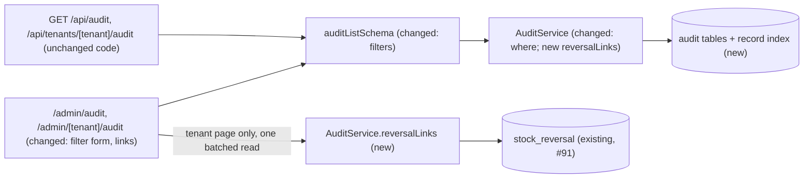
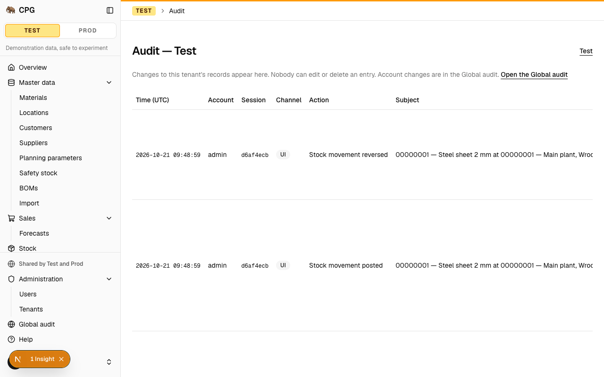
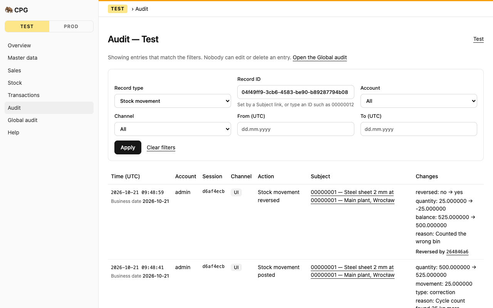
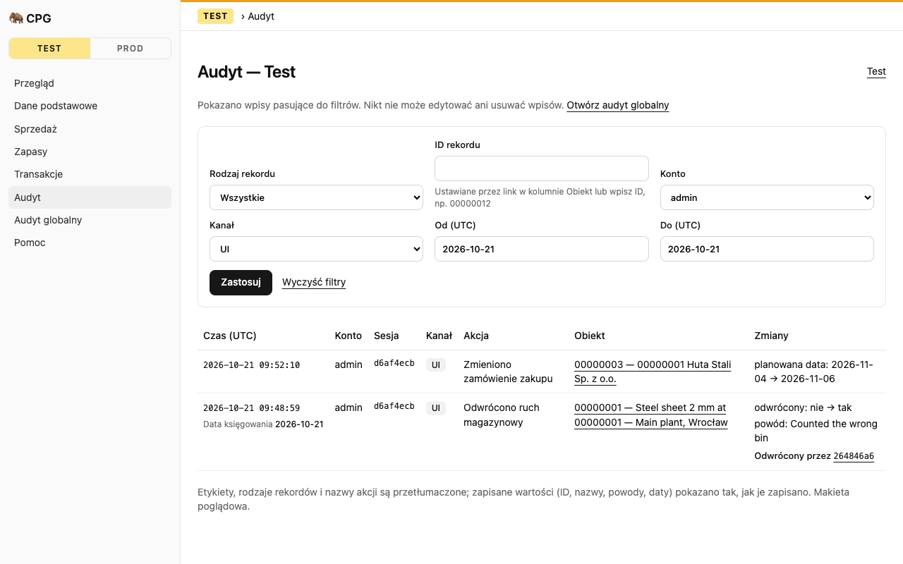

# Trace one record's history in the tenant and Global audit

**Status:** ready
**Created:** 2026-10-21 09:44 UTC
**Issue:** #96 (E13-S03), epic #79 · **Builds on:** `implemented/2026-10-19--1050UTC-audit-log.md` (E02-S02, #20; its Q9 deferred filters to slice 2), `implemented/2026-10-21--0706UTC-stock-reversals.md` (E11-S02, #91) · **Design authority:** `.ai/specs/product-brief.md` (R07, R08), `.ai/specs/research/CPG-prd001.pdf` §06–§07, `.ai/specs/research/CPG-acceptance.md` (AUD-004, AUD-006, AUD-028…030, REV-020, API-014, UX-022)

## 📝 TLDR

Both audits list every entry newest first with no filters. To follow one purchase order or one stock movement, a user pages through every change in the tenant. This spec proposes:

- **Filters** on both audits: record (type and ID), account, channel (UI or API) and a UTC date range. They work the same on the screens and through the API. They are query parameters on the four existing audit URLs, and the keyset paging stays as it is.
- **Business date:** an entry that records one shows it under the audit timestamp. That covers stock corrections, receipts, issues, production completions, transfers and reversals.
- **Reversal links:** an entry about a reversed movement, or about the movement that reverses it, links to the other movement. The reason shows in the entry's changes.
- **History links:** each row's subject opens that record's history.
- **Translations:** labels the Polish screen still shows in English (some snapshot fields, record types) get Polish names.

What the audit records, its append-only guarantee and the shape of its API responses do not change. The only schema change is one additive index per audit table, which serves the record filter.

## Resolved assumptions (autonomous defaults)

| # | Question | Chosen answer | Rationale |
|---|---|---|---|
| Q1 | Split filters, business date and reversal links into separate stories? | No. One spec, one implementation PR, two phases (service and API, then screens). | All three change the same read path and the same table. Phase 1 alone already gives the API its filters (Phasing). |
| Q2 | What does "filter by record" match? | The entry's subject exactly: `subjectType` and `subjectId`. `subjectType` alone is allowed (all purchase orders). `subjectId` without `subjectType` is a validation error. | Subject IDs collide across record types: materials, locations, customers and suppliers all number from `00000001` (lessons, 2026-10-20). Matching only the subject is predictable, and an index serves it (Q11). Including entries that merely mention the record, such as a receipt against a PO, would need `json_extract` conditions on the snapshots. MikroORM can express them, but no index serves them, and which snapshot keys count as "mentions" differs per producer. |
| Q3 | Which date does the date range filter on? | The audit timestamp (`occurredAt`), as UTC calendar days: `from` and `to` are `YYYY-MM-DD`, both inclusive. `from` after `to` is a validation error. | Every entry has a timestamp. Only postings carry a business date, so a business-date filter would silently drop every other entry. The audit's time column is already UTC. |
| Q4 | How is an account chosen? | By username, exact match, lowercased (`account=alice`; usernames are stored lowercase). The screen offers a select of every account's username, read through a new `UserService.usernames()`. That method returns names only and is documented as safe for any signed-in account. The API takes the username. | Entries copy the username at write time, and usernames never change (user-management Q3). A select means nobody has to type a username correctly. `UserService.list()` is admin-only by contract (`assertAdmin` before calling) and returns role, status and version, so the audit pages, which every account opens (AUD-009), must not call it. |
| Q5 | Where does the business date come from? | From the entry's own snapshot: `after.businessDate`, else `before.businessDate`, when it is a valid `YYYY-MM-DD`. A pure `businessDateOf(entry)` in `app` derives it. There is no new column, no join to the stock ledger, and no new API field. It shows only when present. | Six producers already record it: stock postings, reversals, transfers, goods receipts, goods issues and production completions. The snapshot is the immutable fact, and API clients already receive it in `after.businessDate`. A join would also have to cover entries whose rows no longer exist (the Test reset). |
| Q6 | How are an original and its reversal linked? | A new `AuditService.reversalLinks(movementIds)` returns the `StockReversal` links of the given `StockMovement` ids as original or inverse, in one tenant-scoped query. The tenant audit page passes it the page's movement subjects. The screen then shows "Reverses …" or "Reversed by …" as a link to the other movement's history. The reason already shows in each entry's changes. | The `stock.movement.reversed` entry names both movements, but the inverse's own `stock.movement.posted` entry does not name its original. `StockReversal` is the immutable link #91 created for this. One query per page keeps the read bounded. |
| Q7 | Does the API's response change? | No. Entries keep exactly today's fields. The filters are new query parameters only, as issue #96 requires. API clients already get the business date in `after.businessDate`. They get the reversal link from `GET /api/tenants/{tenant}/stock/movements/{id}` (`reverses`/`reversedBy`, #91), under the same authorisation. | It honours the issue's "new query parameters only, no changed response shapes" without a human decision, and parity (R07) holds because each fact the screen shows is already readable through the API. |
| Q8 | What does a filter value that matches nothing do (an unknown account or record)? | It returns an empty page, not an error. Malformed values (`channel=web`, an invalid date, an over-long ID) are `400 VALIDATION_FAILED`, as malformed `before`/`limit` already are. These parameter names were ignored until now, so a request that already sent one malformed gets a 400 where it used to succeed. `BACKWARD_COMPATIBILITY.md` records this, as E13-S01 did for the stock route's `page`. | History can name accounts and records that a reset has since removed, so "no such record" is not an error for a history search. CPG has no external API consumers yet. |
| Q9 | Does a `before` cursor have to match the filter? | No. It must name an entry of this audit, as today. The service applies the filters and then `olderThan(cursor)`. The paging links carry the active filters. | The cursor is a position in the audit, not a member of the result. This keeps one paging rule. |
| Q10 | Do record screens (PO, material, movement) get a "History" link to their audit? | No, not in this story. The entry points are the filter form and the subject link in every audit row. | It is the smallest change that delivers tracing, and it touches no other screen. Each record screen can add the link later with one URL (`/admin/{tenant}/audit?subjectType=…&subjectId=…`). |
| Q11 | Is an index needed? | Yes. One additive index per audit table on `(…, subject_type, subject_id, occurred_at, id)`, with `tenant` first on the tenant table. Account, channel and date filters keep using the `occurred_at` index. | The record filter is this story's main use, and both audits grow without limit (R08). Without the index every page would scan the whole tenant's history. Lessons (2026-10-20): bound a new read path and check the SQLite plan has no temporary sort. |

None needs human confirmation before merge. No default weakens security, tenant isolation or the append-only guarantee. No response shape changes, and the index migration can be rolled back.

## 📝 Problem Statement

PRD §07 ("Audit report") asks that a user can trace a record's history in the audit. The E02-S02 viewer was deliberately minimal (its Q9): 50 entries a page, newest first, no filters. The tenant audit now records materials, BOMs, forecasts, purchase requisitions and orders, receipts, customer orders, shipments, issues, transfers, production orders and completions, stock postings and reversals. Following one purchase order means paging through all of that. A further gap is in the acceptance catalogue:

- **AUD-030:** a posting's business date and its audit timestamp are distinct. The audit records both, but the business date is hidden in the Changes column.
- **AUD-004 / REV-020:** an original posting and its reversal stay separate events, linked, with the reason. Today the inverse's entry does not point back to the original.
- **UX-022:** both languages show some raw IDs. The transfer actions (`transfers.transfer.created`, `.updated`, `.dispatched`, `.received`, `.written-off`) have no label, some snapshot field names (`original`, `reversal`, `balance`, …) have none either, and the record types are not named at all.
- **API-014 / R07:** whatever the screen can filter, the API can too, under the same authorisation.

Both roles have the problem: everyone reads the audit (AUD-009).

## 📝 Proposed Solution

- **One query shape for both audits.** `auditListSchema` gains the optional `subjectType`, `subjectId`, `account`, `channel`, `from` and `to`. `AuditService.listGlobal`/`listTenant` turn them into one MikroORM `where` (no QueryBuilder, no raw SQL), combined with the existing keyset condition. Pages, routes and the paging links all use this one schema.
- **No new response fields** (Q7). The screen derives the business date from the snapshot (Q5). The tenant page asks `AuditService.reversalLinks` for the page's stock movements (Q6).
- **Screens.**
  - A GET filter form above the table, in the stock report's pattern: native selects, Apply, and a "Clear filters" link.
  - The subject cell links to that record's history.
  - The time cell shows the business date under the timestamp.
  - Reversal links show in the Changes cell.
  - Polish labels for record types and the missing snapshot fields.
- **Nothing new is written.** No producer changes. `tests/audit-append-only.test.ts` still holds, and the routes still export only `GET`.

**Alternatives considered:**
- **A business-date column on both audit tables, filled by producers.** Rejected: it needs producer changes and a backfill (or leaves old rows without one), and the value already sits in the immutable snapshot.
- **Record filter that also matches entries naming the record in a snapshot** (a PO's receipts). Rejected: it needs `json_extract` conditions that no index serves, and each producer names related records under different keys. The reversal link (Q6) covers the case the acceptance criteria name.
- **`businessDate` and `reversal` as additive fields on every API entry.** Rejected: issue #96 asks for no changed response shapes, and the API already exposes both facts (Q7).
- **Free-text search across subject labels.** Rejected for now: it is fuzzy, and it is not what the PRD asks for. Exact record, account, channel and date filters cover the stories.

**Market check.** Odoo's chatter and ERPNext's Version log show history per record, opened from the record. GitLab's audit events page filters by entity, author and date range, and its API takes the same filters as query parameters. All three filter by an exact entity reference and a date range, not by text search. CPG does the same: exact filters, the same parameters in the UI and the API, and keyset paging, which GitLab also uses on its audit API. It skips per-record history panels on every screen (Q10). It adds the business date beside the timestamp, which only matters because CPG postings have one.

## 📝 Architecture

- **`db`**
  - `entities/audit/global-audit-event.entity.ts`: index `(subjectType, subjectId, occurredAt, id)`.
  - `entities/audit/tenant-audit-event.entity.ts`: index `(tenant, subjectType, subjectId, occurredAt, id)`.
  - One migration, `audit-record-index` (two `create index` statements). The triggers and columns stay untouched.
- **`core`**
  - `validators/audit/audit-list.schema.ts`: the new optional fields and their refinements (Q2, Q3).
  - `services/audit/audit.service.ts`: `auditWhere(query)` (pure: filters to a `where`) used by both lists, and `reversalLinks(movementIds)` (one tenant-scoped `StockReversal` read).
  - `services/users/user.service.ts`: `usernames()`, every account's username sorted, documented as safe for any signed-in account (Q4).
  - No new service, container line or event.
- **`app`**
  - `components/audit/audit-filters.tsx`: the GET form (server component; native selects and date inputs).
  - `components/audit/audit-query.ts`: pure; builds the filter and paging URLs, and keeps the filters on "Older entries" and "Newest entries". `businessDateOf(entry)` (pure, Q5) lives beside it.
  - Naming: no object key or prop may be called `filters` in `app`/`core`, because the tenant-filter lint rule (`eslint.config.mjs`) flags it (lessons, 2026-10-21). Use `query`, `selected` and an `audit.filterForm` messages block.
  - `audit-view.tsx`, `audit-table.tsx`, `read-audit-page.ts`: changed.
  - Both audit pages: read `userService.usernames()` for the select and pass the active query through. The tenant page also reads `auditService.reversalLinks` for the page's `StockMovement` subjects.
  - Both API routes: no code change. They already parse the whole query through `auditListSchema`.
  - `i18n/messages/{en,pl}.ts`: filter labels, record-type names, the missing field names, "Business date", and "Reverses"/"Reversed by". `help/topics.ts`: the `global-audit` and `tenant-audit` topics describe the filters.
- **Docs:** `BACKWARD_COMPATIBILITY.md` §4 gains the audit URLs, their parameters, and the note that the newly validated parameters can now return 400 (Q8). They are not listed there yet. The engineering standards' audit entry mentions the filters.

Takeaway: one schema and one service carry the filters to both channels, and the responses keep their shape. The only new read is one `StockReversal` lookup per tenant-audit page, made by the screen.

## 📝 Data Model

No entity or column changes. One migration adds two indexes:

| Table | New index | Serves |
|---|---|---|
| `global_audit_event` | `(subject_type, subject_id, occurred_at, id)` | record filter on the Global audit |
| `tenant_audit_event` | `(tenant_code, subject_type, subject_id, occurred_at, id)` | record filter on a tenant audit |

The generated SQL must be plain `create index` statements. If the generator rebuilds a table instead, it would drop and re-create the append-only triggers and copy every row (lessons, 2026-10-21). In that case, replace the migration with the two statements before the first push. `down()` drops the two indexes. An old release runs unchanged against the new schema.

## 📝 API Contracts

**Query** (`auditListSchema`, shared by both pages and both routes; all optional, combined with AND):

| Parameter | Validation | Meaning |
|---|---|---|
| `before` | uuid (unchanged) | keyset cursor: entries older than this one |
| `limit` | 1–100, default 50 (unchanged) | page size |
| `subjectType` | `^[A-Za-z]{1,64}$` | the entry's subject type, e.g. `PurchaseOrder`, `StockMovement` |
| `subjectId` | 1–200 characters; requires `subjectType` (else 400 on `subjectId`) | the subject's ID as recorded: a business ID (`00000012`), a movement UUID, or a composite (`00000003/00000001/2026-11-01`) |
| `account` | 1–64 characters, trimmed, lowercased | the acting account's username, exact |
| `channel` | `ui` \| `api` | where the change came from |
| `from` / `to` | `YYYY-MM-DD`, a real calendar date; `from ≤ to` (else 400 on `to`) | `occurredAt` from `from` 00:00:00.000 UTC up to the end of `to` (UTC), inclusive |

An empty string counts as absent, because a GET form sends `channel=` for "All". Unknown keys are ignored, as today.

**`AuditService`** (internal `core` API):
- `listGlobal(query)` and `listTenant(query)` keep their signatures. `query` is the extended `AuditListQuery`. Both still return `{ entries, nextBefore }`, and `AuditEntryView` is unchanged.
- New: `reversalLinks(movementIds: string[]): Promise<{ original: string; inverse: string }[]>`. It needs a tenant scope. It makes one query for the links whose original or inverse is among the ids (at most one page's worth, ≤ 100). It returns `[]` for no ids, without querying.

**`UserService`:** new `usernames(): Promise<string[]>`, every account's username sorted. It returns nothing else, so any signed-in account may call it.

**Routes** (unchanged code, `GET` only, `requireApiUser()` and bearer tokens as today):

| Route | 200 | Errors |
|---|---|---|
| `GET /api/audit?subjectType=&subjectId=&account=&channel=&from=&to=&before=&limit=` | `{ ok: true, data: { entries, nextBefore } }` | 401, 400 `VALIDATION_FAILED` (field errors keyed by parameter), 404 `AUDIT_CURSOR_NOT_FOUND` |
| `GET /api/tenants/{tenant}/audit?…same…` | as above, that tenant only | as above, plus 404 `TENANT_NOT_FOUND` |

Response bodies are unchanged: no field is added, so no password, hash or token secret can appear in one (AUD-028, AUD-029). The business date is already in `after.businessDate`. The reversal link is in `GET /api/tenants/{tenant}/stock/movements/{id}` (`reverses`/`reversedBy`).

## 📝 UI/UX

- **Filter form** (both audits), between the intro and the table. It is a plain GET form, so a filtered view is a URL that can be bookmarked or shared:
  - **Record type:** a select. "All", then the record types that audit can hold, by translated name. Tenant: material, unit conversion, location, customer, supplier, planning parameters, safety-stock target, forecast, BOM, purchase requisition, purchase order, goods receipt, customer order, shipment, goods issue, stock movement, transfer, production order, production completion. Global: user, API token, tenant.
  - **Record ID:** a text input, hint "Set by a Subject link, or type an ID such as 00000012". A stock movement's ID is a UUID the table doesn't show, so its history is opened through the Subject link.
  - **Account:** a select of all accounts.
  - **Channel:** "All", "UI", "API".
  - **From** and **To:** date inputs (UTC).
  - **Apply**, and a **Clear filters** link (shown only when a filter is active).
  - When a filter is active, the intro line says "Showing entries that match the filters", and the empty state reads "No entries match these filters."
- **Subject cell:** the label is a link to `?subjectType=<type>&subjectId=<id>` on the same audit ("History of this record" as its accessible name, with the label).
- **Time cell:** the UTC timestamp as today. When `businessDateOf(entry)` finds one, a second line reads "Business date 2026-10-21". That covers stock corrections, receipts, issues, production completions, transfers and reversals.
- **Changes cell:** unchanged, plus, when the page's `reversalLinks` include the entry's movement:
  - on the original movement's entries: "Reversed by ‹first 8 characters of the inverse id›";
  - on the inverse movement's entries: "Reverses ‹first 8 characters of the original id›".

  Each one links to that movement's history. The reason is already a line of the entry's changes ("reason: …").
- **Paging:** "Older entries" and "Newest entries" keep the active filters.
- **Wrapping (fixes today's layout):** at 1280 × 800 the Subject label never wraps and pushes the Changes column off-screen (`current-01-tenant-audit.png`; shadcn cells are `whitespace-nowrap`, lessons 2026-10-19). Subject and Changes get `whitespace-normal`, with `wrap-anywhere` for long values such as UUIDs, so every column stays in view at 1280 px.
- **Mobile (390 px):** the form stacks one field per row. The table scrolls sideways as today, and the row links stay reachable.
- **Language:** labels, record types, field names, action names and "Business date" are translated (UX-022). Recorded facts (IDs, labels, reasons, dates, usernames) show as recorded.
- **Bad query on a screen:** as today, a malformed filter or a foreign cursor renders the not-found page. The API answers 400/404.
- **Help:** `global-audit` and `tenant-audit` explain the filters, the history link, the business date and the reversal links, in English and Polish.

Prototype: `.ai/specs/assets/audit-history-filters/`. The mockups are static and only illustrative; the shadcn components decide the final look.

- `current-01-tenant-audit.png`: today's tenant audit (Test).
- `current-02-global-audit.png`: today's Global audit.
- `mockup-01-filtered-movement.png`: Test audit filtered to one stock movement, with its business date and a "Reversed by" link.
- `mockup-02-filters-pl.png`: the same screen in Polish, filtered by account and channel.

## 📝 Edge Cases & Failure Scenarios

| Case | Behaviour |
|---|---|
| `subjectId` without `subjectType` | 400 `VALIDATION_FAILED` on `subjectId` (API); the not-found page on a screen. The form never sends it alone, because the subject link always sets both |
| `from` after `to`; `to=2026-02-30` | 400 on `to`; not-found page on a screen |
| An account or record no longer present (after a Test reset) | Empty page with "No entries match these filters." |
| A record ID of another tenant | Empty page: the tenant filter still isolates the read (R05) |
| A cursor from an unfiltered page used with a filter | Works: entries older than the cursor that match the filters |
| A movement reversed, then the Test tenant reset | Test's audit and its `StockReversal` rows are cleared together, so no dangling link. Prod keeps both indefinitely |
| `account=Alice` | Lowercased to `alice`, so it matches |
| An entry whose snapshot has a non-date `businessDate` (a future producer bug) | No business-date line; the value still shows in Changes. The screen never shows an unvalidated value as the business date |
| An inverse movement that is reversed again (if ever allowed) | Both links show: "Reverses …" and "Reversed by …". #91 forbids reversing a reversal, so this is not reachable today |
| Global audit with `subjectType=StockMovement` | Valid query, empty result. The Global page never calls `reversalLinks` |
| Same-millisecond entries under a filter | Ordering stays `(occurredAt, id)`, so paging still never repeats or skips |
| Huge history for one account with no record filter | Bounded per page: the `occurred_at` index walks newest first until 51 matches. Slower than the record filter, and acceptable at CPG's size (Risks) |

## 📝 Risks & Impact Review

- **Newly validated parameters** (Q8). `channel`, `from`, `to`, `account`, `subjectType` and `subjectId` were ignored before. A malformed value now answers 400. CPG has no external API consumers yet (`BACKWARD_COMPATIBILITY.md`). The audit URLs and their parameters are now added to §4, so later changes are reviewed against them. Response shapes do not change (Q7).
- **Migration.** Index-only, no data movement. The risk is the generator rebuilding a table (Data Model). A migration test asserts that both indexes exist, that the append-only triggers survive, and that existing rows are unchanged on a populated database. Rollback: `down()` drops the indexes. The old release does not need them.
- **Account, channel and date filters scan.** With no record filter, a rare account forces a long walk of the `occurred_at` index. At CPG's scale (two tenants, a handful of accounts) that is milliseconds. If it ever matters, an `(…, actor_username, occurred_at)` index is a later additive migration.
- **Reversal link depends on a business table.** `listTenant` reads `StockReversal`, which is append-only (#91) and tenant-owned. If that table is ever restructured, this read moves with it. Its test catches the drift.
- **Business date depends on a snapshot key name.** Producers that record a business date must keep calling it `businessDate`. Unit tests pin it for all six current producers: stock posting, reversal, transfer, goods receipt, goods issue and production completion.
- **Privacy.** Unchanged: every account already sees every entry (AUD-009). The account select lists usernames only, through `usernames()`, never the admin-only `list()` with roles and status (Q4).
- **Reversibility.** Revert the code, and optionally the index migration. Nothing is written by this feature.

## 📝 Decisions in play

- **R08** (append-only, before/after, account, session, channel, never secrets): unchanged. This story only reads.
- **R07** (API parity, identical authorisation): the same filters on the API, through the same `requireApiUser()`. Every fact the screen shows is readable through the API (Q7).
- **R05** (tenants share no audit): filters run inside the tenant scope, and the reversal read is tenant-owned.
- **D04** (simplest consistent behaviour): Q2, Q3, Q8 and Q10 are gap-closing choices, for owner Piotr12 to override.

Nothing is superseded.

## 📋 Phasing

- **Phase 1, query and API:** schema, index migration, service filters, `reversalLinks` and `usernames`. The API gains the filters; its responses keep their shape. The screens are unchanged but already accept the parameters in their URLs.
- **Phase 2, screens:** filter form, history links, business date and reversal links in the table, translations, help, integration tests.

## 📋 Implementation Plan

### Phase 1 — Query and API

1. **Record index migration.** Add the two indexes on the entities and run `npm run db:migration:create -- audit-record-index`. Check that the generated SQL is two `create index` statements; replace it if the generator rebuilt a table. Commit the migration, `.snapshot.json` and `migrations/index.ts`. Update the older migrations' rollback tests (lessons, 2026-10-19 `down({ to })`). Tests (db, temp SQLite):
   - both indexes exist after `migrate()`;
   - the append-only triggers still abort an update and a delete;
   - on a database populated before the migration, the rows are unchanged after it;
   - `EXPLAIN QUERY PLAN` for a record-filtered, ordered page uses the new index with no temporary sort.
2. **Schema.** Extend `auditListSchema` (Q2, Q3, Q4; empty strings as absent, `account` lowercased). Unit tests for each field: valid values, bounds, `subjectId` without `subjectType`, `from > to`, impossible dates, `channel=web`, `account=Alice`, and full-path field errors.
3. **Service filters.** Add `auditWhere(query)` and apply it in `listGlobal`/`listTenant` together with `olderThan`. Unit tests on a temp database with mixed entries:
   - each filter alone and all combined;
   - inclusive UTC day bounds (entries at 00:00:00.000 and 23:59:59.999);
   - paging under a filter without repeats or gaps, including same-millisecond entries;
   - an unfiltered cursor used with a filter;
   - an unknown account or record gives an empty page;
   - another tenant's record ID is invisible (R05);
   - a page of purchase-order history holds only that order's entries, newest first (PRD §07);
   - the returned entries have exactly today's fields (Q7).
4. **Reversal links and usernames.** `AuditService.reversalLinks(ids)` (one query: `$or` original/inverse in ids; `[]` for no ids without querying) and `UserService.usernames()`. Unit tests:
   - after a receipt reversal, the links are returned when asked with the original's id, with the inverse's id, and with both; the `posted` and `reversed` entries of both movements carry the reason in their snapshots (AUD-004, REV-020);
   - another tenant's movement ids return nothing (R05);
   - no ids makes no query;
   - `usernames()` returns every account's name sorted, and nothing else.
5. **API.** Route tests (mocking `@cpg/core`) prove the filters reach the service on both routes. Service-level tests own the outcomes. Add the audit URLs, parameters and the newly validated parameters' 400s to `BACKWARD_COMPATIBILITY.md` §4.

### Phase 2 — Screens

6. **Filter form and URLs.** `audit-query.ts` (pure: query → URL, paging URLs that keep the query, "is filtered"; `businessDateOf(entry)`). `audit-filters.tsx`, wired into `AuditView`. Both pages read `userService.usernames()` for the account select. The tenant page reads `auditService.reversalLinks` for the page's movement subjects. No key or prop named `filters` (lint). Unit tests:
   - URL building and round-tripping;
   - `businessDateOf`: `after` first, then `before`, a malformed value ignored, and a business date found for each of the six producers' snapshot shapes (stock posting, reversal, transfer, goods receipt, goods issue, production completion);
   - the form shows the active values;
   - Clear filters appears only when filtered;
   - paging links keep the query;
   - the filtered empty state;
   - the Global page never asks for reversal links.
7. **Table and labels.** Subject history link, business-date line, Reverses/Reversed-by links. Survey every action ID and snapshot key `core` records, and add EN/PL labels for each one missing. Known gaps: the five `transfers.transfer.*` actions; the fields `original`, `reversal`, `reversed`, `balance`, `moved`, `kind` and `transfer`; the `reversal` value of `type`. Also add filter labels, record types (`audit.subjects`) and the help topics. Subject and Changes cells wrap (UI/UX, Wrapping). Unit tests:
   - each new cell part, and its absence when there is no business date or link;
   - a repo test (`tests/audit-labels.test.ts`) that collects every action ID `core` can record and fails when EN or PL lacks a label. It covers templated IDs such as the named-record and `entry(...)` helpers, not just literals;
   - every record type in the select has an EN and a PL name;
   - rendering the table with the Polish messages shows translated labels next to unchanged recorded values (UX-022);
   - still no edit or delete controls.
8. **Integration tests** in `tests/integration/audit.test.ts` (scope assertions to the file's own records, restore preferences and revoke the file's tokens in `afterAll`; see lessons):
   - in Test, edit a purchase order in the UI, then open its history from the Subject link: only that order's entries, newest first, channel UI with session and account (AUD-006, PRD §07);
   - receive that purchase order today against a later planned date. Its stock movement's history shows today's business date beside the audit timestamp, and the order keeps its planned date (AUD-030);
   - reverse that receipt. The original movement's history shows "Reversed by" with the reason; following it shows the inverse's entry with "Reverses" (AUD-004, REV-020);
   - filter by account, channel and date range on the tenant and the Global audit; the paging link keeps the filters;
   - switch to Polish: labels translated, recorded values unchanged (UX-022);
   - a normal user that the file creates gets the same entries from `GET /api/tenants/test/audit` and `GET /api/audit` with the same filters, using a bearer token the file creates and revokes; no payload carries a token secret or hash (R07, API-014, AUD-028, AUD-029);
   - at 1280 × 800 the Changes column is inside the viewport; at 390 px the form and the row links stay usable.

   Then run the gate: lint, typecheck, `test:coverage` (100%), build, `tests/integration/audit.test.ts`, plus `smoke.test.ts` for the migration count.
