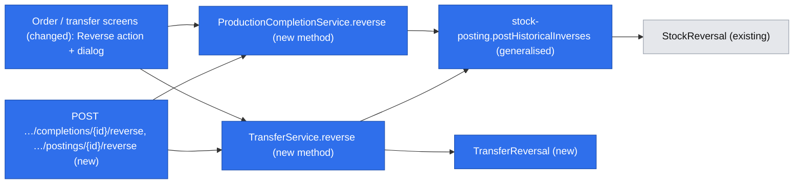
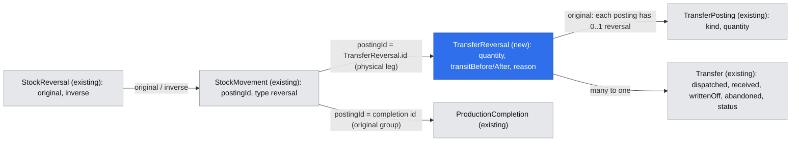
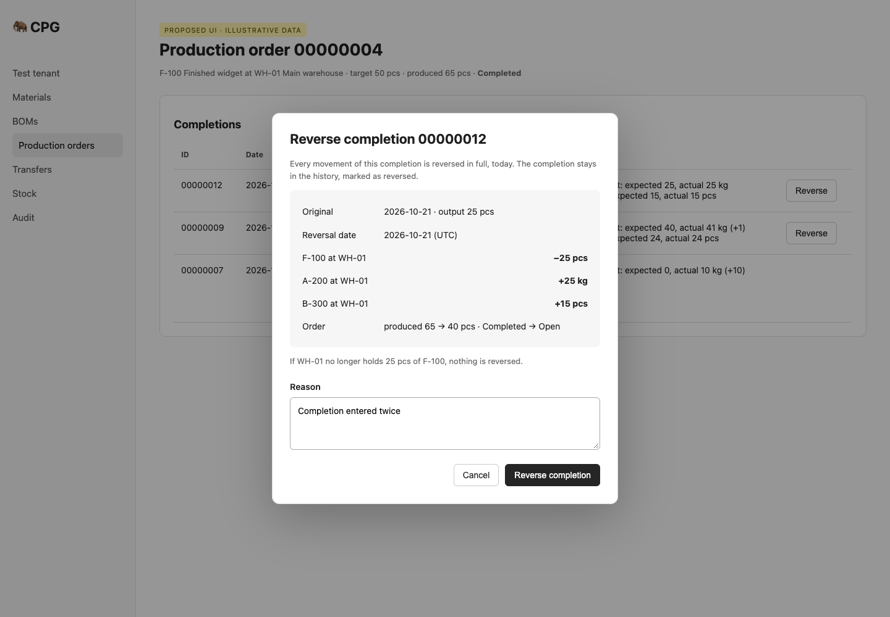
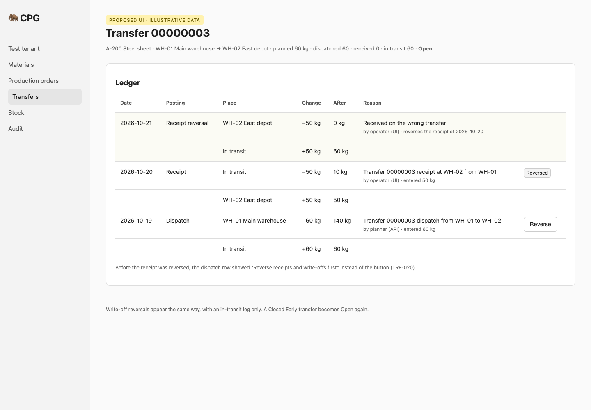

# Production completion and transfer posting reversals

**Status:** ready
**Created:** 2026-10-21 09:46 UTC
**Issue:** #92 (E11-S03)

## 📝 TLDR
Both roles can post a production completion or a transfer dispatch, receipt or write-off, but cannot undo one when it was a mistake. Each has several legs that must unwind together. This proposal adds a full, once-only reversal of one completion or one transfer posting, dated today with a reason. All its legs are inverted in one transaction, and the production order or transfer is recalculated, in the UI and the API. Receipt, issue and correction reversals (#91) and partial reversals stay out of scope.

## Resolved assumptions (autonomous defaults)

| Question | Chosen answer | Rationale |
| --- | --- | --- |
| Q1 — One spec for production and transfer reversals, or two? | One spec and one implementation PR, built in two phases (production first, then transfers). | The issue is one backlog story with one set of acceptance criteria. Both share the group-inverse primitive, the reason dialog, the once-only rule and the error contract. If the phases ever ship separately, each PR carries its own integration file, and only the second says `Closes #92`. |
| Q2 — When can a dispatch be reversed? | Only when the transfer's net received and written-off quantities are both zero, meaning every receipt and write-off has been reversed. | The decision register says "Reverse destination receipts/write-offs before source dispatch" and the data model says "Source issue reversal needs downstream receipts and write-offs unwound first". Transit is fungible, so the alternative ("enough in transit") cannot tell which receipt a dispatch fed. The strict rule can be relaxed later without a migration. |
| Q3 — Where is a transfer reversal recorded? | In a new append-only `TransferReversal` entity, one per original `TransferPosting`, holding the transit leg. The physical leg is a `reversal` stock movement linked through the existing `StockReversal`. `TransferPosting.kind` is unchanged. | A write-off has no stock movement, so `StockReversal` alone cannot represent it. Adding kinds to the `TransferPosting` enum would rebuild the table in SQLite (see lessons) and change a protected API value that clients switch on. A new table is purely additive. |
| Q4 — Does a production reversal need its own record? | No. One `StockReversal` link per original movement, all written in one transaction. The completion counts as reversed when its movements are linked. | Every completion has at least one movement (`PRODUCTION_COMPLETION_EMPTY`), and the unique `(tenant, original)` index already makes the reversal once-only. Reason, date and actor live on the inverse movements. No schema change is needed. |
| Q5 — How do states recalculate? | **Production:** `produced` drops by the completion's output; a Completed order becomes Open when `produced < target`; a Closed Early order stays Closed Early. **Transfer:** every reversal leaves the transfer Open, and a Closed Early transfer reopens with `abandoned` reset to zero. | Production keeps an explicit closure authoritative, as #91 does for purchase orders. Transfers follow the PRD: a transfer "cannot be Completed or Closed Early while in-transit stock remains", and reversals "may automatically reopen the transfer" (TRF-027). Every transfer reversal either adds to transit or needs net receipts at zero, so none can leave the transfer Completed or Closed Early. This is an explicit transfer-only exception to the #90/#91 compatibility statement that closure and abandonment stay authoritative; the compatibility doc is amended to say so. |
| Q6 — Which API addresses a reversal? | New endpoints addressed by document: `…/production-orders/{id}/completions/{completionId}/reverse` and `…/transfers/{id}/postings/{postingId}/reverse`. The movement endpoint keeps refusing these movements. | #91 asked #92 for a group-aware design rather than the line command. These IDs are the ones the screens and API already show. Existing paths do not change. |
| Q7 — Can a reversal reopen a transfer whose material or locations were deactivated after it closed? | No. Every transfer reversal requires the transfer's material, source and destination to be active, otherwise it refuses with `TRANSFER_MASTER_INACTIVE`, naming the inactive records. The user reactivates them first. | Deactivation is refused only while a transfer is Open (`transfer-usage.ts`). A reopened transfer with inactive masters could not take its next receipt, because posting resolves active masters only. Refusing keeps the invariant that an Open transfer uses active masters. It is the smallest rule and can be relaxed later. |
| Q8 — Does a fully reversed transfer count as unprocessed? | No. Cancel/Close Early decide "has processing" from whether any `TransferPosting` exists, not from `dispatched > 0`. | Immutable history counts as processing (#90/#91 compatibility statement). This matches production, which counts completions. Without the change, reversing everything would make Cancel available on a transfer with history. |

No new product direction is inferred from the brief's untested manufacturer-demand premise (A01). This remains D01's owner-requested showcase build.

## 📝 Problem Statement
`StockReversalService` (#91) refuses production and transfer movements by design (`STOCK_REVERSAL_UNSUPPORTED`). A completion posts its output and every consumed input as one movement group. A transfer posting changes one location's physical stock and the transfer's in-transit quantity, and a write-off changes in-transit only. Inverting one movement at a time would leave the order's produced quantity or the transit balance wrong. Today the only workaround is a manual correction, which loses the link to the original, does not update the order or the transfer, and cannot touch transit at all.

Authority: issue #92; `research/CPG-prd001.pdf` §03 ("Reversal transaction", "Transfers are special") and §06; `research/CPG-prd-decisions.pdf` ("Reversal granularity", "Production reversal", "Transfer close and reversal"); `research/CPG-prd-datamodel.pdf` (reversal posting, in-transit write-off); `research/CPG-acceptance.md` REV-007, REV-008, REV-011–014, REV-017–019, TRF-019–021, TRF-027, AUD-004, AUD-021, LFC-008, API-016.

Out of scope: receipt/issue/correction reversals (#91, done), partial reversals, reversing a reversal, any manual reopen command, changes to Cancel/Close Early (#90), MRP, finance, new permissions or dependencies.

## 📝 Proposed Solution

**Production completion.** One command reverses an entire completion. In one transaction it appends a `reversal` posting group with the exact inverse of every movement of the completion (output out, each consumed input back), links each original to its inverse, subtracts the completion's output from the order's `produced`, recalculates the order's state and audits everything. Insufficient finished stock refuses the whole operation before anything is written (REV-012, REV-018, AUD-021). A waste completion (output 0) only returns its inputs. `produced` is unchanged and the completion itself is never modified (REV-013).

**Transfer posting.** One command reverses one dispatch, receipt or write-off:

| Original | Physical leg of the reversal | Transit leg | Transfer progress | Precondition |
| --- | --- | --- | --- | --- |
| Dispatch q | source +q | −q | `dispatched −= q` | net `received` = 0 and net `writtenOff` = 0 (Q2) |
| Receipt q | destination −q (needs stock) | +q | `received −= q` | destination holds q |
| Write-off q | none | +q | `writtenOff −= q` | none |

Afterwards the transfer is Open. A Closed Early transfer reopens with `abandoned = 0` (TRF-027). Transit can never go negative: a dispatch reversal needs `received = writtenOff = 0`, so transit equals `dispatched` and is at least q.

**Alternatives rejected.** Calling the line command once per movement is not atomic across legs and cannot reach transit or document progress. Editing the original posting destroys history. Linking a reversal to a document by material and quantity alone cannot tell which posting was mistaken. A generic "undo last" breaks REV-014, which reverses one completion of several. Extending the `TransferPosting` kind enum is rejected (Q3).

## 📝 Research
[ERPNext's immutable ledger](https://docs.frappe.io/erpnext/immutable-ledger-in-erpnext) cancels a stock entry by appending reverse ledger entries for every row of that entry. That is the same whole-document, append-only shape proposed here. ERPNext also refuses to cancel a document while later linked documents remain submitted, which is the same downstream-first rule as Q2. Odoo's *unbuild order* undoes a manufacturing order by consuming the finished product and returning the components, and it needs the finished product to be available. That matches REV-012. CPG takes neither product's valuation, partial unbuild, nor return-to-different-location features (N01/N02): the reversal always mirrors the recorded quantities and locations exactly.

## 📝 Architecture

The diagram shows two new service methods on the owning services, sharing one generalised ledger primitive and the existing link table.

- **Owning services, no new service class.** `ProductionCompletionService.reverse(orderId, completionId, input, actor)` and `TransferService.reverse(transferId, postingId, input, actor)` own the transaction, because the recalculation is theirs. Neither imports `StockReversalService`, and there are no events and no service cycles, as in #91.
- **Ledger primitive.** Generalise `postHistoricalInverse` in `core/src/services/stock/stock-posting.ts` to `postHistoricalInverses(em, originals, reason, postingId, actor)`. It validates each original (non-zero signed quantity, stored base unit equal to the material's immutable base unit), builds one resolved line per original in original position order, and posts them as **one** group of type `reversal` through the existing `postResolvedStockMovements`. That primitive checks every cumulative pair balance before its single flush, so one failing line writes nothing. The single-line `postHistoricalInverse` becomes a one-element call, so #91 behaviour is unchanged. The new helper `linkReversals(em, originals, inverses)` in `services/stock/reversal-records.ts` creates the `StockReversal` rows by position.
- **Shared input.** Reuse `stockReversalSchema` (strict `{ reason }`, trimmed, 1–500 characters). Unknown keys (quantity, date, material, location, version) are refused (REV-008).
- **Read-only and generation.** Gated by the existing `tenantServerAction` / `tenantApiWrite`. Each service method also checks `isScopeReadOnly(em)` inside its transaction before writing (REV-017), as `StockReversalService` does.

### Production transaction sequence
1. Parse the IDs (order and completion business IDs, eight digits) and `{ reason }`.
2. In the transaction: refuse a read-only scope; load the order with `refresh` (`PRODUCTION_ORDER_NOT_FOUND`), then the completion by `{ order, code }` (`PRODUCTION_COMPLETION_NOT_FOUND`; another order's or tenant's completion is the same 404).
3. Load the completion's movements (`postingId = completion.id`, populated material/location, ordered by position) and its lines. If any movement already has a `StockReversal`, refuse with `PRODUCTION_COMPLETION_ALREADY_REVERSED` and the existing reversal posting ID.
4. Verify the history before posting, or refuse with `STOCK_REVERSAL_INCONSISTENT`: every movement is type `production-completion` at the order's location; output > 0 means exactly one positive movement of the order's output equal to `completion.quantity`; each line with `actual > 0` has exactly one negative movement of its material equal to `−actual`; no other movements exist.
5. `postHistoricalInverses` → a new posting UUID, inverse movements, balances and per-movement audit. Insufficient finished output (or any overflow) aborts everything (REV-012, REV-018, AUD-021).
6. Link each original to its inverse. Set `produced = produced − completion.quantity` (`subtractReversedQuantity`, never negative). Status: if the order is Completed, recompute it with `productionStatus`; Open stays Open; Closed Early stays Closed Early (Q5). Always advance `updatedAt` monotonically so the optimistic version moves. `productionOrderView` now passes `status` to `outstandingQuantity`, so a Closed Early order keeps showing 0 outstanding after a reversal, as the #90/#91 compatibility statement already promises.
7. Audit `production-orders.production-completion.reversed` (subject: the completion; before `{ reversed: false }`; after: the reversal posting ID, reason, business date, and flat `lineNOriginal` / `lineNInverse` movement IDs) and `production-orders.production-order.completion-reversed` (produced/status before and after, completion code). Flush and commit.

### Transfer transaction sequence
1. Parse the transfer business ID, the posting UUID and `{ reason }`.
2. In the transaction: refuse a read-only scope; load the transfer with `refresh` (`TRANSFER_NOT_FOUND`), then the posting by `{ transfer, id }` (`TRANSFER_POSTING_NOT_FOUND`). If a `TransferReversal` exists for it, refuse with `TRANSFER_POSTING_ALREADY_REVERSED` and the reversal ID.
3. Refuse with `TRANSFER_MASTER_INACTIVE` (`{ transfer, material?, source?, destination? }`) when the transfer's material, source or destination is inactive (Q7).
4. A dispatch with net `received` or `writtenOff` above zero is refused with `TRANSFER_REVERSAL_ORDER`, which names both quantities and the unit (TRF-020).
5. For a dispatch or receipt, load its one physical movement (`postingId = posting.id`). Verify the type, the material, the location (source for a dispatch, destination for a receipt) and that the signed quantity equals ∓`posting.quantity`; a write-off must have none. Otherwise refuse with `STOCK_REVERSAL_INCONSISTENT`.
6. Compute the new progress with a pure domain function `afterReversal(progress, kind, quantity)` in `domain/transfers/transfer-quantity.ts`. It returns null when a field would go negative, and the service maps that to `STOCK_REVERSAL_INCONSISTENT`.
7. For a dispatch or receipt, `postHistoricalInverses` with the new reversal UUID posts the physical leg (a receipt reversal fails with `INSUFFICIENT_STOCK` when the destination no longer holds q, TRF-019). Then link the movements.
8. Create the `TransferReversal` (same UUID, transit before/after, reason, actor) and apply the progress. Set status to Open, `abandoned = "0.000000"` and `updatedAt` (advancing the version). Audit `transfers.transfer.reversed`: before is progress, status and abandoned; after is progress, status, abandoned, the original posting ID and kind, the reversal ID, the quantity and the reason. Flush and commit.

`TransferService.resolve` (Cancel/Close Early) decides `hasProcessing` from `count(TransferPosting, { transfer }) > 0` instead of `dispatched > 0` (Q8).

Once-only is enforced by the unique `(tenant, original)` indexes on `StockReversal` and `TransferReversal`. Two racing writers normally surface as a stale snapshot. The existing request wrappers retry the whole transaction, and the retry's in-transaction check then returns `…_ALREADY_REVERSED` with the existing reversal ID. A `UniqueConstraintViolationException` that slips past is caught outside the failed transaction. The service re-reads the existing link in a fresh read and throws the same code with its ID. A two-connection test covers both paths. A transfer `OptimisticLockError` becomes `VERSION_CONFLICT` through the existing `versioned` helper. A production-order lock error becomes the existing `PRODUCTION_ORDER_CHANGED`.

## 📝 Data Model

Add `db/src/entities/transfers/transfer-reversal.entity.ts`, registered in `entities/index.ts`:

| Field | Shape |
| --- | --- |
| id | UUID primary key, generated by the service before posting. The physical inverse movement carries it as `postingId` |
| tenant | `tenantOwned()` relation and default filter |
| transfer | many-to-one `Transfer` |
| original | many-to-one `TransferPosting`; unique `(tenant, original)` |
| businessDate | `YYYY-MM-DD`, today (server UTC) |
| occurredAt | datetime on create |
| quantity | positive six-decimal base quantity, equal to the original's |
| transitBefore / transitAfter | the transfer's in-transit quantity around it |
| reason | string(500) |
| actorUserId (nullable), actorUsername, channel (`ui` / `api`) | provenance, as on `TransferPosting` |

Add an index on `(transfer, occurredAt)` and a `transfer_reversal_no_update` trigger that aborts with `TRANSFER_REVERSAL_IMMUTABLE`. There is no application update or delete. The generic Test reset already deletes tenant-owned tables, so verify it clears the new rows and leaves Prod untouched. The runtime tenant guard validates both references.

Production adds no table. Inverse movements are ordinary `StockMovement` rows of type `reversal`, linked by `StockReversal`.

Generate the migration from the entity and commit it with `.snapshot.json` and `migrations/index.ts`. It is additive: create the table, its indexes and the trigger, with no backfill. Test up and down on a fresh database and on an upgraded current schema that already has transfer postings. `down` drops the table only. It cannot undo posted inverse movements or recalculated progress, so a rollback after use needs a backup or a forward repair. During deploy overlap the old release ignores the new table, and its line command still refuses these movements.

## 📝 API Contracts

Both routes use `tenantApiWrite`: bearer authentication, 24-hour idempotency keys, the dataset-generation check, and the shared envelope. Both roles may call them. The body is strict `{ "reason": "Posted against the wrong order" }`.

- `POST /api/tenants/{tenant}/production-orders/{id}/completions/{completionId}/reverse` → `{ completion: CompletionView, order: ProductionOrderView, movements: StockMovementView[] }`.
- `POST /api/tenants/{tenant}/transfers/{id}/postings/{postingId}/reverse` → `{ transfer: TransferView, reversal: TransferReversalView }`.

Additive read fields (existing fields, decimal strings and serialization unchanged):

- `CompletionView.reversal: { id, businessDate, occurredAt, reason, actorUsername, channel } | null`, resolved for the page's completions in bounded batches (≤ 20 completions × ≤ 100 movements, `movementReversals` batching).
- `TransferPostingView.reversedBy: string | null` and `canReverse: boolean`. `canReverse` reflects source eligibility only: not reversed, and for a dispatch net received and written-off are zero. The writable-tenant UI gate stays separate.
- `TransferDetailView.reversals: TransferReversalView[]`, newest first: the reversals of the postings already returned (at most `TRANSFER_POSTINGS_SHOWN`). Every reversal shown therefore has its original shown too. The UI merges both lists by `occurredAt`, so a merged ledger can exceed 100 entries. `TransferReversalView = { id, original, kind (the original's), businessDate, occurredAt, quantity, reason, actorUsername, channel, legs: TransferLegView[] }`. Its legs mirror the original's legs with opposite signs, in the order the goods move back.
- The ledger keeps `canReverse: false` for production, transfer and reversal movements. Inverse rows already resolve `reverses` and the original's source document, so they link to the order or transfer page.

Failure codes:
- 404 `PRODUCTION_ORDER_NOT_FOUND`, `PRODUCTION_COMPLETION_NOT_FOUND`, `TRANSFER_NOT_FOUND`, `TRANSFER_POSTING_NOT_FOUND`.
- 409 `PRODUCTION_COMPLETION_ALREADY_REVERSED` / `TRANSFER_POSTING_ALREADY_REVERSED` (`{ reversal }`), `TRANSFER_REVERSAL_ORDER` (`{ transfer, received, writtenOff, unit }`), `TRANSFER_MASTER_INACTIVE` (`{ transfer, material?, source?, destination? }`), `INSUFFICIENT_STOCK` (existing params), `STOCK_REVERSAL_INCONSISTENT`, `TENANT_READ_ONLY`, `PRODUCTION_ORDER_CHANGED`, `VERSION_CONFLICT`, and the existing generation/idempotency codes.
- 400 `VALIDATION_FAILED` or `QUANTITY_OUT_OF_RANGE` (a returned balance past the storable maximum: production inputs, or the source on a dispatch reversal).

Errors carry public parameters for EN/PL text, never raw database detail. A same-key retry replays the first response; a new key or a repeated UI submit gets `…_ALREADY_REVERSED` (REV-019). Register both routes and the additive fields in `BACKWARD_COMPATIBILITY.md`, beside the #91 reversal entries. Amend the #90/#91 lifecycle bullets explicitly: (a) transfer reversals reopen a Completed or Closed Early transfer and reset its `abandoned`, because a transfer cannot stay closed with stock in transit (TRF-027); (b) a transfer's processing is the existence of a posting; (c) production outstanding honours terminal status.

## 📝 UI/UX

The feature reuses the existing production-order and transfer pages, with no new navigation item.

- **Completion history** (`components/production-orders/completion-history.tsx`). An unreversed completion gets a `Reverse` row action when the tenant is writable. A reversed completion shows a `Reversed` badge plus "{date} by {actor}: {reason}", and its quantities stay as posted. The order header's produced, outstanding and status refresh after success.
- **Transfer ledger** (`components/transfers/ledger-table.tsx`). Each original posting row gets a `Reverse` action when `canReverse` is true and the tenant is writable. A blocked dispatch shows a short hint instead ("Reverse receipts and write-offs first"). Reversal entries merge into the ledger by `occurredAt`, labelled "Dispatch reversal", "Receipt reversal" or "Write-off reversal", with their legs and reason. Reversed originals show a `Reversed` badge.
- **One shared confirmation.** Extract a `ReversalConfirmDialog` from `components/stock/reversal-dialog.tsx`: shadcn Dialog, `CrudForm` with `stockReversalSchema`, `TALL_DIALOG`. It takes summary rows and a server action, and the existing `ReversalDialog` becomes a thin wrapper around it. The completion dialog lists every inverse leg (F −10, A +25, B +15 at the order's location) and the order effect ("Produced 65 → 40, status Completed → Open"). The transfer dialog lists the inverse legs (destination −50, transit +50) and "The transfer will be Open again". Both show today's date (UTC), explain that the whole posting is reversed and that a missing stock leg blocks everything, and require a reason. There are no quantity, unit or date inputs. The dialog keeps its target snapshot while open. On `…_ALREADY_REVERSED` it shows the existing reversal. A refusal keeps the dialog and reason visible, and a read-only refusal is not refreshed away.
- Server actions `reverseProductionCompletion` (in `admin/[tenant]/production-orders/[id]/`) and `reverseTransferPosting` (in `admin/[tenant]/transfers/[id]/actions.ts`) go through `tenantServerAction`. Revalidate only the page that changed.
- EN/PL labels for every new string and error code, with dynamic parameters passed through the error envelope (lessons). Contextual help for production orders and transfers: a full reversal then a corrected posting, no partial reversal, and reverse receipts and write-offs before a dispatch.
- Shared loading, empty and error states. Tables scroll within their container at 360 px, long reasons wrap, and the dialog title leaves room for the close button. Keyboard-only operation works, and focus returns to the trigger.

Prototype: `assets/production-transfer-reversals/` (illustrative mockups; see the PR's evidence comment).

Current-screen evidence: [production order with a completion](assets/production-transfer-reversals/current-01-production-order.png), [transfer ledger with a dispatch and a receipt](assets/production-transfer-reversals/current-02-transfer.png). These were captured against this checkout in development mode with disposable data: the Docker test environment could not build because Docker storage was full. UI changes are subject to real-browser QA on the implementation PR.

## 📝 Edge Cases & Failure Scenarios

- **Finished stock short (REV-012/018, AUD-021).** With 9 F available against a +10 F completion, the request is refused with `INSUFFICIENT_STOCK` naming F. No input returns, and no link, progress or audit is written. A test fails the order audit after the ledger flush and proves balances, inverse movements, links, progress and the idempotency record all roll back.
- **Waste (REV-013).** The inputs come back, `produced` and status are unchanged, and the completion and its lines are untouched (the immutability triggers prove it). The version still advances.
- **One of several (REV-014, LFC-008).** Completions of 40 and 25 on a target of 50: reversing the 25 leaves 40 produced and 10 outstanding, and Completed becomes Open. The 40's movements stay unlinked. With a target of 30, the order stays Completed.
- **Closed Early order.** `produced` drops, status and `abandoned` stay, and outstanding stays 0 (the view honours status; without that fix it would show `target − produced − abandoned`). Cancel/Close Early keep reading "has processing" from completion existence, so a fully reversed order cannot be Cancelled.
- **Inactive masters / changed conversions.** The inverse uses the stored base quantity and the historical material and location even when inactive. A conversion edited after posting has no effect.
- **Transfer ordering (TRF-020/021).** Dispatched 60, received 50: the dispatch reversal is refused with `TRANSFER_REVERSAL_ORDER`. Reverse the receipt (transit 60), then the dispatch: the source gets +60 and transit becomes 0. Two dispatches of 30 with one receipt of 30 behave the same: neither dispatch can be reversed until the receipt is.
- **Closed Early reopens (TRF-025/027).** Planned 60, received 55, written off 5, then Closed Early with `abandoned` 5. Reversing the write-off sets transit to 5, status to Open and `abandoned` to 0. A later receipt of 5 completes the transfer; a new write-off and Close Early close it again.
- **Completed transfer.** Reversing a receipt reopens it, and the destination must still hold the quantity.
- **Deactivated masters on a closed transfer (Q7).** If the material or a location was deactivated after the transfer closed, every reversal on it is refused with `TRANSFER_MASTER_INACTIVE` and nothing changes. After reactivation the reversal succeeds.
- **Fully reversed transfer (Q8).** After every posting is reversed, Cancel still refuses (`DOCUMENT_PROCESSED`), and Close Early is available once transit is 0.
- **Overflow.** A reversal that would push a returned balance (production input, dispatch source) past the storable maximum returns `QUANTITY_OUT_OF_RANGE` and writes nothing.
- **Repeat / race (REV-007, REV-019).** A second reversal under a new key, a double click or two connections cannot produce two links. A same-key replay returns the first response.
- **Tenant / reset.** Foreign IDs return 404. Old-generation submissions are refused. The Test reset clears reversals, and Prod is unchanged.
- **History stays immutable.** Completions, completion lines, transfer postings, movements and links refuse updates. Audit holds separate events for the original-side link, each inverse movement and the document recalculation (AUD-004).

## 📝 Risks & Impact Review

This change is risk-high: a migration, stock and transit writes across several legs, and two new protected routes. It needs migration, tenant-isolation, concurrency, rollback and idempotency tests, 100 % coverage and a separate review. User-facing QA keeps `needs-qa`. Rollback limits are covered under Data Model. No credentials, production access, dependencies or permissions change.

Product calls that are documented defaults rather than evidenced rules: Q2 (strict ordering), Q5 (production Closed Early stays closed; a transfer reopens with `abandoned` reset). Each is reversible in code without data migration.

## 📝 Decisions in play
R03, R05, R08, R09, D01, D02, D04, D06, D07 and N01–N06 stay in force; nothing is superseded.

## 📋 Phasing
- **Phase 1 — Production completion reversal** (engine, API, UI).
- **Phase 2 — Transfer posting reversal** (entity and migration, engine, API, UI). Builds on Phase 1's generalised primitive and shared dialog.
- **Phase 3 — Verification and delivery**: one integration file covering both, and one implementation PR (`Closes #92`). If the owner asks for two PRs instead, each carries its own integration file, and the first uses `Refs #92`.

## 📋 Implementation Plan

### Phase 1 — Production completion reversal
1. Generalise `postHistoricalInverse` into `postHistoricalInverses`, and add `linkReversals`. #91 tests stay green. New tests cover multi-line groups, cumulative balance refusal with nothing written, inactive masters and base-unit mismatch.
2. Add `ProductionCompletionService.reverse` with the history verification, order recalculation and audit. Pass `status` into the production order view's outstanding. Tests: REV-011–014, REV-018, AUD-021 rollback after flush, Closed Early, Completed with overproduction, read-only, already reversed and racing connections, inconsistent history, wrong order or tenant.
3. Add `CompletionView.reversal` read enrichment (bounded), the API route, the server action, and the `BACKWARD_COMPATIBILITY.md` entry. Test every error mapping, key replay, stale generation and wrong tenant.
4. Extract `ReversalConfirmDialog` and keep `ReversalDialog` behaviour. Add the completion-history action, badge and dialog with EN/PL labels and help. Unit-test every state and the keyboard flow.

### Phase 2 — Transfer posting reversal
5. Add the `TransferReversal` entity, trigger, migration and registry, with up/down, populated-upgrade, reset and tenant-isolation tests.
6. Add `afterReversal` (pure, fully tested) and `TransferService.reverse`, and switch transfer `hasProcessing` to posting existence. Tests: inactive-master refusal, Cancel refused after full reversal, TRF-019–021, TRF-027, write-off without a physical leg, Completed → Open, ordering refusal, overflow, read-only, already reversed, version conflict and audit-failure rollback.
7. Add the transfer read fields (`reversedBy`, `canReverse`, `reversals`), the API route, the server action and the compatibility entry, with error-mapping and idempotency tests.
8. Add the ledger merge, row actions, blocked-dispatch hint, dialog, EN/PL labels and help, with unit tests.

### Phase 3 — Verification and delivery
9. Add `tests/integration/production-transfer-reversals.test.ts`: UI and API for both roles, REV-011/012/014, TRF-019–021/027, idempotent replay and read-only refusal. Update `smoke.test.ts` for the migration count and any touched integration assertions (lessons: row actions change cell text). Run only those files locally. Check wide and 360 px views, read-only and error states in a real browser, with screenshots.
10. Run lint → typecheck → test:coverage → build, review the diff against the engineering-standards checklist, and publish the implementation PR (`Refs` this spec PR, `Closes #92`). Check full CI, attach QA evidence and update the run log and spec status. The design PR stays design-only.

## Design review
A fresh-context architectural review checked the design against the code. It confirmed atomicity (all balances are checked before the single flush), the once-only indexes, the transit invariant under Q2, the reversal links in ledger rows, generic Test reset coverage, and scope cohesion. All eight findings are resolved above:
- (High) Closed Early production outstanding: the view honours status.
- (High) Reopening with deactivated masters: Q7.
- (Medium) Amendment of the compatibility statement: explicit.
- (Medium) Cancel after a full transfer reversal: Q8.
- (Medium) Integration test per shippable PR: phasing.
- (Low) Race mapping detail.
- (Low) Production overflow code.
- (Low) Merged ledger truncation.

The review did not execute any implementation.
