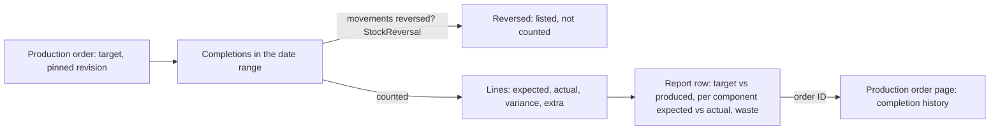
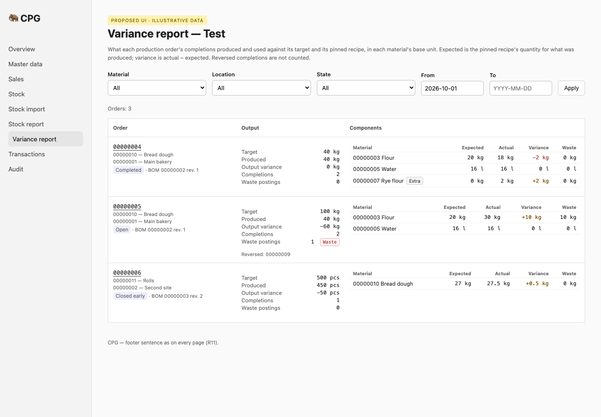
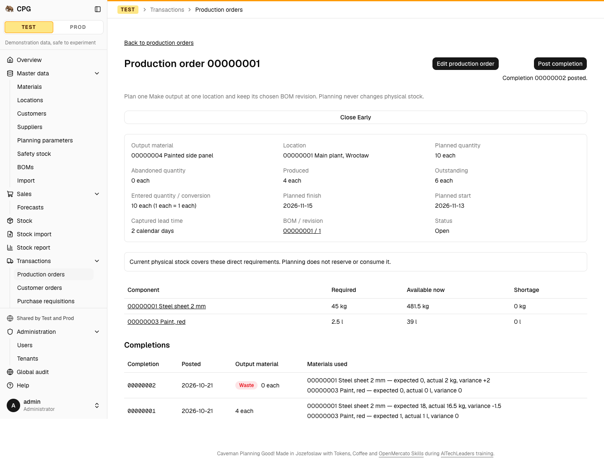

# A user opens the production variance report: each order's target and pinned-BOM expected consumption against actual output and inputs, with extra components, zero-output waste and reversed completions, filters, and the same through the API

**Status:** ready
**Created:** 2026-10-21 09:47 UTC
**Issue:** #95 (E13-S02), epic #79 · **Builds on:** `implemented/2026-10-20--2221UTC-production-completions.md` (#89: completions and their stored expected, actual and variance lines), `implemented/2026-10-20--2047UTC-production-orders.md` (#88: orders and their pinned revision), `implemented/2026-10-21--0706UTC-stock-reversals.md` (#91: the append-only `StockReversal` link), `implemented/2026-10-21--0707UTC-document-lifecycle.md` (#90: the four states), `implemented/2026-10-20--2221UTC-stock-report.md` (#94: the first report, whose shape this one follows), `implemented/2026-10-19--2018UTC-read-only-tenants.md`, `implemented/2026-10-19--0913UTC-test-prod-tenants.md` · **Design authority:** `.ai/specs/product-brief.md` (R05, R07, R11, N01, N04, D02), `.ai/specs/research/CPG-prd001.pdf` §07 "Production variance reporting" and §03 "Production postings" / "Reversal transaction", `CPG-prd-datamodel.pdf` ("Production completion posting", "Actual component usage"), `CPG-acceptance.md` (PRD-013, PRD-014, PRD-015, PRD-018, REV-011, REV-013, REV-014, UX-021, API-014, TEN-018, UX-013)

## 📝 TLDR

Every completion already stores, per material, what the pinned recipe expected for its output, what was actually used and the signed variance (#89). Nobody can see that across orders. This spec adds the **production variance report**: one row per production order that has completions, showing its **target** against what it **produced**, and per component the summed **expected**, **actual** and **variance** in the material's base unit. Inputs that are not in the pinned recipe are marked **Extra**. Zero-output postings are counted as **waste postings**, and each component shows how much of its actual went to waste. A **reversed** completion is left out of every figure and its ID is listed as reversed. Filters narrow the rows by material, location, state and a posting-date range. Both roles read it, in the UI and through `GET /api/tenants/{tenant}/reports/variance`, under the same authorisation, read-only tenants included. Nothing is written, so there is no migration and no audit entry. No cost or capacity figure appears (N01, N04).

## Resolved assumptions (autonomous defaults)

The run is autonomous (cezar, `/om-auto-fix-issue 95`). The PRD gives the report one sentence (§07: "Compare recorded production order target and pinned BOM expected consumption to actual output/input, including extra components and zero-output waste. No finance/capacity.") and no columns, filters or order. Each choice below is the most reversible one the sources allow, published here for override.

| # | Question | Chosen answer | Rationale |
|---|---|---|---|
| Q1 | Which rows does the report hold? | One row per **production order** with at least one completion posted in the date range (every completion when no range is given). An order with no completion has recorded nothing to compare and isn't a row. An order whose only completions in range are reversed is still a row, so the reversal stays visible: `produced` `0.000000`, `completions` 0, `wasteCompletions` 0, `components` `[]`, its `reversed` IDs, and an `outputVariance` of −target (or null under a date range, Q2). | The PRD compares "recorded" production. Listing unstarted orders would add rows of zeros. |
| Q2 | What does a row show about the order? | The order's ID (linked to its page), output material (ID, description, base unit), location (ID, name), state, BOM and pinned revision. **Target** is the order's quantity. **Produced** is the sum of the counted completions' output (Q5): with no date range and no reversal it equals the order's own produced quantity. **Output variance** is produced − target, signed, and is **null** (shown "—") while a date range is set, because the target belongs to the whole order and a range sees only part of its output. **Completions** counts the counted completions and **Waste postings** the counted ones with zero output. | PRD §07 "target … to actual output". The state tells whether a negative output variance is an unfinished Open order or a shortfall on a Completed or Closed-early one. A partial-range variance against the full target would read as a shortfall that isn't one (spec review). |
| Q3 | What does a row show per component? | One line per material used by the counted completions: **Expected** (the sum of the lines' stored expected), **Actual** (the sum of their actual), **Variance** (the sum of their stored variance, which is actual − expected) and **Waste** (the part of the actual posted by zero-output completions). An input the pinned revision doesn't hold carries `extra: true` and an **Extra** badge, with an expected of zero. Pinned components come first in recipe order (the stored lines' `position`, which pins them first and in recipe order), then extra inputs by material ID (their positions vary between completions). All quantities are six-decimal base-unit strings (R03), shown as elsewhere (`+3`, `-2`, `0` for variances). | The issue's example: 18 kg against 20 kg expected is −2 kg, and 2 kg of extra X is +2 kg. The stored figures are immutable, so the report never recomputes history from rules that may change (completions spec, "variance derived on read" rejected). |
| Q4 | How does zero-output waste appear (PRD-018)? | A zero-output completion is counted: its lines' actuals add to Actual and Variance (its expected is zero) and to the component's **Waste**, and it adds one to **Waste postings** and nothing to Produced. A reversed waste posting counts nowhere, like any reversed completion (REV-013). | "Zero-output waste postings appear as such": a waste count per order and a waste quantity per component, never folded silently into the variance. |
| Q5 | Which completions count, and what does "reversed" mean (REV-011, REV-014)? | A completion is **reversed** when any of its stock movements (`postingId` = the completion's `id`, type `production-completion`) is the `original` of a `StockReversal` link (#91). A reversed completion counts nowhere: not in Produced, Completions, Waste postings or any component figure. Its business ID is listed in the row's `reversed`, in ID order, shown as "Reversed: 00000012". Every other completion of the order in the date range counts. A reversal of completion 25 leaves completion 40 counted (REV-014). "Reversed" is judged as of the read, whatever date the reversal was posted on; the date range applies to the completion's own business date. | Completion reversal is #92 (E11-S03), not built yet: `StockReversalService` refuses a completion's movement today (`STOCK_REVERSAL_UNSUPPORTED`). Until #92 ships, criterion 2 is proven by service tests that insert the link and its inverse movement by hand; the end-to-end check belongs to #92. a completion's movements are its posting group, and the reversal link is the existing append-only record of "this movement was reversed". If #92 records completion reversals differently, only the one helper that answers "which of these completions are reversed" changes (Implementation notes). |
| Q6 | Filters? | `material`: the order's output is that material, or a line of one of its **counted** completions in the range has that material with a non-zero expected or actual (a pinned line is stored even when nothing was used, and a reversed completion matches nothing). The row still shows all its components. `location`: the order's location. `status`: one of `open`, `completed`, `closed-early`, `cancelled`, named as the rows' `status`. `from` / `to`: inclusive bounds on the completions' business date, `YYYY-MM-DD`. Figures cover only completions in the range, and the target is the order's. Material and location are eight-digit IDs offered as selects (inactive ones marked); an unknown one, the other tenant's included, is 404 `MATERIAL_NOT_FOUND` / `LOCATION_NOT_FOUND`. Dates must be real calendar dates (`2026-02-30` is refused). A `from` after `to` is 400 `VALIDATION_FAILED` with a field error on `to` through the API; the page keeps the form and shows that error beside **To** instead of a table, rather than a not-found page. Any other malformed query is the not-found state on the page, as for the stock report. | Issue criterion 3. Not-found keeps tenant scoping explicit, as in the stock report (R05). The date range is on postings because that is when consumption happened. |
| Q7 | Order and paging? | By production order ID (the business ID, never the UUID a completion references), ascending, as the Production orders list. 50 orders per page (`page`, from 1): each row holds a component table, so 100 would be a very long page. The page shows the last page when asked for one past it; the API returns empty `rows` with the `total`. | Same rules as the stock report, with a smaller page for taller rows. |
| Q8 | How is it computed? | At request time, nothing stored. Completions in the range and under the order filters are read in batches of 500 without the identity map, keeping only primitives (ID, code, order, output quantity). Per batch, reversals are read from the `StockReversal` side (only the few links come back) and material matches from the lines. The kept orders are mapped to their business IDs, sorted and paged. Only the page's counted completions' lines are then read, in keyset batches of 500 without the identity map, and added to a per-order tally (pure, in `domain/`) as they arrive. Memory grows with the completions in range and the page's components, not with the ledger or the lines. | The PRD sets no performance target (§07 "best effort"). Lessons: bound managed entities as well as SQL pages; order by business ID. |
| Q9 | API (R07, API-014, UX-021)? | `GET /api/tenants/{tenant}/reports/variance?material=&location=&status=&from=&to=&page=` returns `{ asOf, page, pageSize, total, rows: [{ id, output, outputDescription, baseUnit, location, locationName, status, bom, revision, target, produced, outputVariance, completions, wasteCompletions, reversed: [id], components: [{ material, description, baseUnit, extra, expected, actual, variance, waste }] }] }`. `asOf` is the server's UTC date; `outputVariance` is null under a date range. Another query parameter is 400. No other key exists (no cost, value or capacity figure). | The page and the API call the same service with the same query. The envelope matches the stock report's (`asOf`, `rows`); row fields follow the production order and completion views. Inactive markers are left out: the order page shows them, and no filter here depends on them. |
| Q10 | Who and which tenant (R05, TEN-018)? | Any signed-in account, both roles: the page through `requireUser`, the API through `requireApiUser` (bearer token, or the session cookie for `GET`). Everything is read through `tenantScope`, so Test never shows a Prod order. A read-only tenant opens the report as usual: it writes nothing. | The shared read gates, as for the stock report. |
| Q11 | Where is it? | `/admin/{tenant}/reports/variance`, a flat **Variance report** entry right after **Stock report** in the sidebar. Each row's order ID opens the order's page, whose completion history lists the individual postings. | The sidebar must fit 1280 × 800 without scrolling (lesson 2026-10-20); one flat entry is the smallest addition. A Reports group stays a separate navigation change. |
| Q12 | Help, language, footer (R11, UX-013)? | A `variance-report` help topic in English and Polish, explaining expected, actual, variance, extra, waste and reversed. All strings EN/PL. The root layout's footer is already on every page. | `tests/every-page-has-help.test.ts`. |
| Q13 | Costs, capacity, audit? | No cost, price, value, work centre or capacity figure anywhere (N01, N04). Reads are not audited (R08 covers changes). | The PRD row's "No finance/capacity". |

## 📝 Architecture

- **core:**
  - `validators/reports/variance-report.schema.ts`: `varianceReportQuerySchema` (strict; `from` ≤ `to`) and `VARIANCE_REPORT_PAGE_SIZE` (50).
  - `domain/reports/variance-report-rows.ts`: pure. Sums a page of orders' counted completion lines into component figures (Q3, Q4), orders the components, and computes produced and output variance.
  - `services/reports/variance-report.service.ts`: `VarianceReportService.read(query)`. It resolves the filters through `findMaterial` / `findLocation`, reads completions in batches, marks reversed ones (Q5), applies the material filter, pages the orders and builds the rows.
  - Container, cradle and index lines.
- **app:**
  - `api/tenants/[tenant]/reports/variance/route.ts`.
  - `admin/[tenant]/reports/variance/page.tsx`.
  - `components/reports/variance-report-screen.tsx` (filters, the order table with its component sub-table).
  - The sidebar entry and icon, both dictionaries and the help topic.
- **No db change.** Reads `ProductionOrder`, `ProductionCompletion`, `ProductionCompletionLine`, `StockMovement` and `StockReversal`.

### UI

The page follows the stock report: a heading, one sentence on what the figures mean, a filter form (material, location, state, from, to as date inputs, Apply), the row count, then the order table. Each row's components sit in a small table in the row's last cell, so one order reads as one block. Below `md` the location, state and recipe move under the order, and the component table stays readable at 390 px (lesson 2026-10-21: dense tables at phone width).

Current screens it builds on: the order's completion history (`assets/production-variance-report/current-01-order-completions.png`) and the stock report (`assets/production-variance-report/current-02-stock-report.png`).

## Requirements

- [ ] Rows per Q1–Q4: target, produced and output variance per order; expected, actual, variance and waste per component; Extra for inputs outside the pinned recipe; waste postings counted (PRD-013, PRD-014, PRD-015, PRD-018).
- [ ] Reversed completions excluded from every figure and listed as reversed (Q5, REV-011, REV-014).
- [ ] Filters by material, location, state and date range; paging (Q6, Q7).
- [ ] `GET /api/tenants/{tenant}/reports/variance` (Q9), the page route with its query parameters and the `variance-report` help topic, documented in `BACKWARD_COMPATIBILITY.md` §4.
- [ ] Both roles, both channels, tenant-scoped; a read-only tenant opens the report (Q10, API-014, UX-021, TEN-018, R05, R07).
- [ ] No cost or capacity figure (Q13, N01, N04): a test pins the exact key set of a row and of a component.
- [ ] Sidebar entry, EN/PL strings and help (Q11–Q12, R11, UX-013).
- [ ] Unit tests at 100%, and integration tests for the page and the API.

## Out of scope

Recording completion reversals (#92); MRP's use of the remaining balance (PRD-028, slice 3); cost or capacity figures (N01, N04); export formats; totals across orders; a Reports group in the sidebar; per-completion detail beyond the order page's existing history.

## Acceptance criteria

The six criteria of issue #95.

## 📋 Implementation Plan

1. core: the query schema, the pure tally, `VarianceReportService` (batched completions, reversal links, material filter, paging, batched lines), DI and the index. Unit tests on a real SQLite file: the issue's 18-vs-20 kg and extra-X example, a waste posting, a reversal simulated with a hand-inserted `StockReversal` link and inverse movement (REV-014: one of two completions; an order with only reversed ones; a reversed waste posting), every filter branch (Q6), the null output variance under a range, ordering past one page with more orders than a page (business ID, not UUID), batches past 500 completions and 500 lines, unknown filters, `from` after `to`, and the exact key set.
2. app: the report route and page (the range error beside **To**), `components/reports/variance-report-screen.tsx` (props named `selected`, never `filters`: lesson 2026-10-21), the sidebar entry and icon, EN/PL and the help topic. Unit tests.
3. Integration: `variance-report.test.ts` (UI: an order with under-consumption, an extra input and a waste posting; filters, dates through `fillDate`; the link to the order; read-only tenant; phone width) and `variance-report-api.test.ts` (normal user and admin parity, Prod rows absent in Test, filters, 404s, 400s, a read-only tenant). `navigation.test.ts` must pass at 1280 × 800 with the new entry. A reversed completion can't be posted end to end until #92; that check is #92's.
4. Docs: `BACKWARD_COMPATIBILITY.md` §4. Move the spec to `implemented/`.

## Implementation notes

- **Reversals (#92).** At the time of writing #92 (completion reversal) is being designed in parallel. The report decides "reversed" in one helper over the completions' movements and `StockReversal`. If #92 links a reversal to the completion itself instead, that helper reads the new link; nothing else in the report changes.
- **Spec review.** A fresh-context review before publication found the output variance misleading under a date range (now null), an ambiguous material filter (now counted lines with a non-zero figure), an unbounded line read (now keyset batches into a tally), a 404 for a reversed date range on the page (now a field error), and an envelope that differed from the stock report's (now `asOf` and `rows`, with `status` as the query name). All are folded into Q1–Q9 above.
