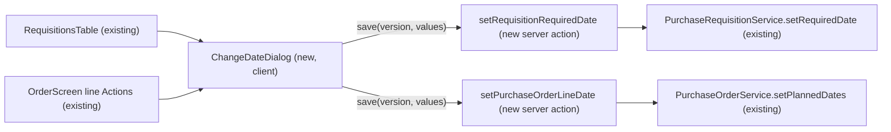
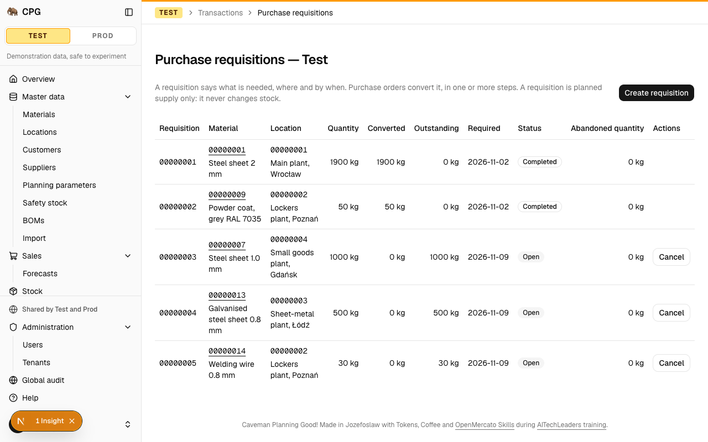
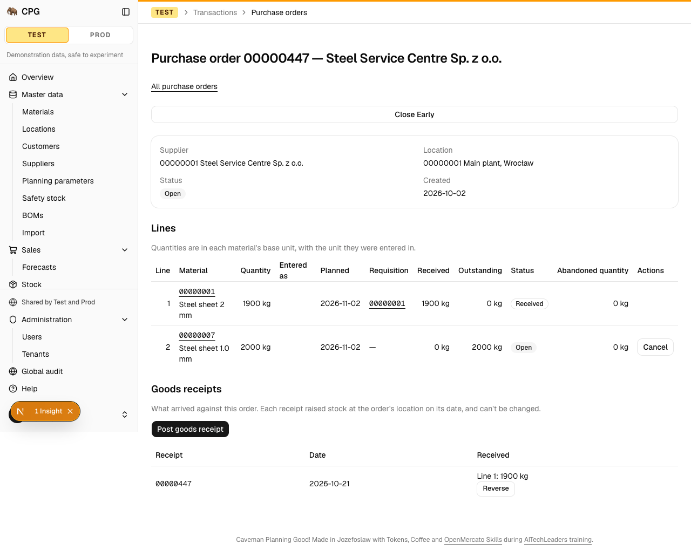
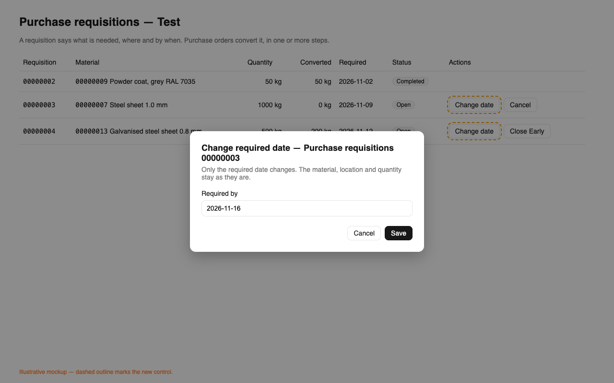
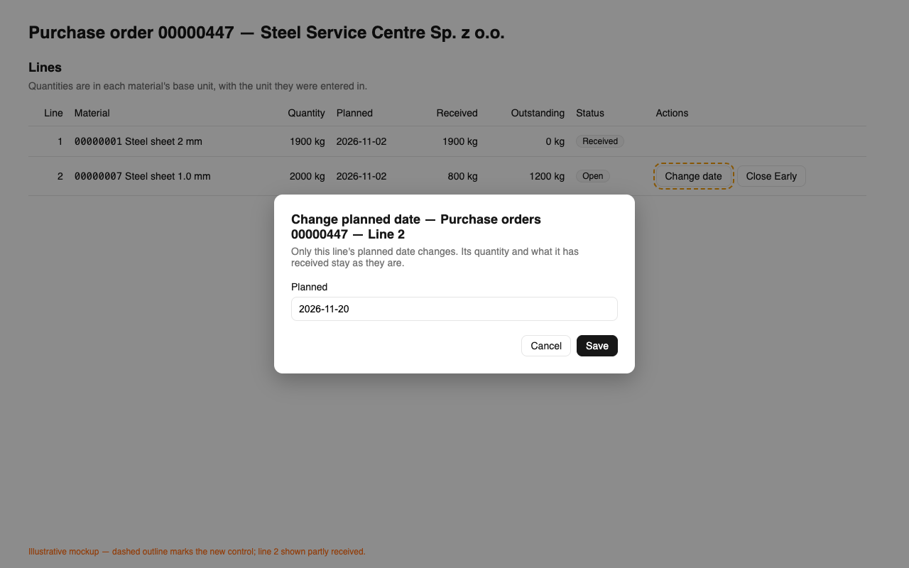

# A user changes a requisition's required date and a purchase order line's planned date on screen

**Status:** ready
**Created:** 2026-10-21 20:36 UTC
**Issue:** #142 (E09-S04), epic #75 · **Builds on:** `implemented/2026-10-20--1636UTC-purchase-requisitions-orders.md` (#86, Q8: the only edits after creation), `implemented/2026-10-20--1933UTC-goods-receipts.md` (#87, BUY-020…024), `implemented/2026-10-20--2046UTC-transfers.md` (the Change dates dialog), `implemented/2026-10-21--0707UTC-document-lifecycle.md` (row actions, line states) · **Design authority:** `.ai/specs/product-brief.md` (R05, R07), `CPG-acceptance.md` (BUY-024)

## 📝 TLDR

Today a requisition's required date and a purchase order line's planned date can be changed only through the API (`PATCH`, spec #86 Q8). Nothing on screen calls `setRequiredDate` or `setPlannedDates`, although BUY-024's channel is "Both" and transfers already have Change dates. This spec proposes a **Change date** action on each Open requisition row and on each Open line of an Open purchase order. Each action opens a one-field dialog bound to the version the user loaded, and saves through a new server action that calls the existing service method. No schema, API or service change.

## Resolved assumptions (autonomous defaults)

| # | Question | Chosen answer | Rationale |
|---|---|---|---|
| Q1 | One spec, or one per document? | One. Both edits ship together on one PR. | Both reuse the same pattern, dialog and services, and the issue's criteria cover both. Each half is small; splitting them would double the review and integration work for no gain. |
| Q2 | On the PO, one page-level dialog with every line's date, or an action per line? | An action per line: **Change date** in the line's Actions column, beside Cancel/Close Early. It edits that line's date only. | An order has up to 100 lines, and a dialog with 100 date fields doesn't fit (lesson: tall dialogs). The line's Actions column is where line-scoped actions already live. The API keeps the multi-line `PATCH`, so a bulk change is still possible there. Reversible: a page-level dialog can be added on top later. |
| Q3 | Which PO lines offer it? | Lines whose status is Open, on an Open order, in a writable tenant. Completed, Cancelled and Closed Early lines don't. | BUY-024 changes "the planned delivery date of the open amount". A Completed line expects nothing more, so its date has no planning meaning. The service still accepts a Completed line through the API, so nothing is taken away. |
| Q4 | Where is a requisition's action, given it has no page of its own? | In the row's Actions column of the requisition list, beside Cancel/Close Early, while the requisition is Open and the tenant writable. A partly converted requisition is still Open, so it is still offered. | Same place as the row's lifecycle action. It matches what the service allows (`status === "open"`). |
| Q5 | Which version does a save carry? | The version the dialog **opened** with. A refresh behind an open dialog doesn't rebind it, so a stale save gets `VERSION_CONFLICT`. For a PO line this is the order's version. | Lesson "Bind an aggregate edit to the version it opened with" and the transfer dialog's precedent. The order's version is what `setPlannedDates` checks. |
| Q6 | Saving the same date? | A success with no change and no audit entry, exactly as the service does. The dialog closes. | Same as the API. |
| Q7 | Shared dialog or two? | One shared client component, `ChangeDateDialog` in `components/purchasing/`. Each screen passes its own field, labels and server action, already bound to the record. | Two copies of the same one-field dialog would break "build once, reuse" (engineering standards). `components/purchasing/` already holds what both purchasing screens share. |

## 📝 Problem Statement

- BUY-024 (P1, channel **Both**) is "Partially verified": the API half passes, and the screen half is missing (#142). The acceptance entry says so.
- R07 still holds, because every screen operation has an API twin. But a user without a token can't move a date at all, and both roles have this need (issue #142).
- Transfers (TRF-026) and production orders already offer date changes on screen, so purchasing is the odd one out.

## 📝 Proposed Solution

Two server actions over the existing service methods, plus one shared one-field dialog placed in the existing Actions columns. Nothing else changes.

Alternatives rejected:
- **An inline editable date cell.** That would be a new interaction pattern that no other screen uses. It also needs its own pending and error states and a version capture.
- **A page-level "Change dates" dialog listing every line.** See Q2.
- **A requisition detail page.** That is new routing and navigation for a single field.

Research: Odoo and ERPNext both edit a PO line's schedule date per line on the order, after a partial receipt, without reopening the order. ERPNext's "Update Items" dialog edits all lines at once, and its weight is what Q2 avoids. Neither lets the date edit touch received quantities, which is BUY-024's rule.

## 📝 Architecture

Takeaway: the new code is presentation and action wiring. The rules (version check, Open check, audit, same value = no change) stay in the services that the API already uses, so the UI and the API can't drift apart.

- **Validators (`core/src/validators/purchasing/`).** Two form schemas, each with one field and the existing `calendarDateSchema`:
  - `requisitionDateSchema = z.object({ requiredDate })` in `purchase-requisition.schema.ts`;
  - `orderLineDateSchema = z.object({ plannedDate })` in `purchase-order.schema.ts`.

  The `PATCH` body schemas stay as they are. The client imports these schemas through the `@cpg/core/validators/*` subpath, never the `@cpg/core` root (lesson: client bundles).
- **Server actions** go in the existing action files. They follow `setTransferDates`: `currentUser()` before the transaction, `tenantServerAction` with the tenant and generation the page rendered, `assertSignedIn` inside, and `refreshAfterWrite`.
  - `purchase-requisitions/actions.ts` gets `setRequisitionRequiredDate(tenant, generation, id, version, values)`, which calls `purchaseRequisitionService.setRequiredDate(id, requiredDate, version, uiActor(…))` and refreshes `/admin/{tenant}/purchase-requisitions`.
  - `purchase-orders/[id]/actions.ts` gets `setPurchaseOrderLineDate(tenant, generation, id, line, version, values)`, which calls `purchaseOrderService.setPlannedDates(id, [{ line, plannedDate }], version, uiActor(…))` and refreshes `/admin/{tenant}/purchase-orders/{id}`. The list doesn't show planned dates, so it needs no refresh.
  - The leading arguments (tenant, generation, id and, for a PO, line) are bound with `.bind(null, …)` when the screen renders, as the lifecycle actions are. The dialog passes the version it captured and the form values.
- **`ChangeDateDialog` (`components/purchasing/change-date-dialog.tsx`, client).**
  - Props: `available`, `subject` (for example "Requisition 00000003" or "Purchase order 00000002 — Line 2"), `field` (`{ name, label }`), `schema`, `value`, `version`, `save: (version, values) => Promise<Result<unknown>>`, `labels` and `errors`.
  - It renders an outline **Change date** trigger named `Change date — {subject}` (it sits in a row beside Cancel and Close Early), then a dialog with a `CrudForm` holding one `date` field.
  - It captures `{ value, version, save }` when it opens (Q5).
  - Error codes go through the shared `messages.errors` (`VERSION_CONFLICT`, `REQUISITION_NOT_OPEN`, `PURCHASE_ORDER_NOT_OPEN`, `DOCUMENT_NOT_OPEN` and `TENANT_READ_ONLY` already exist in EN and PL), and field messages through the screen's existing `fieldErrorFormatter`.
- **Screens.**
  - `RequisitionsTable`'s Actions cell wraps the existing `LifecycleControl` and the new dialog in one `flex flex-wrap gap-2` row. The new dialog is offered when `editable && row.status === "open"`.
  - `OrderScreen`'s line Actions cell does the same. Its dialog is offered when `!tenant.readOnly && order.status === "open" && line.status === "open"`.
- **No change** to entities, migrations, services, the routes, the audit (the entries and their field labels exist: `requiredDate`, `line{N}PlannedDate` → "line N: planned date"), the navigation or the events.

## 📝 UI/UX

Prototype: `.ai/specs/assets/purchasing-date-edits/` (static mockups)

- **Trigger.** An outline **Change date** button in the Actions cell, before Cancel/Close Early. It is hidden wherever the edit can't succeed: a read-only tenant, a requisition or order that isn't Open, or a line that isn't Open.
- **Dialog, requisition.**
  - Title: "Change required date — Requisition {id}".
  - Description: "Only the required date changes. The material, location and quantity stay as they are."
  - One field: Required date, prefilled.
  - Buttons: Save (pending "Saving…") and Cancel.
- **Dialog, PO line.**
  - Title: "Change planned date — Purchase order {id} — Line {n}".
  - Description: "Only this line's planned date changes. Its quantity and what it has received stay as they are."
  - One field: Planned date, prefilled.
  - Buttons: the same as the requisition dialog.
- **After a save.** The dialog closes and the page refreshes, so the new date shows in the row. The audit lists an `updated` entry from the UI channel.
- **Refusals.** A refusal stays in the dialog as an alert (`role="alert"`), and the form keeps the value the user entered:
  - `VERSION_CONFLICT`;
  - a document that is no longer Open;
  - a read-only tenant, for a form opened before the switch;
  - an invalid date, shown beside the field.

  As in the transfer dialog, the page refreshes behind the dialog after a conflict, but the dialog keeps the version it opened with (Q5).
- **Copy.** EN and PL strings, plain data only (lesson: no functions passed to client components). The help topics are updated:
  - `purchase-requisitions` gains one sentence: "Change date on an Open requisition sets a new required date, here or through the API with PATCH, at the version you loaded. Every change appears in the tenant's audit."
  - `purchase-order`'s API-only paragraph becomes: "Change date on an Open line of an Open order sets its planned date, here or through the API with PATCH, at the version you loaded, also after receipts. The supplier, the location and a line's material, unit and quantity never change."
- **Small screens.** The Actions cell wraps its buttons. The dialog has one field, so it is not tall. The existing tables already keep row actions in view at 390 px; the integration test asserts this for the new button.

## 📝 Edge Cases & Failure Scenarios

| Case | What happens | What the user sees |
|---|---|---|
| Another user changed the requisition or order (any field, a receipt or a lifecycle action) after the dialog opened | The service refuses: `VERSION_CONFLICT`. Nothing is written. | The conflict message in the dialog. After closing it, the refreshed row. |
| The requisition was converted in full, cancelled or closed after the page loaded | `VERSION_CONFLICT`: the version check comes first. | The conflict message. After a refresh the row offers no Change date. |
| A PO line was cancelled or closed early in another session | `VERSION_CONFLICT`: the order's version moved. | The same. |
| The tenant was made read-only while the form was open | `tenantServerAction` refuses `TENANT_READ_ONLY` before the service runs. | The read-only message. The page doesn't refresh, so the explanation stays visible (lesson: refresh after refusal). |
| A Test reset happened while the form was open | The generation check refuses, as for every Test write. | The existing message. |
| The same date is saved again | Success, no write, no audit entry. | The dialog closes. |
| An empty or invalid date is submitted | `calendarDateSchema` refuses before the service runs. | The field message beside Required date or Planned date. |
| A PO with receipts | Allowed: only the planned date changes, and received and outstanding are untouched (BUY-024). | The new date. Received is unchanged. |

## 📝 Risks & Impact Review

- **Contracts.** Purely additive. No API, schema, event or audit format changes. The two new server actions are internal endpoints. No `BACKWARD_COMPATIBILITY.md` surface is touched. Rollback is a revert.
- **Repository rules.**
  - R05: writes go through `tenantServerAction`, so a read-only tenant refuses them, and the action is hidden there.
  - R07: the screen calls the same service methods as `PATCH`, so the two channels stay at parity.
  - Pages and actions go through services only.
- **Row width.** One more button in the requisition table's Actions cell. The table already wraps, so the integration test checks the row at phone width (lesson: dense tables).

## 📝 Decisions in play

R05 (a read-only tenant blocks business writes) and R07 (UI/API parity) are relied on, not changed. The spec supersedes no decision. It completes the "API-only" note in the #86 spec's Implementation notes, which pointed here.

## 📋 Phasing

One phase: both edits ship on one implementation PR (Q1).

## 📋 Implementation Plan

1. **Validators and server actions.**
   - Add `requisitionDateSchema` and `orderLineDateSchema` with tests: a valid date, a missing date, an invalid date.
   - Add `setRequisitionRequiredDate` and `setPurchaseOrderLineDate` with action tests in the existing `actions.test.ts` files: forwarding of id, line, version and actor, the refreshed paths, and refusal passthrough.
   - Service tests already cover the rules. Add a service test only if a gap shows up.
2. **`ChangeDateDialog`.**
   - The client component and its jsdom tests:
     - the trigger is hidden when `available` is false;
     - the field is prefilled;
     - `save` is called with the captured version, which survives a prop change while the dialog is open;
     - refusal messages, with field errors beside the field;
     - the dialog closes on success.
   - EN/PL labels in `messages`, and an update to the purchasing labels tests (plain data only).
3. **Screens.**
   - Wire the dialog into `RequisitionsTable` and `OrderScreen`'s line Actions, with screen tests:
     - offered only for Open documents and lines;
     - hidden in a read-only tenant;
     - the subject and the bound action are right.
   - Update the help topics `purchase-requisitions` and `purchase-order` in EN/PL.
4. **Integration and docs.**
   - In `tests/integration/purchasing.test.ts`:
     - change a requisition's required date on screen, see it in the row and in the audit;
     - change the planned date of a received PO line on screen, and see that received is unchanged and the audit is recorded;
     - check the button stays in view at 390 px.
   - Check that existing assertions on Actions cell text still hold (lesson: row actions changed).
   - In `CPG-acceptance.md`, BUY-024 becomes `Passed (automated)` for its non-MRP half, with the new evidence. Its MRP half stays slice 3 (#14).
   - Update the #86 spec's Implementation notes line that says "API-only".
   - Move this spec to `implemented/`.
