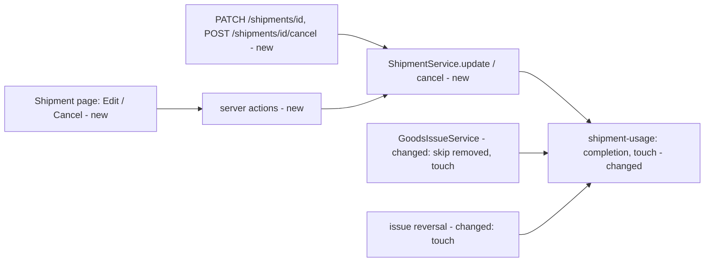

# A user changes an Open shipment's plan, and cancels a shipment nothing has been issued against

**Status:** ready
**Created:** 2026-10-23 20:06 UTC
**Issue:** #147 (E08-S05), epic #74 · **Builds on:** `implemented/2026-10-20--2045UTC-shipments-goods-issues.md` (#84: shipments, Q8 completion, Q10 order-line locks), `implemented/2026-10-21--0707UTC-document-lifecycle.md` (#90: Cancel versus Close Early), `implemented/2026-10-21--0706UTC-stock-reversals.md` (#91: posting history outlives a reversal) · **Design authority:** `.ai/specs/product-brief.md` (R03, R05, R07, R08, D04), `BACKWARD_COMPATIBILITY.md`

## 📝 TLDR

Once a shipment is created, its plan can't be changed: the API has no write on a shipment, and the page offers only Post goods issue. A user who mistypes a planned date or quantity, or plans a dispatch that won't happen, has two choices: leave a wrong Open shipment beside the order, or close the whole order early. This spec proposes **Edit shipment** and **Cancel shipment**, on the shipment's page and through keyed API routes. Edit changes an Open shipment's planned date and lines at the version the user loaded. Cancel ends an Open shipment that has never had a goods issue posted against it, giving it a new status, `cancelled`.

## Resolved assumptions (autonomous defaults)

| # | Question | Chosen answer | Rationale |
|---|---|---|---|
| Q1 | One spec, or one each for edit and cancel? | One spec and one implementation PR. | The issue scopes them as one story. Both need the same new `version`, migration, page controls and audit subject. #90 shipped Cancel and Close Early together for the same reason. |
| Q2 | How does an edit name the lines it keeps, changes, adds and removes? | By `orderLine`, the stable customer-order line ID, exactly as create does. The body lists the whole plan: a listed `orderLine` the shipment already has keeps that line, a new one adds a line, and a line left out is removed. | A shipment has at most one line per order line (create refuses duplicates), so the order line identifies the shipment line. The body then has the same shape as create, so the schema, the form and its error mapping are reused. The customer-order `PATCH` uses the same full-list convention. |
| Q3 | What happens to a removed line's record and number? | It stays as a hidden row (`removed`), and its number is never reused. A new line is numbered after the highest number the shipment has ever had. | A goods issue names a shipment line by number, without a version. If a number were reused, a client still holding the old plan could issue against a different material. A hidden row keeps the number taken, as `CustomerOrderLine.removed` does. |
| Q4 | What bounds a changed quantity? | Never below what the line has issued, as a field error. Raising it is bounded like create: what is left to issue (planned − issued) may not exceed what the order line still has outstanding (SAL-018). Lowering it is never refused for outstanding. | The issue's criteria, and create's rule applied to the remainder. Refusing a decrease because another shipment has since issued against the order line would block the very correction this story is for. |
| Q5 | What advances a shipment's version? | Every change to what its page shows: an edit that changes something, a cancel, completion and recalculation, a goods issue, and the reversal of one. An edit that changes nothing writes no audit and keeps the version. | "The edit is made at the version the user loaded" (issue). The page shows issued and to-issue quantities, so an issue posted behind an open dialog makes it stale, as on customer orders, whose version a goods issue already advances. |
| Q6 | Which history blocks a cancel? | Any goods issue ever posted against the shipment, even one reversed since. Lines left with nothing issued are no exception. | The #91 rule: a full reversal returns quantities to zero but doesn't erase the posting. The issue's criteria and D04 split it the same way #90 does: Cancel only what was never processed, and finish a processed shipment by lowering its lines to what was issued. |
| Q7 | How does the migration add `cancelled` to the status check? | Without rebuilding the table. It adds a new checked column, copies `status` into it, drops the old column and renames the new one. The version, timestamp and `removed` columns are plain `ADD COLUMN`s with defaults. | `shipment` is referenced by `shipment_line` and the immutable `goods_issue`. A generated table rebuild is what the lesson "Verify generated SQLite additions on populated data" warns about, and the issue asks for an additive migration that keeps the enum check. |
| Q8 | What does the Edit dialog look like? | The Create shipment form, reused: the planned date, then a row per line. The shipment's lines come first, filled with their entered quantity and unit. They are followed by the order's other lines that have anything outstanding, left empty. Emptying a row removes its line, and filling an empty row adds one. | It is the form users already know from create (`LineQuantitiesForm`). The only new thing it needs is starting values per row. |
| Q9 | What if an edit leaves out a line that has had goods issued? | Refused with 409 `SHIPMENT_LINE_ISSUED`, naming the line number in `params.line`. | A line that was left out has no field in the body, so there is nowhere to attach a field error. The message points the user to lowering the line instead (lesson: name the record in `params`). |
| Q10 | Does a cancelled shipment, or a removed shipment line, still lock its order line (shipments spec Q10)? | Yes. Nothing changes in `isAnyShipped`. | A replaced order line keeps its ID and takes a new material (`archiveLine`). If the lock were released, a cancelled shipment's page would start showing a material it never planned. History keeps its meaning, and the lock is the existing, conservative behaviour. |

## 📝 Problem Statement

- #84 left "shipment edits or cancellation" out of scope. Its run log's follow-up says "a plan can't be changed yet; create another shipment instead". Closing epic E08 filed that leftover as #147.
- A shipment only ever ends through goods issues or its order's closure (#90). A wrong one stays Open beside the order. A user can see it, but the Post goods issue dialog keeps offering it.
- Both roles have the need, on screen and through the API (R07).

## 📝 Proposed Solution

Two new methods on `ShipmentService`, `update` and `cancel`, under the shipment's new version. They are served by a keyed `PATCH …/shipments/{id}`, a keyed `POST …/shipments/{id}/cancel` and two server actions on the shipment page. The page gets an **Edit shipment** dialog (the create form, pre-filled) and a **Cancel shipment** confirmation.

Rules:
- **Edit** needs the shipment Open (`SHIPMENT_NOT_OPEN` otherwise) and its order Open (`CUSTOMER_ORDER_NOT_OPEN`, as on create).
  - It replaces the planned date and the line set (Q2). It may lower a line down to what it has issued, raise it within the order line's outstanding (Q4), add lines of the same order, and remove lines nothing was ever issued against (Q9).
  - An unchanged entered quantity and unit keeps the line's stored base quantity and factor, so a conversion changed since doesn't silently re-price the plan (the customer-order precedent).
  - After the change, the existing completion check runs. If no line has anything left to issue, the shipment is Completed in the same transaction (issue: "lowering its lines to their issued quantity completes it").
- **Cancel** needs the shipment Open and no goods issue ever posted against it (Q6). It sets `cancelled` and nothing else: shipments reserve no stock and fulfil nothing (SAL-009). Stock, the order's quantities and the forecast consumption stay as they are.
- A cancelled shipment is terminal. No goods issue posts against it (the existing `SHIPMENT_NOT_OPEN`), edits and a second cancel are refused, and completion and reversal recalculation skip it (they already read only Open and Completed shipments).

Alternatives rejected:
- **Line numbers in the edit body.** That would mean a second line identity, and new lines would still need `orderLine`, so one form couldn't serve both create and edit (Q2).
- **Deleting a removed line's row.** A later added line could take its number (Q3).
- **Cancel by setting every line to its issued quantity.** For a shipment with nothing issued, that is a zero quantity, which create refuses. "Completed" would also misreport a dispatch that never happened.
- **A generated table rebuild for the status check** (Q7).

Research: in Odoo, an un-validated delivery order can be edited or cancelled. Once part of it is validated, the remainder becomes a backorder, which can then be cancelled. ERPNext cancels a draft Delivery Note but amends a submitted one. Both separate "never processed" (cancel) from "partly processed" (finish the remainder), which D04 and #90 already do. Neither offers a stock-reversing cancel of a posted delivery. Here that stays the E11-S02 reversal.

## 📝 Architecture

- **`core/services/shipments/shipment.service.ts`**: `update(id, input, version, actor)` and `cancel(id, version, actor)`, each in one transaction. The version is compared against a fresh read, and `OptimisticLockError` maps to `versionConflict()` (the `UserService` reference). Line resolution shares create's checks (`resolveLines`) and adds Q4's bounds for kept lines.
- **`core/services/shipments/shipment-usage.ts`**:
  - `completeFinishedShipments` and `recalculateReversedShipments` read only lines that aren't `removed`. Otherwise a removed line with something left to issue would keep a shipment Open forever.
  - A new leaf, `touchShipment(shipment, at)`, sets `updatedAt` monotonically (lesson "A version bumped through a timestamp needs a monotonic timestamp"). Every writer that changes only a shipment's lines calls it, so the header row changes and its version advances: the edit, the goods issue (`issueShipment`) and the issue reversal.
- **`core/services/goods-issues/goods-issue.service.ts`**: it resolves the lines a goods issue names among the shipment lines that aren't `removed`, so a removed number is "no such line".
- **`core/services/shipments/shipment-records.ts`**: `postedShipmentLineIds(em, lines)`, the shipment lines any goods issue line has ever referenced. It is bounded like `postedOrderLineIds` and feeds each line view's `posted` flag, the removal check and the cancel check.
- **Views** (additive): `ShipmentView.version`, and `ShipmentLineView.posted`. A view lists only lines that aren't `removed`.
- **`app`**:
  - the two route handlers, through `tenantApiWrite`;
  - two server actions in `shipments/[id]/actions.ts`, through `tenantServerAction`;
  - `components/shipments/edit-shipment-dialog.tsx` and `cancel-shipment-button.tsx`;
  - `shipmentEditChoices` in `line-choices.ts` (server side, as `shipmentLineChoices` is);
  - `LineQuantitiesForm` gains an optional `initial` per choice.

No new concept, service or cradle entry.



Takeaway: everything that changes a shipment funnels into `shipment-usage`, which completes it and advances its version. The order and stock services are untouched.

## 📝 Data Model

One migration, `shipment_edit_cancel`, with no table rebuild (Q7):

```sql
alter table shipment add column version integer not null default 1;
alter table shipment add column updated_at datetime not null default 0;
update shipment set updated_at = created_at;
alter table shipment add column status_next text check (status_next in ('open', 'completed', 'cancelled')) not null default 'open';
update shipment set status_next = status;
alter table shipment drop column status;
alter table shipment rename column status_next to status;
alter table shipment_line add column removed integer not null default 0;
```

- `SHIPMENT_STATUSES` becomes `["open", "completed", "cancelled"]`. `Shipment` gains `version: p.integer().version()` and `updatedAt: p.datetime()` (set on create, as `createdAt` is; the seed's `at` for seeded ones). `ShipmentLine` gains `removed: p.boolean().default(false)`.
- `down()` is the reverse, with the same add, copy, drop and rename for the status. A cancelled row maps back to `open`, because the old check has no other value for it. The test documents that loss.
- The entity snapshot must equal what the migration builds: `npm run db:migration:create` after it must find no difference. The column moves to the end of the table. MikroORM's diff ignores column order, and this is checked rather than assumed.
- Tested on a **populated** database (lesson): Open and Completed shipments keep their status, lines keep `issued`, goods issues still reference their shipments and lines (foreign keys checked with `pragma foreign_key_check`), the check refuses an unknown status, and `down()` restores the old check.
- Every migration count moves (lesson "A new migration moves every migration count"): `orm.test.ts`, `core/src/database.test.ts`, `system-status.service.test.ts`, `smoke.test.ts`, and the rollback-by-count tests.

## 📝 API Contracts

Both routes are keyed writes (`tenantApiWrite`): bearer token, `Idempotency-Key`, JSON body, and in Test the current `Dataset-Generation`. Read-only tenants answer 403 `TENANT_READ_ONLY`, and a same-key retry replays the first answer with no second audit entry. Both answer 200 with the `ShipmentView`.

**`PATCH /api/tenants/{tenant}/shipments/{id}`**:

```json
{ "version": 3, "plannedDate": "2026-11-02",
  "lines": [{ "orderLine": "<uuid>", "quantity": "20", "unit": "PC", "customerOrder": "00000004" }] }
```

- `lines` has 1 to 100 entries, each for a different `orderLine` (create's schema). `customerOrder` on a line is optional, as on create. The body's top level refuses `customerOrder` (`z.never`: a shipment doesn't move to another order, issue Out of scope) and `status`.
- Field errors (400 `VALIDATION_FAILED`, `lines.N.<field>`):
  - `quantity` below the line's issued ("This is less than this line has already issued.");
  - `quantity` above the outstanding (Q4, existing message);
  - `orderLine` not of this order (existing);
  - `customerOrder` of another order (SAL-008, existing);
  - `unit` not convertible (existing).
- 404 `SHIPMENT_NOT_FOUND`.
- 409:
  - `VERSION_CONFLICT`;
  - `SHIPMENT_NOT_OPEN`;
  - `CUSTOMER_ORDER_NOT_OPEN`;
  - `SHIPMENT_LINE_ISSUED` (`params.line`).

**`POST /api/tenants/{tenant}/shipments/{id}/cancel`** takes `{ "version": 3 }`, a strict body like the other lifecycle routes. Refusals: 404 `SHIPMENT_NOT_FOUND`; 409 `VERSION_CONFLICT`, `SHIPMENT_NOT_OPEN` or `SHIPMENT_ISSUED`.

**Reads (additive)**: every shipment adds `version`, and every line `posted`. `status` may now be `cancelled`. A removed line no longer appears, and the remaining lines keep their numbers, so numbering can have gaps.

**Audit (R08)**, subject `Shipment`:
- `shipments.shipment.updated`, before and after `{ plannedDate, status, lines }`. `lines` is the readable line list create already writes (`N: material quantity unit`), so a removal, an addition and a quantity change all show.
- `shipments.shipment.cancelled`, from `{ status: "open" }` to `{ status: "cancelled" }`.

When an edit completes the shipment, the existing `shipments.shipment.completed` entry follows. Both new action IDs get EN/PL labels (`tests/audit-labels.test.ts`).

## 📝 UI/UX

On `/admin/{tenant}/shipments/{id}`, below the details and above the lines, while the shipment is Open and the tenant writable:

- **Edit shipment**, any Open shipment. The dialog is described in Q8, using `TALL_DIALOG`. Each kept line's hint reads "Planned 50 PC, issued 30 PC, at least 30 PC". An added line's hint is the order line's outstanding, as on create. The dialog captures the version when it opens (lesson "Bind an aggregate edit to the version it opened with").
  - Success closes the dialog, and the page refreshes.
  - A `VERSION_CONFLICT` keeps the dialog open with the shared text.
  - `SHIPMENT_LINE_ISSUED` shows above the buttons and names the line.
- **Cancel shipment**, only while no line is `posted`. It uses the shared `ConfirmDialog`: "Cancel shipment 00000012? It will plan nothing more. Stock and the order are not changed." Afterwards the status badge reads Cancelled, and neither control nor Post goods issue is shown.
- A read-only tenant hides both. A submit from a form that was already open is refused by the server action (`TENANT_READ_ONLY`), and the dialog shows it.
- The order page's shipment list and the shipment page show the Cancelled state (EN "Cancelled", PL "Anulowana").
- The help topic `shipment` gains a paragraph on editing and cancelling, in both languages.

Prototype: `.ai/specs/assets/shipment-edit-cancel/` (static mockups, illustrative).

## 📝 Edge Cases & Failure Scenarios

- **A goods issue posts while the Edit dialog is open.** The shipment's version advanced (Q5), so the save is refused with `VERSION_CONFLICT`. Reopening shows the new issued quantities.
- **A line lowered to exactly its issued quantity.** It has nothing left to issue. If every line is the same, the shipment completes in the edit's transaction, and the audit holds `updated` then `completed`.
- **Every line lowered to its issued quantity while one line never issued anything.** That line can't be lowered to zero (quantities are positive). The user removes it, and the shipment completes.
- **A line removed, then the same order line added again in a later edit.** The new line gets a new number (Q3), and the hidden row keeps the old one.
- **A goods issue naming a removed line's number** is refused on that line as "no such line" (existing `lines.N.line` message).
- **The order closes early, or its lines are cancelled, while a shipment is Open.** The existing closure completes the shipment, so a later edit gets `SHIPMENT_NOT_OPEN`.
- **A reversal returns a Completed shipment to Open** (#91 recalculation). It can be edited again. It can't be cancelled, because its issue history remains (Q6).
- **An edit that changes nothing** (same date, same entries) answers 200 with the unchanged view, no audit entry and the same version.
- **Two edits race.** The second gets `VERSION_CONFLICT` (or a stale-snapshot retry that then conflicts). A unit test covers the repeated and the concurrent case.
- **Deploy overlap.** The previous release reads `cancelled` as an unknown status. Its Post goods issue already refuses a non-Open shipment. Its shipment screens would render the badge empty during the overlap window only. Its writes don't set `version` or `updated_at` and get their defaults, and a later `touchShipment` moves `updated_at` forward (the monotonic `max`).

## 📝 Risks & Impact Review

- **Schema (risk-high).** The migration drops and renames a column. It is still additive for the previous release, which never names `status_next` and still finds a `status` column after the rename. Rollback note: `kamal rollback` runs the old image against the migrated schema, which it can read. Running `down()` turns cancelled shipments back into Open ones (documented loss). Tested on populated data.
- **Shared contract.** New routes and additive fields on `GET` shipments. A client that switches on `status` meets a new value, `cancelled`. `BACKWARD_COMPATIBILITY.md` §4 records all of it.
- **Hidden lines.** Every reader of shipment lines must skip `removed`. There are four today (views, completion, recalculation, goods-issue resolution), and each gets a test with a removed line present. Q10 deliberately leaves `isAnyShipped` counting them.
- **Version bumps on goods issues** add a refusal path to concurrent issues on the same shipment. SQLite's single writer already serialises them, and the existing `OptimisticLockError` mapping in the goods-issue service covers them. The reversal path's mapping is checked and tested.

## 📝 Decisions in play

R03 (exact decimals), R05 (read-only blocks every business write), R07 (API twin, keyed writes, generation), R08 (append-only audit with before/after), D04 (simplest consistent behaviour: cancel only the unprocessed). Nothing is superseded.

## 📋 Implementation Plan

### Phase 1: Schema
1.1 Entity changes (`Shipment.version`, `updatedAt`, `cancelled`; `ShipmentLine.removed`) and the hand-checked migration with snapshot and index. Migration test on populated data (up, `foreign_key_check`, enum check, down). Every migration count updated.

### Phase 2: Core
2.1 Readers skip removed lines (views, completion, recalculation, goods-issue resolution). `touchShipment` is called from goods issues and their reversal. Views add `version` and `posted`. Tests for each reader with a removed line, and for the version advancing.
2.2 `shipmentUpdateSchema`, `shipmentCancelSchema` and the new messages, with schema tests.
2.3 `ShipmentService.update`: rules Q2–Q4 and Q9, no-op, completion, audit, version conflict. Service tests on a real SQLite file.
2.4 `ShipmentService.cancel`: rule Q6, audit, the terminal state (refused issue, refused edit). Service tests.

### Phase 3: API
3.1 `PATCH …/shipments/{id}` and `POST …/shipments/{id}/cancel` through `tenantApiWrite`, with route tests (key replay, read-only, generation).

### Phase 4: Screen
4.1 EN/PL messages (`cancelled` state, edit and cancel strings, error codes, audit labels) and the `shipment` help topic.
4.2 `LineQuantitiesForm` per-row `initial`, and `shipmentEditChoices`, with tests.
4.3 Server actions `updateShipment` and `cancelShipment`, with tests.
4.4 `EditShipmentDialog`, `CancelShipmentButton` and the screen wiring, with jsdom tests.

### Phase 5: Integration and docs
5.1 Integration: edit and cancel journeys in `shipments.test.ts`, the API contract in `shipments-api.test.ts`, and the migration count in `smoke.test.ts`.
5.2 `BACKWARD_COMPATIBILITY.md` §1 and §4, the engineering-standards shipments note, the #84 spec's out-of-scope note, and the run log.
