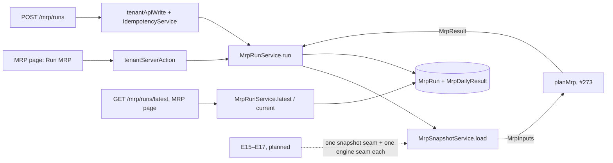
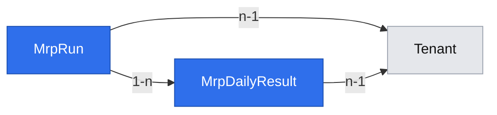
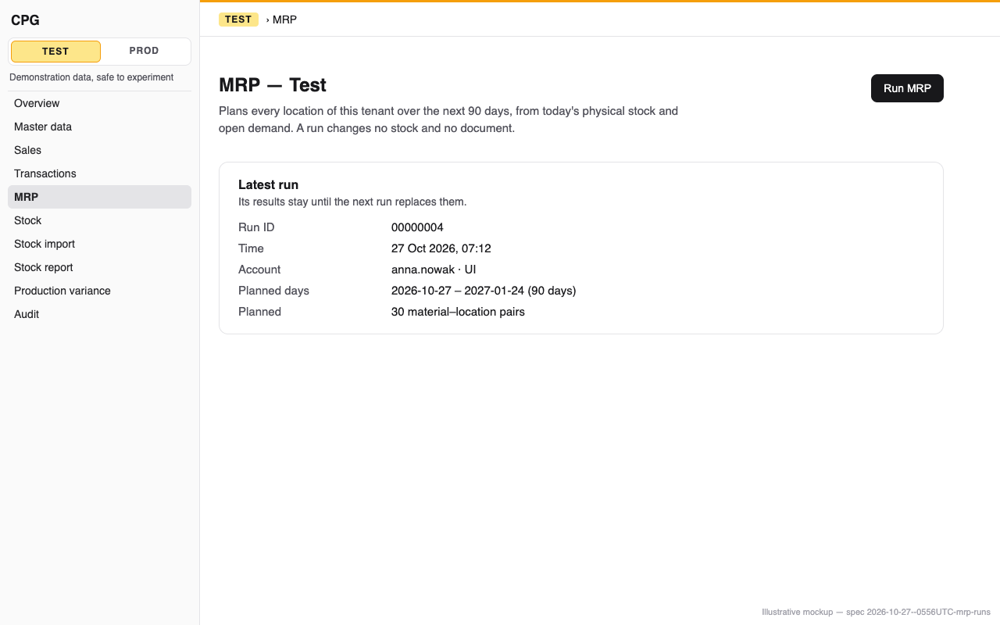
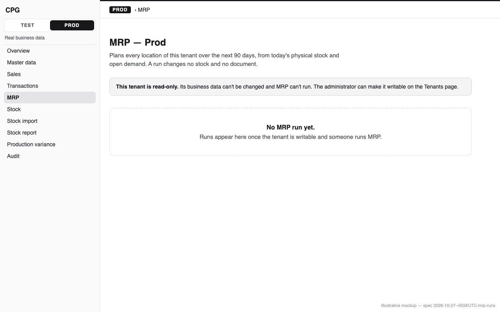

# MRP runs: run MRP on demand from the UI or the API, store the run and its daily results

**Status:** ready
**Created:** 2026-10-27 05:56 UTC
**Issue:** #274 (E14-S02, epic #266) · **Depends on:** the MRP engine (`implemented/2026-10-27--0525UTC-mrp-engine-projection.md`, #273), the atomic Test reset (#93), API idempotency (`implemented/2026-10-19--1548UTC-api-idempotency.md`), read-only tenants (`implemented/2026-10-19--2018UTC-read-only-tenants.md`) · **Design authority:** `.ai/specs/product-brief.md` (R05, R07, R10, R11, D02, D06, N05), `research/CPG-prd001.pdf` §04 "Invocation" and §05, `research/CPG-prd-datamodel.pdf` ("MRP run", "MRP daily result"), `research/CPG-acceptance.md` MRP-001/002/008, RUN-001/002/021, TEN-019, INV-008

## 📝 TLDR

#273's `planMrp` can plan, but nobody can start it and nothing keeps its result. This spec adds the first MRP run. Any signed-in account presses **Run MRP** on a new MRP page, or calls a keyed `POST`. The run plans every location of the tenant over 90 daily buckets from today, and stores its ID, time, account, channel and dataset generation with its daily results, all in one transaction. The page and a `GET` show the latest run until a newer one supersedes it. A read-only tenant or a stale Test generation refuses a run, and a Test reset clears Test's runs.

## 📝 Problem Statement

PRD §04 "Invocation": runs are manual and on demand only. Each run covers all locations of the selected tenant over 90 daily buckets starting today, and has a run ID and time. Its results stay visible until superseded, and a read-only tenant blocks new runs. The data model's "MRP run" records the user, time, tenant dataset generation and all locations. Its "MRP daily result" records the per-material, per-site, per-day projection. Every later slice-3 story reads or extends this record:

- E18 reports it;
- E16 adds proposals and exceptions to it;
- E19 tags the documents it creates with its run ID and reuses its read-only and generation gate.

Without a stored run, none of them has anything to build on.

## Resolved assumptions (autonomous defaults)

These answer the issue's open questions, and the gaps between its notes and the code, with the most reversible choice. Each is open to override before merge.

| # | Question | Applied default | Why |
|---|---|---|---|
| Q1 | Retention: every run, the latest, or the latest N? | Every run's **record** stays: ID, time, account, channel, generation, dates and pair count. Only the latest run's **daily results** stay: a run deletes every other run's result rows in its own transaction. | Superseded results are never shown (PRD §04), and each run stores pairs × 90 rows: 2,700 on the realistic dataset and 27,000 at ten times its size. Run records are small. Later documents cite a run ID (data model: a requisition's "optional source MRP run"), and IDs are never reused (R01), so the records stay. Keeping N result sets later only changes the delete. |
| Q2 | Create the recommendation and exception tables now, empty? | No. E16-S01 and E16-S03 create them, once their shape is known. | A new table is an additive migration whenever it comes. The bucket already carries every figure E15–E17 fill (#273 Q4), so the daily-result table gets no new columns, except the data model's "chosen BOM", which E17 adds. |
| Q3 | Does a run write a tenant audit entry? | Yes. One entry, `mrp.mrp-run.created`, about subject `MrpRun` with the run ID. Its `after` snapshot is `{ date, generation }`: the first planned day and the dataset generation. | The engineering standards' checklist: "every mutating service method takes an `actor` and records its audit entry". A run creates a tenant record, and the tenant audit is where users look for who did what. It changes no business record (R10), and the snapshot says so by naming none. |
| Q4 | Two manual runs at once? | Both commit, one after the other, and the later commit is the latest. A run holds the write gate from its first step, so the second waits for the first. Only automatic creation is one at a time per tenant (E19-S03). | Confirmed as the issue proposed. SQLite already serializes writers; refusing a second manual run would add a state to recover from for nothing. |
| Q5 | Does a run plan inactive locations and materials? | The snapshot reads every stock row and every Open order line of the tenant, whatever the active flags. Pairs come from the data (#273 Q1), not from the flags. | PRD §04 says "all locations". An Open customer order blocks location deactivation (`customer-order-usage.ts`), so an inactive location has no firm demand to plan. If it still has stock, planning it is correct. Filtering by flag would be a new rule. |
| Q6 | Do results reference materials and locations by key or by business ID? | By business ID: material and location codes as text, the shape `MrpResult` already has. | Codes never change and are never reused (R01), so a code is as stable as a key. Storing codes needs no loaded references for 27,000 rows, which `TenantGuard` would otherwise demand. E18-S01 filters by code with no join. Only the latest run's rows exist (Q1), and a run can be recomputed at will, so a later migration could empty and reshape the table. |
| Q7 | What does a daily row store? | The 13 figures of `MrpBucket`, as six-decimal texts. Not stored: the opening physical stock (it can be derived from day 0) and the firm-demand items behind each figure. | Day 0's opening balance equals its `projectedBefore` minus its supply plus its demand. E18-S03 (explanations) decides whether pegging needs storing, with its own migration. |
| Q8 | The run's mode? | A `mode` column, checked as `manual` or `automatic`. Only `manual` is written until E19-S03. | Widening a checked enum rebuilds the table (lesson 2026-10-23, "Review every generated SQLite migration"). The PRD's run already has both modes. |
| Q9 | What does the latest-run `GET` return when there is no run, and how big is it? | 404 `MRP_RUN_NOT_FOUND` when the tenant has no run. Otherwise the run and one page of its results: 25 pairs (2,250 days) per `?page=`, by material ID, then location ID. A pager passes `?run=` with the ID page 1 returned. Once a newer run supersedes that one, the answer is 409 `MRP_RUN_SUPERSEDED`, so pages from two runs never mix. | A run at ten times the realistic size is 27,000 rows. A list is bounded from its first release (lesson 2026-10-24, "Paging a list"). E18-S01's report API adds filters and weekly folds. |
| Q10 | Is there a confirmation step? | No. One click, with a pending state. | A run supersedes derived results and changes no business record (R10). RUN-004's confirmation belongs to proposal acceptance (E19). |
| Q11 | Split the story? | No. | Run, store and show are one capability: a page without stored runs has nothing to show, and stored runs without a trigger are never written. |

## 📝 Proposed Solution

A run is one service call inside the shared tenant write wrappers. They already check the generation and the read-only flag inside the transaction, and retry once on a stale snapshot. The service:

1. holds the write gate;
2. reads a bounded snapshot, yielding to the event loop between reads;
3. calls `planMrp(inputs, today)`;
4. inserts the run, its audit entry and its daily rows in chunks, yielding between chunks;
5. deletes the superseded runs' result rows.

All of it commits or rolls back together.

**Alternatives considered.**
- *A background job with a "running" state.* Rejected. A realistic run takes well under a second, so an in-request run needs no job runner. A job adds a status to recover from after a crash, and R10 rules out scheduled runs.
- *One row per pair with the 90 days as JSON.* Rejected. The data model's "daily result" is per day, and E18-S01 filters by date range through the index the issue asks for. JSON would put the decimals of R03 back into an opaque blob.
- *Writing through `insertMany`.* `TenantEntityManager` refuses it (lesson 2026-10-19, "MikroORM filters and the flush don't see every write"). Chunked `em.create` and flush, with `em.clear()` after each chunk, is the measured bulk path (lesson 2026-10-22, "Bulk writes").

## 📝 Architecture

```
db/src/entities/mrp/
  mrp-run.entity.ts            MrpRun (tenant-owned), MRP_RUN_MODES
  mrp-daily-result.entity.ts   MrpDailyResult (tenant-owned)
core/src/services/mrp/
  mrp-run.service.ts           MrpRunService: run(actor), current(), latest(query)
  mrp-snapshot.service.ts      MrpSnapshotService: load(today): MrpInputs
  snapshot/stock.ts            readStock(em, codes)       one seam per input, like the engine
  snapshot/order-lines.ts      readOrderLines(em, codes, before)
  mrp-run-view.ts              MrpRunView, MrpLatestView, toRunView, toBucketView
core/src/validators/mrp/
  mrp-run.schema.ts            mrpRunSchema: the POST body ({} or empty)
  mrp-latest.schema.ts         mrpLatestQuerySchema: ?page=
core/src/http/yield-to-event-loop.ts       moved out of seed-demo-data.ts, shared, beside request-transaction.ts
app/src/app/admin/[tenant]/mrp/{page.tsx,actions.ts}
app/src/components/mrp/{mrp-run-screen.tsx,run-mrp-button.tsx}
app/src/app/api/tenants/[tenant]/mrp/runs/route.ts          POST
app/src/app/api/tenants/[tenant]/mrp/runs/latest/route.ts   GET
```



Every box except `planMrp` and the two wrappers is new. Later stories add an input read under `snapshot/` and one line in `load`, as they add one engine seam and one line in `planMrp`.

### The snapshot (`MrpSnapshotService.load(today)`)

The reads are bounded, use partial loads (`fields`, `disableIdentityMap: true`), and are chunked by `$in` lists of 100. Each yields to the event loop after its chunk (lessons 2026-10-25 on hydration and on EXPLAIN):

1. every material's `(id, code)` and every location's `(id, code)`, to map keys to codes and to chunk the line read;
2. `readStock`: every `StockBalance` row of the tenant, `(material, location, quantity)`, as `MrpStock`;
3. `readOrderLines`: per chunk of 100 materials, the lines with `removed: false` and `status: "open"` whose `requiredDate` falls before the horizon's end. Overdue lines are included, since the engine moves them to today. The read loads `position`, `requiredDate`, `quantity`, `fulfilled`, `abandoned`, `status`, `material`, `order.code` and `order.location`. It goes through the existing index `(tenant, material, removed, status, id)`, which a plan test pins. If the plan shows the `customer_order` join starting from a walk of the tenant (lesson 2026-10-25, "EXPLAIN the query MikroORM really sends"), the fallback is two single-table reads: the lines alone, then their orders' `(id, code, location)` in `id $in` chunks of 100. E15-S01 widens this read to the lines that consume forecasts. Until then the engine needs only Open lines (#273 Q6).

Quantities go through `parseDecimal` into `bigint` micro-units. `today` is the server's UTC date, read once per run, as `DemandReviewService` does.

### The run (`MrpRunService.run(actor)`)

It runs inside the caller's transaction: `tenantServerAction`, or `tenantApiWrite`'s `IdempotencyService.run`. Both have already checked the generation and the read-only flag in that transaction.

1. `holdWriteGate(em)` comes first, before the snapshot. This deliberately differs from the helper's doc, which says to call it after the reads a retry repeats. Here the snapshot *is* those reads, and it yields. Every root transaction another connection starts after the gate then waits for this run. It can neither make the run's snapshot stale nor hit "database is locked" while the run yields (lesson 2026-10-24, "better-sqlite3 is synchronous"). The gate can't stop a transaction that was already open on another connection before it was taken; the next paragraph covers that window.
2. `load(today)`, then `planMrp(inputs, today)`.
3. The run ID is `nextSequentialId(highest code)`, read in this transaction behind the unique `(tenant, code)` index. Exhaustion is 409 `MRP_RUN_IDS_EXHAUSTED`.
4. Create the `MrpRun` and record the tenant audit entry (Q3) on the same `em`.
5. Insert the daily rows in chunks, 500 to start with, tuned by measurement. Format each chunk's figures with `formatSignedQuantity` (`domain/stock/signed-quantity.ts`). `formatDecimal` handles only values of zero or more and turns −15.5 into `"-15.-500000"`, and the balances go negative by design. (#273's spec named `formatDecimal` for this step; this corrects it.) Then flush, `em.clear()`, re-load the run (a cleared reference fails `TenantGuard`), then yield.
6. `nativeDelete(MrpDailyResult, { run: { $ne: run.id } })`: the superseded result rows (Q1).
7. Return the `MrpRunView`.

A throw anywhere rolls the whole transaction back: no run, no row, no audit entry. An API key is stored only with a successful write, so a retry with the same key runs again.

**Transactions already open elsewhere.** A transaction another connection began before the gate keeps running, and the run's yields let it commit at any point between the run's first read (the wrapper's generation check) and its first write. Two outcomes follow:
- If it commits before the run's first write, the run's snapshot is stale and the first write fails with `SQLITE_BUSY_SNAPSHOT`. The wrappers retry once, and the retry's root transaction starts after the gate is released, so it plans from fresh data.
- If it still holds SQLite's write lock when the run first writes, the run gets plain `SQLITE_BUSY` at once (a WAL read-to-write upgrade skips the busy handler). That error isn't retried.

Either way, a second refusal or a plain BUSY fails like any such write today: nothing is stored, the API answers 500 `INTERNAL` without storing the key, and the UI shows its generic error. The same key, or another click, runs the plan again. The window is as long as one ordinary write transaction, since every long one holds the gate. Mapping these errors to their own code would change the shared wrappers for every write, so that stays out of scope. A two-ORM test proves the first case: a write open on a second ORM commits during the snapshot, and the run retries once and stores a correct run.

### The reads

- `current()` returns the latest run's `MrpRunView`, or `null`. The latest run is the highest `code`, read through the unique index. The page uses it.
- `latest(raw)` parses `mrpLatestQuerySchema`:
  - `page` is a whole number from 1, default 1;
  - `run` is an optional eight-digit run ID;
  - any other parameter is 400.

  It reads the latest run and its page inside one read transaction (`inRequestTransaction` on the request `em`). In WAL mode that gives one snapshot, so a run committing in between can't leave the response with the old run and the new run's deleted rows. With no run it throws `NotFoundError(…, "MRP_RUN_NOT_FOUND")`. When `run` names a run that isn't the latest, it throws `ConflictError(…, "MRP_RUN_SUPERSEDED", { run })`, so a client paging through results learns that page 2 would come from another run. It reads `25 × 90` rows of the run with `orderBy: { material, location, date }` and `offset: (page − 1) × 25 × 90`. Every pair has exactly 90 rows, so the offset falls on pair boundaries, and the unique index serves both the filter and the order with no sort. `total` is the run's `pairs`, and a page past the last returns no plans. The read transaction waits for a run in flight, since the gate holds back root transactions; it waits no longer than that run takes.

### Read-only, generation and channels

Nothing new is needed: `tenantServerAction` and `IdempotencyService` refuse a read-only tenant (`TENANT_READ_ONLY`, 409) for every caller, the admin included. They refuse a missing Test generation (428 `GENERATION_REQUIRED`, API only; the page binds its generation) and a stale one (409 `GENERATION_STALE`). The page hides Run MRP while the tenant is read-only, and the read-only banner says why. Reads are open to every signed-in account in any tenant state (TEN-018).

## 📝 Data Model

Two tenant-owned entities, declared with `tenantOwned()` and listed in `entities/index.ts`. One additive migration, `npm run db:migration:create -- mrp-runs`, creates two tables and touches no existing one.

**`MrpRun`** (`db/src/entities/mrp/mrp-run.entity.ts`)

| Field | Type | Notes |
|---|---|---|
| `id` | uuid PK | |
| `tenant` | `owned.tenant` | |
| `code` | string(8) | The run ID, `00000001…` per tenant. Unique `(tenant, code)`. |
| `createdAt` | datetime | The run's time. |
| `startDate` | string(10) | The first bucket: the server's UTC date when the run started. |
| `horizonDays` | integer | `MRP_HORIZON_DAYS` (90), so a stored run states its own horizon. |
| `mode` | enum `MRP_RUN_MODES = ["manual", "automatic"]` | Only `manual` is written until E19-S03 (Q8). |
| `generation` | integer | The tenant's dataset generation the run planned. |
| `pairs` | integer | Planned material-location pairs: the latest-run `GET`'s `total`. |
| `actorUserId` | string, not null | Plain text, as on `StockMovement`, but required: a run always has an account (there is no seed run). |
| `actorUsername` | string | The account. |
| `channel` | enum `["ui", "api"]` | |

**`MrpDailyResult`** (`db/src/entities/mrp/mrp-daily-result.entity.ts`)

| Field | Type | Notes |
|---|---|---|
| `id` | uuid PK | |
| `tenant` | `owned.tenant` | |
| `run` | many-to-one `MrpRun` | |
| `material`, `location` | string(8) each | Business IDs (Q6). |
| `date` | string(10) | ISO day. |
| `firmDemand`, `forecastDemand`, `dependentDemand`, `transferOut`, `tentativeSupply`, `dependableSupply`, `atRiskSupply`, `transferIn`, `proposedReceipts`, `safetyTarget`, `projectedBefore`, `projectedAfter`, `shortage` | string each | Six-decimal texts, signed where the balance goes negative (R03). The same names as `MrpBucket`. |

The unique `(tenant, run, material, location, date)` index is a backstop against a duplicate day. It also serves the latest-run page read and E18-S01's filtered reads, so the report needs no migration.

Retention (Q1): run records are never deleted, except by the Test reset. A run deletes every other run's daily rows. `resetTestData` derives its tables from metadata, so the reset clears both tables in Test, and Test's next run ID restarts at `00000001` (D06, R05). `tests/tenant-ownership.test.ts` and `tests/test-reset-coverage.test.ts` cover both entities with no further code.



Two tables hang off the tenant. Materials and locations are cited by business ID (Q6), so no key links them.

## 📝 API Contracts

**`POST /api/tenants/{tenant}/mrp/runs`** is built with `tenantApiWrite`. It needs a bearer token (401), an `Idempotency-Key` (400 `IDEMPOTENCY_KEY_REQUIRED`) and, in Test, `Dataset-Generation` (428 `GENERATION_REQUIRED`; stale: 409 `GENERATION_STALE`). A read-only tenant answers 409 `TENANT_READ_ONLY`. The body is empty or `{}` (`mrpRunSchema`, strict, so any key is 400 `VALIDATION_FAILED`; E19-S03 adds `mode`). Both roles may call it. A repeat with the same key and body within 24 hours replays the first run with `Idempotent-Replayed: true`. A 200 returns `{ ok: true, data: MrpRunView }`:

```ts
interface MrpRunView {
  id: string;            // "00000001"
  createdAt: string;     // ISO instant
  account: string;       // the username
  channel: "ui" | "api";
  mode: "manual" | "automatic"; // MRP_RUN_MODES; only "manual" until E19-S03
  generation: number;
  startDate: string;     // first bucket, YYYY-MM-DD
  endDate: string;       // last bucket: startDate + 89
  horizonDays: number;   // 90
  pairs: number;
}
```

**`GET /api/tenants/{tenant}/mrp/runs/latest?page={n}&run={id}`** (both optional) follows the stock report route's pattern (`requireApiUser`, `tenantScope`). Any signed-in account may call it, on a read-only tenant too. It returns `{ run: MrpRunView, page, pageSize: 25, total, plans }`. A plan is `{ material, location, buckets }`, and its 90 buckets are `{ date, firmDemand, forecastDemand, dependentDemand, transferOut, tentativeSupply, dependableSupply, atRiskSupply, transferIn, proposedReceipts, safetyTarget, projectedBefore, projectedAfter, shortage }` in date order, six-decimal strings in the base unit (balances signed, `"-15.500000"`). Plans sort by material ID, then location ID. Clients that page pass `run` from page 1. The errors are:
- 404 `MRP_RUN_NOT_FOUND` when the tenant has no run;
- 409 `MRP_RUN_SUPERSEDED` (`params.run`) when `run` is no longer the latest;
- 400 `VALIDATION_FAILED` for a malformed `page` or `run`, or an unknown parameter.

Both routes go into `BACKWARD_COMPATIBILITY.md` §4, and the migration into §1 as an additive change with its rollback note. New error codes get EN and PL text, keyed by code (lesson 2026-10-23, "Refusals carry structured `params`"): `MRP_RUN_NOT_FOUND`, `MRP_RUN_SUPERSEDED`, `MRP_RUN_IDS_EXHAUSTED`.

## 📝 UI/UX

`/admin/{tenant}/mrp`, a flat **MRP** entry in the tenant zone between Transactions and Stock. A flat entry fits 1280×800 without scrolling (lesson 2026-10-20, "Sidebar changes"), and its icon goes in `sidebar-nav.tsx`'s registry. Readable by every account; help topic `mrp` in EN and PL; the R11 footer comes from the root layout.

- **Header:** the title "MRP — {tenant}", as the other tenant pages title themselves ("Stock report — Test"), one line of description ("Plans every location of this tenant over the next 90 days."), and a primary **Run MRP** button on the right. The button is shown only when the tenant is writable. While its server action runs it reads "Running MRP…" and is disabled. A refusal shows `ErrorMessage` under the button, translated by code (`TENANT_READ_ONLY`, `GENERATION_STALE`, `MRP_RUN_IDS_EXHAUSTED`, `INTERNAL`).
- **Latest run** (a card): the run ID, the time (in the reader's locale and time zone), the account and channel (UI or API), the planned days (`startDate`–`endDate`) and "N material-location pairs planned". A sentence says the results stay until the next run replaces them.
- **No run yet:** `EmptyState` with "No MRP run yet." In a writable tenant it adds "Run MRP to plan the next 90 days for every location."
- The daily report itself is E18-S01. This page shows what the issue asks for: the run's ID, time and account (RUN-002).

`page.tsx` reads `current()` with `connection()` inside `<Suspense fallback={<LoadingMessage />}>`, as `reports/stock/page.tsx` does. `actions.ts` exports `runMrp(tenant, generation)` through `tenantServerAction(mrpRunSchema, …)` with `uiActor`, then `refreshAfterWrite(result, "/admin/{tenant}/mrp")`. The button is a small client component that gets its strings as props.

Prototype: `.ai/specs/assets/mrp-runs/mockup-01-mrp-latest-run.png` (writable, with a run) and `.ai/specs/assets/mrp-runs/mockup-02-mrp-read-only-empty.png` (read-only, no run). Both are rendered from the static HTML beside them.





## 📝 Edge Cases & Failure Scenarios

- **An empty tenant.** The run is stored with `pairs: 0` and no rows. The page shows it, and the `GET` returns it with no plans.
- **A write error mid-insert.** The transaction rolls back. No run, row or audit entry exists, and an API retry with the same key runs again (issue criterion "no partial run").
- **A Test reset during a run.** The reset and the run both hold the gate, so one waits for the other. If the run commits first, the reset clears it. If the reset commits first, the run's generation check fails with `GENERATION_STALE`.
- **Read-only set during a run.** The flag's write waits for the run's commit. The run counts as committed before the flag, and the next run is refused.
- **Midnight during a run.** `today` is read once, so the run plans one consistent horizon.
- **A page bound to an old generation** (another tab reset Test). `GENERATION_STALE` with its translated message; a reload binds the new generation.
- **Nothing triggers a run but a user** (RUN-001, R10). No startup hook, schedule, event or read creates one. Browsing and time passing leave the latest run's ID and time unchanged.
- **A run writes no business record.** Its only writes are its own two tables and its audit entry. Stock, documents and masters are unchanged (INV-008, MRP-008, R10): with physical 5 and demand 20, the stock page and API still say 5, while the stored day shows −15.

## 📝 Risks & Impact Review

- **Schema.** Two new tables and no change to an existing one. `kamal rollback` leaves them in place, and the previous release ignores them. `down()` drops both. A test covers up and down on a real file.
- **Lock time and server stalls.** A run holds SQLite's write lock for its whole write phase. **Budget** (fastest of three, run alone, recorded in the PR):

  | Size | Materials | Locations | Pairs (daily rows) | Customer-order lines (Open) | Stock rows | Forecasts | Budget |
  |---|---|---|---|---|---|---|---|
  | Realistic | 30 | 1 | 30 (2,700) | 7,800 (3,900) | 30 | 3,100 | 1 s |
  | Ten times | 300 | 10 | 300 (27,000) | 78,000 (39,000) | 300 | 31,000 | 5 s |

  Each material is stocked at one location (material *n* at location 1 + *n* mod 10), and its order lines are at that location. Pairs therefore scale ten times, as every other count does; the realistic dataset has one pair per material. The required dates spread over two years around a pinned today. Forecasts aren't read until E15-S01; they are seeded so that story only extends the benchmark. At ten times, the longest event-loop stall during a run stays under 250 ms. Because the run yields and holds the gate, `/up` and pages keep answering while it runs. Writes in other bundles wait for it, as they do for the Test reset. Above the budget, the implementation tunes the chunk size before shipping (lesson 2026-10-22, "Measure a bulk write at its row cap").
- **Storage.** About 0.7 MB per realistic run, kept for the latest run only (Q1). Run records add one small row per run.
- **Protected contracts.** The page URL, the help topic `mrp`, both API routes, their response fields and the two new error codes become §4 surfaces. The audit action `mrp.mrp-run.created` and subject type `MrpRun` become stored history.

## 📝 Decisions in play

R05 (no shared data or ID sequences; read-only blocks new MRP runs for every caller), R07 (a keyed bearer API for every operation; Test writes need the current generation), R10 (on demand only; no document rewritten), R11 (the footer on every page), D02 (MRP after every manual document), D06 (an atomic Test reset into a new generation), N05 (no new roles: both roles run and read). None is superseded.

## 📋 Phasing

One phase, one PR: entities and migration, snapshot and service, the API, the page, the benchmark and the integration tests. Each step below leaves the application working.

## 📋 Implementation Plan

1. **Entities and migration.** Add `MrpRun` and `MrpDailyResult` as specified, list them in `entities/index.ts`, and run `npm run db:migration:create -- mrp-runs`. Check that the generated SQL only creates tables (lesson 2026-10-23). Add an up/down test, and update the migration lists and counts in `packages/db/src/orm.test.ts`, `packages/core/src/database.test.ts`, `packages/core/src/services/system/system-status.service.test.ts` and `tests/integration/smoke.test.ts`. Add one more `down()` to each rollback-by-count test (lesson 2026-10-23, "A new migration moves every migration count").
2. **Shared yield.** Move `yieldToEventLoop` from `services/demo/seed-demo-data.ts` into `core/src/http/yield-to-event-loop.ts`, beside `request-transaction.ts`, the other long-write helper. Both callers import it, and it gets its own test.
3. **Snapshot.** Add `services/mrp/snapshot/{stock,order-lines}.ts` and `MrpSnapshotService`, registered in `container.ts` and `cradle.ts`. Tests on a real SQLite file:
   - stock rows and Open lines become `MrpStock` and `MrpOrderLine` in micro-units, with order codes, positions and the order's location;
   - removed, non-Open and beyond-horizon lines aren't read;
   - an overdue Open line is read;
   - inactive masters are planned by data (Q5);
   - Prod's rows never reach a Test snapshot (MRP-002);
   - a plan test pins the line read's index: `explain query plan` on the SQL MikroORM sends (lesson 2026-10-25, "EXPLAIN the query MikroORM really sends").
4. **Run service.** Add `MrpRunService` (`run`, `current`, `latest`), `mrp-run-view.ts` and the validators, registered in the container. Add the audit action and subject (`AUDIT_FIELDS` already lists `date` and `generation`) with EN and PL labels and a place in `TENANT_SUBJECT_TYPES`. Add the error codes' EN and PL texts. Tests:
   - each MRP-001 case: three locations give 90 rows per planned pair, none omitted;
   - MRP-002: Prod's run shows 40 and nothing of Test's 70, and Test's latest run keeps its ID and time;
   - the stored-run half of INV-008 and MRP-008: physical 5, demand 20, a stored −15, and the balance still 5;
   - a run writes nothing else: for every tenant-owned table except the two MRP tables (derived from metadata, as `testResetEntities` does), the row count and each row's `version`/`updatedAt` where present are equal before and after, and the only new audit entry is `mrp.mrp-run.created` (R10, INV-008);
   - a fractional negative balance (physical 4.5, demand 20) is stored and read back as `"-15.500000"`;
   - sequential IDs, the second run is the latest, and only its rows remain (Q1);
   - a throw after the first chunk's flush leaves no run, row or audit entry (mock `recordTenantAudit`, or fail a later flush, as `transfer.service.test.ts` does);
   - two runs on two ORMs over one file both commit, one after the other (lesson 2026-10-19, "Two racing creates on SQLite");
   - a write already open on a second ORM that commits during the snapshot makes the run retry once and store a correct run;
   - while a run is in flight, a timer still fires and another ORM's `pingDatabase` answers;
   - `latest` pages by pair and returns no plans past the last page. It refuses a bad `page` or `run` and an unknown key. It says `MRP_RUN_NOT_FOUND` with no run and `MRP_RUN_SUPERSEDED` for an older `run`. A run committed between two pages leaves no response with the old run's header and no rows;
   - the real `tenantServerAction(mrpRunSchema, …)` and `IdempotencyService.run` around `MrpRunService.run` refuse a read-only tenant with `TENANT_READ_ONLY` and store nothing. The app tests mock `@cpg/core`, so this core test is what proves the gate;
   - a run reads its own generation and `today` (pinned clock).
5. **Test reset.** Extend `test-reset.service.test.ts`'s sequence-restart case, which derives the sequenced tables (tenant-owned, with a `code`) from metadata (lesson 2026-10-23, "Prove a sequence restart"). The generation before the reset holds two runs; after it, Test has none and its next run is `00000001`, while Prod's run is unchanged.
6. **API.** Add `POST /api/tenants/[tenant]/mrp/runs` (`tenantApiWrite`, writing only through the handed `cradle`, as `tests/api-writes.test.ts` enforces) and `GET …/mrp/runs/latest`, with route tests that mock `@cpg/core`.
7. **Page.** Add `admin/[tenant]/mrp/{page.tsx,actions.ts}` and `components/mrp/{mrp-run-screen,run-mrp-button}.tsx` with EN and PL strings. Add the nav entry and its icon, and update `nav-items.test.ts`, `nav-tree.test.ts` and `sidebar-nav.test.tsx`. Add the help topic `mrp` in both languages (`tests/every-page-has-help.test.ts`). Component tests cover a run, no run, read-only (no button), pending, and a refusal shown by code.
8. **Benchmark.** Add `services/mrp/mrp-run-timing.test.ts`, on the pattern of `demand-review-reads.test.ts`: seed both sizes from the budget table with SQL, with the order lines' dates spread over two years around a pinned today, and 3,100 or 31,000 forecasts so E15-S01 only extends it. Time the fastest of three runs, measure the longest event-loop stall with a timer heartbeat, and print both with `process.stdout.write`. Give CI a loose bound derived from the printed figure, and a test timeout derived from the bound and the run count (lesson 2026-10-25, "A timing test's own bound must fail before Vitest's 5 s timeout"). Record the isolated figures in the PR.
9. **Integration tests.**
   - `tests/integration/mrp-run.test.ts` (UI):
     - a normal user runs MRP in a writable tenant and sees the new ID, time and account, and `GET …/mrp/runs/latest` returns the same run with its results (RUN-002);
     - the page has help and the footer;
     - RUN-001: through the API, the test creates a customer order and posts a stock correction, then browses other pages and comes back. The latest run's ID and time are unchanged, and no new run exists;
     - a read-only tenant shows the earlier run and no Run button, for the normal user and for the admin, with the flag restored in `afterAll`.
   - `tests/integration/mrp-run-api.test.ts` covers four groups:
     - keys: 400 without a key, and a replay that returns the first run with no second one;
     - Test generation: 428 when missing, and 409 when stale with nothing stored;
     - read-only: 409 for a normal token and the admin's, with the earlier run still readable;
     - INV-008 and MRP-008 through the API: physical 5 and an Open line of 20 for a pair the file creates; after a run, the stock report API still says `5.000000` for it, and the latest run's day shows `-15.000000`;
     - isolation and reset: Prod and Test as in `tenant-isolation-api.test.ts`, plus the Test reset case (Test has no run and restarts at `00000001`, Prod is untouched), owning its resets (lesson 2026-10-24, "A test that compares two Test generations").
   - In `tests/integration/test-reset-realistic.test.ts`, on the realistic dataset, send the run's `POST`, then at once `GET /up` on a reused connection (lesson 2026-10-24, "A blocked event loop closes pooled connections unread"). Assert `/up` answers 200 *before* the `POST` answers, which proves an overlap, and record both times. The ten-times stall bound comes from the unit benchmark (step 8), where a run lasts seconds.
   - Update `navigation.test.ts` for the new entry.

   Each file asserts only on the records it creates.
10. **Docs and close-out.**
    - `BACKWARD_COMPATIBILITY.md`: the routes, URL, help topic and codes in §4, and the migration in §1 with its rollback note.
    - `.ai/docs/engineering-standards.md` §5: one bullet on runs (the write gate, chunked inserts, latest-only results, snapshot seams).
    - The acceptance catalogue: move only rows whose every Then is asserted (lesson 2026-10-21, "Cite a scenario only where a test asserts it"): MRP-001, MRP-002, RUN-001, RUN-002, and the manual halves of RUN-021 and TEN-019.
    - Move this spec to `implemented/` with implementation notes.

Run `npm run lint`, `npm run typecheck`, `npm run test:coverage` (100%) and `npm run build`. Then run the integration files this change adds or touches, and `smoke.test.ts` for the migration count.
