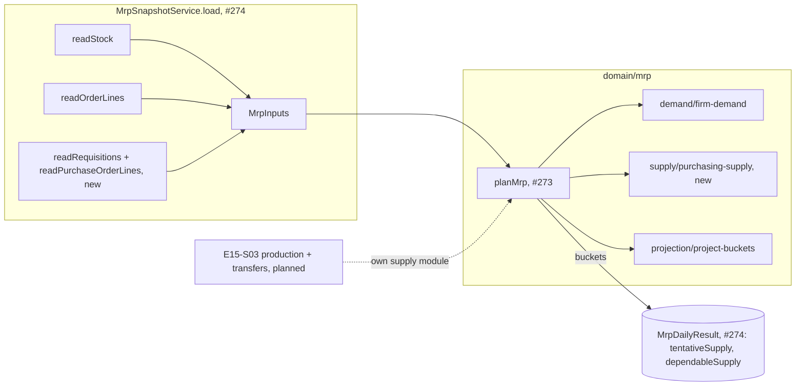

# MRP purchasing supply: open requisitions as tentative, purchase-order lines as dependable, each quantity once

**Status:** ready
**Created:** 2026-10-31 09:05 UTC
**Issue:** #276 (E15-S02, epic #267) · **Depends on:** the MRP engine (`implemented/2026-10-27--0525UTC-mrp-engine-projection.md`, #273), MRP runs and the snapshot loader (`implemented/2026-10-27--0556UTC-mrp-runs.md`, #274), purchasing (`implemented/2026-10-20--1636UTC-purchase-requisitions-orders.md`, #86/#87), the document lifecycle (#90, #144), purchasing date edits (`implemented/2026-10-21--2036UTC-purchasing-date-edits.md`, #142) · **Design authority:** `.ai/specs/product-brief.md` (R03, R05, R09, R10, D04, N06), `research/CPG-prd001.pdf` §04 "Supply pipeline and overdue", "Overdue and late", `research/CPG-acceptance.md` MRP-010/012/013/014/015/042, BUY-002/017/018/019/024/026, LFC-024

## 📝 TLDR

Today MRP projects physical stock against customer demand only, so every open purchase order and requisition looks missing, and the proposals E16-S01 will size would duplicate them. After this change every run also counts incoming purchasing supply. Each open purchase-order line's outstanding quantity counts as **dependable** supply, and each open requisition's unconverted quantity as **tentative** supply. Each lands at its document's location on its planned or required date, or today when that date has passed, flagged overdue. Cancelled, Closed Early, Completed, converted and already-received quantities count for nothing, so every quantity counts exactly once.

## 📝 Problem Statement

PRD §04 "Supply pipeline and overdue" asks MRP to count the remaining active PR and PO quantities without double counting converted PR→PO quantities. A requisition is tentative: it prevents a duplicate requisition but is not dependable for BOM feasibility. A purchase order is dependable planned pipeline. "Overdue eligible outstanding supply projects today with original dates/warnings unchanged", and "PO output overdue is expected today with warning."

The documents already keep each quantity in one place. A goods receipt moves it from the order line's outstanding remainder into physical stock (`received`). A conversion moves it from the requisition's remainder into the order line (`converted`). Cancel and Close Early move the rest into `abandoned` and leave the line non-Open (#90). So counting each document's own Open remainder is enough to count every quantity once; MRP needs no cross-document netting.

Without this story E16-S01 has nothing to suppress a duplicate requisition against, E17-S02 cannot tell dependable supply from tentative, and E18 cannot show the pipeline.

## Resolved assumptions (autonomous defaults)

The issue's open questions, and the gaps between its notes and the code, answered with the most reversible choice. Each can be overridden before merge.

| # | Question | Applied default | Why |
|---|---|---|---|
| Q1 | Does an overdue **requisition** also move to today with the Overdue marker? | Yes. Any overdue Open supply, requisition or purchase-order line, counts today, keeps its own date, and is flagged `overdue`. It stays tentative or dependable as before. | PRD §04: "overdue eligible outstanding supply projects today". The named Overdue Supply warning covers PO and production output; flagging a requisition too is the simplest consistent reading (D04). The report (E18-S02) decides how each flag is shown. |
| Q2 | Does the Overdue Supply marker live on the supply entry or in the run's exception list? | On the entry. `MrpPlan` gets a `supply` list, one `MrpSupply` per counted document line, carrying `plannedDate` (the document's own date), `date` (its bucket) and `overdue`. No exception list is created. | `MrpFirmDemand` already keeps the original date this way (SAL-017). E16-S03's exception seam can derive its warnings from `overdue` without the engine knowing about exceptions. |
| Q3 | Is the supply list stored with the run? | No. The run stores the two bucket figures it already has columns for, `tentativeSupply` and `dependableSupply`; the `supply` list stays in the engine result, as `firmDemand` does. | #274 Q7 stored no pegging items. Showing the Overdue marker is E18-S02's, which then adds whatever storage it needs. No migration here. |
| Q4 | E14-S02's loader: wait for it, or read separately? | Extend it. #274 has landed (`services/mrp/mrp-snapshot.service.ts`), so this story adds one read seam under `snapshot/` and one line in `load`, as #274 designed. | The seam rule (engineering standards, MRP). |
| Q5 | Does the snapshot carry closed lines, or only Open ones? | The loader reads Open documents only, which bounds the read. The input rows still carry `status`, and the engine's status filter is the rule, tested with closed fixtures that keep a remainder. | The same split as `MrpOrderLine` (#273 Q6). The lesson "Test a status filter with quantities that would pass without it" (2026-10-27) names this story. |
| Q6 | Requisition remainder: `requisition-quantity.ts`'s `outstandingQuantity(quantity, converted)` or the lifecycle's? | The lifecycle's `outstandingMicro(quantity, converted, abandoned)`, on `bigint`, never below zero. | The purchasing helper ignores `abandoned` and works on texts. Open requisitions have `abandoned` 0 today, but the lifecycle rule is the one shared remainder rule (#273 Q7). |
| Q7 | Supply dated after the horizon's last day? | In no bucket and not in `supply`, as firm demand past day 89 (MRP-004). A pair whose only data is such supply isn't planned. | #273 Q1: each seam adds only the pairs its items inside the horizon name. |
| Q8 | Does the PO-line input carry its requisition link? | No. Counting each document's own remainder already avoids double counting; nothing in this story reads the link. | Least surface. E16-S01 or E18-S03 adds it if duplicate suppression or pegging needs it. |
| Q9 | Split the story? | No. The engine seam and the loader read are one capability: neither changes a run without the other. | Spec-writing's split check. |

## 📝 Proposed Solution

Two additions, each in the seam #273 and #274 reserved for it:

1. **Engine:** `domain/mrp/supply/purchasing-supply.ts` turns requisitions and purchase-order lines into dated, located `MrpSupply` items, and `planMrp` adds each item to its day's `tentativeSupply` or `dependableSupply`. The balance formula in `projection/project-buckets.ts` already adds both figures, so same-day supply already offsets same-day demand (MRP-042).
2. **Snapshot:** `services/mrp/snapshot/purchasing.ts` reads the tenant's Open requisitions and the Open lines of its Open purchase orders in bounded, partial, yielding reads, and `MrpSnapshotService.load` adds them to `MrpInputs`.

`MrpRunService` doesn't change: it already stores every bucket figure, so `GET …/mrp/runs/latest` starts returning non-zero `tentativeSupply` and `dependableSupply` with no contract change.

**Alternatives considered.**
- *Net requisitions against the order lines that converted them.* Rejected. `converted` already holds what the order lines took, so subtracting the lines again would count the conversion twice in the other direction.
- *Read Open PO lines directly by `status = 'open'`.* Rejected. `purchase_order_line` has no index on its status, so SQLite would walk every line of the tenant, history included. An Open line belongs to an Open header (`documentState`), and headers have `(tenant, status, code)` (`listSortIndexes`). So the read pages Open headers and then reads their lines through the existing `(tenant, order)` index. No migration.
- *An exception row for Overdue Supply now.* Rejected (Q2): E16-S03 owns the exception seam.

## 📝 Architecture

```
core/src/domain/mrp/
  mrp-inputs.ts                 + requisitions, purchaseOrderLines; MrpRequisition, MrpPurchaseOrderLine
  mrp-result.ts                 + MrpSupply; MrpPlan.supply
  supply/purchasing-supply.ts   new: purchasingSupply(requisitions, purchaseOrderLines, dates), compareSupply
  plan-mrp.ts                   + one call: add each item to its bucket and its pair's supply list
core/src/services/mrp/
  snapshot/purchasing.ts        new: readRequisitions(em, codes), readPurchaseOrderLines(em, codes)
  mrp-snapshot.service.ts       + two lines in load()
```



The new boxes plug into the seams the earlier stories fixed. E15-S03 adds production output to `dependableSupply` through its own module under `supply/`, so the two stories touch disjoint files except one line each in `mrp-inputs.ts`, `plan-mrp.ts` and `load`.

### Inputs (`mrp-inputs.ts`)

```ts
export interface MrpInputs {
  stock: readonly MrpStock[];
  orderLines: readonly MrpOrderLine[];
  requisitions: readonly MrpRequisition[];
  purchaseOrderLines: readonly MrpPurchaseOrderLine[];
}

/** A purchase requisition at its own location (BUY-001). `code` is its business ID. */
export interface MrpRequisition {
  code: string;
  material: string;
  location: string;
  requiredDate: string;
  quantity: bigint;
  converted: bigint;   // what purchase-order lines have taken (BUY-003)
  abandoned: bigint;
  status: DocumentState;
}

/** A purchase-order line with its order's location (BUY-006). `(order, position)` is its business ID. */
export interface MrpPurchaseOrderLine {
  order: string;
  position: number;
  material: string;
  location: string;
  plannedDate: string; // the current planned date, edits included (BUY-024)
  quantity: bigint;
  received: bigint;    // may exceed quantity (BUY-015)
  abandoned: bigint;
  status: DocumentState;
}
```

### Supply (`supply/purchasing-supply.ts`)

```ts
/** One counted document line: its remainder, in the bucket it counts in. */
export interface MrpSupply {            // in mrp-result.ts
  kind: "requisition" | "purchase-order"; // E15-S03 adds "production-order"
  reliability: "tentative" | "dependable";
  document: string;                    // requisition or purchase-order code
  position: number | null;             // the PO line's position; null for a requisition
  material: string;
  location: string;
  plannedDate: string;                 // the document's own date, kept (PRD §04)
  date: string;                        // max(plannedDate, today)
  overdue: boolean;                    // plannedDate < today: the Overdue Supply marker
  quantity: bigint;                    // > 0
}
```

`purchasingSupply(requisitions, purchaseOrderLines, dates)`:

- **Requisition** → `tentative`, when `status === "open"`, with `outstandingMicro(quantity, converted, abandoned)`. A fully converted requisition is Completed, so it adds nothing (BUY-026). A part-converted one adds only its unconverted rest (MRP-012).
- **Purchase-order line** → `dependable`, when `status === "open"`, with `outstandingMicro(quantity, received, abandoned)`. A receipt moves its quantity into physical stock, which the snapshot's stock already holds (MRP-010). Over-receipt clamps at zero (BUY-015). A Completed, Cancelled or Closed Early line adds nothing (BUY-017, MRP-013, MRP-014, LFC-024).
- A remainder of zero is dropped. The bucket is `max(plannedDate, today)`; an item placed after the horizon's last day is dropped (Q7). An item whose date has passed is `overdue: true` and keeps its `plannedDate` (MRP-015, BUY-019).
- Items sort by `compareSupply`: `date`, `plannedDate`, `kind`, `document`, then `position`, in code-unit order, so the result never depends on input order. E15-S03 merges its items with the same comparator.

`planMrp` adds one loop beside firm demand:

```ts
for (const item of purchasingSupply(inputs.requisitions, inputs.purchaseOrderLines, dates)) {
  const pair = pairOf(item.material, item.location);
  pair.flows[dayOf.get(item.date)!][item.reliability === "tentative" ? "tentativeSupply" : "dependableSupply"] += item.quantity;
  pair.supply.push(item);
}
```

`MrpPlan` gains `supply: readonly MrpSupply[]`. A pair named only by supply inside the horizon is planned from zero stock, as a demand-only pair is (#273 Q1). The engine still never writes its inputs or any document (R09, R10).

### Snapshot (`services/mrp/snapshot/purchasing.ts`)

Both reads are partial (`fields`, `disableIdentityMap: true`), bounded per call and followed by `yieldToEventLoop()`. They map keys to codes through `SnapshotCodes`. The horizon's end isn't filtered in SQL: overdue items count today, and supply past day 89 is few and dropped by the engine. A date range in the query would move SQLite off the status index (lesson 2026-10-25, "EXPLAIN the query MikroORM really sends").

- **`readRequisitions(em, codes)`**: pages `PurchaseRequisition` with `{ status: "open", code: { $gt: cursor } }`, `orderBy: { code: "asc" }`, 1,000 per page (a requisition is one row, so a page hydrates at most 1,000 rows, about 17 ms). Fields: `code`, `material`, `location`, `requiredDate`, `quantity`, `converted`, `abandoned`, `status`.
- **`readPurchaseOrderLines(em, codes)`**: pages Open `PurchaseOrder` headers the same way (`{ status: "open", code: { $gt: cursor } }`, 100 per page, fields `code` and `location`). Then it reads their lines 10 headers at a time: `PurchaseOrderLine` with `{ order: { $in: ids }, status: "open" }` through `(tenant, order)`, the index #247 added for the list page's line read. Fields: `order`, `position`, `material`, `plannedDate`, `quantity`, `received`, `abandoned`, `status`. An order holds at most 100 lines (`purchasing-fields.schema.ts`), so one line read hydrates at most 1,000 rows, whatever the orders hold. A chunk is sized by the rows it hydrates, not by its keys (lesson 2026-10-25, "A read of thousands of rows costs hydration"). Each line takes its header's code and location from the page. Each read yields after it.

Both header reads seek `tenant_code = ? AND status = ? AND code > ?` through one of `listSortIndexes`' status indexes, the ascending or the `desc` one; MikroORM 7.2.5 makes SQLite pick the `desc` one. Neither needs a temp B-tree for the order. The tenant filter still inner-joins every filtered to-one relation a read selects: `material` and `location` on the requisition read, `location` on the header read, and `purchase_order` and `material` on the line read. Each join resolves by key, as the order-line read's does. The plan test pins the seek and each join's `SEARCH`, not an index name.

Header and requisition `status` are plain `string(12)` columns, not enums, so the loader narrows them to `DocumentState`.

The tenant filter scopes every read to the run's tenant (R05). Inactive materials, locations and suppliers are read by their data, as #274 Q5 does. Quantities parse with `parseDecimal` into micro-units, which are never negative in stored purchasing documents.

## 📝 Data Model

None: no entity, column, index or migration. The stored run already has the `tentativeSupply` and `dependableSupply` columns (#274).

## 📝 API Contracts

No new route and no shape change. `GET /api/tenants/{tenant}/mrp/runs/latest` keeps its `MrpLatestView`, but its `tentativeSupply` and `dependableSupply` figures, always `"0.000000"` until now, carry the purchasing pipeline, and `projectedBefore`, `projectedAfter` and `shortage` include it. That is the behaviour #274's contract reserved those fields for. Clients get no new field or code.

## 📝 UI/UX

No new screen or control. The MRP page shows run metadata only; showing the supply columns and the overdue mark is E18-S01 and E18-S02. The `mrp` help topic's first paragraph (`packages/app/src/help/topics.ts`, EN and PL) states what a run takes away; it gains what it adds. Proposed EN: "…and takes away, day by day, what open customer orders still need. It adds what open purchase orders still have to deliver and what open requisitions haven't yet turned into orders; a requisition is counted as tentative supply. Anything already overdue, an order line, a delivery or a requisition, counts today." The PL text follows. The existing glossary guards (`help/topics.test.ts`, `messages.test.ts`) still apply.

## 📝 Edge Cases & Failure Scenarios

Each with today fixed at 1 October 2026:

- **Direct PO, no requisition (BUY-002).** 100 planned 15 October → 100 dependable on 15 October.
- **Partial receipt (MRP-010).** PO line 100, received 40 → stock holds 40, supply 60.
- **Part-converted requisition (MRP-012).** Requisition 100, converted 60 into a PO line of 60 → 60 dependable + 40 tentative, 100 in total.
- **Fully converted (BUY-026).** Requisition 100 Completed into a PO line of 100 → 100 dependable, nothing tentative.
- **Cancelled before processing (BUY-018, MRP-013).** A Cancelled requisition of 100 and a Cancelled PO line of 100 → nothing. Cancelling a PO line keeps its requisition's conversion (#90), so the requisition still adds nothing. E16-S01 sizes any need that remains.
- **Closed Early (BUY-017, MRP-014, LFC-024).** PO line 100, received 60, Closed Early → 60 in stock and no remainder. A Completed sibling line adds nothing either. The status filter is tested with a Closed Early line whose receipt was reversed (received back to 0, 40 abandoned), so the arithmetic alone would leave 60. A receipt reversal on a Completed line reopens it (`receipt-reversal.ts`), so its remainder counts again, correctly.
- **Overdue (MRP-015, BUY-019).** 50 planned 30 September → 50 dependable on 1 October, `plannedDate` 30 September, `overdue: true`. Physical stock is unchanged and no receipt is posted. The same holds for a line with 40 outstanding.
- **Date edit (BUY-024).** A partly received line moved from 10 to 20 October → its remainder counts on 20 October; the snapshot reads the current date.
- **Same day (MRP-042).** A receipt of 40 and a customer-order line of 40 on 10 October → that day's `projectedBefore` doesn't drop and there is no shortage. E15-S03 adds the production-component case.
- **Over-receipt (BUY-015).** Received 110 of 100 → nothing, never negative supply.
- **Another tenant (R05).** Its documents are never read.
- **Past the horizon.** Planned 30 December (day 90) → no bucket, no item.
- **Rounding (R03).** A line of 0.3 received 0.1 + 0.1 → exactly `100000n` micro-units (0.1).
- **A document edited mid-run.** The same as for every other input (#274, "Transactions already open elsewhere"): the run holds the write gate before its snapshot, and a write that was already open and commits during the reads makes the run's first write fail stale, so the wrappers retry it once from fresh data.

## 📝 Risks & Impact Review

- **Engine types are an internal contract.** `MrpInputs` gains two lists and `MrpPlan` one; every existing caller builds inputs through the loader or test fixtures, and the fixtures gain two empty lists. `MrpSupply.kind` is a union E15-S03 widens. These are TypeScript types inside `@cpg/core`, not a `BACKWARD_COMPATIBILITY.md` surface.
- **API figures change value, not shape.** The latest-run response's supply figures stop being zero. That is the documented meaning of fields #274 already shipped, not a breaking change. No client relies on them being zero.
- **Run time.** Two more reads per run. The budget is unchanged, stated in absolute counts the benchmark picks. They are a chosen contract, not a dataset measurement: the realistic dataset's purchasing (466 orders, about 800 lines and 5 requisitions when #126 measured it) is well below them. `mrp-run-timing.test.ts` adds 1,200 purchase orders with 2,400 lines (a third Open) and 100 requisitions at the realistic size. The other size has ten times those counts, plus 100 Open orders of 100 lines each, the most an order holds. The run stays within 1 s and 5 s, and the longest stall within 250 ms.
- **Rollback.** Pure code with no data: reverting the PR returns the figures to zero. The next run stores the old projection.

## 📝 Decisions in play

R03 (six-decimal exact quantities), R05 (tenant isolation), R09 (projected supply never changes physical stock), R10 (MRP never edits a document), D04 (simplest consistent behaviour: Q1, Q6), N06 (no supplier prices or source lists: nothing here reads a supplier beyond the order header). None is superseded.

## 📋 Phasing

One phase, one PR: the engine seam, the loader read, their tests, the timing benchmark, the help copy and one API integration test. No migration and no new route.

## 📋 Implementation Plan

1. **Types.** Add `MrpRequisition` and `MrpPurchaseOrderLine` with `requisitions` and `purchaseOrderLines` to `mrp-inputs.ts`, and `MrpSupply` with `MrpPlan.supply` to `mrp-result.ts`. Pass empty lists from every existing fixture and from `MrpSnapshotService.load` for now, and return `supply: []` from `planMrp`. The suite stays green.
2. **Supply seam.** Add `domain/mrp/supply/purchasing-supply.ts` with `purchasingSupply` and `compareSupply`, with tests in `purchasing-supply.test.ts`:
   - the Open status filter, each with a closed fixture that keeps a remainder: a Closed Early PO line whose receipt was reversed (received back to 0, 40 abandoned), a Cancelled one, and a synthetic Completed requisition and line with a remainder, which real data can't produce, since a reversal reopens a Completed line;
   - the requisition remainder `quantity − converted − abandoned`;
   - the PO-line remainder `quantity − received − abandoned`, clamped after over-receipt;
   - zero dropped;
   - overdue placed today, keeping `plannedDate` with `overdue: true`, and not overdue on today itself;
   - day 89 kept and day 90 dropped;
   - the reliability of each kind;
   - the sort on every key, from a shuffled input.
3. **Engine wiring.** Add the loop to `plan-mrp.ts`. In `plan-mrp.test.ts`, one test per acceptance criterion of #276 with today fixed at 1 October 2026, asserted on `planMrp`'s buckets and `supply`:
   - BUY-002, MRP-010, MRP-012, BUY-026, BUY-018 with MRP-013, BUY-017 with MRP-014, LFC-024;
   - MRP-015 with BUY-019, both the 50 and the 40 case, physical unchanged;
   - BUY-024's revised date;
   - MRP-042 with a customer-order line of 40: no shortage that day, and `physical` unchanged;
   - tentative and dependable marked apart;
   - over-receipt;
   - six-decimal exactness and a frozen snapshot (R03, R10).
   Also: a supply-only pair planned from zero, and a pair whose only supply lies past day 89 left unplanned.
4. **Snapshot read.** Add `services/mrp/snapshot/purchasing.ts` and the two lines in `load`. In `mrp-snapshot.service.test.ts`, against a real SQLite file with the migrations applied:
   - a requisition part-converted into a PO line;
   - a partly received line and a Closed Early line;
   - an Open order holding a Completed line;
   - an overdue line, and a line past the horizon, which is still read;
   - both tenants, and the other tenant's documents never read;
   - more Open headers than one page, and more requisitions than one page;
   - more than 10 Open headers in one page, so the line read takes several chunks, and an order of 100 lines;
   - each read's plan, through `onQuery` and `explain query plan` on the SQL MikroORM sends (lesson 2026-10-25): the status seek, the `(tenant, order)` seek and each join's `SEARCH` by key, with no walk of the tenant.
5. **Timing.** Extend `mrp-run-timing.test.ts`'s seed with the purchasing counts in Risks, and keep its budgets and its stall bound. Record the printed figures in the PR.
6. **Help copy.** Update the `mrp` topic's first paragraph in EN and PL, with its test.
7. **Integration.** In `tests/integration/mrp-run-api.test.ts`, on a second material (so the existing pair's assertions stay put), with its own supplier, create the following through the API:
   - a requisition of 100 required in 10 days, converted into a PO line of 60 planned in 5 days;
   - a direct PO line of 50 planned yesterday, which buckets today;
   - a Cancelled requisition.

   The three buckets fall on different days, so their figures never merge. `ourPlan` takes the pair it looks up as a parameter. Then run MRP through the API and read `runs/latest`. Assert 40 tentative on the requisition's date, 60 dependable on the line's date, 50 dependable today and nothing from the Cancelled requisition.
8. **Docs and catalogue.** In `.ai/docs/engineering-standards.md`'s MRP bullets, name `supply/` and the counting rule: each document's own Open remainder, with no cross-document netting. In `CPG-acceptance.md`, move MRP-010/012/013/014, BUY-017/018/026 and LFC-024 to Partially verified, with Evidence naming the tests above; the report screen (E18-S01) is the missing half. MRP-015 and BUY-019 move the same way, with the overdue mark's display (E18-S02) also missing. Match every clause to an `expect` first (lesson 2026-10-21, "Cite a scenario only where a test asserts it"). Move this spec to `implemented/`.

Each step leaves the suite green. Run `npm run lint`, `npm run typecheck`, `npm run test:coverage` (100%), `npm run build`, and `npm run test:integration -- tests/integration/mrp-run-api.test.ts`.
