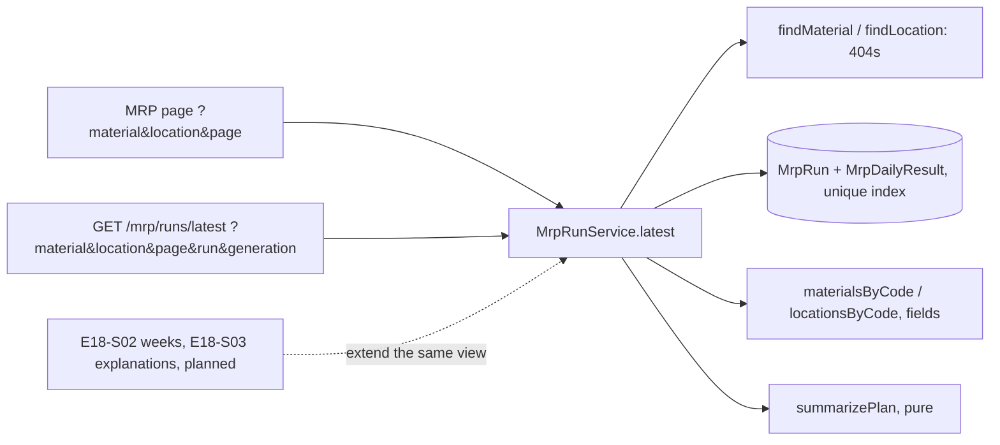
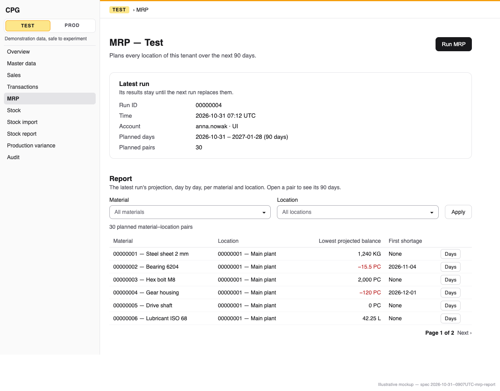
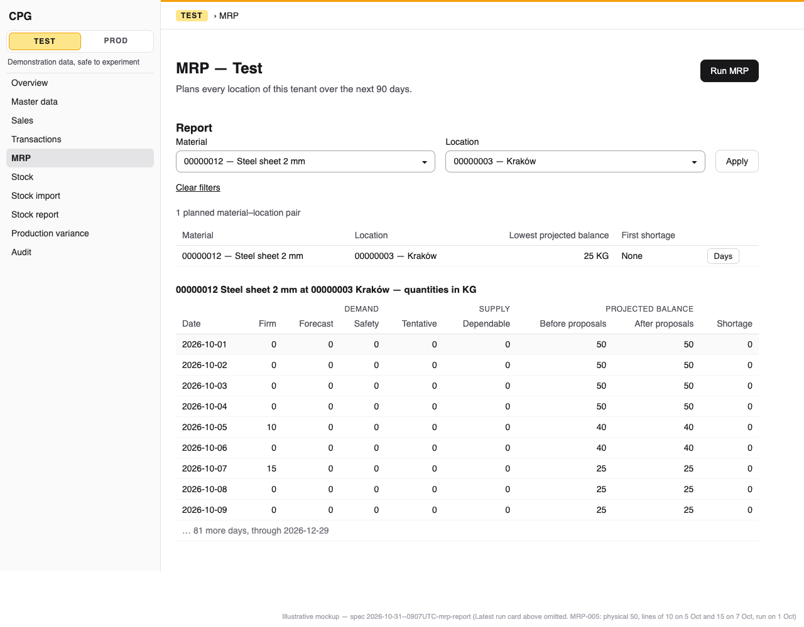

# MRP report: the last run's daily report per material and location, filtered, on the MRP page and through the API

**Status:** ready
**Created:** 2026-10-31 09:07 UTC
**Issue:** #284 (E18-S01, epic #270) · **Depends on:** MRP runs (`implemented/2026-10-27--0556UTC-mrp-runs.md`, #274), the MRP engine (`implemented/2026-10-27--0525UTC-mrp-engine-projection.md`, #273), the stock report (`implemented/2026-10-20--2221UTC-stock-report.md`, #94), the report filter pickers (`implemented/2026-10-25--0751UTC-autocomplete-pickers-report-filters.md`) · **Design authority:** `.ai/specs/product-brief.md` (R03, R05, R07, R11, D03, N01, N04), `research/CPG-prd001.pdf` §04 and §07 "Last MRP report", `research/CPG-acceptance.md` MRP-005, MRP-008, RUN-002, TEN-018, API-014, UX-010, UX-021

## 📝 TLDR

Since #274 a user can run MRP, but the MRP page shows only the run's header, and the API returns the daily figures only as unfiltered pages. This spec adds the "Last MRP report" of PRD §07 to the MRP page, under the run header. It lists the run's material-location pairs with their lowest projected balance and first shortage. Material and location filters narrow the list, and once they leave a single pair, its 90 days show with nine columns: firm, forecast and safety demand; tentative and dependable supply; the projected balance before and after proposals; and the shortage. The existing `GET …/mrp/runs/latest` takes the same two filters and returns the same figures, so the API and the screen match for both roles, read-only tenants included.

## 📝 Problem Statement

PRD §07 asks for the "Last MRP report": a daily 90-day projection across all sites, with filters, showing:
- firm, forecast and safety demand;
- tentative and dependable supply;
- shortages and the balances before and after recommendations.

R07 asks for the same report through a bearer-token API under the same authorization. Today:

- `/admin/{tenant}/mrp` shows the latest run's ID, time, account, horizon and pair count (RUN-002), and nothing of its results;
- `GET /api/tenants/{tenant}/mrp/runs/latest` returns every figure, but only as pages of 25 pairs, sorted by ID. It can't be narrowed to a material or a location, and it names neither the materials nor their base unit.

Several catalogue rows wait for this screen: MRP-005 (daily needs stored per day), MRP-008 (a −15 balance "allowed in report"), RUN-002 (results available in the report), TEN-018 (the MRP report readable in a read-only tenant), and API-014, UX-021 and UX-010 (their MRP halves). The weekly view (E18-S02) and explanations (E18-S03) build on this report.

## Resolved assumptions (autonomous defaults)

These answer the issue's two open questions and the choices its notes leave to the spec, with the most reversible option. Each is open to override before merge.

| # | Question | Applied default | Why |
|---|---|---|---|
| Q1 | With no run yet, does the API answer 404 or 200 with `run: null`? | 404 `MRP_RUN_NOT_FOUND`, as `GET …/mrp/runs/latest` already does. The page shows its existing empty state, with Run MRP while the tenant is writable. | It is the shape #274 already published (`BACKWARD_COMPATIBILITY.md` §4). A second "no run" shape would be a new contract for one fact. |
| Q2 | Is "shortages only" a filter of this story? | No. The filters are material and location. The pair list shows each pair's first shortage, so shortages are found without a filter. | PRD §07 names no filter, and the issue sets material and location as the minimum. Exceptions (E18-S03) and proposals (E16) define what a planner acts on. A filter is an additive query parameter whenever it comes. |
| Q3 | A new `GET …/mrp/runs/latest/report` route, or filters on the existing latest-run route? | Filters on the existing route: optional `material` and `location` query parameters on `GET /api/tenants/{tenant}/mrp/runs/latest`. Each plan gains seven additive fields: `materialDescription`, `materialActive`, `baseUnit`, `locationName`, `locationActive`, `lowestProjectedBefore` and `firstShortageDate`. No new route. | That route already returns the latest run's daily figures under the report's authorization. A second route returning the same rows would be a second contract to keep in step. Both parameters used to be 400 (unknown key), so accepting them is additive (§4: "new optional fields"). The new fields carry what the screen shows, so API and UI match (UX-021). |
| Q4 | Layout and paging of up to pairs × 90 rows | A list of pairs, 25 per page in ID order: the latest-run route's page. Each row shows the material, the location, the lowest projected balance before proposals and the first shortage date, and links to that pair. When the filters leave exactly one pair, its 90-day table follows the list. | The page stays bounded: 25 rows, or one pair's 90 days, never the 2,700 rows of the realistic dataset (lesson 2026-10-24, "Paging a list"). Sorting pairs by shortage would read every row of the run for each page. ID order is the index order, and the first-shortage column already shows where the trouble is. |
| Q5 | Which figures are columns of the day table? | The nine the issue names: firm, forecast and safety demand; tentative and dependable supply; projected before and after; shortage. Dependent demand, transfers out and in, at-risk supply and proposed receipts stay in the API only, until the stories that fill them add their columns (E15-S03, E16-S01, E17-S03, E18-S03). | Those four are zero until their stories land, and E18-S03 owns the BOM and at-risk explanations. Adding a column later changes no contract. The API already returns all 13 figures. |
| Q6 | "Formatted in the reader's locale": with what? | `Intl.NumberFormat(locale, { maximumFractionDigits: 6 })` applied to the **six-decimal text**, never to a number: `"1234.500000"` shows as `1,234.5` in English and `1234,5` in Polish; a negative is `-15.5` / `-15,5` with a hyphen-minus (U+002D), and Polish groups five digits or more with a no-break space (U+00A0). A new app helper does this, `localeQuantity(text, locale)` in `components/forms/form-labels.ts`, narrowing the text to `` `${number}` `` for `format()`'s type. It is used on this screen only; moving the other screens is #304. | `Intl.NumberFormat.format` takes a decimal string and keeps every digit (checked on Node 24: `"12345678901234.123456"` keeps all 20 digits), so R03 holds with no float. The other screens keep `shownQuantity`. Moving them is a separate, screen-by-screen change. |
| Q7 | Which balance is "lowest", before or after proposals? | Before proposals, the balance the shortage is measured from (`project-buckets.ts`). | Until E16-S01 the two are equal. The shortage figure is defined on `projectedBefore`, so the pair summary agrees with the shortage column. E16 can add an after-proposals summary as one more field. |
| Q8 | A page past the last, or a filtered pair the run didn't plan? | Past the last: the page shows the last page, as the stock report does. The API returns no plans, as today. A known material or location the run didn't plan gives an empty list: "No planned pairs match these filters." | Both behaviours already exist (stock report page; latest-run route). The not-found state is kept for records the tenant doesn't have. |
| Q9 | Split the story? | No. | The screen and its API equivalent are one capability under R07, and both read one service method. |

## 📝 Proposed Solution

`MrpRunService.latest(query)` already reads the latest run and one page of its plans in one read transaction. This spec extends that one read:

1. **Filters.** `mrpLatestQuerySchema` gains optional `material` and `location`, each an eight-digit ID, with an empty value meaning "all" (the report form's "All" choice), as in `stockReportQuerySchema`. `latest` checks them with `findMaterial` / `findLocation` **before** reading the run. An ID the tenant doesn't have is 404 `MATERIAL_NOT_FOUND` / `LOCATION_NOT_FOUND`, the other tenant's included (R05). The daily-row read adds `material` / `location` to its `where`. `total` becomes the number of pairs the filters leave: the run's `pairs` unfiltered, otherwise the matching rows ÷ `horizonDays`, since every pair has exactly that many rows.
2. **Names and units.** After the page's rows are read, one `materialsByCode` and one `locationsByCode` read (≤ 25 IDs each, the helpers as they are) give each plan its `materialDescription`, `materialActive`, `baseUnit`, `locationName` and `locationActive`. Masters are never deleted, and a Test reset clears Test's runs, so every code a run names resolves.
3. **Pair summary.** A pure function, `summarizePlan(buckets)` in `core/src/domain/mrp/report/plan-summary.ts`, returns `lowestProjectedBefore`, the smallest `projectedBefore` of the 90 days, and `firstShortageDate`, the first date whose `shortage` is above zero, or `null`. It compares exact `bigint` micro-units through `parseSignedQuantity`, never floats, and returns the stored text unchanged.

The page calls the same `latest` method with its own query, so the screen and the API show the same figures.

**Alternatives considered.**
- *A separate `MrpReportService` and a `/report` route.* Rejected (Q3): a second read of the same rows, a second contract, and a second place for the run-superseded rule.
- *All pairs' 90 days on one page, collapsed per pair.* Rejected (Q4): 25 pairs × 90 days is 2,250 table rows, about 20,000 cells of server-rendered HTML per page. It is unusable on a phone and slow to stream.
- *A weekly fold now.* Out of scope: E18-S02 owns weeks, with their "never sum stock balances" rule.

## 📝 Architecture

```
core/src/domain/mrp/report/plan-summary.ts      summarizePlan(buckets): lowest projected before, first shortage date   (new)
core/src/validators/mrp/mrp-latest.schema.ts    + material, location                                                  (changed)
core/src/validators/mrp/mrp-report.schema.ts    mrpReportPageQuerySchema: the page's ?material&location&page          (new)
core/src/services/mrp/mrp-run.service.ts        latest(): filters, filtered total, names, summary                     (changed)
core/src/services/mrp/mrp-run-view.ts           MrpPlanView + seven fields                                            (changed)
app/src/app/admin/[tenant]/mrp/page.tsx         reads latest(query) as well as the header                             (changed)
app/src/components/mrp/mrp-report.tsx           filters, pair list, the one pair's day table                          (new)
app/src/components/mrp/mrp-run-screen.tsx       renders <MrpReport> under the run card                                (changed)
app/src/components/forms/form-labels.ts         + localeQuantity(text, locale)                                        (changed)
app/src/app/api/tenants/[tenant]/mrp/runs/latest/route.ts   unchanged code; new parameters through the schema
```



One read serves both channels. Everything except `plan-summary.ts`, the page schema and `mrp-report.tsx` already exists and is extended. No entity, migration, event or container binding changes.

### The read (`MrpRunService.latest(raw)`)

In one `inRequestTransaction` on the request `em`, as today:

1. Parse the query (`mrpLatestQuerySchema`; any other parameter is 400 `VALIDATION_FAILED`).
2. `findMaterial` / `findLocation` for the filters given: 404 first, so an unknown filter is refused whether or not a run exists.
3. The latest run, or 404 `MRP_RUN_NOT_FOUND`, and the existing `run`/`generation` checks (404, or 409 `MRP_RUN_SUPERSEDED`).
4. `total`: `run.pairs` without filters; with filters, `em.count(MrpDailyResult, where) / run.horizonDays`.
5. The page of rows: `where = { run, material?, location? }`, `orderBy: { material, location, date }`, `limit` 25 × 90, `offset` (page − 1) × 25 × 90, `fields` and `disableIdentityMap` as today. Every pair still has exactly 90 rows, so the offset still falls on pair boundaries.
6. Group the rows into plans, as `groupPlans` does, then add the names, unit and summary.

The unique index `(tenant, run, material, location, date)` serves every filter combination:
- material, or material and location: an index prefix;
- location alone: the `(tenant, run)` prefix, with `location` checked inside the index, in the index's order;
- no filter: as today.

None of them sorts. A plan test captures the SQL MikroORM sends for all four combinations and for the count, with `initOrm(…, { onQuery })` on a `selectTenant` fork. It asserts that `explain query plan` uses that index with no `USE TEMP B-TREE` (lesson 2026-10-25, "EXPLAIN the query MikroORM really sends"). If location alone walks more than the run's rows, the fallback is a `(tenant, run, location, material, date)` index. That would be a create-index-only migration, with its up/down test and the migration-count updates (lesson 2026-10-23). This spec expects it not to be needed.

**Budget** (fastest of three, read alone, in absolute row counts; lesson 2026-10-25, "A read of thousands of rows costs hydration"):

| Run | Pairs | Daily rows | Read | Budget |
|---|---|---|---|---|
| Realistic | 30 | 2,700 | page 1, unfiltered | 100 ms |
| Ten times | 300 | 27,000 | page 1 unfiltered; by material; by location; by both; the last page by location | 250 ms each |

A page hydrates at most 2,250 partial rows (about 25 ms at 10 µs a row), and the count reads only the index. `mrp-report-reads.test.ts` seeds the run rows directly, prints the figures with `process.stdout.write`, and gives CI a loose bound with a test timeout derived from it (lesson 2026-10-25, "A timing test's own bound").

### The page (`/admin/{tenant}/mrp?material={id}&location={id}&page={n}`)

`page.tsx` keeps `connection()` inside `<Suspense fallback={<LoadingMessage />}>` and `requireUser()`. It parses `searchParams` with `mrpReportPageQuerySchema`: a strict `{ material, location, page }` built from the same field schemas. A malformed or unknown parameter, `run` and `generation` included, is `notFound()`: the page always shows the latest run, and it never needs a paging token. Then:

- `orNotFound(cradle.mrpRunService.latest(query), ["MATERIAL_NOT_FOUND", "LOCATION_NOT_FOUND"])`. `MRP_RUN_NOT_FOUND` is caught and becomes `report: null`, so the existing empty state shows;
- a page past the last is read again at the last page, as `reports/stock/page.tsx` does;
- the header card is `report.run`, so header and rows come from one snapshot. `MrpRunService.current()` then has no caller, so it is removed and its tests move to `latest` (no dead code);
- the filter pickers come from `materialService.list()` and `locationService.list()`, as on the stock report.

A run started from this page refreshes the page through `refreshAfterWrite`, so the report then shows the new run ("until superseded", PRD §04).

## 📝 Data Model

No change. The report reads `MrpRun` and `MrpDailyResult` through #274's unique index, which was declared for this read.

## 📝 API Contracts

**`GET /api/tenants/{tenant}/mrp/runs/latest?material={id}&location={id}&page={n}&run={id}&generation={n}`**, every parameter optional. Additive over #274:

- `material`, `location`: eight-digit IDs, and an empty value means no filter. A malformed one is 400 `VALIDATION_FAILED`. An ID the tenant doesn't have is 404 `MATERIAL_NOT_FOUND` / `LOCATION_NOT_FOUND`, checked before the run: an unknown filter is 404 for its own reason even with no run.
- `total` is the number of pairs the filters leave (unchanged without filters: the run's `pairs`). Pages are 25 of those pairs, by material ID, then location ID.
- Each plan becomes:

```ts
interface MrpPlanView {
  material: string;              // "00000012"
  materialDescription: string;   // new
  materialActive: boolean;       // new, as on the stock report's rows
  baseUnit: string;              // new: the unit of every figure below
  location: string;
  locationName: string;          // new
  locationActive: boolean;       // new
  lowestProjectedBefore: string; // new: the lowest of the 90 projectedBefore values, signed six-decimal text
  firstShortageDate: string | null; // new: the first date with shortage > 0, or null
  buckets: MrpBucketView[];      // unchanged: 90 days, 13 figures as six-decimal texts
}
```

Unchanged: the run header, `page`, `pageSize: 25`, 404 `MRP_RUN_NOT_FOUND` with no run (Q1), and 409 `MRP_RUN_SUPERSEDED` for a stale `run`/`generation`. Any signed-in account may call it, on a read-only tenant too (`requireApiUser`, `tenantScope`, no write). `BACKWARD_COMPATIBILITY.md` §4 records the two parameters, the seven fields, the filtered `total` and the page URL's query. No new error code: all five codes already have EN and PL texts.

## 📝 UI/UX

The MRP page, below the "Latest run" card, gets a **Report** section (`MrpReport`, a server component). A read-only tenant renders it the same way (TEN-018). The R11 footer comes from the root layout.

- **Filters.** A `<form action="/admin/{tenant}/mrp">` with two `FilterAutocomplete`s, Material and Location, "All" when empty, and **Apply**. **Clear filters** shows while a filter is set. The stock report's form is extracted into one shared component, `components/reports/material-location-filters.tsx`, with its `key` remount rule (lesson 2026-10-25, "Read the server's markup only while hydrating") and a slot for extra controls. The stock report passes its zero checkbox there, and the MRP report passes nothing.
- **Pair list.** A line "{n} planned material–location pairs" (`total`). Then a `DataTable` with these columns:
  - Material ("00000012 — Steel sheet", "(inactive)" when it is), the location under it below `md`;
  - Location, marked the same way;
  - Lowest projected balance ("-15.5 KG", danger-toned when below zero);
  - First shortage (the date, or "None").

  Each row's action is **Days**, a link to `?material={m}&location={l}`, labelled "Days of {material} at {location}" for screen readers. `PageLinks` pages the list. When filters are set and match nothing: "No planned pairs match these filters."
- **One pair's days.** When the filters leave exactly one pair, a `DataTable` follows the list, captioned "{material} at {location} — quantities in {BUoM}". It has 90 rows, today first, and these columns:
  - Date;
  - Demand, three columns: Firm, Forecast, Safety (the safety target in force that day);
  - Supply, two columns: Tentative, Dependable;
  - Projected before proposals, Projected after proposals;
  - Shortage.

  Figures use `localeQuantity` (Q6), and negative balances and nonzero shortages are danger-toned. The Date column is sticky and the table scrolls sideways inside its labelled container (DataTable). Every column stays at 390 px, so the day table never hides a figure.
- **No run.** The existing `EmptyState`, "No MRP run yet.", with Run MRP and its hint while writable. No filters show.
- **Not found.** A filter naming a material or location the tenant doesn't have is the page's not-found state, as on the stock report.

Copy is EN and PL, in a new `messages.mrp.report` section; say BOM, never recipe (`tests/api-messages-glossary.test.ts`). The help topic `mrp` gains a paragraph per language explaining each column, with the example from MRP-005: physical 50, Open lines of 10 due 5 October and 15 due 7 October. Firm demand is 10 on the 5th, 0 on the 6th and 15 on the 7th, and the projected balance is 40, 40 and 25. It also explains that a negative balance is a shortage to plan for and changes no stock (MRP-008). The topic's API paragraph adds the filters. The Polish title already contains "Planowanie", so searching "MRP" or "planowanie" finds the topic.

Prototype: `.ai/specs/assets/mrp-report/mockup-01-mrp-report-pairs.png` (unfiltered pair list) and `.ai/specs/assets/mrp-report/mockup-02-mrp-report-days.png` (filtered to one pair, its day table). Both are rendered from the static HTML beside them. Today's page, in a tenant with no run, is `current-01-mrp-page.png`; with a run it adds only the run card (#274's `mockup-01-mrp-latest-run.png`).





## 📝 Edge Cases & Failure Scenarios

- **A run commits while the report is read.** The read is one transaction, so header and rows always come from one run. The page shows the run the read saw, and the next load shows the newer one.
- **An empty run (`pairs: 0`).** The header shows, and the pair list says "0 planned material–location pairs" with its empty text. The API returns `total: 0` and no plans.
- **A filter for an inactive material or location.** It resolves: the run plans by data (#274 Q5), and the pickers list inactive records with "(inactive)".
- **The other tenant's material ID.** IDs are numbered per tenant, so `00000005` in Prod and in Test are two materials. The filter resolves the reading tenant's own `00000005`, and never shows Prod's rows in Test (R05). The isolation test uses figures only one tenant has.
- **A Test reset.** It clears Test's runs, so the report shows the empty state until the next run. A client paging with `run`/`generation` gets 409 `MRP_RUN_SUPERSEDED`, as today.
- **A malformed filter.** 400 on the API; `notFound()` on the page (Next answers 200 with the not-found UI under Partial Prefetching, lesson 2026-10-19).
- **Huge or fractional figures.** The figures are texts, so `localeQuantity` keeps every digit: `-15.500000` shows as `-15.5` and `-15,5`. Grouping follows the locale: a comma in English, a no-break space from five digits in Polish.

## 📝 Risks & Impact Review

- **Contract.** Additive only: two accepted query parameters that used to be 400, seven new fields per plan, and a `total` that is filtered once a filter is used. A client that sends neither parameter sees the same `total`, pages and figures, plus seven fields.
- **The page URL becomes strict.** Today `/admin/{tenant}/mrp` ignores its query, so `?anything` renders the page. With `mrpReportPageQuerySchema` an unknown or malformed parameter is the not-found state, as on the stock report. Only hand-made URLs are affected, and §4 records it. Rollback: the previous release answers 400 to the filters again and drops the fields; nothing is stored.
- **Performance.** Bounded by the page size, and measured against the budget above. Reads take no write lock and yield nothing. A report read waits behind a run in flight, for at most that run's duration, as the latest-run read already does.
- **No schema change**, unless the plan test forces the fallback index. The spec expects it not to be needed.
- **Protected surfaces.** The page URL's query (`material`, `location`, `page`), the API's parameters and fields, and the help topic's content. All are recorded in §4.

## 📝 Decisions in play

R03 (exact six-decimal texts in the API; on screen, locale formatting of the text, never a float), R05 (tenant-scoped reads; a read-only tenant still reads), R07 (the same report through a bearer API, same authorization), R11 (the footer on the MRP page, already in `footer.test.ts` since #274), D03 (EN/PL copy and help grow with the screen), N01 (no costs) and N04 (no capacity view): no column shows either. None is superseded.

## 📋 Phasing

One phase, one PR: the read, the API's parameters, the page, the help and the tests. Each step below leaves the application working.

## 📋 Implementation Plan

1. **Pair summary.** Add `core/src/domain/mrp/report/plan-summary.ts` with `summarizePlan`. Unit tests:
   - the lowest balance is negative and fractional (`-15.500000`, lesson 2026-10-27, "`formatDecimal` takes values of zero or more only");
   - the first shortage is not the lowest day;
   - with no shortage, the result is `null`;
   - ties keep the stored text.
2. **Validators.** Extend `mrpLatestQuerySchema` with `material` and `location`, empty meaning none, reusing `materialReferenceSchema` / `locationReferenceSchema`. Add `mrpReportPageQuerySchema` (strict `material`, `location`, `page`). Tests: each accepts and refuses what is specified; the page schema refuses `run` and `generation`.
3. **The read.** Extend `MrpRunService.latest` and `MrpPlanView` as specified. Tests on a real SQLite file:
   - **MRP-005**, with the clock pinned to 1 October 2026: physical 50, Open lines of 10 due 5 October and 15 due 7 October. The run stores three distinct days. Filtered to the pair, `latest` returns `firmDemand` `10.000000` / `0.000000` / `15.000000` and `projectedBefore` `40.000000` / `40.000000` / `25.000000` for 5, 6 and 7 October;
   - the summary, names, active flags and unit of each plan;
   - each filter alone, both together, and none, with `total` and pages over more than 25 pairs fed in an order where insertion order and ID order differ (lesson 2026-10-21, "Sort and page by business ID");
   - unknown material or location: 404, the other tenant's ID resolves to the reading tenant's own records, and an unknown filter with no run is the filter's 404;
   - a known but unplanned material: `total: 0`, no plans;
   - `run`/`generation` with filters still answers `MRP_RUN_SUPERSEDED` after a newer run.
4. **Plan and timing tests.** In `services/mrp/mrp-report-reads.test.ts`:
   - EXPLAIN the five captured queries (four filter combinations and the count) against the unique index, with no temp B-tree. If one fails, add the fallback index migration as described, and do the migration-count updates;
   - the budget table, fastest of three, printed;
   - add the report's material and location `IN` reads to `core/src/services/list-page-reads.test.ts`, with its fixture chosen by count (lesson 2026-10-25), so a later index can't turn them into a walk of the tenant.
5. **API.** The route code is unchanged. Extend its route test for the new parameters passed through, and `tests/api-messages-glossary.test.ts` stays green.
6. **Page and components.**
   - Add `localeQuantity` to `form-labels.ts`, with tests: EN and PL, a negative fraction, a 20-digit value kept exactly.
   - Extract `components/reports/material-location-filters.tsx` from `stock-report-screen.tsx`, keeping that screen's tests green.
   - Add `components/mrp/mrp-report.tsx`, render it from `mrp-run-screen.tsx`, and update `page.tsx` as specified. Remove `MrpRunService.current()` and move its tests to `latest`. The existing `page.test.tsx` cases move from mocking `current` to mocking `latest`.
   - Add EN/PL messages and extend the `mrp` help topic in both languages.
   - Component and page tests cover: the pair list, the one-pair day table with its nine columns, the empty filter result, no run (empty state, Run MRP only when writable), read-only (report shown, no button), the not-found filters, a malformed query, the last-page clamp, and that labels passed to client components are plain data (lesson 2026-10-24).
7. **Integration tests.** Each file creates its own material, location, stock correction and customer order line, runs MRP, and asserts only on its own pair (lessons 2026-10-22, 2026-10-25):
   - `tests/integration/mrp-report.test.ts` (UI):
     - a normal user filters to the file's pair and sees the day table with the MRP-005 figures, relative to today: lines due today + 4 and today + 6, so balances 40 / 40 / 25 on those days;
     - a pair with physical 5 and demand 20 shows -15 on screen, while the stock report still says 5 (MRP-008);
     - unfiltered, the pair count on page 1 equals the run's `pairs`. The file's pair has the highest material ID in a shared database, so the test opens `?page=1000000` (clamped to the last page) and asserts the pair's **Days** link there (lesson 2026-10-24, "Paging by ascending ID moves the row a test just created off the first page");
     - unknown filters show the not-found state;
     - a second run replaces the header's ID;
     - read-only Prod, with the flag restored in `afterAll`: a normal user still reads the report (TEN-018);
     - the help search finds `mrp` for "MRP" in English and "planowanie" in Polish, with the admin's preferences restored in `afterAll`;
     - the page holds at 1280 px and 390 px with no page-level overflow (lesson 2026-10-20, "Tall dialogs and dense tables").
   - `tests/integration/mrp-report-api.test.ts`:
     - the admin's and a normal user's tokens get identical filtered reports (API-014, UX-021), with the same three days as the screen test;
     - 404 `MATERIAL_NOT_FOUND` / `LOCATION_NOT_FOUND`, and 400 for a malformed filter;
     - Test never returns the Prod pair's figures (R05), as in `stock-report-api.test.ts`;
     - read-only Prod answers 200 for a normal token (TEN-018).
   - `tests/integration/footer.test.ts` already lists `/admin/test/mrp` (#274); add a filtered `/admin/test/mrp?material=…`, as it does for the audit page.
8. **Docs and close-out.**
   - `BACKWARD_COMPATIBILITY.md` §4: the page query (strict now), the two parameters, the seven fields, the filtered `total`.
   - `.ai/docs/engineering-standards.md` §5: one bullet, the report reads through `latest` and `localeQuantity` formats texts.
   - The acceptance catalogue: move only rows whose every Then is asserted (lesson 2026-10-21): MRP-005, MRP-008, RUN-002, TEN-018, API-014, UX-021 and UX-010 are expected. RUN-021 and TEN-019 keep their automatic halves (E19-S03).
   - Move this spec to `implemented/` with implementation notes.

Run `npm run lint`, `npm run typecheck`, `npm run test:coverage` (100%) and `npm run build`. Then run the integration files this change adds or touches, and `smoke.test.ts` only if step 4 added a migration.
