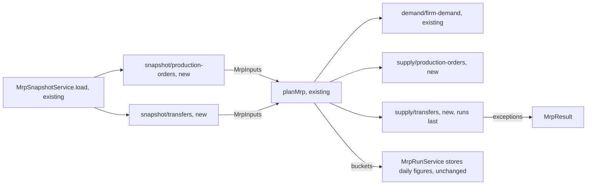

# MRP projects open production orders and transfers

**Status:** ready
**Created:** 2026-10-31 09:08 UTC
**Issue:** #277 (E15-S03, epic #267) · **Depends on:** the MRP engine (`implemented/2026-10-27--0525UTC-mrp-engine-projection.md`, #273), MRP runs and the snapshot loader (`implemented/2026-10-27--0556UTC-mrp-runs.md`, #274), production orders (`implemented/2026-10-20--2047UTC-production-orders.md`), production completions (`implemented/2026-10-20--2221UTC-production-completions.md`), transfers (`implemented/2026-10-20--2046UTC-transfers.md`) · **Design authority:** `.ai/specs/product-brief.md` (R03, R09, R10, D04, N04, N06), `research/CPG-prd001.pdf` §04 "Component timing and execution", "Overdue and late starts", "Transfers", `research/CPG-acceptance.md` MRP-011/013/016/017/018/019/021/022/023/039/040, PRD-009/025/027/028/029/030, TRF-016/017, UX-024/026

## 📝 TLDR

Today MRP projects physical stock against customer-order demand only (#273). It doesn't count open production orders or transfers. So it misses output that is already planned and the components those orders will use, and it can't see stock that is about to leave a site or is already on the road. This spec adds both to `planMrp`, the engine function:

- Each open production order's unproduced balance becomes dependable output on its planned finish day.
- The pinned BOM's components for that balance become dependent demand on the order's planned start day.
- Each open transfer's in-transit quantity arrives at the destination on the planned arrival day.
- Its undispatched quantity leaves the source on the planned dispatch day and arrives at the destination on the planned arrival day, but only as much as the source can supply. The rest raises an Insufficient Transfer Stock exception.

Overdue output, component needs, dispatches and arrivals move to today, marked overdue and keeping their original dates. The run writes no document and no stock movement.

## 📝 Problem Statement

PRD §04 fixes the rules, and none of them is implemented:

- **Component timing.** Finished output arrives on the completion day. The pinned BOM's inputs are needed on the start day. Nothing is physically reserved, because inputs and output post only at completion.
- **Partial completion.** Only the unproduced balance's BOM inputs stay planned, without extrapolating actual variance.
- **Overdue.** Overdue production output is expected today with a warning, and an overdue start-day need moves to today.
- **Transfers.** Dispatch at the source and receipt at the destination are planned separately, and stock in transit can't be consumed. A destination counts only what the source can supply. Insufficient Transfer Stock is reported without changing or creating a transfer (N06), and an overdue in-transit receipt is expected today with an Overdue Transfer warning.

Without this story, a site with a production order due Friday shows a shortage MRP should not propose against. Its components show no need, so the shortage at the component level goes unseen. A destination waiting on a transfer looks short, and a source about to send 100 looks long. E16-S01's proposals would then buy what is already planned and miss what is not.

## Resolved assumptions (autonomous defaults)

These answer the issue's open questions, and the gaps between its notes and the code, with the most reversible choice. Everything here is pure engine code over an in-memory result, and only the daily figures are stored, in columns E14-S02 already created. So each choice can be overridden before merge, or changed later without a migration.

| # | Question | Applied default | Why |
|---|---|---|---|
| Q1 | When a transfer plans 100 and the source can supply 60, what does the source subtract? | Only the 60. The source's `transferOut` and the destination's `transferIn` both count the feasible 60. The uncovered 40 shows once, as the exception. | The issue's D04 reading. If the source subtracted the full 100, E16-S01 would propose the same 40 at both sites. |
| Q2 | Which source balance does "can supply" mean? | The **dependable balance** at the end of the dispatch day, never below zero. It counts physical stock plus dependable supply and transfer receipts already counted, minus every demand and every transfer dispatch already counted, up to and including that day. It excludes tentative supply (requisitions, E15-S02) and proposals (E16-S01). Only the dispatch day is checked, not the lowest balance from that day to day 89. So a transfer may take stock that the source's own later demand needed, and the shortage then shows at the source on that later day, counted once. | The PRD's word is "can supply": a requisition isn't approved supply, and proposals are hypothetical ("never become real supply"). This is the balance E17-S02's BOM feasibility uses, so the two feasibility checks agree. TRF-017 states the check on the dispatch day. The lowest-balance alternative would reserve source stock for later demand, which N04 rules out. Until E15-S02 lands, tentative supply is zero, and the dependable balance equals `projectedBefore`. |
| Q3 | Is a transfer receipt dependable supply? | Yes. Both the in-transit receipt and the source-feasible part of a planned receipt count in the destination's balance (`transferIn`). Later transfers' feasibility and E17-S02's BOM feasibility count them as dependable. | In-transit stock is already off the source's books. The feasible part is covered by the source's own dependable balance, so it is as reliable as the supply behind it. |
| Q4 | In what order are transfers evaluated, and how are chains A → B → C handled? | Transfers come **after every other seam**, so each source's balance already holds its own demand and supply. They are evaluated one at a time, ordered by the day their dispatch is counted (today when overdue), then the planned dispatch day (so an older overdue transfer is served first), then the transfer code (code-unit order). Each one sees the dispatches and receipts of those before it. A leg checked later always lands on that day or after it, so a balance already checked never changes. The only artefact: a transfer A → B that dispatches and arrives on day *d* is seen by a day-*d* transfer B → C only when A → B is evaluated first. An arrival on day *d* from a transfer dispatched earlier is always seen. | A stable, deterministic order, as the closure defaults in PRD §04 require. A same-day fixed point would cost a cycle check (A → B and B → A on one day) for a rare case. The artefact is conservative: it under-counts a destination, never the reverse. |
| Q5 | Where do the Insufficient Transfer Stock exception and the overdue markers go? | `MrpResult` gains `exceptions`, an in-memory list whose only kind so far is `insufficient-transfer-stock`. The overdue markers are an `overdue` flag on each output, component-demand and transfer item, next to its kept original date. Neither is stored: the run stores daily figures only (#274 Q7), and E16-S03 creates the exception table. | The issue's criteria are asserted on `planMrp`'s result. Creating the exception table now would fix its shape before E16-S03 has defined the other kinds (#274 Q2). |
| Q6 | Do orders whose pinned BOM uses a deactivated component count? | Yes, as dependable, until E17-S03 moves them to `atRiskSupply`. | That classification is out of this story's scope (issue Scope); E17-S03 changes one filter in this module. |
| Q7 | Does an order's start day come from its stored `plannedStart`, or from finish minus lead time? | The stored `plannedStart`. A finish edit already recalculates it from the captured lead time (PRD-027, #89). MRP-017 is asserted on an order whose stored dates are 1 and 6 November with a 5-day lead time. MAT-018's lead-time back-scheduling of new proposals stays with E16-S02. | One source of truth: the order's own dates, as its detail page shows them. |
| Q8 | How is a component's need for the remainder rounded? | Per order and component: `perOutput × remainder`, rounded upward once to six decimals, the rule an order's detail and its completions already use (`scaledRequirement`). The orders' needs then add up exactly. The arithmetic moves into a `bigint` twin, `scaledMicro`, which `scaledRequirement` delegates to while keeping its overflow refusal. | R03 and PRD §04: round planned component requirements upward. A bigint total can't overflow, and the run stores it as text, so the engine needs no refusal path. |
| Q9 | What about movements past the horizon, and which pairs get a plan? | Each movement counts on its own day, or not at all when that day is after day 89 (MRP-004). An order finishing on day 95 but starting on day 80 adds its component need on day 80 and no output. A transfer dispatching on day 88 and arriving on day 92 is checked and subtracted at the source, with nothing at the destination. Pairs get a plan when one of these happens inside the horizon: (1) a production leg; (2) an in-transit or non-zero planned receipt at a destination; (3) a dispatch check at a source, even one that finds nothing to send, since that is where the exception's shortfall belongs. A destination that receives nothing gets no plan of its own. | The same rule as firm demand (#273 Q1). Each leg is placed independently, as the PRD plans them separately. |
| Q10 | Split production and transfers into two specs? | No: one spec and one PR, in two phases, each of which leaves the engine working. | Each half could ship alone, but together they are one backlog story (E15-S03), filed as one issue against one engine seam and one snapshot seam. The two phases keep them reviewable. |
| Q11 | Must the snapshot loader wait for E14-S02? | No. E14-S02 has landed (#299), so this story adds two reads to `MrpSnapshotService.load`. | — |

## 📝 Proposed Solution

Two engine seams and two snapshot reads, following the one-property, one-call rule that #273 set for later stories:

```
domain/mrp/
  mrp-inputs.ts                  + productionOrders: MrpProductionOrder[], transfers: MrpTransfer[]
  mrp-result.ts                  + item types, MrpException; MrpPlan + four item lists; MrpResult + exceptions
  plan-mrp.ts                    + one call per seam (transfers last)
  supply/
    production-orders.ts         productionMovements(orders, dates): { output, components }
    transfers.ts                 planTransfers(transfers, dates, ledgerOf): { movements, exceptions }
  projection/project-buckets.ts  + MrpLedger, dependableBalance(ledger, day)
domain/production-orders/production-planning.ts   + scaledMicro(perOutput, output): bigint
services/mrp/
  mrp-snapshot.service.ts        + two reads in load()
  snapshot/production-orders.ts  readProductionOrders(em, codes, before)
  snapshot/transfers.ts          readTransfers(em, codes, before)
```

E15-S02's purchasing module (`supply/purchasing.ts`, separate issue) touches the same three shared lines (`MrpInputs`, `planMrp`, `load`) but no file of this story's.

**Alternatives considered.**
- *Computing transfer feasibility on `projectedBefore`.* It is simpler, but it lets an unapproved requisition at the source make a destination's receipt look covered (Q2).
- *A simultaneous solve across all pairs and days* (a fixed point over transfers). It handles same-day chains exactly, but it needs cycle detection for an edge the stable order already handles conservatively (Q4).
- *Recomputing the start day from finish minus lead time.* Rejected (Q7): it duplicates what the order already stores and would disagree with its detail page.

## 📝 Architecture

### Inputs (`mrp-inputs.ts`)

```ts
export interface MrpInputs {
  stock: readonly MrpStock[];
  orderLines: readonly MrpOrderLine[];
  productionOrders: readonly MrpProductionOrder[];
  transfers: readonly MrpTransfer[];
}

/** A production order with its pinned revision's lines, any status. */
export interface MrpProductionOrder {
  order: string;          // order code (business ID)
  material: string;       // output material code
  location: string;       // the site that consumes the inputs and receives the output
  plannedStart: string;
  plannedFinish: string;
  quantity: bigint;       // target, base units
  produced: bigint;
  abandoned: bigint;
  status: DocumentState;
  components: readonly { material: string; perOutput: bigint }[]; // BomComponent.quantity per base unit of output
}

/** A transfer with its posting progress, any status. */
export interface MrpTransfer {
  transfer: string;       // transfer code (business ID)
  material: string;
  source: string;
  destination: string;
  plannedDispatch: string;
  plannedArrival: string;
  quantity: bigint;
  dispatched: bigint;
  received: bigint;
  writtenOff: bigint;
  abandoned: bigint;
  status: DocumentState;
}
```

### Production orders (`supply/production-orders.ts`)

An order counts only when it is `open`. Its remainder is `outstandingMicro(quantity, produced, abandoned)`, the lifecycle's remainder rule, which `productionOutstanding` also applies (without `abandoned`, which only a closed order carries). A remainder of zero (produced 100 of 100 or more, PRD-030) adds nothing. Otherwise:

- **output** of `remainder` on `max(plannedFinish, today)`, in the order's `(material, location)` pair: `dependableSupply`, flagged `overdue` when `plannedFinish < today` (MRP-016);
- **component demand** for each pinned line, `scaledMicro(perOutput, remainder)`, on `max(plannedStart, today)`, in the `(component, location)` pair: `dependentDemand`, flagged `overdue` when `plannedStart < today` (MRP-022). This is the recipe's need for the remainder, never the completions' actual consumption (PRD-028). A component whose need rounds to zero is dropped.

Each leg lands in its own bucket, or none when its day is after day 89 (Q9). Nothing touches `physical` (MRP-019, R09).

### Transfers (`supply/transfers.ts`)

Only `open` transfers count: a Completed, Closed Early or Cancelled transfer projects nothing, and a transfer can't close while stock is in transit (`TRANSFER_IN_TRANSIT`). Two stages:

1. **In transit**: `inTransit = dispatched − received − writtenOff`. It already left the source's physical stock and is in no site's physical stock (R09). It arrives at the destination on `max(plannedArrival, today)`, in `transferIn`, flagged `overdue` when `plannedArrival < today`: the Overdue Transfer warning (TRF-016, MRP-040). No feasibility check, because the stock is already on the road.
2. **Undispatched**: `planned = quantity − dispatched` (`undispatchedOf`'s rule, in micro-units). A transfer's `abandoned` isn't subtracted: closing one sets it from `received`, not `dispatched` (`transfer.service.ts`), and an open transfer carries zero. Its dispatch day is `max(plannedDispatch, today)` and its arrival day `max(plannedArrival, today)`. When the dispatch day falls inside the horizon:
   - `available` = the source's dependable balance at the end of the dispatch day (Q2), never below zero;
   - `feasible = min(planned, available)`;
   - `feasible` adds to the source's `transferOut` on the dispatch day and to the destination's `transferIn` on the arrival day, when that is inside the horizon. Both items are flagged `overdue` when their planned day is before today;
   - when `feasible < planned`: an `insufficient-transfer-stock` exception names the transfer, the material, both sites, the dispatch day, `planned` and `available` (TRF-017, MRP-039). The transfer document is untouched, and nothing is created (R10, N06).

`planTransfers` runs after every other seam in `planMrp` and evaluates the undispatched legs in the Q4 order. Its contract differs from the other seams': each check depends on the moves before it, so **`planTransfers` itself writes `transferOut` and `transferIn` into the flows**. It returns the movement items and exceptions, and `planMrp` only files the items into the plans' `transfersOut`/`transfersIn` lists, never adding them to the flows again. In-transit receipts are written first, since none depends on a source. `ledgerOf(material, location): MrpLedger` is `planMrp`'s `pairOf`, called per Q9.

`MrpLedger` (`{ physical: bigint; flows: MrpFlows[] }`) and `dependableBalance(ledger, day)` live in `projection/project-buckets.ts`, beside `projectBuckets`. The standards keep the balance formula in that one file. `dependableBalance` is the same running sum without `tentativeSupply`, and both share one list of signed terms there. It is recomputed per check, so a run does at most 90 × its transfers additions.

**Later seams.** A seam that adds demand or dependable supply must run before `planTransfers` (E15-S01, E15-S02, E17-S03's at-risk move). One that adds proposals runs after it (E16-S01, E17-S01's Make-proposal components), because feasibility is before proposals. The `planMrp` doc comment states this rule, and so does the `domain/mrp/` bullet in the engineering standards.

### Result (`mrp-result.ts`)

```ts
export interface MrpResult {
  today: string;
  dates: readonly string[];
  plans: readonly MrpPlan[];
  proposals: readonly MrpProposal[];
  exceptions: readonly MrpException[];   // by date, then transfer code
}

export interface MrpPlan {
  // … existing fields
  productionOutput: readonly MrpProductionOutput[];  // behind dependableSupply's production part
  componentDemand: readonly MrpComponentDemand[];    // behind dependentDemand
  transfersOut: readonly MrpTransferMovement[];      // behind transferOut
  transfersIn: readonly MrpTransferMovement[];       // behind transferIn
}

export interface MrpProductionOutput {
  order: string; material: string; location: string;
  plannedFinish: string;  // the order's own date, kept (MRP-016)
  date: string;           // the bucket: plannedFinish, or today when overdue
  quantity: bigint;
  overdue: boolean;       // Overdue Supply marker
}

export interface MrpComponentDemand {
  order: string; material: string; location: string;
  plannedStart: string;   // kept (MRP-022)
  date: string;
  quantity: bigint;
  overdue: boolean;
}

export interface MrpTransferMovement {
  transfer: string; material: string; location: string;
  stage: "in-transit" | "planned";
  plannedDate: string;    // plannedDispatch for an out, plannedArrival for an in
  date: string;
  quantity: bigint;       // feasible part for a planned stage
  overdue: boolean;       // on an in: the Overdue Transfer warning
}

export interface MrpInsufficientTransferStock {
  kind: "insufficient-transfer-stock";
  transfer: string; material: string; source: string; destination: string;
  date: string;           // the dispatch day it was checked on
  planned: bigint;        // the undispatched quantity
  available: bigint;      // what the source can supply, less than planned
}
export type MrpException = MrpInsufficientTransferStock; // E16-S03 adds the other kinds
```

Item lists sort by `date`, then document code (code-unit order), then material, like `firmDemand`, so the result never depends on input order.

### Snapshot reads (`services/mrp/snapshot/`)

Both follow `readOrderLines`: partial loads (`fields`, `disableIdentityMap: true`), codes mapped through `SnapshotCodes`, `parseDecimal` into micro-units, a yield after each read, and the horizon's end (`before`) checked in code, not SQL (lesson 2026-10-25, "EXPLAIN the query MikroORM really sends").

- `readProductionOrders(em, codes, before)`: `ProductionOrder` with `status: "open"`, fields `code, output, location, recipe, quantity, produced, abandoned, plannedStart, plannedFinish, status`. Orders with `plannedStart >= before` are dropped, since their finish is later still. Then `BomComponent` with `revision: { $in: … }` in chunks of 100 revision IDs, fields `revision, material, quantity`, grouped by revision. Several orders pinning one revision share its lines.
- `readTransfers(em, codes, before)`: `Transfer` with `status: "open"`, fields `code, material, source, destination, quantity, dispatched, received, writtenOff, abandoned, plannedDispatch, plannedArrival, status`. Transfers with `plannedDispatch >= before` are dropped. `Transfer.status` is a plain string column, so the mapping casts it to `DocumentState`, as `transfer.service.ts` does.

`load` calls them after `readOrderLines`, each followed by `yieldToEventLoop()`. A plan test, in the style of `list-page-reads.test.ts`, captures each read's SQL through `onQuery` and `explain query plan`s it. The `status = 'open'` reads should seek the list indexes `(tenant_code, status, code)`, and the component read the `(revision, material)` unique. If the component read walks the tenant instead, the fix is an additive `(tenant, revision)` index migration (lesson 2026-10-25), the only migration this story may need.



Takeaway: the run service and its stored table don't change. The new figures fill bucket columns E14-S02 already stores (`dependent_demand`, `dependable_supply`, `transfer_out`, `transfer_in`), and the items and exceptions stay in memory until E16-S03 and E18 need them.

## 📝 Data Model

No entity change; no migration expected (see the plan-test fallback above). Existing rows in `mrp_daily_result` keep their meaning, and the next run fills the four columns that were zero.

## 📝 Edge Cases & Failure Scenarios

- **Partly completed order (MRP-011, MRP-021).** Target 100, produced 40, 2 kg of A per unit: output 60, A need 120 kg. Completions' actual over-use doesn't scale the remainder (PRD-028).
- **Target raised (PRD-025).** Target 120, produced 40: output 80, components for 80. **Finish moved (PRD-027).** Output on the new finish day, components on the stored start day the edit recalculated.
- **Closed Early with a remainder (PRD-029).** Status `closed-early`, `abandoned` 60: nothing. The test also uses a fixture whose arithmetic would leave a remainder without the status filter (lesson 2026-10-27, "Test a status filter with quantities that would pass without it"). Cancelled before any completion (MRP-013): nothing.
- **Overdue order.** Finish yesterday, 20 pending: 20 today, `overdue`, `plannedFinish` kept. Start Monday, today Wednesday: the need is on Wednesday, `plannedStart` kept.
- **Output after a same-site need (MRP-023).** Start Monday, finish Friday, demand Wednesday: Wednesday is short and the output lands Friday. Late Supply is E16-S02's.
- **Two overlapping orders at one site (UX-024).** Both projected in full; there is no capacity check (N04).
- **Goods issue before production (UX-026).** 100 on hand, 10 issued, then a need of 100: physical 90, so a shortage of 10 on the start day.
- **Part-dispatched transfer.** Quantity 100, dispatched 30, received 0, plan 70: 30 arrives in transit and 70 is checked at the source. Written off 5 of the 30: 25 arrives.
- **Insufficient source (TRF-017, MRP-039).** Plans 100, source has 60 by the dispatch day: out 60, in 60, exception `{ planned: 100, available: 60 }`. A source with nothing or below zero: out 0, in 0, `available: 0`, and no movement items.
- **Two transfers from one source on one day.** The lower code is served first; the second sees what the first took.
- **A transfer drains stock the source needs later (Q2).** Source 100, a transfer of 100 dispatching on day 3, firm demand of 100 on day 5: the transfer is feasible, the destination is covered, and the source is 100 short on day 5. That shortage is counted once, where E16-S01 will propose against it.
- **Chain A → B → C across days.** B → C on day 5 counts A → B's day-3 arrival. On one day, see Q4.
- **Overdue undispatched transfer.** Both legs move to today when both dates passed. When only the dispatch passed, out today and in on the planned arrival day.
- **Malformed snapshot.** Built from validated stored rows, as for #273: dates are ISO, arrival ≥ dispatch (TRF-002) and finish ≥ start. The engine doesn't re-validate them.
- **Size.** Linear in orders × components and in transfers × 90. The run's measured budget (`mrp-run-timing.test.ts`, 1 s realistic, 5 s and a 250 ms stall at ten times) must still hold with the extended fixture (Implementation Plan, step 9).

## 📝 Risks & Impact Review

- **Shapes.** `MrpInputs`, `MrpPlan` and `MrpResult` gain properties. These are internal `@cpg/core` types, not a `BACKWARD_COMPATIBILITY.md` surface. Every construction site (tests, `MrpRunService`) gets the new lists. The daily-result API and screen show the same columns with real values instead of zeros, and their shape doesn't change.
- **A product call, not a defect: feasibility excludes requisitions (Q2).** A destination fed by a source that only has a requisition shows the shortage at the destination, with an exception, rather than trusting the requisition. If the owner prefers `projectedBefore`, that is a one-line change in `supply/transfers.ts`.
- **E15-S01/E15-S02 run in parallel.** They change the same three shared lines. The ordering rule (transfers last) is what keeps them correct when they merge in any order, and both specs should cite it.
- **Rollback.** Pure code plus two reads: reverting the PR restores zeros in the four columns at the next run.

## 📝 Decisions in play

R03 (six-decimal quantities, requirements rounded upward once), R09 (projections never change physical stock), R10 (MRP never rewrites documents), D04 (simplest consistent behaviour: Q1, Q2, Q4), N04 (no capacity, calendars or reservations), N06 (no automatic transfers). None is superseded.

## 📋 Phasing

1. **Production orders.** Engine seam, snapshot read, tests. With no transfers in the snapshot, the result already meets every production criterion.
2. **Transfers.** Engine seam with feasibility and exceptions, snapshot read, tests, timing extension, docs.

Both phases ship on one PR. Each leaves the suite green. There's no route or screen change, so there's no new integration test; `tests/integration/smoke.test.ts` runs only if the plan-test fallback adds a migration.

## 📋 Implementation Plan

**Phase 1: production orders**

1. **`scaledMicro`.** In `domain/production-orders/production-planning.ts`, add `scaledMicro(perOutput: bigint, output: bigint): bigint`, rounding upward once. `scaledRequirement` parses, delegates and keeps its overflow refusal. Tests in `production-planning.test.ts`: exact, rounding-up and zero cases. The existing tests stay unchanged.
2. **Types.** Add `MrpProductionOrder` to `mrp-inputs.ts` (the `productionOrders` property), plus `MrpProductionOutput` and `MrpComponentDemand`, and the `productionOutput` and `componentDemand` plan lists to `mrp-result.ts`, with doc comments. Update every place that builds an `MrpInputs` or `MrpPlan`.
3. **Seam.** Add `supply/production-orders.ts` with `productionMovements(orders, dates)`, and wire it into `planMrp` (both legs into `pairOf`). Tests in `production-orders.test.ts` and in `plan-mrp.test.ts`, one per criterion, each with its own fixed `today`: MRP-017 (1 and 6 November 2026), MRP-018, MRP-019, PRD-009, MRP-023, MRP-011, MRP-021, PRD-028, PRD-025, PRD-027, PRD-029 (with a remainder left by arithmetic), PRD-030 (100 and 110 produced), MRP-013, MRP-016, MRP-022, UX-024, UX-026. Also a beyond-horizon finish with an in-horizon start, a sub-micro need rounding up to 0.000001, and a shuffled snapshot giving an equal result.
4. **Read.** Add `snapshot/production-orders.ts` and call it from `load`. Tests in `mrp-snapshot.service.test.ts` against a real SQLite file: an open, a partly completed, a Closed Early and a Cancelled order; two orders pinning one revision; an order starting after the horizon; both tenants. Add the plan test for the order and component reads.

**Phase 2: transfers**

5. **Types and ledger.** Add `MrpTransfer`, `MrpTransferMovement`, `MrpInsufficientTransferStock`/`MrpException`, `transfersOut`/`transfersIn` and `MrpResult.exceptions`. In `projection/project-buckets.ts`, add `MrpLedger` and `dependableBalance`, sharing the signed terms with `projectBuckets`. Tests: it equals `projectedBefore` when tentative supply is zero, and it ignores tentative supply otherwise.
6. **Seam.** Add `supply/transfers.ts` with `planTransfers(transfers, dates, ledgerOf)`, and call it last in `planMrp`. Document the ordering rule and the pair rule (Q9) in `planMrp`'s doc comment. Tests in `transfers.test.ts` and `plan-mrp.test.ts`, each with a fixed `today`:
   - the criteria: TRF-016, MRP-040, an open undispatched transfer (on time and overdue), TRF-017/MRP-039 (100 planned, 60 available: out 60, in 60, exception, and the input object unchanged), and Completed, Closed Early and Cancelled transfers projecting nothing (Closed Early with an undispatched remainder by arithmetic);
   - progress cases: part-dispatched, written-off;
   - contract cases: each bucket's `transferOut` and `transferIn` equal the sum of that day's items (no double count); a zero-feasible check plans the source pair and not the destination;
   - feasibility cases: a source at zero or below; two overdue transfers served by planned dispatch day before code; feasibility ignoring tentative supply (set `tentativeSupply` on the flows directly until E15-S02 lands); two same-day transfers from one source in code order; a chain A → B → C across days; a dispatch inside the horizon with the arrival after it.
7. **Read.** Add `snapshot/transfers.ts` and call it from `load`. Loader tests: an open, a part-dispatched, a Closed Early and a Cancelled transfer, one dispatching after the horizon, both tenants. Add the plan test.
8. **Run.** One `mrp-run.service.test.ts` case: a run with a production order and a transfer stores non-zero `dependent_demand`, `dependable_supply`, `transfer_out` and `transfer_in` rows, and writes no document or stock movement (R10).
9. **Timing.** Extend `mrp-run-timing.test.ts`'s fixture with 40 open production orders of 4 components each and 20 open transfers at the realistic size, and 400 and 200 at ten times. Re-check the budgets and the stall bound, and record the printed figures in the run log.
10. **Docs.** Extend the `domain/mrp/` bullet in `.ai/docs/engineering-standards.md` with the supply seam and the transfers-last ordering rule. Move the acceptance-catalogue rows only as far as the lesson "Cite a scenario only where a test asserts it" allows: they are "Both"-channel, and the report is E18. Move this spec to `implemented/`.

Run `npm run lint`, `npm run typecheck`, `npm run test:coverage` (100%) and `npm run build`.
