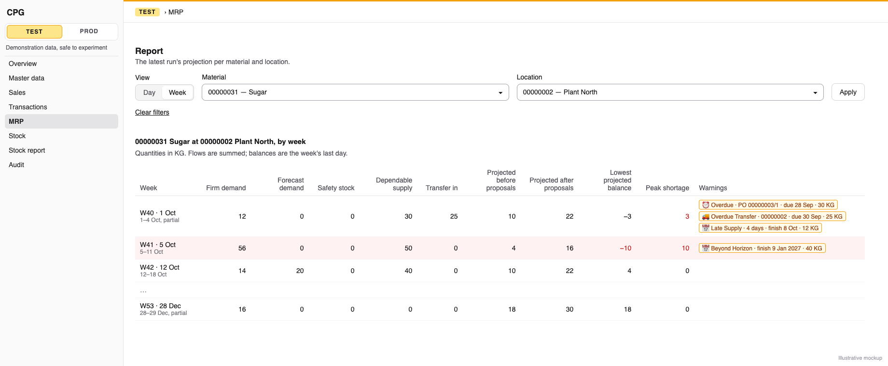
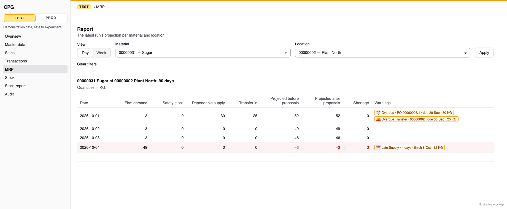

# MRP report weeks and marks: a Day/Week switch that sums flows but keeps balances, and a warning on every overdue, late or beyond-horizon date

**Status:** ready
**Created:** 2026-11-01 11:05 UTC
**Issue:** #285 (E18-S02, epic #270) · **Depends on:** the MRP report (`implemented/2026-10-31--0907UTC-mrp-report.md`, #284), purchasing supply (`implemented/2026-10-31--0905UTC-mrp-purchasing-supply.md`, #276), production and transfer supply (`implemented/2026-10-31--0908UTC-mrp-production-and-transfer-supply.md`, #277), proposal timing (`implemented/2026-11-01--0738UTC-mrp-proposal-timing-demand-priority.md`, #279), planning exceptions (`implemented/2026-11-01--0737UTC-mrp-planning-exceptions.md`, #280), all merged · **Design authority:** `.ai/specs/product-brief.md` (R03, R07, R10, D03, N04), `research/CPG-prd001.pdf` §04 "Overdue and late starts", "Transfers", §07 "UI and preferences", "Last MRP report", `research/CPG-prd-datamodel.pdf` ("MRP daily result", "MRP recommendation / exception"), `research/CPG-acceptance.md` UX-018, UX-019, UX-027, MRP-006, MRP-015, MRP-016, MRP-037, MRP-040, MRP-049, BUY-019, TRF-016

## 📝 TLDR

Since #284 the MRP page shows one pair's 90 days as 90 rows, and the overdue supply MRP moved to today carries no visible mark: the engine flags it, but the run never stores the flag. This spec proposes two things. First, a **Day / Week** switch: the week view folds the stored daily rows for display, summing flows and taking the week-end balance, the week's lowest balance and its peak shortage, and never summing balances. The page and `GET …/mrp/runs/latest?bucket=week` both use it. Second, **marks**: overdue purchasing and production supply, overdue transfer arrivals, Late Supply and Beyond Horizon proposals each get a warning badge on the day or week they fall in. To store the overdue ones, each run records them as two warning codes, `OVERDUE_SUPPLY` and `OVERDUE_TRANSFER`, in the exception table #280 built. No migration is needed. The read keeps them out of the API's `exceptions` list and returns them only as `marks`.

## 📝 Problem Statement

- **Ninety rows are hard to scan.** PRD §07 asks for a "weekly display (sum flows, week-end stock and minimum/peak deficit; never sum stock balances)". The data model says the same of "MRP daily result". UX-027 sets the rule: flows summed, the projected balance the last day's, the minimum and peak from the weakest day. MRP-006 and UX-019 ask that the switch change the presentation only.
- **Overdue supply is invisible.** PRD §04: "Production/PO output overdue is expected today with warning", and an "overdue in-transit receipt expected today in projection with Overdue Transfer warning". Since #276 and #277 the engine places such supply on today with `overdue: true` and its original date. Both specs left storing and showing the flag to this story (#276 Q3: "E18-S02 … then adds whatever storage it needs"; #277 Q5). Today the run stores only the bucket figures, so MRP-015, MRP-016, MRP-040, BUY-019 and TRF-016 lack their warnings.
- **Late and beyond-horizon proposals show as plain text.** Since #287 the one-pair Proposals table notes a late proposal's planned finish in muted text, a hint that needs no warning token. UX-018 asks for warnings visible "in material/location filter context", and the issue asks for them on the day or week each date falls in.

## Resolved assumptions (autonomous defaults)

These answer the issue's open questions and the choices its notes leave to the spec, with the most reversible option. Each is open to override before merge.

| # | Question | Applied default | Why |
|---|---|---|---|
| Q1 | Where does the run store the overdue flags? The issue says "this story adds no migration" and that the producing story adds any missing field. #276 and #277 have merged and left the storage to this story. | As **warnings** in `mrp_run_exception`: one row per overdue item with code `OVERDUE_SUPPLY` or `OVERDUE_TRANSFER`, written after the run's exceptions. The engine derives them from the `overdue` flags it already sets, into a new `MrpResult.warnings` list kept apart from `exceptions`. The read keeps the two codes **out of the API's `exceptions`** and returns them only as `marks`. No migration. | The data model's "MRP recommendation / exception" entity lists "overdue/late/beyond-horizon dates". #280 made `exceptionCode` a plain string so that "a code a later story adds needs no table rebuild" (its Q6), and #276 Q2 named this seam. A warning is not an exception, though: §4 promises "a plan with any exception but `INSUFFICIENT_TRANSFER_STOCK` has `proposals: []`", and a transfer's exception sits at its source. Keeping the codes out of `exceptions` keeps both promises, and keeps #286's exception list to planning blockers. |
| Q2 | Which overdue items are marked? The issue says "every overdue … date". | **Supply only.** Overdue Supply covers an Open purchase-order line, an Open requisition and an open production order's output. Overdue Transfer covers a transfer's arrival at its destination, in transit or planned. Overdue demand (customer-order lines, component needs, transfer dispatches) gets no mark in this story. | PRD §04 and UX-018 name overdue PO, production output and transfer arrival. #276 Q1 flags an overdue requisition the same way and left "how each flag is shown" to this story. Overdue demand already counts today by design (SAL-017, MRP-022). Its mark has no catalogue row, and adding one later is one more warning code. This narrows the issue's wording, so the defaults comment names it for the owner. |
| Q3 | Partial weeks | The first and last weeks are **cut to the horizon** and marked partial ("1–4 Oct, partial"). Their balances are those of their last horizon day, 29 December for the last week. Days outside the run are never padded in. | The run has no figures outside its 90 days. Inventing them would show a balance MRP never computed. |
| Q4 | The safety target in a week | The **week-end** value, like the balances. It is a level, not a flow (`MrpBucket.safetyTarget`). | Summing a level over seven days is the same mistake as summing balances. |
| Q5 | Is the lowest balance taken before or after proposals? | **Before proposals**, `projectedBefore`, like the pair list's lowest balance (#284 Q7). The peak shortage is the largest daily `shortage`, which is measured on `projectedBefore` too. | The shortage the report already shows is defined on `projectedBefore` (`project-buckets.ts`), so the week's two weakest-day figures agree with each other and with the day view. An after-proposals minimum can be added later as one more field. |
| Q6 | The API's week shape | `bucket=day\|week` (default `day`) on `GET …/mrp/runs/latest`. Every plan keeps its 90 daily `buckets` unchanged and gains `marks`. With `bucket=week`, each plan also gains `weeks`. The response echoes `bucket`. | Additive: `bucket` used to be 400 (an unknown key), and `buckets` keeps its meaning whatever the parameter, so no client is surprised and MRP-006's "daily rows identical" holds by construction. |
| Q7 | Which day does a Late Supply or Beyond Horizon mark fall on? | The proposal's **need date**, the day it was meant to cover, which never moves (MRP-037). The mark names the planned finish and the days late. The Proposals table keeps listing every proposal, Beyond Horizon ones included, apart from the day rows. Its timing note becomes the same warning badge. No second table. | A need date is always inside the horizon, so every proposal's mark has a day. The finish of a Beyond Horizon proposal has none (MRP-049). The Proposals table already lists proposals apart from the buckets (#287), which is what PRD §04 asks ("visible separately with Beyond Horizon dates"). A second table of the same rows would split one list. |
| Q8 | Which day does an overdue mark fall on? | The run's first day, where the supply counts. The mark names the document, its own date and the quantity. | PRD §04: "expected today, with original date kept". |
| Q9 | What does the switch change? | Only the one-pair table: day rows or week rows. The pair list is the same in both views. The switch sits in the report's GET filter form, in `MaterialLocationFilters`' extra-controls slot (as the stock report's zero checkbox), with a hint that it groups one pair's days. The pair list's Days links and its page links keep the chosen view. | The fold is per pair. The pair list's columns (lowest balance, first shortage) are already horizon-wide. |
| Q10 | Week labels | The demand review's notation, in new `mrp.report` keys: "W41 · 5 Oct" in English and "T41 · 5 paź" in Polish, ISO weeks through `isoWeek`, so MRP weeks match the demand review's weeks. The date is the week's first day in the horizon, so the first week of a run starting on Thursday 1 October is "W40 · 1 Oct", with "1–4 Oct, partial" under it. | One week notation across reports (D03). A title date outside the run would name a day the run has no figures for. |
| Q11 | Split the story? | No. | The switch and the marks are one display of the same stored run, and both reach the API through the same read. |

## 📝 Proposed Solution

1. **The engine stores its overdue flags.** `planMrp` returns a new `warnings` list, one warning per overdue supply item it already projects:
   - `OVERDUE_SUPPLY` for `plan.supply` items (`purchase-order` and `requisition`) and for `plan.productionOutput` items with `overdue: true`;
   - `OVERDUE_TRANSFER` for `plan.transfersIn` items with `overdue: true`.

   Each is stored in `mrp_run_exception` at its pair (the destination for a transfer), after the run's exceptions, dated with the bucket it counts in (the run's first day). Its details hold the document kind, document ID, line position for a purchase-order line, its own planned date and its quantity. The figures, proposals and exceptions don't change: a run on the same data stores the same rows as before, plus these.
2. **A pure weekly fold.** `foldWeeks(buckets, marks)` in `core/src/domain/mrp/report/weekly.ts` takes a plan's daily rows and returns its week rows: flows summed, levels from the last day, the lowest `projectedBefore` and the largest `shortage`. It works on exact `bigint` micro-units through `parseSignedQuantity` and `formatSignedQuantity` (R03).
3. **Marks, derived on read.** `planMarks(proposals, warnings)` in `core/src/domain/mrp/report/plan-marks.ts` turns a plan's stored proposals and overdue warnings into one list of marks, each with the day it falls on. `foldWeeks` gives each week the marks of its days.
4. **One read for both channels.** `MrpRunService.latest` accepts `bucket`, attaches `marks` to every plan, and with `bucket=week` adds `weeks`. The page reads it with the page's own query, so screen and API show the same figures and marks (R07).

**Alternatives considered.**
- *A new `mrp_overdue_supply` table.* It needs a migration, a cascade and a third per-page read. The exception table already has the pair, a date and string details, and the data model puts overdue dates on that entity (Q1).
- *Listing the warnings in `exceptions`.* It breaks §4's "any exception but `INSUFFICIENT_TRANSFER_STOCK` means no proposals" and its "a transfer's exception sits at its source", and hands #286 two kinds it doesn't plan for (Q1).
- *Deriving overdue marks on read from today's documents.* That would show what is overdue now, not what this run planned with (R10: the report shows the stored run). It also breaks when a document is received after the run.
- *Folding weeks in the browser.* It would leave the API without weeks (R07), and the six-decimal arithmetic would have to be exact in client code too.
- *Replacing `buckets` with `weeks` when `bucket=week`.* A smaller payload, but `buckets` would then change meaning with a parameter. The read is bounded by the page anyway (25 pairs × 90 days).

## 📝 Architecture

```
core/src/domain/mrp/mrp-result.ts                  + MrpWarning (MrpOverdueSupply | MrpOverdueTransfer), MrpResult.warnings (changed)
core/src/domain/mrp/warnings/overdue.ts            overdueWarnings(plan), compareWarnings, toStoredWarning, codes      (new)
core/src/domain/mrp/plan-mrp.ts                    warnings for every readable plan                                  (changed)
core/src/services/mrp/mrp-run.service.ts           run(): stores warnings after exceptions                           (changed)
core/src/domain/mrp/report/weekly.ts               foldWeeks(buckets, marks): week rows                              (new)
core/src/domain/mrp/report/plan-marks.ts           planMarks(proposals, warnings): marks by day                      (new)
core/src/validators/mrp/mrp-latest.schema.ts       + bucket on both schemas                                          (changed)
core/src/services/mrp/mrp-run-view.ts              + MrpMarkView, MrpWeekView, MrpPlanView.marks/weeks, bucket       (changed)
core/src/services/mrp/mrp-run.service.ts           latest(): warnings out of exceptions; marks; weeks for week        (changed)
app/src/components/mrp/mrp-report.tsx              switch, week table, marks column                                  (changed)
app/src/components/mrp/mrp-marks.tsx               <MrpMarks>: one StatusBadge per mark                              (new)
app/src/components/mrp/mrp-proposals.tsx           timing note → the same badge                                      (changed)
app/src/help/topics.ts, i18n/messages/{en,pl}.ts   weeks and marks, EN and PL                                        (changed)
```

```mermaid
flowchart LR
  S[planMrp: supply / output / transfersIn overdue flags, existing] --> X[overdueWarnings, new]
  X --> E[(mrp_run_exception, existing table)]
  R[(mrp_recommendation, existing)] --> M[planMarks, new]
  E --> M
  D[(mrp_daily_result, existing)] --> W[foldWeeks, new]
  M --> W
  M --> L[MrpRunService.latest ?bucket=day|week]
  W --> L
  L --> P[MRP page: Day/Week switch, marks]
  L --> A[GET …/mrp/runs/latest]
```

Everything is stored by the run. Everything new on the read side is pure and computed per page, so nothing the report shows is written by reading it (MRP-006, R10). No entity, migration, event or container binding changes.

### The overdue warnings

```ts
interface MrpOverdueSupply {
  code: "OVERDUE_SUPPLY";
  material: string; location: string;
  date: string;              // the bucket it counts in: the run's first day
  source: "purchase-order" | "requisition" | "production-order";
  document: string;          // the PO, requisition or production order ID
  position?: number;         // the purchase-order line
  plannedDate: string;       // the document's own date: planned, required or planned finish
  quantity: bigint;
}
interface MrpOverdueTransfer {
  code: "OVERDUE_TRANSFER";
  material: string; location: string;  // the destination
  date: string;
  transfer: string;
  stage: "in-transit" | "planned";
  plannedDate: string;       // its planned arrival
  quantity: bigint;
}
```

`type MrpWarning = MrpOverdueSupply | MrpOverdueTransfer` lives apart from `MrpException`, whose definition ("what the plan can't do, or can't plan without guessing") stays true. `MrpResult.warnings` is sorted by `compareWarnings`, a total order: material, location, `OVERDUE_SUPPLY` before `OVERDUE_TRANSFER`, `plannedDate`, then `source` or `stage`, document or transfer ID, and position (none first). So two runs on the same data store the same rows in the same positions (#280's criterion), even when one transfer gives two overdue receipts at one destination (in transit and planned) or a requisition and a production order share an ID.

The run writes them into `mrp_run_exception` after its exceptions, continuing their positions, with `source`, `document` (or `transfer`), `position`, `stage`, `plannedDate` and `quantity` (six-decimal text) in `details`. A material with an unreadable row gets no warnings, as it gets no Insufficient Transfer Stock (#316): a planned transfer's counted quantity comes from the incomplete balances. The entity's doc comment names the warning codes. The table and its unique index are unchanged.

The codes and their fixed English messages live in `warnings/overdue.ts`. They aren't in `MRP_EXCEPTION_CODES`, since they are never listed as exceptions:
- `OVERDUE_SUPPLY`: "This supply was due before the run's first day and hasn't arrived, so MRP expects it on the first day."
- `OVERDUE_TRANSFER`: "This transfer was due to arrive before the run's first day, so MRP expects it at the destination on the first day."

### The weekly fold

`foldWeeks(buckets: MrpBucketView[], marks: MrpMarkView[]): MrpWeekView[]` groups the days by `bucketStart("week", date)`, in date order, and for each group returns:

| Field | Rule |
|---|---|
| `start`, `end` | the first and last horizon day in the week |
| `year`, `week` | `isoWeek(start)` |
| `partial` | fewer than seven days |
| `firmDemand`, `forecastDemand`, `dependentDemand`, `transferOut`, `tentativeSupply`, `dependableSupply`, `atRiskSupply`, `transferIn`, `proposedReceipts` | sums |
| `safetyTarget`, `projectedBefore`, `projectedAfter` | the last day's |
| `lowestProjectedBefore` | the smallest `projectedBefore` of its days |
| `peakShortage` | the largest `shortage` of its days |
| `marks` | the marks whose `date` is in `[start, end]`, in plan order |

A week has no `shortage` field: a sum of daily shortages is the "seven duplicate snapshots of a persistent shortage" PRD §07 forbids. The fold reads the stored texts and returns six-decimal texts. A text that doesn't parse can't occur, because the run wrote it through `formatSignedQuantity`, so the fold throws rather than guessing.

UX-027, as a unit test: a run on Thursday 1 October 2026, a balance of 10 at the end of 4 October, firm demand of 8 on each day from Monday 5 to Sunday 11 October, and dependable receipts of 20 on the 7th and 30 on the 10th. The days show 2, −6, 6, −2, −10, 12 and 4. W41 then shows demand 56, receipts 50, projected 4, lowest −10 and peak shortage 10. Neither 6 (the sum of the balances) nor 18 (the sum of the shortages) appears in the result.

### Marks

`exceptionsOf` reads the page's rows as today and splits them by code: the two warning codes feed `planMarks`, every other code stays in `exceptions` as before.

```ts
type MrpMarkView =
  | { kind: "overdue-supply"; date: string; source: "purchase-order" | "requisition" | "production-order"; document: string; position: number | null; plannedDate: string; quantity: string }
  | { kind: "overdue-transfer"; date: string; transfer: string; stage: "in-transit" | "planned"; plannedDate: string; quantity: string }
  | { kind: "late-supply" | "beyond-horizon"; date: string; proposal: string; plannedFinish: string; lateDays: number; quantity: string };
```

`planMarks` reads the pair's stored warnings and every proposal with `lateDays > 0`. A Beyond Horizon proposal is `beyond-horizon` (it is late too, but its finish falls on no day), and any other late proposal is `late-supply`. Marks are ordered by date, then overdue supply, overdue transfer, late supply, beyond horizon, then the stored order. A warning row whose stored details can't be read (a newer image's shape) is skipped.

### The read and the page

- `mrpLatestQuerySchema` and `mrpReportPageQuerySchema` gain `bucket: z.enum(["day", "week"]).default("day")`. The page's strict query takes it too, so `/admin/{tenant}/mrp?bucket=week` is a valid URL, and another value is the not-found state.
- `latest` computes `marks` for every plan from the proposals and warnings it already reads, and `weeks` when `bucket` is `week`. No new query. The fold is linear in the page's 2,250 rows; `mrp-report-reads.test.ts` adds the week read to its budget table, at the same 250 ms bound.
- `MrpPlanView` gains `marks`, then `weeks`, after `exceptions`.
- The response gains `bucket`. Paging, `total`, `run`/`generation` and every refusal are unchanged.

## 📝 API Contracts

`GET /api/tenants/{tenant}/mrp/runs/latest?bucket=day|week&material&location&page&run&generation`. Additive over #284 and #287:

- `bucket`: optional, default `day`. Another value is 400 `VALIDATION_FAILED`.
- The response gains `bucket`.
- Every plan gains `marks: MrpMarkView[]`. With `bucket=week`, every plan also gains `weeks: MrpWeekView[]`: 14 weeks for a horizon that starts on a Thursday, whose first and last are partial.
- `exceptions` is unchanged: the two warning codes never appear in it, so a plan with only warnings keeps its proposals.
- `buckets` are unchanged whatever `bucket` is.

Any signed-in account may call it, on a read-only tenant too. The read writes nothing. `BACKWARD_COMPATIBILITY.md` §4 records the parameter, the three fields, the mark kinds, and the page URL's `bucket`.

## 📝 UI/UX

The MRP page's Report section, as #284 built it, with three changes.

- **The switch.** The filter form gains a **View** `SegmentedControl` (`name="bucket"`, Day / Week), passed to `MaterialLocationFilters` in its extra-controls slot, as the stock report passes its zero checkbox. Its hint says it groups one pair's days. It works without JavaScript: Apply submits it. Week shows Clear filters, which returns to Day, but the empty-list text still depends on material and location only. The pair list's Days links and page links keep `bucket`.
- **The one-pair table.** In Day view it is #284's day table plus a last column, **Warnings**. In Week view it has one row per week:
  - **Week**: "W41 · 5 Oct", with the date range under it, and "partial" when it has fewer than seven days;
  - the day table's flow columns, summed;
  - **Safety stock**, **Projected before proposals** and **Projected after proposals**, at week end;
  - **Lowest projected balance** and **Peak shortage**;
  - **Warnings**.

  The caption says "{material} at {location}, by week — quantities in {BUoM}; flows are summed, balances are the week's last day". A week with a peak shortage gets the danger row tone, as a short day does. Negative balances are danger-toned.
- **Marks.** `MrpMarks` renders each mark as a `StatusBadge` with the `warning` tone, an icon and a text, never colour alone (design system v1, `tests/design-tokens.test.ts`):
  - **Overdue**, `ClockAlert`: "Overdue · PO 00000003/1 · due 28 Sep · 30 KG", and likewise for a requisition or a production order;
  - **Overdue Transfer**, `Truck`: "Overdue Transfer · 00000002 · due 30 Sep · 25 KG";
  - **Late Supply**, `CalendarClock`: "Late Supply · 4 days · finish 8 Oct · 12 KG";
  - **Beyond Horizon**, `CalendarX`: "Beyond Horizon · finish 9 Jan 2027 · 40 KG".

  Badges stack in the Warnings cell (`flex flex-col items-start`, `whitespace-normal`). Dates use the locale's short format, and quantities `localeQuantity`. The Proposals table's late and Beyond Horizon notes under the need date become the same badge.
- **Help.** The `mrp` help topic gains two paragraphs per language: how weeks fold flows and balances, with the UX-027 example, and what each warning means. Its API paragraph names `bucket=week`, `weeks` and `marks`. Copy is EN and PL, and the glossary guards apply (BOM, never recipe).

Prototype: `.ai/specs/assets/mrp-report-weeks/mockup-01-week-view.png` (one pair, Week view, with marks) and `.ai/specs/assets/mrp-report-weeks/mockup-02-day-marks.png` (Day view, the first days with Overdue, Overdue Transfer and Late Supply marks). Both are rendered from the static HTML beside them. Today's one-pair view is #287's `mockup-01-mrp-proposals.png`.





## 📝 Edge Cases & Failure Scenarios

- **A run before this release.** Its stored rows have no warnings, so it shows no overdue marks until the next run. Late and Beyond Horizon marks show at once, since they come from the stored proposals. Only the latest run is kept, so this lasts until the next run.
- **A rollback to the previous image.** Until its next run, it lists the stored warning rows as exceptions with the fallback message (#280 Q7), on plans that may also have proposals. It refuses `bucket` as an unknown parameter (400), and the page's `?bucket=week` becomes its not-found state. Its next run replaces the rows.
- **A year boundary.** W53 of 2026 (28 Dec 2026 – 3 Jan 2027) is the last week of a run starting 1 October 2026, cut to 28–29 December. A run starting in late 2026 continues into W1 of 2027. ISO weeks come from `isoWeek`, which a unit test pins across that boundary.
- **A horizon starting on a Monday.** The first week is complete and the 13th is partial: 90 = 12 × 7 + 6.
- **Several marks on one day.** They stack in the cell, in the order above. A week holds every mark of its days.
- **An overdue transfer whose source can't supply it.** A planned transfer arrival of only the feasible part is marked with the quantity counted, beside the existing Insufficient Transfer Stock exception at the source.
- **A read-only tenant.** It sees the switch and the marks. Both are reads.

## 📝 Risks & Impact Review

- **Contract.** Additive: one accepted parameter that used to be 400, and three response fields. `exceptions` keeps its codes and its promises. The page URL accepts one more parameter.
- **Rows per run.** One warning row per overdue supply item, bounded by the tenant's open documents with a past date. Writing them is part of the run's existing chunked write.
- **Exception order.** Warnings get positions after every exception, so every existing exception keeps its position.
- **Rollback.** Nothing is migrated. An older image shows the warning rows as fallback exceptions until its next run (above).
- **Protected surfaces.** The parameter, the fields, the codes and their messages, and the help topic: all are recorded in §4.

## 📝 Decisions in play

R03 (exact sums in `bigint`), R07 (the week view and marks through the bearer API), R10 (the switch reads and never writes; the run stores only its own rows), D03 (EN/PL copy and help grow with the screen), N04 (calendar weeks; no working-day calendar). None is superseded.

## 📋 Phasing

One phase, one PR: the engine's overdue warnings, the fold and marks, the read and API parameter, the screen, help and tests. Each step below leaves the application working.

## 📋 Implementation Plan

1. **Overdue warnings.** Add `MrpWarning` and `MrpResult.warnings` to `mrp-result.ts`, and `warnings/overdue.ts` (`overdueWarnings`, `compareWarnings`, `toStoredWarning`, the codes and messages). Call it in `planMrp` for readable materials, and store the warnings in `MrpRunService.run` after the exceptions. Unit tests:
   - MRP-015 / BUY-019 (a purchase-order line, its position kept), a requisition, MRP-016 (production output), and MRP-040 / TRF-016 (in transit), each giving one warning with its original date and quantity;
   - a planned transfer with both dates passed is warned at the destination only, nothing is warned for an item due today, and a material with an unreadable row gets none;
   - the stored row and its position after the exceptions;
   - order across two runs fed in different snapshot orders, including one transfer in transit and planned, and a requisition and production order with the same ID;
   - the existing figure, proposal and exception assertions unchanged. `plan-mrp.test.ts`'s overdue in-transit case keeps `exceptions: []` and gains its warning.
2. **Fold and marks.** Add `report/plan-marks.ts` and `report/weekly.ts`. Unit tests:
   - UX-027's numbers, asserting the two forbidden sums appear in no field;
   - the partial first week (Thu 1 – Sun 4 Oct) and last week (Mon 28 – Tue 29 Dec, W53);
   - a run starting on 28 December 2026 crossing into W1 of 2027;
   - a fractional negative balance (lesson 2026-11-01, "`formatDecimal` takes values of zero or more only");
   - the safety target taken at week end;
   - mark kinds, their order and the week each falls in, and an unreadable overdue row skipped.
3. **The read.** Extend both schemas, `MrpPlanView`, `MrpLatestView` and `latest`. Tests on a real SQLite file: `bucket` default and refusal; the plan's key list (`mrp-run.service.test.ts` pins it) with `marks` and `weeks` after `exceptions`; warning rows never in `exceptions`, and a pair with only warnings keeping its proposals; marks present in both views; weeks only with `week`; daily `buckets` identical between `day` and `week` reads, with the run's ID and time unchanged and nothing written (MRP-006: count rows and the audit before and after); the issue's UX-018 example (a purchase-order line planned 28 September, 25 in transit due 30 September, a need 3 days ahead with a 7-day lead time) giving Overdue and Overdue Transfer on 1 October with their dates and Late Supply 4 days on the need date; a Beyond Horizon proposal (lead time 100, need 15 October, finish 9 January 2027) marked and adding no receipt to any day. Add the week read to `mrp-report-reads.test.ts`'s budget table.
4. **API.** The route code is unchanged. Extend its route test with `bucket` passed through, and keep `tests/api-messages-glossary.test.ts` green with the two new messages.
5. **Screen.** `MrpMarks`, the switch, the week table, the Warnings column and the Proposals badge, with EN/PL messages and the help topic. Component and page tests: both views, the partial labels, each mark's text and icon, the switch's default and kept value in the Days and page links, the empty-list text unchanged by Week alone, `?bucket=week` accepted and `?bucket=month` not found, and the labels passed to client components being plain data (lesson 2026-10-24).
6. **Integration tests.** Each test creates its own records through the API before running MRP (lesson 2026-10-25, "An integration test sets up what it reads"):
   - `tests/integration/mrp-report.test.ts`: switch to Week and back, and the week rows show the summed demand and week-end balance. With the filter applied, the Overdue mark of the file's own overdue purchase-order line shows on the first day and in the first week. The page holds at 1280 px and 390 px. Put the new data in cells after the columns existing tests read (lesson 2026-11-01, "Two features merged together need a check at their seam").
   - `tests/integration/mrp-report-api.test.ts`: the admin's and a normal user's `bucket=week` reads are identical. The daily `buckets` before and after a weekly read are identical. The overdue line's mark is present and `exceptions` doesn't list it.
7. **Docs and close-out.** `BACKWARD_COMPATIBILITY.md` §4 records the parameter, fields, codes and messages. The engineering standards' MRP bullets name `report/weekly.ts` and `plan-marks.ts`. In the acceptance catalogue, move only rows whose every Then is asserted (lesson 2026-10-21). UX-019, UX-027 and MRP-006 are expected to move to Passed. MRP-015, BUY-019, MRP-016, MRP-040, TRF-016 and UX-018 should move as far as their tests reach. Move this spec to `implemented/` with implementation notes.

Run `npm run lint`, `npm run typecheck`, `npm run test:coverage` (100%) and `npm run build`, then the two integration files.
