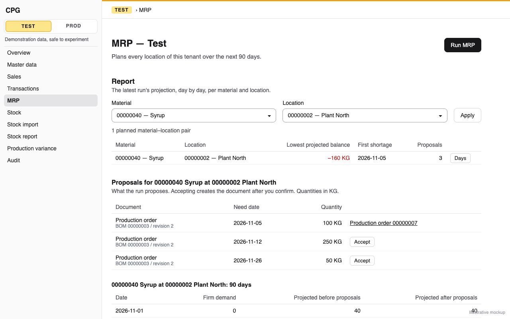
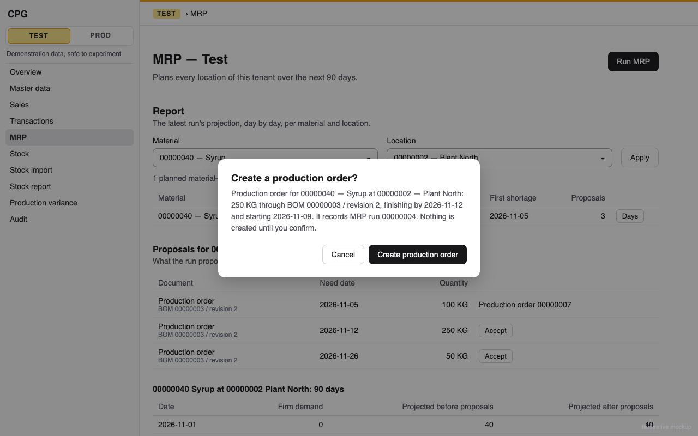

# MRP Make acceptance: a feasible Make proposal becomes an Open production order pinned to its BOM revision and tagged with the run, by Accept or by an automatic run

**Status:** ready
**Created:** 2026-11-02 13:04 UTC
**Issue:** #320 (E19-S01, Make half; epic #271) · **Depends on:** proposal acceptance (`implemented/2026-11-01--0737UTC-mrp-proposal-acceptance.md`, #287), BOM choice (`implemented/2026-11-01--1918UTC-mrp-bom-choice.md`, #282), at-risk and provisional plans (`implemented/2026-11-01--2049UTC-mrp-at-risk-and-provisional-plans.md`, #283), automatic mode (`implemented/2026-11-02--1031UTC-mrp-automatic-mode.md`, #289), production orders (`implemented/2026-10-20--0757UTC-boms.md` and the production-order services), all merged · **Related:** #322 (open: the date of a document accepted from a Late Supply proposal) · **Design authority:** `.ai/specs/product-brief.md` (R03, R05, R07, R08, R10, N06), `research/CPG-prd001.pdf` §04 "Manual/auto creation", "Stale and concurrent", "BOM choice and explanation", `research/CPG-acceptance.md` RUN-006, RUN-007, RUN-014, RUN-015, RUN-017

## 📝 TLDR

Since #287 a planner can accept a Buy proposal, and since #289 an automatic run creates every Buy proposal, but a Make proposal is listed with "Production orders can't be accepted yet", and the API refuses it as `MRP_PROPOSAL_NOT_EXECUTABLE`. After this change a Make proposal of the latest run that carries the BOM MRP chose gets the same Accept flow. After a confirmation that names the BOM and revision, it creates one Open production order: the proposal's lot-rounded quantity, pinned to that BOM revision, finishing on the proposal's need date and starting the location's lead time before it, tagged with the run. No stock moves. The stale check also compares the BOM and revision, so a revision changed since the run is refused as `MRP_PROPOSAL_STALE`. Automatic runs then create production orders as well, with no change to the batch itself.

## 📝 Problem Statement

PRD §04 "Manual/auto creation" makes one-click creation the default for both kinds: "a Buy proposal creates a purchase requisition and a feasible Make proposal a production order, each tagged with the run". #287 shipped the shared rules (confirmation, freshness, double accept, tenant, read-only, idempotency, audit) for Buy only (its Q1). Make waited for #282 to choose and store the BOM, and for #283 to take infeasible Make out of the proposals. Both have merged:

- every stored `production-order` recommendation carries `bom` and `bomRevision` (MRP-031), the highest-priority usable BOM whose components can be supplied on the planned start (`chooseBom`);
- a Make need no BOM can supply is a **provisional action**, stored apart, with no ID, never a proposal (#283). So every listed Make proposal is feasible, and an all-infeasible one has nothing to accept.

Today RUN-006 can't execute. The automatic halves of RUN-007 and RUN-014, and RUN-015's "BOM component deactivated" case, wait on this story (the comment #289 left on #320). Planners retype every production order MRP proposes, which is where a typo in quantity, BOM or date gets in.

## Resolved assumptions (autonomous defaults)

The issue's scope, plus the gaps between it and the shipped code, each answered with the most reversible choice. The schema change is one nullable text column added with `alter table … add column`. The contract changes are additive: `mrpRun` on production-order reads, `executable: true` for Make proposals that carry a BOM, a production order in the accept answer's `document`, and production orders in an automatic run's `documents`.

| # | Question | Applied default | Why |
|---|---|---|---|
| Q1 | Which date does the production order take as its planned finish? | The proposal's **need date**, as the requisition's required date does today. Its planned start is that date less the location's lead time, through `ProductionOrderService`'s own `plannedStart`. On a Late Supply proposal the start falls before today, and the next run marks the order's start as overdue. | The issue says "its planned finish is the proposal's date", and #319 keeps the need date for requisitions for a reason that applies equally here. #279 sizes from the need date and counts existing supply on its own date, so an order finishing on the late planned finish would leave the need date short. The next plan would propose that shortage again and make the pair's later proposals stale (#287 Q2). #322 is the owner's open decision for both kinds. Whatever it decides changes this one line and its requisition twin. |
| Q2 | How does `isExecutableProposal` admit Make? | It takes the proposal, `isExecutableProposal({ kind, bom })`: a `purchase-requisition` always, a `production-order` only with a `bom`. `EXECUTABLE_PROPOSAL_KINDS` becomes both kinds. A Make row without a BOM can only come from an image older than E17-S01, and stays not executable, so the API still answers `MRP_PROPOSAL_NOT_EXECUTABLE` for it. | The issue's scope line. One predicate keeps the read, Accept and the batch in agreement, as #287 and #289 built it. A row with no BOM has nothing to pin, and planning again would refuse it as stale anyway, since the current engine always chooses one. |
| Q3 | How narrow is "stale" for Make? | #287's rule plus three fields. The fresh plan's proposal for the same material, location and need date must also have the same `bom` and `bomRevision`, and for a production order the same `leadTimeDays`. A new current revision of the chosen BOM, a switch to another BOM, a kind change (Make → Buy) or a changed lead time refuses the proposal as `MRP_PROPOSAL_STALE` before anything is written. For a requisition the recipe is null on both sides and the lead time isn't compared, so Buy is unchanged. | The issue's RUN-017 line. The comparison costs nothing: the fresh plan already carries the recipe and the lead time. The lead time matters for Make only. The order takes its start, and its components' demand dates, from the current planning parameters (`resolveProductionOptions`). The existing `plannedFinish` comparison doesn't see a lead-time change on an on-time proposal, whose finish is its need date whatever the lead time (`scheduleProposal`). So the start the dialog showed and the order's start could differ. A requisition takes no start. A BOM edit that leaves the choice and the revision as they were isn't a reason to refuse. |
| Q4 | Which `ProductionOrderService` entry does MRP use? | A new `createFromMrp(input, actor, { mrpRun })`, sharing `createWith` (and so `insertOrder`'s checks, the ID sequence, the race refusal and the audit entry) with `create`. `createWith` and `insertOrder` gain an `origin` argument, as `insertRequisition` takes one. It always passes an explicit `bom` and `revision`, and returns `ProductionOrderView` instead of `create`'s detail. `create(input, actor)` keeps its signature. | The accept answer and the batch need the order, not its components and shortages, which `detail` reads in two more queries per document (lesson 2026-10-22: per-call cost dominates a batch). The explicit pin is what makes `insertOrder` refuse a changed revision (`PRODUCTION_BOM_CHANGED`) instead of picking another BOM silently. The issue asks for "an optional run reference" on create, and this is that argument on the path MRP calls. |
| Q5 | How does a production order record its run? | A nullable `mrp_run` text column on `production_order` (`ProductionOrder.mrpRun`), holding the run's eight-digit ID, not a foreign key. `ProductionOrderView.mrpRun: string \| null` (`?? null`). `productionSnapshot` adds `mrpRun` only when it is set, so the audit entries of manually created orders keep their shape. `AUDIT_FIELDS` already has `mrpRun`. | The same choice and reasons as #287's Q5 for `purchase_requisition.mrp_run`: an additive `alter table`, no FK rebuild, and a Test reset deletes the orders together with the runs. E19-S02's netting (#288) reads the link the same way. |
| Q6 | Which refusals can a Make accept or batch candidate meet after the stale check? | The production-order service's own: `MATERIAL_INACTIVE`, `LOCATION_INACTIVE`, `PRODUCTION_REQUIRES_MAKE`, `PRODUCTION_NO_USABLE_BOM`, `PRODUCTION_BOM_CHANGED`, `VALIDATION_FAILED` (above the entry limit, a planned start before year 0000, a component requirement too large to store), `PRODUCTION_ORDER_IDS_EXHAUSTED`. In a batch every one fails the whole batch as an `AppError`. `PRODUCTION_ORDER_ID_RACE` propagates, as `REQUISITION_ID_RACE` does (#289 Q10). | Accepting validates as a manual order would (#287 Q11). Most of these can't follow a fresh plan, but `insertOrder` judges the BOM at the order's planned finish. On a Late Supply proposal that is the need date, while MRP judged it at the late planned finish (Q1). A revision valid on one of those days and not the other then gives `PRODUCTION_NO_USABLE_BOM` or `PRODUCTION_BOM_CHANGED`, so the screens translate both. |
| Q7 | Does accepting a Make proposal leave the run's other proposals acceptable? | Yes for the pair's later proposals, and for its components' proposals: the stale rule is unchanged, and a test proves both. An open order finishing on the need date gives the pair the receipt the proposal gave it (#287's Q2 argument). Its outstanding component requirements are dependent demand on its planned start, clamped to today, which is where the proposal's explosion put them. Another Make pair that shares a component may choose differently once the accepted order's needs count as committed rather than proposed. If the test shows that happens, it is pinned as a known limit and the planner runs MRP again, the same advice as any stale refusal. | Q2 of #287 is a promise the Buy half proved, and the Make half must not break it silently. The shared-component case depends on the order in which `chooseBom` tests feasibility, and planning again is the rule that settles it. Weakening the freshness rule to hide that would accept a proposal the current data no longer supports. |
| Q8 | What does the screen show for a Make proposal? | Accept, as for Buy. The confirmation names the document, the BOM and revision, the quantity, the planned finish and start, and the run. The accepted row links "Production order 00000007" to `/admin/{tenant}/production-orders?q=00000007`. A Make row without a BOM shows "This proposal can't be accepted. Run MRP again." The Production orders list shows "MRP run 00000004" under the order's ID, as the requisitions list does, and the order's detail adds an "MRP run" field. | The flow #287 built, with the BOM named because pinning is what this story adds. Under the ID, so no column of the production-orders table moves (lesson 2026-11-01: integration tests read cells by index). |
| Q9 | Does the automatic batch need any change? | Only what flows from Q2 and Q4: it reads candidates by `EXECUTABLE_PROPOSAL_KINDS`, now both kinds, and filters them through `isExecutableProposal` in code. `MrpProposalFields` gains `bom` and `bomRevision`. The cap (`MRP_BATCH_LIMIT`, 2,500) now counts Make candidates too. Its count runs before the filter, so a BOM-less row would count toward the cap without being created. That is accepted, since this image writes none. | #289's Q1 designed the batch so that this story adds Make with no change to it. Filtering the BOM-less rows in code avoids an `$or` that SQLite plans badly (lesson 2026-10-31), and in a run this image writes there are none. |
| Q10 | Budget? | Measured in `mrp-run-timing.test.ts`, fastest of three. A Make accept stays within #287's budgets, under 1 s on the realistic fixture and under 5 s at ten times. A batch of exactly the cap's candidates, the realistic Make share included, stays under #289's 15 s, with the longest event-loop stall under 250 ms. The benchmark currently deletes Make proposals before timing the batch (`delete from mrp_recommendation where kind = 'production-order' …`). It keeps them instead, and prints the Make and Buy counts beside the figures. | A production order costs more ORM calls than a requisition (`resolveProductionOptions` reads the planning parameters, the BOMs, their revisions and components, and balances). If the cap misses its budget, the fix is fewer ORM calls per order, a batched read of the run's BOM revisions (lesson 2026-10-22), never skipping a check. |
| Q11 | Integration tests? | Extend the existing files on their own masters: `mrp-accept-api.test.ts` (accept a Make proposal, a revision changed after the run → stale, a replay), `mrp-accept.test.ts` (the browser flow: the dialog names the BOM, confirm, the row links the order, the order's list shows the run), and `mrp-automatic-api.test.ts` (an automatic run creates the pair's production order tagged with the run). | Every user-visible flow gets a browser test. The image is the only proof that the migration, the route and the snapshot meet. Extending the files keeps the setup they already own. |

## 📝 Proposed Solution

```
db/entities/production-orders/production-order.entity.ts   + mrpRun (nullable text, 8)
db/migrations/                                              + Migration…_production_order_mrp_run (one add column)
core/domain/mrp/acceptance/executable-proposal.ts           isExecutableProposal({ kind, bom }); both kinds
core/services/production-orders/production-order.service.ts + createFromMrp(input, actor, { mrpRun })
core/services/production-orders/production-order-records.ts view + snapshot carry mrpRun
core/services/mrp/mrp-proposal-document.service.ts          + the production-order branch
core/services/mrp/mrp-acceptance.service.ts                 stale rule compares bom/bomRevision; answer's document is either kind
core/services/mrp/mrp-batch.service.ts                      reads bom/bomRevision; filters through the predicate; PRODUCTION_ORDER_ID_RACE propagates
core/services/mrp/mrp-run.service.ts                        latest(): executable from the predicate
app/components/mrp/mrp-proposals.tsx                        per-kind dialog, document link, not-executable text
app/components/production-orders/production-screen.tsx      "MRP run …" under the ID, and a detail field
app/i18n/messages/{en,pl}.ts, app/help/topics.ts            copy
```

**Alternatives considered.**
- *Let `ProductionOrderService` choose the BOM (`input.bom` omitted).* Rejected: it preselects by physical stock alone, which E17-S02 replaced. The order would then not be the one the planner confirmed (Q4).
- *A foreign key from `production_order` to `mrp_run`.* Rejected for #287's Q5 reasons (Q5).
- *Take the late planned finish as the order's date.* Deferred to #322 (Q1).
- *Map `PRODUCTION_BOM_CHANGED` to `MRP_PROPOSAL_STALE`.* Rejected: the stale check already compares the revision, so this code only follows from the date difference in Q6, and it names the real cause.

## 📝 Architecture

`MrpAcceptanceService.accept` keeps #287's steps 0–8. Two lines change:

- **Step 5, executable:** `isExecutableProposal(proposal)` on the stored `kind` and `bom`.
- **Step 6, fresh:** the fresh proposal must also match `bom` and `bomRevision`, and for a production order `leadTimeDays` (Q3).

Step 7 goes through `MrpProposalDocumentService.create(runCode, proposal, actor)`, which gains the production-order branch:

```ts
// production-order: pinned to the BOM MRP chose, finishing on the need date (Q1), tagged with the run (Q5)
const { baseUnit } = await findMaterial(this.em, material);
const input = parseInput(productionOrderCreateSchema, {
  output: material, location, quantity, unit: baseUnit, plannedFinish: needDate, bom, revision: bomRevision,
});
const document = await this.productionOrderService.createFromMrp(input, actor, { mrpRun: runCode });
```

The quantity is in the base unit, so the order stores it unconverted (factor 1/1, R03). `insertOrder` resolves the options through `resolveProductionOptions`. That refuses an inactive output or location, a material that isn't Make at the location, and a BOM that isn't the current, date-valid revision with active components on the planned finish. It takes the lead time from the planning parameters. The creation audit entry, `production-orders.production-order.created`, with `mrpRun` in its after snapshot, is written in the same transaction (R08). The mark (`acceptedDocument`) follows as today. `MrpProposalFields` gains `bom` and `bomRevision`, which the accept path and the batch read from the recommendation.

The accept answer's `document` becomes `RequisitionView | ProductionOrderView` (`MrpAcceptanceView`), told apart by `proposal.kind`, the shape #287's Q10 kept for this. The answer's `proposal` carries the stored `bom` and `bomRevision`, and `rejectedBoms: []`, since it stands alone. The latest-run read is where the rejections are explained.

`MrpBatchService.createAll` counts and reads `{ run, kind: { $in: EXECUTABLE_PROPOSAL_KINDS } }` and then filters through `isExecutableProposal` (Q9). The rest is unchanged: savepoint, chunked flushes, the first `AppError` fails the batch with its candidate. `PRODUCTION_ORDER_ID_RACE` joins `REQUISITION_ID_RACE` among the errors that propagate. The catch tests a set of the two race codes. The production code's message becomes an exported constant, as the requisition's is.

`mrpProposalDocumentService` gains `productionOrderService` among the dependencies it destructures. The container line and its cradle type are unchanged, since both are already registered.

## 📝 Data Model

```ts
// ProductionOrder (additive)
/** The MRP run whose proposal created it (E19-S01): its eight-digit ID, or null when entered by hand. */
mrpRun: p.string().length(8).nullable(),
```

One migration, `npm run db:migration:create -- production_order_mrp_run`, which must read `alter table \`production_order\` add column \`mrp_run\` text null;`, with the `drop column` in `down()`. `production_order` is referenced by `production_completion`: if the generator rebuilds the table, hand-write the two statements (lesson 2026-10-23) and assert that `orm.schema.getUpdateSchemaSQL()` doesn't mention it. Test the upgrade on a populated database, where an existing order reads `mrpRun: null` and its completions survive. Also test an old-style insert without the column after the migration (lesson 2026-10-21). Update the migration lists and counts (lesson 2026-10-23).

During a deploy the previous image ignores the column, and its orders leave it null. Rollback is the migration's `down()`: orders lose their run link, and nothing else changes.

## 📝 API Contracts

No new route. Additive:

- `GET …/mrp/runs/latest`: a `production-order` proposal with a `bom` reads `executable: true`.
- `POST …/mrp/runs/{run}/proposals/{proposal}/accept`: such a proposal answers `200 { proposal, document }`, with `document` the production order as `GET …/production-orders` lists it, `mrpRun` set. Its refusals add the production-order service's codes (Q6). `MRP_PROPOSAL_STALE` also covers a changed BOM or revision (Q3). `MRP_PROPOSAL_NOT_EXECUTABLE` remains only for a Make row without a BOM.
- `POST …/mrp/runs` with `{ "mode": "automatic" }`: `documents` lists production orders (`kind: "production-order"`) beside requisitions, and a failed batch's `creation.code` can be a production-order code.
- Every production-order read and write answer gains `mrpRun`.

`BACKWARD_COMPATIBILITY.md`: the additive fields, the widened accept and batch behaviour ("since E19-S01 Make, #320"), and the migration's rollback note. One behaviour change for existing clients is called out: an automatic run now also creates production orders. That is the behaviour #289 announced ("production orders join the batch when #320 makes Make proposals executable").

## 📝 UI/UX

Prototype: `assets/mrp-make-proposal-acceptance/mockup-01-make-proposals.png`, `assets/mrp-make-proposal-acceptance/mockup-02-accept-make-dialog.png`

- **Proposals table** (`mrp-proposals.tsx`, unchanged layout): a Make row with a BOM gets **Accept** (`data-mrp-accept`). Once accepted it links "Production order 00000007" to `/admin/{tenant}/production-orders?q=00000007` (`data-mrp-document`). The link's path follows the proposal's kind. A Make row without a BOM shows the muted "This proposal can't be accepted. Run MRP again." (`data-mrp-not-executable`).
- **Confirmation** (`ConfirmDialog`, not destructive), per kind:
  - **Title:** "Create a production order?"
  - **Description:** "Production order for 00000040 — Syrup at 00000002 — Plant North: 250 kg through BOM 00000003 / revision 2, finishing by 2026-11-12 and starting 2026-11-09. It records MRP run 00000004. Nothing is created until you confirm."
  - **Buttons:** "Create production order" (pending: "Creating…") and "Cancel".

  The Buy texts stay as they are. The start shown is the need date less the proposal's stored lead time. The stale rule refuses the accept when the current lead time differs (Q3), so it is the start the order takes (Q1).
- **Refusals in the dialog:** add `PRODUCTION_NO_USABLE_BOM`, `PRODUCTION_BOM_CHANGED`, `PRODUCTION_REQUIRES_MAKE` and `PRODUCTION_ORDER_ID_RACE` in EN and PL. The kind-specific texts `MATERIAL_INACTIVE`, `LOCATION_INACTIVE` and `VALIDATION_FAILED` ("…no requisition can be created…") become kind-neutral ("…no document can be created…"). The automatic card's `causes` gain the two BOM codes.
- **Production orders:** the list shows "MRP run 00000004" under the order's ID (`data-production-mrp-run`), and nothing for an order entered by hand. The detail's fields add "MRP run" when it is set.
- **Help (EN, PL):** "Production-order proposals can't be accepted yet" and "Production-order proposals aren't created yet" are replaced by one sentence: a Make proposal's Accept creates an Open production order pinned to the BOM and revision MRP chose, finishing on the need date and starting the lead time before it, and recording the run; a changed BOM revision makes it out of date.





## 📝 Edge Cases & Failure Scenarios

All with today fixed in the tests:

- **RUN-006.** A feasible Make proposal of 250 kg whose chosen BOM is revision 2 of BOM B, accepted: one Open production order of `250.000000` kg, `bom` B, `revision` 2, planned finish the need date, planned start that date less the location's lead time, `mrpRun` the run's ID. No stock movement, no completion, and the proposal reads `document` = the order.
- **Lot rounding (R03).** A need of 237 with a multiple of 50 gives a proposal, and an order, of 250.
- **RUN-017, BOM half.** After the run, BOM B gets revision 3 as current: 409 `MRP_PROPOSAL_STALE` with the material and location, nothing created. The same applies when a higher-priority BOM becomes feasible and is chosen instead, when the pair turns to Buy, and when the pair's lead time changes on an on-time Make proposal. A Buy proposal's lead-time change stays judged by its planned finish only, as today. A BOM edit that leaves the choice and the revision unchanged doesn't refuse.
- **Infeasible.** A Make need whose BOMs all fail is a provisional plan. It has no Accept and no ID to send. A stored Make row without a BOM answers 409 `MRP_PROPOSAL_NOT_EXECUTABLE`, and its row shows the "can't be accepted" text.
- **Late Supply (Q1).** A late Make proposal's order finishes on the need date and starts before today. The pair's later proposal stays acceptable. A revision valid on the late planned finish but not on the need date refuses with `PRODUCTION_NO_USABLE_BOM`, and a test pins this as Q6's known edge.
- **Chain (Q7).** Accepting the parent leaves its components' proposals acceptable, and accepting a component's requisition first leaves the parent acceptable. A second parent sharing a component: the test records what happens, and the spec's notes say which.
- **Double accept and race (R07).** A second accept is `MRP_PROPOSAL_ACCEPTED` with `kind: "production-order"`, leaving exactly one order. The two-ORM race test (`mrp-acceptance-concurrency.test.ts`) gains a Make case.
- **Audit (R08).** `production-orders.production-order.created` carries `mrpRun`, the account, the session and the channel. A refused or rolled-back accept leaves no entry. A manual order's snapshot has no `mrpRun` key.
- **Automatic (RUN-007, RUN-014).** An automatic run with three Buy and two Make executable proposals creates exactly five documents, each tagged with the run. `documents` lists them in candidate order with their kinds.
- **RUN-015, BOM component deactivated.** A run's stored Make candidate whose BOM component is then deactivated (set directly, as #287's inactive-material test does) fails the batch with `PRODUCTION_NO_USABLE_BOM` and its candidate. Nothing is created, and the run's results stay.
- **Tenant, read-only, generation.** Unchanged from #287 and covered for both kinds by the shared wrapper. One Make case each for `TENANT_READ_ONLY` and a Prod run ID with a Test proposal ID → 404.
- **Over the limits.** A Make proposal above the entry limit is `VALIDATION_FAILED` on `quantity`. A component requirement too large to store is `VALIDATION_FAILED` too, both from the service.

## 📝 Risks & Impact Review

- **Behaviour change for automatic runs.** Production orders now appear in automatic batches, which #289 announced. A tenant used to Buy-only batches gets orders it must manage. Mitigation: the help and the run card already describe the batch per kind, and Manual stays the default.
- **Cost.** Q10's budgets. A Make document costs several reads, so the cap's benchmark is the one to watch.
- **Schema.** One nullable column, additive. Rollback is `down()`.
- **Seam with #322.** The planned finish follows the requisition's required date. One decision changes both lines.
- **Seam with E19-S02 (#288).** Later runs net accepted documents through `mrpRun`. Production orders now carry it too, and the netting already treats open production orders as supply.

## 📝 Decisions in play

R03 (the order takes the proposal's exact six-decimal base quantity), R05 (tenant scope, read-only, generation), R07 (API parity, idempotency), R08 (the creation audit entry in the document's transaction), R10 (creating never changes an existing document; no stock moves), N06 (no transfers or purchase orders from MRP). None is superseded.

## 📋 Phasing

One phase, one PR: the column and migration, the run link on production orders, the predicate and the Make branch, the stale rule, the screen and copy, the batch's Make half, the benchmark, integration tests, docs and the catalogue.

## 📋 Implementation Plan

1. **Column and migration.** `ProductionOrder.mrpRun`, then `npm run db:migration:create -- production_order_mrp_run`. Review the SQL (add column only), add the populated upgrade and old-style insert tests, and update the migration lists and counts.
2. **Run link on production orders.** Add `createFromMrp(input, actor, { mrpRun })` through `createWith`. `productionOrderView.mrpRun` (`?? null`), and `productionSnapshot` with `mrpRun` only when set. Tests:
   - a manual order reads `mrpRun: null`, with an unchanged audit snapshot;
   - one from MRP reads its run back through the same `em` and in the audit;
   - an explicit stale revision refuses as `PRODUCTION_BOM_CHANGED`.
3. **Predicate and read.** `isExecutableProposal({ kind, bom })` and `EXECUTABLE_PROPOSAL_KINDS = ["purchase-requisition", "production-order"]`. `latest()` passes the stored `bom`. Update `executable-proposal.test.ts`, the exact comparisons of `latest()` proposals in core and the view literals in the app tests. Rewrite the doc comments that still say Make can't be accepted: `executable-proposal.ts`, `MrpAcceptanceService`, `MrpProposalView.executable`.
4. **Document step and acceptance.** The production-order branch in `MrpProposalDocumentService` (with `bom`/`bomRevision` in `MrpProposalFields`), the stale rule's two fields, and the widened answer type. Tests on a real SQLite file with a fixed clock, covering every Edge Case line not specific to the UI or the image: RUN-006, lot rounding, RUN-017's BOM half, a BOM-less row, Late Supply, the chain cases, double accept, the Make race, the refusals of Q6 and the audit.
5. **Batch.** The predicate filter, `PRODUCTION_ORDER_ID_RACE` propagation (the race-code set and the exported constant), and in `mrp-batch.service.test.ts`:
   - change 'creates nothing for a Make proposal…' to its opposite;
   - add RUN-007 and RUN-014's production-order halves (3 Buy + 2 Make → 5 documents) and RUN-015's deactivated component.
6. **Screen and copy.**
   - The per-kind dialog, document link and not-executable text in `mrp-proposals.tsx`.
   - "MRP run …" in the production-orders list and detail.
   - EN/PL messages, with the kind-neutral refusals and the new codes, and the card's causes.
   - The help sentence, with the `topics.test.ts` phrases updated.
   - Component tests: the Make dialog's text, the production-order link, the BOM-less text, the new error translations, no function-valued labels.
7. **Benchmark.** In `mrp-run-timing.test.ts`, time a Make accept at both sizes, keep Make candidates in the cap batch, print the counts, and assert Q10's budgets.
8. **Integration tests** (Q11). Also run:
   - `mrp-automatic.test.ts`, whose run card now counts production orders among the documents;
   - `production-orders.test.ts`, if its row text reads the ID cell;
   - `smoke.test.ts`, for the migration count.
9. **Docs and catalogue.**
   - `BACKWARD_COMPATIBILITY.md` (API Contracts).
   - `.ai/docs/engineering-standards.md`: the MRP bullet names the predicate's new signature.
   - `CPG-acceptance.md`: Evidence for RUN-006, RUN-007, RUN-014, RUN-015 and RUN-017, moving a status only when every clause and channel is asserted (lesson 2026-10-21).
   - Move this spec to `implemented/` with implementation notes, and record the Q7 outcome there.

Each step leaves the suite green. Run `npm run lint`, `npm run typecheck`, `npm run test:coverage` (100%) and `npm run build`.
