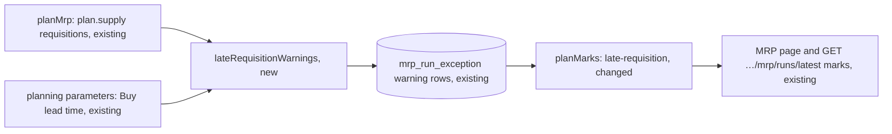

# MRP Late Requisition: a document accepted from a Late Supply proposal keeps its need date, and every run marks an Open requisition its lead time can't meet

**Status:** ready
**Created:** 2026-11-02 16:12 UTC
**Issue:** #322 (follow-up of #319 and #345) · **Depends on:** proposal acceptance (`implemented/2026-11-01--0737UTC-mrp-proposal-acceptance.md`, #287), proposal timing (`implemented/2026-11-01--0738UTC-mrp-proposal-timing-demand-priority.md`, #279), report weeks and marks (`implemented/2026-11-01--1105UTC-mrp-report-weeks.md`, #285), Make acceptance (`implemented/2026-11-02--1304UTC-mrp-make-proposal-acceptance.md`, #320), all merged · **Design authority:** `.ai/specs/product-brief.md` (R03, R07, R10, N04), `research/CPG-prd001.pdf` §04 "Overdue and late starts", `research/CPG-acceptance.md` MRP-037, MRP-038, BUY-001

## 📝 TLDR

#322 asks which date a document accepted from a **Late Supply** proposal takes. This spec answers **its need date**, for both kinds, which is what #319 (requisitions) and #345 (production orders) ship. It also closes the gap that answer leaves. Today a requisition that the lead time can't meet looks like any other on the next run, because the proposal's Late Supply mark goes away once the proposal is accepted. After this change every run warns of an Open requisition whose required date falls before today plus its pair's lead time. The new **Late Requisition** warning is stored with the run like Overdue Supply and shown as a mark on its required date, for example "Late · Requisition 00000007 · 1 day · earliest 3 Oct · 5 kg". It changes no figure.

## 📝 Problem Statement

A Late Supply proposal is one whose lead time can't meet its need date (#279, MRP-037). It is sized from its **need date**, and its receipt counts on its **planned finish**, today plus the lead time. Accepting it creates a document dated on the need date (#287 Q3 as shipped by #319, #320 Q1). #322 lists three options:

1. **Keep the need date.** The plan then counts the requisition on a day the lead time can't meet, and nothing says so.
2. **Planned finish, plus a sizing change**, so that existing late supply covers its need the way a proposal does.
3. **Planned finish**, accepting that later proposals go stale.

Option 3 orders twice. With the requisition on the planned finish, the next run finds the need date short again. It sizes a new proposal for that shortage, which is late too and finishes on the same planned finish. Accepting it puts two receipts on one day for one need. #319 also showed that it makes the pair's later proposals `MRP_PROPOSAL_STALE` (`mrp-acceptance.service.test.ts`), which breaks #287 Q2.

Option 2 lets supply count against needs before its own date. That covers up real shortages for every late document, purchase orders included, not only accepted ones. It also reopens #279's sizing, which all of E16–E19 builds on.

Option 1 is what both halves ship, and it is how mainstream MRP treats a firmed document: the document keeps the requirement date, and an exception says its date can't be met. The gap is that missing exception. Before the accept, the planner sees "Late Supply · 1 day · finish 3 Oct" on the need date. After it, the next run shows the requisition as ordinary tentative supply on that day. The warning appears only once the date has passed, as Overdue Supply. So the planner loses the one fact that would make them expedite the purchase. The same happens to a requisition typed by hand, or created by an automatic run (#289), with a date too close.

## Resolved assumptions (autonomous defaults)

The owner delegated the #322 decision to this run ("make reasonable assumptions and proceed"), so each answer below is the most reversible one and is posted for override. There is no schema change and no new endpoint. The only contract change is additive: a new mark kind and a new stored warning code.

| # | Question | Applied default | Why |
| --- | --- | --- | --- |
| Q1 | Which date does a document accepted from a Late Supply proposal take? | Its **need date**, for both kinds: a requisition's required date, and a production order's planned finish. This is today's code, unchanged. | Option 3 double-orders and Option 2 hides shortages (Problem Statement). Option 1 is what #319 and #345 ship and test, so choosing it changes no data and no contract, and it can still be revisited. Both specs named #322 as the one place that decides it. |
| Q2 | Flag it, and how? | Yes, with a **warning**, `LATE_REQUISITION`, one per late requisition. It is stored with the run after its exceptions, like `OVERDUE_SUPPLY`, and shown as a mark. It is not an exception, and it changes no figure and no proposal. | #285 built exactly this channel for "an existing document whose date the plan can't trust" (its Q1), and #322's option 1 asks for "flag the requisition as late, or show it as an exception". An exception would empty the pair's proposals (#280's rule), which is wrong for a plan that is sound apart from timing. |
| Q3 | Which requisitions? | Every **Open requisition MRP counts**, whatever created it (Accept, an automatic run, by hand), whose required date is **today or later** and before today plus its pair's **Buy** lead time. The days late and the earliest date come from `scheduleProposal`, the rule that gives a proposal its Late Supply mark. A requisition already overdue keeps its Overdue Supply mark only. | The same timing rule for a proposal and its document, so accepting a late proposal turns its Late Supply mark into a Late Requisition mark with the same days and finish. The rule doesn't depend on how the document was made, which keeps it a pure function of the run's snapshot (R10). Two marks for one overdue requisition would say the same thing twice. |
| Q4 | A pair with no readable planning parameters, or a Make pair? | **No warning.** Without a readable set (none, or an unreadable one, which `planMrp` keeps in `invalidSets`, never in `parametersOf`) the lead time is unknown. The pair gets `MISSING_PLANNING_PARAMETERS` once it has a need to size. On a Make pair the lead time is a production lead time, not a purchasing one. | No guessed lead time. A requisition at a Make pair is rare and keeps its other marks. |
| Q5 | Purchase orders and production orders? | **Not warned** in this story. A purchase order's date is the supplier's commitment, so a lead time doesn't apply to it. A production order accepted late already starts before today: its components are needed today with their original date kept (#277), and its output is marked Overdue once its finish passes. An open order may also have legitimately started in the past, so "start before today" alone isn't late. | The smallest scope that closes #322's gap. A production-order lateness mark needs a notion of "not yet started" that the data model doesn't have (Out of scope). |
| Q6 | Which day does the mark fall on, and what does it say? | The requisition's **required date**, the day its supply counts. It names the requisition, the days late, the earliest date the lead time allows, and the quantity counted: "Late · Requisition 00000007 · 1 day · earliest 3 Oct · 5 kg". In Polish: "Spóźnione · Zapotrzebowanie zakupu 00000007 · 1 dzień · najwcześniej 3 paź · 5 kg". | The day the plan relies on the date is where the planner must see that it can't hold. The words follow Overdue's "Overdue · {document} · due {date} · {quantity}" (#285). |
| Q7 | Change the Accept confirmation for a late proposal? | **No.** The proposals table already shows its Late Supply mark beside Accept (#285 Q7). The help says what happens next. | No new UI on a flow that is already clear. |
| Q8 | Split the story? | No. | The decision and the warning that makes it safe ship together. |

## 📝 Proposed Solution

1. **The decision (Q1).** No code change to acceptance. The help says it in both languages, and the tests that pin it (`mrp-acceptance.service.test.ts`, "requires a Late Supply proposal on its need date…", and #345's Late Supply case) stay as they are.
2. **The engine warns (Q2–Q4).** `planMrp` adds `lateRequisitionWarnings(plan, parametersOf.get(pairKey(material, location)), today)` to its warnings. For a pair whose readable set is `procurement: "buy"`, each `plan.supply` item with `kind: "requisition"` and `overdue: false` is timed by `scheduleProposal(item.plannedDate, set.leadTimeDays, today, MRP_HORIZON_DAYS)`. When `lateDays > 0` it gives `LATE_REQUISITION` on `item.date`, with the document, `plannedDate`, `plannedFinish`, `lateDays` and the quantity counted. The timing's `beyondHorizon` is ignored. The same `unreadable` filter as the overdue warnings applies (#316).
3. **Stored like the overdue warnings.** `MRP_WARNING_CODES` gains `LATE_REQUISITION`, after `OVERDUE_TRANSFER`. Its helpers branch on the new code explicitly: `compareWarnings`' `kindOf` gives `"requisition"`, `documentOf` gives `document`, and `positionOf` gives 0. `toStoredWarning` gets its own branch with details `{ document, plannedDate, plannedFinish, lateDays, quantity }`, `lateDays` as a decimal string. Today both helpers treat every code that isn't one of the overdue ones as the other. `MrpRunService` writes and reads it with no change, since both go by `isMrpWarningCode`.
4. **A mark on read.** `planMarks` reads the row as a `late-requisition` mark. The shared `plannedDate` and `quantity` checks apply. The branch also needs `document` and `plannedFinish`, and a `lateDays` matching `/^\d+$/` above 0. `MRP_MARK_KINDS` lists it after `overdue-transfer`, before `late-supply`. A row whose details this image can't read is skipped, as today.
5. **Shown.** `MrpMarks` renders it as a warning `StatusBadge` with the `Hourglass` icon. The text comes from new EN/PL messages, and the `mrp` help topic explains it.

**Alternatives considered.**
- *Options 2 and 3* (Problem Statement).
- *Derive the mark on read from today's requisitions.* Rejected for the same reason as #285: the report shows the stored run (R10), and a requisition converted after the run would change the run's marks.
- *Store a "late" flag on the requisition at accept time.* It covers only accepted ones, adds a migration, and goes stale when the lead time or the date is edited. The warning is recomputed every run.
- *An exception code.* It would empty the pair's proposals (#280) and count among planning blockers (Q2).

## 📝 Architecture

```
core/src/domain/mrp/mrp-result.ts                      + MrpLateRequisition in MrpWarning               (changed)
core/src/domain/mrp/warnings/late-requisition.ts       lateRequisitionWarnings(plan, parameters, today)  (new)
core/src/domain/mrp/warnings/overdue.ts                codes, compareWarnings, toStoredWarning           (changed)
core/src/domain/mrp/plan-mrp.ts                        warnings += late requisitions                     (changed)
core/src/domain/mrp/report/plan-marks.ts               late-requisition mark                             (changed)
core/src/domain/mrp/report/weekly.ts, services/mrp/mrp-run-view.ts   take the new mark kind through `MrpMark` (tests only)
app/src/components/mrp/mrp-marks.tsx                  icon and text                                     (changed)
app/src/i18n/messages/{en,pl}.ts, app/src/help/topics.ts   copy, EN and PL                               (changed)
BACKWARD_COMPATIBILITY.md                              the mark kind and the stored code                 (changed)
```



The warning reuses the overdue warnings' whole path. Only its producer is new, and it plugs into the warnings list `planMrp` already returns. Acceptance, sizing, the stale check and the automatic batch don't change.

## 📝 Data Model

No migration. A `LATE_REQUISITION` row in `mrp_run_exception` holds the pair, `date` (the required date), and `details` `{ document, plannedDate, plannedFinish, lateDays, quantity }`, all strings, the quantity as a six-decimal text (R03), as `toStoredWarning` writes the overdue ones.

```ts
interface MrpLateRequisition {
  code: "LATE_REQUISITION";
  material: string;
  location: string;
  /** The requisition's required date, where it counts. */
  date: string;
  /** The requisition's business ID. */
  document: string;
  /** Its required date, kept beside `date` as the other warnings keep theirs. */
  plannedDate: string;
  /** The earliest date its pair's lead time allows from the run's first day. */
  plannedFinish: string;
  lateDays: number;
  quantity: bigint;
}
```

The fixed English message: "This requisition is required sooner than its lead time allows from the run's first day, so it can't arrive by its date."

## 📝 API Contracts

`GET /api/tenants/{tenant}/mrp/runs/latest`: a plan's `marks` (and a week's, with `bucket=week`) may include

```json
{ "kind": "late-requisition", "date": "2026-10-02", "document": "00000007", "plannedDate": "2026-10-02", "plannedFinish": "2026-10-03", "lateDays": 1, "quantity": "5.000000" }
```

It is additive: a new value of `kind`, listed in `BACKWARD_COMPATIBILITY.md` §4 beside the other mark kinds. The accept endpoint is unchanged and keeps dating the document on the need date (Q1).

## 📝 UI/UX

- **Mark.** On the MRP page's Day view, the requisition's required date shows "Late · Requisition 00000007 · 1 day · earliest 3 Oct · 5 kg" as a warning badge (icon and text, never colour alone, design system v1). The Week view shows it in its week, as every mark. The date drops the year unless it differs from the mark's day (`shortDate`), and the quantity is in the reader's locale (#304).
- **Help (EN, PL).** The warnings paragraph gains Late Requisition. The accept paragraph says that a late proposal's requisition is still required on its need date, and that the next run marks it Late until it is converted, its date moves, or it can be met. The API paragraph lists `late-requisition` among the mark kinds.

Prototype: none. The mark is one more badge in #285's existing marks column (`.ai/specs/assets/mrp-report-weeks/mockup-02-day-marks.png`), with new text.

## 📝 Edge Cases & Failure Scenarios

- **Lead time 0, or a requisition required on or after today plus the lead time:** no mark.
- **Required today with lead time 2:** 2 days late, earliest today + 2.
- **Overdue requisition:** Overdue only (Q3).
- **Partly converted requisition:** only the unconverted part counts (MRP-012), and the mark names that quantity. A fully converted or cancelled requisition counts nothing and gets no mark.
- **Earliest date past the horizon:** still a Late Requisition when the requisition itself falls inside the horizon. It counts on its own date, and the mark names the earliest date. A requisition required after day 89 isn't in the plan (`purchasingSupply`), so it gets no mark.
- **A material with an unreadable row:** no warning, like the others (#316).
- **Accepting a late proposal, then running again:** the Late Supply mark on that day becomes a Late Requisition mark with the same days and finish (Q3). The pair's later proposals stay acceptable (#287 Q2, unchanged).
- **Rollback to the previous image:** it doesn't know the code, so its read lists a stored `LATE_REQUISITION` row among the plan's exceptions with the fallback message until its next run, as with `BOM_REJECTIONS` (#286). Its proposals are unaffected, since the engine, not the read, empties a pair's proposals.

## 📝 Risks & Impact Review

- **Noise.** Each requisition dated within its lead time gets a mark every run until it is converted or its date passes. That is the intended signal, and it is no louder than Overdue.
- **Contract.** One additive mark kind. A client that switches on `kind` exhaustively must handle it, as with every kind #285 added. Recorded in `BACKWARD_COMPATIBILITY.md`.
- **Reversibility.** No schema change. Removing the producer stops new rows, and old runs keep a row the read skips as an unknown mark. Q1 changes nothing.

## 📝 Decisions in play

R10 (the report shows the stored run) and N04 (calendar-day lead times) hold. #322's decision is recorded here (Q1). Superseding it later means changing the accept date in `MrpAcceptanceService` and its twin for production orders.

## Out of scope

- A lateness mark for open production orders that haven't started by their planned start (Q5). It needs a started state.
- Moving a document's date, or expediting from the mark.
- A Late flag on the Purchase requisitions list.

## 📋 Phasing

One phase, one PR: the decision is a no-op, and the warning is a small vertical slice through the existing warning path.

## 📋 Implementation Plan

1. **Engine.** Add `MrpLateRequisition` to `MrpWarning` and `lateRequisitionWarnings` in `warnings/late-requisition.ts`. Extend `MRP_WARNING_CODES`, `compareWarnings` and `toStoredWarning`, and call it from `planMrp`. Unit tests: late by 1 and by the full lead time, on time, lead time 0, overdue (Overdue only), a purchase order (none), a Make pair, no set, an invalid set (`plan-mrp.test.ts`), an unreadable material, a partly converted requisition's counted quantity, the stored row shape, and a `compareWarnings` order with `LATE_REQUISITION` beside `OVERDUE_SUPPLY` of the same pair and a requisition ID shared with an overdue one. `plan-mrp.test.ts`: a run's warnings include it.
2. **Read.** `planMarks` maps `LATE_REQUISITION` to `late-requisition` and skips malformed details (missing document or `plannedFinish`, or a `lateDays` that isn't a whole number above 0). `MRP_MARK_KINDS` order, with a one-day test of `overdue-supply`, `late-requisition` and `late-supply` together. `weekly.test.ts` folds it into its week. A `mrp-run.service.test.ts` case: run, then `latest` returns the mark.
3. **Screen and copy.** `MrpMarks` icon (its `ICONS` record is keyed by every kind, so the compiler requires it) and `markText`; EN/PL messages; the help topic's three paragraphs (warnings, accept, API). Component and help tests, the glossary guards included.
4. **Contract docs.** `BACKWARD_COMPATIBILITY.md` §4: the mark kind and the stored code, with the rollback note. Add evidence to `research/CPG-acceptance.md` MRP-037 if it lists Late Supply's evidence.
5. **Integration.** `tests/integration/mrp-accept.test.ts`: after accepting the late proposal, run MRP again and see the "Late · Requisition …" mark on its need date in the browser. Assert the same mark through `GET …/mrp/runs/latest`.

## Acceptance criteria

- Accepting a Late Supply proposal still creates a requisition required on its need date (and a production order finishing on it), and the pair's later proposals stay acceptable.
- Sugar, Buy, lead time 2, today 1 Oct, an Open requisition of 5 kg required on 2 Oct: the run stores one `LATE_REQUISITION` warning on 2 Oct with `plannedFinish` 3 Oct and `lateDays` 1. The API's marks for that day include `late-requisition`, and the page shows "Late · Requisition 00000001 · 1 day · earliest 3 Oct · 5 kg". The figures are identical to a run without the warning.
- Required on 3 Oct, or lead time 0: no mark. Required 30 Sep: Overdue only.
- A Make pair, or a pair with no planning parameters: no mark.
- EN and PL copy, help included. 100% coverage of the change.
