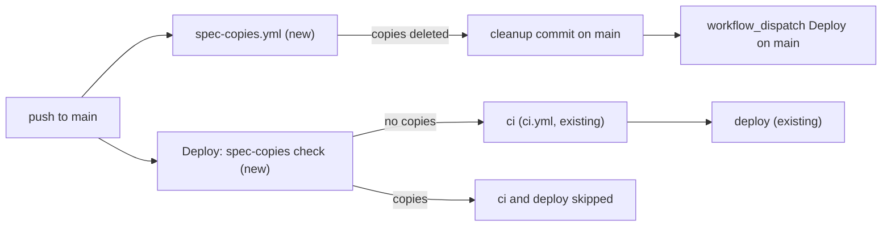

# A push to main deletes the active copy of a spec already implemented or archived, and Deploy skips the commit that had it

**Status:** ready
**Created:** 2026-11-02 19:53 UTC
**Issue:** #351 (follow-up of #348) · **Touches:** `.github/workflows/` (a new `spec-copies.yml`, a first job in `deploy.yml`), `tests/ai-filenames.test.ts`, a new root `scripts/` folder, the paperwork lesson in `.ai/lessons.md`

## 📝 TLDR

A spec PR's squash merge can put back the active copy of a spec that its implementation PR has already moved to `.ai/specs/implemented/`. `main` then holds both copies, `tests/ai-filenames.test.ts` fails, and so does the Deploy, until someone opens a PR that deletes the copy. After this change, a new workflow runs on every push to `main`. If the pushed commit holds such a copy, the workflow deletes it, commits the deletion to `main` and starts Deploy on `main`. Deploy's new first job checks for copies too, and skips CI and the deploy for a commit that has any. No merge is blocked and nobody has to clean up by hand.

## 📝 Problem Statement

A spec lives in exactly one place: `.ai/specs/` while it is active, then `implemented/` or `archive/` (AGENTS.md). The spec PR adds the active file, and the implementation PR, branched from `main`, adds the `implemented/` copy (lesson 2026-11-02, "Close the paperwork"). Each PR passes CI on its own. GitHub doesn't re-run a PR's CI when `main` changes, and `main` has no branch protection (no required checks, no "branch must be up to date"). So the two merges race:

- **The implementation merges first.** The spec PR's squash then adds the active file again.
- **The spec PR merges first.** The implementation's green run predates that merge, so it doesn't delete the active file, and merging it adds the second copy.

Either way the merged `main` fails `a spec is never active and implemented or archived at once`. On 2026-11-02 this happened four times, each time with the owner merging a pair 10 to 30 s apart, sometimes in the right order: #339/#340, #341/#342, #343/#346 and #344/#345. Each needed a follow-up PR (#341/#342, #347, #348, #350), and no deploy went out until it merged. The lesson describes the right order, but the order alone doesn't prevent the race: #339 merged 18 s before #340.

## Resolved assumptions (autonomous defaults)

Each answer is the most reversible one. They are posted on the PR and on #351 for override.

| # | Question | Applied default | Why |
| --- | --- | --- | --- |
| Q1 | Block the merge (#351's first option) or remove the copy automatically (its second)? | **Remove it automatically, on the push to `main`.** | `main` has no branch protection, so a failing check blocks nothing until the owner makes it required, and #351 needs a guard that works on its own. Even a required check would keep failing the second PR of every pair, which the owner merges seconds after the first, until it merged `main` and ran CI again (about 10 minutes). A check that runs when the PR opens can't see a merge that happens later anyway. Seeing it would take a workflow that re-checks every open PR on every push to `main`. Automatic removal needs no settings change and no change to how pairs are merged. It is the option #351 offers second. |
| Q2 | Which copy is kept? | The one in `implemented/` or `archive/`. The active copy is deleted. | It is what the test's message asks for, and what #341/#342, #347, #348 and #350 did by hand. The implementation PR's copy carries the implementation notes. The active copy is the spec PR's text, which the implementation PR started from. |
| Q3 | What if the two copies differ? | Delete the active copy anyway. | A spec PR that merges after its implementation is stale by definition. Its text stays in git history, and the cleanup commit names every file it deletes. |
| Q4 | Which workflow deletes the copy? | **A new workflow, `spec-copies.yml`**, on `push` to `main`, with its own concurrency group. It deletes, commits, pushes, then starts Deploy on `main` with `workflow_dispatch`. A push made with the workflow's `GITHUB_TOKEN` starts no workflow run, but a dispatch does. Deploy itself stays read-only: its first job, `spec-copies`, only checks, and skips `ci` and `deploy` when the commit holds a copy. | `deploy.yml` runs in one `deploy-production` queue. A pair's second merge, the dirty one, would wait there behind the first merge's whole CI and Kamal deploy, 15 to 25 minutes, and every PR run started in that time would fail `ai-filenames` (fresh-context review). On its own the cleanup lands within a minute. The dispatched Deploy replaces the dirty commit's pending run in the queue, and Deploy never needs write access. |
| Q5 | `main` moved on before the cleanup push? | Don't retry. The push is rejected. The job reads `main` with `git ls-remote`, and if it is no longer the pushed commit it ends green without dispatching: the newer commit's own `spec-copies` run deletes the copies. A push rejected while `main` is still at that commit fails the run, so it goes red and someone looks. | No rebase or force-push from automation. Every push to `main` gets its own run. |
| Q6 | A run on a ref other than `main`? | `spec-copies.yml` runs only on pushes to `main`. A hand-started Deploy on another ref changes nothing: its check job finds the copies and skips CI and the deploy. | Automation may push to `main` only. |
| Q7 | Where does the guard's code live? | A new root folder, `scripts/`, for repository tooling outside the four packages: `scripts/spec-copies.ts` holds only the pure decision, `activeCopies`, and `scripts/delete-spec-copies.ts` is the command-line entry, with code at the top level. Each has its test beside it. Coverage, the node test project, typecheck and the `no-console` exception include `scripts/`, so the 100% rule applies. `tests/ai-filenames.test.ts` imports `activeCopies`, so the test and the guard can't disagree, and importing it deletes nothing. | The guard belongs to no package's layer, and `tests/` holds no code under coverage. Splitting the pure function from the entry follows `packages/core/scripts/migrations.ts`. It reaches 100% with no `import.meta.main` branch, and the test can never delete a file by importing it. The scripts import only `node:` modules and each other (with the `.ts` extension), so Node 24 runs them directly, with no `npm ci` in the job. |
| Q8 | Also block at PR time? | **No.** A PR whose merge with `main` has both copies already fails `tests/ai-filenames.test.ts`, and that test names the file. | It already exists. |

## 📝 Proposed Solution

1. **`scripts/spec-copies.ts`** exports `activeCopies(specsDir): string[]`. It returns the names of the active spec files (directly in `specsDir`) whose name is also in `implemented/` or `archive/`. The names are sorted and counted once even when a name is in both folders. It applies the naming rule the test applies today: only `YYYY-MM-DD--HHMMUTC-slug.md` names count, so `README.md`, `backlog.md` and `product-brief.md` never do. The `.ai/` name rule (`isValidName`) moves here from the test, and the test imports it.
2. **`scripts/delete-spec-copies.ts <specsDir>`** deletes `specsDir/<name>` for each copy and prints the deleted paths as given (`.ai/specs/<name>`), one per line. It prints nothing when there are none. Without an argument it exits 1 with a usage line.
3. **`tests/ai-filenames.test.ts`** asserts `activeCopies(".ai/specs")` is empty, with today's message ("Delete the active copy of these specs from .ai/specs/"), now listing the active paths to delete.
4. **`.github/workflows/spec-copies.yml`** (new):
   - `on: push: branches: [main]`, `concurrency: spec-copies` (no cancel), `permissions: contents: write, actions: write`, one job with `timeout-minutes: 5`;
   - checkout, Node 24, no `npm ci`. Then one step under `set -euo pipefail`, with `GH_TOKEN: ${{ github.token }}`:

     ```bash
     removed="$(node --disable-warning=MODULE_TYPELESS_PACKAGE_JSON scripts/delete-spec-copies.ts .ai/specs)"
     [ -z "$removed" ] && exit 0
     git config user.name "github-actions[bot]"
     git config user.email "41898282+github-actions[bot]@users.noreply.github.com"
     git commit --quiet -m "docs(specs): delete the active copy of specs already implemented or archived (#351)" -m "$removed" -- .ai/specs
     if ! git push origin HEAD:refs/heads/main; then
       [ "$(git ls-remote origin refs/heads/main | cut -f1)" != "$GITHUB_SHA" ] || exit 1
       echo "main moved on; its own spec-copies run deletes the copies."
       exit 0
     fi
     gh workflow run deploy.yml --ref main
     ```
5. **`deploy.yml`**:
   - a top-level `permissions: contents: read`;
   - a first job, `spec-copies` (checkout, Node 24, `timeout-minutes: 5`). It runs the same `node … scripts/delete-spec-copies.ts .ai/specs` on its own checkout, which writes nothing back. It outputs `copies` (the script's output, or empty);
   - `ci` gets `needs: spec-copies` and `if: needs.spec-copies.outputs.copies == ''`. `deploy` needs `ci`, so it skips too.

Alternatives that lost (Q1, Q4): a required status check (needs a branch-protection change, can't see a later merge, and adds a CI round to every pair), GitHub's merge queue (a different merge flow for every PR, for one file-placement rule), a scheduled cleanup (`main` stays red until it runs), and doing the deletion inside Deploy (it queues behind the previous deploy).

## 📝 Architecture



Takeaway: on a clean commit Deploy runs as today, one short job later, and `spec-copies.yml` ends at once. On a dirty commit Deploy skips, the cleanup lands within a minute, and the dispatched Deploy deploys `main` at or after the cleanup commit. `ci.yml` and the PR checks don't change.

## 📝 Edge Cases & Failure Scenarios

- **Window between the dirty merge and the cleanup** (about a minute): a PR run that starts then tests a merge with both copies and fails `ai-filenames`. Re-running it after the cleanup passes.
- **The push is refused while `main` hasn't moved** (a permission change, or branch protection or a ruleset added to `main` later): `spec-copies.yml` fails and goes red. Deploy has already skipped the commit, so it is today's state with a named cause. Allow the workflow to push in the protection rule, or remove the workflow.
- **The dispatch fails** after a successful push: the run goes red. `main` is already clean, so the next push deploys, or start Deploy by hand.
- **The dispatched Deploy's commit**: a `workflow_dispatch` run deploys `main`'s head when it is created, which may already be newer than the cleanup commit. It is checked the same way.
- **No loop:** `spec-copies.yml` runs on pushes only, and its own push starts no run. A dispatched Deploy that still found copies would skip, not push.
- **Several copies at once** (#343/#344 left two): one commit deletes them all.
- **An active spec whose name matches an archived spec** (re-opened work): the rule stays "never both". Re-activating an archived spec means moving it back, which the test already demands.
- **`node` can't run the `.ts` files** (type stripping): the root `tsconfig.json` sets `erasableSyntaxOnly`, so typecheck refuses syntax Node can't strip. One test runs `node scripts/delete-spec-copies.ts` as a child process on a temp folder, so a PR fails before `main` does.

## 📝 Risks & Impact Review

- **Automation writes to `main`.** The `spec-copies.yml` token can push to `main` and start workflows. It runs only the repository's own code from `main`, deletes only files the rule selects, and pushes a fast-forward only (no `--force`). Undo: revert the commit. Delete the workflow to switch the behaviour off; Deploy's check then just skips dirty commits.
- **Branch protection added later** would refuse the push. Then the run fails loudly (Edge Cases).
- **New top-level folder `scripts/`.** It joins coverage, typecheck and lint. AGENTS.md and the engineering standards list it.
- No app code, schema, API or UI changes. Nothing in `BACKWARD_COMPATIBILITY.md` is touched.

## Out of scope

- Branch protection, required checks or a merge queue (Q1, Q8).
- Changing where specs live, or the spec-PR / implementation-PR split.
- Any other file-placement rule.
- A hand-started Deploy on a branch other than `main` deploys that branch once its CI passes. That is #360.

## 📋 Phasing

One phase. Each step leaves the app and both workflows working.

## 📋 Implementation Plan

1. **The guard's decision and its command.** Add `scripts/spec-copies.ts`, `scripts/delete-spec-copies.ts` and their tests. They run on temp folders. The tests cover:
   - copies found in `implemented/` and in `archive/`, a name in both counted once;
   - fixed-name files ignored, sorted output;
   - the command deletes exactly the copies, prints them, and prints nothing and deletes nothing when there are none;
   - a missing argument exits 1;
   - one run as a `node` child process.

   Add `scripts/**/*.test.ts` to the node project, and `scripts/**/*.ts` to coverage and to the root `tsconfig.json`, with `erasableSyntaxOnly` and `allowImportingTsExtensions`. Add `scripts/**` to the lint rule that allows `console`. Switch `tests/ai-filenames.test.ts` to `isValidName` and `activeCopies`. Verify with `npm run test:coverage` (100%), lint and typecheck.
2. **The workflows.** Add `spec-copies.yml` and Deploy's check job as above, and `tests/spec-copies-workflows.test.ts`, which pins:
   - `spec-copies.yml` runs on `push` to `main` only, runs the command, pushes `HEAD` to `main` without `--force`, and dispatches `deploy.yml` on `main`;
   - its permissions are `contents: write` and `actions: write`;
   - Deploy's top-level permissions are `contents: read`, with no job asking for more;
   - `ci` needs `spec-copies` and runs only when `copies` is empty;
   - both jobs set up Node 24 and have a `timeout-minutes`.
3. **Docs.** AGENTS.md (the Deployment and CI bullets, and the coverage scope), engineering standards §3–§4 (`scripts/`), and the paperwork lesson in `.ai/lessons.md`: drop its incident list and say that a push to `main` deletes such a copy (#351). Its rules for the PR stay: branch the implementation from `main`, carry the spec into `implemented/`, merge the spec PR first.

## Acceptance criteria

- [ ] A `main` commit that holds an active copy of a spec in `implemented/` or `archive/` never deploys. `spec-copies.yml` deletes the copy on `main` and starts Deploy, which deploys `main` at or after the cleanup (#351 AC1 and AC2, the automatic-removal option).
- [ ] `scripts/spec-copies.test.ts` and `scripts/delete-spec-copies.test.ts` cover the decision and the deletion at 100%, and `tests/spec-copies-workflows.test.ts` pins both workflows' wiring (#351 AC3).
- [ ] `tests/ai-filenames.test.ts` uses the same function and still fails on a duplicate.
- [ ] The paperwork lesson points at the guard instead of listing incidents (#351 AC4).
