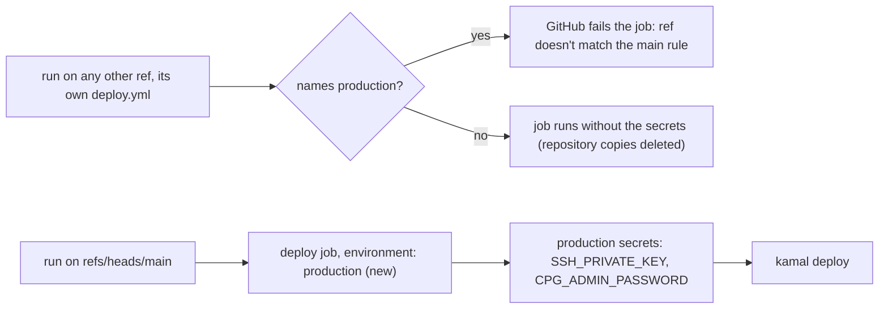

# Deploy secrets live in a `production` environment that only `main` may use

**Status:** ready
**Created:** 2026-11-03 08:15 UTC
**Issue:** #368 (follow-up of #360, PR #367) · **Touches:** `.github/workflows/deploy.yml`, `tests/deploy-workflow.test.ts`, the Deployment bullet in AGENTS.md, CI/CD in `.ai/docs/engineering-standards.md`, and repository settings the owner changes

## 📝 TLDR

The `deploy` job declares `environment: production`. The owner creates that environment, limits it to the `main` branch, and moves `SSH_PRIVATE_KEY` and `CPG_ADMIN_PASSWORD` into it. Once a `main` deploy has gone through the environment, the owner deletes the repository-level copies. After that, no workflow run on another ref can read the deploy secrets, whatever its own copy of `deploy.yml` says. A test pins the environment, and that every workflow secret is read only in a job bound to `production`. AGENTS.md drops the caveat #367 added.

## 📝 Problem Statement

#367 makes `main`'s `deploy.yml` refuse a hand-started Deploy on any ref but `refs/heads/main`. But `workflow_dispatch` runs the copy of `deploy.yml` stored on the ref it starts. A branch cut before #367 merged, or one that edits the refusal out or adds its own `push:` trigger, can still run `kamal deploy` with the production SSH key and admin password, because repository secrets are available to every branch's workflows. The #367 guard prevents accidents, not a deliberate deploy by someone who can push.

GitHub enforces an environment's deployment-branch rule itself, outside any workflow file. Environment secrets are only available to jobs that reference the environment, and the rule is matched against the run's `GITHUB_REF`. A job on another ref that names `production` fails without starting. A job that doesn't name it gets no environment secrets.

## Resolved assumptions (autonomous defaults)

Each answer is the most reversible one. They are posted on the PR and on #368 for override.

| # | Question | Applied default | Why |
| --- | --- | --- | --- |
| Q1 | Which branch rule? | **Selected branches and tags**, one branch rule, `main`. Not "Protected branches only". | "Protected branches only" lets every branch deploy when no branch is protected, and would let any branch protected later deploy too. One exact `main` rule says what #360 decided. Tags and `refs/pull/*/merge` don't match it. |
| Q2 | Keep #367's refusal step, its `if` and the refused-run concurrency group? | **Keep all three.** | They make a mistaken run on `main`'s copy fail at once, with a message, before CI spends 7 minutes. The environment is what holds against an edited copy. The concurrency group still keeps a refused run out of `deploy-production`. |
| Q3 | `environment: production` or the long form with a `url`? | **The string `production`.** | #368's acceptance criterion names it. A `url` only adds a link on the Environments page and can be added later. |
| Q4 | Required reviewers or a wait timer on the environment? | **No.** | Neither is asked for. A push to `main` deploys unattended today, and a reviewer would stop that. |
| Q5 | "Allow administrators to bypass configured protection rules"? | **Leave GitHub's default.** | The owner is the repository's only admin and can change the settings anyway. GitHub documents the bypass for jobs waiting on a protection rule (reviewers, timers). |
| Q6 | In which order do the settings and the merge happen? | 1. Create `production` with the `main` rule. 2. Add both secrets to it. 3. Merge the implementation PR. 4. Check that the `main` Deploy it starts passes and shows on the environment. 5. Delete the repository secrets. | Each step keeps deploys working. The job reads the environment's secrets as soon as it names `production`, and the repository's while they exist. Deleting the repository copies before step 4 would leave a failed deploy with no rollback but re-adding them. Merging before step 1 is harmless: GitHub creates a missing environment, with no rules, on the first run that names it. |
| Q7 | Does the implementation PR close #368? | **No: `Refs #368`.** The owner closes #368 after step 5. | Merging can't delete the repository secrets. A closing keyword would close #368 with its second criterion still open. |
| Q8 | What does the test pin? | `deploy`'s `environment` is `production`. And, across every workflow file, a job that reads a `secrets.*` value other than `GITHUB_TOKEN` declares `environment: production`, no job passes `secrets:` to a reusable workflow or calls one from another repository, and nothing outside the jobs reads a secret. | Moving a secret into the environment only protects it while every job that reads it names the environment. The rule covers future workflows too, so a new secret can't quietly go back to repository level. `GITHUB_TOKEN` is GitHub's per-run token, not a repository secret. |
| Q9 | Can a test check the repository settings? | **No.** The owner checks them once (step 4). | Unit tests run offline, and the settings change once, by hand. |

## 📝 Proposed Solution

1. **`deploy.yml`, job `deploy`**: `environment: production`, beside `needs` and `if`, with a comment saying the secrets live there (#368).
2. **`tests/deploy-workflow.test.ts`** gains:
   - `deploy.jobs.deploy.environment` is exactly `"production"`;
   - for every file in `.github/workflows/`: every job whose definition reads `${{ secrets.<NAME> }}` with a name other than `GITHUB_TOKEN` has `environment: production`; no job has a `secrets` key or calls a workflow outside this repository (a `uses:` not starting with `./`, which could name `production` itself); nothing outside the jobs reads a secret. A test also checks that the deploy job is among the jobs found, so the scan can't pass by finding nothing.
3. **Docs.** AGENTS.md, the Deployment bullet: replace "That holds for `main`'s `deploy.yml`, not for a branch's own edited or older copy, which #368 tracks." with "Its secrets live in the `production` environment, which only `main` may use, so a branch's own copy of `deploy.yml` can't reach them either (#368)." The same change goes in the CI/CD paragraph of `.ai/docs/engineering-standards.md`.
4. **Owner steps** (repository settings, Q6), in the implementation PR's body as a checklist:
   1. Settings → Environments → New environment `production`. Deployment branches and tags: **Selected branches and tags**, add a **Branch** rule `main`. Or: `gh api -X PUT repos/Piotr12/CPG/environments/production -F 'deployment_branch_policy[protected_branches]=false' -F 'deployment_branch_policy[custom_branch_policies]=true'`, then `gh api -X POST repos/Piotr12/CPG/environments/production/deployment-branch-policies -f name=main -f type=branch`.
   2. Add `SSH_PRIVATE_KEY` and `CPG_ADMIN_PASSWORD` to the environment, with the current values (`gh secret set <NAME> --env production`). GitHub never shows a stored secret's value, so take them from where the owner keeps them (the deploy key's private file, the password manager). If either is lost, this step becomes a rotation, which is out of scope.
   3. Merge the implementation PR.
   4. Check that the Deploy run on `main` passes and that the Environments page lists its deployment to `production`.
   5. Delete the repository secrets (`gh secret delete SSH_PRIVATE_KEY`, `gh secret delete CPG_ADMIN_PASSWORD`), and close #368.

## 📝 Architecture

Takeaway: once the repository copies are deleted, only a job on `main` that names `production` can read the deploy secrets, and that is enforced by GitHub, not by a file a branch can edit.

## 📝 Edge Cases & Failure Scenarios

- **A branch's `deploy.yml` without `environment:`** runs, but `secrets.SSH_PRIVATE_KEY` is empty, so the SSH agent step fails and nothing deploys.
- **A branch's `deploy.yml` with `environment: production`**: GitHub refuses the job, since its `GITHUB_REF` isn't `refs/heads/main`.
- **A tag, or a `pull_request` run** (`refs/pull/N/merge`) doesn't match the `main` branch rule. Fork pull requests get no secrets at all.
- **`spec-copies.yml`'s dispatch** passes `--ref main`, so its Deploy uses the environment as a push does.
- **Re-running an old `main` run** whose `deploy.yml` predates this change: it doesn't name the environment, so after step 5 it fails at the SSH step. Re-deploy by starting Deploy on `main` instead.
- **Rollback** (`kamal rollback` from a workstation) uses the workstation's own key, which this change doesn't touch.

## 📝 Risks & Impact Review

- The only workflow change is one key on `deploy`. Until step 5 the repository secrets still serve as a fallback, so no deploy can break before the owner has seen one pass through the environment. No app code, schema, API, UI or `BACKWARD_COMPATIBILITY.md` surface.
- The rule ties the secrets to the ref `refs/heads/main`, not to reviewed code. `main` has no branch protection, so whoever can push can push an edited `deploy.yml` straight to `main`. Today that is the owner and the owner's agents, and direct pushes are allowed while the project bootstraps. #371 tracks protecting `main`.
- Undo: re-add the repository secrets, then remove the `environment` line.

## Out of scope

- Branch protection on `main`, required reviewers, wait timers, custom protection rules.
- `ci.yml`, `spec-copies.yml` and the Kamal configuration.
- Changing the secret values (rotating the SSH key or the admin password).

## 📋 Phasing

One phase, one step. The owner steps are repository settings, outside the PR.

## 📋 Implementation Plan

1. **The environment, its test and the docs.** Add `environment: production` to `deploy`, extend `tests/deploy-workflow.test.ts` as above, update AGENTS.md and the engineering standards, and list the owner steps in the PR body. Verify with `npm run lint`, `npm run typecheck`, `npm run test:coverage` (100%) and `npm run build`. Check that the test fails with the `environment` line deleted, and with a new job in another workflow that reads a secret without the environment.

## Acceptance criteria

- [ ] The `deploy` job declares `environment: production` (#368 AC1, workflow part).
- [ ] `tests/deploy-workflow.test.ts` pins it, and that every job reading a workflow secret is bound to `production` (#368 AC3).
- [ ] AGENTS.md and the engineering standards drop the caveat #367 added and say the secrets live in the `production` environment (#368 AC3).
- [ ] Owner: the `production` environment allows `main` only and holds both secrets (#368 AC1, settings part).
- [ ] Owner: the repository-level copies are deleted after a `main` deploy through the environment (#368 AC2).
