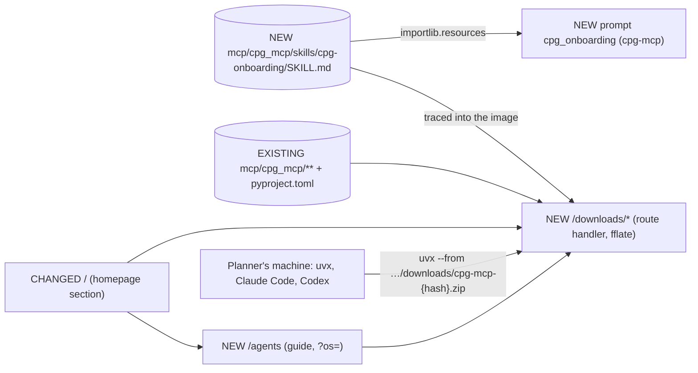

# CPG onboarding skill for MCP agents, and downloads from the homepage

**Status:** ready
**Created:** 2026-11-23 08:10 UTC
**Issue:** #398 (split out of #393, decisions Q4, Q5, Q10, Q11, Q12 recorded there) · **Owner's extension (2026-11-23, on the run that picked #398 up):** "make sure that the skill and mcp python package are easily downloadable from the homepage of the app … This should include an installation manual for windows/linux/Mac as well." · **Design authority:** implemented spec `2026-11-22--0818UTC-local-mcp-server`, `BACKWARD_COMPATIBILITY.md` §4 and §6, `.ai/specs/product-brief.md` (R03, R05, R09, R10)

## 📝 TLDR

`cpg-mcp` (#393) gives an agent CPG's tools, but not the know-how to use them. This spec adds that know-how: an onboarding skill, `cpg-onboarding/SKILL.md`, which teaches the planner's daily loop, CPG's hard rules and the safety rules. The MCP server also serves the same file as its prompt `cpg_onboarding`, so an agent without skill support gets it too.

It also makes both easy to get. The homepage gains a "Use CPG from an AI agent" section with two downloads, the MCP server package and the skill. A new public page, `/agents`, is the installation guide, with its commands for Windows, macOS or Linux. The app serves the package as a zip that `uvx` installs directly, so the user needs neither git nor a checkout.

## 📝 Problem Statement

- **The agent has the tools but not the job.** Without guidance it may edit a posted document instead of reversing it, retry a `GENERATION_STALE` error as if it were a glitch, or write to Prod without asking (#398).
- **Installing is a developer's chore.** Today `mcp/README.md` is the only guide. Its command `uvx --from "git+https://github.com/Piotr12/CPG#subdirectory=mcp" cpg-mcp` needs git, which most Windows planners don't have, and nothing on the app points to it. There is no skill to download yet.
- **One URL can't be updated in place.** `uvx` caches a tool by the URL it came from. Checked on 2026-11-23 with uv 0.11.14: a changed zip at the same URL kept the old code, even with `--refresh` and `--refresh-package`. A new URL installed the new code at once.

## Resolved assumptions (autonomous defaults)

#393 settled the delivery and language (Q10 A, Q11 A), the Prod rule (Q4 B) and the missing Test reset (Q5 A). The owner's extension adds the downloads and the guide. The questions those left open are resolved here:

| # | Question | Chosen answer | Rationale |
|---|---|---|---|
| A1 | Where does the skill file live? | `mcp/cpg_mcp/skills/cpg-onboarding/SKILL.md`, inside the Python package, instead of the issue's `mcp/skills/…`. The server reads it with `importlib.resources`, as it reads `catalogue.json`. | The prompt must work from an installed package, and hatchling packs only `cpg_mcp/`. Keeping the file outside would need a `force-include`, which an editable install (tests, `uv sync`) doesn't apply. One file, one loader, no second copy (#398's note). |
| A2 | What does the prompt look like? | One prompt, `cpg_onboarding`, with no arguments. Its description is the skill's frontmatter `description`. It answers one `user` message holding the skill body without the frontmatter. An unknown prompt name is an error. | MCP clients show prompts as commands (Claude Code: `/mcp__cpg__cpg_onboarding`). The frontmatter is skill-loader metadata, not instructions. |
| A3 | How does the check find tool names and help topics in the text? | Each tool is written in backticks as `` `cpg_…` ``. Each help topic is written as ``help topic `<id>` ``. A pytest test fails when a backticked `cpg_` word isn't a registered tool or the prompt's own name, or when a help topic id isn't in the catalogue's topics. | The catalogue's topics are generated from `HELP_TOPIC_IDS`, and `catalogue.test.ts` already fails when they drift. So a Python-only check covers both lists without parsing TypeScript. |
| A4 | How is the MCP package downloaded? | The app serves `GET /downloads/cpg-mcp-{hash}.zip`, a source archive of the package. It holds `pyproject.toml`, `README.md` and `cpg_mcp/**`, including the catalogue and the skill, without `__pycache__`. `{hash}` is the first 12 hex digits of the archive's SHA-256. `uvx --from <that URL> cpg-mcp` installs it, as verified on 2026-11-23. A request with any other hash answers 307 to the current one. | A content-addressed URL defeats the stale cache in the Problem Statement. The redirect keeps an old copied command working on a fresh machine. The archive comes from the deployed image, so its catalogue always matches the API it talks to. The repository is public under AGPL, so serving its source publicly reveals nothing new. |
| A5 | How is the skill downloaded? | Two routes, both public: `GET /downloads/cpg-onboarding-skill.zip`, which holds `cpg-onboarding/SKILL.md` for the download button, and `GET /downloads/cpg-onboarding/SKILL.md`, the raw file, which the guide's one-line install commands fetch. | A skill is a folder holding `SKILL.md`, so the zip unpacks into a skills folder as it is. The raw file makes the terminal install one command on every OS. |
| A6 | Where is the installation guide? | A new public page, `/agents`, with EN and PL text, help topic `ai-agents`, and a "Use CPG from an AI agent" section on the homepage. That section has both download buttons and a link to the guide. | The homepage stays short: two buttons and a link. The guide has room for the four steps and three operating systems. Every page needs a help topic (`tests/every-page-has-help.test.ts`). |
| A7 | How does the guide pick the OS? | `/agents?os=windows\|macos\|linux`, rendered on the server. Without `?os=`, the guide picks the OS from the `User-Agent`: Windows if it contains `Windows`, Linux if it contains `Linux` but not `Android`, macOS otherwise. Three links switch between them, and the selected one carries `aria-current="page"`. | It needs no client JavaScript, works before hydration, and each OS has a URL to share. macOS and Linux share the same shell commands, but each still gets its own view, with its own install options (Homebrew on macOS). |
| A8 | Which address do the commands use? | The origin of the request that renders the page: `x-forwarded-proto` and `x-forwarded-host` (kamal-proxy), falling back to `host` and `http`. It goes into the download URLs. `CPG_BASE_URL=<origin>` is added to the commands only when the origin isn't `https://cpg.baby`, the server's default. | A copied command must point at the CPG that served it, which may be Prod or a local `npm run dev`. The headers affect only the page shown to that same requester, so trusting them is harmless. |
| A9 | How do the files reach the server at run time? | A route handler reads `mcp/` from the repository (`path.join(process.cwd(), "../../mcp")`), since `process.cwd()` is `packages/app` under both `next dev` and the standalone `server.js`. `outputFileTracingIncludes` in `next.config.ts` copies `mcp/pyproject.toml`, `mcp/README.md` and `mcp/cpg_mcp/**` into the standalone build. The archives are built once per process, deterministically: entries sorted, a fixed 1980-01-01 timestamp and fixed permissions. | No build step and no generated file to commit. `npm run dev` serves the working tree, and the image serves what it was built from. A deterministic zip keeps the hash stable across restarts and replicas. The archives use `fflate`, which the app already depends on (import templates). |
| A10 | Which agents does the guide cover? | Claude Code and Codex by name (`claude mcp add`, `~/.codex/config.toml`), and the common `mcpServers` JSON for any other client. For the skill, the guide covers each client's documented user skills folder. Claude Code's is `~/.claude/skills/`. Codex's folder is checked against its current documentation at implementation time and listed only if it exists. Every other agent gets the prompt `cpg_onboarding`. | These are the clients #393 already documents. The prompt covers any client without skill support, so the guide never has to guess a folder. |
| A11 | How is #398's acceptance run recorded? | The run uses Claude Code headless (`claude -p`) with only the `cpg` MCP server and the skill, against a local standalone build on Test with the tiny dataset. Its task is: "run today's planning loop and report what you did". The PR records the tool calls, the record IDs it cites, and any point where it stopped to ask. | #398's third criterion. Claude Code is the agent installed here, and the standalone build is the image's code (lesson 2026-10-23). |

## 📝 Proposed Solution

The skill is plain text for a model, in English (Q11 A). The server adds one prompt and nothing else. The app adds one public page, one homepage section and three download routes. It changes no API, database, validator or existing message.

Alternatives considered:
- **Link to GitHub instead of serving files.** Rejected. The `git+` command needs git, GitHub has no per-folder download, and a branch archive URL has the same stale cache problem. The `git+` command stays in `mcp/README.md` as the developer's path.
- **Build a wheel in the Docker image.** Rejected. It adds a Python build stage to the image, and `npm run dev` would have no wheel. A source archive installs just as well with `uvx`, since uv builds it with hatchling.
- **One "latest" URL with `--refresh` in every command.** Rejected. The check above showed `--refresh` doesn't pick up a changed archive.
- **A client-side OS tab control.** Rejected in favour of `?os=` (A7). It works without JavaScript, has one URL per OS, and needs no new shadcn component on a public page.

## 📝 Architecture

### The skill (`mcp/cpg_mcp/skills/cpg-onboarding/SKILL.md`)

Frontmatter: `name: cpg-onboarding`, and a `description` that says when to load it: when working in CPG through the `cpg` MCP tools. The body follows #398's outline, in this order:

1. **Orientation.** Call `cpg_whoami` first. Then read the tenants, Test versus Prod, the read-only flag (R05), the dataset generation and the role. Link the help topics `getting-started`, `test-and-prod` and `test-dataset-week`.
2. **Glossary.** Each term gets one line: material, BUoM, logical BOM and revision, PR/PO/GR/GI, production order, transfer, statistical unit. Each line links its help topic and doesn't copy the topic's text. For Polish, call `cpg_help` with `locale: "pl"` (Q11 A).
3. **The daily loop.**
   1. Demand review (`cpg_report`, `demand-review`).
   2. `cpg_mrp_run`.
   3. Read the MRP report's shortages, exceptions and at-risk supply.
   4. Accept proposals with `cpg_mrp_accept_proposal`, or say why not.
   5. Release and post receipts, completions, shipments and goods issues.
   6. Check the stock and variance reports.
4. **Hard rules.**
   - R03: a quantity is a decimal string in a named unit.
   - R09: stock never goes negative.
   - R10: MRP never rewrites documents.
   - A posting is corrected by reversing it (`cpg_reverse`), never by editing it.
   - After `VERSION_CONFLICT`, re-read the record and decide again.
5. **Safety.**
   - Work on Test first.
   - Confirm with the human before every Prod write (Q4 B).
   - `GENERATION_STALE` means Test was reset and every ID read earlier is void. Re-read, never retry.
   - Never suggest a Test reset: the MCP doesn't offer one (Q5 A).
   - Cite record IDs back to the human.
6. **Worked example on Test's tiny dataset.** A customer order goes through MRP to a purchase requisition and order, then to its goods receipt. The steps name the tools and the fields to read, not the IDs, since IDs change with every reset.

It stays short enough to load whole: a target of under 2,500 words.

### The prompt (`mcp/cpg_mcp/onboarding.py`, `server.py`)

- `onboarding.py` loads the file once (`importlib.resources.files("cpg_mcp").joinpath("skills/cpg-onboarding/SKILL.md")`) and splits off the frontmatter. It returns the body and the description. A file without frontmatter or without a `description` raises at startup.
- `CpgServer.build()` registers `on_list_prompts` (one `types.Prompt`, `name="cpg_onboarding"`, `title="CPG onboarding"`, no arguments) and `on_get_prompt` (one `PromptMessage(role="user", content=TextContent(body))`). Any other prompt name raises `ValueError`, as `read_resource` does for an unknown URI.
- `INSTRUCTIONS` gains one sentence: "Load the prompt cpg_onboarding to learn how a planner works in CPG."

### Downloads (app)

`packages/app/src/agent-downloads/` holds pure, tested functions:
- `archive.ts`: `buildArchive(files)` takes `{ path, bytes }[]` and returns deterministic zip bytes via `fflate`'s `zipSync`. It sorts the entries and fixes their `mtime` and attributes. `archiveHash(bytes)` returns the first 12 hex digits of the SHA-256.
- `sources.ts`: `mcpPackageFiles(root)` lists `pyproject.toml`, `README.md` and `cpg_mcp/**` under `root`, skipping `__pycache__` and `*.pyc`, under the prefix `cpg-mcp/`. `skillFiles(root)` returns `cpg-onboarding/SKILL.md`. The filesystem is injected, so tests run against a temp directory.
- `downloads.ts`: a memoized `agentDownloads()` that builds both archives once per process. It returns `{ mcp: { fileName, bytes }, skill: { bytes }, skillMarkdown }`.

`packages/app/src/app/downloads/[file]/route.ts` answers `GET`:

| Path | Answer |
| --- | --- |
| `/downloads/cpg-mcp-{hash}.zip`, current hash | 200, `application/zip`, `Content-Disposition: attachment`, `Cache-Control: public, max-age=31536000, immutable` |
| `/downloads/cpg-mcp-{other}.zip`, any other 12-hex hash | 307 to the current file name |
| `/downloads/cpg-onboarding-skill.zip` | 200, `application/zip`, attachment, `Cache-Control: no-cache` |
| anything else | 404 |

`packages/app/src/app/downloads/cpg-onboarding/SKILL.md/route.ts` (or the equivalent dynamic segment) answers the raw file as `text/markdown; charset=utf-8` with `Cache-Control: no-cache`.

`next.config.ts` adds `outputFileTracingIncludes` for both routes: `../../mcp/pyproject.toml`, `../../mcp/README.md` and `../../mcp/cpg_mcp/**/*`, relative to `packages/app`. The `fs` path carries `/* turbopackIgnore: true */` (lesson 2026-10-17).

### The guide (`/agents`) and the homepage

- `packages/app/src/app/agents/page.tsx` is a public server component. It calls `await connection()` inside `<Suspense>`, reads `headers()` for the origin (A8) and the `User-Agent` (A7), and reads `searchParams.os`. It renders, in the account's or browser's language:
  1. **What you get.** The MCP server, the skill, and both download buttons.
  2. **Install uv.** Windows: `powershell -ExecutionPolicy ByPass -c "irm https://astral.sh/uv/install.ps1 | iex"`, or `winget install --id=astral-sh.uv -e`. macOS: `curl -LsSf https://astral.sh/uv/install.sh | sh`, or `brew install uv`. Linux: the same `curl` command. Then open a new terminal.
  3. **Create a token.** A link to `/admin/tokens` (help topic `api-tokens`). The secret is shown once.
  4. **Add the server to your agent.** Claude Code: `claude mcp add cpg -e CPG_API_TOKEN=<token> [-e CPG_BASE_URL=<origin>] -- uvx --from <origin>/downloads/cpg-mcp-{hash}.zip cpg-mcp`. Codex: a `config.toml` block, at `%USERPROFILE%\.codex\config.toml` on Windows and `~/.codex/config.toml` elsewhere. Any other client: the `mcpServers` JSON.
  5. **Install the skill.** Claude Code's one-liner per OS:
     - macOS and Linux: `mkdir -p ~/.claude/skills/cpg-onboarding && curl -fsSL <origin>/downloads/cpg-onboarding/SKILL.md -o ~/.claude/skills/cpg-onboarding/SKILL.md`.
     - Windows PowerShell: `New-Item -ItemType Directory -Force "$HOME\.claude\skills\cpg-onboarding" | Out-Null; Invoke-WebRequest <origin>/downloads/cpg-onboarding/SKILL.md -OutFile "$HOME\.claude\skills\cpg-onboarding\SKILL.md"`.
     - Or unzip the download into that folder.
     - Codex's folder, if its documentation has one (A10).
     - Any other agent: ask it to load the prompt `cpg_onboarding`.
  6. **Check it works.** Ask the agent to call `cpg_whoami`. If the server doesn't start, its one-line error names the missing variable or the refused token.
- Commands are shown in `<pre><code>` blocks. The token placeholder is literal `<token>`: the page never shows a secret.
- `packages/app/src/app/page.tsx` gains, below the flow list, a "Use CPG from an AI agent" section. It has one sentence, two download buttons (`/downloads/cpg-mcp-{hash}.zip` and `/downloads/cpg-onboarding-skill.zip`) and a "How to install" link to `/agents`.
- The text goes in `home.agents` and a new `agents` section of `i18n/messages/en.ts` and `pl.ts`. Commands, paths and URLs are built in code, not translated (lesson 2026-11-01). The help topic `ai-agents` (route `/agents`) goes in `help/topics.ts` in EN and PL.
- Styling: the homepage and `/agents` are frontend pages, so plain Tailwind utilities, plus the `Button` the homepage already uses.

## 📝 API Contracts

New public URLs (`BACKWARD_COMPATIBILITY.md` §4), all unauthenticated `GET`s:
- `/agents`, which accepts `?os=windows|macos|linux` (help topic `ai-agents`);
- `/downloads/cpg-mcp-{hash}.zip`, where an unknown hash redirects to the current one;
- `/downloads/cpg-onboarding-skill.zip`;
- `/downloads/cpg-onboarding/SKILL.md`.

`BACKWARD_COMPATIBILITY.md` §6 gains:
- **Prompts:** `cpg_onboarding`.
- **The command:** also `uvx --from <CPG>/downloads/cpg-mcp-{hash}.zip cpg-mcp`. The `{hash}` URL pattern and its redirect are the contract. The hash value itself is not.

No `/api` route changes, so the operation catalogue doesn't change.

## 📝 Edge Cases & Failure Scenarios

- **An agent config holds an old hash.** On a machine that already ran it, uvx uses its cache and the old server keeps running until the user re-runs the new command. The catalogue's `generatedFrom` hash in `cpg_whoami` shows the mismatch (#393). On a fresh machine, the 307 delivers the current archive.
- **The image is missing a traced file.** Building the archive throws at the first request, and the route answers 500 through the standard handler. The integration test downloads both archives from the production image and checks their entries, so CI catches this before deploy.
- **A `__pycache__` in a developer's `mcp/`.** It is skipped by name, so dev and the image hash the same tree.
- **Spoofed `Host` / `X-Forwarded-Host`.** It only changes the URLs shown to the requester who sent it. The downloads don't depend on it.
- **An unknown `?os=` value.** The guide falls back to the `User-Agent` choice.
- **A Windows user without PowerShell 5+.** Out of scope. uv's own installer needs PowerShell, and `winget` is offered as the alternative.

## 📝 Risks & Impact Review

- **Public source download.** The archive is the AGPL repository's own `mcp/` folder, already public on GitHub. It contains no secret: the catalogue is generated from public route schemas. Risk is low.
- **Request cost.** Zipping about 600 KB once per process is negligible. Afterwards it's a memory copy.
- **Rollback.** Remove the routes, the page and the section, and the prompt. Nothing persists: no schema change, no migration.

## 📝 Decisions in play

The spec relies on R03, R05, R09 and R10, which the skill teaches, and on #393's Q4 B, Q5 A, Q10 A and Q11 A. It supersedes none. The owner's extension (downloads and guide) is recorded in the header.

## Out of scope

- New MCP tools or API changes. Gaps the skill exposes go to new issues.
- A Polish version of the skill (Q11 A). The guide page itself is translated.
- Publishing `cpg-mcp` to PyPI (#393 Q7 A).
- An installer or a signed binary. The guide uses uv's own installers.

## 📋 Phasing

One implementation PR, in two parts that touch disjoint files:
1. **The skill and the prompt** (`mcp/`), with the text check and 100% Python coverage.
2. **The downloads, the guide and the homepage** (`packages/app`, `next.config.ts`, the dictionaries, the help topic, and the docs), with unit tests, an integration test and the acceptance run.

## 📋 Implementation Plan

### Phase 1: skill and prompt

1. Write `mcp/cpg_mcp/skills/cpg-onboarding/SKILL.md` per the Architecture outline. Read the tool modules (`mcp/cpg_mcp/tools/`) and the help topics for the exact names, arguments and report kinds.
2. Add `mcp/cpg_mcp/onboarding.py` and register the prompt in `server.py`. Extend `INSTRUCTIONS`. Tests (`tests/test_onboarding.py`, `tests/test_server.py`):
   - the prompt is listed with no arguments and the frontmatter description;
   - `get_prompt` returns exactly the file's body;
   - an unknown name raises;
   - a file without frontmatter or without a description raises;
   - the wheel build includes the file (`uv build` into a temp directory, or an `importlib.resources` read from the installed package).
3. Add `tests/test_skill_text.py` (A3). It checks that every backticked `cpg_…` word is a registered tool or `cpg_onboarding`, and that every ``help topic `<id>` `` is in the catalogue's EN topics. It also asserts the check itself catches a bad name and a bad topic id, using fixture text.

### Phase 2: downloads, guide, homepage

4. Add `packages/app/src/agent-downloads/{archive,sources,downloads}.ts` with tests: deterministic bytes across two builds, sorted entries, skipped caches, a hash that changes with one changed byte, and the skill zip's single entry.
5. Add the download route handlers and `outputFileTracingIncludes`. Route tests cover: 200 with the headers in the table, a 307 for another hash, 404 for unknown names, and the raw `SKILL.md`.
6. Add `/agents`, the homepage section, the EN/PL dictionary keys, and help topic `ai-agents`. Component tests cover each OS view, the `User-Agent` default, an unknown `?os=`, the `CPG_BASE_URL` rule for an origin that is and isn't `https://cpg.baby`, and that no command holds anything but the literal `<token>`. Update `page.test.tsx` for the homepage.
7. Add `tests/integration/agents.test.ts` against the production image:
   - the homepage shows both downloads;
   - both archives download, `cpg-mcp-*.zip` holds `cpg-mcp/pyproject.toml` and `cpg-mcp/cpg_mcp/skills/cpg-onboarding/SKILL.md`, and the skill zip holds `cpg-onboarding/SKILL.md`;
   - the guide switches OS views by link.
8. Update the docs:
   - `mcp/README.md`: the download command first, then `git+` as the developer's path, and the prompt.
   - `BACKWARD_COMPATIBILITY.md` §4 and §6.
   - `.ai/lessons.md`: the uvx per-URL cache, in the MCP section.
9. Acceptance run (A11). Run a local standalone build on Test with the tiny dataset, `uvx` the server from that build's own `/downloads/` URL, and install the skill with the guide's macOS command. Then run `claude -p` with only that MCP server. Record the transcript summary on the PR. Also run `uvx --from <url>` on a URL with an old hash, to show the redirect installs.

## Acceptance criteria

- [ ] `mcp/cpg_mcp/skills/cpg-onboarding/SKILL.md` exists, and the MCP serves its body as the prompt `cpg_onboarding`, read from the same file.
- [ ] Every tool name and help topic id in the skill exists, enforced by a test.
- [ ] The homepage offers both downloads and links to `/agents`. `/agents` gives working install commands for Windows, macOS and Linux, in EN and PL, built from the serving origin.
- [ ] `uvx --from <CPG>/downloads/cpg-mcp-{hash}.zip cpg-mcp` installs and starts the server with no git and no checkout. An old hash redirects to the current archive.
- [ ] An agent given only the skill and the MCP, on Test with the tiny demo dataset, runs the daily loop end to end, and the run is recorded as evidence on the PR.
- [ ] Python coverage stays at 100%, and `npm run test:coverage` stays at 100%.
