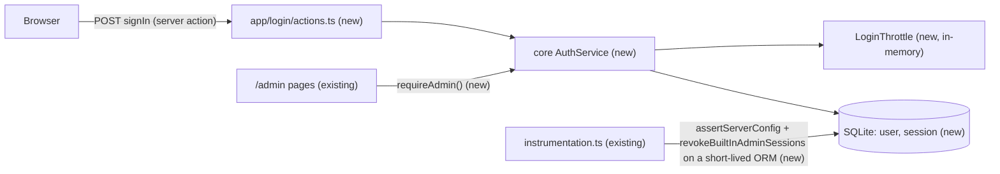
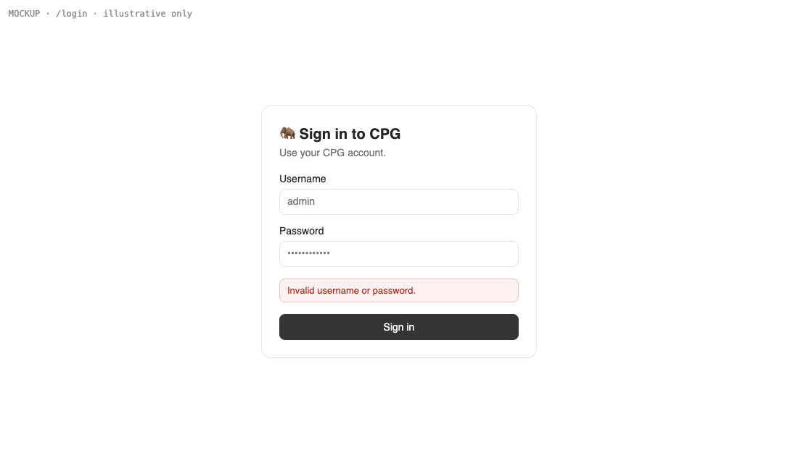
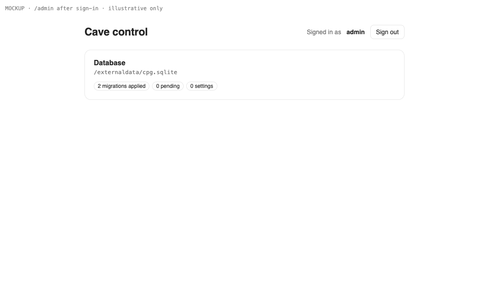

# Admin sign-in and the startup password guard

**Status:** implemented
**Created:** 2026-10-19 07:46 UTC
**Issue:** #15 (E01-S01), epic #9 · **Design authority:** `.ai/specs/product-brief.md`, `.ai/specs/research/CPG-prd001.pdf` §05

## 📝 TLDR

CPG has no authentication: `/admin` is public, and nothing requires an administrator credential. This spec proposes that the server refuses to start unless `CPG_ADMIN_PASSWORD` is set. The single built-in admin would sign in at `/login` with that password and get a server-side session in an `httpOnly` cookie, and every `/admin` page would require that session. This is the first piece of D03's foundations. Normal users, tokens, tenants and audit build on it in later stories.

## Resolved assumptions (autonomous defaults)

| # | Question | Chosen answer | Rationale |
|---|---|---|---|
| Q1 | Session mechanism: server-side sessions or a signed/encrypted cookie (JWT, iron-session)? | Server-side sessions. A random 32-byte token sits in the cookie, and only its SHA-256 hash is stored in a `session` table. | R06 requires a reset or deactivation to end every session at once. A database row can be deleted; a signed cookie can't be revoked before it expires. No new dependency (`node:crypto`). |
| Q2 | Session lifetime? | 12 hours, absolute. No sliding renewal and no "remember me". | The standards ask for a short expiry. 12 h covers a working day. Renewal is a documented known limitation, not silently a longer expiry. |
| Q3 | Password rule for `CPG_ADMIN_PASSWORD`? | Required. At least 12 characters after trimming, otherwise startup fails. | The PRD only says "mandatory". A minimum length is a security floor, not a business feature (D04). It's reversible by changing one constant. |
| Q4 | What does the admin type to sign in? | A username and a password. The built-in admin's username is fixed: `admin`. | E01-S02 adds normal users, who also need a username. One form now avoids changing the login contract next story. |
| Q5 | Which screens require sign-in? (Brief Q03, settled in this epic.) | Every page under `/admin`, and every future CPG screen, which will live under `/admin` with shadcn/ui. Public: `/` (landing), `/login`, `/up`, icons and the manifest. | This matches the repo's existing public frontend vs `/admin` backend split. The PRD's Master Data and Transactions screens are all authenticated, so they belong under `/admin`. |
| Q6 | Brute-force protection parameters? | Two in-memory counters over a rolling 15 minutes. 5 failures per (client IP, username) block that pair for 15 minutes. 20 failures per username from any IP block that username for 15 minutes. Unknown usernames count under one shared per-IP key, and expired entries are pruned on every check. | The standards require a per-IP plus per-account counter with a cooldown, and accept in-memory for a single instance (CPG runs on one VM). The account-wide cap stops a many-IP attack on the one `admin` account. Its cost is that such an attack can lock the admin out for 15 minutes; see Risks. |
| Q7 | What happens to existing admin sessions when `CPG_ADMIN_PASSWORD` changes? | Every server start deletes all of the built-in admin's sessions, through a short-lived connection like the startup migrations. Changing the password needs a restart, so the old sessions end then. Known limitation: during a deploy's overlap, the old container keeps serving until the new one passes `/up`. A sign-in with the old password in that window survives up to 12 h. | R06's spirit is that a credential change ends existing sessions. Binding sessions to the credential would mean storing a password-derived verifier, and the standards allow only argon2id or bcrypt for that, neither of which is in the stack. The cost is that the admin signs in again after each deploy. |
| Q8 | Split the issue? | No. The startup guard and sign-in are one capability: the guard exists so sign-in has a credential. | Neither part delivers value without the other. |

None of these needs human confirmation before merge. Each is reversible without a data migration, except Q1, which is the reason for the `session` table.

## 📝 Problem Statement

`AGENTS.md` and `.ai/docs/engineering-standards.md` both say `/admin` is currently public and nothing sensitive may go there until authentication exists. Every slice 1 story after this one needs a known account: users, tokens, tenants, audit and master data (product brief D02, D03). The PRD (§05) fixes the shape:
- exactly one built-in administrator;
- the admin password comes from a mandatory runtime environment variable;
- the app refuses to start without it;
- there is no password change in the UI and no SSO (R06, N05).

## 📝 Proposed Solution

- **Startup guard.** The guard runs in `packages/app/src/instrumentation.ts`, before migrations. It checks `CPG_ADMIN_PASSWORD` and throws with a clear message if the variable is missing or too short.
  - `loadConfig` reads it into `AppConfig.adminPassword` but does not require it, so the migration CLI and unit tests keep working without it.
  - Instead, `assertServerConfig(config)` makes it mandatory for the server.
- **Sign-in.** `/login` is a server-rendered form posting to a `signIn` server action. `AuthService` in `core`:
  - compares the password with `CPG_ADMIN_PASSWORD` in constant time;
  - creates the built-in admin `User` row on the first successful sign-in;
  - creates a `Session` and returns its raw token, which the action sets as the `cpg_session` cookie.
- **Enforcement.** A `requireAdmin()` helper in `app` reads the cookie, validates the session through `AuthService`, and redirects to `/login` otherwise.
  - Every `/admin` page calls it inside the `<Suspense>` child that renders its data, so no data renders outside the gated boundary.
  - A repo-wide test fails when an `app/admin/**/page.tsx` doesn't call it.
  - `signOut` deletes the session and the cookie.
  - Under Cache Components the static shell of `/admin` (title, layout) is still served before the check. Only data inside the boundary is protected, which is why the boundary rule exists.

**Alternatives considered:**
- **A signed JWT or iron-session cookie.** Rejected: a stateless token can't be revoked before it expires, which R06 requires. It would also add a dependency.
- **A `proxy.ts` (middleware) redirect.** Deferred: the standards require each page to check the session itself, so a proxy would only be an extra optimistic layer (YAGNI).
- **Seeding the admin row in a migration.** Rejected in favour of creating it on first sign-in: fixed UUIDs in a migration, and no startup coupling to the container for the row itself.

**Market check.** Established self-hosted ERPs (Odoo, ERPNext) keep server-side session stores rather than stateless tokens, for the same revocation reason. Current session-handling guidance (e.g. The Copenhagen Book, Lucia's session guide) stores only a hash of the session token, so a database leak doesn't hand out live sessions. CPG follows both. It skips their multi-factor, OAuth and "remember me" layers, which N05 and the minimal-scope rule (D04) exclude.

## 📝 Architecture

- **`db`** — a new folder `auth` with the `User` and `Session` entities, plus one migration.
  - `auth` is cross-cutting, like `system`: `AuthService` owns both entities.
  - E01-S02 may move `User` into a `users` concept with its own `UserService`. Moving an entity file needs no migration.
- **`core`**:
  - `services/auth/auth.service.ts` (`AuthService`, scoped) and `services/auth/login-throttle.ts` (`LoginThrottle`, singleton);
  - `validators/auth/sign-in.schema.ts`;
  - the first shared HTTP layer: `http/errors.ts`, `http/result.ts`, `http/server-action.ts`;
  - `config.ts` (`adminPassword`, `assertServerConfig`);
  - `revokeBuiltInAdminSessions(config)` next to `migrateDatabase` in `database.ts`, on a short-lived connection. Instrumentation never builds the shared container (lesson `2026-10-17--0920UTC-mikroorm-entity-identity-next-bundles`).
  - The engineering standards are updated in the same change:
    - secrets are "read in `loadConfig`, validated for the server in `assertServerConfig`";
    - cookie-reading session helpers live in `app/src/auth/` because `core` can't import `next/headers`;
    - `core/src/http/auth.ts` keeps role assertions for when E01-S02 needs them.
  - This adds the `zod` dependency and the `@cpg/core/validators/*` subpath export, as the standards prescribe for the first schema.
- **`app`**:
  - `src/auth/session-cookie.ts`: cookie name, options and read/write via `next/headers`;
  - `src/auth/require-admin.ts`;
  - `src/app/login/{page.tsx,actions.ts}`, with the login form as a small client component;
  - `/admin` calls `requireAdmin()` and gets a sign-out button;
  - `instrumentation.ts` gains the guard (before migrations) and the purge (after them).
- **Ops:**
  - `config/deploy.yml`: `env.secret: [CPG_ADMIN_PASSWORD]`, plus `proxy.forward_headers: false` pinned explicitly with a comment, so kamal-proxy replaces any client-supplied `X-Forwarded-For` and the throttle's IP is trustworthy;
  - `.kamal/secrets` referencing `$CPG_ADMIN_PASSWORD`;
  - the deploy workflow passing the GitHub secret;
  - the integration test harness passing a test password.

The only cross-cutting effect is that `/admin` stops being public. `/up` stays public, so kamal-proxy health checks are unaffected.

## 📝 Data Model

| Entity | Field | Type | Notes |
|---|---|---|---|
| `User` (`user`) | `id` | uuid PK | standards: UUID primary keys |
| | `username` | string, unique | `admin` for the built-in admin; E01-S02 adds normal users |
| | `role` | enum `admin` \| `user` | only `AuthService.ensureBuiltInAdmin` ever writes `admin`, so exactly one admin exists (TEN-003) |
| | `createdAt` | datetime | |
| `Session` (`session`) | `id` | uuid PK | shown in the future audit as the session id, never the token |
| | `tokenHash` | string(64), unique | hex SHA-256 of the 32-byte random token; the raw token exists only in the cookie |
| | `user` | FK → `User`, on delete cascade | |
| | `createdAt` | datetime | |
| | `expiresAt` | datetime, indexed | `createdAt` + 12 h (Q2) |

No password is stored for the built-in admin: its credential stays in the environment. `passwordHash` for normal users arrives with E01-S02 (argon2id or bcrypt per the standards). One migration, `auth-users-sessions`, is created with `npm run db:migration:create`. Sensitive data: the raw session token is never stored, logged or returned after the cookie is set.

## 📝 API Contracts

There are no route handlers. Bearer-token API access arrives with E01-S03.

- **`signIn(prevState, formData)`** — a server action in `app/src/app/login/actions.ts`.
  - It awaits the `core/http/server-action.ts`-wrapped call. Only when the envelope is `ok` does it set the cookie and call `redirect("/admin")`, outside the wrapper and outside any `try`.
  - The wrapper never sees a Next.js redirect, so `core` doesn't import `next`.
  - Input `signInSchema`: `{ username: string (1–64), password: string (1–256) }`.
  - On failure it returns `{ ok: false, error: { code: "UNAUTHORIZED", message: "Invalid username or password." } }`. The same message is used for an unknown user, a wrong password and an inactive account.
  - When throttled it returns `{ code: "TOO_MANY_ATTEMPTS", message: "Too many attempts. Try again in a few minutes." }`.
- **`signOut()`** — a server action. It deletes the session row (when there is one) and the cookie, then redirects to `/login`, again outside the wrapper. It is idempotent.
- **`AuthService`** (core):
  - `signIn({ username, password, clientIp }) → { token, expiresAt }`; throws `UnauthorizedError` or `TooManyRequestsError`;
  - `validateSession(token) → { userId, username, role } | null`; an expired session is deleted lazily;
  - `signOut(token) → void`;
  - startup purge: `revokeBuiltInAdminSessions(config) → number`, in `database.ts`.
- **Cookie `cpg_session`:** `httpOnly`, `secure` when `config.env === "production"`, `sameSite: "lax"`, `path: "/"`, `maxAge` 12 h.
- **CSRF:** relies on Next.js's built-in Origin check for server actions. No cookie-authenticated route handler exists yet.

## 📝 UI/UX

- **`/login`**: a centred shadcn `Card` with Username, Password and a "Sign in" button.
  - While submitting, the button is disabled and shows a pending label.
  - One generic error message appears above the button.
  - Already signed in → redirect to `/admin`.
  - It uses `@cpg/ui` components in the `/admin` look, but it is public.
  - It is a bespoke form rather than `CrudForm` (which isn't built yet). A credentials form has no cancel, no per-field server errors and no record to edit, so form-over-schema doesn't fit.
- **`/admin`**: the header shows "Signed in as admin" and a "Sign out" button. Without a valid session the page redirects to `/login`.
- English only for now. Polish, theme and the exact footer arrive with E01-S04.

Prototype: `.ai/specs/assets/admin-sign-in/` (static mockups: `mockup-01-login.png`, the login card in its error state; `mockup-02-admin-signed-in.png`, the `/admin` header once signed in). Illustrative only; the shadcn components decide the final look.

## 📝 Edge Cases & Failure Scenarios

| Case | Behaviour |
|---|---|
| `CPG_ADMIN_PASSWORD` unset, empty or shorter than 12 characters | `register()` throws `Missing or too short CPG_ADMIN_PASSWORD`. Next.js's start server catches that, logs it and exits with code 1 (`next/dist/server/lib/start-server.js`), the same path the startup migrations already rely on. kamal-proxy never sees `/up` healthy and keeps the old container (TEN-002) |
| Wrong password, or a username other than `admin` | Generic "Invalid username or password."; no session; failure counted (R06, standards) |
| Sixth failure within 15 min for the same IP and username, or the 21st for the username from any IP | Rejected without checking the password; "Too many attempts…"; blocked until the cooldown ends |
| Expired session | Validation returns null and deletes the row; the page redirects to `/login` |
| Cookie present but row deleted (sign-out elsewhere, restart purge) | Same as expired |
| Server restart | All admin sessions deleted (Q7); the admin signs in again |
| Two admin sign-ins at once (two browsers) | Two independent sessions; unlimited concurrent sessions are allowed (PRD §05, TEN-009) |
| First sign-in race (two requests create the admin row) | `ensureBuiltInAdmin` runs in `em.transactional()` behind the unique `username`; the loser re-reads the row |
| Database unavailable during validation | Fails closed: treated as no session, redirect to `/login`, error logged without the token |
| Missing `x-forwarded-for` (only possible when bypassing kamal-proxy) | The IP part of the throttle key falls back to `unknown`; the key is still per username, so every request without the header shares one bucket for that username |

## 📝 Risks & Impact Review

- **⚠ Deploy prerequisite (operator action).**
  - Before the PR containing Phase 1 merges, someone must create the `CPG_ADMIN_PASSWORD` GitHub Actions secret, because `main` auto-deploys.
  - Without it the new container refuses to start. Kamal keeps the old container serving, so it's safe, but the deploy fails.
  - The implementation PR must say so prominently.
  - Developers need `packages/app/.env.local` for `npm run dev`.
  - Integration tests in `CPG_BASE_URL` mode need `CPG_ADMIN_PASSWORD` in the environment.
- **Admin lockout by a distributed attack.** The account-wide throttle cap (Q6) lets someone who knows the login URL lock the single admin out for 15 minutes at a time. That's accepted in exchange for stopping a many-IP brute force; recovery is waiting, or a restart, which clears the in-memory counters.
- **`/admin` stops being public, and existing tests change:**
  - `tests/integration/smoke.test.ts` must sign in before opening `/admin`, and its migration count goes from 1 to 2;
  - `packages/core/src/index.test.ts` pins the export list;
  - `packages/app/src/instrumentation.test.ts` and `packages/app/src/app/admin/page.test.tsx` need the new mocks (`assertServerConfig`, `revokeBuiltInAdminSessions`, `requireAdmin`).
- **Admin logged out on every deploy (Q7).** An accepted cost; reversible.
- **In-memory throttle.** Resets on restart and isn't shared across instances. Acceptable on one VM; noted for scale-out.
- **Throttle per bundle.** The in-memory `LoginThrottle` singleton lives in each bundle's container. Counting is only shared if every `signIn` runs from the one bundle of `app/login/actions.ts`, which is the case because there's a single sign-in action. Verified by the integration test that hammers the action.
- **Reversibility.** All of it reverses with a revert plus a migration that drops `session` and `user`. No other table references them yet.

## 📝 Decisions in play

- **R06** (one built-in admin, env password, no UI password change; owner Piotr12) is implemented here.
- **N05** (no SSO, one admin) is respected.
- **D03** (foundations in slice 1) and **D04** (no added business requirements; Q3's length floor is a security minimum, not a feature) apply.
- **Brief Q03** is resolved by Q5. That's a default for Piotr12 to override; the brief should be updated to close it when this merges.

Nothing is superseded.

## 📋 Phasing

- **Phase 1 — Startup guard and secret plumbing.** CPG can't start without a valid admin password, in every environment. Ships alone: nothing visible changes except the requirement.
- **Phase 2 — Sign-in, sessions and a protected `/admin`.** The admin signs in and out, and `/admin` requires it.

## 📋 Implementation Plan

### Phase 1 — Startup guard

1. **Config.** Add `adminPassword: string | undefined` to `AppConfig`, read from `CPG_ADMIN_PASSWORD` in `loadConfig`. Add `assertServerConfig(config)`, which throws when the trimmed value is missing or shorter than `MIN_ADMIN_PASSWORD_LENGTH = 12`. Unit tests: missing, empty, whitespace, 11 and 12 characters; the value never appears in the error message.
2. **Guard at startup.**
   - Call `assertServerConfig(loadConfig())` first in `register()`.
   - Pass a test password to the container in `tests/integration/global-setup.ts`; integration tests in `CPG_BASE_URL` mode read it from the environment.
   - Add an integration test that reuses the image `global-setup` builds, starts it without the variable, and asserts the container exits non-zero and logs the guard message (TEN-002). It's skipped when `CPG_BASE_URL` is set.
   - Update `instrumentation.test.ts`.
3. **Deploy and dev plumbing** (create the GitHub secret before this PR merges):
   - `config/deploy.yml` `env.secret: [CPG_ADMIN_PASSWORD]` and `proxy.forward_headers: false`;
   - `.kamal/secrets` `CPG_ADMIN_PASSWORD=$CPG_ADMIN_PASSWORD`;
   - `.github/workflows/deploy.yml` passes `secrets.CPG_ADMIN_PASSWORD`;
   - README development section: put it in `packages/app/.env.local` (gitignored).
   - Verify with `kamal config` locally if available, otherwise by review.

### Phase 2 — Sign-in

4. **Shared HTTP layer:**
   - `core/src/http/errors.ts`: `AppError`, `ValidationError`, `UnauthorizedError`, `TooManyRequestsError`. Add `NotFoundError`, `ConflictError` and `ForbiddenError` only when a step uses them.
   - `result.ts`: the envelope.
   - `server-action.ts`: Zod parse, `AppError` → envelope, anything else logged without details and returned as a generic `INTERNAL` error. Callers redirect after it returns `ok`, so it never imports `next`.
   - Add `zod`, `validators/auth/sign-in.schema.ts` and the `@cpg/core/validators/*` export. Unit tests for every branch.
5. **Entities and migration.** `db/src/entities/auth/{user,session}.entity.ts`, registered in `entities/index.ts`; `npm run db:migration:create -- auth-users-sessions`; commit the migration, snapshot and index. Test that migrations apply on a temp SQLite file, and that unique `username` and `tokenHash` and the cascade delete hold.
6. **`LoginThrottle`, `AuthService` and the purge.** Register `loginThrottle` (singleton) and `authService` (scoped) in `container.ts` and `cradle.ts`. Add `revokeBuiltInAdminSessions(config)` to `database.ts`. Export from `index.ts`, and update `index.test.ts`. Unit tests against real SQLite:
   - success creates the admin once (TEN-003);
   - wrong password and unknown user give the same `UnauthorizedError`;
   - the comparison is constant-time (`timingSafeEqual` on SHA-256 digests);
   - the throttle allows 5 per IP and username, blocks the 6th, caps at 20 per username across IPs, buckets unknown usernames per IP, prunes expired entries, and resets after the window;
   - an expired session is rejected and deleted;
   - `signOut` is idempotent;
   - `revokeBuiltInAdminSessions(config)` deletes only the admin's sessions and closes its connection;
   - the token is never stored in the clear.
7. **App auth helpers.**
   - `app/src/auth/session-cookie.ts` (options per API Contracts) and `require-admin.ts` (`validateSession`, else `redirect("/login")`; fails closed on errors).
   - In `register()`, after migrations, call `revokeBuiltInAdminSessions(config)` (Q7).
   - Update `.ai/docs/engineering-standards.md` as described in Architecture.
   - Unit tests mock `next/headers` and `@cpg/core`.
8. **Pages and actions:**
   - `/login` page, the client form component and the `signIn`/`signOut` actions;
   - `/admin` calls `requireAdmin()` inside its `<Suspense>` data component and shows the signed-in header and sign-out button;
   - client IP from the first `x-forwarded-for` entry via `headers()`.
   - Add a repo-wide test, `tests/admin-pages-require-admin.test.ts`, that every `packages/app/src/app/admin/**/page.tsx` calls `requireAdmin`.
   - Unit tests (await async server components per `app/src/app/admin/page.test.tsx`).
9. **Integration tests** in `tests/integration/auth.test.ts`:
   - an unauthenticated `/admin` redirects to `/login`;
   - a wrong password shows the generic error and sets no cookie;
   - the right password lands on `/admin` showing "Signed in as admin";
   - the cookie has `HttpOnly`, `Secure` and `SameSite=Lax`;
   - six wrong attempts show the throttle message;
   - tests assert the final URL, not the status code;
   - sign out returns to `/login`, and `/admin` redirects again.
   - Update `smoke.test.ts` to sign in first and expect 2 migrations.
   - Then run the full gate: lint, typecheck, `test:coverage` (100%), build, `test:integration`, and `npm audit` triage for `zod`.

## Implementation notes

Implemented on PR #29. These deviations from the text above are deliberate:

- **The startup guard exits the process itself.** The design says `register()` throws and Next.js stops. That holds for `next start`, but the standalone server in the Docker image (`node server.js`) only logs a failing `register()` and then answers every request with a 500. `instrumentation.ts` logs the message and calls `process.exit(1)`, and `tests/integration/startup-guard.test.ts` proves the container exits.
- **The throttle keys every attempt by the submitted username, and adds an IP-wide cap.** Q6 puts all unknown usernames from one IP into one shared bucket. The code counts failures per client and username (5), per username across clients (20), and per client across all usernames (50, `MAX_FAILURES_PER_IP` in `services/auth/login-throttle.ts`). A block then looks the same for a real and an unknown username, so it never reveals which accounts exist, and name spraying from one address is still capped. A request with no usable client address gets no IP-wide bucket.

Changed by later stories, without weakening this spec's criteria:
- **E01-S02 (#16, PR #34):** `/admin` admits any active account through `requireUser()`; `requireAdmin()` guards only admin-only pages. `tests/admin-pages-require-admin.test.ts` keeps the list.
- **E01-S03 (#17, PR #41):** a restart with a changed `CPG_ADMIN_PASSWORD` also revokes the admin's API tokens (`revokeAdminTokensIfPasswordChanged` in `core/src/database.ts`).
- **#43 (PR #46):** the "Signed in as" header and the sign-out control moved into the account panel of the role-based menu (`components/layout/account-panel.tsx`).
- `smoke.test.ts` now expects one migration per schema change made since, not the two named in step 9.

Brief Q03 is closed in the brief as Q5 above decided, with `/help` added to the public frontend by `2026-10-19--0855UTC-user-preferences-footer-help`.
