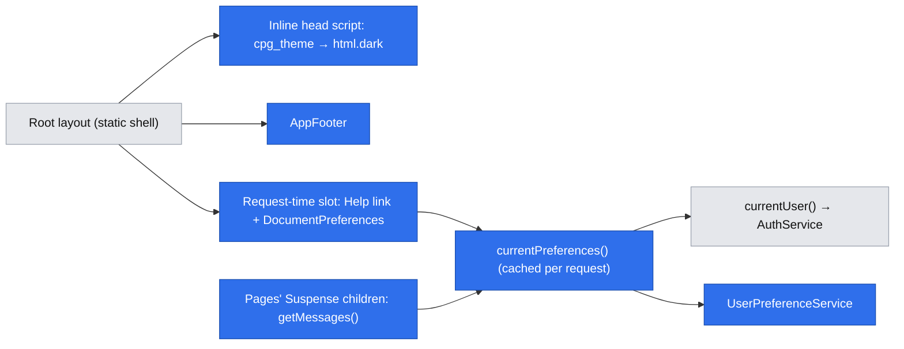
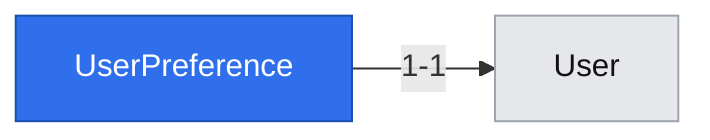

# Language and theme preferences, the exact footer and in-app help

**Status:** implemented
**Created:** 2026-10-19 08:55 UTC
**Issue:** #18 (E01-S04), epic #9 · **Depends on:** E01-S01 (#15, shipped in #29) · **Design authority:** `.ai/specs/product-brief.md`, `.ai/specs/research/CPG-prd001.pdf` §05–§06, `.ai/specs/research/CPG-acceptance.md` UX-001…UX-013

## 📝 TLDR

Today every CPG page is English and light-only, there is no footer, and there is no help. This spec proposes that every signed-in account would pick English or Polish and light or dark mode, stored against the account so the choice survives signing out and holds across browsers. Every page would end with the PRD's exact footer sentence and its two links, and every page would carry a Help link to a searchable, bilingual `/help` with a topic for each existing screen. The topic set then grows with each new screen (D03). This is the last E01 foundation that the screens in later stories build on.

## Resolved assumptions (autonomous defaults)

| # | Question | Chosen answer | Rationale |
|---|---|---|---|
| Q1 | The issue bundles four capabilities that would each work alone: language, theme, footer and help. Split it into separate specs? | No. One spec, as the backlog filed it, with four phases that each ship and deploy on their own. | The story is the tracking unit and its acceptance criteria are written together. The phasing keeps each part independently shippable and reviewable, which is what a split would buy. |
| Q2 | Where is a preference stored? | A new `user_preference` table, one row per account, written on the first change. With no row, the account sees the defaults. | UX-003 and UX-007 make it an account setting, so a browser-only cookie fails them. A separate table is additive (no backfill, no change to `user`), the old release ignores it on rollback, and no row means "never chose", which is UX-001 for free. |
| Q3 | Which themes, and what is the default? | `light` and `dark` only, defaulting to `light`. No "follow the system" option. | The PRD names exactly two modes (D04: no added requirements). Light is what CPG renders today, so nothing changes for anyone until they choose. |
| Q4 | What do pages show with no one signed in, and what does a signed-in account see on the public pages? | Signed out: English and light everywhere. Signed in: the account's language and theme on every page, `/` and `/help` included. `/login` is only ever seen signed out, because it redirects a signed-in admin away. | A preference belongs to an account. Before sign-in there is none, and UX-001 makes English the default. Applying it everywhere once signed in avoids pages that are half Polish and half English. |
| Q5 | Translation mechanism and URL shape? | Typed local dictionaries (`en`, `pl`) in `app`, selected by the account's preference. No i18n library, and no locale in the URL. | Two languages and a few dozen strings need about 20 lines of code (standards: no dependency for that). The language follows the account, not the link, and `[lang]` URL segments would change every public URL (BACKWARD_COMPATIBILITY §4). |
| Q6 | How does the theme apply under Cache Components without making every page request-time? | Next.js's documented pattern. A small inline `<head>` script sets `class="dark"` on `<html>` from a readable `cpg_theme` cookie before first paint. The database stays the source of truth: sign-in and every change rewrite the cookie, sign-out clears it, and a client component corrects the cookie and the class if they ever disagree with the account. | `node_modules/next/dist/docs/01-app/02-guides/migrating-to-cache-components.md` (root-layout `<html>` attributes) and `preventing-flash-before-hydration.md`. The class has to sit on `<html>` so that shadcn portals (dialogs, selects, tooltips), which render into `<body>`, are themed too. |
| Q7 | Exact footer wording and links? | `Caveman Planning Good! Made in Jozefoslaw with Tokens, Coffee and OpenMercato Skills during AITechLeaders training.` in English in both languages. "OpenMercato Skills" links to `https://github.com/open-mercato/skills` and "AITechLeaders training" to `https://www.aitechleaders.pl/`. Both open in a new tab with `rel="noopener noreferrer"`. | R11 demands the *exact* sentence, so it is not translated. UX-011 and UX-012 give the targets and name the second link the "AITechLeaders training link". A new tab keeps a half-filled form intact. Each is a one-string change if the owner reads R11 differently. |
| Q8 | What does "help" mean in this story? | A public `/help` page: one or more topics per existing screen in both languages, with server-side search over titles and text. Every page links to it. Contextual field tooltips (UX-014) and guided how-tos (UX-015) arrive with the screens that have fields and workflows to explain. | The issue's criterion is "searchable help exists for every slice 1 screen", and its scope excludes help for screens that don't exist yet. `/help` is public because the login screen needs help too and help holds nothing sensitive (brief Q03: public frontend, plain Tailwind). |
| Q9 | Bearer-token API and audit for preference changes (R07, R08)? | Deferred to the stories that build them: the bearer API (E01-S03, #17, with the parity pattern in E02-S03, #21) and the audit log (E02-S02, #20). Both must then cover `UserPreferenceService.update`. | Neither layer exists yet, so there is nothing to attach to. The service is the single write path, so adding the route and the audit event later touches one place. |
| Q10 | Where does a user change the settings? | In the signed-in header next to "Sign out": a language switch (English / Polski, each named in its own language) and a theme switch (Light / Dark), each a pair of buttons with the current one marked pressed. | This is the smallest surface that is always reachable. A separate settings page is unnecessary for two values. |

None of these needs human confirmation before merge. Each is reversible. The only schema change is Q2's additive table, which a later migration can drop.

## 📝 Problem Statement

The PRD (§05 "UI and preferences", "In-app documentation", "Exact footer"; §06 "Navigation, help, language, theme" and "Footer") and the decision register ("Bilingual help", "Theme and branding": both approved) require:

- per-user English/Polish with English as the default;
- selectable light and dark modes;
- searchable bilingual help reachable from every screen;
- the exact branded footer, with working links, on every application page, login included (R11).

None of this exists. `packages/app/src/app/layout.tsx` hardcodes `lang="en"` and has no footer, `/` ends with an unrelated tagline in a `<footer>`, and no page offers help. D03 puts these in slice 1 so that every later screen is built with translations and a help topic from the start, instead of retrofitting dozens of screens. Acceptance: UX-001…UX-013 (UX-004 and UX-009 become checkable once tenants and the Transactions screen exist).

## 📝 Proposed Solution

- **Footer.** An `AppFooter` server component, rendered last in the root layout, so every page, present and future, ends with it. It is static, so it is part of every prerendered shell. The landing page's tagline becomes a plain paragraph, so the page has one footer.
- **Preferences.** `UserPreferenceService` (`core`) reads an account's `{ locale, theme }`, returning defaults when the account has no row, and upserts changes. An `updatePreferences` server action (next to `/admin`) is the only write path from the UI.
- **Language.** `app/src/i18n/` holds the `en` dictionary and a `pl` dictionary typed against it, so a missing Polish string fails `typecheck`. `getMessages()` resolves the signed-in account's dictionary once per request (React `cache`). Localized text renders only inside the request-time `<Suspense>` children, which already gate data. Each child wraps its output in an element with `lang={locale}`, so the language is right in the server HTML with no JavaScript. Static shells hold no translatable text: `<Suspense>` fallbacks are text-free `aria-busy` placeholders. `/` moves its copy into such a child too (Q4).
- **Theme.** See Q6. The inline head script handles the first paint, and `DocumentPreferences` (a client component) keeps `<html lang>`, the `dark` class and the cookie in line with the account on later renders and soft navigations. `<html lang>` is a best-effort extra: the server-rendered `lang` on each localized wrapper is what holds without JavaScript.
- **Help ordering.** Help (Phase 4) builds on Phase 3's root-layout slot, so the phases ship in order.
- **Help.** Topics live as typed bilingual content in `app/src/help/`, each tied to the route it explains. `/help?q=` filters them on the server, ignoring case and diacritics, so it works without JavaScript. A Help link sits in a small request-time slot of the root layout on every page. A repo-wide test fails when a page has no topic, which makes "help grows screen by screen" enforced rather than remembered.

**Alternatives considered:**

- **`next-intl` or another i18n library.** Rejected: a new dependency and routing middleware for two languages that follow the account, not the URL.
- **Rendering the whole body inside one root `<Suspense>`** and putting the `dark` class on a wrapper `
`. Rejected: every page loses its static shell, and portaled shadcn content would stay light in dark mode.
- **Preferences as columns on `user`.** Rejected: `AuthService` owns that entity, and `user` rows for the admin are created lazily at sign-in. A separate table gives the preference its own owner and needs no backfill.
- **Storing preferences only in cookies.** Rejected: that fails UX-003 (per account on a shared browser) and UX-007 (the setting belongs to the account).

**Market check.** Self-hosted business apps (Odoo, ERPNext, Grafana) keep language and theme on the user record and render the UI from it after sign-in, and Grafana and GitLab fall back to a default for signed-out pages, which is the model here. They ship full translation pipelines (gettext/PO files, translation platforms) and help centers with their own search index. CPG skips both: two hand-maintained languages and a small topic list don't justify them (D04). They become worth revisiting only if the help corpus grows past what an in-memory filter handles.

## 📝 Architecture

Takeaway: one cached lookup per request feeds both the root slot and the page content. Everything else in the shell stays static.

- **`db`:** a new `preferences` concept folder with `user-preference.entity.ts` (`UserPreference`), `LOCALES`/`THEMES` constants and `Locale`/`Theme` types beside it (like `USER_ROLES`), and one migration, `user-preferences`.
- **`core`:**
  - `services/preferences/user-preference.service.ts` (`UserPreferenceService`, scoped, registered in `container.ts`/`cradle.ts`, exported from `index.ts`), with `DEFAULT_PREFERENCES = { locale: "en", theme: "light" }`. `core` re-exports `LOCALES`, `THEMES`, `Locale` and `Theme`, because `app` must not import `@cpg/db`;
  - `validators/preferences/user-preference-update.schema.ts`;
  - `AuthService.signIn` also returns the `userId`, so the sign-in action can set the theme cookie.
- **`app`:**
  - `src/i18n/messages/{en,pl}.ts`, `src/i18n/get-messages.ts`, and `src/i18n/error-message.ts`, which translates an envelope's `code` with a fallback to the server's message;
  - `src/preferences/{current-preferences,theme-cookie,theme-script}.ts`;
  - `src/components/layout/{app-footer,help-link}.tsx`, and `src/components/preferences/{preferences-controls,document-preferences}.tsx`, both client components;
  - `src/help/{topics,search-help}.ts`, plus the `src/app/help/page.tsx` page;
  - `currentUser()` in `src/auth/require-admin.ts` is wrapped in React `cache`, so the root slot, `getMessages()` and `requireAdmin()` share one session lookup per request. `updatePreferences` reads only `currentUser()`, never the cached preferences, so the `refresh()` render can't show values from before the write;
  - `/admin` moves its heading into the gated child, renders `PreferencesControls` in its header, and gains the `updatePreferences` action in `admin/actions.ts`; `signIn` and `signOut` write and clear `cpg_theme`.
- **`ui`:** no new components. `globals.css` already has the `.dark` tokens and the `dark` custom variant. It gains `color-scheme: dark` under `.dark`, so native controls and scrollbars follow the theme.
- **Docs, updated in the same change:**
  - `.ai/docs/engineering-standards.md` gets a short "Language, theme and help" rule: user-visible strings go in both dictionaries, render inside request-time boundaries, and every new page adds its help topic in both languages. It also records `cpg_theme` as the one deliberately readable cookie (a non-sensitive display hint, never trusted on the server).
  - `BACKWARD_COMPATIBILITY.md` adds `/help`, the `user_preference` table and the `cpg_theme` cookie.
- **Later stories that rely on this:** E01-S02 (normal users get preferences with no extra work), E02-S01 (tenants: the table is global, so UX-004 holds by construction and a Test reset must not touch it), E02-S02 (audit of preference changes), and E01-S03/E02-S03 (bearer API for preferences).

## 📝 Data Model

| Entity | Field | Type | Notes |
|---|---|---|---|
| `UserPreference` (`user_preference`) | `id` | uuid PK | standards: UUID primary keys |
| | `user` | one-to-one FK → `User`, unique, on delete cascade | one row per account; global, never tenant-scoped (PRD §05: preferences survive a Test reset) |
| | `locale` | enum `en` \| `pl` | written as `en` when a row is created by a theme-only change |
| | `theme` | enum `light` \| `dark` | written as `light` when a row is created by a language-only change |
| | `updatedAt` | datetime | set on create and update |

- **No row** means the account never chose, and reads return `DEFAULT_PREFERENCES`.
- **Writes** are one `em.upsert` on the unique `user`, so a double-click or two tabs can't create two rows.
- **Migration** `user-preferences`, created with `npm run db:migration:create`. `down()` drops the table.
- **Rollback:** the previous release never reads the table, so `kamal rollback` is safe, and choices made in between come back on the next roll-forward.
- **Sensitive data:** none.

## 📝 API Contracts

There are no route handlers (Q9).

- **`UserPreferenceService`** (`core`):
  - `get(userId) → { locale, theme }`, with the defaults when there is no row;
  - `update(userId, patch) → { locale, theme }`. `patch` is the parsed schema output, and fields it omits keep their stored or default value.
- **`userPreferenceUpdateSchema`:** `{ locale?: "en" | "pl", theme?: "light" | "dark" }`, refined to require at least one field. Unknown keys are stripped, so there is no mass assignment, and nothing else is writable.
- **`updatePreferences(prevState, formData)`:** a server action in `app/src/app/admin/actions.ts`, wrapped in `serverAction`.
  - It requires a signed-in account of any role via `currentUser()`, and throws `UnauthorizedError` otherwise. It always writes the caller's own row, never one named by the input.
  - On `ok` it writes `cpg_theme` and calls `refresh()` from `next/cache`, so the page re-renders in the new language.
  - It returns `{ error?: string }` translated through `error-message.ts`. `UNAUTHORIZED` redirects to `/login`.
- **`signIn`** reads the stored theme after the session is created. If that read fails, it logs the error, writes `light`, and still signs the user in, because a display preference never blocks sign-in.
  - CSRF: Next.js's built-in Origin check for server actions.
- **Cookie `cpg_theme`:**
  - values `dark` or `light`, anything else read as `light`;
  - **not** `httpOnly`, because the head script reads it;
  - `secure` in production, `sameSite: "lax"`, `path: "/"`, `maxAge` one year (`THEME_COOKIE_MAX_AGE_S`, long enough that a returning user on the same browser never sees a flash);
  - written by `signIn` (the account's stored theme) and `updatePreferences`, deleted by `signOut`;
  - never read on the server for any decision.
  - `THEME_SCRIPT` is a constant with no interpolation. It only calls `classList.add("dark")` when a cookie value equals exactly `dark`. A future Content-Security-Policy must allow it by hash, not by nonce: a nonce would make every page request-time.
- **`AuthService.signIn`** returns `{ token, expiresAt, userId }`. This is additive, and the only caller is `signIn`.
- **`/help?q=<text>`:** a public page.
  - `q` is trimmed and capped at 100 characters (`HELP_QUERY_MAX_LENGTH`).
  - The result lists topics where every whitespace-separated term occurs in the title or the text, after lowercasing, NFD decomposition with combining marks stripped, and `ł`→`l`, which doesn't decompose.
  - An empty `q` lists every topic. Each topic has a stable anchor `#<topic-id>`.

## 📝 UI/UX

- **Every page** ends with the footer (small, muted, centred), and has a "Help" / "Pomoc" link at the top right.
- **`/admin` header:** `Signed in as admin · [English | Polski] · [Light | Dark] · Sign out`. The two switches are pairs of small outline buttons with `aria-pressed` on the active one and a visually hidden group label ("Language", "Theme"). Choosing one re-renders the page in place with no full reload. An error (only possible when the session expired mid-click) shows as an inline alert in the account's language.
- **`/help`:** a page heading, a search field with a submit button (GET form), and the topic list (title and paragraphs, anchored). When nothing matches it shows "No help topics match "{q}"." with a link back to all topics. In the account's language when signed in, English otherwise.
- **Topics at launch**, each in English and Polish:
  - `getting-started` (`/`): what CPG is and where to start;
  - `signing-in` (`/login`): username and password, the generic error, the lockout after repeated failures;
  - `admin-home` (`/admin`): what the Database card shows, and signing out;
  - `language-and-theme` (`/admin`): how to switch, and that the choice is kept per account;
  - `using-help` (`/help`): searching, and that topics grow with each screen.
- **Translated:** all `/admin` and `/help` text, the header controls and translated error codes. Not translated: the footer (Q7), page `<title>`s, which stay as static metadata, and `/` and `/login`, which have no account yet (Q4) but take their strings from the `en` dictionary like every other screen.
- **Accessibility:** `<html lang>` follows the account; the switches are real buttons in forms and work without JavaScript; the dark tokens are the shadcn `radix-nova` set already in `globals.css`.

Prototype: `.ai/specs/assets/user-preferences-footer-help/`. These are illustrative statics, not app code:

| Image | Shows |
|---|---|
|  | `/admin`, English, light: the switches, the Help link and the footer |
|  | the same account after choosing Polski and Ciemny |
|  | `/help` searched for "sign" |

Today's `/`, `/login` and `/admin` are in `current-01-landing.png`, `current-02-login.png` and `current-03-admin.png` in the same folder.

## 📝 Edge Cases & Failure Scenarios

- **A preference read fails** (database error): `currentPreferences()` logs it and falls back to the defaults. The page still renders, in English and light. A display preference is never a reason to fail a page. Authorization is unaffected: `requireAdmin()` keeps its own fail-closed path.
- **The cookie and the account disagree**, for example after a change made in another browser. The first paint uses the stale cookie, then `DocumentPreferences` corrects the class and rewrites the cookie at hydration. This is one brief flash, once.
- **The session expires without a sign-out:** the cookie survives, but the signed-out pages want light. `DocumentPreferences` applies light and deletes the cookie.
- **JavaScript disabled:** the head script doesn't run, so the theme stays light. Language, the switches (plain form posts), help search and the footer still work.
- **A tampered `cpg_theme` value** is treated as `light`. It only ever affects the visitor's own rendering.
- **A tampered switch payload** (an unknown locale, or a `userId` field): the schema rejects or strips it. The action only writes the session's own account.
- **A Polish search with or without diacritics** ("łatwo" vs "latwo", "Pomoc" vs "pomoc") finds the same topics. A query longer than 100 characters is truncated, not rejected.
- **A page added without a help topic** (in a later story) fails `npm test` (`tests/every-page-has-help.test.ts`). A missing Polish string fails `typecheck`.
- **The preference read fails during sign-in:** the user is still signed in with a `light` cookie, and the error is logged (API Contracts).

## 📝 Risks & Impact Review

- **Schema** (BACKWARD_COMPATIBILITY §1): one additive table, no change to existing ones, `down()` included, rollback-safe (see Data Model). The PR is `risk-high` and carries the rollback note.
- **New contracts:** the `cpg_theme` cookie and the `/help` URL become protected surfaces (§4), documented in the same PR. The cookie is deliberately readable by scripts, a documented exception to the "cookies are `httpOnly`" habit. It carries only `light`/`dark` and nothing on the server trusts it. The session cookie keeps its flags.
- **Rendering:** every page gains one small request-time slot in the root layout, for the Help label and the document sync. The rest of each static shell is unchanged. `/admin`'s heading moves inside its gated `<Suspense>` child, which shrinks that page's static shell.
- **Translation quality:** the Polish strings and topics are written by the agent. Piotr12 reviews them on the PR, and they are trivial to amend later.
- **Product direction calls**, made as defaults and easy to reverse: an untranslated footer (Q7), English-only signed-out pages (Q4), and tooltips and how-tos deferred to their screens (Q8).

## 📝 Decisions in play

- **R11** (exact footer with working links on every application page; owner Piotr12): implemented here, with the linked phrases read per Q7.
- **D03** (foundations in slice 1; translations and help grow screen by screen): implemented here, and enforced for later screens by the typed dictionaries and the help-coverage test.
- **D04** (no added requirements): applies. Two languages, two themes and no system mode.
- **D05** (theme and footer kept in slice 1): applies.
- **R07 and R08** (API parity, audit): not contradicted. They are sequenced after the layers that implement them (Q9).
- **Brief Q03:** `/help` is public frontend. Screens that need an account stay under `/admin`, consistent with the sign-in spec's Q5.

Nothing is superseded.

## 📋 Phasing

- **Phase 1 — The exact footer on every page.** Ships alone: R11, UX-008, UX-010 (for the pages that exist), UX-011 and UX-012.
- **Phase 2 — Stored preferences.** The table and the service, with no UI yet. Ships alone, with nothing visible.
- **Phase 3 — Language and theme in the UI.** The switches, the dictionaries and the theme mechanism: UX-001, UX-002, UX-003 (service level), UX-005, UX-006 and UX-007.
- **Phase 4 — In-app help.** `/help`, the Help link and the topic-coverage rule: UX-013, and the issue's last criterion. It ships after Phase 3, whose root-layout slot holds the Help link.

## 📋 Implementation Plan

### Phase 1 — Footer

1. **`AppFooter` on every page.**
   - Add `app/src/components/layout/app-footer.tsx` with the Q7 sentence and links, as named constants (`FOOTER_LINKS`), and render it last in `app/src/app/layout.tsx`.
   - Change the `/` tagline's `<footer>` to `
`.
   - Unit tests: the exact text, both `href`s, `target`/`rel`, and that the layout renders the footer after `children`.
   - Add the integration test `tests/integration/footer.test.ts`: on `/`, `/login` and `/admin` (signed in), the last footer's `textContent` equals the sentence and both links resolve to the exact targets (UX-008, UX-010, UX-011, UX-012).

### Phase 2 — Stored preferences

2. **Entity and migration.**
   - Add `db/src/entities/preferences/user-preference.entity.ts` with the `LOCALES`/`THEMES` exports, and register it in `entities/index.ts`.
   - Run `npm run db:migration:create -- user-preferences`, and commit the migration, snapshot and index together.
   - Tests on a temp SQLite file: migrations apply up and down, `user` is unique, and deleting a user cascades.
3. **`UserPreferenceService` and the schema.**
   - Add `user-preference-update.schema.ts` and the service. Register `userPreferenceService` (scoped) in `container.ts`/`cradle.ts`, and export it from `index.ts` (update `index.test.ts`).
   - Tests against real SQLite: defaults with no row (UX-001); a theme-only change keeps `en`; a language change keeps the theme; two users are independent (UX-003); a repeated update leaves one row; the schema rejects an empty patch and unknown values and strips extra keys.

### Phase 3 — Language and theme in the UI

4. **Dictionaries and the per-request lookup.**
   - Add `i18n/messages/en.ts` and `pl.ts` (typed `Messages`), `get-messages.ts`, `error-message.ts`, and `preferences/current-preferences.ts`. Wrap `currentUser()` in React `cache`.
   - Move the strings of `/`, `/login` and `/admin` into `en`, keeping today's English text verbatim, and add their Polish counterparts. `/` renders its copy in a request-time child (Q4). Localized children wrap their output in `lang={locale}`, and fallbacks become text-free `aria-busy` placeholders.
  - `core` re-exports `LOCALES`, `THEMES`, `Locale` and `Theme`; update `index.test.ts`.
   - Tests: the dictionaries have the same keys (a runtime check besides the type); signed out gives `en`; a Polish account gives `pl`; a failing service logs and gives the defaults; known error codes are translated and unknown ones fall back to the server message.
5. **Theme mechanism.**
   - Add `preferences/theme-cookie.ts` (write, clear and parse) and `preferences/theme-script.ts` (the `THEME_SCRIPT` string).
   - Root layout: `<html suppressHydrationWarning>`, the script in `<head>`, and a `<Suspense>` slot whose child calls `await connection()`, then renders `DocumentPreferences` with `currentPreferences()`.
   - Add `.dark { color-scheme: dark }` to `globals.css`.
   - Tests:
     - `THEME_SCRIPT`, evaluated in jsdom, adds `dark` only for `cpg_theme=dark`;
     - `DocumentPreferences` sets `lang`, toggles the class, and rewrites or deletes the cookie only when it differs;
     - the cookie options match API Contracts, including that it is not `httpOnly`.
6. **Switches and the action.**
   - Add `components/preferences/preferences-controls.tsx` and `updatePreferences` in `admin/actions.ts`.
   - `/admin`: the heading and all text come from `getMessages()` inside `AdminContent`, plus the controls in its header.
   - `AuthService.signIn` returns `userId`; `signIn` writes `cpg_theme` from `userPreferenceService.get`; `signOut` clears it.
   - Tests:
     - the action writes only the session's own account;
     - signed out, it redirects to `/login`;
     - an invalid payload returns a translated error;
     - `refresh()` is called on success;
     - `aria-pressed` follows the current values;
     - `signIn` still succeeds and writes `light` when the preference read throws;
     - the existing sign-in and sign-out tests are extended for the cookie.
7. **Integration test** `tests/integration/preferences.test.ts`:
   - sign in and see English and light (UX-001);
   - switch to Polski: `/admin` shows the Polish heading and `<html lang="pl">` (UX-002);
   - switch to Dark: `<html>` has `dark` (UX-006), then back to Light (UX-005);
   - sign out: `/login` is English and light;
   - sign in again: Polish and dark are kept (UX-007);
   - right after each switch, the page shows the new value without a reload. This proves the `refresh()` render isn't served stale preferences.
   - The two-account half of UX-003 is added here once E01-S02 can create a second account. A comment in the test points at #16.

### Phase 4 — Help

8. **Topics and search.**
   - Add `help/topics.ts` (topic ids as a union, with an `en` and a `pl` record keyed by them, each with `route`, `title` and `body`) and `help/search-help.ts`.
   - Add the repo-wide test `tests/every-page-has-help.test.ts`: every `packages/app/src/app/**/page.tsx` maps to a route that has at least one topic.
    - A page's route is its directory path relative to `src/app`, with a leading `/`.
    - Route groups `(x)` are dropped, and dynamic segments are kept literally (`/admin/materials/[id]`).
    - A topic's `route` uses the same form.
   - Tests: case and diacritic folding including `ł`; multi-term AND; an empty query returns everything; a long query is capped; and `en` and `pl` cover the same ids.
9. **`/help` page and the Help link.**
   - Add `app/src/app/help/page.tsx` (plain Tailwind; the search results render in a `<Suspense>` child that awaits `searchParams` and `getMessages()`), and `components/layout/help-link.tsx` in the root layout's slot, next to `DocumentPreferences`.
   - Unit tests for the page states (all topics, matches, no match) in both languages.
   - Add the integration test `tests/integration/help.test.ts`: the Help link is on `/`, `/login` and `/admin`; searching "sign" finds `signing-in`; a Polish account sees Polish topics and finds them by "logowanie" (UX-013).
   - Extend `footer.test.ts` with `/help` (UX-010).
10. **Docs and the gate.**
    - Update `.ai/docs/engineering-standards.md` and `BACKWARD_COMPATIBILITY.md` as described in Architecture.
    - Run lint, typecheck, `test:coverage` (100%), build and `test:integration`, and check `/admin` and `/help` in both themes and languages with `npm run dev`. No dependency is added, so no `npm audit` triage is needed.

## Implementation notes

Implemented on PR #32. Differences from the text above:

- **File names.** The theme script lives in `app/src/preferences/theme.ts`, not `theme-script.ts`. There is no `components/layout/help-link.tsx`: #43 (PR #46) folded the Help link into the role-based menu (`components/layout/nav-items.ts`), which the root layout's app bar renders on every page.
- **Bearer-token API and audit (Q9, and "There are no route handlers" under API Contracts).** Both were deferred and have since landed. E02-S02 (#20, PR #42) audits `UserPreferenceService.update`. E02-S03 (#21, PR #48) added `GET /api/preferences` and `PATCH /api/preferences`. They change only the caller's own row and require an `Idempotency-Key`. They need no version, because only the fields sent change.
- **Help covers every screen built since.** `tests/every-page-has-help.test.ts` fails the build for any `page.tsx` without a topic. The topic texts are typed per locale, so a topic missing in Polish is a type error.

Some scenarios are unit-tested or true by construction, but not yet asserted end to end:
- the two-account half of UX-003;
- UX-004, the language kept across a tenant switch;
- the footer on the admin screens added after this story: `/admin/users`, `/admin/tokens`, `/admin/audit`, `/admin/[tenant]` and `/admin/[tenant]/audit`. The footer itself is in the root layout, so every page renders it.

See `.ai/specs/research/CPG-acceptance.md` for the status of each scenario.
