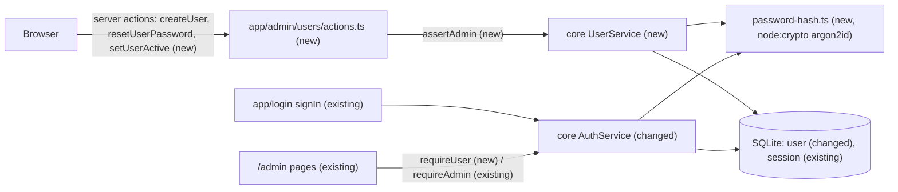
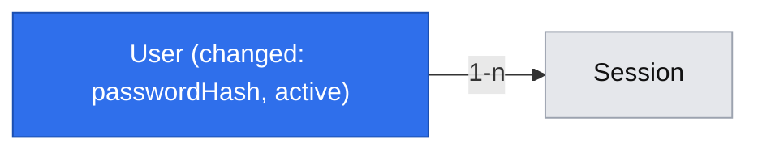

# The admin manages normal users

**Status:** implemented
**Created:** 2026-10-19 09:12 UTC
**Issue:** #16 (E01-S02), epic #9 · **Builds on:** `2026-10-19--0746UTC-admin-sign-in.md` (#15, merged) · **Design authority:** `.ai/specs/product-brief.md`, `.ai/specs/research/CPG-prd001.pdf` §05

## 📝 TLDR

Today only the built-in admin can sign in. `User` holds nothing but a username and a role, and every `/admin` page requires the admin. This spec proposes that the admin creates normal users with an initial password, resets their passwords, and deactivates or reactivates them on a new `/admin/users` screen. A normal user signs in at the same `/login` and gets into `/admin` without any admin rights. A reset or a deactivation deletes all of that user's sessions in the same transaction, so access ends at once (R06). Users are never deleted. This is what E01-S03 (tokens) and E02-S02 (audit) build on.

## Resolved assumptions (autonomous defaults)

| # | Question | Chosen answer | Rationale |
|---|---|---|---|
| Q1 | Where does a normal user land, and which screens can they see? | `/admin`, like the admin. A new `requireUser()` gate admits any active account. `requireAdmin()` keeps guarding admin-only screens: `/admin/users` and the database status card on `/admin`. | The admin sign-in spec (Q5) put every CPG screen under `/admin`. PRD §05 says both roles share transactions, reports and audit, so most future screens are for everyone. `/admin` stays the one path prefix. |
| Q2 | How are normal users' passwords stored? | argon2id through Node's built-in `crypto.argon2()` (Node ≥ 24.7, which the `node:24-alpine` image provides): memory 19 456 KiB, 2 passes, parallelism 1, 16-byte random salt, 32-byte tag, stored as a PHC string (`$argon2id$v=19$m=19456,t=2,p=1$<salt>$<hash>`). | The standards allow only argon2id (at exactly these minimums) or bcrypt. The built-in function avoids a native dependency; it took about 24 ms per hash in a quick local check. The PHC string records its own parameters, so raising them later needs no migration. `crypto.argon2` carries no stability marker of its own, so it inherits `crypto`'s Stable status, and it prints no warning; `engines.node` becomes `>=24.7`. |
| Q3 | Username and password rules? | Username: 3–32 characters, lowercase `a–z`, `0–9`, `.`, `_`, `-`, starting with a letter or digit. Input is trimmed and lowercased, so `Alice` and `alice` are one account, including at sign-in. `admin` is reserved. Usernames can't be renamed. Password: 12–256 characters, the same 12-character floor as `CPG_ADMIN_PASSWORD`. The admin types it; CPG doesn't generate one. | The PRD gives no rules (D04: the simplest consistent behaviour). One floor for every password in CPG. Immutable usernames keep audit attribution (R08) simple. |
| Q4 | Can a deactivated user be reactivated? | Yes. Reactivation is the inverse toggle. The account keeps its password hash, so the confirmation says so and suggests a reset when the account may have been compromised. | PRD §05 lists create, deactivate and reset. Without reactivation, a mistaken deactivation could only be undone by a database fix, and the username would be burned for good. The PRD's master data uses the same activate/deactivate toggle. |
| Q5 | Is there a bearer-token API for user management in this story? | No. The API equivalents arrive with the first bearer-authenticated endpoint (E01-S03 builds token auth and `api-handler.ts`). `UserService` is written so a route can call it unchanged. | R07 requires API parity, but there is no API authentication to hang it on yet. Building `api-handler.ts` without bearer auth would be speculative. E01-S03's spec has to list these routes. |
| Q6 | Is anything audited here? | No. E02-S02 (#20, which depends on this story) builds the Global audit, including account creation, deactivation and password resets (AUD-015, AUD-028). | Nothing to write audit into yet. TEN-008's "history keeps naming it" is met because the row is never deleted. |
| Q7 | What does "no master-data edit permission" (TEN-004) mean today? | A normal user can't open `/admin/users` and can't run its actions (`ForbiddenError`). There is no master data yet; E03 reuses `assertAdmin()` for it. | The rule is enforced the same way for every admin-only screen. |
| Q8 | Split the issue? | No. Creating users is pointless if they can't sign in, and reset and deactivation are what make the accounts safe to hand out. | One capability. |

None needs human confirmation before merge: none weakens security, and each is reversible. Q2 adds two schema columns but no dependency.

## 📝 Problem Statement

PRD §05 has two roles. The admin maintains master data, user accounts, read-only flags and the Test reset. Normal users maintain transactions, post corrections, run MRP, and use reports and audit. Today only the admin exists. Every story that is about "a user" (tokens in E01-S03, audit attribution in E02-S02, both-tenant access in TEN-010) needs a second account type to be testable. R06 sets the rules: users are created, reset and deactivated only by the admin, and never deleted. A reset or deactivation invalidates all of that user's sessions (and later tokens) at once. N05 rules out SSO, more admins and more roles.

## 📝 Proposed Solution

- **Accounts.** `User` gains `passwordHash` (null for the built-in admin, whose password stays in the environment) and `active`. The name `admin` is reserved in `UserService` itself, not just by the admin's row, which only exists after the admin's first sign-in. A new `UserService` (concept `users`) lists accounts, creates normal users, resets passwords, and deactivates or reactivates. Each reset or deactivation runs in one `em.transactional()` that updates the row and deletes every `Session` of that user.
- **Sign-in.** `AuthService.signIn` accepts either the built-in admin (unchanged: compared to `CPG_ADMIN_PASSWORD`) or an active normal user (verified against `passwordHash`). Unknown, inactive and wrong-password attempts are indistinguishable in three ways:
  - **Message:** the same generic error.
  - **Timing:** a missing account is verified against a fixed dummy hash.
  - **Throttle:** buckets are keyed by the submitted, normalized name whether or not the account exists (see API Contracts).

  After the password check, the session is inserted in a short `em.transactional()`. That transaction re-reads the user and aborts unless the account is still active and its `passwordHash` is still the one just verified. So a reset or deactivation that commits during the roughly 24 ms hash can't leave a session opened with the old password behind. `validateSession` also rejects (and deletes) a session whose user is inactive. That is defence in depth, since deactivation already deleted it.
- **Authorization.** `core/src/http/auth.ts` (named in the standards for when a second role appears) gets `assertSignedIn(user)` and `assertAdmin(user)`. They throw `UnauthorizedError` or the new `ForbiddenError`. Server actions call them inside the `serverAction` wrapper. Pages use `requireUser()` (new) or `requireAdmin()` from `app/src/auth/`.
- **Screens.** `/admin/users` (admin only) lists every account and offers Create, Reset password, Deactivate and Reactivate. The built-in admin's row has no actions. There is deliberately no Delete. `/admin` admits any active account; its database card and the Users link show only for the admin.
- **Shared UI layers.** This is the first list and the first create/edit form, so it builds the standards' `DataTable`, `CrudForm` and `feedback/` components in `packages/ui/src/backend/`. They're kept to what this screen needs (no pagination yet; see Risks).

**Alternatives considered:**
- **`bcryptjs` or `@node-rs/argon2`.** Rejected: both are new dependencies, one of them native on Alpine, for something Node 24 has built in.
- **Moving `User` into a `users` entity folder**, as the sign-in spec allowed. Rejected for now: #18 (in flight) imports `../auth/user.entity`, and the move would buy nothing but a merge conflict. The service and screens use the `users` concept name; the entity stays in the cross-cutting `auth` folder like `Session`.
- **A soft delete (`deletedAt`) instead of `active`.** Rejected: the PRD speaks of active/inactive status, and a "deleted" account that can come back would be a contradiction.
- **Separate screens for the admin and normal users (`/admin` vs `/app`).** Rejected: it would contradict the sign-in spec's Q5 and split one navigation.

**Market check.** Self-hosted business tools (Odoo, ERPNext, Gitea) let administrators create accounts with an initial password and archive or disable them rather than delete them, so history keeps the name. Disabling ends existing sessions in Gitea and ERPNext, which is R06. CPG skips their invitation e-mails, forced password change on first sign-in, and self-service reset. N05 and R06 exclude the latter two, and there is no e-mail port.

## 📝 Architecture

- **`db`:** `auth/user.entity.ts` gains `passwordHash` and `active`. One migration: `users-password-active`.
- **Root `package.json`:** `engines.node` `>=24.7` (for `crypto.argon2`).
- **`core`:**
  - `services/users/user.service.ts` (`UserService`, scoped): `list`, `create`, `resetPassword`, `setActive`.
  - `services/auth/password-hash.ts`: `hashPassword` and `verifyPassword` (PHC string, constant-time compare), plus a dummy hash for unknown accounts.
  - `services/auth/auth.service.ts`: normal-user sign-in with a compare-and-set session insert, and an active check in `validateSession`.
  - `services/auth/login-throttle.ts`: buckets keyed by the submitted name for every name, so a block never reveals whether an account exists.
  - `validators/users/{create-user,reset-password}.schema.ts`, and a `username` schema shared with sign-in.
  - `http/auth.ts` (`assertSignedIn`, `assertAdmin`); `http/errors.ts` gains `ForbiddenError`, `NotFoundError` and `ConflictError`.
  - `container.ts`/`cradle.ts`: one line each for `userService`.
- **`ui`:**
  - `backend/tables/data-table.tsx`, `backend/forms/crud-form.tsx`, `backend/feedback/{loading-message,error-message,empty-state}.tsx`;
  - shadcn `table`, `dialog`, `alert-dialog` and `dropdown-menu`, added with `npx shadcn@latest add`.
- **`app`:**
  - `auth/require-admin.ts` gains `requireUser()` (its file name stays, to avoid churn);
  - `app/admin/users/{page.tsx,actions.ts}`;
  - `components/users/` for the client pieces (the users table with row actions, the create and reset dialogs);
  - `app/admin/page.tsx` switches to `requireUser()` and shows the admin-only parts conditionally;
  - `app/login/page.tsx` redirects any signed-in user, not only the admin.
- **Repo test:** `tests/admin-pages-require-admin.test.ts` keeps an explicit list of admin-only pages, which must call `requireAdmin()` (today `admin/users/page.tsx`). Every other `/admin` page must call `requireUser()` or `requireAdmin()`. Downgrading an admin-only page then fails the test.

The cross-cutting effect: `/admin` stops meaning "the admin". A page that should stay admin-only must call `requireAdmin()` explicitly and be added to the repo test's admin-only list.

## 📝 Data Model

| Entity | Field | Change | Notes |
|---|---|---|---|
| `User` (`user`) | `passwordHash` | new, string, nullable | PHC argon2id string for `role = user`; always null for the built-in admin. Never returned by a service, logged or rendered. |
| | `active` | new, boolean, not null, database default `true` | `false` blocks sign-in. The database default lets SQLite add the column to a table with rows, so the existing admin row migrates as `true` with no hand-edited migration |
| `Session` (`session`) | — | unchanged | `UserService` deletes a user's rows on reset or deactivation |

Usernames are stored lowercased, and the existing unique index on `username` keeps them unique. `admin` is reserved by `UserService`, not by the admin's row, which may not exist yet. No new table. No `updatedAt`, which nothing would read. No `version` column: optimistic locking comes with E02-S03 (#21).

## 📝 API Contracts

No route handlers (Q5). Server actions in `app/src/app/admin/users/actions.ts` each go through `serverAction` and start with `assertAdmin(await currentUser())`:

| Action | Input (Zod) | Success | Errors |
|---|---|---|---|
| `createUser` | `createUserSchema`: `{ username, password }` per Q3 | `{ id, username }`; the list revalidates | `VALIDATION_FAILED` (field errors), `CONFLICT` "That username is taken." (also for `admin`), `FORBIDDEN`, `UNAUTHORIZED` |
| `resetUserPassword` | `resetPasswordSchema`: `{ userId: uuid, password }` | `{ id }`; that user's sessions are gone | `NOT_FOUND` (unknown id, or the built-in admin), `VALIDATION_FAILED`, `FORBIDDEN`, `UNAUTHORIZED` |
| `setUserActive` | `{ userId: uuid, active: boolean }` | `{ id, active }`; when `false`, that user's sessions are gone | `NOT_FOUND` (as above), `FORBIDDEN`, `UNAUTHORIZED` |

`UserService` (core):
- `list() → UserSummary[]`, where `UserSummary` is `{ id, username, role, active, createdAt }`. It never includes `passwordHash`. The order is the admin first, then usernames A–Z.
- `create({ username, password }) → UserSummary`. It inserts `role: "user"` only, so no path creates a second admin (TEN-003). `admin` is rejected before the insert, whether or not the admin's row exists yet, and so is a unique violation; both become `ConflictError`.
- `resetPassword(userId, password) → UserSummary` and `setActive(userId, active) → UserSummary`. Both run in one transaction, only on `role = "user"` rows, and are idempotent: deactivating an inactive user succeeds and changes nothing.

Changed `AuthService.signIn`: the input username is lowercased and trimmed. Errors are unchanged.

Changed `LoginThrottle`: both the per-client bucket and the account-wide bucket are keyed by the normalized submitted name, whether or not an account exists. A block therefore never tells an existing name from an unknown one (the shared `*` unknown-name bucket goes away). Memory stays bounded the same way for both kinds of bucket:
- past `MAX_BUCKETS`, the least recently active unblocked buckets are evicted;
- blocked buckets are kept until their block ends, so flooding the map can't lift a block, and each one costs an attacker 5 or 20 failures;
- expired buckets are pruned as today.

`ensureBuiltInAdmin` looks the row up by `username = admin` **and** `role = admin`.

`ForbiddenError` (`FORBIDDEN`, "You don't have access to this.") is what a normal user gets from an admin-only action. A page redirects instead (`requireAdmin()` sends a signed-in non-admin to `/admin`, and anyone else to `/login`).

## 📝 UI/UX

- **`/admin/users`** (admin only), titled "Users":
  - A line under the title: "Users are never deleted. Deactivate an account to end its access; its history keeps its name." (TEN-008).
  - A `DataTable` with Username, Role (badge), Status (Active / Inactive badge) and Created. The built-in admin is listed first and has no actions.
  - Row actions in a menu:
    - **Reset password** opens a dialog with a `CrudForm` holding one password field. Its note reads "Signs them out everywhere."
    - **Deactivate** asks for confirmation in an alert dialog: "{username} is signed out everywhere and can't sign in until reactivated."
    - **Reactivate** asks for a light confirmation: "{username} can sign in again with their current password. Reset it too if the account may have been compromised."
  - **Create user** opens a dialog with a `CrudForm` holding Username and Initial password.
  - On success a dialog closes and the list refreshes. Server field errors show under their field.
- **`/admin`:** the header gains a **Users** link for the admin. A normal user sees "Signed in as {username}" and Sign out, and no database card. There is no password-change control anywhere for a normal user (TEN-005).
- **Help and footer:** if #18 has merged first, the help for `/admin/users` is added per D03, and the footer comes from the root layout automatically.
- English only until #18's translations land.

Prototype: `.ai/specs/assets/user-management/`. These are static mockups and only illustrative; the shadcn components decide the final look.
- `mockup-01-users-list.png`: the list with a row menu open.
- `mockup-02-create-user.png`: the create dialog showing a server field error.
- `mockup-03-deactivate-confirm.png`: the deactivate confirmation.
- `mockup-04-admin-as-user.png`: `/admin` for a normal user.
- `current-01-admin-signed-in.png`: today's `/admin`.

## 📝 Edge Cases & Failure Scenarios

| Case | Behaviour |
|---|---|
| A user is reset or deactivated while one of their pages is open | Their next request finds no session and lands on `/login` (TEN-006, TEN-007) |
| Reset or deactivation fails halfway | One transaction: either the row changed and every session is gone, or nothing changed. The admin sees the generic error and can retry; both operations are idempotent |
| Two simultaneous `createUser` calls with the same username | The unique index rejects the second one, which gets `CONFLICT` |
| `createUser` with `Admin` or `admin` | `CONFLICT` "That username is taken.", the same as any taken name |
| Reset, deactivate or reactivate aimed at the built-in admin's id (crafted request) | `NOT_FOUND`; the service only touches `role = user` rows |
| A normal user calls an admin action (crafted request) | `FORBIDDEN`; nothing changes |
| A deactivated user signs in with the right password | The generic "Invalid username or password." (TEN-007); the failure counts toward the throttle |
| A session row survives for an inactive user (only by a bug or a manual database edit) | `validateSession` rejects and deletes it |
| Sign-in with an unknown username | The same message, comparable time (dummy-hash verification) and the same throttle behaviour as a wrong password for an existing account |
| A reset or deactivation commits while that user's sign-in is between the password check and the session insert | The insert transaction sees the changed hash or `active = false` and aborts with the generic error; no session survives (R06) |
| `createUser` with `admin` before the built-in admin has ever signed in | `CONFLICT`; the name is reserved in the service, not by the existing row |
| Two clients signed in as one normal user | Two independent sessions (TEN-009); a reset ends both |
| Server restart | Only the built-in admin's sessions are purged (existing behaviour); normal users stay signed in until their 12 h expiry |
| An account deactivated because it was compromised is reactivated | It keeps its old password; the reactivate confirmation says so and offers Reset password next to it |
| `crypto.argon2` missing (Node older than 24.7) | Startup fails: `assertServerConfig` checks `typeof crypto.argon2 === "function"` and exits with a clear message, so deploys never half-work |

## 📝 Risks & Impact Review

- **Parallel stories (#18 preferences, #19 tenants).** All three branches add a migration and append lines to `entities/index.ts`, `container.ts`, `cradle.ts` and `core/src/index.ts`. Whichever merges later regenerates its migration on the new `main` (never hand-merges `.snapshot.json`). The other risks:
  - **#19** may add a tenant indicator to `/admin` and gate pages with `requireAdmin()`. After both merge, every page a normal user should reach must use `requireUser()`, and TEN-010 ("all active users access both tenants") needs a normal account, which this story provides.
  - **#18** owns help and the footer. The `/admin/users` help entry (D03) belongs to this story. If #18 is on `main` when Phase 2 is implemented, step 9 adds it. Otherwise the implementation PR files a follow-up issue against #18's help so the entry isn't lost.
- **`/admin` opens to normal users.** Any existing admin-only content on `/admin` must move behind `requireAdmin()` or a role check. Today that is only the database card. The repo test can't tell "should be admin-only" from "fine for users", so reviewers check new pages' gates.
- **Built-in `crypto.argon2`.** It is newer API surface (added in Node 24.7). The startup check turns an older runtime into a clear refusal to start. The PHC format is portable to `@node-rs/argon2` if it ever has to change.
- **Shared UI layers built here.** `DataTable` and `CrudForm` set the pattern every later screen copies. Pagination, sorting and filtering are left out until a list needs them; a CPG account list stays small. That is a deliberate narrowing of the standards' description, recorded in the standards' Section 5 when built.
- **No API yet (Q5).** R07 parity for user management is owed by E01-S03. If E01-S03's spec forgets it, the gap is invisible, so the implementation PR files a follow-up note on #17.
- **Reversibility.** A revert plus a migration that drops the two columns. Users created in the meantime would lose their passwords and need re-creation.

## 📝 Decisions in play

- **R06** (one admin, admin-managed users, never deleted, reset or deactivation ends sessions and tokens): implemented for sessions. The token half is E01-S03's (API-011, API-012), on the same `UserService` paths.
- **R08** (append-only audit, never secrets): respected, since no hash leaves `UserService`. Audit writing itself is E02-S02's.
- **N05** (no SSO, one admin, two roles): respected; no path creates an admin.
- **D04** (simplest consistent behaviour): Q3's rules and Q4's reactivation are the gap-closing choices, owner Piotr12 to override.
- **Brief Q03** stays as the sign-in spec resolved it (everything under `/admin`).

Nothing is superseded.

## 📋 Phasing

- **Phase 1 — Accounts and sign-in.** Normal users exist, sign in, and lose access on reset or deactivation, through `UserService`. They are created through the service in tests; there is no screen yet. Ships alone: `/admin` admits normal users with nothing admin-only shown.
- **Phase 2 — The users screen.** The shared `DataTable`/`CrudForm`/`feedback` layers and `/admin/users`.

## 📋 Implementation Plan

### Phase 1 — Accounts and sign-in

1. **Errors and authorization helpers.**
   - Add `ForbiddenError`, `NotFoundError` and `ConflictError` to `http/errors.ts`.
   - Add `http/auth.ts` with `assertSignedIn(user)` and `assertAdmin(user)`.
   - Unit tests for every branch.
2. **Password hashing.**
   - `services/auth/password-hash.ts`: `hashPassword(password) → PHC string`; `verifyPassword(password, phc) → boolean`, which parses the PHC parameters, uses `timingSafeEqual`, and fails closed on a malformed string; `verifyDummy(password)`.
   - `assertServerConfig` also checks that `crypto.argon2` exists; the root `package.json` gets `engines.node: ">=24.7"`.
   - Unit tests:
     - a round trip succeeds;
     - a wrong password fails;
     - a malformed or truncated PHC string fails;
     - the parameters match the standards;
     - two hashes of one password differ (salt);
     - the startup check refuses a runtime without `crypto.argon2`.
3. **Schema.**
   - Add `passwordHash` (nullable) and `active` (database default `true`) to `User`.
   - `npm run db:migration:create -- users-password-active`; commit the migration, snapshot and index unedited.
   - The migration test on a temp SQLite file holding an admin row asserts it migrates with `active = 1` and a null hash.
4. **`UserService`.**
   - `services/users/user.service.ts`; `validators/users/` (username, create-user, reset-password schemas, sharing the 12-character floor with `config.ts`).
   - Register it in `container.ts`/`cradle.ts`, export it from `index.ts`, and update `index.test.ts`.
   - Unit tests against real SQLite:
     - create stores a lowercased username and an argon2id hash, never the password;
     - a duplicate name gives `ConflictError`, and so does `admin`, also on a database with no admin row (afterwards the admin still signs in as `role = admin`);
     - `list` never exposes `passwordHash`;
     - `resetPassword` replaces the hash and deletes all of the user's sessions but not other users';
     - `setActive(false)` deletes the sessions, and `setActive(true)` restores sign-in;
     - both are idempotent;
     - the admin's id gives `NotFoundError`;
     - a failure inside the transaction leaves the row and the sessions unchanged.
5. **Sign-in for normal users.**
   - `AuthService.signIn` looks the user up by lowercased username: admin → env compare (unchanged); active user → `verifyPassword`; missing or inactive → `verifyDummy`, then the generic error. The session insert runs in a transaction that re-checks `active` and the verified `passwordHash`.
   - `LoginThrottle` keys both bucket kinds by the submitted name and evicts only unblocked buckets past `MAX_BUCKETS`.
   - `validateSession` rejects and deletes the session of an inactive user.
   - Unit tests:
     - a normal user signs in, and with mixed case;
     - wrong password, inactive and unknown accounts all give the same `UnauthorizedError`;
     - the throttle counts per account for normal users, and an unknown name blocks after exactly as many failures as an existing one (enumeration regression test);
     - a reset or deactivation committed between the password check and the insert leaves no session (interleaving driven by a stubbed `verifyPassword` that runs the reset before it resolves);
     - the throttle map stays bounded under many distinct names, and blocked buckets survive eviction;
     - after a reset the old password fails and the new one works (TEN-006);
     - two sessions coexist (TEN-009);
     - an inactive user's session is rejected.
6. **Gates and `/admin`.**
   - `requireUser()` in `app/src/auth/require-admin.ts`. `requireAdmin()` redirects a signed-in non-admin to `/admin` and anyone else to `/login`.
   - `/admin` uses `requireUser()`; the database card renders for the admin only.
   - `/login` redirects any signed-in user.
   - Update `tests/admin-pages-require-admin.test.ts`: the explicit admin-only list must call `requireAdmin()`, and every other page must call either gate.
   - Unit tests for both roles.

### Phase 2 — The users screen

7. **Shared UI layers.**
   - `npx shadcn@latest add table dialog alert-dialog dropdown-menu` in `packages/ui`.
   - `backend/feedback/{loading-message,error-message,empty-state}.tsx`.
   - `backend/tables/data-table.tsx`: a column config, an empty state and a row-actions slot.
   - `backend/forms/crud-form.tsx`, schema-driven: fields, server `fieldErrors` under the right field, pending state, `Cmd/Ctrl+Enter` submits, `Escape` cancels.
   - Unit tests with Testing Library for each state and key binding.
   - Record the pieces in the standards' Section 5.
8. **Actions.** `app/admin/users/actions.ts`: `createUser`, `resetUserPassword`, `setUserActive`, each `serverAction` + `assertAdmin` + `revalidatePath("/admin/users")`. Unit tests mock `@cpg/core` and assert:
   - a normal user gets `FORBIDDEN`, and nobody signed in gets `UNAUTHORIZED`;
   - success returns the envelope;
   - no `passwordHash` appears in any result.
9. **Page and components.**
   - `app/admin/users/page.tsx`: `requireAdmin()` inside `<Suspense>`, `userService.list()`, and the never-deleted line.
   - `components/users/{users-table,create-user-dialog,reset-password-dialog,deactivate-user-dialog}.tsx`.
   - A Users link in the `/admin` header for the admin.
   - Unit tests: the admin row has no actions; there is no Delete anywhere; confirmations, including the reactivate hint; field errors.
   - Add `admin/users/page.tsx` to the repo test's admin-only list.
   - Help entry and translations if #18 is on `main`; otherwise file the follow-up issue (Risks).
10. **Integration tests** in `tests/integration/users.test.ts`:
    - the admin creates `alice`, who signs in on a second browser session and sees `/admin` without the Users link or the database card (TEN-004, TEN-005);
    - `alice` opening `/admin/users` lands on `/admin`;
    - alice has two sessions; the admin resets her password; both sessions land on `/login` on their next navigation; the old password fails and the new one works (TEN-006, TEN-009);
    - deactivation signs out both sessions and refuses sign-in (TEN-007); reactivation restores it;
    - the users screen offers no Delete and shows the never-deleted line (TEN-008).

    Then run the full gate: lint, typecheck, `test:coverage` (100%), build and `test:integration`. Also run `npm audit` (there is no new dependency, so the triage should be a no-op).

## Implementation notes

Implemented on PR #34. What this spec deferred was picked up by later stories, so parts of the text above no longer describe the code:

- **Bearer-token API (Q5, and "No route handlers" under API Contracts).** E01-S03 (#17, PR #41) built bearer authentication and `GET /api/users`. E02-S03 (#21, PR #48) added `POST /api/users`, `PATCH /api/users/{id}` (activate or deactivate) and `PUT /api/users/{id}/password`. All three go through `apiWrite` with `authorize: assertAdmin`, which checks the role before the `Idempotency-Key` and the body. The two routes that carry a password store their request fingerprint as an argon2 hash. There is no `DELETE`, so accounts still can't be removed (TEN-008).
- **Audit (Q6).** E02-S02 (#20, PR #42) records account creation, password resets and activation changes in the Global audit, in the same transaction as the change. The snapshot never holds a password or its hash.
- **Optimistic locking ("No `version` column" under Data Model).** E02-S03 (#21, PR #48) added `User.version`. The screen's reset and activation actions and the API routes reject a stale version (`VERSION_CONFLICT`, HTTP 409 over the API).
- **Tokens (R06).** E01-S03 deletes the user's API tokens in the same transaction as the sessions on a reset or deactivation.
- **Paths.** The users screen lives at `app/src/app/admin/(global)/users/`, since E02-S01 (#19) moved the global screens into the `(global)` route group. The header link became an entry in #43's role-based menu (`components/layout/nav-items.ts`).
- **Shared UI.** `ui/src/backend/feedback/loading-message.tsx` was not built: no screen needed it, and the standards add it with its first consumer. `DataTable` has no pagination yet, for the same reason.
