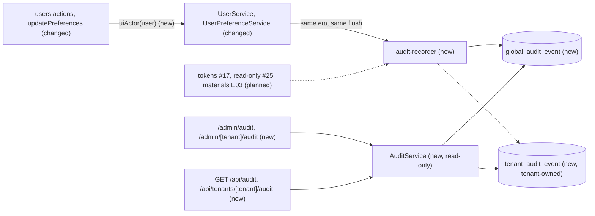
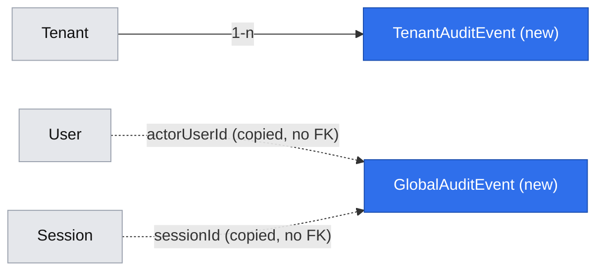

# Every change is kept in an append-only tenant or Global audit

**Status:** implemented
**Created:** 2026-10-19 10:50 UTC
**Issue:** #20 (E02-S02), epic #10 · **Builds on:** `2026-10-19--0912UTC-user-management.md` (#16, merged), `2026-10-19--0913UTC-test-prod-tenants.md` (#19, merged) · **Design authority:** `.ai/specs/product-brief.md` (R05, R08), `.ai/specs/research/CPG-prd001.pdf` §05–§06, `.ai/specs/research/CPG-acceptance.md` (AUD-001…016, AUD-028…030)

## 📝 TLDR

Today nothing records who changed what. Creating a user, resetting a password or deactivating an account leaves no trace except the changed row. This spec proposes two append-only audit stores: a **Global audit** for account-level changes, and a **tenant audit** that Test and Prod each own. Every write saves its audit entry in the same database transaction. The entry holds before/after values, time, account, session and channel (UI/API, plus the token when the API is used), and never a password, hash or secret. Every signed-in account can read both audits on new `/admin/audit` and `/admin/{tenant}/audit` screens and through read-only API endpoints. Nobody can edit either audit, not even the admin, and SQLite triggers back that up. Today's account changes (user create, password reset, deactivate, reactivate, and language/theme changes) start writing Global events. The tenant audit is ready for the first tenant-owned records (E03), and tokens (#17) and read-only flags (#25) record through the same function when they arrive.

## Resolved assumptions (autonomous defaults)

| # | Question | Chosen answer | Rationale |
|---|---|---|---|
| Q1 | One audit table with a nullable tenant, or two? | Two entities with one shared shape: `TenantAuditEvent`, declared with `tenantOwned()`, and `GlobalAuditEvent`, listed in `GLOBAL_ENTITIES`. | R05 forbids Test and Prod sharing audit, and the existing tenant filter, `TenantGuard` and lint rules then isolate the tenant audit for free. A table with a nullable tenant would be a global entity referencing tenant data, which `TenantEntityManager` restricts, and every read would need a hand-written scope condition. The Test reset (slice 2) can then clear Test's tenant audit with the tenant-scoped `nativeDelete` it already gets. |
| Q2 | How does a write know who made it? | Explicitly. Every mutating service method takes an `actor: Actor` argument: `{ userId, username, sessionId, channel: "ui" \| "api", token: { id, name } \| null }`. The action or route builds it from the validated session (`uiActor(user)`). The service writes the audit entry with `em.create` on the same EntityManager and flush as the change itself. | The standards prefer explicit to implicit. An actor registered in the request scope (as `tenantScope` does with `tenant`) would make every service that depends on the audit unresolvable in scopes without one, reads included. Writing in the same flush makes the audit atomic with the change (PRD §06 "atomically or not at all"), which the event bus can't do: it emits after commit. |
| Q3 | How is "append-only" enforced? | In three layers. (1) No service, action or route updates or deletes an audit entry; `AuditService` only reads. (2) The audit API exports only `GET`. (3) The migration adds SQLite triggers that abort any `UPDATE` or `DELETE` on either audit table. Slice 2's Test reset replaces the tenant-audit delete trigger in its own migration with one that aborts only `when old.tenant_code <> 'test'`, so that only Test's entries can be cleared. Tests never clear audit rows: each one uses a fresh temp database. | AUD-010 says even the admin is refused. Triggers also catch a future code path or a manual `sqlite3` edit through the app's connection. They are plain SQL in a migration, so a later migration can change them. |
| Q4 | Which changes are audited in this story? | The Global audit records `users.user.created`, `users.user.password-reset`, `users.user.deactivated`, `users.user.reactivated` and `preferences.user-preference.updated`. Tokens (#17, AUD-007, AUD-014, AUD-029), read-only flags (#25, AUD-016) and the Test reset (slice 2, AUD-011…013) record through the same `recordGlobalAudit` when they are built. The tenant audit has no producer until E03-S01 (materials) calls `recordTenantAudit`. | Only these writes exist today. The issue depends on #16 only, and the token and flag stories are still open. The preferences spec (Q9) already committed `UserPreferenceService.update` to this story. |
| Q5 | Is a write that changes nothing audited (deactivating an inactive user, choosing the current theme)? | No. Those writes stay idempotent and record nothing. | An event with before = after says nothing, and a double-click shouldn't produce two entries. |
| Q6 | Are sign-in, sign-out and the built-in admin's first-sign-in row audited? | No. | The PRD's Global audit list (§06) is account creation, deactivation, password resets, tokens, read-only toggles and Test resets. Sessions aren't changes to records. The admin's row comes from the environment (R06) and has no acting session to attribute it to. |
| Q7 | What goes into before/after, and how are secrets kept out? | Each audited entity has an explicit allowlist snapshot function: `User` → `{ username, role, active }`, `UserPreference` → `{ locale, theme }`. A password reset records the action and the subject account, with both snapshots null. The allowlists are typed per entity (`(user: User) => UserAuditSnapshot`), and they are the real protection. As a coarse backstop, the recorder throws (and so rolls back the write) when a snapshot *key* matches `/password\|hash\|secret/i`. It can't inspect values. | AUD-015 and AUD-028: no password or hash anywhere. An allowlist can't leak a field that is added later, and the backstop fails closed on the obvious mistake. |
| Q8 | Who can read which audit, and through what? | Every active account reads both audits (AUD-009, PRD §05 "both roles … use reports and audit"): UI at `/admin/audit` (Global) and `/admin/{tenant}/audit`, API at `GET /api/audit` and `GET /api/tenants/{tenant}/audit`. The API uses the existing `requireApiUser()`; bearer tokens join it with #17. | One gate for both roles keeps the rule visible. API parity (R07) for reads is cheap now. |
| Q9 | How much does the viewer do? | Newest first, 50 per page, and an "Older entries" link that pages by keyset (`?before=<entry id>`). No filters, search or export. | The smallest viewer that stays usable as the audit grows. `DataTable` gains no pagination; the link is plain navigation. Filters can come with the reports in slice 2. |
| Q10 | Split the issue? | No. One PR, delivered in two phases (Phasing). | A store nobody can read, or a viewer with nothing to show, delivers no user-visible outcome on its own. The tenant half has no producer yet and is deliberately built ahead of one: the store, its isolation and its empty screen, so that E03 only needs to call one function (D03: foundations first). |

None needs human confirmation before merge. No default weakens security or tenant isolation, and each is reversible by a later migration. Q3 adds hand-written trigger SQL to a generated migration before it is pushed, the same way the `tenants` migration inserts its rows.

## 📝 Problem Statement

R08 requires that every change is attributable and kept: append-only, with before/after, account, session and channel, and never a secret. PRD §06 splits the audit in two:
- the **tenant audit**: snapshot change events per tenant, "every user can read, never edit", Prod kept indefinitely and Test cleared on reset;
- the **Global audit**: account creation, deactivation and password resets, token create and revoke, read-only toggles and Test resets, kept indefinitely and visible read-only to both roles.

Today CPG has accounts (#16), preferences (#18) and tenants (#19), and none of their writes is recorded. Every later story (tokens, read-only flags, master data, documents) needs somewhere to write its history and a rule for what it may write. Without that, each would invent its own, or retrofit history after the fact (D03).

## 📝 Proposed Solution

- **Two stores, one shape.** `GlobalAuditEvent` and `TenantAuditEvent` share their properties through one helper in `db`:
  - `occurredAt`: server time (AUD-030, distinct from any business date);
  - `action`: the `concept.entity.action` event ID;
  - the subject (`subjectType`, `subjectId`, `subjectLabel`);
  - `before`/`after` as JSON snapshots;
  - the actor (`actorUserId`, `actorUsername`), `sessionId`, `channel`, and `tokenId`/`tokenName`.

  The tenant one adds `tenant` through `tenantOwned()`. Actor and subject are plain columns, not foreign keys. An entry describes the world as it was and never depends on the rows it mentions (PRD §06: "separate from business relational records"). Usernames are immutable (user-management Q3), so the copied name stays true.
- **Recording.** `core/src/services/audit/audit-recorder.ts` exports `recordGlobalAudit(em, actor, entry)` and `recordTenantAudit(em, actor, entry)`. Each validates the snapshots (Q7) and calls `em.create`; it never flushes. The calling service passes the EntityManager it is writing with: its transactional fork, or `this.em` before its own flush. The change and its audit entry then commit, or roll back, together.
- **Attribution.** `Actor` lives in `core/src/services/audit/actor.ts`, with `uiActor(user: SessionUser)`, which sets channel `ui` and the session's id. The API's `apiActor` (channel `api`, plus the token when there is one) arrives with the first mutating route (#17), against the same type. Two people sharing one account in two browsers have two session ids (AUD-008). The session id is `Session.id`, never the token or its hash (admin sign-in spec, Data Model).
- **Producers wired now** (Q4):
  - `UserService.create`, `resetPassword` and `setActive` take an `actor` and record `users.user.*`;
  - `UserPreferenceService.update` takes an `actor` and records `preferences.user-preference.updated` with the old and new `{ locale, theme }`, only when something changed (Q5).

  The users actions and `updatePreferences` pass `uiActor(...)`.
- **Reading.** `AuditService` (concept `audit`, scoped) has `listGlobal({ before, limit })` and `listTenant({ before, limit })`. The latter needs a tenant scope, as every tenant read does. Both return `{ entries, nextBefore }`, newest first. Screens and API endpoints use only these.
- **Append-only** (Q3): no write path, `GET`-only routes, and abort triggers on both tables.

**Alternatives considered:**
- **Audit through the domain event bus** (`core/src/events/`), with a subscriber writing entries. Rejected: events are emitted after a successful mutation, so a crash between commit and handler loses the entry, and the PRD requires atomicity. The bus also isn't built yet.
- **MikroORM lifecycle hooks or an `EventSubscriber` in `db`** that snapshot every flushed entity automatically. Rejected for now: `db` knows no actor or channel, a generic snapshot would include `passwordHash` unless every entity is denylisted (the failure Q7 prevents), and `upsert`/`nativeDelete` bypass flush events (lessons, 2026-10-19). Explicit calls in services are greppable and testable.
- **One table with a nullable tenant column** (Q1). Rejected: it would sit outside the tenant filter.
- **An integer sequence primary key for ordering.** Rejected: the standards require UUID keys. Ordering is `(occurredAt, id)`, indexed.

**Market check.** ERPNext keeps a "Version" document per change (a JSON diff, the user, the time), read-only and separate from the record. Odoo's chatter tracks field changes per record. Gitea keeps an admin-visible log of account actions. All three store before/after per field and the acting account, and none lets an admin edit the history. CPG takes the per-field before/after and the separation from business records. It skips per-record history panels and diff rendering of long text, which no CPG record has yet, and it adds the session and channel R08 asks for. Like those tools, CPG enforces append-only below the application: here with SQLite triggers, where they rely on database permissions.

## 📝 Architecture

- **`db`:**
  - `entities/audit/audit-event.ts`: shared properties and the `AuditChannel` (`ui`, `api`) and `AuditSnapshot` types;
  - `entities/audit/global-audit-event.entity.ts`, and `entities/audit/tenant-audit-event.entity.ts` (with `tenantOwned()`);
  - both listed in `entities/index.ts`; `GlobalAuditEvent` also in `GLOBAL_ENTITIES`;
  - one migration, `audit-events`: the two tables plus four triggers (Data Model).
- **`core`:**
  - `services/audit/actor.ts`: the `Actor` type and `uiActor`;
  - `services/audit/audit-recorder.ts`: `recordGlobalAudit`, `recordTenantAudit`, and the snapshot check;
  - `services/audit/audit.service.ts`: `AuditService` with `listGlobal` and `listTenant`;
  - `services/users/user.service.ts` and `services/preferences/user-preference.service.ts`: an `actor` argument on every write, and the audit call;
  - `validators/audit/audit-list.schema.ts`: `{ before?: uuid, limit?: 1–100, default 50 }`, shared by pages and routes;
  - one line each in `container.ts`/`cradle.ts` for `auditService`; exports from `index.ts`.
- **`app`:**
  - `app/admin/(global)/audit/page.tsx` and `app/admin/[tenant]/audit/page.tsx`, both `requireUser()`;
  - `app/api/audit/route.ts` and `app/api/tenants/[tenant]/audit/route.ts`, `GET` only, `apiHandler` and `requireApiUser()`;
  - `components/audit/`: `audit-table.tsx` (a `DataTable` of entries), `audit-changes.ts` (pure: before/after into per-field rows), and `labels.ts`;
  - users actions and `updatePreferences` pass `uiActor(...)`;
  - links: "Audit" in the `/admin` header next to Users (for every account) and on each tenant home page;
  - i18n strings (en and pl) and two help topics.
- **Repo tests:**
  - `tests/tenant-ownership.test.ts` covers the new entities with no change, through `GLOBAL_ENTITIES`;
  - `tests/tenant-entry-points.test.ts` covers the tenant page and route;
  - `tests/every-page-has-help.test.ts` requires the two topics;
  - a new `tests/audit-append-only.test.ts`, a best-effort source scan that fails if an audit route exports anything but `GET`, or if a `core`/`app` file names an audit entity together with `nativeUpdate`, `nativeDelete`, `remove` or `assign`. A scan can't see every path; the database triggers are the real guard.



The cross-cutting effect: from now on a mutating service method takes an `actor` and records its own audit entry. Every later story's spec has to name its audit actions and snapshot allowlist, and its reviewers check that every write records one.

## 📝 Data Model

Both tables have the same columns, except `tenant`.

| Field | Type | Notes |
|---|---|---|
| `id` | uuid PK | |
| `tenant` | FK → `tenant.code`, indexed | `tenant_audit_event` only, filled from the scope (`tenantOwned()`) |
| `occurredAt` | datetime, indexed (with `tenant` for the tenant table) | server clock at the write; ordering `(occurredAt desc, id desc)` |
| `action` | string | `concept.entity.action`, e.g. `users.user.deactivated` |
| `subjectType` | string | entity name, e.g. `User` |
| `subjectId` | string | the subject's primary key |
| `subjectLabel` | string | a human name at the time (username, later material ID + description) |
| `before` / `after` | JSON, nullable | allowlisted snapshots; `before` null on create, both null on a password reset |
| `actorUserId` | string (uuid) | the account; no FK |
| `actorUsername` | string | copied at the write |
| `sessionId` | string (uuid), nullable | `Session.id` of the acting session; null only for a bearer-token write (#17) |
| `channel` | enum `ui` \| `api` | |
| `tokenId` / `tokenName` | string, nullable | set only for bearer-token writes (#17); never the secret |

Triggers in the `audit-events` migration, where `<t>` is each of the two tables:

```sql
create trigger <t>_no_update before update on <t> begin select raise(abort, 'audit is append-only'); end;
create trigger <t>_no_delete before delete on <t> begin select raise(abort, 'audit is append-only'); end;
```

`down()` drops the triggers and the tables. The migration is generated with `npm run db:migration:create -- audit-events`, and the trigger statements are added to its `up()`/`down()` before it is first pushed.



## 📝 API Contracts

**Recording (core, internal):**

```ts
interface AuditEntry {
  action: string;                                   // "users.user.created"
  subject: { type: string; id: string; label: string };
  before: AuditSnapshot | null;                     // Record<string, string | number | boolean | null>
  after: AuditSnapshot | null;
}
recordGlobalAudit(em: EntityManager, actor: Actor, entry: AuditEntry): void   // em.create only, no flush
recordTenantAudit(em: EntityManager, actor: Actor, entry: AuditEntry): void   // needs a tenant-scoped em
```

The recorder throws a plain `Error` (and so the write rolls back as a 500) when a snapshot key matches `/password|hash|secret/i`, or when `recordTenantAudit` runs without a tenant scope (`TenantViolationError` from `db`). Both are programming errors.

**Changed service signatures:**

| Method | Records | before → after |
|---|---|---|
| `UserService.create(input, actor)` | `users.user.created` | `null` → `{ username, role, active }` |
| `UserService.resetPassword(userId, password, actor)` | `users.user.password-reset` | `null` → `null` |
| `UserService.setActive(userId, active, actor)` | `users.user.deactivated` / `users.user.reactivated`, only when the state changes | `{ active }` → `{ active }` |
| `UserPreferenceService.update(userId, change, actor)` | `preferences.user-preference.updated`, only when a value changes | `{ locale, theme }` → `{ locale, theme }` (a never-saved account's `before` is the defaults) |

The preference event's subject is the account (`User`, its id and username). To capture `before`, `update` reads the row, upserts and records inside one short `em.transactional()`, the same pattern as `UserService`'s writes. It keeps the single upsert, which only overwrites the fields the change names, so the two-tab guarantee of the preferences spec is unchanged. If two requests interleave on CPG's single SQLite connection, an entry's `before` could be one change stale. The stored preferences stay correct, and the next entry's `before` shows the true value.

**Reading:**

`AuditService.listGlobal(query)` and `listTenant(query)`: `query` is `auditListSchema`, `{ before?: uuid; limit?: number }` (1–100, default 50). Each returns `{ entries: AuditEntryView[]; nextBefore: string | null }`, where:

```ts
interface AuditEntryView {
  id: string; occurredAt: Date; action: string;
  subject: { type: string; id: string; label: string };
  before: AuditSnapshot | null; after: AuditSnapshot | null;
  actor: { userId: string; username: string };
  sessionId: string | null; channel: "ui" | "api";
  token: { id: string; name: string } | null;
}
```

A `before` id unknown in that store (or in another tenant) is `NotFoundError("AUDIT_CURSOR_NOT_FOUND")`.

**Routes** (both `apiHandler` + `requireApiUser()`, `GET` only; any other method answers Next.js's 405):

Next.js answers `HEAD` and `OPTIONS` on its own and `405` for every other method a route doesn't export, so the write surface is empty.

| Route | Query | 200 | Errors |
|---|---|---|---|
| `GET /api/audit` | `before`, `limit` | `{ ok: true, data: { entries, nextBefore } }` (dates as ISO strings) | 401 `UNAUTHORIZED`, 400 `VALIDATION_FAILED`, 404 `AUDIT_CURSOR_NOT_FOUND` |
| `GET /api/tenants/{tenant}/audit` | `before`, `limit` | as above, that tenant's entries only | as above, plus 404 `TENANT_NOT_FOUND` |

## 📝 UI/UX

- **`/admin/audit`** ("Global audit"; every signed-in account): the Global strip, then a `DataTable` of entries, newest first, with these columns:
  - **Time:** UTC, `YYYY-MM-DD HH:MM:SS UTC`;
  - **Account:** the username;
  - **Session:** the first 8 characters of the session id, the full id in a `title`;
  - **Channel:** a "UI" or "API" badge, plus the token name for API;
  - **Action:** a translated label such as "User deactivated";
  - **Subject:** the label;
  - **Changes:** one line per changed field, `field: before → after`. "Created" rows list the new values. A password reset reads "Password replaced (not recorded)".
  - An empty audit shows the `EmptyState` "Nothing has been recorded yet."
  - Under the table, an "Older entries" link when `nextBefore` is set.
  - No edit, delete or select controls anywhere (AUD-009).
- **`/admin/{tenant}/audit`** ("Audit — Test" / "Audit — Prod"): the tenant strip and the same table, for that tenant only. Today it shows the empty state, with a line: "Changes to this tenant's records appear here. Account changes are in the Global audit." That line links to `/admin/audit`.
- **Links:** "Audit" in the `/admin` header for every account, next to Users (admin only), and on each tenant home page.
- **Help:** topics `global-audit` (`/admin/audit`) and `tenant-audit` (`/admin/[tenant]/audit`), in English and Polish. They explain what is recorded, that nobody can change it, and what Session and Channel mean.
- All strings are in `i18n/messages/en.ts` and `pl.ts`.

Prototype: `.ai/specs/assets/audit-log/`. These are static mockups and only illustrative; the shadcn components decide the final look.
- `mockup-01-global-audit.png`: the Global audit as a normal user sees it, after the admin created, reset, deactivated and reactivated `alice`, and she changed her theme.
- `mockup-02-tenant-audit-empty.png`: the Test audit before any tenant record exists.
- `current-01-admin-home.png` and `current-02-tenant-home.png`: today's `/admin` and `/admin/test`, which gain the Audit links.


## 📝 Edge Cases & Failure Scenarios

| Case | Behaviour |
|---|---|
| The write fails after the audit entry was created (unique violation, crash mid-transaction) | Same flush or transaction: neither the change nor the entry is stored. The user sees the write's normal error |
| The audit insert fails (disk full, trigger bug) | The change rolls back with it; the user sees the generic error. Never a change without its entry |
| A snapshot accidentally contains `passwordHash` (a future code change) | The recorder throws, the write rolls back as a 500, and the unit test for that service fails first |
| Admin or anyone tries `PUT`/`PATCH`/`DELETE /api/audit` | 405; nothing changes (AUD-010) |
| Code or a manual SQL statement through the app's connection updates or deletes an entry | The trigger aborts it with "audit is append-only" |
| Deactivating an already inactive user; choosing the current theme | Success, no entry (Q5) |
| Two sessions of one account each make a change | Two entries with the same account and different session ids (AUD-008) |
| A Prod entry id passed as `before` on the Test audit | `AUDIT_CURSOR_NOT_FOUND`; the tenant filter can't see it |
| A tenant audit is read from a global scope (programming error) | The tenant filter throws, as for any tenant-owned read |
| A new entry arrives while someone pages back | Keyset paging never repeats or skips older entries; the new one shows on the first page next time |
| Clock skew or two entries in the same millisecond | Ordering falls back to `id` for equal `occurredAt`; the order between such entries is arbitrary but stable |
| A deactivated or never-again-seen account in an old entry | The copied username still shows; nothing is joined |
| The session in an entry has since ended | The session id still shows; sessions are not joined |
| A normal user opens either audit | Read-only access, the same screen as the admin (AUD-009) |
| Test reset (slice 2) | Out of scope. Its migration replaces `tenant_audit_event_no_delete` so that Test's entries can be cleared. Prod and Global stay protected (AUD-011…013) |

## 📝 Risks & Impact Review

- **Every later write must record its entry.** Nothing enforces it in general, because a missing call is invisible. The mitigations:
  - each story's spec lists its audit actions;
  - the review checklist gets an item: "every mutating service method takes an `actor` and records an audit entry in the same flush";
  - service unit tests assert on the entry.
- **Parallel stories.** #17 (tokens) and #25 (read-only flags) are open and touch `UserService` (token revocation on reset or deactivation) and new services. Whichever merges second rebases onto the other's signatures. Their specs must record `tokens.api-token.created`/`revoked` and `tenants.tenant.read-only-changed` (AUD-014, AUD-016), and #17 adds `apiActor`. The implementation PR comments this on #17 and #25 so it isn't lost.
- **Signature change.** `UserService` and `UserPreferenceService` writes gain a required `actor` argument. These are internal `core` APIs with exactly two call sites in `app`, not a `BACKWARD_COMPATIBILITY.md` surface.
- **Triggers are invisible to MikroORM's schema diff.** A future `db:migration:create` won't drop them, because MikroORM doesn't track triggers. But it also won't recreate them if a table is ever rebuilt. A migration test asserts that both triggers exist after `migrate()`.
- **Growth.** Retention is indefinite (R08). The `occurredAt` indexes and keyset paging keep reads cheap; at CPG's scale the table stays small for years. No purge is offered, since that would contradict R08.
- **Privacy within the team.** Every account sees every other account's account-level changes, including theme switches. The PRD asks for exactly this visibility (both roles read the audit); Q4 can drop preference events if the owner finds them noisy.
- **Reversibility.** Revert the code and add a migration that drops the triggers and tables. The recorded history is then lost, which is acceptable only before production use.

## 📝 Decisions in play

- **R08** (append-only, before/after, account, session, channel, never secrets; Test cleared on reset; Prod and Global kept): implemented, except the Test clearing, which belongs to the slice 2 reset (Q3).
- **R05** (no shared audit between tenants): implemented by Q1's tenant-owned store.
- **R07** (API parity): read endpoints included. Writes have no API, by design (AUD-010).
- **R06** (users never deleted): the audit keeps their name by copy.
- **D03** (foundations first): the tenant audit is built before its first producer (Q10).
- **D04** (simplest consistent behaviour): Q5, Q6 and Q9 are gap-closing choices, for owner Piotr12 to override.

Nothing is superseded.

## 📋 Phasing

- **Phase 1: the stores and recording.** Entities, migration with triggers, recorder, `Actor`, and the producers in `UserService` and `UserPreferenceService`. Ships alone: every account change is recorded, though nobody can read it yet except through the database.
- **Phase 2: reading.** `AuditService`, both API routes, both screens, links, help and translations.

## 📋 Implementation Plan

### Phase 1 — Stores and recording

1. **Entities and migration.**
   - `db/src/entities/audit/audit-event.ts` (shared properties, `AuditChannel`, `AuditSnapshot`), `global-audit-event.entity.ts`, `tenant-audit-event.entity.ts` (`tenantOwned()`), registered in `entities/index.ts` and, for the global one, `GLOBAL_ENTITIES`.
   - `npm run db:migration:create -- audit-events`, then add the four triggers to `up()` and drop them in `down()`. Commit the migration, `.snapshot.json` and `migrations/index.ts` together.
   - Unit tests on a temp SQLite file:
     - both tables exist after `migrate()`;
     - an insert works;
     - `nativeUpdate`, `nativeDelete` and raw `update`/`delete` on each table fail with "audit is append-only";
     - a tenant entry is invisible from the other tenant's scope;
     - `tests/tenant-ownership.test.ts` still passes.
2. **Actor and recorder.**
   - `core/src/services/audit/actor.ts` (`Actor`, `uiActor(user)`);
   - `audit-recorder.ts` (`recordGlobalAudit`, `recordTenantAudit`, and the `/password|hash|secret/i` key check);
   - exports from `core/src/index.ts`.
   - Unit tests:
     - an entry is created with every actor field and is persisted on the caller's flush, not before;
     - a forbidden key throws and nothing is written;
     - a tenant entry without a tenant scope throws;
     - a tenant entry gets the scope's tenant.
3. **User changes recorded.** `UserService.create`, `resetPassword` and `setActive` take an `actor` and record their action in the same flush or transaction. The users actions pass `uiActor(assertAdmin(actor))`, inside the `serverAction` callback as today, so the check still runs after parsing. Unit tests:
   - each action writes exactly one entry with the right before/after, actor, session and channel (AUD-001, AUD-002, AUD-003, AUD-015);
   - no stored entry contains the password or the hash anywhere in its JSON (AUD-028);
   - an idempotent `setActive` writes nothing;
   - a failing create (duplicate name) writes nothing;
   - two different sessions give two session ids (AUD-008).

   The action tests assert that the actor comes from the signed-in session.
4. **Preference changes recorded.** `UserPreferenceService.update(userId, change, actor)` reads and upserts in one transaction and records only real changes. `updatePreferences` passes `uiActor(user)`. Unit tests:
   - first save (defaults as `before`), a change, and no change;
   - a locale change followed by a theme change records two entries whose before/after chain;
   - the theme-only change still leaves the locale as stored (unchanged guarantee).

### Phase 2 — Reading

5. **`AuditService` and schema.**
   - `core/src/services/audit/audit.service.ts` (`listGlobal`, `listTenant`, keyset on `(occurredAt, id)`, `AUDIT_CURSOR_NOT_FOUND`);
   - `validators/audit/audit-list.schema.ts`;
   - container and cradle lines; exports.
   - Unit tests:
     - newest first;
     - pages of 50 without repeats or gaps, including entries created with one fixed `occurredAt` (ties ordered by `id`);
     - `before`/`after` come back as parsed objects, not JSON strings;
     - `limit` bounds;
     - an unknown or foreign cursor;
     - the tenant list sees only its tenant (R05).
6. **API routes.**
   - `app/api/audit/route.ts` and `app/api/tenants/[tenant]/audit/route.ts`: `GET` through `apiHandler` + `requireApiUser()`, query parsed with `auditListSchema`.
   - Unit tests (mocking `@cpg/core`): 401 without a session, 200 for a normal user (AUD-009), a 400 for a bad query, and a 404 for an unknown tenant.
   - `tests/audit-append-only.test.ts`: the audit routes export only `GET`, and no `core`/`app` file mutates an audit entity.
7. **Screens.**
   - `app/admin/(global)/audit/page.tsx` and `app/admin/[tenant]/audit/page.tsx`: `requireUser()` inside `<Suspense>`, `await connection()`, read through the service, `?before=` from `searchParams`.
   - `components/audit/{audit-table.tsx,audit-changes.ts,labels.ts}`.
   - The "Audit" links on `/admin` and the tenant home.
   - en/pl strings and the two help topics.
   - Unit tests:
     - the table renders each column, the token name for API rows, and the password-reset wording;
     - `audit-changes` lists only changed fields, and all fields for a create;
     - the empty state and the "Older entries" link;
     - there are no edit or delete controls;
     - a normal user sees the page.
8. **Integration tests** in `tests/integration/audit.test.ts`:
   - the admin creates `audit-alice`, resets her password and deactivates her;
   - `/admin/audit` lists the three entries, newest first, with account `admin`, channel UI and a session id; the reset row shows no password (AUD-001, AUD-003, AUD-015, AUD-028);
   - reactivated, `audit-alice` signs in in a second browser session, opens `/admin/audit`, sees the same entries and no edit controls (AUD-009);
   - she changes her theme and sees her own entry;
   - `PATCH /api/audit` answers 405 (AUD-010);
   - `/admin/test/audit` shows the empty tenant state.

   Restore the preferences in `afterAll` (lessons, 2026-10-19).

   Then run the full gate: lint, typecheck, `test:coverage` (100%), build and `test:integration`. No dependency is added, so `npm audit` triage should be a no-op. Add the audit pieces to the standards' Section 5 and the "records an audit entry" item to the review checklist.

## Implementation notes

Implemented in #42.
- **Triggers.** The append-only triggers are declared on the entities (MikroORM 7 `triggers`), not hand-written into the migration. `db:migration:create` generates the same SQL, and the snapshot tracks it.
- **Actor type.** `Actor` is named `AuditActor`, so it doesn't collide with the tokens spec's `Actor` (`2026-10-19--1053UTC-api-tokens.md`). #17 adds the API's `apiActor`.
- **Links.** The header link reads "Global audit" and the tenant link "Audit — {tenant}". On a tenant page both links show, and two links named "Audit" would be ambiguous.
- **Time column.** It says "(UTC)" in its header instead of after every value.
- **Changes column.** It shows field names and known values in the reader's language.
- **Bad queries on the screens.** A malformed query or a foreign cursor renders the not-found page. The API answers 400/404.
- **Query parsing.** `core/src/http/parse-input.ts` (`parseInput`) parses query strings for routes and pages; `serverAction` shares its `validationError`.
- **Files and index.** `components/audit/labels.ts` was never created: labels live in the messages, and the screens are `audit-view.tsx` and `read-audit-page.ts`. The index is on `occurredAt` alone. The `(occurredAt, id)` order still holds; `id` only breaks ties.

What later stories changed (recorded on 2026-10-20, when epic E02 (#10) closed):
- **The tenant audit has producers.** Q4, the UI/UX section and integration step 8 say the tenant audit has no producer yet. Materials and unit conversions (#22) and locations, customers and suppliers (#23) now record into it, so Test's tenant audit is no longer empty.
- **More Global audit producers.** Tokens record their creation and revocation (#17, `apiActor`/`callerActor`), and so does the read-only flag (#25, `tenants.tenant.read-only-changed`, AUD-016).
- **The Global audit link moved.** It is in the sidebar now (#58), not the header.
- **Writes take a `version` (#21).** `resetPassword` and `setActive` take one too.
- **Deleted tokens go unaudited (#44, open).** A password reset or a deactivation deletes the account's API tokens, and so does the startup admin purge. None of these records a `tokens.api-token.revoked` entry.

