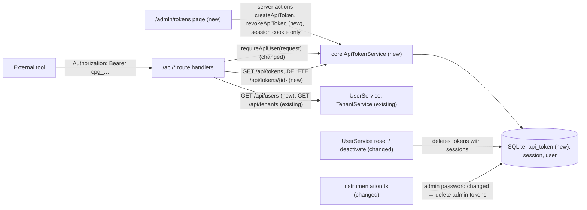
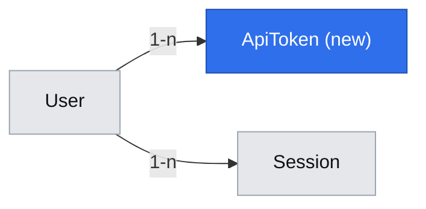

# Named API tokens and bearer authentication

**Status:** implemented
**Created:** 2026-10-19 10:53 UTC
**Issue:** #17 (E01-S03), epic #9 · **Builds on:** `2026-10-19--0912UTC-user-management.md` (#16, merged), `2026-10-19--0913UTC-test-prod-tenants.md` (#19, merged) · **Design authority:** `.ai/specs/product-brief.md`, `.ai/specs/research/CPG-prd001.pdf` §05–§06

## 📝 TLDR

CPG's API has no way to authenticate a script: the two `GET /api/tenants` routes only accept the browser session cookie. This spec proposes that any signed-in account creates named API tokens on a new `/admin/tokens` screen, sees each secret exactly once, and lists and revokes its tokens there or through the API. Every `/api` route then accepts `Authorization: Bearer <token>` with exactly the rights of the token's owner. No API route can mint a token (R07). A password reset or a deactivation deletes all of that user's tokens in the same transaction that ends their sessions (R06). The same applies to the admin when `CPG_ADMIN_PASSWORD` changes.

## Resolved assumptions (autonomous defaults)

| # | Question | Chosen answer | Rationale |
|---|---|---|---|
| Q1 | How is a token stored, and what does it look like? | `cpg_` followed by 32 random bytes in base64url (47 characters). Only its SHA-256 (hex) is stored, as with sessions. The secret is returned once, by the create action, and never again. | The same scheme as `Session` (`session-token.ts`). A 256-bit secret needs no slow hash. The prefix makes a leaked token recognisable to secret scanners and in logs. |
| Q2 | Does revoking delete the row or mark it revoked? | Delete. Revocation, password reset and deactivation all delete the rows, like sessions. The list shows only tokens that work. | A deleted row can't authenticate by mistake. The name becomes free again, so `(user, name)` stays a plain unique index. The future Global audit (E02-S02, #20) records the token id and name as text, so it needs no row to point at. |
| Q3 | Where are tokens managed, and whose? | `/admin/tokens`, in the Global route group. Any active account opens it and sees and manages **only its own** tokens, the admin included. Every account gets an "API tokens" link in the signed-in bar. | PRD §05: "Both roles … manage own tokens". The admin cuts off another user's tokens by resetting or deactivating them (R06). An admin view of everyone's tokens is not in the PRD. |
| Q4 | What is the "explicit confirmation" and the duplicate-submission guard? | Creating is a deliberate dialog: a name field, a warning that the token can do everything the account can in Test and Prod until revoked, and a **Create token** button. While the request runs the button is disabled (`CrudForm`'s pending state). A double submit with the same name creates one token; the second request gets `CONFLICT` from the unique index. | One click on a page can't create a token by accident, and a retry can't create two. A separate "are you sure?" step after the dialog would add a click without adding information. |
| Q5 | Token name rules? | 1–64 characters after trimming. Stored as typed. Unique per account and case-sensitive. Rejected with "You already have a token with that name." | Names are labels the user chooses (`agent1`, `build`). API-003/004 only ask for per-account uniqueness. Case folding would be a rule nobody asked for (D04). |
| Q6 | How do routes authenticate, and what about CSRF? | `requireApiUser(request)`: an `Authorization: Bearer` header authenticates by token **only**. When the header is present and invalid the answer is 401, never a fallback to the cookie. Without the header, the session cookie is accepted when `request.method` is `GET` or `HEAD` (Next.js answers `HEAD` with the `GET` handler). A state-changing request without a bearer token gets 401 "Use a bearer token for this request." | Bearer requests carry no ambient credential, so they need no CSRF header. CPG's own pages change state through server actions, so no cookie-authenticated mutating route is needed, and building the standards' CSRF header check now would be unused code (YAGNI). |
| Q7 | When is "last used" recorded? | When a token authenticates a request, through a `nativeUpdate` filtered by the token id. The write is skipped when the stored value is less than 60 seconds old. A failed write is logged with the token id (never the secret) and doesn't fail the request. The screen shows the time to the minute, or "Never". | API-007 asks for the timestamp. With one SQLite writer, a write per API call is avoidable load, and nobody reads it more precisely than to the minute. It is bookkeeping, not an access decision, so a busy database must not turn a read into a 500. `nativeUpdate` never re-creates a row that a concurrent revoke just deleted. |
| Q8 | What happens to the admin's tokens when `CPG_ADMIN_PASSWORD` changes? | They are deleted at the next start, like the admin's sessions. At startup CPG compares the configured password with an argon2id hash stored in the `setting` table (key `auth.admin-password`). When it differs, CPG deletes the admin's tokens and stores the new hash in **one transaction**. An ordinary restart keeps them. While a deploy overlaps old and new containers, the old container must not mint a token the new one never deleted. So creating an admin token re-verifies the running container's password against the stored hash inside the insert transaction, and refuses on a mismatch or a missing hash. | R06: a password reset invalidates the account's tokens. The admin's "reset" is a change of the environment variable, and it only takes effect at a restart. Deleting admin tokens at every restart would break API-009 (tokens never expire) on every deploy. The hash follows the standards' argon2id rule. The create-time check costs one argon2 verification (~24 ms) per admin token. |
| Q9 | Which routes ship here, given R07 parity and the specs that deferred their API to #17 (user management Q5, preferences Q9)? | Token routes: `GET /api/tokens` and `DELETE /api/tokens/{id}`. Plus read-only `GET /api/users` (admin only), which makes API-010 testable against a real admin-only endpoint. The existing `GET /api/tenants[/{tenant}]` routes accept bearer tokens automatically. The **mutating** parity routes for users and preferences move to #21 (E02-S03, idempotency, which depends on #17). The implementation PR posts that list on #21. `BACKWARD_COMPATIBILITY.md` lists the new routes, and records now that every state-changing bearer route will require an `Idempotency-Key` header once #21 lands, `DELETE /api/tokens/{id}` included. | R07 requires every mutating API to carry an idempotency key, and #21 builds that layer. Mutating routes added here would ship without the key and need a retrofit. Read routes need no key. `DELETE /api/tokens/{id}` is in this story's own acceptance criteria. Recording the key requirement now means #21 tightens a documented contract instead of breaking an undocumented one. CPG has no external API consumers yet. |
| Q10 | Rate limits on bearer authentication? | None. | A 256-bit random secret can't be guessed online. A throttle keyed by token would add state and protect nothing. |
| Q11 | Split the issue? | No. A token nobody can authenticate with is useless, and authentication without a way to obtain a token can't be tested. | One capability. |

None needs human confirmation before merge. Each answer is reversible, and none weakens security: Q6 is stricter than the standards require, and Q8 closes a gap that R06 would otherwise leave for the admin.

## 📝 Problem Statement

PRD §06 makes the bearer-token API the second way into CPG ("every business/admin operation … has a bearer-token API equivalent"), and R07 makes token creation its one UI-only exception. Today there is nothing to authenticate an API call with except the browser's session cookie, which a script can't obtain without the account's password. Every later story that promises API parity (tenants, audit, master data, imports, MRP) needs this layer first. #21 (idempotency) depends on it directly.

## 📝 Proposed Solution

- **Tokens.** A new global entity `ApiToken` (concept `api-tokens`): owner, name, secret hash, created and last-used times. `ApiTokenService` lists an account's tokens, creates one (returning the secret once), revokes one, and authenticates a secret. It always works on one account's own tokens: a caller passes the acting user's id, never a client-supplied owner.
- **Creation is UI-only by construction.** `ApiTokenService.create` takes a `SessionUser`, which carries a `sessionId`. An `ApiActor` from a bearer token doesn't type-check there.
  - Its only caller is the server action `createApiToken`, which authenticates through the session cookie (`currentUser()`, which reads only the cookie). Server actions can't be invoked with a bearer token.
  - No route handler exports `POST`, so `POST /api/tokens` answers 405.
  - A repo test pins two things: `tokens/actions.ts` is the only file in `packages/app/src` that calls `apiTokenService.create`, and `currentUser()` reads no `Authorization` header (API-032).
- **No token outlives a reset that races its creation.** `create` inserts the token inside `em.transactional()`, and only if the actor's session row still exists and its owner is still active. A reset or deactivation deletes the sessions, so one that commits between the session check and the insert makes the insert fail with `UnauthorizedError`. This is the same compare-and-set the sign-in already does for sessions. For the admin, the same transaction re-verifies the admin password hash (Q8).
- **Bearer authentication.** `requireApiUser(request)` reads `Authorization: Bearer …` (Q6). `ApiTokenService.authenticate` looks the hash up with its owner and rejects an inactive owner (defence in depth: deactivation already deleted the row). It records last use (Q7) and returns an `ApiActor` carrying the token id and name, for the future audit attribution (PRD §06).
- **Rights.** A token has exactly its owner's current role, read from the user row on every call: `assertAdmin` works unchanged for token callers (API-010, API-002).
- **Invalidation (R06).** `UserService.resetPassword` and `setActive(false)` delete the user's `ApiToken` rows in the transaction that already deletes their sessions (API-011, API-012). The admin's tokens follow Q8 at startup.
- **Screen.** `/admin/tokens` lists the account's tokens (name, created, last used) and offers **Create token** and a per-row **Revoke**. A new secret is shown in a one-time panel with a copy button and the warning "Copy it now. You won't see it again."

**Alternatives considered:**
- **Store tokens as `Session` rows with a type column.** Rejected: sessions expire, carry no name and are purged for the admin at every restart. Two concepts with different lifecycles would share one table.
- **A `revokedAt` column instead of deleting.** Rejected (Q2): a row that must never authenticate again is safest when it doesn't exist. Uniqueness would also need a partial index.
- **Let the cookie session call mutating routes, with the CSRF header.** Rejected for now (Q6): CPG's pages don't need it, and `apiCall` doesn't exist yet. It can be added in `requireApiUser` without touching any route.
- **Hash tokens with argon2id.** Rejected: a slow hash protects low-entropy passwords. A random 256-bit secret is safe under SHA-256 and is checked on every API call.

**Market check.** GitHub, GitLab and Gitea personal access tokens follow the same pattern: named per user, secret shown once, stored hashed, a recognisable prefix (`ghp_`, `glpat-`) for secret scanning, last-used shown in the list, revocation by deletion. They also let a user choose an expiry and scopes. CPG skips both: the PRD says tokens never expire and inherit the owner's rights. Gitea, like CPG, deletes a user's tokens when an admin disables the account.

## 📝 Architecture

- **`db`:**
  - `entities/api-tokens/api-token.entity.ts` (new), listed in `entities/index.ts` and in `GLOBAL_ENTITIES` (tokens survive a Test reset, PRD §05).
  - One migration: `api-tokens`.
- **`core`:**
  - `services/api-tokens/api-token.service.ts` (`ApiTokenService`, scoped): `list`, `create`, `revoke`, `authenticate`.
  - `services/auth/api-token-secret.ts`, next to `session-token.ts`: `generateApiTokenSecret()` (`cpg_` + 32 random bytes) and `hashApiTokenSecret()`. The hash is the one `session-token.ts` uses, imported rather than copied.
  - `services/users/user.service.ts`: reset and deactivation also delete `ApiToken` rows.
  - `services/auth/admin-password-stamp.ts`: reads and verifies the `auth.admin-password` setting (Q8). It is used by both the startup check and `ApiTokenService.create`.
  - `database.ts`: `revokeAdminTokensIfPasswordChanged(config)`, run at startup after `revokeBuiltInAdminSessions` (Q8). The delete and the hash write happen in one transaction.
  - `http/auth.ts`: `assertSignedIn`/`assertAdmin` accept any `Actor` (`{ userId, username, role }`). `SessionUser` (with `sessionId`) and the new `ApiActor` (with `tokenId`, `tokenName`) both extend it.
  - `validators/api-tokens/{create-api-token,revoke-api-token}.schema.ts`.
  - `container.ts`/`cradle.ts`: one line each for `apiTokenService`.
- **`app`:**
  - `auth/require-api-user.ts`: `requireApiUser(request)` per Q6; every route passes its `request`.
  - `app/api/tokens/route.ts` (`GET`) and `app/api/tokens/[id]/route.ts` (`DELETE`); `app/api/users/route.ts` (`GET`, admin only).
  - `app/admin/(global)/tokens/{page.tsx,actions.ts}`;
  - `components/api-tokens/` for the client pieces: the tokens table with its revoke action, the create dialog and the one-time secret panel.
  - The signed-in bar gets the "API tokens" link.
  - `en.ts`/`pl.ts` get the strings, and `help/topics.ts` the `api-tokens` topic.
- **`instrumentation.ts`:** calls the Q8 check after the admin-session purge.
- **`BACKWARD_COMPATIBILITY.md`:** the three new routes, and the announced `Idempotency-Key` requirement (Q9).
- **Repo tests:**
  - `tests/api-token-minting.test.ts` (new): only `tokens/actions.ts` calls `apiTokenService.create`, and `currentUser()` never reads `Authorization`.
  - `tests/every-page-has-help.test.ts` covers the new page automatically.

The cross-cutting effect: every route handler, existing and future, authenticates through `requireApiUser(request)`. A route that skips it is unauthenticated, as today. Token creation stays reachable only from a cookie-authenticated server action.

## 📝 Data Model

| Entity | Field | Type | Notes |
|---|---|---|---|
| `ApiToken` (`api_token`) | `id` | uuid PK | Shown in the list and used by `DELETE /api/tokens/{id}`. It is not a secret. |
| | `user` | many-to-one `User`, `deleteRule("cascade")` | The owner. Users are never deleted, so the cascade only matters to tests and manual fixes |
| | `name` | string(64) | Q5. Unique together with `user` |
| | `tokenHash` | string(64), unique | Hex SHA-256 of the secret. The secret itself is never stored, logged or returned after creation |
| | `createdAt` | datetime | `onCreate` |
| | `lastUsedAt` | datetime, nullable | Q7. Null means never used |

`Setting` gains one row, `auth.admin-password`: the argon2id PHC string of the configured admin password (Q8). It is written by the startup check only, never shown, and never returned by `SystemStatusService` (which only counts settings).

## 📝 API Contracts

All routes go through `apiHandler` and start with `requireApiUser(request)`. Responses use the shared envelope and `Cache-Control: no-store`.

| Method and path | Who | Success | Errors |
|---|---|---|---|
| `GET /api/tokens` | any account (bearer or session) | 200 `[{ id, name, createdAt, lastUsedAt }]`: the caller's own tokens, newest first. Never a secret or hash | 401 `UNAUTHORIZED` |
| `DELETE /api/tokens/{id}` | any account, **bearer only** (Q6) | 200 `{ id }`. The token stops authenticating at once. Revoking the token making the call is allowed | 401; 404 `TOKEN_NOT_FOUND` for an unknown id, another account's token or a malformed id (no hint which). The route doesn't parse `{id}` with the action's uuid schema: a malformed id is simply not found, never 400 |
| `POST /api/tokens` | — | not implemented: 405 from Next.js | — (API-032) |
| `GET /api/users` | admin only | 200 `UserSummary[]`, as `UserService.list()` | 401; 403 `FORBIDDEN` for a normal user's token or session (API-010) |
| `GET /api/tenants`, `GET /api/tenants/{tenant}` | any account | unchanged | unchanged, plus bearer authentication |

Every 401 from a bad bearer token (unknown, revoked, reset or deactivated owner, malformed header) has the same message, "Invalid or revoked token.", so the response never says why.

Server actions in `app/src/app/admin/(global)/tokens/actions.ts` go through `serverAction` and `assertSignedIn(await currentUser())`:

| Action | Input (Zod) | Success | Errors |
|---|---|---|---|
| `createApiToken` | `createApiTokenSchema`: `{ name }` per Q5 | `{ token: { id, name, createdAt, lastUsedAt: null }, secret }`; the list revalidates | `VALIDATION_FAILED`, `CONFLICT` "You already have a token with that name.", `UNAUTHORIZED` (no session, or the session ended before the insert) |
| `revokeApiToken` | `revokeApiTokenSchema`: `{ tokenId: uuid }` | `{ id }`; the list revalidates | `TOKEN_NOT_FOUND`, `UNAUTHORIZED` |

`ApiTokenService` (core):
- `list(userId) → ApiTokenSummary[]`.
- `create(actor: SessionUser, name) → { token: ApiTokenSummary, secret }`. It inserts in one transaction, only while the actor's session row exists and its owner is active. For the admin, the transaction also requires the stored admin-password hash to match `config.adminPassword` (Q8). Otherwise it throws `UnauthorizedError`. A unique violation becomes `ConflictError`.
- `revoke(userId, tokenId) → { id }`. It deletes only a row with that id **and** that owner; anything else is `NotFoundError("TOKEN_NOT_FOUND", …)`.
- `authenticate(secret) → ApiActor | null`. Null for an unknown hash or an inactive owner. It updates `lastUsedAt` per Q7.

Time-dependent tests (Q7, API-009) use Vitest's fake timers (`vi.setSystemTime`), so no clock binding is added to the cradle.

## 📝 UI/UX

- **`/admin/tokens`** (any signed-in account), titled "API tokens":
  - Intro line: "A token lets a script or tool use the CPG API as you, in Test and Prod, until you revoke it. Tokens never expire."
  - A `DataTable` with Name, Created and Last used ("Never" when null), with a **Revoke** row action. An empty state reads "No tokens yet."
  - **Create token** opens a dialog with a `CrudForm` holding one Name field. Above the button: "This token can do everything you can, in both tenants, until you revoke it." A server `CONFLICT` shows under the Name field.
  - On success the dialog switches to the one-time panel: the secret in a read-only monospace field, a **Copy** button, the warning "Copy it now. You won't see it again." and **Done**. Closing the panel discards the secret from client state. The list shows the new row without the secret (API-006).
  - **Revoke** asks for confirmation in an alert dialog: "Revoke {name}? Anything using it stops working at once."
- **Signed-in bar:** an "API tokens" link for every account, next to the admin's "Users" link.
- **Help:** a new `api-tokens` topic in English and Polish: creating a token, using it (`Authorization: Bearer …`), that it never expires, and that a password reset or deactivation deletes every token.
- **Translations:** every string in `en.ts` and `pl.ts`.

Prototype: `.ai/specs/assets/api-tokens/`. These are static mockups and only illustrative; the shadcn components decide the final look.
- `mockup-01-tokens-list.png`: the list with two tokens.
- `mockup-02-create-token.png`: the create dialog with a duplicate-name error.
- `mockup-03-secret-once.png`: the one-time secret panel.
- `mockup-04-revoke-confirm.png`: the revoke confirmation.
- `current-01-admin-signed-in.png`: today's `/admin` header, where the new link goes.

## 📝 Edge Cases & Failure Scenarios

| Case | Behaviour |
|---|---|
| The user closes the secret panel or reloads before copying | The secret is gone (API-006). They revoke that token and create another |
| Double-click on Create token, or a retried request | The button is disabled while pending. A second request with the same name gets `CONFLICT`, so one token exists |
| `Authorization: Bearer` with an unknown, revoked or malformed token, plus a valid session cookie | 401 "Invalid or revoked token." Bearer never falls back to the cookie |
| `Authorization: Basic …` or another scheme | Treated as no bearer token: a `GET` falls back to the cookie, anything else gets 401 |
| A token revokes itself | 200; its next call gets 401 |
| `DELETE /api/tokens/{id}` with another account's token id | 404 `TOKEN_NOT_FOUND`, the same as an unknown id; nothing changes |
| The admin resets or deactivates a user while that user's API call is in flight | A call already past authentication finishes under the old rights; the next one gets 401. The same holds for sessions today. Writes after authentication will carry the actor into the audit (E02-S02) |
| The owner is deactivated, then reactivated | Their tokens were deleted on deactivation and don't come back; they create new ones (API-011) |
| `POST`/`PUT`/`PATCH` on `/api/tokens` with any credential | 405, with no body from CPG (API-032) |
| A state-changing route called with only the session cookie | 401 "Use a bearer token for this request." (Q6) |
| The last-used write fails (database busy) | The failure is logged with the token id and the call is served. Authentication itself (the hash lookup and the active check) still fails closed |
| A reset or deactivation commits between `createApiToken`'s session check and the token insert | The insert transaction finds the session gone and fails with `UNAUTHORIZED`; no token survives (R06) |
| A deploy overlaps the container with the old `CPG_ADMIN_PASSWORD` and the new one | The new container deleted the admin's tokens and stored the new hash in one transaction. If the old container tries to create an admin token, its password no longer verifies against the stored hash, so it refuses with `UNAUTHORIZED` |
| `CPG_ADMIN_PASSWORD` changes between deploys | At start the admin's sessions and tokens are deleted and the new hash is stored. A restart with the same password deletes the sessions (existing behaviour) but keeps the tokens |
| The setting row is missing (first start with this feature, or a fresh database) | The hash is stored and no token is deleted. No admin token can exist before this feature, so nothing escapes R06 |
| The startup check itself fails (database error) | It throws like the migrations do, and the server doesn't start. A deploy never runs with stale admin tokens |
| A Test reset (E02-S04/later) | `ApiToken` is global and untouched (PRD §05) |

## 📝 Risks & Impact Review

- **`requireApiUser` changes signature.** Both existing tenant routes pass `request`. Any future route must too, and TypeScript enforces it. `tests/tenant-entry-points.test.ts` already pins how tenant routes resolve their scope. The new repo test pins the minting rule.
- **Cookie-only clients lose nothing.** No current caller makes a state-changing API request. If a client component later needs one, `requireApiUser` gains the CSRF-header branch from the standards. That is a one-place change.
- **Idempotency debt (R07).** `DELETE /api/tokens/{id}` ships without an idempotency key, and the users and preferences write routes don't exist yet. #21 owns both. The implementation PR posts the list on #21 so it isn't lost (Q9). Without the key a replayed revoke answers 404 instead of the original 200, and changes nothing.
- **The admin-password hash in `setting`.** A database copy now holds an argon2id hash of the admin password, at the same strength as normal users' hashes. Before this change a copy held no admin credential at all. That is the cost of honouring R06 for the admin without deleting their tokens at every deploy (Q8).
- **Overlap with #38** (`apiHandler` logs prerender bail-outs for `/api/tenants`). It is untouched here, but the tenant routes change in the same lines. Whichever lands second rebases.
- **Reversibility.** Revert, plus a migration dropping `api_token`, plus deleting the setting row. Tokens issued in the meantime stop working, which is the safe direction.

## 📝 Decisions in play

- **R07** (bearer API parity, token creation UI-only, idempotency on every mutating API): token creation is UI-only by construction and pinned by a test. Token list/revoke and user listing get API equivalents. The mutating parity routes and the idempotency keys are sequenced into #21 (Q9).
- **R06** (reset or deactivation invalidates sessions **and tokens**): completed here for tokens, including the admin (Q8).
- **R05** (tenant isolation): `ApiToken` is global. A token reaches both tenants, through the explicit tenant path (TEN-010, API-013).
- **R08** (audit never stores secrets): no secret or hash leaves `ApiTokenService`. `ApiActor` carries the token id and name for E02-S02.
- **D04** (simplest consistent behaviour): Q5 and Q7 are the gap-closing choices, owner Piotr12 to override.

Nothing is superseded.

## 📋 Phasing

- **Phase 1 — Tokens and bearer authentication.** `ApiToken`, `ApiTokenService`, invalidation on reset, deactivation and admin-password change, `requireApiUser(request)`, and the routes. Tokens are created through the service in tests; there is no screen yet. Ships alone, because nothing can mint a token until Phase 2.
- **Phase 2 — The tokens screen.** `/admin/tokens`, its actions and components, the link, help and translations, and the integration tests.

## 📋 Implementation Plan

### Phase 1 — Tokens and bearer authentication

1. **Entity and migration.**
   - `db/src/entities/api-tokens/api-token.entity.ts` per the Data Model, with a unique `(user, name)` index.
   - Register it in `entities/index.ts` and `GLOBAL_ENTITIES`.
   - `npm run db:migration:create -- api-tokens`; commit the migration, snapshot and index unedited.
   - Tests on a temp SQLite file:
     - the migration applies;
     - `tokenHash` and `(user, name)` are unique, and the same name works for two users;
     - deleting a user cascades.
2. **Secrets and the actor type.**
   - `services/auth/api-token-secret.ts`.
   - `Actor`, `ApiActor` and `SessionUser extends Actor`; `assertSignedIn`/`assertAdmin` typed on `Actor`.
   - Unit tests:
     - the prefix and length;
     - two secrets differ;
     - the hash is 64 hex characters and matches `hashSessionToken`;
     - `assertAdmin` accepts an admin `ApiActor` and refuses a user one.
3. **`ApiTokenService`.**
   - `list`, `create`, `revoke` and `authenticate` per API Contracts, plus the `validators/api-tokens/` schemas.
   - Register it in `container.ts`/`cradle.ts`, export it from `index.ts`, and update `index.test.ts`.
   - Unit tests against real SQLite:
     - create returns the secret once and stores only its hash;
     - create fails with `UnauthorizedError` and stores nothing when the actor's session is deleted between the check and the insert (a regression test for the race, driven by deleting the session inside a stubbed step);
     - an admin create fails when the stored admin-password hash is missing or doesn't match `config.adminPassword`;
     - a duplicate name for the same user gives `ConflictError`, and the same name for another user works (API-003, API-004);
     - many tokens coexist (API-005);
     - `list` returns only the caller's tokens, never a secret or hash;
     - revoke deletes only the caller's own token, and another user's id gives `TOKEN_NOT_FOUND` with nothing deleted (API-008);
     - `authenticate` returns the owner's current role;
     - `authenticate` returns null for an unknown secret or an inactive owner;
     - last use is set on first use and skipped within 60 s, with `vi.setSystemTime` (API-007);
     - a failing last-used write is logged and authentication still succeeds;
     - a token keeps working with no expiry (API-009, by time travel past 24 h).
4. **Invalidation.**
   - `UserService.resetPassword` and `setActive(false)` delete the user's tokens in their existing transaction.
   - `services/auth/admin-password-stamp.ts`, and `database.ts`: `revokeAdminTokensIfPasswordChanged(config)`, which deletes and stores in one transaction and is called from `instrumentation.ts`.
   - Unit tests:
     - reset and deactivation delete that user's tokens only (API-011, API-012);
     - a failure inside the transaction leaves tokens and sessions unchanged;
     - reactivation restores no token;
     - the startup check stores the hash when the setting is missing and deletes no token;
     - it keeps the admin's tokens when the password is unchanged;
     - it deletes them, and replaces the hash, when the password changed;
     - it never touches normal users' tokens.
5. **Bearer authentication.**
   - `requireApiUser(request)` per Q6, and the tenant routes pass `request`.
   - Unit tests:
     - a valid bearer token authenticates;
     - an invalid bearer token is 401 even with a valid cookie;
     - a non-Bearer scheme falls back to the cookie on `GET` and `HEAD`;
     - a `DELETE` with the cookie only is 401;
     - the scheme is matched case-insensitively;
     - one message is used for every bad-token cause.
6. **Routes.**
   - `api/tokens/route.ts` (`GET`), `api/tokens/[id]/route.ts` (`DELETE`), `api/users/route.ts` (`GET`, `assertAdmin`).
   - `tests/api-token-minting.test.ts`.
   - `BACKWARD_COMPATIBILITY.md`: add the three routes and the announced `Idempotency-Key` requirement.
   - Unit tests mocking `@cpg/core`:
     - each route's envelope;
     - 403 for a normal user on `/api/users` (API-010);
     - 404 for a foreign or malformed token id;
     - the token route modules export no `POST`, `PUT` or `PATCH`.

### Phase 2 — The tokens screen

7. **Actions.** `admin/(global)/tokens/actions.ts`: `createApiToken` and `revokeApiToken`, each `serverAction` + `assertSignedIn` + `revalidatePath("/admin/tokens")`. Unit tests:
   - `UNAUTHORIZED` without a session;
   - the acting user's id, never an input field, reaches the service;
   - the secret appears only in the create result.
8. **Page and components.**
   - `admin/(global)/tokens/page.tsx`: `requireUser()` inside `<Suspense>`, then `apiTokenService.list(user.userId)`.
   - `components/api-tokens/{tokens-table,create-token-dialog,token-secret-panel,revoke-token-dialog}.tsx`.
   - The "API tokens" link in `SignedInBar`.
   - Strings in `en.ts`/`pl.ts`; the `api-tokens` help topic in both languages.
   - Unit tests:
     - the empty state;
     - "Never" for an unused token;
     - the secret panel shows the secret and Copy, and Done clears it;
     - the duplicate-name error shows under Name;
     - the revoke confirmation;
     - the link for both roles.
9. **Integration tests** in `tests/integration/api-tokens.test.ts`. The admin creates `alice`, and `alice` signs in, then:
   - `alice` creates `agent1`, sees the secret once, and after a reload sees the row without it (API-001, API-006);
   - with that secret, `GET /api/tenants` answers 200 and `GET /api/users` answers 403 (API-010); `POST /api/tokens` answers 405 (API-032);
   - a second `agent1` is rejected; `bob` can create `agent1` (API-003, API-004);
   - revoke token A through `DELETE /api/tokens/{id}` with token B: A gets 401, B still works (API-008);
   - the list shows a last-used time for the used token (API-007);
   - the admin creates its own token, and `GET /api/users` with it answers 200 (API-002);
   - the admin resets `alice`'s password, and the admin deactivates `bob`. Each remaining token then gets 401 on both a read (`GET /api/tenants`) and a write (`DELETE /api/tokens/{id}`) (API-011, API-012).

   Then run the full gate: lint, typecheck, `test:coverage` (100%), build and `test:integration`, and `npm audit`. There is no new dependency, so the audit triage should be a no-op. Post the deferred parity routes on #21 (Q9).

## Implementation notes

Implemented on PR #41. Two deliberate deviations from the text above:

- **A missing admin-password stamp deletes the admin's tokens at startup.** The Edge Cases table says it deletes none, because none can exist before this feature. Deleting gives the same result on a genuine first start and fails closed if the row is ever lost.
- **A duplicate token name shows as a form-level alert**, not under the Name field. `ConflictError` carries no field, which matches the users screen. The mockup's placement is illustrative.

Added after UI QA: the tokens table had pushed Revoke out of view with a 64-character name, and on a phone with any name. Names now wrap, dates wrap at their spaces, and Created is hidden below the `sm` breakpoint. An integration test checks at 1100 px and 390 px.

Added after the code review:
- If copying to the clipboard fails, the panel says to copy the secret by hand.
- While the secret is shown, only **Done** closes the dialog.

Added when merging `main` after E02-S02 (#20, the audit) landed, as the audit spec required:
- `ApiTokenService.create` records `tokens.api-token.created`, and `revoke` records `tokens.api-token.revoked`, in the same transaction as the change (AUD-014). The snapshot holds only the name, never the secret or its hash (AUD-028).
- `revoke` takes the `AuditActor`: `uiActor` on the tokens screen, and `callerActor` in `DELETE /api/tokens/{id}`, which for a bearer call is `apiActor`: channel `api`, no session, the token's id and name (AUD-007).
- A password reset or deactivation that deletes a user's tokens is covered by that reset or deactivation entry; it writes no separate revoke entries.
