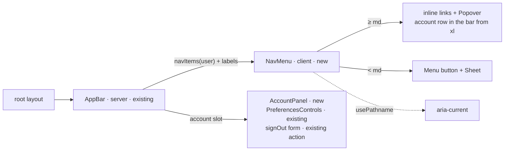
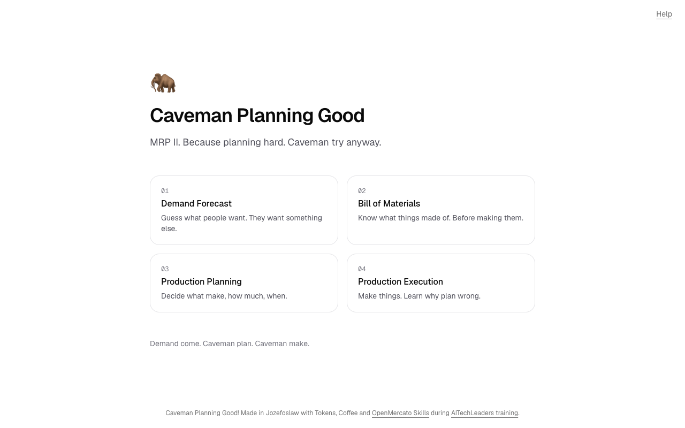
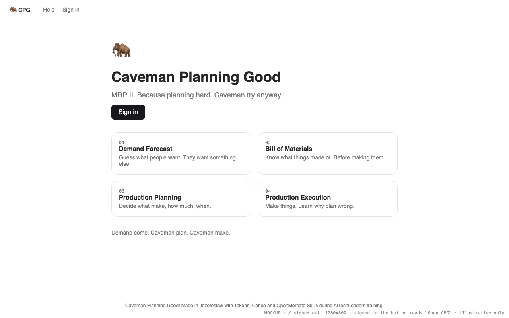
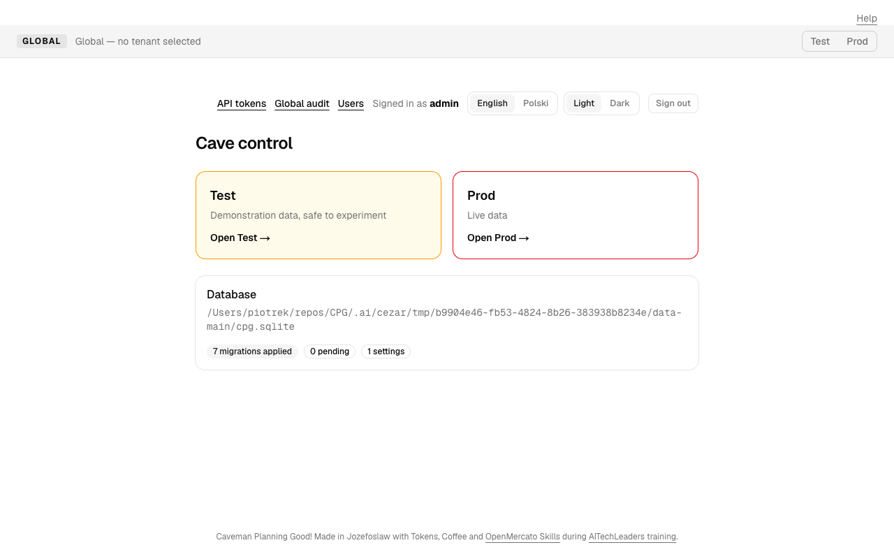
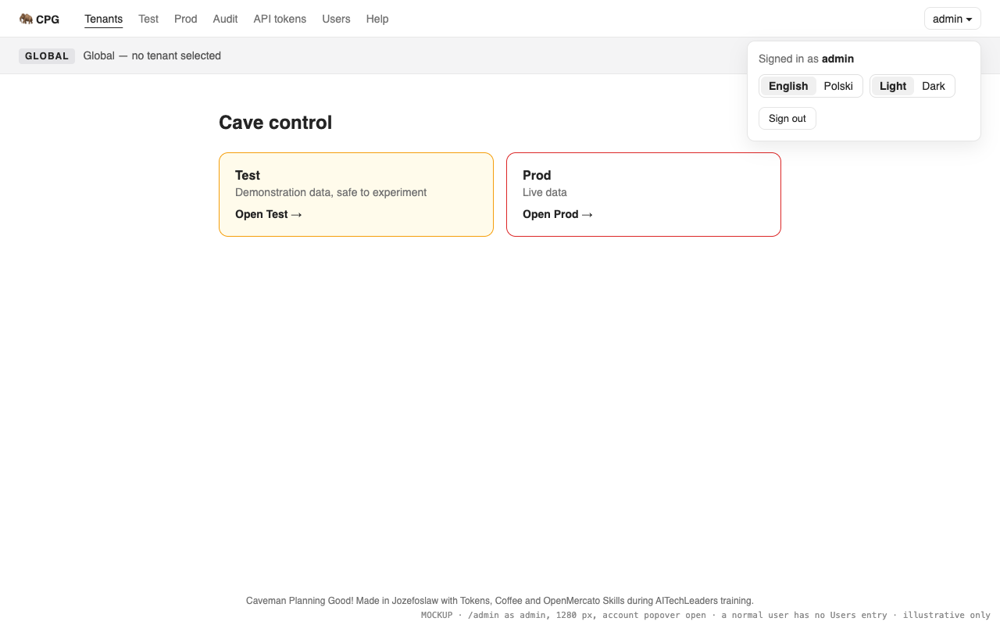
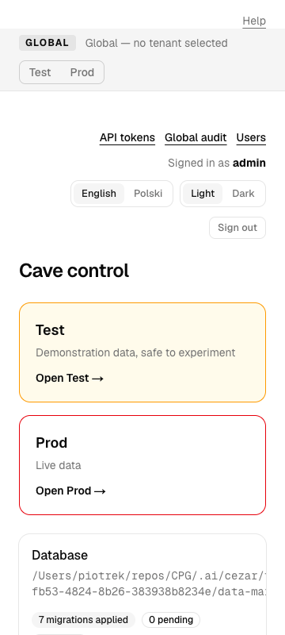
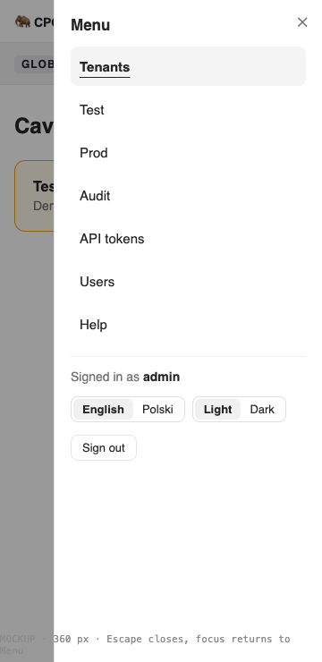

# One role-based navigation menu on every page, and a Sign in button on the homepage

**Status:** implemented
**Created:** 2026-10-19 13:12 UTC
**Issue:** #43 · **Builds on:** `implemented/2026-10-19--1053UTC-api-tokens.md` (#17, merged), `implemented/2026-10-19--1050UTC-audit-log.md` (#20, merged), `implemented/2026-10-19--0855UTC-user-preferences-footer-help.md` (#18, merged) · **Design authority:** `.ai/specs/product-brief.md` (R11, Q03), `.ai/specs/research/CPG-acceptance.md` (UX-002, UX-008…010)

## 📝 TLDR

Today a visitor on `/` can only sign in by typing `/login`. Once signed in, the screens are reached through scattered links: API tokens, Global audit and Users in the per-page `SignedInBar` (on `/admin` and the tenant homes only), the tenant cards on `/admin`, Help in the top strip, and "Cave control" back links. None of it is laid out for a phone. This spec proposes one menu in the root layout's app bar, built from a pure `navItems(user)` list: the screens the account can open, plus its account controls (name, language, theme, sign out). From 768 px up the links sit inline in the bar; below that a **Menu** button opens a sheet. The homepage gets a **Sign in** button (**Open CPG** when signed in), and its layout is tightened so the R11 footer stays in view. Hiding an entry is cosmetic: `requireUser()`/`requireAdmin()` stay the gates.

## Resolved assumptions (autonomous defaults)

| # | Question | Chosen answer | Rationale |
|---|---|---|---|
| Q1 | Desktop layout: a top bar or a permanent sidebar? | A top bar. From `md` (768 px) the entries are inline links in the bar and the account controls open from a button with the account's name (a `Popover`). From `xl` (1280 px) the account controls sit in the bar too (Q4). Below `md` one **Menu** button opens a right-hand `Sheet` holding the entries and the account controls. ✅ Confirmed by Piotr12 (2026-10-19). | The issue's own assumption, flagged by its author for confirmation. A top bar keeps the existing full-width page layouts and the tenant strip (TEN-011) untouched; a sidebar would re-flow every page. Reversible inside `components/layout/`. |
| Q2 | Is the tenant audit (`/admin/{tenant}/audit`) a menu entry? | No. It stays linked from the tenant home, as the audit spec has it. The tenant audit page keeps its back link to its tenant home; the Global audit is the menu's **Audit** entry. | The menu has no tenant context of its own (the strip's switcher does), and two Audit entries would read as duplicates. |
| Q3 | Signed-in homepage: a different button, or a redirect to `/admin`? | The button reads **Open CPG** and leads to `/admin`; no redirect. ✅ Confirmed by Piotr12 (2026-10-19). | The issue's own assumption, flagged by its author. Keeps `/` a page everyone can read and link to; a redirect is a one-line change later. |
| Q4 | How are the account controls reached on a wide screen? | **Changed by Piotr12 (2026-10-19): inline from 1280 px.** From `xl` (1280 px) they sit in the bar itself, in one row: the name (truncated, "Signed in as" for screen readers only), the existing `PreferencesControls` and the sign-out form, with no extra click. From `md` to `xl` (768–1279 px) they open from an account button's `Popover` (new shadcn component), one click away. The autonomous default was the popover at every width ≥ 768 px. | Between 768 and 1279 px the bar has no room for seven links plus two switch groups and a button. A `Popover` keeps Tab order and Escape/focus-return through Radix. `DropdownMenu` was the issue's suggestion, but Radix Menu content blocks Tab, so the switch buttons (forms) couldn't be reached by keyboard. It trades against the issue's "without extra clicks", hence the confirmation. |
| Q5 | Where do the per-page headers and back links go? | `SignedInBar` is deleted. The "Cave control" back links on Users, API tokens and the Global audit go; the menu reaches all three. The tenant audit keeps its back link to its tenant (Q2). | One place to navigate from; the issue retires the per-page bar. |
| Q6 | Is the current page marked for nested routes? | An entry is current when the path equals its `href`, or starts with `href + "/"` for every entry except `/admin` (which would otherwise match everything). So `/admin/test/audit` marks **Test**. | `aria-current="page"` for the screen a reader is in; `/admin` only matches itself. |
| Q7 | Does the menu name the brand? | Yes: a "🦣 CPG" link to `/` at the bar's start, outside the entry list. | Every page then leads home, which the homepage CTA relies on. It is not a menu entry, so it is never `aria-current`. |
| Q8 | Split the issue? | No. One PR. | The menu, the retired headers and the homepage button only make sense together: retiring `SignedInBar` without the menu would strand the account controls. |

Piotr12 confirmed Q1 and Q3 and changed Q4 to inline account controls from 1280 px on 2026-10-19, so no assumption is left open. None of them touches security or data: access stays with `requireUser()`/`requireAdmin()`.

## 📝 Problem Statement

- Signed out, `/` has no way in except typing `/login` (`app/page.tsx` has no link).
- Signed in, where a screen is linked depends on the page: `SignedInBar` (tokens, Global audit, Users for the admin, preferences, sign-out) appears only on `/admin` and `/admin/{tenant}`; Users, API tokens and the Global audit each carry their own back link; Help sits alone in the `AppBar` strip. #17 and #20 each grew `SignedInBar` by one link.
- `SignedInBar` is a `flex-wrap` row of nine controls; at 360 px it wraps to four lines above the heading.
- The homepage's `py-24` and `justify-center` push the R11 footer below the fold at 1280×800.

## 📝 Proposed Solution

One menu, rendered once by `AppBar` (already in the root layout's `<Suspense>`, already reading `currentUser()`), so every page — the homepage, `/login`, `/help` and every `/admin` page — gets it without per-page code.

- **Entries** come from a pure `navItems(user | null)`:

  | Entry | `href` | Shown to |
  | --- | --- | --- |
  | Tenants | `/admin` | every account |
  | Test | `/admin/test` | every account |
  | Prod | `/admin/prod` | every account |
  | Audit | `/admin/audit` | every account |
  | API tokens | `/admin/tokens` | every account |
  | Users | `/admin/users` | admin only |
  | Help | `/help` | everyone |
  | Sign in | `/login` | signed out only |

- **Account controls** (signed in only): "Signed in as **name**", the existing `PreferencesControls`, and the sign-out form, moved out of `SignedInBar` into an `AccountPanel`.
- **Homepage**: a button-styled plain-Tailwind `<Link>` under the tagline (a public page, so no `@cpg/ui` `Button`) — **Sign in** → `/login`, or **Open CPG** → `/admin`. `HomeContent` starts reading `currentUser()` (cached per request, so it shares the bar's lookup). And a tighter layout.

Alternatives considered: a permanent sidebar (re-flows every page, Q1); a `DropdownMenu` for the account (keyboard can't reach the switch buttons, Q4); keeping `SignedInBar` and only adding a mobile drawer (two places to maintain, and #17/#20 showed the bar keeps growing).

## 📝 Architecture

All new code lives in `packages/app/src/components/layout/` plus two shadcn components in `@cpg/ui`. No service, entity, route handler or server action changes.

The server decides *what* the account sees (`navItems`, labels, the `AccountPanel` element); the client component only decides *where* it is shown (inline, popover, sheet) and which entry is current.

- `nav-items.ts` (new, pure): `navItems(user: Pick<SessionUser, "role"> | null): NavItem[]` with `NavItem = { id: NavItemId; href: string }`, and `isCurrentPath(href, pathname): boolean` (Q6). Labels come from `messages.nav[id]`, except Test and Prod, which use `TENANT_NAMES` like the tenant strip.
- `nav-menu.tsx` (new, `"use client"`): props `items: { id; href; label }[]`, `account: { name: string; panel: ReactNode; inline: ReactNode } | null`, `labels`, `locale`. Renders the entry list twice — inline (`hidden md:flex`) and inside the `Sheet` (`md:hidden` trigger) — each in a `<nav aria-label={nav.menu}>`, marking the current entry with `aria-current="page"` from `usePathname()`. Each sheet link is wrapped in `SheetClose asChild`, so following any link (the current page included) closes the sheet; no effect watching the path. `PopoverContent` and `SheetContent` carry `lang={locale}`, since they portal outside the bar.
- `account-panel.tsx` (new, no hooks): the old `SignedInBar` account part, `stacked` for the popover and the sheet or `inline` for the bar from `xl`. `data-action="sign-out"` stays on the sign-out form.
- `app-bar.tsx` (changed): its root becomes a `<header>` (the menu's `<nav>` sits inside, so no nested or unlabelled navs); brand link, `NavMenu`, `DocumentPreferences` (unchanged). `AppBarPlaceholder` takes the bar's new height (`h-12`).
- **Styling exception**: the bar is shared by public and `/admin` pages through the root layout. It is built from `@cpg/ui` (`Sheet`, `Popover`, `Button`) on every page, the one place a public page renders shadcn components; the homepage's own content stays plain Tailwind.
- `@cpg/ui`: `npx shadcn@latest add sheet popover` in `packages/ui`, each with a test like the existing component tests. The sheet's built-in close button has a hard-coded English "Close" label; it gets a translated label (`showCloseButton={false}` plus our own `SheetClose`, or a label prop — whichever the generated component allows).
- Deleted: `components/auth/signed-in-bar.tsx` and its test.

## 📝 UI/UX

Prototype: `.ai/specs/assets/navigation-menu/` (static mockups; the implementation is checked against them).

- **Bar** (every page, above the tenant strip on `/admin` pages): `🦣 CPG` at the start; entries inline from `md`; at the end either the account button or, signed out, nothing extra (Sign in is an entry). Height `h-12`, `border-b`, the existing zinc/shadcn tokens; works in light and dark.
- **Account button**: a user icon and the name, truncated (`max-w-32 truncate`; the popover shows it in full). Its accessible name is "Account: *name*" — `nav.account` as a visually hidden prefix followed by the visible name — so the name a reader sees is part of what a screen reader announces (WCAG 2.5.3). Usernames run to 32 characters, so the bar is checked at 768 px in Polish with a 32-character name.
- **Account popover** (768–1279 px): "Signed in as **admin**", Language (English / Polski), Theme (Light / Dark), Sign out. It is modal: Tab stays inside, and Escape closes it and returns focus to the button.
- **Account controls in the bar** (≥ 1280 px, Q4): the same controls in one row after the entries: the name (`max-w-32 truncate`, full name in `title`), the two switch groups and Sign out. "Signed in as" is visually hidden. The account button is hidden at this width. Checked at 1280 px in Polish for the admin (seven entries) and the 32-character user.
- **Sheet** (< md): a **Menu** button (icon + the word, so the accessible name is visible) opens a right-hand sheet titled "Menu": the entries as a vertical list (44 px tall targets), then the account panel. Escape or the close button closes it and focus returns to **Menu**. Nothing in the bar or the sheet overflows at 360 px.
- **Current entry**: `aria-current="page"`, shown as foreground text with an underline (inline) or a muted background (sheet).
- **Homepage**: `py-12`, no `justify-center`, `gap-8`; the button sits under the tagline. The motto stays a plain `
` (one `<footer>` per page).
- **Copy**: every label in `i18n/messages/{en,pl}.ts` under `nav` (`menu`, `close`, `tenants`, `test`, `prod`, `audit`, `tokens`, `users`, `help`, `signIn`, `account`, `signedInAs`, `signOut`) and `home` (`signIn`, `open`). `admin.signedInAs`/`signOut`/`users`/`tokens` and the three `back` strings that nothing reads any more are removed.
- **Help**: the topics that say "in the header" (sign out, API tokens, Global audit, language and theme) say "in the menu" instead, the Cave control topic stops saying it shows the switches, Sign out and the Users link, and the Global audit topic names the **Audit** entry — in both languages.

| Screen | Today | Proposed |
| --- | --- | --- |
| `/` signed out |  |  |
| `/admin`, admin, 1280 px |  |  |
| `/admin`, 360 px (menu open in the mockup) |  |  |

## 📝 Edge Cases & Failure Scenarios

- **Session check fails** (`currentUser()` returns null on any error, fail closed): the menu shows the signed-out entries; the page's own gate still redirects. Nothing new can fail: the bar reads only what it reads today.
- **Normal user opens `/admin/users` directly**: `requireAdmin()` redirects to `/admin`, as today; the menu never offered the link (integration regression).
- **Deactivated or reset while signed in**: the next request validates the session, gets null, and the menu falls back to signed out.
- **No JavaScript**: the inline links and the homepage button are plain links and work; the sheet and the popover need JavaScript (as the switch buttons' re-render already does). Below `md` without JavaScript the entries are unreachable from the bar; the homepage button and the pages' own links still work.
- **Streaming**: the bar streams in after the static shell; `AppBarPlaceholder` keeps the same height, so nothing jumps. Integration tests wait for hydration before clicking (lessons: React fiber, hidden streamed containers).
- **Polish labels are longer** ("Tokeny API", "Użytkownicy"): the inline list must still fit at 768 px — checked in the integration test at 768 px in Polish via `scrollWidth`.

## 📝 Risks & Impact Review

- **Every page's header changes** (risk-high on the issue). The integration helpers that click `form[data-action=sign-out] button` or the switch buttons directly (`auth.test.ts`, `preferences.test.ts`, `sign-in.ts`'s `choosePreference`) now open the account popover first; `audit.test.ts` follows the **Audit** label instead of "Global audit". No public contract changes: no route, API, schema or event.
- **Two new `@cpg/ui` components** from the sanctioned generator, no new dependency (`radix-ui` and `lucide-react` are already there).
- **Rollback** is a revert; nothing persisted changes.

## 📋 Phasing

One phase: the menu, the retired headers and the homepage button ship together (Q8).

## 📋 Implementation Plan

### Phase 1 — Menu, account panel, homepage button

1. **UI primitives.** `npx shadcn@latest add sheet popover` in `packages/ui`; tests for both (open, close on Escape, focus return) next to them.
2. **Entries and copy.** `components/layout/nav-items.ts` with `navItems` and `isCurrentPath`; unit tests for null, user and admin, and for the current-path rule (`/admin` exact, nested tenant paths). Add the `nav` and `home` strings to `en.ts` and `pl.ts`.
3. **Account panel and menu.** `account-panel.tsx` and `nav-menu.tsx`; `app-bar.tsx` renders the brand, the menu and the account slot, and `AppBarPlaceholder` matches the new height. Tests: entries per role, `aria-current`, the sheet opening from **Menu** and closing on Escape with focus back on the button, the popover holding the switches and sign-out, signed-out entries.
4. **Retire the per-page headers.** Remove `SignedInBar` (component and test) from `/admin` and `/admin/{tenant}`; remove the back links from Users, API tokens and the Global audit (`AuditView`'s `back` becomes optional; the tenant audit keeps it); drop the unused strings; update the affected page tests and the help topics.
5. **Homepage.** The **Sign in** / **Open CPG** button and the tighter layout in `app/page.tsx`; update `page.test.tsx`.
6. **Integration.** Update `sign-in.ts` (an `openAccountMenu` helper that opens the popover only when the button's `aria-expanded` is `"false"`, so `restoreDefaultPreferences`' two `choosePreference` calls in a row work), `auth.test.ts`, `preferences.test.ts` and `audit.test.ts` for the popover. Add `tests/integration/navigation.test.ts`, with its own normal user (`nav-` prefix, a 32-character name, left active):
   - signed out, `/` shows **Sign in** → `/login`; signed in it shows **Open CPG** → `/admin`;
   - the admin's menu has **Users**; the normal user's doesn't, and `/admin/users` still redirects them to `/admin`;
   - `aria-current="page"` on the open screen's entry (`/admin/tokens`, and **Test** on `/admin/test/audit`);
   - at 360 px: the **Menu** button opens the sheet, Escape closes it and focus is back on the button, and `scrollWidth <= innerWidth` with the sheet open and closed;
   - at 1280 px, in Polish, as the admin and as the 32-character user: the account controls sit in the bar and nothing overflows;
   - at 768 px, in Polish and dark, as the 32-character user: the inline entries are visible, nothing overflows, and the open popover shows Polish labels with `<html class="dark">` (preferences restored in `afterAll`);
   - on `/` at 1280×800, signed out and signed in: the footer's bottom is inside the viewport; at 360×800 its top is within two viewport heights.

   `footer.test.ts` keeps passing unchanged.

## Implementation notes

- Implemented in PR #46 (spec PR #45); #43 closed as completed on 2026-10-19. Filed as implemented on 2026-10-23, in the second slice 2 closing pass: the spec had stayed in the active folder with `Status: ready`.
- `implemented/2026-10-19--2048UTC-sidebar-navigation.md` (#58) superseded this spec's layout answers (Q1 top bar, Q4 inline account controls, Q7 brand → `/`). The rest stands: role filtering, `aria-current`, the account controls, the server-side gates and the homepage **Sign in** / **Open CPG** button. `tests/integration/navigation.test.ts` covers them.
