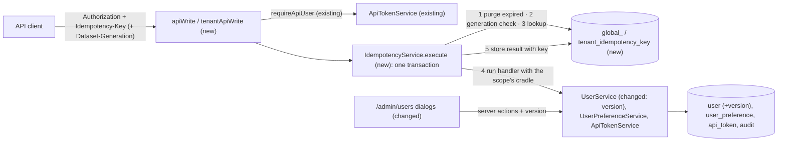
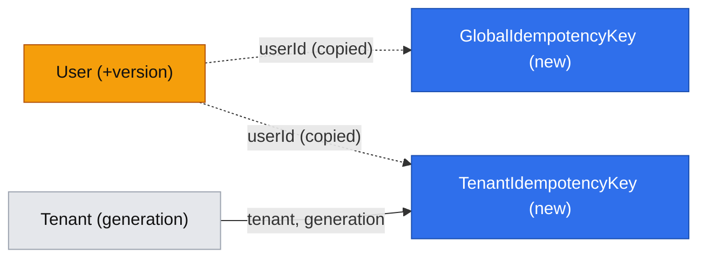

# API writes are safe to retry and stale edits are rejected

**Status:** implemented
**Created:** 2026-10-19 15:48 UTC
**Issue:** #21 (E02-S03), epic #10 · **Builds on:** `implemented/2026-10-19--1053UTC-api-tokens.md` (#17, merged), `implemented/2026-10-19--1050UTC-audit-log.md` (#20, merged), `2026-10-19--0913UTC-test-prod-tenants.md` (#19, merged) · **Design authority:** `.ai/specs/product-brief.md` (R05, R07, D03), `.ai/specs/research/CPG-prd001.pdf` §06, `.ai/specs/research/CPG-acceptance.md` API-018…API-026, API-029, API-033, API-034, AUD-024, AUD-025, TEN-030

## 📝 TLDR

Today a retried API write runs twice, and two people editing the same account both win, the later one silently. This spec proposes three guarantees:

- **Idempotency keys.** Every state-changing bearer request must carry an `Idempotency-Key` header. A repeat with the same key within 24 hours returns the first result and changes nothing. Reusing a key for a different request is a 409.
- **Versions.** Every edit of a versioned record carries the version the caller loaded, through the UI and the API. A stale version is a 409, and the newer change is kept.
- **Dataset generation.** Test-scoped API writes carry the Test tenant's current dataset generation, read from tenant metadata. A missing one is a 428, and a stale one is a 409.

The spec also adds the mutating API routes that #17 sequenced here: users (create, reset password, deactivate or reactivate) and preferences. These close R07's parity for everything built so far.

## Resolved assumptions (autonomous defaults)

| # | Question | Chosen answer | Rationale |
|---|---|---|---|
| Q1 | Split the issue? It bundles idempotency keys, versions and the generation precondition. | No. One spec and one implementation PR, delivered in four phases (Phasing). | The backlog filed them as one story with one outcome, "API writes are safe to retry and stale edits are rejected". Each phase leaves the app working, so a split later costs nothing. |
| Q2 | What happens to a write without a key, or with a malformed one? | 400 `IDEMPOTENCY_KEY_REQUIRED`, message "Send an Idempotency-Key header: 1–255 visible ASCII characters, unique per write." A key is 1–255 characters in the range `!`…`~`, compared case-sensitively. A UUID is recommended. `GET` and `HEAD` ignore the header. | API-019 asks for a stable code. 400 is what the IETF `Idempotency-Key` draft uses for a missing key. A single code covers both cases, because a client fixes them the same way. |
| Q3 | Whose key is it? | A key belongs to **(account, scope)**. The scope is `global` for routes outside a tenant, or the tenant code for routes under `/api/tenants/{tenant}/`. Two tokens of the same account share the keys. Another account, or another tenant, never sees them (API-024, API-025). | PRD wording: "same account/action/tenant". The account, not the token, is the actor whose write must not repeat. A client that rotates tokens mid-retry still gets its replay. |
| Q4 | When is a repeat "the same request"? | When its **fingerprint** matches: SHA-256 over the method, the path (without the query) and the canonical JSON body (keys sorted). Any difference is 409 `IDEMPOTENCY_KEY_REUSED`. The message says whether the operation or the body differed (API-022, API-023). When a body carries a password (create user, reset password), the stored fingerprint is an argon2id hash of that SHA-256. It is computed **before** the transaction opens. A found record is checked with `verifyPassword` **after** the transaction has ended. So no argon2 work holds the database connection. | Method plus path identifies the operation exactly. An unsalted fast hash of a body that contains a password would be a weaker copy of the password than `user.passwordHash`. argon2id makes it no weaker. It costs about 25 ms, on two admin-only routes that already pay for one argon2 hash. |
| Q5 | Which results are stored and replayed? | Successful ones only. A replay answers with the stored `200` envelope, byte for byte, plus the response header `Idempotent-Replayed: true`, and writes nothing, not even an audit entry. A request that fails (any `AppError` or 500) is rolled back with its key. Nothing changed, so the retry runs again and may succeed. | Every write is one transaction, so a failure leaves no partial effect to protect. Storing failures would freeze a transient 409 or 500 for 24 hours. Stripe likewise saves nothing when a request fails validation or loses a race. The header lets clients and tests tell a replay from a fresh write. |
| Q6 | How is "exactly once" guaranteed under concurrency? | The key record is inserted **in the same transaction as the write**, with a unique index on (account, [tenant], key). The transaction is opened with `em.begin()` / `commit()` / `rollback()` on **the request's own `EntityManager`**. The handler's services come from that same scope, so their `em.flush()` runs inside it and their `em.transactional()` becomes a savepoint. (`em.transactional()` would put the transaction on a child fork the services never see. Their own transactions would then wait for the single connection forever.) Two concurrent requests with one key in one process: Kysely's connection mutex serialises them, so the second finds the record and replays. Across connections (another Next.js bundle, or a deploy overlap): the purge, which runs first, takes SQLite's write lock before any read. If the unique index still fires, the loser rolls back, clears its `em`, re-reads the key in a new transaction, and replays or answers 409. A lock wait past `busy_timeout` is a 500 with nothing stored, so the client can retry. | `engineering-standards.md` asks for "a transaction plus a unique constraint, not only an application-level check". A separate "pending" row would need a lease. If the process died between the write and the completion, that lease would either block retries for 24 hours or let them run the write twice. |
| Q7 | How long are keys kept? | 24 hours from the first successful use (API-026). At 24 h or later the key counts as unused, and a request with it runs as new. Each write transaction first deletes every expired record of its store (an indexed `createdAt` delete), so the tables stay at about one day of writes. | R07 says 24 h. Cleaning up inside writes needs no scheduler, and SQLite has one writer anyway. |
| Q8 | Where do records live? | Two tables, like the audit: `global_idempotency_key` (global) and `tenant_idempotency_key` (`tenantOwned()`, with the tenant generation). The tenant store stays empty until the first tenant-scoped write route (#22); it is built and tested now. The slice 2 Test reset deletes the Test rows with the rest of Test's data. | A stored response of a tenant write holds that tenant's business data. R05 and `tests/tenant-ownership.test.ts` forbid keeping it in a global table. D03 asks for the foundations in slice 1, so #22 only has to use the tenant wrapper. |
| Q9 | How does a write carry the dataset generation, and when is it required? | API: the request header `Dataset-Generation: <integer>`. **Test**: required, so a missing or malformed value is 428 `GENERATION_REQUIRED` (API-034). **Prod**: optional, but checked when sent. A value other than the tenant's current generation is 409 `GENERATION_STALE`. The check runs inside the write transaction and **before** the key lookup, so a stale replay can't return a result from an older generation (API-033, TEN-030). UI: the tenant page binds `(tenant, generation)` to `tenantServerAction`, which checks it for both tenants. It checks inside the same kind of request transaction, opened around the handler, so a reset can't commit between the check and the write. | R07: "Test writes need the current generation". Prod's generation never changes, so requiring it there would only burden clients. A header keeps the precondition out of every operation's body schema, so one wrapper enforces it. `tenantServerAction` has no caller yet, so changing its signature now is free. |
| Q10 | Which records carry a version today? | `User`: reset password, deactivate and reactivate, in the UI and the API. Not `UserPreference`: each write changes only the fields it names (the existing field-level upsert), so a stale tab can't undo a change to another field. Not `ApiToken`: tokens are only created and deleted. From #22 on, every editable business record declares a version. | `User` is the only record today that two sessions edit from a loaded copy (AUD-024, AUD-025, API-029). A version check on a single-field toggle would only turn harmless last-writer-wins into errors. |
| Q11 | How is the version carried and checked? | A `version` integer column, managed by MikroORM (`p.integer().version()`). It starts at 1 and goes up on every update. `UserSummary` exposes it. Edits take `version` in the body: a required field in both the server-action and the API schemas. A missing one is 400 `VALIDATION_FAILED`. The service compares it with a **fresh read inside the transaction**. A mismatch, or MikroORM's `OptimisticLockError` at flush, is 409 `VERSION_CONFLICT` "This record was changed since you loaded it. Reload and try again." | The project's ORM already provides optimistic locking, so nothing new is invented. A body field works the same in server actions (which have no request headers) and in routes. HTTP `If-Match` would answer 412, but the acceptance criteria ask for 409. The fresh read follows the identity-map lesson in `lessons.md`. |
| Q12 | Which parity routes ship, and at which paths? | `POST /api/users` (create), `PUT /api/users/{id}/password` (reset), `PATCH /api/users/{id}` (`{ active, version }`), all admin only. `GET /api/preferences` and `PATCH /api/preferences` (`{ locale?, theme? }`) for the caller's own account. `DELETE /api/tokens/{id}` now requires the key. | The list #17 posted on #21. Each route calls the unchanged service method that the matching server action already calls, so the API and the UI share their authorization (R07). The paths follow the standards' `api/<concept>/[id]/<action>` shape. |
| Q13 | Do CPG's own screens send idempotency keys? | No. Server actions keep their existing protection: `CrudForm`'s pending state, unique constraints and, from this spec, versions. | R07 and API-019 are about the bearer API. A browser double-submit is already handled. Adding keys to server actions would add a contract with no consumer. |

None needs human confirmation before merge. Every answer is reversible, and none weakens security or tenant isolation. Q4 is stricter than a plain hash, and Q9 is stricter than the PRD for the UI. The one tightened contract, the required key, was announced in `BACKWARD_COMPATIBILITY.md` when #17 shipped. CPG has no external API consumers yet.

## 📝 Problem Statement

PRD §06 and R07 promise that API clients, which are often scripts and agents retrying after a timeout, can't apply a change twice or overwrite someone else's. Today:

- `DELETE /api/tokens/{id}` is the only mutating route. A retry after a lost response answers 404 instead of the original 200. That case is harmless, but every write route to come (users now, materials in #22, stock postings and MRP later) would repeat its effect: two users, two receipts, two MRP runs.
- The admin's account actions apply whatever arrives last. If the admin deactivates `bob` in one tab and reactivates him from a stale tab, the stale click wins without a warning.
- Nothing stops a client that cached Test data before a reset (slice 2) from writing it into the new dataset. Test IDs restart at 00000001, so the write would land on a different record (TEN-030).
- The users and preferences screens have no API equivalent, so R07's parity is open for both. #17 deferred those routes here so that they ship with keys from the start.

## 📝 Proposed Solution

- **One write wrapper for every mutating route.** `apiWrite` for global routes and `tenantApiWrite` for routes under `/api/tenants/{tenant}/`. Each one runs these steps in order:
  1. `requireApiUser(request)`: bearer only, 401 otherwise.
  2. Read and validate the `Idempotency-Key` header (Q2).
  3. Tenant routes only: resolve `tenantScope(code)` (404).
  4. Parse the JSON body. An unparseable body is 400 `VALIDATION_FAILED`.
  5. Hand everything to `IdempotencyService.execute`.

  Inside one request transaction (Q6), `execute`:
  1. deletes expired records, which also takes the write lock;
  2. tenant routes: checks the generation precondition (Q9);
  3. looks up the key. If it is found, it commits and then replays the result (fingerprint match) or throws 409 (mismatch). The comparison runs after the commit, so an argon2 check holds no lock.
  4. Otherwise it runs the route's handler with the scope's cradle and stores the result with the key, then commits.

  A repo test makes every exported `POST`/`PUT`/`PATCH`/`DELETE` in `app/api` go through one of the two wrappers.
- **Versions** on `User` through MikroORM's version property, checked by `UserService` against a fresh read (Q10, Q11). The users screen passes the loaded version, and a conflict shows in the open dialog while the list refreshes.
- **Generation precondition** on tenant writes, in the API wrapper and in `tenantServerAction` (Q9).
- **Parity routes** for users and preferences (Q12). They are thin: parse, check the role, call the existing service with `callerActor(caller)`.

**Alternatives considered:**
- **A "pending" key row committed before the write, completed after it.** Rejected (Q6). A crash between the two would leave a key that either blocks retries for 24 hours or allows a double write. A same-transaction record has no such gap.
- **Store every response, errors included (as in the IETF draft).** Rejected (Q5). A failed request changed nothing, so freezing its error only stops a legitimate retry.
- **`If-Match` / `ETag` for versions.** Rejected (Q11). Server actions can't send headers, the UI and API should share one contract, and the acceptance criteria ask for 409 rather than 412.
- **Version every record, preferences included.** Rejected (Q10). It would turn harmless field-level writes into conflicts.
- **One global key table with a scope column.** Rejected (Q8). Tenant data would sit outside tenant isolation and survive a Test reset.

**Market check.**
- **Stripe** popularised this pattern: an `Idempotency-Key` header, keys kept 24 hours, an `Idempotent-Replayed: true` response header, a request-parameter comparison, and no saved result when a request fails validation. CPG copies the parts that matter for one SQLite writer. It skips Stripe's "in progress" state, because the shared transaction serialises same-key requests.
- **The IETF `Idempotency-Key` draft** answers 400 for a missing key, 422 for a reused key with another payload, and 409 while a request is still in flight. CPG uses 409 for reuse because the acceptance criteria ask for a conflict.
- **Kubernetes** `resourceVersion` and **GitHub**'s `sha` on content updates answer a stale write with 409, the same rule as Q11.

## 📝 Architecture

- **`db`:**
  - `entities/idempotency/idempotency-key.ts`: the shared columns, as `audit-event.ts` does.
  - `entities/idempotency/global-idempotency-key.entity.ts` and `tenant-idempotency-key.entity.ts`. The global one goes in `GLOBAL_ENTITIES`; the tenant one is `tenantOwned()`.
  - `User` gains `version`.
  - One migration, `api-idempotency`.
- **`core`:**
  - `services/idempotency/idempotency.service.ts` (`IdempotencyService`, scoped): `execute(entry, write)`.
  - `services/idempotency/fingerprint.ts`: canonical JSON, SHA-256, and argon2id for secret-bearing bodies (reusing `auth/password-hash.ts`).
  - `http/idempotency-key.ts`: `readIdempotencyKey(request)` and `readGeneration(request)`, pure header parsers.
  - `http/request-transaction.ts`: `inRequestTransaction(em, fn)`. It calls `em.begin()`, runs `fn`, then `commit()`; on error, `rollback()` and `em.clear()`. It is shared by `IdempotencyService` and `tenantServerAction` (Q6, Q9).
  - `http/errors.ts`:
    - `ConflictError` takes an optional code (`VERSION_CONFLICT`, `IDEMPOTENCY_KEY_REUSED`, `GENERATION_STALE`).
    - New `PreconditionRequiredError` (428), and an `IdempotencyKeyRequiredError` (400) for the missing key.
  - `domain/tenants/generation.ts`: `assertCurrentGeneration(tenant, sent, { required })`, shared by the API and the UI.
  - `http/tenant-server-action.ts`: takes `(tenantCode, generation, raw)`, and runs the generation check and the handler in one `inRequestTransaction` (Q9).
  - `services/users/user.service.ts`:
    - `resetPassword` and `setActive` take `version`;
    - `UserSummary` exposes `version`;
    - `OptimisticLockError` becomes `VERSION_CONFLICT`.
  - Validators:
    - `validators/users/{reset-password,set-user-active}.schema.ts` gain `version`;
    - new `validators/users/user-api.schema.ts` for the route bodies (no `userId`; it comes from the path).
  - `container.ts`/`cradle.ts`: one line each for `idempotencyService`.
- **`app`:**
  - `auth/api-write.ts`: `apiWrite(handler, options?)` and `tenantApiWrite(handler, options?)`, both on top of `apiHandler` and `requireApiUser`. `options.secretBody` selects the argon2 fingerprint (Q4). The replay header is set here.
  - Routes:
    - `app/api/users/route.ts` (`POST`);
    - `app/api/users/[id]/route.ts` (`PATCH`);
    - `app/api/users/[id]/password/route.ts` (`PUT`);
    - `app/api/preferences/route.ts` (`GET`, `PATCH`);
    - `app/api/tokens/[id]/route.ts` (`DELETE`, now through `apiWrite`).
  - `components/users/{reset-password-dialog,set-active-dialog}.tsx` send `user.version`. `admin/(global)/users/actions.ts` also revalidates on `VERSION_CONFLICT`.
  - The `api-tokens` help topic (en, pl) gains the write rules: key, version, generation.
- **Repo tests:**
  - `tests/api-writes.test.ts` (new): every mutating export in `app/api` is defined with `apiWrite`, or with `tenantApiWrite` under `api/tenants/[tenant]/`. Those files call neither `requestScope` nor `tenantScope` themselves, so their writes can't escape the transaction.
  - `tests/tenant-entry-points.test.ts` accepts `tenantApiWrite` as a tenant route's way to resolve its scope.
- **`BACKWARD_COMPATIBILITY.md`:**
  - `Idempotency-Key` moves from "announced" to enforced;
  - the new routes and headers (`Dataset-Generation`, `Idempotent-Replayed`);
  - the error codes;
  - `UserSummary.version`.

The cross-cutting effect: every mutating route, existing and future, runs its service call inside the idempotency transaction, through the cradle the wrapper hands it. A route that resolved its own scope would write outside that transaction. The repo test forbids this.

## 📝 Data Model

| Entity | Field | Type | Notes |
|---|---|---|---|
| `GlobalIdempotencyKey` (`global_idempotency_key`) | `id` | uuid PK | |
| | `userId` | string(36) | the account (Q3). A copied value, not a foreign key: users are never deleted and the row lives 24 h |
| | `key` | string(255) | as sent (Q2) |
| | `operation` | string | `METHOD /path` as received, for the mismatch message (Q4) |
| | `fingerprint` | string | hex SHA-256, or an argon2id PHC string for secret-bearing bodies (Q4) |
| | `response` | json | the `data` of the successful envelope (Q5). Never a secret: no route that returns one (token creation) is an API route (R07) |
| | `createdAt` | datetime, indexed | the start of the 24 h window (Q7) |
| | unique | (`userId`, `key`) | Q6 |
| `TenantIdempotencyKey` (`tenant_idempotency_key`) | same columns, plus `tenant` (`tenantOwned()`) and `generation` (integer) | | unique (`tenant`, `userId`, `key`); index (`tenant`, `createdAt`) |
| `User` | `version` | integer, `version()`, default 1 | Q11. Existing rows get 1 from the migration |

No stored field holds a password or token. Secret-bearing bodies are kept only as an argon2id fingerprint (Q4).

## 📝 API Contracts

**Rules for every state-changing route** (`POST`, `PUT`, `PATCH`, `DELETE` under `/api`), checked in this order:

| Check | Failure |
|---|---|
| bearer token (existing) | 401 `UNAUTHORIZED` |
| `Idempotency-Key` present and valid (Q2) | 400 `IDEMPOTENCY_KEY_REQUIRED` |
| tenant routes: tenant exists (existing) | 404 `TENANT_NOT_FOUND` |
| body is JSON (empty allowed for `DELETE`) | 400 `VALIDATION_FAILED` |
| tenant routes: `Dataset-Generation` (Q9) | 428 `GENERATION_REQUIRED` (Test, missing or malformed); 409 `GENERATION_STALE` |
| key unused, or used with the same fingerprint | 409 `IDEMPOTENCY_KEY_REUSED` |
| the operation itself (schema, role, version, domain rules) | its own code. Nothing is stored, and the key stays unused |

A replay answers `200` with the stored envelope and `Idempotent-Replayed: true`. Every response keeps `Cache-Control: no-store` and the shared envelope (API-018).

**New and changed routes:**

| Method and path | Who | Body | Success | Errors besides the rules above |
|---|---|---|---|---|
| `DELETE /api/tokens/{id}` | any account | — | unchanged: 200 `{ id }`. A replay within 24 h, made with another of the caller's tokens, answers the same 200 instead of 404. A token that revoked **itself** can't replay: its retry is 401, because authentication comes first | unchanged |
| `POST /api/users` | admin | `{ username, password }` (`createUserSchema`) | 200 `UserSummary` | 403; 400 `VALIDATION_FAILED`; 409 `CONFLICT` (name taken) |
| `PUT /api/users/{id}/password` | admin | `{ password, version }` | 200 `UserSummary` (new version). The user's sessions and tokens are gone | 403; 400; 404 `NOT_FOUND`; 409 `VERSION_CONFLICT` |
| `PATCH /api/users/{id}` | admin | `{ active, version }` | 200 `UserSummary`. Setting the current state again succeeds without a change; the version is still checked | 403; 400; 404; 409 `VERSION_CONFLICT` |
| `GET /api/preferences` | any account | — | 200 `{ locale, theme }` | 401 |
| `PATCH /api/preferences` | any account, own row | `{ locale?, theme? }` (`userPreferenceUpdateSchema`) | 200 `{ locale, theme }` | 400 |
| `GET /api/users` | admin | — | unchanged, plus `version` on each row | unchanged |

For a malformed `{id}` the user routes answer 404 `NOT_FOUND`, as the token routes do. For an id that is the built-in admin they answer 404 too: `UserService` only writes `role = user` rows (unchanged). Every write records its Global audit entry with `apiActor` (channel `api`, token id and name), as the tokens route does.

**Server actions** (changed): `resetUserPassword` takes `{ userId, password, version }` and `setUserActive` takes `{ userId, active, version }`. `VERSION_CONFLICT` comes back in the result envelope, and the action revalidates `/admin/users`. `tenantServerAction(schema, handler)` now returns `(tenantCode, generation, raw) => Result`. Its first caller arrives with #22.

**`IdempotencyService`** (core):
- `execute<T>(entry, write: (cradle) => Promise<T>): Promise<{ data: T; replayed: boolean }>`.
- `entry = { userId, scope: "global" | { tenant, generation, requireGeneration }, key, operation, fingerprint }`, where the fingerprint is a precomputed SHA-256 or `{ secret: sha256 }`.
- Inside `inRequestTransaction` on the scope's own `em`, never `em.transactional()` (Q6):
  1. purge expired rows;
  2. (tenant) `assertCurrentGeneration`;
  3. find the key;
  4. if found, commit and then compare the fingerprints outside the transaction (replay or 409);
  5. otherwise run `write` and insert the record.
- A unique violation on insert rolls back and clears the `em`, then repeats the lookup once in a new transaction. That repeat writes nothing.
- The argon2 fingerprint of a secret-bearing body is computed by the caller before `execute` (Q4).
- The stored `response` is whatever the route returns. No API route returns a secret: token creation is a server action only, and `tests/api-token-minting.test.ts` already pins that.

## 📝 UI/UX

There is no new screen. On `/admin/users`, the Reset password and Deactivate/Reactivate dialogs submit the version the row was rendered with. If another session changed the user in the meantime:
- the dialog stays open and shows an alert: "This user was changed since you loaded the page. Check the list and try again." (English and Polish);
- the list behind it refreshes to the current state;
- a second submit uses the refreshed version.

There are no other visible changes. The `api-tokens` help topic gains a short "Writing through the API" section: send an `Idempotency-Key` on every write; send the record's `version` when editing; for Test, send `Dataset-Generation` from `GET /api/tenants/test`.

There are no mockups. The only visual change is an error alert inside existing dialogs, in the alert style the users screen already uses for `CONFLICT` (see `implemented/2026-10-19--1053UTC-api-tokens.md`, Implementation notes).

## 📝 Edge Cases & Failure Scenarios

| Case | Behaviour |
|---|---|
| Response lost, client retries with the same key and body within 24 h | 200 with the original body and `Idempotent-Replayed: true`. Nothing is written, and no audit entry is added (API-021) |
| Same key, different body or path | 409 `IDEMPOTENCY_KEY_REUSED`. Nothing runs (API-022, API-023) |
| Same key from another account, or in the other tenant | Runs as a new request (API-024, API-025) |
| Same key at 23 h 59 m, then at 24 h | A replay, then a new run, which may succeed or fail on its own merits (API-026) |
| First attempt failed (403, 409, 500), retry with the same key | Runs again. The failure stored nothing |
| Two concurrent requests with one key | One write. The other replays once the first commits (Q6) |
| Two connections (another Next.js bundle, or a deploy overlap) race on one key | The purge's write lock serialises them. If the unique index fires anyway, the loser rolls back, re-reads, and replays or answers 409. A lock wait past `busy_timeout` is 500 with nothing stored. Never a double write |
| A token revokes itself, and the response is lost | Its retry is 401: the token is gone. A replay with another of the caller's tokens answers the original 200. The same holds for any key whose account lost its tokens through a reset or deactivation |
| A replay of a create-user call with the same body | Replays the summary. The password in the body is checked against the argon2 fingerprint, never stored |
| A key reused after the user it named was deactivated | A replay returns the original result as recorded (it describes the original write). Any new write is a new key |
| Test write without `Dataset-Generation` | 428 `GENERATION_REQUIRED` before any key lookup (API-034) |
| Test write with an old generation, same key as before the reset, inside or after 24 h | 409 `GENERATION_STALE`. No lookup and no write (API-033, TEN-030). The reset also deleted the old Test key rows |
| Prod write with `Dataset-Generation` sent and wrong | 409 `GENERATION_STALE` |
| Admin deactivates `bob` in tab A, then reactivates him from stale tab B | B gets `VERSION_CONFLICT`. Bob stays inactive and the list refreshes (AUD-024) |
| Two API clients `PATCH` the same user with version 3 | The first wins (version 4), and the second gets 409 (AUD-025, API-029) |
| `PATCH /api/users/{id}` with the current `active` value and the current version | 200, no change, no audit, and the version is unchanged |
| `PATCH /api/preferences` from two clients, one setting `locale` and one `theme` | Both apply, and neither undoes the other (Q10) |
| The idempotency tables grow | Each write deletes expired rows first, so about one day of writes is kept (Q7) |
| A handler written to call `requestScope()` itself | Fails `tests/api-writes.test.ts`. Its write would escape the transaction |
| The database is busy or the write fails | 500 `INTERNAL`, rolled back with the key. The retry runs again |

## 📝 Risks & Impact Review

- **Tightened contract.** `DELETE /api/tokens/{id}` without a key now answers 400. It was announced in `BACKWARD_COMPATIBILITY.md` with #17, and CPG has no external API users yet. The PR moves the note from "announced" to enforced.
- **Longer transactions.** The service call now runs inside the idempotency transaction. For an API password reset or user creation, that includes `UserService`'s own argon2 password hash: about 25 ms of the bundle's one SQLite connection. `ApiTokenService.create` already pays that for admin tokens. The fingerprint's argon2 runs outside the transaction (Q4). Every write adds one indexed delete, one lookup and one insert. A later change can move the password hash out by passing a prepared hash into `UserService`, if the wait ever shows.
- **Transaction propagation is MikroORM behaviour.** In MikroORM 7, `em.transactional()` on a fork (`useContext = false`) opens its transaction on a child fork. A service holding the request `em` would then start a second top-level transaction, and wait forever for Kysely's single-connection mutex. That is why the transaction is opened with `em.begin()` on the request `em` itself (Q6). Step 2 pins this with real-SQLite tests that fail on a timeout, including a tenant-scoped `em`. The handler must use the services of the cradle it is given; `tests/api-writes.test.ts` forbids `requestScope()` in write routes.
- **Deploy overlap weakens versions briefly.** The previous release updates `User` without `version` in its `where`. A stale tab served by the old container can still win during the overlap. This is accepted: the overlap lasts seconds, and the new release is strict once traffic switches.
- **Versions change two server-action schemas.** The users screen is the only caller, and it changes in the same PR.
- **Built ahead of a producer.** `tenantApiWrite`, `TenantIdempotencyKey` and the generation check have no route until #22 (D03). They are unit-tested against real SQLite now. #22's spec has to use them, and `tests/api-writes.test.ts` makes that mandatory.
- **Rollback note (`BACKWARD_COMPATIBILITY.md` §1).** The migration is additive: two new tables and a defaulted `user.version` column. `kamal rollback` runs the previous image against the migrated database unchanged. That image ignores the new tables and never reads `version`. Its `UPDATE`s don't bump it, so a version loaded before the rollback can still match afterwards; that is harmless. The migration's `down()` drops both tables and the column, and its test covers up and down. After a rollback, writes are no longer retry-safe, which is the behaviour before this spec.

## 📝 Decisions in play

- **R07** (API parity, idempotency 24 h, Test generation): enforced for every mutating route. Parity closed for users and preferences (Q12).
- **R05** (tenant isolation): tenant key records are tenant-owned and cleared with Test (Q8).
- **R06** (reset or deactivate ends sessions and tokens): unchanged, and reachable through the API.
- **R08** (audit, no secrets): API writes are audited with the token. Replays add nothing. No secret is stored in a key record (Q4).
- **D03** (foundations in slice 1): the tenant half ships before its first producer (Q8, Q9).

Nothing is superseded.

## 📋 Phasing

- **Phase 1 — Idempotency keys for global routes.**
  - The whole schema in one migration: both key tables, plus `User.version` with the entity's `version()` property. MikroORM increments it from then on, but nothing checks it yet.
  - `IdempotencyService`, `apiWrite`, and `DELETE /api/tokens/{id}` moved onto it.
  - The repo test and `BACKWARD_COMPATIBILITY.md`.

  Ships alone: the existing write route becomes retry-safe.
- **Phase 2 — Tenant writes.** The tenant branch of `execute` on `TenantIdempotencyKey`, the generation precondition, `tenantApiWrite`, and `tenantServerAction` with the generation.
- **Phase 3 — Versions.** `UserService` checks `User.version`; the server actions and the dialogs send it.
- **Phase 4 — Parity routes.** Users and preferences routes, help, and integration tests.

## 📋 Implementation Plan

### Phase 1 — Idempotency keys for global routes

1. **Entities and migration.**
   - Add `entities/idempotency/` per the Data Model: both entities now, since the migration is one unit. `User` gains `version: p.integer().version()`.
   - Register both in `entities/index.ts`, and add the global one to `GLOBAL_ENTITIES`.
   - Run `npm run db:migration:create -- api-idempotency`.
   - Tests on temp SQLite:
     - the migration applies, existing users get version 1, and `down()` removes both tables and the column;
     - a user update through the unit of work increments `version`;
     - the unique indexes reject a duplicate (user, key), but accept the same key for another user or tenant;
     - the tenant table is isolated by the tenant filter, as `tenant-isolation.test.ts` checks.
2. **Fingerprint, headers, request transaction and `IdempotencyService`.**
   - `fingerprint.ts`, `http/idempotency-key.ts`, `http/request-transaction.ts`, the new error classes, and the service per API Contracts.
   - Register the service in the container and cradle, export it, and update `index.test.ts`.
   - Unit tests against real SQLite:
     - canonical JSON is key-order independent;
     - header validation: empty, 256 characters, a non-ASCII character, a space;
     - a first call runs the write and stores the result;
     - a replay returns it with `replayed: true` and runs nothing;
     - a different body and a different operation each give `IDEMPOTENCY_KEY_REUSED`;
     - another user's same key runs anew;
     - a failing write stores nothing, and the retry runs;
     - at 24 h (`vi.setSystemTime`) the key is reusable, and expired rows are purged;
     - a secret fingerprint is argon2 and matches only the same body;
     - two concurrent `execute` calls with one key give one write and one replay;
     - **propagation**, each test with a timeout so a hang fails rather than stalls:
       - a write that calls `em.transactional()` and `em.flush()` on the scope's `em` completes;
       - it rolls back with the outer transaction when the record insert fails (forced unique violation);
       - the lookup retry then replays and writes nothing (the cleared `em` doesn't re-flush the failed entities);
     - a secret-bearing replay's argon2 check runs after the commit;
     - two ORMs on one file racing on one key give one write.
3. **`apiWrite` and the token route.**
   - `app/src/auth/api-write.ts`. `DELETE /api/tokens/{id}` moves to it.
   - `tests/api-writes.test.ts`, and `BACKWARD_COMPATIBILITY.md` (enforced key, replay header, codes).
   - Unit tests mocking `@cpg/core`:
     - the order of checks (401 before 400);
     - the replay header is set on a replay and absent on a fresh write;
     - a replayed `UserSummary` with a `createdAt` date is byte for byte the first response;
     - a malformed JSON body;
     - the handler receives the wrapper's cradle;
     - the route still answers 404 for a foreign token id.

### Phase 2 — Tenant writes

4. **Generation precondition.**
   - `domain/tenants/generation.ts` and the `execute` tenant branch. `tenantApiWrite` resolves `tenantScope` and reads `Dataset-Generation`.
   - Unit tests:
     - Test without the header gives 428, malformed gives 428, and stale gives 409;
     - Prod without the header passes, and Prod stale gives 409;
     - the generation check runs before the lookup, so a stored G1 record is never replayed after a bump to 2;
     - tenant records are isolated per tenant (API-024);
     - the transaction `em` keeps the tenant selection.
5. **`tenantServerAction(schema, handler)` → `(tenantCode, generation, raw)`.**
   - Unit tests:
     - a stale generation gives `GENERATION_STALE` before the input is parsed;
     - the current one runs the handler inside the transaction;
     - a handler error rolls its writes back.
   - Update `tests/tenant-entry-points.test.ts` for `tenantApiWrite`.

### Phase 3 — Versions

6. **`UserService` versions.**
   - `resetPassword(userId, password, version, actor)` and `setActive(userId, active, version, actor)`. `UserSummary.version`. A fresh read in the transaction; `OptimisticLockError` maps to `VERSION_CONFLICT`. The schemas gain `version`.
   - Unit tests:
     - a stale version gives 409, and the newer state and its audit are kept;
     - the current version succeeds and increments;
     - a no-op `setActive` keeps the version;
     - the conflict is detected even when the entity was already in the identity map (regression for the lesson);
     - a concurrent update between the read and the flush gives `VERSION_CONFLICT`.
7. **Users screen.**
   - The dialogs send `user.version`. The actions revalidate on `VERSION_CONFLICT`. Add the en/pl strings.
   - Unit tests:
     - the dialogs submit the version;
     - the conflict alert shows and the dialog stays open;
     - the action revalidates on conflict.

### Phase 4 — Parity routes

8. **Routes** per API Contracts, each with `apiWrite` (`secretBody` for the two password routes), plus `GET /api/preferences`, and `BACKWARD_COMPATIBILITY.md` lists them.
   - Unit tests per route:
     - the envelope;
     - 403 for a normal user on the user routes;
     - 404 for a malformed id or the admin's id;
     - the path id, never a body field, reaches the service;
     - `callerActor` reaches the service;
     - `PATCH /api/preferences` changes only the named field.
9. **Help.** Add the "Writing through the API" section to the `api-tokens` topic, in en and pl.
10. **Integration tests** in `tests/integration/api-idempotency.test.ts`. The admin creates a token, then:
    - `POST /api/users` without a key gives 400 `IDEMPOTENCY_KEY_REQUIRED` (API-019);
    - with key K it gives 200, and the replay gives 200 with `Idempotent-Replayed: true`, while the users list has one `idem-carol` (API-020, API-021);
    - K with another username gives 409 `IDEMPOTENCY_KEY_REUSED` (API-022);
    - K on `PATCH /api/users/{id}` gives 409 (API-023);
    - a second account's token with K creates its own preference change (API-025);
    - `PATCH /api/users/{id}` with version 1 deactivates, and a second client with version 1 gets 409 `VERSION_CONFLICT`, with the user still inactive (API-029, AUD-025);
    - in the browser, open the reset dialog, change the user through the API, and submit: the conflict alert appears, and the list shows the new state (AUD-024);
    - `DELETE /api/tokens/{id}` for token A, made with token B, replays 200 when retried with B and the same key.

    Use usernames unique to this file (`idem-*`), per `lessons.md`. Then run the full gate: lint, typecheck, `test:coverage` (100%), build, `test:integration`. There is no new dependency.

API-024 (tenant isolation of keys) and API-033/API-034 (generation) are unit-tested in steps 2 and 4 against real SQLite. Their API-level integration tests arrive with the first tenant write route, materials in #22.

## Implementation notes

Implemented on PR #48. These deviations from the text above are deliberate:

- **The key's writes come last (Q6).** The design above has the purge run first, to take SQLite's write lock before any read. That deadlocked: better-sqlite3 waits for a lock synchronously, which blocks Node's event loop, so a second connection in the same process (another Next.js bundle) stalls everything while the lock is held across the handler's argon2 await. So:
  - `IdempotencyService.run` reads first, and does the purge and the key insert last.
  - The lookup ignores expired records itself.
  - A lost race rolls back and tries once more, and the second attempt replays. A lost race is either a unique violation on the key, or a stale snapshot (`SQLITE_BUSY_SNAPSHOT`, which fails at once).
  - A real lock timeout is not retried and answers 500.
- **`run`, not `execute`.** ESLint bans `.execute(` as the raw-SQL entry point.
- **`apiWrite(handler, { authorize })`.** The admin routes check the role before the key, the body and any argon2 fingerprint, so a normal user's token can't make the server hash.
- **The write's own changes are flushed before the key is inserted**, so a handler's unique violation stays its own error, not a lost key race.
- **`tenantServerAction` checks the generation after parsing the input**, not before. It still runs before the handler, inside its transaction, and a malformed form keeps its field errors.
- **API body schemas** are `resetPasswordBodySchema` and `setUserActiveBodySchema` next to the action schemas, not a separate `user-api.schema.ts`. `versionSchema` sits in `validators/users/` until #22 needs it elsewhere.
- **A malformed `Dataset-Generation` is 428 in either tenant**, not only in Test.

What later stories changed (recorded on 2026-10-20, when epic E02 (#10) closed):
- **`versionSchema` moved.** It lives in `core/src/validators/version.schema.ts`, shared by users, materials, conversions and the masters.
- **The tenant store is in use.** Lines 28 and 255 say it stays empty until #22. Every tenant write route of #22 and #23 now stores into it, and `tests/api-writes.test.ts` requires every mutating route under `app/api` to use `apiWrite` or `tenantApiWrite`. The only global write in the tenant tree, the read-only `PATCH /api/tenants/{tenant}` (#25), is named as an exception there. It has no version: it is a single flag.
- **Read-only (#25).** `IdempotencyService` checks the flag after the key lookup, so a stored answer still replays on a read-only tenant. `tenantServerAction` retries once on a stale snapshot, like the API.
- **Carry into the Test reset (D06).** The key lookup matches the account and the key, not the generation. A replay after a reset is refused only because the reset deletes Test's key rows (Q8). The reset must do that, with a test, or the lookup must also match the generation.
