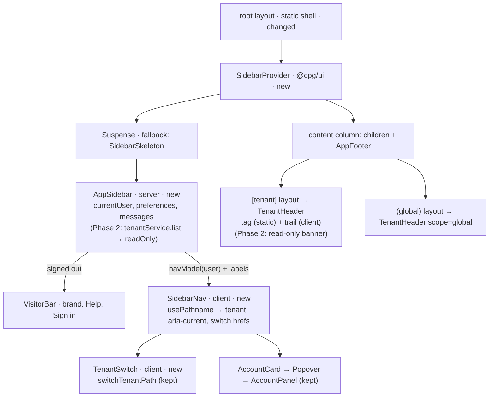

# A left sidebar with a Test | Prod switch and one master-data tree

**Status:** implemented
**Created:** 2026-10-19 20:48 UTC
**Issue:** #58 · **Supersedes (layout only):** `2026-10-19--1312UTC-navigation-menu.md` (#43) · **Builds on:** `2026-10-19--0913UTC-test-prod-tenants.md` (TEN-011, switcher Q8), `2026-10-19--1858UTC-materials.md` (#22) · **Holds:** #23 (spec PR #54, implementation PR #56), #25 (spec PR #55, implementation PR #57) · **Design authority:** [mockup 01, the left sidebar tree](../assets/menu-revamp/01-sidebar-tree/index.html), chosen by Piotr12 from the five concepts in [`assets/menu-revamp/`](../assets/menu-revamp/README.md) ([shared brief](../assets/menu-revamp/BRIEF.md))

## 📝 TLDR

Every signed-in account currently navigates CPG through one flat top-bar row: `Tenants · Test · Prod · Audit · API tokens · Users · Help`. Below it, a full-width tenant strip carries the Test/Prod switcher. Materials and the tenant audit are reachable only from the tenant home card. The row has no room for what slice 1 adds.

This spec proposes replacing the bar and the strip with the sidebar of mockup 01, built from the shadcn `sidebar` component:
- a full-width **TEST | PROD** switch at the top, which keeps the current screen;
- the tenant's screens under it, with Master data as one tree;
- the screens shared by both tenants, and an account card, pinned to the bottom.

On desktop the sidebar collapses to an icon rail. Below 768 px it becomes a drawer behind a slim top bar. Role filtering, the `aria-current` rule, the account controls and the server-side gates carry over from #43 unchanged.

## Resolved assumptions (autonomous defaults)

The issue lists five open questions as non-blocking; this run added four more of the same kind (Q6–Q9). Each one has the most reversible default below. Piotr12 can override any of them before merge. None weakens a gate, tenant scoping or a protected URL, so none needs confirmation before merge.

| # | Question | Chosen answer | Rationale |
|---|---|---|---|
| Q1 | Do the unbuilt groups (Sales, Purchasing, Production, Inventory, Planning, Reports) and the unbuilt slice 1 entries (Planning parameters, Safety stock, BOMs, Import) show greyed as "later", or only once built? | **Only once built.** The sidebar lists the screens that exist on `main`. Each story adds its own entry when its screen ships: #24, #26, #27 and E06 each add one line to the nav model and its label. No placeholder pages and no "later" badge. This is the mockup with "Show later slices" switched off. | No dead links and no "coming in slice N" routes to build, test and later remove. Adding an entry is a one-line change in the story that owns the screen. The mockup's "later" state can come back as its own change if wanted. |
| Q2 | Where does the read-only toggle live: the mockup's "Tenants & read-only" page, or the #25 card on `/admin`? | **Where #25 puts it: the admin's Read-only card on `/admin`.** The sidebar reaches that page through Administration → **Tenants**. | #25's spec (PR #55) and implementation (PR #57) are in flight, and its Q5 chose `/admin` for a reason that still holds: a tenant-page action can't lift its own tenant's lock. Moving the card is a later, local change. |
| Q3 | What does `/admin`, today's tenant chooser, become once the switch replaces it? | **The same URL and the same role.** It stays the page every account lands on after sign-in (`HOME_PATH`). It keeps the two tenant cards. For the admin it also keeps the system-status card and gains #25's Read-only card. For the admin the sidebar labels it **Administration → Tenants**. The mockup's separate **System status** entry folds into it, since the status card already lives there. Normal users have no sidebar entry for it, and don't need one: the switch reaches both tenants. | `/admin` is a protected public URL (BACKWARD_COMPATIBILITY.md §4) and the post-sign-in target. No new pages, no redirects. Splitting it into `/admin/tenants` and `/admin/system` can come later if the page gets crowded. |
| Q4 | Can the sidebar, the switch and a breadcrumb tag replace the tenant strip and still satisfy TEN-011? | **Yes, so the strip is removed.** TEN-011 is then carried by: <ul><li>a **tenant header row** that the `[tenant]` layout renders on every tenant page, so no page can leave it out. Its tag `TEST` or `PROD` and its 3 px tenant-coloured top edge are language-neutral and sit in the static shell. Its translated name ("Active tenant") streams in, as the strip's sentence does today;</li><li>the switch, with the current side pressed;</li><li>the page-title prefix (`Test · …`).</li></ul>Global pages get a neutral `GLOBAL` tag and "Shared by Test and Prod". | The tag keeps every guarantee the strip had: it is rendered by the layout, prerendered, readable as words, and works without JavaScript. Unlike the switch, it is also visible when the sidebar is a rail or a closed drawer. The mockup Piotr12 chose has no strip. |
| Q5 | Should this land after PRs #56 and #57, or include their entries? | **Implement after #56 merges.** Phase 1 includes Locations, Customers and Suppliers. The read-only display (🔒 on the switch, the banner) is **Phase 2**, which starts once #57 merges. Preferred order: #56 → #57 → this spec, both phases in one PR. If #57 is still open when Phase 1 starts, Phase 1 ships alone, and #57's screen step puts its read-only label in the banner slot defined here instead of the strip. | #56 is complete. Its links and pages work unchanged in the sidebar. #57 has only its core phase done, and its UI is designed against the strip this spec removes. One merge order avoids building the read-only label twice. |
| Q6 | What do signed-out visitors see on `/`, `/login` and `/help`? | **No sidebar.** A slim top bar with the brand, Help and Sign in: today's signed-out entries. | A visitor has no tenant and two entries. A sidebar would be an empty column. |
| Q7 | Which tenant does the switch show on a global page (Users, Global audit, Help), or on a fresh load of one? | **The last tenant page visited in this tab, or Test on a fresh load.** It is client state in the root layout, which survives in-app navigation. On a global page, flipping the switch only changes which tenant the tree above links to: the page stays put, and its header says it is shared by both tenants. There, the switch is named "Menu shows: Test", not "Tenant: Test", and the caption reads "This page is shared by Test and Prod". The page then has one scope signal, the `GLOBAL` tag. There is no tenant cookie and no tenant on the session. | Keeps test-prod-tenants Q2/Q7: each request names its tenant in the URL. Test is the safe default. The mockup behaves the same way. |
| Q8 | Is the collapsed rail remembered across reloads? | **No.** The rail state lives in the provider in the root layout. It survives in-app navigation and resets to expanded on a full page load. The generated component's `sidebar_state` cookie write is removed. | The standards allow one script-readable cookie (`cpg_theme`). A second one, or a new preference column, isn't worth it for a collapse state. Persisting it later is additive. |
| Q9 | Does the issue bundle independently deployable capabilities that should be split into separate specs? | **No.** One spec in two phases. Phase 2 (the read-only display) depends on #57 and ships with or after Phase 1. | The sidebar, the switch and retiring the strip only work together: a sidebar beside the strip would show two switches. The read-only display needs both this layout and #25's flag. |

## 📝 Problem Statement

- **The bar is full.** The admin's row already has seven entries. At 768–1279 px the account controls hide behind a popover (#43 Q4). #23 adds three screens and #24, #26 and #27 add four more, all tenant-scoped. None fits as a top-level entry.
- **Test and Prod are menu entries, not a context.** `Test` and `Prod` in the bar lead to the tenant homes. The real switcher sits on a separate strip below the bar. Users meet the same choice twice, in two places, with two behaviours: the bar entry goes to the home, the strip's switcher keeps the section.
- **Tenant screens are buried.** Materials, the tenant audit and (with #56) Locations, Customers and Suppliers are only links on the tenant home card. From a material record, reaching Suppliers means going back to the tenant home first. Nothing shows that these screens belong to one "Master data" group.
- **System status is hidden** on `/admin` for the admin. Nothing in the menu says it is there.
- Piotr12 compared five concepts against the same brief and requirements (`assets/menu-revamp/BRIEF.md`: Test/Prod as a switch; master data as one tree; any existing screen within 2 clicks) and chose 01.

## 📝 Proposed Solution

Replace `AppBar`, `NavMenu` and the tenant strip with one sidebar built from shadcn's `sidebar` component in `@cpg/ui`, laid out as in mockup 01.

**What the sidebar holds**, top to bottom (admin view, slice 1 as built after #56):

| Zone | Entry | `href` | Shown to | Current when |
|---|---|---|---|---|
| Head | 🦣 CPG (brand) | the current tenant's Overview | every account | never |
| Head | Collapse/expand toggle (desktop), Close (drawer) | — | every account | — |
| Tenant | **TEST \| PROD switch**, then a one-line caption ("Demonstration data, safe to experiment" / "Live data") | the same section in the other tenant (`switchTenantPath`, unchanged) | every account | — |
| Tenant | Overview | `/admin/{t}` | every account | exact path only |
| Tenant | **Master data** (group) → Materials, Locations, Customers, Suppliers | `/admin/{t}/{materials,locations,customers,suppliers}` | every account | path or below (`/admin/test/materials/00000005` → Materials) |
| Tenant | Audit | `/admin/{t}/audit` | every account | path or below |
| Shared ("Shared by Test and Prod") | **Administration** (group) → Users, Tenants | `/admin/users`, `/admin` | admin only | Users: path or below; Tenants: exact `/admin` |
| Shared | Global audit | `/admin/audit` | every account | path or below |
| Shared | Help | `/help` | every account | path or below |
| Foot | Account card: avatar initial, name, role → popover with Language, Theme, **API tokens** (`/admin/tokens`), Sign out | — | every account | the card shows as current on `/admin/tokens` |

`{t}` is the tenant in the URL on tenant pages. Anywhere else it is the remembered tenant (Q7). Future entries slot into this table: Planning parameters, Safety stock and BOMs go into Master data. Import goes into Master data for the admin only, so a normal user never sees it. E06's groups go between Master data and Audit.

**Changes from #43's menu:**
- Tenants, Test and Prod are no longer entries. The switch replaces Test and Prod, and Tenants becomes the admin's Administration → Tenants.
- API tokens moves into the account card.
- "Audit" becomes two entries: the tenant Audit above, Global audit below.
- The brand leads to the current tenant's Overview instead of `/`, as in the mockup. The public homepage stays at `/` and keeps its own Open CPG button. A signed-in account no longer has a link back to `/`. A normal user has no link to `/admin`: it is where sign-in lands them, and the switch reaches both tenants from anywhere. Both are accepted.

Kept from #43:
- `navItems`' role filtering, now in a tree.
- The `aria-current="page"` rule (path or below, exact for pages that prefix others).
- The `AccountPanel` contents.
- Overlays close when the path changes.
- Hiding an entry is cosmetic: `requireUser()`/`requireAdmin()` stay the gates.

**Alternatives considered:**
- Concepts 02–05: rejected by the owner's choice.
- Keeping the strip beside the sidebar (Q4): it would show two switches.
- A hand-built sidebar on `Sheet`: the standards say to add missing components with the shadcn CLI, and `sidebar` brings the rail, the drawer, the keyboard shortcut and the width tokens (`--sidebar-*` already exist in `globals.css`).
- Placeholder entries for later slices (Q1).

**Research.** ERPNext/Frappe, Odoo 17 and SAP Fiori's side navigation all put a persistent tree of modules on the left. They put the *context* (company, workspace) above it, and personal settings at the bottom. Vercel and Linear (and shadcn's `sidebar-07` block) put a context switcher at the top of the sidebar, which is the role of our TEST | PROD switch. We take the same split: context on top, tree in the middle, account at the bottom. We skip what those tools carry for hundreds of screens: favourites, search inside the menu, configurable workspaces. CPG has around ten screens in slice 1, and Help already has search.

## 📝 Architecture

All changes are in `packages/app/src/components/{layout,tenants}/`, the root, `(global)` and `[tenant]` layouts, and new shadcn components in `@cpg/ui`. No service, entity, route handler, server action, URL or event changes in Phase 1. Phase 2 reads `TenantInfo.readOnly`, which #57 adds.

The server decides what the account may see. The client decides where things go (expanded, rail or drawer), which tenant the tree targets, and which entry is current. This is the same split as `AppBar`/`NavMenu` today.

- **`@cpg/ui`.**
  - Run `npx shadcn@latest add sidebar collapsible breadcrumb` in `packages/ui`. `sidebar` also brings `tooltip`, `separator`, `skeleton`, `input` and the `use-mobile` hook. The hook needs a new `"./hooks/*": "./src/hooks/*.ts"` export in `packages/ui/package.json`.
  - **One minimal edit to the generated `sidebar.tsx`**, noted in a comment at its top, so a re-generation is reviewed:
    - drop the `sidebar_state` cookie write (Q8);
    - take as props the strings the component hard-codes in English: the mobile sheet's title and description, and the trigger's and rail's "Toggle Sidebar".

    Everything else stays as generated, including the ⌘B / Ctrl+B shortcut.
- **The nav model is split in two, so client code never imports `@cpg/core`** (2026-10-19 lesson: a client import of `nav-items.ts` broke `npm run build`):
  - **`components/layout/nav-tree.ts`** (new, dependency-free) holds the tree's shape: `NavNode = { id; section | href; match: "exact" | "prefix"; adminOnly?; children? }` for the tenant zone and the shared zone. Tenant entries carry a `section` (`""`, `materials`, …). The client prefixes it with `/admin/{t}`, because only the client knows the remembered tenant. The sidebar and the section trail both read this one shape.
  - **`components/layout/nav-items.ts`** (server, imports `@cpg/core`) becomes `navModel(user, messages)`. It filters `nav-tree.ts` by role and attaches translated labels. A visitor gets `null`.
- **`components/layout/current-path.ts`** (stays dependency-free): `isCurrentPath(href, pathname, match)` replaces the special case for `/admin` with the explicit `match`, and it gains `tenantFromPath(pathname)`.
- **`components/tenants/switch-tenant-path.ts`** (new): `switchTenantPath`, moved from `tenant-switcher.tsx` with its tests. It keeps importing `TENANT_CODES` from the `@cpg/core/validators/*` subpath, which client code may use. It inlines `tenantHome`, because `tenant-switch-links.tsx` is deleted.
- **`components/layout/app-sidebar.tsx`** (server, new; replaces `app-bar.tsx`):
  - reads `currentUser()`, `currentPreferences()` and `getMessages()`, as `AppBar` does;
  - renders `DocumentPreferences`;
  - renders `VisitorBar` for a visitor, or `SidebarNav` with the model, the resolved labels and the `AccountPanel` element;
  - exports `SidebarSkeleton`, the `<Suspense>` fallback. It reserves the sidebar's width from `md` and the top bar's height below `md`, so a signed-in page doesn't jump.
- **`components/layout/sidebar-nav.tsx`** (client, new; replaces `nav-menu.tsx`):
  - composes `Sidebar` (`collapsible="icon"`), `SidebarHeader`, `SidebarContent` (the tenant tree), `SidebarFooter` (the shared zone and the account card), and the mobile top bar;
  - tree groups are `Collapsible` and start open. A group that holds the current page is forced open;
  - in rail mode a group's button opens a `DropdownMenu` fly-out (`side="right"`), and leaves get `SidebarMenuButton`'s tooltip;
  - closes the drawer and the account popover when `usePathname()` changes, by adjusting state while rendering (the existing pattern, see the 2026-10-19 root-layout lesson);
  - holds the remembered tenant (Q7) in state.
- **`components/tenants/tenant-switch.tsx`** (client, new; replaces `tenant-switcher.tsx` and `tenant-switch-links.tsx`):
  - a two-option segmented control in a `role="group"` named "Tenant: Test";
  - on a tenant page both options are links: the current one has `aria-current="page"`, the other goes to `switchTenantPath(pathname, other)`. Below the record level it lands on the section (TEN-012), as today;
  - on a global page both options are `aria-pressed` toggle buttons that change the remembered tenant. The group is named "Menu shows: Test" there (Q7);
  - one component renders full-width in the sidebar, stacked in the rail and compact in the mobile top bar.
- **`components/tenants/tenant-header.tsx`** (new; replaces `tenant-strip.tsx`):
  - rendered by `[tenant]/layout.tsx` (`scope = tenant`) and `(global)/layout.tsx` (`scope = "global"`);
  - a `role="region"` row, `aria-labelledby` its tag and its streamed text, as the strip is today;
  - **static shell** (language-neutral, prerendered for both tenants): the tag `TEST`, `PROD` or `GLOBAL`, and the row's 3 px top edge in the tenant's colour (neutral for `GLOBAL`);
  - **request-time `<Suspense>` child** `TenantHeaderText` (server: `connection()`, `getMessages()`, `currentUser()`):
    - the translated region text ("Active tenant", or on global pages "Shared by Test and Prod — switching tenant doesn't change this page");
    - the translated trail labels from `navModel`, passed to the client `SectionTrail`. `SectionTrail` picks the group and entry for `usePathname()` from the dependency-free `nav-tree.ts` and renders them with shadcn `breadcrumb`.
- **Root layout**:
  - `<body>` holds `SidebarProvider`. Its wrapper is `flex-col` below `md`, so the mobile top bar sits above the content, and `flex-row` from `md`;
  - the sidebar slot is `<Suspense fallback={<SidebarSkeleton/>}><AppSidebar/></Suspense>`;
  - a content column `div` (not shadcn's `SidebarInset`, which renders a `<main>`, and pages already render their own) holds `{children}` and `AppFooter`.

  The provider and the column are static. Only the sidebar's contents stream. Public pages show no tenant colour, because the colour belongs to the tenant header row.
- **Deleted:** `app-bar.tsx`, `nav-menu.tsx`, `tenant-strip.tsx`, `tenant-switcher.tsx`, `tenant-switch-links.tsx` and their tests. `AccountPanel` loses its `inline` layout, because the bar that used it is gone.
- **Phase 2 (after #57):**
  - `AppSidebar` also reads `tenantService.list()` (`TenantInfo.readOnly`). One query per render, through the service.
  - The switch shows 🔒 with the words "read-only" (visually hidden) on a read-only side, and the caption becomes "Read-only — business changes are blocked".
  - `[tenant]/layout.tsx` renders a `ReadOnlyBanner` under the tenant header. It is a request-time `<Suspense>` child that reads `tenantService.get(code)`, as #25 planned for the strip text.
  - #25's toggle action already refreshes the page, which re-renders the sidebar and the banner.

## 📝 UI/UX

Prototype: `.ai/specs/assets/menu-revamp/01-sidebar-tree/index.html` (the visual authority; open it from disk, use its "Mockup controls" with "Show later slices" **off** to see slice 1 as specified). Previews: `assets/menu-revamp/01-sidebar-tree/preview-desktop.png`, `preview-mobile.png`. The mockup's own CSS is illustrative: the build uses `@cpg/ui` components and the theme tokens in `globals.css`, in light and dark.

- **Desktop (≥ 768 px), expanded (default):** the sidebar is 16 rem wide (shadcn's default, close to the mockup's 264 px, and enough for the ~30 % longer Polish labels; longer labels truncate with a `title`). The content column takes the rest.
- **Rail:** the collapse button in the sidebar head (or ⌘B / Ctrl+B) shrinks the sidebar to icons:
  - the switch stacks to two short options;
  - leaves show tooltips;
  - a group's icon opens its children as a fly-out, which takes one extra click;
  - the account card shows only the avatar;
  - the group holding the current page is highlighted.
- **Mobile (< 768 px):** a sticky top bar with a **Menu** button (icon plus the word, so its accessible name is visible), the brand and the compact switch. The switch stays one tap away. **Menu** opens the sidebar as a left drawer with its own translated **Close** button. Escape, the close button or the scrim close it, and focus returns to **Menu**. Following a link closes it. Nothing overflows at 390 px, open or closed.
- **Tenant colours** (from the strip today, in the mockup's places):
  - Test: amber `TEST` on the switch's pressed side, on the tag and on the 3 px top edge of the tenant header row. The edge sits where the mockup's window-top line is, at the top of the content column.
  - Prod: near-black with a red edge.

  Colour is never the only signal: the switch and the tag always say TEST or PROD.
- **Tenant header row** (every `/admin` page): the tag, then the trail (`TEST › Master data › Materials`), above the page's own `<h1>`. Pages keep their headings ("Locations — Test" and so on). The row replaces the strip's place, so page content doesn't move down.
- **Account card → popover:** opens upward from the sidebar foot (to the right in rail mode). It holds "Signed in as **name**", Language, Theme, API tokens and Sign out. It is modal, as today: Tab stays inside, and Escape closes it and returns focus to the card.
- **Click counts** (desktop, expanded):
  - every sidebar entry is 1 click from anywhere;
  - switching tenant on the same screen is 1;
  - API tokens and language are 2 (the account card, then the item).

  Mobile: sidebar entries are 2 taps (Menu, then the entry), the switch is 1, API tokens is 3. Rail: Master data and Administration entries are 2 (the fly-out). This meets the brief's limit of 2 on desktop.
- **Phase 2, read-only tenant** (copy from #25 and the mockup):
  - 🔒 on that side of the switch;
  - the caption "🔒 Read-only — business changes are blocked";
  - a full-width banner under the tenant header on that tenant's pages: "**Prod is read-only** — business changes are blocked. Reading, the audit, preferences and user management still work." For the admin it adds a **Change on Tenants** link to `/admin`. The banner has `role="status"` and is styled in the tenant's colours.

  Hiding the write controls stays #25's job.
- **Copy:**
  - The `nav` messages gain `overview`, `masterData`, `materials`, `locations`, `customers`, `suppliers`, `tenantAudit`, `administration`, `tenantsPage`, `globalAudit`, `shared`, `collapse`, `expand`, `sidebar`, `sidebarDescription`, `tenantSwitch` and `sharedNote`, plus `readOnly` and `readOnlyBanner` in Phase 2. All in `en.ts` and `pl.ts`.
  - Keys nothing reads any more are removed: `tenants.strip` once the tag and caption replace it, and `nav.tenants` if it is unused.
- **Help:** update the topics that describe "the menu at the top", "the strip at the top of every page" and "Switch with Test and Prod on the right of the strip", in both languages. Mention the rail shortcut. Topic ids stay (BACKWARD_COMPATIBILITY.md §4).

## 📝 Edge Cases & Failure Scenarios

| Situation | What happens |
|---|---|
| Session check fails (`currentUser()` → null, fail closed) | The visitor bar shows; the page's own gate redirects, as today. |
| Normal user opens `/admin/users` directly | `requireAdmin()` redirects to `/admin`; the sidebar never offered the link (integration regression kept). |
| Fresh load of a global page | The switch shows Test (Q7), and the header says the page is shared. Choosing Prod re-targets the tree without navigating. |
| Switching from a record page (`/admin/test/materials/00000005`) | Lands on `/admin/prod/materials`, never on the same ID in the other tenant (TEN-012, unchanged `switchTenantPath`). |
| Unknown tenant segment (`/admin/staging`) | The `[tenant]` layout's `notFound()` runs before the header, as it does before the strip today. The sidebar falls back to the remembered tenant. |
| No JavaScript | From 768 px the sidebar's links, the switch's links on tenant pages and the tag all work, because they are server-rendered. The rail, the popover and the switch on global pages need JavaScript. Below 768 px the drawer needs JavaScript, so a phone without it has only the top bar's switch and the pages' own links. Today's sheet has the same limit (#43). |
| Streaming | The skeleton reserves the sidebar column. A visitor sees the column briefly before the top bar replaces it, a one-time shift on public pages only (no database work happens without a session cookie). Integration tests wait for hydration and for content outside `[hidden]` (2026-10-19 lessons). |
| Hidden earlier pages | Next.js keeps earlier pages mounted but hidden. The sidebar lives in the root layout, so there is only ever one. Tenant headers can repeat hidden, so tests pick the shown one (`offsetParent`). |
| Long Polish labels / a 32-character username | Labels and the name truncate with a `title`. Integration tests assert no horizontal overflow at 1280 and 390 px in Polish. |
| Phase 2: the tenant is made read-only in another tab | The banner and 🔒 appear on the next navigation or refresh. #25's refusal (`TENANT_READ_ONLY`) still guards every write. |

## 📝 Risks & Impact Review

- **Every page's frame changes** (`risk-high` on the issue). These integration helpers and tests change:
  - `tests/integration/sign-in.ts`: `openAccountMenu`, `closeAccountMenu` and `choosePreference` now open the account card's popover at every width. The inline panel at ≥ 1280 px is gone.
  - `navigation.test.ts`: rewritten.
  - `tenants.test.ts` and `preferences.test.ts`: their `[role=region][data-tenant]` strip selector becomes the tenant header region.

  `named-records.test.ts` (#56) keeps working, because the tenant home's links stay in `<main>`.
- **Editing generated shadcn code.** The edit to `sidebar.tsx` is small and marked. A future `shadcn add sidebar --overwrite` must re-apply it, which the comment and the unit tests catch: they assert no cookie is written and the labels are translated.
- **Coverage.** The generated `sidebar.tsx` has many exports, and 100 % coverage applies to `packages/ui/src`. Its test renders every export, as the existing component tests do.
- **TEN-011 by a tag instead of a strip** (Q4). The guarantees carry over: the layout renders it, it is prerendered, it is words plus colour, and it is a named region. `tenants.test.ts` keeps asserting it on both tenants and on global pages.
- **No contract changes in Phase 1**: no URL, route, schema, cookie, event or help-topic id changes. Rollback is a revert.
- **#57's UI step** must target the banner slot if this lands first (Q5). That needs a note on PR #57 when this spec merges.
- This spec supersedes #43's Q1 (top bar), Q4 (inline account controls from 1280 px) and Q7 (brand → `/`). The rest of `2026-10-19--1312UTC-navigation-menu.md` stands.

## 📝 Decisions in play

- **Relies on:**
  - R11: the footer stays on every page, in the content column;
  - N05: only the admin and normal-user roles, so there is no new role filtering;
  - D05: slice 1 holds every master and the read-only flags; the tree's slots are sized for them;
  - Q03: `/admin` pages use shadcn. The standards' one exception for public pages, "the app bar … built from `@cpg/ui`" (`engineering-standards.md`, section 2 step 7), is reworded to cover what replaces it: the sidebar a signed-in account sees on `/` and `/help`, and the visitor bar.
- **Proposes to supersede:** nothing in `product-brief.md`. Only #43's layout answers change, and Piotr12, who owns #43, chose mockup 01.

## 📋 Phasing

- **Phase 1 — Sidebar, switch and tenant header** (after #56 merges). It replaces the bar and the strip on every page and works without #25.
- **Phase 2 — Read-only display** (after #57 merges). It adds the 🔒 on the switch, the caption and the banner. Ships in the same PR as Phase 1 when #57 has already merged (Q5).

## 📋 Implementation Plan

### Phase 1 — Sidebar, switch and tenant header

1. **UI primitives.**
   - In `packages/ui`, run `npx shadcn@latest add sidebar collapsible breadcrumb`, and add the `./hooks/*` export.
   - Make the marked edit to `sidebar.tsx`: no cookie, translated labels as props.
   - Tests next to each new component and the hook. The sidebar test covers the provider, the rail toggle, ⌘B, the mobile sheet opening and closing, and that `document.cookie` stays untouched.
2. **Nav model and paths.**
   - `nav-tree.ts` (dependency-free shape) and `nav-items.ts` → `navModel(user, messages)`: tenant tree, shared tree, admin-only nodes, `match`.
   - `current-path.ts`: `isCurrentPath(href, pathname, match)` and `tenantFromPath`.
   - `switch-tenant-path.ts`: `switchTenantPath`, moved with its tests. `tenant-switcher.tsx` imports it from there until step 4 deletes it.
   - Unit tests: visitor, user and admin; exact matching for Overview and `/admin`; prefix matching for record pages; switching from a record page.
   - Add the `nav` strings to `en.ts` and `pl.ts`.
3. **Sidebar.**
   - `app-sidebar.tsx` (with `SidebarSkeleton` and `VisitorBar`), `sidebar-nav.tsx`, `tenant-switch.tsx` and the account card.
   - The root layout gets the provider, the sidebar slot and the content column. `AccountPanel` drops `inline`.
   - Delete `app-bar.tsx` and `nav-menu.tsx`.
   - Tests:
     - entries per role, and `aria-current`;
     - groups start open, and are forced open for the current page;
     - the rail fly-out;
     - the drawer opens from **Menu**, closes on Escape and on navigation, and focus returns;
     - the remembered tenant on global pages;
     - the switch: links on tenant pages, toggles on global pages;
     - the popover contents;
     - the visitor bar.

   In the same step, update the `tests/integration/sign-in.ts` helpers (`openAccountMenu`, `closeAccountMenu`, `choosePreference`) to open the account card's popover at every width, and remove the `navigation.test.ts` cases for the old bar. The existing integration suite then stays green. The strip still renders under the sidebar, so the app keeps working.
4. **Tenant header replaces the strip.**
   - `tenant-header.tsx` with the static tag and edge, and the streamed `TenantHeaderText` and `SectionTrail`, rendered by `[tenant]/layout.tsx` and `(global)/layout.tsx`.
   - Delete `tenant-strip.tsx`, `tenant-switcher.tsx`, `tenant-switch-links.tsx` and the unused strings.
   - Update the layout tests. They assert the region name, the tag text per scope, and that an unknown tenant still 404s before the header renders.
   - In the same step, move the `[role=region][data-tenant]` selector in `tenants.test.ts` and `preferences.test.ts` to the tenant header region.
5. **Help, copy and standards.**
   - Rewrite the help topics that mention the top menu or the strip, in English and Polish. Add the rail shortcut. Keep the topic ids. Update `topics.test.ts`.
   - Reword the public-page shadcn exception in `.ai/docs/engineering-standards.md` (section 2 step 7) from "the app bar" to the sidebar and the visitor bar.
6. **Integration.** Rewrite `navigation.test.ts`, with its own normal user (`nav-` prefix, a 32-character name, left active):
     - **admin at 1280 px:** the sidebar shows Master data (Materials, Locations, Customers, Suppliers), Audit, Administration (Users, Tenants), Global audit and Help. Each is one click away and marked `aria-current` on arrival;
     - **switch:** `/admin/test/materials` → Prod → `/admin/prod/materials` and back, and from a material record to the Prod list (TEN-010, TEN-012);
     - **normal user at 1280 px:** no Administration. `/admin/users` still redirects to `/admin`;
     - **rail:** the collapse button shrinks the sidebar, a Master data fly-out reaches Locations, and expanding restores it;
     - **390 px, both roles:** **Menu** opens the drawer, Escape closes it with focus back on **Menu**, a link closes it, the top bar's switch works, and `scrollWidth <= innerWidth` open and closed;
     - **1280 px in Polish and dark, as the 32-character user:** nothing overflows, and the account popover shows Polish labels. Preferences are restored in `afterAll`;
     - **TEN-011:** the tenant header region says TEST or PROD on tenant pages, and GLOBAL with the shared note on global pages.
   - `footer.test.ts` and `named-records.test.ts` pass unchanged.

### Phase 2 — Read-only display (after #57)

1. **Lock on the switch.** `AppSidebar` reads `tenantService.list()`, and `TenantSwitch` and the caption show the read-only state. Unit tests for each side read-only, both, and neither.
2. **Banner.** A `ReadOnlyBanner` in `[tenant]/layout.tsx` (request-time `<Suspense>` child, `tenantService.get(code)`), with the admin-only link to `/admin`, and its strings in both languages. Unit tests: writable, read-only as a user, read-only as the admin.
3. **Integration.** Extend #25's `tests/integration/read-only.test.ts`:
   - the admin makes Prod read-only on `/admin`;
   - 🔒 shows on Prod's side of the switch at 1280 and 390 px;
   - the banner shows on `/admin/prod/materials` and not on Test;
   - lifting the lock removes both.

## Implementation notes

Implemented in PR #60, both phases (#57 merged while Phase 1 was finishing). The deviations from this spec (the rewritten `use-mobile` hook, `TooltipProvider` in the root layout, extra strings, the read-only side's `aria-label`) are listed in the run plan `.ai/pipeline/runs/2026-10-19--2110UTC-sidebar-navigation.md`.
