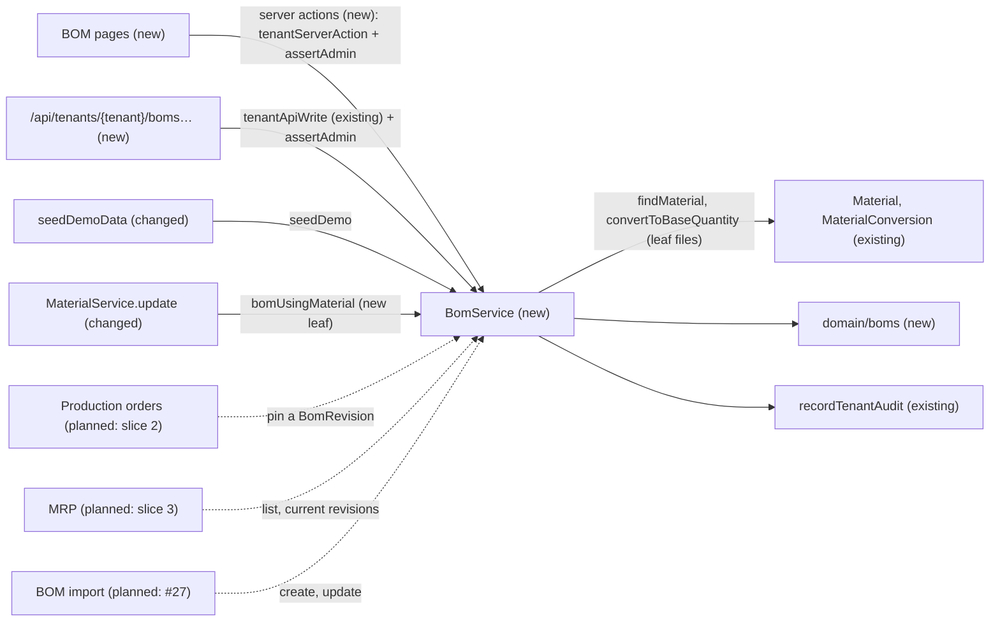
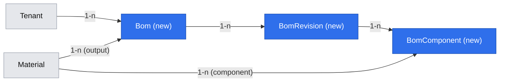
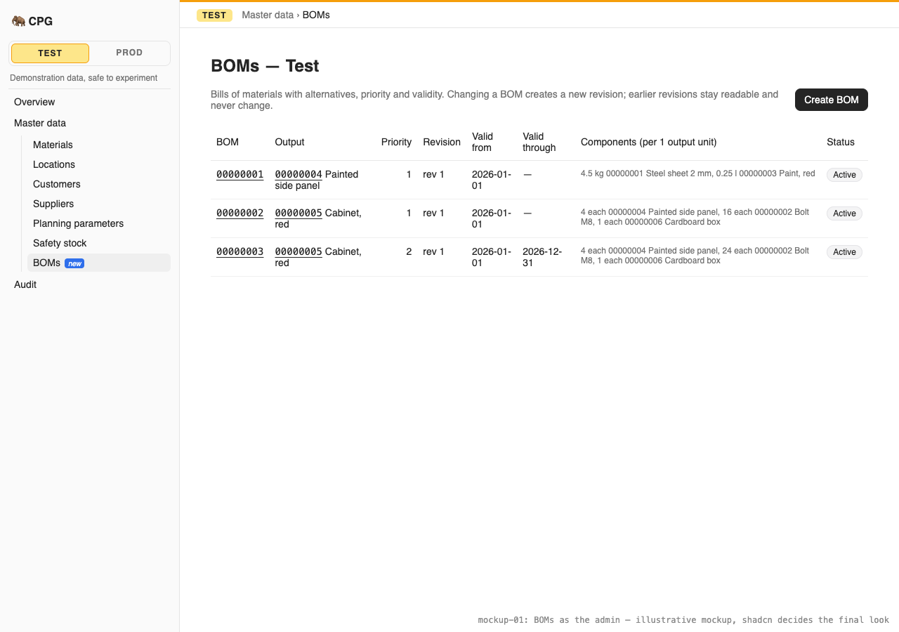
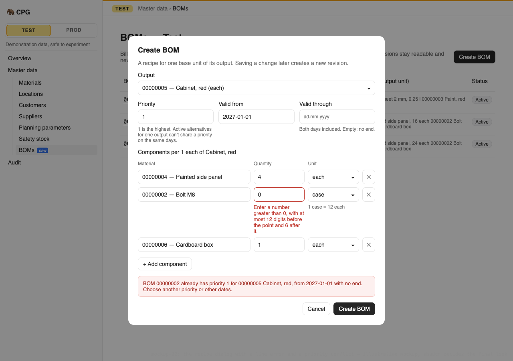
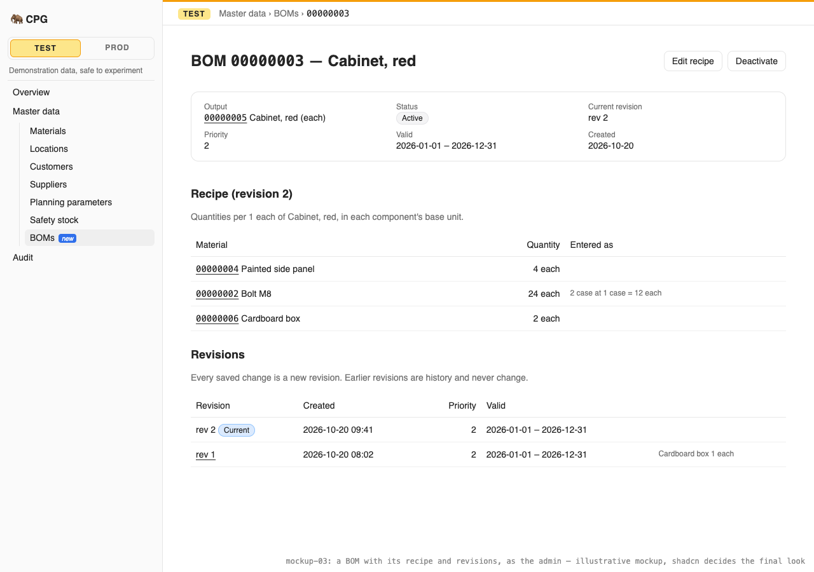

# The admin defines BOMs with alternatives, and every real edit is kept as an immutable revision

**Status:** implemented
**Created:** 2026-10-20 07:57 UTC
**Issue:** #26 (E04-S01), epic #12 · **Builds on:** `implemented/2026-10-19--1858UTC-materials.md` (#22: materials, `toBaseQuantity` and its Q5 record, the list/detail page pattern, the startup seed), `implemented/2026-10-20--0532UTC-planning-parameters-safety-stock.md` (#24: `BASE_UNIT_IN_USE`, the leaf usage files, "an inactive master can't be picked for new entries", calendar dates), `implemented/2026-10-19--2048UTC-sidebar-navigation.md` (#58: the Master data tree), `implemented/2026-10-19--2018UTC-read-only-tenants.md` (#25), `implemented/2026-10-19--1548UTC-api-idempotency.md` (#21), `implemented/2026-10-19--1050UTC-audit-log.md` (#20) · **Design authority:** `.ai/specs/product-brief.md` (R02, R03, R04, R05, R07, R08, D04, D06), `.ai/specs/research/CPG-prd001.pdf` §02 ("Immutable BOMs", "BOM structure", "Masters and integrity"), `CPG-prd-datamodel.pdf` (Logical BOM, Immutable BOM revision, BOM component), `CPG-prd-decisions.pdf` §01–§02 (BOM amount, BOM revisions, BOM priority, BOM validity and cycles, Validity endpoints, BOM deactivation), `CPG-acceptance.md` (BOM-001…030, MAT-009, MAT-011, MAT-019…032), [mockup 01, the sidebar tree](../assets/menu-revamp/01-sidebar-tree/index.html) (its BOMs screen, owner-chosen in #58)

## 📝 TLDR

Production orders (slice 2) and MRP (slice 3) will need recipes that never change under them, and CPG has no recipes yet. This spec proposes that the admin defines **logical BOMs** in each tenant. A BOM has an eight-digit ID, one intermediate or finished output material and an active flag. Its recipe holds a priority, an inclusive validity period and the raw or intermediate components needed for one base unit of the output. Each component is entered in any unit the material converts and stored in its base unit with the entered unit and factor kept (#22 Q5). Saving a real change to the recipe adds a new **immutable revision** and leaves the old ones readable. An identical save, or switching the BOM on or off, adds none. Two active alternatives for the same output can't share a priority over overlapping dates, and a recipe that would make a cycle is refused with the full path shown. Once any BOM revision references a material, its type and base unit lock. Every signed-in user reads BOMs, in the UI and through the API. The Test tenant is seeded with three demonstration BOMs.

## Resolved assumptions (autonomous defaults)

| # | Question | Chosen answer | Rationale |
|---|---|---|---|
| Q1 | Split the issue (BOMs and revisions vs. priority/cycle checks vs. material locks)? | No. One story, one spec, one PR. | None of the parts works alone: a BOM without revisions breaks R04 from its first edit, and the checks and locks only mean something once BOMs exist. The issue's acceptance criteria cover all of them. Shipping the screens in a second PR would shrink this risk-high review, but the issue's criteria are written for the admin's screens as much as the API, and every earlier master-data story shipped core, API and screens together. The phases below are the review checkpoints instead. |
| Q2 | How is a BOM identified? | A UUID primary key stays internal. The BOM ID is a separate eight-digit `code` (`"00000001"`), sequential per tenant with its own sequence, assigned as the tenant's highest + 1 through `nextSequentialId` (exhausted: 409 `BOM_IDS_EXHAUSTED`). It never changes and BOMs are never deleted. The BOM has **no name**: its ID and output identify it. | The PRD's "stable logical BOM ID", "generated" by the import (XLS-018), and TEN-029 lists it among the business ID counters a reset restarts. Material IDs already follow this rule (R01), and so does the shared helper. The data model gives a logical BOM no name or description. Adding one would be a new field (D04). The mockup's "Alt A" is shown as the BOM ID. |
| Q3 | What belongs to the BOM and what to a revision? | **BOM:** ID, output material, active flag, the number of its current revision, version. **Revision:** number (1, 2, …), priority, valid from, valid through, created at, and its component lines. The output is fixed when the BOM is created. Making a different material means a new BOM. Only the **current** (latest) revision is the BOM's recipe. Older revisions are read-only history that slice 2's production orders will pin. | The data model puts "priority" and "validity dates" on the revision and makes their change a new revision (R04). The output names what the logical BOM *is* ("stable alternative-recipe ID for output material"). "Revisions are … not treated as competing active BOMs" (data model), so only the current one takes part in the checks. |
| Q4 | Priority and validity rules? | **Priority:** a whole number from 1 to 999, where 1 is the highest (BOM-009). **Valid from:** a required calendar date. **Valid through:** an optional calendar date, on or after Valid from. When it is empty the recipe has no end. Both dates are inclusive (BOM-013, decisions "Validity endpoints"). Dates are ISO text `YYYY-MM-DD`, as safety targets store them. | The mockup ranks Alt A (priority 1) above Alt B (2) and shows "—" for an open end. An open end saves the admin from inventing a far-future date. 999 alternatives for one output is far more than anyone needs, and a bound keeps the field a small integer. |
| Q5 | Component rules? | 1 to 100 lines per revision, each with a **different** material (a second line for the same material is a field error: enter its total once). A component is a raw or intermediate material, never finished (BOM-004, BOM-005) and never the output itself (that is a cycle, Q8). The output is intermediate or finished, never raw (BOM-001…003). The quantity is greater than 0, per **one base unit of the output** (BOM-006), entered in the component's base unit or any unit it converts. It is stored as #22's `toBaseQuantity` record: the six-decimal base quantity plus the entered quantity, unit, numerator and denominator (MAT-019, MAT-032). Material-type and conversion problems on a line are field errors on that line: `BomService` maps the conversion's `UNIT_NOT_CONVERTIBLE` to `components.N.unit`, and `QUANTITY_ROUNDS_TO_ZERO` and `QUANTITY_OUT_OF_RANGE` to `components.N.quantity`. | The PRD: "a recipe specifies raw/intermediate components required for one BUoM of the output" and the data model's "positive … BUoM quantity per one output BUoM, historical entered UoM/factor". The import compares lines by material (XLS-021, XLS-025), so one line per material keeps the comparison simple. 100 lines bounds the request. No demo or acceptance recipe has more than five. |
| Q6 | What counts as a "real change" (R04, BOM-022, BOM-023)? | A save creates a revision only when the **recipe** differs from the current revision: the priority, either date, or the set of (component material, stored base quantity). The order of the lines and the unit they were entered in don't count, so entering 1 case where 12 each was stored is no change. A save with no change returns the BOM as it is and records nothing. **A line resubmitted with the same material, entered quantity (compared normalized, so `2.0` is `2`) and entered unit as a current line keeps that line's stored record and is not converted again.** To apply a changed factor, the admin re-enters the line (another quantity, or the base unit). | An edit form resends every line. Without the reuse rule, a later conversion change (1 case = 10 each) would silently turn the unchanged "1 case" line into 10 each and create a revision nobody asked for. That would break MAT-027 and MAT-028. Comparing base quantities measures the recipe itself, which is what MRP and production will use. |
| Q7 | Which alternatives compete for a priority (R04, BOM-015…019, BOM-030)? | The current revisions of the **active** BOMs with the same output. Two of them may not have the same priority when their inclusive validity periods share at least one day; an open end overlaps everything after its start. The check runs on the **end state** of a save: when a BOM is created, and when an update leaves the BOM active and either creates a revision (whether or not the priority changed, BOM-018, BOM-019) or reactivates it (BOM-030). A request that reactivates and changes the recipe at once is checked once, with the new recipe. A BOM that ends the save inactive is not checked, and inactive BOMs are never compared. A refusal is 409 `BOM_PRIORITY_CONFLICT` naming the conflicting BOM and the shared days, and nothing is written. Validity periods entirely in the past still count. | The data model compares "only currently selectable logical BOM alternatives for the same output material and overlapping validity periods". Deactivated BOMs are not selectable, so their stale priorities must not block anyone, and reactivation re-checks them. Ignoring past periods would need a business date ("today"), which this story doesn't have. Counting them is the stricter, reversible choice. |
| Q8 | Which recipes does the cycle check see (BOM-024, BOM-025)? | The graph of every BOM's **current** revision in the tenant, active or not, with an edge from each output to each of its components. On create or revise, the new recipe replaces its BOM's edges. If one of its components can reach the output, the save is refused with 409 `BOM_CYCLE` and the path from the saved BOM's output back to itself, each step naming the BOM that supplies it. For BOM-025 (BOMs 00000007 A uses B, 00000008 B uses C, and 00000009 C is edited to use A) that is `00000003 C →(BOM 00000009) 00000001 A →(BOM 00000007) 00000002 B →(BOM 00000008) 00000003 C`: the same cycle as the scenario's A → B → C → A, started where the edit is. A component equal to the output is the shortest cycle, `00000004 →(BOM 00000001) 00000004`. Old revisions are history and not part of the graph. | Including inactive BOMs means reactivation never needs its own cycle check and a dormant cycle can't be woken up. Historic revisions are never selectable again, so a cycle through them can't be planned. The path in the message satisfies "full material cycle path" without adding a field to the shared error envelope. |
| Q9 | What exactly locks on a material (R02, MAT-009, MAT-011, MAT-030)? | Once a material is the output of a BOM or a component in **any revision**, current or historic, active or inactive: a type change is 409 `MATERIAL_TYPE_IN_USE`, and a base-unit change is 409 `BASE_UNIT_IN_USE` with a message naming a BOM. Revisions are never removed, so these locks are permanent. The BOM checks run **first**, before `BASE_UNIT_HAS_CONVERSIONS` and `MATERIAL_MADE_AT_LOCATIONS`, so the admin isn't told to remove conversions or Make sets when that wouldn't help. Material deactivation is not blocked by BOMs. | The PRD: "BUoM locks when a material is first referenced by any BOM revision" and "type cannot change after BOM … reference". #24 designed `BASE_UNIT_IN_USE` to take BOM lines as another reason. The PRD explicitly lets a material with "only an active BOM reference" be deactivated. |
| Q10 | Inactive materials (MAT-029, PRD "Masters and integrity")? | **Creating** a BOM whose output is inactive, or **adding** an inactive material as a component, is 409 `MATERIAL_INACTIVE`. A component that is already in the current revision may stay when it becomes inactive, and a BOM whose output became inactive can still be revised and toggled. The forms offer active materials only, and a current line keeps its material in the list even when inactive. | Inactive masters can't be picked for new entries, but existing references stay valid (#24 Q7). The PRD keeps a recipe with an inactive component and lets MRP (slice 3) skip it with an explicit exception, so blocking its edit would strand the admin. |
| Q11 | Deactivation (BOM-022, BOM-029, BOM-030)? | The BOM's `active` flag. Deactivate and reactivate are audited as `boms.bom.deactivated` / `reactivated` and never create a revision. Reactivation runs the Q7 check (on the end state, so together with any recipe change in the same request) and leaves the BOM inactive when it fails. | The PRD's "independently audited flag toggle, not a new recipe revision", like materials (#22 Q7). |
| Q12 | Which screens? | `/admin/[tenant]/boms`: the mockup's list (BOM ID, output, priority, current revision, validity, a components summary, status) and **Create BOM**. `/admin/[tenant]/boms/[id]`: the current recipe, the revision history, **Edit recipe**, **Deactivate** / **Reactivate**. `?revision=N` shows an older revision read-only. One sidebar entry, **BOMs**, after Safety stock. The recipe form is a **bespoke component** in `components/boms/`, built from the `@cpg/ui` primitives. | The owner chose mockup 01 (#58), which has a BOMs screen under Master data. Keeping old revisions on the detail page (BOM-020: "the old one stays readable") avoids a third page. The standards allow a bespoke form "when the UX isn't form-over-schema". A recipe is a variable list of lines whose unit choices depend on each line's material, and `CrudForm` holds one string per field. Slice 2's order lines may later promote it to `ui/backend/`. |
| Q13 | API parity (R07)? | Yes: `GET`/`POST /api/tenants/{tenant}/boms`, `GET`/`PATCH …/boms/{id}`, `GET …/boms/{id}/revisions/{revision}`. Writes go through `tenantApiWrite` and are admin-only (API-010). `PATCH` takes any of the recipe fields (the components as the complete list) and `active`. Added to `BACKWARD_COMPATIBILITY.md` §4. | Every operation needs its API equivalent. One `PATCH` with optional fields, active included, follows `PATCH /materials/{id}`. Sending the complete component list matches the import's "full-recipe replace" (decisions, BOM XLS) and avoids line-level endpoints. |
| Q14 | Demo data (D06, the issue's last criterion)? | Yes. At every start, after the materials seed, if Test has no BOM and isn't read-only, Test gets the three BOMs in the Data Model table, built through the same rules as a save, each flushed before the next reads the highest ID. An entry that fails any rule (a demo material missing, inactive or retyped, a conversion removed) is skipped, and the next one takes the next free ID. Not audited, like the other demo records. `isUntouchedKind` and `activeDemoReferences` are not reused: BOMs are never removed, and their references are materials only, not material and location pairs. | D06 and the issue. BOMs are never deleted, so "Test has none" is true only once, as with materials (#22 Q9). The demo materials were designed for these recipes (`demo-materials.ts`). Production's Test tenant may have been edited since it was seeded, so each entry is checked instead of assumed. |
| Q15 | Code names (brief Q04)? | Concept `boms` (the standards' own example); entities `Bom`, `BomRevision`, `BomComponent`; service `BomService`; action IDs `boms.bom.*`. The screens say "BOM" (Polish: "BOM", with "struktura wyrobu" in help), as the PRD and the mockup do. | The PRD's and the standards' term, following #22 Q13. |

Every default is reversible before merge and none weakens a rule. Q9 tightens the material edit as R02 requires. Q7 and Q8 apply R04 in its stricter reading. No question needs the owner's confirmation before merge.

## 📝 Problem Statement

Production orders pin a recipe, and MRP picks among alternative recipes, so recipes must never change in place (PRD §02 "Immutable BOMs", R04). The PRD's logical BOM is a stable alternative recipe for one intermediate or finished output material, with an audited active flag and a history of immutable revisions. A revision holds a priority, inclusive validity dates and the complete list of raw or intermediate components needed for one base unit of the output (R02, BOM-001…006, BOM-013). A real change to the recipe, priority or validity creates a new revision and keeps the old one (BOM-020, BOM-021). An activation toggle or an identical save doesn't (BOM-022, BOM-023, BOM-029). Active alternatives for the same output may not share a priority over overlapping validity (BOM-015…019, BOM-030). Direct and indirect cycles are rejected with the path (BOM-024, BOM-025). Once referenced, a material's type and base unit lock (MAT-011, MAT-030). Component quantities are entered in any unit and stored exactly in the base unit, with the entered unit and factor kept and never revalued (R03, MAT-019, MAT-027, MAT-028, MAT-032). The materials spec deferred the end-to-end check of that storage to this story (#22 Q5). Only the admin maintains BOMs, everyone reads them (TEN-004), every change is audited (R08), Test and Prod are isolated (R05), a read-only tenant refuses writes, and every operation has an API equivalent (R07). Test starts with demonstration records (D06).

## 📝 Proposed Solution

- **BOMs and revisions.** Three tenant-owned entities: `Bom` (identity, output, active flag, current revision number), `BomRevision` (priority, validity) and `BomComponent` (one line). A `BomService` (concept `boms`) offers `list`, `get`, `getRevision`, `create`, `update` (recipe fields and/or the active flag) and `seedDemo`. A save builds the candidate recipe, compares it with the current revision (Q6), and only when it differs inserts revision N + 1 and bumps the BOM's `revision` (so the BOM's `version` advances). Revisions and lines are only ever inserted. SQLite triggers abort any `UPDATE` of them.
- **Rules in pure functions** (`core/src/domain/boms/`): output and component types (Q5), recipe equality (Q6), validity overlap and the priority conflict (Q7), and cycle search with its path (Q8). Each is unit-tested on its own.
- **Quantities.** The conversion inside `MaterialService.toBaseQuantity` moves into a leaf function, `convertToBaseQuantity(em, material, entered)`. `toBaseQuantity` and `BomService` both call it, so a BOM line stores exactly #22's record without one service depending on another.
- **Material locks.** A leaf `services/boms/bom-usage.ts` (`bomUsingMaterial(em, material)`) lets `MaterialService.update` refuse type and base-unit changes (Q9), as it already calls `hasPlanningParameters`.
- **Screens and API.** A list page and a detail page, a sidebar entry, three route files, reusing `tenantServerAction`, `tenantApiWrite`, `DataTable`, `ConfirmDialog`, `feedback/` and the shared validators (`calendarDateSchema`, `positiveQuantitySchema`'s decimal rules, `versionSchema`). The recipe form is bespoke (Q12).
- **Demo data.** A seventh kind, `boms`, in `seedDemoData` (Q14).

**Alternatives considered:**
- **One mutable BOM with an audit trail instead of revisions.** The audit would show the history, but a production order can't pin an audit entry, and R04 asks for immutable snapshots. Rejected.
- **Line-level endpoints** (add/change/remove a component), each creating a revision. A change to three lines would produce three revisions, and intermediate states could fail the cycle or type checks. Rejected for one full-recipe save (Q13).
- **Revisions as JSON on the BOM row.** Fewer tables, but component references would bypass the tenant guard and foreign keys, and "is this material used in any revision?" (Q9) would become a JSON scan. Rejected.
- **Recomputing the cycle check from the database in SQL** (a recursive CTE). Raw SQL is banned in `core` (tenant lint). The tenant's current revisions are loaded and searched in memory instead (a few hundred edges at most).

**Market check.** ERPNext has one BOM document per variant, makes a submitted BOM immutable (amend → `BOM-0001-1`), and marks one BOM as default per item. It has no priority/validity alternative selection and checks recursion only on submit. Odoo keeps editable BOMs with a sequence (its priority) and archiving, and tracks history only through its optional PLM module's engineering change orders. SAP's alternative BOMs carry validity dates, and its change numbers time-slice a BOM. CPG takes ERPNext's immutability, Odoo's sequence-as-priority and SAP's validity-dated alternatives. It skips change orders, approvals and variants (N05, D04), and adds the R04 overlap check, which none of the three enforces.

## 📝 Architecture

- **`db`:** `entities/boms/bom.entity.ts`, `bom-revision.entity.ts`, `bom-component.entity.ts`, all `tenantOwned()`. `BomRevision` and `BomComponent` declare `UPDATE`-abort triggers from a new helper, `entities/boms/immutable-triggers.ts` (`noUpdateTriggers(table)`, message `BOM revisions are immutable`). It follows the audit's `appendOnlyTriggers` (lesson "MikroORM 7 entities can declare triggers") but blocks only `UPDATE`: `DELETE` stays possible for the slice-2 Test reset, though no service deletes. One migration: `boms`.
- **`core`:**
  - `domain/boms/recipe-rules.ts`: `BOM_COMPONENTS_MAX`, `BOM_PRIORITY_MAX`, `canBeBomOutput(type)`, `canBeBomComponent(type)`.
  - `domain/boms/recipe-equality.ts`: `isSameRecipe(current, candidate)` (Q6).
  - `domain/boms/priority-conflict.ts`: `validityOverlap(a, b)` (the shared days, or null) and `findPriorityConflict(candidate, alternatives)` (Q7).
  - `domain/boms/find-cycle.ts`: `findCycle(edges, output, components)` → the material path or null (Q8).
  - `domain/boms/demo-boms.ts`: the Test seed (pure data).
  - `validators/boms/`: `bom-recipe.schema.ts` (priority, dates, lines), `bom-create.schema.ts`, `bom-update.schema.ts` (at least one field, `version`), and the action variants, with the field messages as exported constants.
  - `services/materials/base-quantity.ts`: `convertToBaseQuantity` (moved out of `MaterialService.toBaseQuantity`, which delegates to it). Its errors are unchanged; `BomService` maps them to line field errors (Q5).
  - `services/boms/bom.service.ts` (`BomService`, scoped), registered in `container.ts`/`cradle.ts`, exported from `index.ts`.
  - `MaterialService.listUnits()`: every material's convertible units (`{ "00000002": ["each", "box", "case"] }`, base unit first) in two queries. The recipe form needs it for its unit selects. The pages join BOM rows with `materialService.list()` for descriptions, base units and Inactive badges, as the planning pages do.
  - `services/boms/bom-usage.ts`: `bomUsingMaterial(em, material)`, the code of one BOM referencing the material as output or component in any revision, or null. `MaterialService.update` calls it (Q9).
  - `demo-data.ts`: `DEMO_KINDS` gains `boms` after `safety-stock targets`.
- **`ui`:** nothing new. The recipe form composes `Input`, `NativeSelect`, `Button`, `Label` and `ErrorMessage`.
- **`app`:**
  - `app/admin/[tenant]/boms/{page.tsx,actions.ts}` and `app/admin/[tenant]/boms/[id]/page.tsx`;
  - `components/boms/`: the BOM table, the recipe form and its create/edit dialogs, the revision view and history, the active toggle, and `labels.ts`;
  - `app/api/tenants/[tenant]/boms/route.ts`, `…/boms/[id]/route.ts`, `…/boms/[id]/revisions/[revision]/route.ts`;
  - `components/layout/nav-tree.ts`: one Master data entry; the tenant home links to BOMs; English and Polish strings, two help topics, the audit action labels and the new error codes.

Most of the change is additive. It touches one existing service: `MaterialService.update` gains `MATERIAL_TYPE_IN_USE` and a new reason for `BASE_UNIT_IN_USE`, and `toBaseQuantity`'s body moves into a shared leaf with no change in behaviour.

## 📝 Data Model

| Entity | Field | Type | Notes |
|---|---|---|---|
| `Bom` (`bom`) | `id` | uuid, PK | Internal only |
| | `tenant` | FK → `tenant` | `tenantOwned()` |
| | `code` | string(8) | `"00000001"`…; unique with `tenant`; never changes (Q2) |
| | `output` | FK → `material` | Intermediate or finished; fixed at create (Q3) |
| | `active` | boolean, default `true` | Q11 |
| | `revision` | integer | Number of the current revision; 1 at create |
| | `createdAt` | datetime | |
| | `version` | integer, `.version()` | Advances on every revision and toggle |
| `BomRevision` (`bom_revision`) | `id` | uuid, PK | What slice 2's production orders will reference |
| | `tenant` | FK → `tenant` | `tenantOwned()` |
| | `bom` | FK → `bom` | |
| | `number` | integer | 1, 2, …; unique with `bom` |
| | `priority` | integer | 1–999, 1 highest (Q4) |
| | `validFrom` | string(10) | ISO date, inclusive |
| | `validThrough` | string(10), nullable | ISO date, inclusive; null = no end |
| | `createdAt` | datetime | |
| `BomComponent` (`bom_component`) | `id` | uuid, PK | |
| | `tenant` | FK → `tenant` | `tenantOwned()` |
| | `revision` | FK → `bom_revision` | |
| | `position` | integer | Order as entered, for display only |
| | `material` | FK → `material` | Raw or intermediate; unique with `revision` |
| | `quantity` | string | Base-unit quantity per one output base unit, six decimals, > 0 |
| | `enteredQuantity`, `enteredUnit`, `numerator`, `denominator` | string | The `toBaseQuantity` record (#22 Q5) |

Indexes: `bom (tenant, code)` unique; `bom (output)`; `bom_revision (bom, number)` unique; `bom_component (revision, material)` unique; `bom_component (material)` for the lock lookup (Q9). Nothing is updated in `bom_revision` or `bom_component` (triggers), and nothing is deleted from any of the three.

Demo data (Q14), on the demo materials of #22 (00000001 Steel sheet 2 mm, raw, kg; 00000002 Bolt M8, raw, each, 1 case = 12; 00000003 Paint, red, raw, l, 1 ml = 1/1000; 00000004 Painted side panel, intermediate, each; 00000005 Cabinet, red, finished, each; 00000006 Cardboard box, raw, each):

| BOM | Output | Priority | Valid | Components per one output unit (as entered → stored) |
|---|---|---|---|---|
| 00000001 | 00000004 Painted side panel | 1 | from 2026-01-01, no end | 4.5 kg steel sheet → 4.5 kg; 250 ml paint → 0.25 l |
| 00000002 | 00000005 Cabinet, red | 1 | from 2026-01-01, no end | 4 each side panel; 16 each bolt; 1 each cardboard box |
| 00000003 | 00000005 Cabinet, red | 2 | 2026-01-01 – 2026-12-31 | 4 each side panel; 2 case bolt → 24 each; 1 each cardboard box |

## 📝 API Contracts

All paths are under `/api/tenants/{tenant}`, with the materials routes' rules. Reads accept a bearer token or the session cookie. Writes use `tenantApiWrite` with `authorize: assertAdmin`: bearer only, 403 `FORBIDDEN` for a normal user, `Idempotency-Key`, `Dataset-Generation` for Test, and 409 `TENANT_READ_ONLY`. `{id}` is an eight-digit BOM ID and `{revision}` a positive integer; anything else is the not-found of that path. Quantities are JSON strings and the priority is a JSON integer.

| Method and path | Body | Success | Errors (besides the pipeline's) |
|---|---|---|---|
| `GET /boms` | — | `Bom[]` by output, then priority, then ID | — |
| `POST /boms` | `{ output, priority, validFrom, validThrough?, components: [{ material, quantity, unit }] }` | `BomDetail`, revision 1 | `VALIDATION_FAILED` (any field; output raw, BOM-003; a finished component, BOM-004; a duplicate line; a unit the material doesn't convert, MAT-023; a quantity that rounds to zero, MAT-032, or that is too large in the base unit); `MATERIAL_NOT_FOUND` (404); `MATERIAL_INACTIVE`, `BOM_PRIORITY_CONFLICT`, `BOM_CYCLE`, `BOM_IDS_EXHAUSTED` (409) |
| `GET /boms/{id}` | — | `BomDetail` | `BOM_NOT_FOUND` |
| `PATCH /boms/{id}` | `{ version, priority?, validFrom?, validThrough? (null clears it), components?, active? }`, at least one besides `version` | `BomDetail` | as `POST`, plus `BOM_NOT_FOUND`, `VERSION_CONFLICT`. `output` or `id` in the body is `VALIDATION_FAILED` ("A BOM's output can't be changed: create a new BOM.") |
| `GET /boms/{id}/revisions/{revision}` | — | `BomRevision` | `BOM_NOT_FOUND`, `BOM_REVISION_NOT_FOUND` |

Line field errors are keyed by path, `components.2.unit`, so the form puts them on the right row.

Shapes:
- `Bom`: `{ id: "00000002", output: "00000005", active, revision: 1, priority: 1, validFrom: "2026-01-01", validThrough: null, components: BomComponent[], createdAt, version }`. The fields from `priority` on are the current revision's.
- `BomDetail`: `Bom` plus `revisions: [{ number, priority, validFrom, validThrough, createdAt }]`, newest first.
- `BomRevision`: `{ bom: "00000002", number, priority, validFrom, validThrough, createdAt, current: boolean, components: BomComponent[] }`.
- `BomComponent`: `{ material: "00000002", quantity: "24.000000", enteredQuantity: "2", enteredUnit: "case", numerator: "12", denominator: "1" }`, in entered order.

`PATCH /materials/{id}` gains 409 `MATERIAL_TYPE_IN_USE`, and `BASE_UNIT_IN_USE` gains the BOM reason (Q9).

`BomService` (core). Every write takes `actor: AuditActor` and runs in one transaction with its audit entry. The subject is `{ type: "Bom", id: <code>, label: "00000002 — 00000005 Cabinet, red" }`. The recipe snapshot is a flat allowlist (audit values are scalars): `{ revision, priority, validFrom, validThrough, components: "00000004 4.000000 each; 00000002 24.000000 each (2 case)" }`.
- `list()`, `get(id)`, `getRevision(id, number)`.
- `create(input, actor)`: loads the output and each component by business ID in the scope, checks types, activity, duplicates, conversions, the priority conflict and cycles, then assigns the next ID. Action `boms.bom.created` with `{ id, output, active }` plus the recipe snapshot.
- `update(id, changes, version, actor)`: compares `version` with a fresh read. Recipe fields absent from `changes` keep the current revision's values. When the candidate recipe differs (Q6), it runs the type, activity and cycle checks and inserts the next revision, recording `boms.bom.revised` with the old and new recipe snapshots. A changed `active` records `boms.bom.deactivated` / `reactivated` with `{ active }`. The priority check runs once, on the end state (Q7). With nothing changed, nothing is written or recorded and the version stays.
- `seedDemo()`: Q14. Returns how many BOMs it created.

The server actions in `app/admin/[tenant]/boms/actions.ts` mirror the writes (`createBom`, `updateBomRecipe`, `setBomActive`). Each is a `tenantServerAction` bound to the page's tenant and generation, with `assertAdmin(await currentUser())` inside, and `refreshAfterWrite` on success or `VERSION_CONFLICT`.

## 📝 UI/UX

- **Sidebar:** Master data gains **BOMs** after Safety stock, for every account. The tenant home links to it.
- **`/admin/[tenant]/boms`**, titled "BOMs — Test", with the mockup's intro: bills of materials with alternatives, priority and validity; changing a BOM creates a new revision and keeps the old one.
  - `DataTable`: BOM (ID, linking to the BOM), Output (ID and description, Inactive badge when the material is inactive), Priority, Revision ("rev 2"), Valid from, Valid through ("—" for no end), Components ("4 each 00000004 Painted side panel, 24 each 00000002 Bolt M8, …": base quantity and unit, then the material; truncated with the full text in a title) and Status (Active / Inactive).
  - Admin: **Create BOM** opens the recipe dialog (below).
  - Empty state: "No BOMs in Test yet." plus, for the admin, "Create the first one."
- **Recipe dialog** (create and edit, `TALL_DIALOG`):
  - Output: a select of active intermediate and finished materials (create only; the edit dialog shows the output as text).
  - Priority (hint: 1 is the highest; two active alternatives for this output can't share a priority on the same days), Valid from, Valid through (hint: both days included; leave empty for no end).
  - **Components**, one row each: Material (active raw and intermediate materials, plus any inactive one already on the current revision), Quantity, Unit (the material's base unit, then its conversions, plus the line's entered unit on an edit when that conversion was removed since; resets to the base unit when the material changes), and a Remove button labelled with the row's material. **Add component** appends a row. The heading says "per 1 {output base unit} of {output}".
  - Field errors show under the field and row they belong to. `BOM_PRIORITY_CONFLICT` and `BOM_CYCLE` show above the buttons with their BOM and path. `Cmd/Ctrl+Enter` submits and `Escape` cancels, as in `CrudForm`.
  - After a save with no change, the dialog closes and a note says "No change: revision N is still current."
- **`/admin/[tenant]/boms/[id]`**, titled "BOM 00000002 — Cabinet, red":
  - A details card: Output (linked), Status, Current revision, Priority, Valid (from – through), Created.
  - **Recipe (revision N)**: Material (linked, Inactive badge), Quantity per 1 {output base unit} in the component's base unit, and Entered as ("2 case at 1 case = 12 each") when the entered unit differs.
  - **Revisions**: a table of number, created, priority and validity, newest first. Each row links to `?revision=N`, which shows that revision's recipe under a notice: "Revision 1 of 3: history, kept unchanged. Revision 3 is current." A revision number that doesn't exist renders the not-found state.
  - Admin: **Edit recipe** (prefilled with the entered quantities and units of the current revision), **Deactivate** / **Reactivate** with a confirmation. The confirmation says that an inactive BOM can't be chosen for new orders and keeps its revisions, and that reactivation checks priorities again.
- **Normal users** see both pages without any control (TEN-004), and a read-only tenant hides the controls for the admin too (R05). Every action and route still checks.
- **Materials:** the Materials help topic says that type and base unit lock once a BOM uses the material, and the two new errors are translated.
- **Help:** topics "BOMs" and "A BOM and its revisions", in English and Polish.

Prototype: `.ai/specs/assets/boms/`, static mockups following mockup 01. They are illustrative only: the shadcn components decide the final look.
- `current-01-master-data.png`: today's Test home and Master data tree.
- `mockup-01-boms-list.png`: the Test list as the admin, with the three demo BOMs.
- `mockup-02-recipe-dialog.png`: the recipe dialog with a line error and a priority conflict.
- `mockup-03-bom-detail.png`: a BOM with its current recipe and revision history.

## 📝 Edge Cases & Failure Scenarios

| Case | Behaviour |
|---|---|
| A raw material as the output, or a finished material as a component | `VALIDATION_FAILED` on `output` / `components.N.material`; nothing stored (BOM-003, BOM-004) |
| The output listed as its own component | 409 `BOM_CYCLE`, path `00000004 →(BOM) 00000004` (BOM-024) |
| A uses B, B uses C, and C's recipe is edited to use A | 409 `BOM_CYCLE` with the path from C, each step naming its BOM: `C →(BOM) A →(BOM) B →(BOM) C`; the edit writes nothing (BOM-025) |
| The same material on two lines | `VALIDATION_FAILED` on the second line |
| 2 case of a material with 1 case = 12 each | Stored 24.000000 each, entered 2 case, factor 12/1 kept (MAT-019); 0.25 t at 1 t = 1000 kg is 250 kg (MAT-020); 0.123456 kg stays 0.123456 (MAT-024); 1 unit at 1/3 is 0.333333 (MAT-032) |
| A unit the component doesn't convert, or 0.0000001 in a unit at 1/3 | `VALIDATION_FAILED` on that line's unit / quantity: never assumed 1:1 (MAT-023), never rounded to zero (MAT-032) |
| The case conversion changes to 10 each after the BOM was saved | The stored 24 each stays; the revision number stays (MAT-027, MAT-028). An edit that resends the unchanged "2 case" line keeps 24 each (Q6); a newly entered "2 case" line gets 20 each |
| Equal priority 1 for two active alternatives, Jan–Mar and Mar–May | 409 `BOM_PRIORITY_CONFLICT` naming the other BOM and the shared days, 1–31 March (BOM-015); identical periods likewise (BOM-016) |
| Equal priority, January and February | Accepted (BOM-017). 31 January and 1 February are adjacent, not overlapping |
| A validity edit creates an equal-priority overlap while the priority stays | Refused, nothing written (BOM-018, BOM-019) |
| A component amount or the valid-through date changes | Revision N + 1; revision N unchanged and readable at `?revision=N` (BOM-020, BOM-021) |
| A save identical to the current revision, lines in another order or entered in another unit with the same base quantity | No revision, no audit entry, same version (BOM-023 for the UI and API) |
| Deactivate, then reactivate | Two audit entries, no revision, revision count unchanged (BOM-022, BOM-029) |
| Reactivating B while active A has the same priority over overlapping days | 409 `BOM_PRIORITY_CONFLICT`; B stays inactive; no revision for either (BOM-030) |
| An inactive BOM with the same priority and dates as an active one | Allowed while it is inactive; it competes again only if reactivated |
| A new BOM for an inactive output, or an inactive material added as a component | 409 `MATERIAL_INACTIVE`; an inactive component already on the current revision may stay in an edit (Q10) |
| A material used by any BOM revision gets a new type or base unit | 409 `MATERIAL_TYPE_IN_USE` / `BASE_UNIT_IN_USE` naming one BOM, even when the BOM is inactive or the reference is in an old revision (MAT-011, MAT-030); resending the same values is no change and succeeds |
| A used material is deactivated | Allowed; its BOMs keep it (PRD "Masters and integrity") |
| Two saves of one BOM from stale pages | The second gets `VERSION_CONFLICT`; the page refreshes and shows the newer revision |
| Two creates racing (a page and the API), or a create racing a revision that would conflict with it | The later transaction meets SQLite's stale snapshot and is retried once by its wrapper. It then sees the first one's write: consecutive IDs for two creates, `BOM_PRIORITY_CONFLICT` or `BOM_CYCLE` when they clash. For IDs and revision numbers the unique indexes are the backstop, mapped to `CONFLICT` ("Another BOM was created at the same moment. Try again.", `BOM_ID_RACE`). For priority and cycle conflicts the retry is the only guard, which holds because SQLite has one writer |
| A Prod BOM ID or material ID used in Test | 404 `BOM_NOT_FOUND` / `MATERIAL_NOT_FOUND`, unless Test has its own record with that ID (TEN-012, TEN-014) |
| `?revision=0`, `?revision=abc`, `/revisions/99` | The not-found state / 404 `BOM_REVISION_NOT_FOUND` |
| Anything tries to update a revision or a line (a bug, a future service) | The trigger aborts the statement; the transaction rolls back |
| A write to a read-only tenant | 409 `TENANT_READ_ONLY`; the dialog keeps the explanation |
| The demo seed meets an edited Test tenant (a demo material retyped, deactivated, or its case conversion removed) | That BOM is skipped; the others are created. A failure rolls back the kind and is logged; the server still starts and the next start retries |

## 📝 Risks & Impact Review

- **Schema.** Three new tables with foreign keys to `material`, and `UPDATE`-abort triggers on two of them. Nothing existing changes. Rollback is a revert plus a migration dropping the three tables and the triggers. BOMs created meanwhile are lost, and their audit entries stay. A `kamal rollback` to the previous image keeps the tables but runs the old `MaterialService.update`, which would let a BOM-referenced material change type or base unit and silently change what the stored recipes mean. After such a rollback, fix forward rather than editing materials. The PR is `risk-high` (schema migration, `BACKWARD_COMPATIBILITY.md` §1).
- **Permanent locks.** Once a material appears in any revision, its type and base unit can never change again, because revisions are never deleted. That is R02 and MAT-030, but an admin who picks the wrong base unit can only fix it with a new material. The create-material hint (#22) and the Materials help say so.
- **Two new refusals on an existing route** (`PATCH /materials/{id}`, Q9). They are additive error codes, documented in `BACKWARD_COMPATIBILITY.md`.
- **Public URLs and API paths** (`BACKWARD_COMPATIBILITY.md` §4) become protected once merged. The import (#27) will reuse `create`/`update`, the full-recipe semantics and the no-op rule. Production orders (slice 2) will reference `BomRevision.id`.
- **Cycle and priority checks load the tenant's BOMs into memory.** That is fine at slice 1's scale (the demo has three). A tenant with thousands of BOMs would make each save slower, but still well inside the write transaction's budget. Revisit if it shows.
- **The bespoke recipe form** is the first form outside `CrudForm`. It must keep `CrudForm`'s conventions (field errors by path, pending state, keyboard). A review should check that it doesn't grow its own error mapping. Slice 2's order lines are the moment to promote it to `ui/backend/`.
- **The demo seed runs against production's Test tenant at the next deploy.** The skip rules keep it within the rules, and Prod is never touched.
- **Parallel stories.** #27 (import) adds the BOM sheets on top of this service. Whichever story merges later regenerates its migration on `main`.
- **No pagination.** The list is flat. Paging arrives with the first list that needs it.

## 📝 Decisions in play

- **R02** (raw is never an output, finished never a component, type and base unit lock once referenced): Q5, Q9.
- **R03** (exact six-decimal quantities, entered unit and factor kept, never revalued): Q5, Q6, through `convertToBaseQuantity`.
- **R04** (real change → immutable revision; toggle and identical save don't; no equal priority over overlapping validity; cycles rejected with the path): Q3, Q6, Q7, Q8, Q11.
- **R05** (isolation, read-only): tenant-owned entities, references loaded in the scope, writes through the gated wrappers.
- **R07** (API parity): Q13.
- **R08** (audit): every create, revision and toggle with before and after; the seed is unaudited (Q14, as #22 Q9).
- **D04** (simplest consistent behaviour): Q2, Q4, Q5.
- **D06** (demo data now): Q14.
- **Brief Q04** (PRD terms in code): Q15.

Nothing is superseded.

## Out of scope

- Choosing among alternatives (BOM-009…012, BOM-014, BOM-027, BOM-028) and scaling a recipe to a planned quantity (BOM-006's and BOM-007's "When"). These belong to MRP and production orders. This story stores the per-one-output quantities they will scale.
- Pinning revisions on production orders (BOM-020's and BOM-022's "referencing production orders unchanged", BOM-026). Slice 2.
- The BOM spreadsheet import (BOM-023's import path, XLS-017…028). #27, on this service.
- A "Used in" section on the material page (mockup 01 shows one). It can be added later without changing anything here.
- Copying a BOM, a BOM tree view, filtering or paging the list.

## 📋 Phasing

One PR, built in this order (Q1). The phases are review checkpoints, not separate releases.

- **Phase 1 — Core.** Domain rules, entities and migration, validators, the shared conversion leaf, `BomService`, the material locks and the demo seed, unit-tested against SQLite.
- **Phase 2 — API.** The three route files, unit and integration tests, `BACKWARD_COMPATIBILITY.md`.
- **Phase 3 — Screens.** The two pages, the recipe form, the sidebar entry, translations, help, audit labels, integration tests.

## 📋 Implementation Plan

### Phase 1 — Core

1. **Domain rules.** `domain/boms/recipe-rules.ts`, `recipe-equality.ts`, `priority-conflict.ts`, `find-cycle.ts`. Unit tests:
   - output and component types per BOM-001…005;
   - equality: same recipe in another line order or with the same base quantity entered differently is equal, while any priority, date, material or base-quantity difference is not (Q6);
   - overlap: Jan–Mar vs. Mar–May shares March (BOM-015), identical periods (BOM-016), January vs. February none (BOM-017), adjacent days none, an open end overlapping everything after it, through-dates inclusive (BOM-013); the conflict search ignores other priorities;
   - cycles: self (BOM-024), A → B → C → A (BOM-025), a diamond without a cycle, the path in order from the output.
2. **Schema.** The three entities, `tenantOwned()`, in `entities/index.ts`, with the triggers declared on `BomRevision` and `BomComponent`. Run `npm run db:migration:create -- boms`, then commit the migration, snapshot and index unedited. Tests: `tests/tenant-ownership.test.ts` unchanged; the migration's up/down test with the unique indexes; an `UPDATE` of a revision and of a line aborted by the triggers; the older migrations' rollback tests updated (lesson: `down({ to })`).
3. **Validators.** `validators/boms/`: priority 1–999 as a JSON integer (form digits only), the two calendar dates with valid-through on or after valid-from, 1–100 lines, each with an eight-digit material, a positive decimal string quantity and a unit; create, update (at least one field, `output`/`id` refused with their messages, `validThrough: null` clears) and the action variants. Unit tests for every rule and message.
4. **Shared conversion.** Move `toBaseQuantity`'s body into `services/materials/base-quantity.ts` (`convertToBaseQuantity(em, material, entered)`), and make `MaterialService.toBaseQuantity` delegate. The existing tests pass unchanged, and the leaf gets its own tests.
5. **`BomService`**, registered and exported. Tests on a real SQLite file, in a Test and a Prod scope:
   - create: an intermediate and a finished BOM with raw and intermediate components (BOM-001, BOM-002, BOM-005), IDs 00000001, 00000002 and Prod independent (TEN-012); the line record for 2 case = 24 each, 0.25 t = 250 kg, 0.123456, 1/3 (MAT-019, MAT-020, MAT-024, MAT-032); a raw output and a finished component refused (BOM-003, BOM-004); unknown unit (MAT-023) and rounds-to-zero as line field errors; duplicate line; inactive output and component (Q10); Prod material from Test not found (TEN-014); the audit entry;
   - two alternatives for one output read back independently (BOM-008);
   - priority: BOM-015, BOM-016, BOM-017 on create; BOM-018 on a validity-only edit; an inactive alternative not compared;
   - cycles: BOM-024; BOM-025 through three BOMs, the edit writing nothing;
   - revisions: a component amount change makes revision 2 and revision 1 still reads back unchanged (BOM-020); a valid-through change (BOM-021); an identical save, a reordered save and a same-base-quantity save make none and record nothing (BOM-023); after a conversion change from 12 to 10, the BOM still reads 24 each, the revision number is unchanged, and an edit resending "2 case" keeps 24 each (MAT-027, MAT-028, Q6); `VERSION_CONFLICT` on a stale version;
   - active flag: deactivate and reactivate record their entries and no revision (BOM-022, BOM-029); reactivation refused on a priority conflict, the BOM still inactive (BOM-030); one request that reactivates and moves the priority away from the conflict succeeds; a recipe change sent with `active: false` is not priority-checked;
   - inactive references: an edit keeping an inactive component succeeds, and adding one is refused; a BOM whose output became inactive can still be revised and toggled (Q10); `validThrough: null` on a dated BOM creates a revision with no end;
   - line errors: `UNIT_NOT_CONVERTIBLE`, `QUANTITY_ROUNDS_TO_ZERO` and `QUANTITY_OUT_OF_RANGE` arrive as field errors on the right `components.N.*` path; the revise path issues no `UPDATE` on `bom_revision` or `bom_component` (the triggers would abort it);
   - two ORMs racing creates get consecutive IDs; two racing conflicting creates end with one BOM and one `BOM_PRIORITY_CONFLICT`.
6. **Material locks.** `bom-usage.ts`, then `MaterialService.update`: `MATERIAL_TYPE_IN_USE` and `BASE_UNIT_IN_USE` for a material that is an output, a current component, or only a component of an old revision of an inactive BOM (MAT-011, MAT-030); the BOM reasons checked before `BASE_UNIT_HAS_CONVERSIONS` and `MATERIAL_MADE_AT_LOCATIONS`; `listUnits()`; resending the same type and base unit succeeds; an unused material's type and base unit still change (MAT-009, MAT-013); deactivating a used material succeeds. Regression tests that fail without the guards.
7. **Demo seed.** `demo-boms.ts` and `seedDemo()`; `DEMO_KINDS` extended. Tests: a fresh Test gets the three BOMs with the stored quantities in the table (250 ml → 0.250000 l, 2 case → 24.000000 each); nothing on a second run; a demo material retyped, inactive or without its case conversion skips that BOM only; a read-only Test seeds nothing; Prod untouched.

### Phase 2 — API

8. **Routes.** `boms/route.ts`, `boms/[id]/route.ts`, `boms/[id]/revisions/[revision]/route.ts`: reads with `requireApiUser`, writes with `tenantApiWrite(…, { authorize: assertAdmin })` and `apiActor(caller)`. Unit tests with `@cpg/core` mocked: 403 for a normal token (API-010), malformed IDs and revision numbers as not-found, bodies through the shared schemas. `tests/api-writes.test.ts` and `tests/tenant-entry-points.test.ts` pass with the new routes. `BACKWARD_COMPATIBILITY.md` §4 gains the paths and the two new `PATCH /materials/{id}` codes.
9. **API integration tests** (`tests/integration/boms-api.test.ts`): in Prod, an admin token creates materials and a BOM with an idempotency key, and a replay returns the same BOM. A `PATCH` with a changed quantity returns revision 2, and `GET …/revisions/1` still shows the old quantity (BOM-020). A stale version is 409 (API-029), and an equal-priority overlap and a cycle are 409. A normal token reads but gets 403 on `POST`. Test without `Dataset-Generation` is 428. The output material's type change is then 409 `MATERIAL_TYPE_IN_USE` (MAT-011).

### Phase 3 — Screens

10. **Actions.** `boms/actions.ts`. Unit tests: admin succeeds; normal user `FORBIDDEN`; signed out `UNAUTHORIZED`; refresh on success and on `VERSION_CONFLICT`, none on `TENANT_READ_ONLY`; stale generation refused; line field errors passed through by path.
11. **Recipe form.** `components/boms/recipe-form.tsx` and its dialogs. Unit tests: add and remove rows, the unit options following the row's material and resetting on change, a removed conversion's unit still offered on its current line, client-side schema errors on the right row, server field errors by path, form-level errors translated (priority conflict, cycle), pending state, `Cmd/Ctrl+Enter` and `Escape`, the edit form prefilled with entered quantities and units, an inactive current component still offered.
12. **Pages and components.** The two pages (`requireUser()` inside `<Suspense>`, `tenantScope`, `await connection()`, not-found), the BOM table, the revision view and history, the active toggle, the sidebar entry and tenant-home link, English and Polish strings, two help topics, the audit action labels and error translations. Unit tests: admin vs. normal user vs. read-only controls, the empty state, the components summary, "—" for no end, `?revision=N` showing history with its notice, an unknown revision not found, the "Entered as" text.
13. **Screen integration tests** (`tests/integration/boms.test.ts`), scoped to the records this file creates:
    - Test shows the three demo BOMs, and BOM 00000003's bolt line reads 24 each entered as 2 case (TEN-001, MAT-019);
    - in Prod, the admin creates raw, intermediate and finished materials, then a BOM for the finished one with a raw and an intermediate component (BOM-001, BOM-005);
    - a raw output isn't offered, and a finished component isn't offered (BOM-003, BOM-004 at the form level; the service tests cover the refusal);
    - changing a quantity shows revision 2, and revision 1 is still readable from the history (BOM-020);
    - a second alternative with the same priority and overlapping dates shows the conflict (BOM-015);
    - an edit making C use A shows the cycle path (BOM-025);
    - deactivating shows Inactive and adds no revision (BOM-022);
    - the material's Edit then refuses a type change with the lock message (MAT-011);
    - a normal user sees both pages without any control (TEN-004).

    Then the full gate: lint, typecheck, `test:coverage` (100%), build, `test:integration`, and `npm audit` (no new dependency expected).

## Implementation notes

Implemented on #70; the execution plan is `.ai/pipeline/runs/2026-10-20--0807UTC-boms.md`, which records each deviation in full. In short:
- The details of `BOM_CYCLE` and `BOM_PRIORITY_CONFLICT` follow the first colon of the message in a language-neutral form (`→(BOM 00000007)` per step, `BOM 00000001 (2027-03-01 – …)`), so the screens append them to a translated sentence. A new BOM's own step is a bare `→`.
- Field errors are keyed by their full path (`components.2.unit`) in the shared `validationError`, so a line's error reaches its row; top-level fields keep their plain names.
- The screens translate `BASE_UNIT_IN_USE` and `MATERIAL_TYPE_IN_USE` generically; the API's English message names the BOM.

Closure notes (epic E04, #12; run log `.ai/runs/2026-10-20--0901UTC-close-epic-e04.md`):
- A unique-index clash on a racing revision number is `VERSION_CONFLICT`, not the edge-case table's `CONFLICT`/`BOM_ID_RACE`. The BOM changed under the caller, and `BOM_ID_RACE` says another BOM was created. Before the closure it answered 500. `BOM_ID_RACE` remains for racing creates.
- Smaller differences from this text: the shared field schemas are `validators/boms/bom-fields.schema.ts` (not `bom-recipe.schema.ts`); the demo kind is named `BOMs`; and the history notice also shows the old revision's priority and validity (a review fix on #70).
- Still owed by later work, as Out of scope says: alternative selection and recipe scaling (MRP, slice 3), pinned revisions and "new orders can't select an inactive BOM" (production orders, slice 2), and the import's Unchanged result (#27). The acceptance catalogue's BOM entries say which part of each scenario waits.
