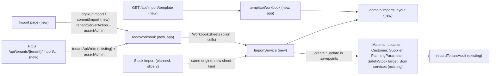
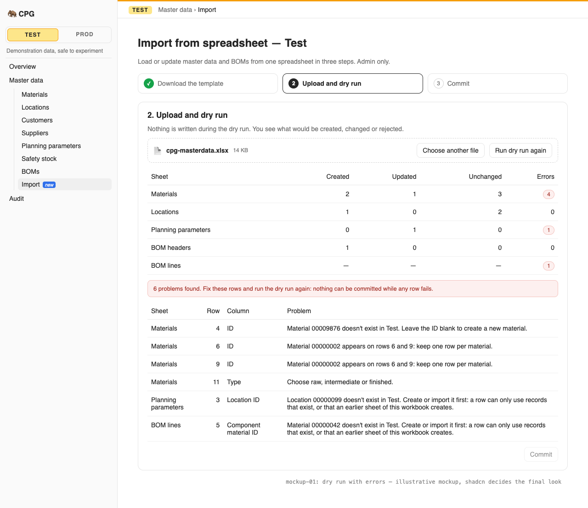
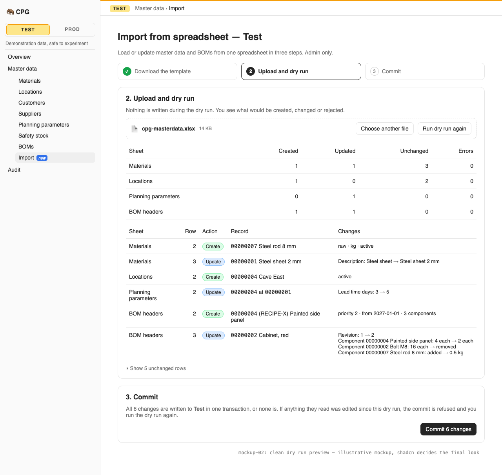
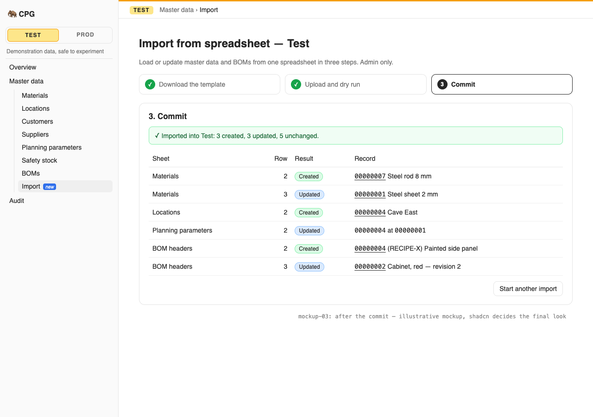

# The admin imports master data and BOMs from a workbook, with a full dry run before an atomic commit

**Status:** implemented
**Created:** 2026-10-20 09:08 UTC
**Issue:** #27 (E05-S01), epic #13 · **Builds on:** `implemented/2026-10-19--1858UTC-materials.md` (#22), `implemented/2026-10-19--2014UTC-locations-customers-suppliers.md` (#23), `implemented/2026-10-20--0532UTC-planning-parameters-safety-stock.md` (#24), `implemented/2026-10-20--0757UTC-boms.md` (#26: `BomService.create`/`update`, the full-recipe save, the no-op rule), `implemented/2026-10-19--2018UTC-read-only-tenants.md` (#25), `implemented/2026-10-19--1548UTC-api-idempotency.md` (#21), `implemented/2026-10-19--1050UTC-audit-log.md` (#20), `implemented/2026-10-19--2048UTC-sidebar-navigation.md` (#58) · **Design authority:** `.ai/specs/product-brief.md` (R01, R04, R05, R07, R08, D04, D05), `.ai/specs/research/CPG-prd001.pdf` §05 ("Business identifiers", "Master-data XLS workflow", "BOM workbook") and §06 ("Complete UI/API parity", "Idempotency", "Optimistic edits and freshness", "Atomic business operations"), `CPG-prd-datamodel.pdf` ("Import dry run"), `CPG-prd-decisions.pdf` §04 ("Master XLS", "BOM XLS", "Import no-change", "Import errors and freshness"), `CPG-acceptance.md` (XLS-001…028, API-015, API-028), [mockup 01, the sidebar tree](../assets/menu-revamp/01-sidebar-tree/index.html) (its admin-only **Import** screen under Master data, owner-chosen in #58)

## 📝 TLDR

The admin can only create and change master data one record at a time, so loading a real plant's materials, locations, parameters and recipes means hundreds of dialogs. This spec proposes an **Import** screen and two API calls. The admin downloads one documented `.xlsx` template with a sheet per master (materials, unit conversions, locations, customers, suppliers, planning parameters, safety stock) and two BOM sheets (headers and component lines). The admin fills it and uploads it for a **dry run**. The dry run runs every row through the same services the screens use, inside a transaction that is always rolled back. It reports every error by sheet, row and column, and otherwise previews each row as create (with the ID it would get), update (field by field, and line by line for a recipe) or unchanged. Only an error-free dry run can be **committed**. The commit runs the same rows again in one transaction and applies them only if the outcome is exactly what the dry run showed. If anything the workbook reads or changes was edited meanwhile, the whole commit is refused. A blank ID creates, a known ID updates, and an unknown explicit ID is an error. A new BOM's lines find their header through an **Import reference**. A BOM's lines are its complete recipe, so an omitted component is removed in a new revision and an identical recipe creates none. The API takes the same workbook as base64 with an idempotency key, so a retried commit never applies twice.

## Resolved assumptions (autonomous defaults)

| # | Question | Chosen answer | Rationale |
|---|---|---|---|
| Q1 | Split the issue (master-data import vs. BOM import)? | No. One spec, one screen, one PR. The phases below are the review checkpoints. | Each half would work alone, but they share all their machinery: the template, the parser, the dry run, the freshness check, the report and the routes. The owner-chosen mockup has one Import screen, and the issue's criteria cover both. Splitting would build the engine in one PR and use it in two. |
| Q2 | One workbook, or one template per master? | **One template, one workbook**, with every sheet optional. Its data sheets are applied in a fixed dependency order: Materials, Unit conversions, Locations, Customers, Suppliers, Planning parameters, Safety stock, BOM headers (with BOM lines). The template also has an **Instructions** sheet and an **Instrukcja** sheet, which the importer ignores. | The mockup's step 1 is "One sheet per master — … BOMs", with one download and one upload. One workbook means one dry run, one commit and one atomic unit, so a material and the planning parameters that use it can land together. XLS-001 and XLS-017 ask for documented sheets, not separate files. |
| Q3 | What does a row mean? | **An upsert of one full record.** A blank ID creates the record, a known ID updates it (XLS-002, XLS-003), and an unknown explicit ID is a row error that advises leaving the ID blank (XLS-004). A known record whose values all equal the stored ones is **unchanged** and writes nothing. Required cells are required on updates too. **Active** is the one exception: blank keeps an existing record's flag, and a new record is always created active ("no" on a new row is an error: "A new record starts active. Deactivate it after the import."). Records the workbook doesn't mention are untouched. The import never deletes anything: no conversion, planning set or safety target is removed. | The PRD: "blank material ID creates; existing ID updates; unknown explicit ID yields a row-level error", "one atomic upsert". Full rows make "unchanged" well defined (XLS-011). Creating then deactivating in one run would make a new BOM skip its priority check, so new records start active, as in the screens. Removal by omission would turn a partial workbook into mass deletion. The PRD says "absent rows remain untouched" for stock, and nothing asks for deletion here. |
| Q4 | How do rows reference other records? | **By ID, as the record stands when the row is applied.** That is a record that existed before the import, or one an earlier sheet or row of the same workbook created or changed. The preview shows each created record's ID. A reference to a missing record is `IMPORT_MISSING_REFERENCE`, which names the record and gives the dependency guidance: "Material 00000042 doesn't exist in Test. Create or import it first: a row can only use records that exist, or that an earlier sheet of this workbook creates." (XLS-007, XLS-008). A BOM line reaches a new BOM through its header's **Import reference** (Q8). | Masters have no import reference in the PRD, only BOMs do. An earlier sheet's created records are real by the time a later row runs (Q6), so forbidding them would be an extra rule that buys nothing. The guidance sentence is the PRD's "missing references/import dependencies". |
| Q5 | Duplicate keys in the workbook (XLS-005)? | Found in a pre-pass, per sheet. A key is the explicit ID on Materials, Locations, Customers, Suppliers and BOM headers; the import reference on BOM headers; (material, unit) on Unit conversions; (material, location) on Planning parameters; and (material, location, date) on Safety stock. **Every** row sharing a key gets `IMPORT_DUPLICATE_KEY`, naming the other rows, and none of them is applied. Blank IDs are never duplicates. A component repeated within one BOM's lines is the BOM service's own duplicate-line error, placed on the later line. | "Both relevant rows identified as conflicting". Applying the first copy and refusing the second would pick a winner silently. |
| Q6 | How does the dry run check every rule? | **It runs the real services.** Every row that passes its cell checks and the key pass is applied through its service's public method (`MaterialService`, `LocationService`, `CustomerService`, `SupplierService`, `PlanningParameterService`, `SafetyStockTargetService`, `BomService`). Each method already runs in its own savepoint (`this.em.transactional`), so a refused row rolls back alone. Its error is recorded, and the run continues: later rows see the earlier ones, and every error is reported (XLS-009). The whole apply pass sits inside **one outer savepoint opened on the request's own `em`** by a new helper, `inRequestSavepoint(em, fn, { keep })`, in `core/src/http/request-transaction.ts`:<br>• It opens the savepoint on that `em`'s transaction context, so every service savepoint nests **under** it.<br>• It rolls back to it (dry run) or releases it (commit).<br>• It then restores the request `em`'s context, so the wrapper's commit and the idempotency key's store still run in the request transaction.<br>• It clears the identity map. The engine also clears it after every refused row, so nothing rolled back (a created entity, a bumped version, a half-assigned field) can be flushed by a later row, by the key store or by the commit.<br>Audit entries are written by the services and roll back with everything else (XLS-010). | This gives UI, API and import identical rules by construction (API-015, R04, R05). Re-implementing type locks, priority overlaps, cycles and conversions in a validator would drift. The obvious primitives fail:<br>• `em.transactional()` puts the outer savepoint on a fork that the services' own `em` never sees. Their savepoints then reuse its name, and after a refused row, `ROLLBACK TO` lands on the wrong one and keeps earlier rows. The fresh-context review reproduced this.<br>• A bare `em.begin()`/`rollback()` drops the request's transaction context.<br>Hence the helper, which is proven by its own tests (Implementation Plan step 4). The cost is that the apply pass holds SQLite's write lock, which Q10 bounds (see Risks). |
| Q7 | How does a commit prove that a successful dry run came first, and that nothing changed since (XLS-012, XLS-014)? | A clean dry run returns a **`previewToken`**: the SHA-256 of the canonical JSON of the tenant's generation, the normalized workbook cells, every row's outcome (action, record ID, changes) and the version of **every record a row names or writes** (its own record and the records its cells reference), taken before the row applied. Records a service consults internally, such as the other BOMs of the cycle and priority checks, aren't in the token: the commit's re-run checks them against the current data anyway. A dry run with errors returns no token. The commit carries the token and the same workbook, and re-runs the same procedure, keeping the row savepoints this time. If the re-run has any error or its token differs, the whole transaction is rolled back with 409 `IMPORT_STALE`: "Records this workbook reads or changes were edited since the dry run, or the workbook differs. Run the dry run again." A commit without a token is `VALIDATION_FAILED` on `previewToken`: "Run a dry run first." Nothing is stored between the two calls. | The data model's "Import dry run" holds "source records' versions/fingerprint and Test generation", and the token is exactly that fingerprint, so no table, file or cleanup job is needed. Re-running makes the commit check every rule against the current data, so a forged or replayed token can't apply anything invalid. It only skips the human look at the preview, and the API caller owns that choice anyway. An HMAC would make the token unforgeable, but CPG has no server secret, and a stored key would be new persisted state for little gain. Created IDs are part of the outcome, so a record created elsewhere meanwhile changes them and also makes the commit stale. |
| Q8 | BOM sheets (XLS-017…028)? | **BOM headers:** BOM ID (blank to create), Import reference, Output material ID, Priority, Valid from, Valid through (blank: no end), Active. **BOM lines:** BOM (a BOM ID or an import reference), Component material ID, Quantity, Unit (blank: the component's base unit). A header with a blank BOM ID needs an import reference: 1–40 characters, unique in the sheet, and never eight digits, so it can't be mistaken for an ID. A header with an ID may have one too. The lines of a header are its **complete recipe**, in sheet order. A new BOM goes through `BomService.create`. An existing one goes through `BomService.update` with every recipe field, the lines and Active, at the version read in the same transaction. A real change therefore makes the next revision, an identical recipe makes none (XLS-022), and an Active change alone toggles without one (XLS-028). For an existing BOM, Output may be blank. If filled, it must be the BOM's output (otherwise `BOM_OUTPUT_IMMUTABLE_MESSAGE` on that cell). A header without lines is `IMPORT_BOM_WITHOUT_LINES`. A line whose BOM matches no header is `IMPORT_LINE_WITHOUT_HEADER`, with the advice to add the BOM's header and complete recipe. | The PRD's "two sheets: logical BOM headers and complete component lines", "temporary Import Reference links new header and components until permanent ID exists", "omitted components are removed from new version" and "no revision when imported BOM is identical". #26 built `update` for exactly this full-recipe save and its no-op rule. |
| Q9 | Cell formats? | **IDs:** text of 1–8 digits or a whole number from 1 to 99999999, zero-padded to eight digits (Excel drops leading zeros of a number). The template formats ID columns as text. **Text:** trimmed. A number cell becomes its plain decimal text. **Quantities and factors:** a number cell becomes its shortest plain decimal text, never exponent notation, and a text cell is taken as written. Both then go through the existing decimal schemas (six decimals, R03). **Dates:** a date cell becomes its calendar date, read in UTC; a text cell must be `YYYY-MM-DD`. **Whole numbers** (priority, lead time): a whole-number cell or digits. **Type / Procurement:** the API words (`raw`, `intermediate`, `finished`; `make`, `buy`), case-insensitive. **Active:** yes/no, true/false, tak/nie (case-insensitive), or a boolean cell. Blank rows are skipped. Row numbers are the sheet's own, with the header on row 1. Columns are matched by header name, case-insensitively and in any order. | Admins fill templates in Excel, LibreOffice and Google Sheets, which turn `00000001` into `1` and dates into serial numbers. Accepting those forms is cheap. Everything after normalization goes through the same schemas as the API. |
| Q10 | Limits, and when the work happens? | The file is at most **512 KB**. It may hold at most **2,000** data rows across all sheets, and at most **20 MB** once inflated. The adapter counts the bytes it actually inflates, never the sizes the zip declares. Over a limit, the request fails with `VALIDATION_FAILED` on `workbook` before any row runs. Everything that needs no database runs **before the first write**: decoding, inflating, parsing, and the engine's layout, cell and key passes (a pure `prepareImport(sheets)`). The screen's actions do this before `tenantServerAction` opens its transaction. The API route does it first in its handler: the keyed transaction is open by then, but it holds no write lock before its first write. Only the apply pass holds the lock. | 512 KB of `.xlsx` holds well over 2,000 rows, and as base64 it fits the server actions' default 1 MB body limit, so `next.config.ts` doesn't change. The row cap keeps the apply pass, and with it the write lock, short (see Risks). Counting inflated bytes stops a zip bomb even when its headers lie. All three limits are constants and easy to change later. |
| Q11 | A read-only tenant (XLS-015, R05)? | Both the dry run and the commit are refused with 409 `TENANT_READ_ONLY`, through the same gated wrappers as every tenant write. The Import page shows the read-only banner, and its upload and buttons are disabled with a lock, as in the mockup. No inspection-only dry run is offered. | XLS-015 says inspection "may be offered", so it is optional. The dry run executes writes before rolling them back, so it belongs behind the write gate. Offering it in a read-only tenant would mean a gate exception, so it is deferred. |
| Q12 | Who may import? | **The admin only**, in both channels (master data is admin-maintained, TEN-004; API-015's "same authorization"). A normal user's request is 403 `FORBIDDEN`, and a normal user who opens the page is sent to `/admin` (`requireAdmin`). Any signed-in account may download the template: it holds no data. | Every master write is admin-only today. The sidebar entry is `adminOnly`, as in the mockup. |
| Q13 | API parity (R07, API-015, API-028)? | `GET /api/import/template` (the `.xlsx`, any signed-in caller, bearer or session cookie), `POST /api/tenants/{tenant}/import/dry-run` with `{ workbook }`, and `POST …/import/commit` with `{ workbook, previewToken }`, where `workbook` is the file as base64. Both POSTs use `tenantApiWrite` (`Idempotency-Key`, `Dataset-Generation` for Test, read-only gate) with `authorize: assertAdmin`, and both answer the same `ImportReport` as the screen. A replayed commit returns the first result and writes nothing (API-028). Added to `BACKWARD_COMPATIBILITY.md` §4. | JSON bodies keep the existing keyed pipeline, the fingerprint and the replay unchanged. Multipart would need a second write wrapper and a second idempotency fingerprint. The dry run is a POST because it carries a body and runs writes, so `tests/api-writes.test.ts` keeps it keyed and gated. |
| Q14 | Which `.xlsx` library, and where does it live? | **`read-excel-file`** (reading) and **`write-excel-file`** (the template), plus **`fflate`** for the size check. All three are small, maintained and pure JavaScript, and they are dependencies of `@cpg/app` only. An adapter in `app/src/components/imports/workbook-file.ts` turns the base64 file into plain `WorkbookSheets` (sheet name → rows of cells) and builds the template. `core` sees only plain cells, so the import engine is unit-tested without files and no vendor library enters `core`. | The standards keep vendor SDKs out of `core`. SheetJS's npm package (0.18.5) carries known high advisories and ships fixes only from its own CDN. `exceljs` hasn't released since 2023 and pulls in `archiver`, `unzipper` and `tmp`. Hand-writing zip and XML handling is far more than the "~20 lines" the standards allow before a dependency. |
| Q15 | Audit (R08)? | Each change is audited by its own service, with the same entry, actor and channel (UI or API) as the same edit made by hand. The import adds no summary entry and no "Import" channel. | The PRD asks that every change be audited, and it is. The mockup's "recorded in the audit as channel 'Import'" would change the audit's actor shape for every reader. It can be added later as a new channel value without touching the import. |
| Q16 | Language? | Sheet names and column headers are fixed English identifiers: they are a contract, like API field names. The template explains them in an **Instructions** sheet (English) and an **Instrukcja** sheet (Polish). The report carries each error's `code`, English `message` and language-neutral `params`. The screen translates it by code, or by the existing field-message constants for `VALIDATION_FAILED`, and falls back to the message. | One static template needs no preference lookup in the template route. Translating by code is how every screen already handles errors. |
| Q17 | Which screen? | `/admin/[tenant]/import`, titled "Import from spreadsheet — Test", with the mockup's three steps: **1. Download the template**, **2. Upload and dry run**, **3. Commit**. The sidebar gets **Import** as the last Master data entry, admin only, with a lock while the tenant is read-only. The Materials and BOMs pages get an **Import from spreadsheet** link for the admin, as in the mockup's Master data header. | The owner chose mockup 01 (#58), and this follows its Import screen. |
| Q18 | Code names? | Concept `imports`; `ImportService`; routes under `import/`; error codes `IMPORT_*`. | The standards' concept-folder rule and the PRD's term. |

Every default is reversible before merge, and none weakens a rule. Q6 and Q7 make the import apply exactly the rules of a hand edit, and Q11 keeps the read-only gate whole. Two choices deserve a reviewer's eye, though no question needs the owner's confirmation before merge: the first third-party library that reads untrusted uploads (Q14, bounded by Q10 and admin-only access), and a dry run that writes and rolls back (Q6).

## 📝 Problem Statement

The PRD's master-data workflow is "download documented template, edit, upload, run mandatory full dry run. Report all sheet/row/field errors, duplicate business keys, missing references/import dependencies, and create/update/unchanged previews. All rows must pass; then one atomic upsert, rejecting if referenced/affected records changed since dry run" (§05). The BOM workbook has "two sheets: logical BOM headers and complete component lines". In it, a blank BOM ID creates, an existing one revises on a real change, and an Import Reference links a new header to its lines. Omitted components are removed, the dry run reports added, changed and removed lines, and an identical BOM gets no revision (§05, R04). Every spreadsheet dry run and import has a bearer-token API equivalent with identical authorization (§06, R07). Mutating calls need a 24-hour idempotency key, and Test writes need the current generation. A read-only tenant blocks them all (R05). Slice 1 includes this import (D05), and the acceptance set is XLS-001…028 plus API-015 and API-028. Today every master and BOM can only be written one record at a time, by hand or through its own API route.

## 📝 Proposed Solution

- **One engine in `core`, in two halves.**
  - **`prepareImport(sheets)`** is pure and runs before any write (Q10). It takes plain `WorkbookSheets` and runs three passes:
    1. **Layout check.** Unknown sheets, and missing or unknown columns, are reported. A sheet with a column problem is skipped. The tab order of the sheets doesn't matter: the template order is applied, whatever order the tabs are in.
    2. **Cell pass.** Each row is normalized (Q9) and parsed with the existing field schemas, and its errors are mapped to columns.
    3. **Key pass.** Duplicate keys are reported (Q5), and BOM lines are grouped under their headers (Q8).
  - **`ImportService.dryRun(prepared, actor)`** and **`ImportService.commit(prepared, previewToken, actor)`** run the **apply pass** inside `inRequestSavepoint` (Q6) and return an `ImportReport`. In dependency order, each remaining row first runs its own pre-checks: an unknown explicit ID (Q3), a missing reference (Q4), and for a BOM line an unknown material. Then its service method runs. The row's outcome is computed from the record before and after: create (with the new ID), update with its field changes (and, for a BOM, its line changes), or unchanged. Last, the token of Q7 is computed. The dry run always rolls the outer savepoint back. The commit keeps it only when the run had no error and its token equals the one sent.
- **Per-sheet row importers** (leaf files in `services/imports/`) map one sheet's row to its service call and the service's field names to the sheet's columns. The engine knows nothing about masters, and each importer knows nothing about savepoints.
- **The workbook adapter in `app`** (Q14) decodes and size-checks the base64 file, then reads it into `WorkbookSheets`. It also writes the template from the shared layout (`core/src/domain/imports/workbook-layout.ts`), the single source of sheet names, columns, required flags and examples.
- **Routes and the screen** reuse `tenantApiWrite`, `tenantServerAction`, `assertAdmin`, `uiActor`/`apiActor`, `DataTable` and `feedback/`.

**Alternatives considered:**
- **A validator that re-implements the rules, plus a separate applier.** The dry run would stay read-only, but every master and BOM rule would be written twice, and the two copies would drift: a lock or priority rule added to a service would silently be missing from the import. Rejected for running the services (Q6).
- **A persisted import run** (a table holding the parsed rows, the preview and the versions, with the commit naming its ID). It would match the data model's wording literally, but it adds a migration, a retention rule and a cleanup job, and it is still stale the moment anything changes. The stateless token (Q7) checks the same things. Rejected.
- **Separate dry-run and commit code paths.** They could disagree about what a row means. One procedure with a rollback switch can't.
- **Partial commits** ("apply the valid rows"). Forbidden by the PRD ("all rows must pass", XLS-013).
- **CSV instead of `.xlsx`.** One file couldn't hold several sheets, and the PRD and every scenario say XLS.

**Market check.** Odoo's import is a single-model upload with a "Test" (dry run) button that runs the real create/write in a rolled-back savepoint and lists errors by row. That is this design, and it is proven at scale. It matches records by external ID, which plays the role of the Import reference. ERPNext's Data Import offers templates, an "insert or update" mode and a preview, but applies rows one by one and keeps the successful ones, which the PRD forbids. SAP's LSMW/Migration Cockpit simulate first and stage the data in tables. CPG takes Odoo's rolled-back dry run and external-reference idea, adds an all-or-nothing commit and a freshness check that none of the three has, and skips staging tables, mapping UIs and per-model templates (D04).

## 📝 Architecture

- **`core`:**
  - `domain/imports/workbook-layout.ts`: the sheets in apply order, each with its columns (header, required, kind: id / text / decimal / integer / date / boolean / enum, an example and a one-line meaning), the instructions text in English and Polish, and the limits `IMPORT_FILE_MAX_BYTES`, `IMPORT_ROWS_MAX` and `IMPORT_UNCOMPRESSED_MAX_BYTES`. Pure data, imported by the engine, the template writer and the help.
  - `domain/imports/cells.ts`: the cell normalizers of Q9. Pure.
  - `domain/imports/recipe-diff.ts`: the line changes between two recipes by component material (added, removed, quantity changed: XLS-021, XLS-025). Pure.
  - `domain/imports/preview-token.ts`: the token of Q7 over `canonicalJson` (reused from `services/idempotency/fingerprint.ts`, moved to a shared leaf if the import would otherwise depend on the idempotency service).
  - `validators/imports/import-request.schema.ts`: `{ workbook }` and `{ workbook, previewToken }`, where `workbook` is a base64 string up to the size limit and `previewToken` is 64 hex characters. The `previewToken` messages are exported constants.
  - `domain/imports/prepare-import.ts`: `prepareImport(sheets)`, the layout check and the cell and key passes, which produce `PreparedImport` (the typed rows per sheet, plus the errors so far). Pure.
  - `http/request-transaction.ts`: `inRequestSavepoint(em, fn, { keep })` (Q6), beside `inRequestTransaction`.
  - `services/imports/import.service.ts` (`ImportService`, scoped): `dryRun` and `commit`. It depends on the seven master services, `em` and `tenant` from the cradle. Registered in `container.ts`/`cradle.ts` and exported from `index.ts`.
  - `services/imports/apply-import.ts`: the apply pass (pre-checks, service calls, clearing the identity map after a refused row, outcomes, token) inside the savepoint.
  - `services/imports/rows/{materials,unit-conversions,named-records,planning-parameters,safety-stock,boms}.ts`: one row importer per sheet kind (locations, customers and suppliers share `named-records.ts`, as their services share `NamedRecords`). Each exports its key, its pre-checks, its apply step and its field-to-column map.
- **`app`:**
  - `components/imports/workbook-file.ts` (server only): `readWorkbook(base64)`. It decodes, checks the file size, inflates every entry with `fflate`'s streaming unzip while counting the real bytes (stopping past 20 MB), then reads every sheet with `read-excel-file`, and checks the row count and `templateWorkbook()` (`write-excel-file`: every data sheet with a bold header row, ID columns formatted as text, then Instructions and Instrukcja).
  - `app/api/import/template/route.ts` (`GET`); `app/api/tenants/[tenant]/import/dry-run/route.ts` and `…/import/commit/route.ts` (`POST`, `tenantApiWrite`).
  - `app/admin/[tenant]/import/{page.tsx,actions.ts}`; `components/imports/` (the three-step client screen, the report tables, `labels.ts`); the sidebar entry; the links on the Materials and BOMs pages; English and Polish strings; the help topic `import`; translations for the new error codes.
- **`ui`:** nothing new. The screen composes `Card`, `Button`, `Input` (`type="file"`), `Table`/`DataTable`, `Badge` and `ErrorMessage`.
- **`db`:** nothing. No entity, no migration.



The change is additive. No existing service, entity or route changes behaviour. The import is a new caller of the services' public methods, and one helper (`canonicalJson`) may move to a shared leaf. Slice 2's stock import ("same complete dry-run/atomic/optimistic checks") can add its sheets as another row-importer kind.

## 📝 Data Model

No change: no entity, no migration. The dry run's state lives only in its response, and the commit re-derives it (Q7). The data-model graph is skipped for that reason.

The workbook (one template, Q2), in apply order. **Bold** columns are required. "ID" columns accept a blank only where the table says so.

| Sheet | Columns | Key | Service calls |
|---|---|---|---|
| Materials | ID (blank: create), **Type**, **Description**, **Base unit**, Active | ID | `materialService.create` / `get` + `update` |
| Unit conversions | **Material ID**, **Unit**, **Numerator**, **Denominator** | material, unit | `materialService.addConversion` / `changeConversion` |
| Locations, Customers, Suppliers | ID (blank: create), **Name**, Active | ID | `locationService`, `customerService`, `supplierService` `create` / `update` |
| Planning parameters | **Material ID**, **Location ID**, **Procurement**, **Lead time days**, **Minimum quantity**, **Lot multiple** | material, location | `planningParameterService.create` / `update` |
| Safety stock | **Material ID**, **Location ID**, **Effective from**, **Quantity** | material, location, date | `safetyStockTargetService.create` / `update` |
| BOM headers | BOM ID (blank: create), Import reference (required when BOM ID is blank), Output material ID (required when BOM ID is blank), **Priority**, **Valid from**, Valid through, Active | BOM ID; import reference | `bomService.create` / `get` + `update` |
| BOM lines | **BOM** (BOM ID or import reference), **Component material ID**, **Quantity**, Unit (blank: base unit) | — (grouped under the header) | as part of their header's call |

## 📝 API Contracts

All three routes answer the shared envelope. `ImportReport`:

```ts
{
  committed: boolean;              // false for a dry run, true after a commit
  previewToken: string | null;     // only from a dry run without errors
  summary: { sheet: string; created: number; updated: number; unchanged: number; errors: number }[];
  rows: {
    sheet: string; row: number;    // the sheet's own row number (header = 1)
    action: "create" | "update" | "unchanged";
    record: string;                // "00000003", "00000003/case", "00000003/00000001", "00000003/00000001/2027-01-01"
    reference?: string;            // a new BOM's import reference
    label: string;                 // "00000003 — Steel sheet 2 mm"
    changes: { field: string; before: string | number | boolean | null; after: string | number | boolean | null }[];
  }[];                             // one per data row that passed the cell and key passes
  errors: {
    sheet: string | null; row: number | null; column: string | null;
    code: string; message: string; params?: Record<string, string | number>;
  }[];                             // every error found, in sheet and row order
}
```

`changes` uses the sheet's column names. A BOM update lists the header fields that changed, `Revision` (`2` → `3`) when a revision is made, `Active`, and one entry per component that changed, named `Component 00000001` with the base quantity and unit before and after (`null` when the component was added or removed: XLS-021, XLS-025). A status-only BOM change lists `Active` and no `Revision` (XLS-028).

| Method and path | Body | Success | Errors (besides the pipeline's) |
|---|---|---|---|
| `GET /api/import/template` | — | `200`, the `.xlsx` (`Content-Disposition: attachment; filename="cpg-import-template.xlsx"`) | `UNAUTHORIZED` |
| `POST /api/tenants/{tenant}/import/dry-run` | `{ workbook }` | `ImportReport`, `committed: false`. Errors in the workbook are in the report, not an error status | `FORBIDDEN` (a normal user), `VALIDATION_FAILED` on `workbook` (not base64, over 512 KB, not a readable `.xlsx`, over 2,000 rows, over 20 MB uncompressed), `TENANT_READ_ONLY` |
| `POST /api/tenants/{tenant}/import/commit` | `{ workbook, previewToken }` | `ImportReport`, `committed: true`, `previewToken: null` | as the dry run, plus `VALIDATION_FAILED` on `previewToken` (missing or malformed: "Run a dry run first, then commit with its previewToken."), and 409 `IMPORT_STALE` |

Report error codes. The services' own codes pass through unchanged (`MATERIAL_INACTIVE`, `LOCATION_INACTIVE`, `MATERIAL_TYPE_IN_USE`, `BASE_UNIT_IN_USE`, `BASE_UNIT_HAS_CONVERSIONS`, `MATERIAL_MADE_AT_LOCATIONS`, `UNIT_IS_BASE_UNIT`, `BOM_PRIORITY_CONFLICT`, `BOM_CYCLE`, `*_IDS_EXHAUSTED`, and `VALIDATION_FAILED` field errors placed on their column). The import adds:
- `IMPORT_EMPTY` (no data row in any sheet);
- `IMPORT_UNKNOWN_SHEET`, `IMPORT_MISSING_COLUMN`, `IMPORT_UNKNOWN_COLUMN` (row 1);
- `IMPORT_UNKNOWN_ID` (XLS-004: "Material 00009876 doesn't exist in Test. Leave the ID blank to create a new material.");
- `IMPORT_DUPLICATE_KEY` (XLS-005);
- `IMPORT_MISSING_REFERENCE` (Q4);
- `IMPORT_NEW_RECORD_INACTIVE` (Q3);
- `IMPORT_REFERENCE_REQUIRED`, `IMPORT_BOM_WITHOUT_LINES` and `IMPORT_LINE_WITHOUT_HEADER` (Q8).

A service error that names no field lands on the row with `column: null`. For a BOM it lands on the header row. A line's field error (`components.N.unit`) is placed on that line's own row and column.

`ImportService` (core). Both methods take the `PreparedImport` and `actor: AuditActor`, and must run inside the caller's write transaction (`tenantServerAction`, or `tenantApiWrite`'s keyed transaction):
- `dryRun(prepared, actor)` returns the `ImportReport`. Nothing persists, and the caller's transaction still commits whatever it owns, such as the idempotency key.
- `commit(prepared, previewToken, actor)` returns the `ImportReport` with `committed: true`, or throws `IMPORT_STALE` (Q7). Every change is audited by its service (Q15).

Server actions in `app/admin/[tenant]/import/actions.ts`: `dryRunImport(tenant, generation, { workbook })` and `commitImport(tenant, generation, { workbook, previewToken })`. Each first reads the session and checks `assertAdmin`, so a normal user can't make the server parse a file. Then it parses its input with the import schema, reads the workbook and calls `prepareImport`, all **before** calling `tenantServerAction` (Q10). A request-level failure (a bad file) returns the error envelope without opening a transaction. Inside the transaction, the service is called. The API's `authorize` runs before the body is read, likewise. The routes do the same in their handler, before the service call. No page needs refreshing: the master pages read at request time.

## 📝 UI/UX

- **Sidebar:** Master data gains **Import** after BOMs, for the admin only, with a lock icon (and "Test is read-only" as its title) while the tenant is read-only. The Materials and BOMs pages show an **Import from spreadsheet** link next to their create button for the admin (mockup 01).
- **`/admin/[tenant]/import`**, titled "Import from spreadsheet — Test". The intro: "Load or update master data and BOMs from one spreadsheet in three steps. Admin only." A stepper shows the three steps, marking the current one with `aria-current="step"`.
  1. **Download the template.** One paragraph: one sheet per master and two for BOMs; keep the header row; a blank ID creates and an existing ID updates; sheets are applied in order, so a row can use what an earlier sheet creates. Then **Download template (.xlsx)**, a link to `/api/import/template`.
  2. **Upload and dry run.** A file input (`.xlsx`, at most 512 KB, checked in the browser too) and **Run dry run**, with the note "Nothing is written during the dry run." The result shows:
     - a summary table by sheet: Created, Updated, Unchanged, Errors;
     - with errors: an error table (Sheet, Row, Column, Problem), every error, in order, and the note "Fix these rows and run the dry run again: nothing can be committed while any row fails.";
     - without errors: a preview table (Sheet, Row, Action badge, Record, Changes), where changes read `Description: Steel sheet → Steel sheet 2 mm`, a new BOM reads `00000004 (RECIPE-X), 3 components`, and a revised one lists `Component 00000002 Bolt M8: 16 each → removed`. Unchanged rows are folded under a "Show N unchanged rows" disclosure.
     - Choosing another file clears the result.
  3. **Commit.** Enabled only after an error-free dry run of the file currently chosen, labelled **Commit N changes** (created + updated). With nothing to change, it stays disabled with "Nothing to change." The note reads "All N changes are written to Test in one transaction, or none is." On success, "Imported into Test: 2 created, 1 updated, 4 unchanged" is shown above the final table, where created records link to their pages. On `IMPORT_STALE`, the translated explanation appears and the screen returns to step 2 with the file still chosen.
- **Pending and errors:** both buttons show their pending state and lock the file input while running. A request-level error (`VALIDATION_FAILED` on `workbook`, `TENANT_READ_ONLY`, `GENERATION_STALE`) shows with `ErrorMessage` above the buttons.
- **Read-only tenant:** the read-only banner, and steps 2–3 disabled with "🔒 Test is read-only: imports are blocked. The administrator can make it writable on the Cave control page." Step 1 stays available.
- **Normal users** don't see the entry, and the page sends them to `/admin` (Q12).
- **Help:** topic `import` in English and Polish: the sheets and their order, the ID rules, import references and full recipes, the dry run and the commit, the limits, and the API calls.

Prototype: `.ai/specs/assets/master-data-bom-import/`, static mockups following mockup 01. They are illustrative only: the shadcn components decide the final look.
- `current-01-boms.png`: today's BOMs page in Test, the last Master data entry.
- `mockup-01-dry-run-errors.png`: step 2 with a summary and an error table (an unknown material ID, a duplicate ID, a missing location).
- `mockup-02-dry-run-preview.png`: step 2 with a clean preview (a new material with its ID, a description change, a new BOM by import reference, a revised BOM with a removed component).
- `mockup-03-committed.png`: step 3 after a commit.





## 📝 Edge Cases & Failure Scenarios

| Case | Behaviour |
|---|---|
| Materials 00000001 and 00000002 exist; a row with a blank ID | Preview: create `00000003`. After the commit, 00000003 exists and the report shows it (XLS-002) |
| A row with ID 00000001 and a new description | Preview: update, `Description: old → new`; the commit updates the same record and audits it (XLS-003) |
| A row with ID 00009876, absent from the tenant | `IMPORT_UNKNOWN_ID` on Materials, that row, column ID, advising to leave it blank (XLS-004) |
| Two Materials rows with ID 00000001 | `IMPORT_DUPLICATE_KEY` on both rows, each naming the other; neither applied; no token (XLS-005) |
| A Materials row without a type | `VALIDATION_FAILED`, column Type, "Choose raw, intermediate or finished."; nothing created (XLS-006) |
| A planning row for location 00000099, which doesn't exist | `IMPORT_MISSING_REFERENCE` on Location ID, with the dependency guidance (XLS-007) |
| A BOM line for a material that doesn't exist yet | `IMPORT_MISSING_REFERENCE` on Component material ID: "…create or import it first…" (XLS-008) |
| One workbook with a duplicate ID, an invalid type and an unknown reference | All three reported, each on its own row and column (XLS-009) |
| Any dry run | No master, BOM, revision or audit entry changes, even for a clean workbook; the token is the only output (XLS-010) |
| One new, one modified, one unchanged row | Preview labels create (with ID), update (with changes), unchanged (XLS-011) |
| A commit without a token, or after a dry run with errors (which gave none) | `VALIDATION_FAILED` on `previewToken`; nothing written (XLS-012) |
| Several valid rows and one invalid row at commit time | The re-run finds the error, the token differs, the commit is `IMPORT_STALE`, and nothing is written (XLS-013, XLS-026) |
| Material 00000001 edited in another session after the dry run | Its version is in the token, so the commit is `IMPORT_STALE`, and the other session's change stays (XLS-014) |
| A material created elsewhere after the dry run | The would-be IDs shift, so the commit is `IMPORT_STALE`; a new dry run shows the new IDs |
| Test read-only | Dry run and commit both 409 `TENANT_READ_ONLY`; the page shows the lock (XLS-015) |
| Test and Prod both have 00000001 with different contents; import in Test | Only Test's 00000001 changes (XLS-016) |
| The template | Shows the BOM headers and BOM lines sheets with BOM ID and Import reference explained in Instructions/Instrukcja (XLS-017); every sheet documents blank/known/unknown IDs, required columns and examples (XLS-001) |
| A header with a blank ID and reference RECIPE-X, and three lines with BOM = RECIPE-X | One new BOM with the next BOM ID and all three lines; the preview shows `0000000N (RECIPE-X)` (XLS-018) |
| RECIPE-A and RECIPE-B for two alternatives of one output, different priorities | Two BOMs, each with its own lines and revision 1 (XLS-019); with the same priority over overlapping days, the second is `BOM_PRIORITY_CONFLICT` and nothing commits (XLS-023) |
| An existing BOM at revision 2 with a changed recipe | Revision 3; revisions 1–2 unchanged; the BOM ID unchanged (XLS-020, XLS-027) |
| Current lines A, B and C; the workbook lists A and B | Preview: `Component C: … → removed`; after the commit, revision N + 1 has A and B, and revision N still has A, B and C (XLS-021) |
| A header and lines identical to the current revision | Unchanged; no revision, no audit entry (XLS-022) |
| Lines that close a cycle with existing BOMs | `BOM_CYCLE` on the header row with the full path; nothing commits (XLS-024) |
| Current lines A 1 kg and B 2 kg; the workbook has A 1.5 kg and C 1 kg | Preview: A changed 1 → 1.5, B removed, C added (XLS-025) |
| An identical recipe with Active toggled | `Active: yes → no`, no `Revision` change; the commit records the toggle only (XLS-028) |
| A header with a blank ID and no import reference | `IMPORT_REFERENCE_REQUIRED` on that row |
| An existing BOM with a different Output material ID | `VALIDATION_FAILED` on Output material ID, "A BOM's output can't be changed: create a new BOM." |
| A line whose BOM is an ID or reference with no header row | `IMPORT_LINE_WITHOUT_HEADER`; a header with no lines: `IMPORT_BOM_WITHOUT_LINES` |
| A BOM line with a blank unit | Read in the component's base unit |
| `1` in an ID cell, a date cell, `1.5` as a number | Read as `00000001`, `YYYY-MM-DD`, `"1.5"` (Q9) |
| A material locked by a BOM gets a new type | `MATERIAL_TYPE_IN_USE` on the Type cell; the rest of the workbook is still checked |
| A new row with Active = no | `IMPORT_NEW_RECORD_INACTIVE` (Q3) |
| An extra sheet "Notes", or a missing "Base unit" column | `IMPORT_UNKNOWN_SHEET` / `IMPORT_MISSING_COLUMN` on row 1; that sheet's rows aren't checked further |
| A `.csv`, a 600 KB file, 2,500 rows, or a zip inflating past 20 MB whatever its headers declare | `VALIDATION_FAILED` on `workbook`; no row runs |
| A workbook with only the Instructions sheets | `IMPORT_EMPTY` |
| A normal user's token | 403 on both POSTs; the template downloads |
| The same commit retried with its idempotency key | The first report, `Idempotent-Replayed: true`, nothing written twice (API-028; the scenario's inventory-correction workbook is slice 2, so API-028 is only partly covered here) |
| A dry run through the API and the screen on the same workbook | The same report: same rules, same authorization (API-015) |
| A dry run in Test without `Dataset-Generation`, or after a Test reset (slice 2) | 428 `GENERATION_REQUIRED` / 409 `GENERATION_STALE`; a token from the old generation never matches |
| The commit transaction meets a stale snapshot | Retried once by its wrapper, which re-runs the whole procedure; a changed outcome is then `IMPORT_STALE` |
| A write from another bundle while the apply pass runs | That write waits, freezing the server, and fails after `busy_timeout` if the import outlasts it; the import completes (Risks) |
| A refused row that changed an entity before it failed | The identity map is cleared after it, so neither a later row nor the key store nor the commit can flush that change (Q6) |
| The BOM sheets placed before Materials in the tab order | The template order applies regardless; a BOM line using a material created by the Materials sheet works (XLS-008) |
| An unexpected (non-`AppError`) failure in a row | The whole request fails as an internal error and rolls back; it is never reported as a row error |

## 📝 Risks & Impact Review

- **No schema change.** Rollback is a revert. Nothing persisted depends on the import. A `kamal rollback` simply removes the screen and routes.
- **A third-party parser for uploaded files (Q14).** `read-excel-file` unzips and parses XML from the admin's file. Exposure is bounded: the caller must be the authenticated admin, the file at most 512 KB, at most 20 MB of inflated bytes (counted, not declared), and at most 2,000 rows. Its XML parsing must not expand entities: a test feeds a sheet with a `DOCTYPE` entity and expects no expansion. `npm audit` covers the three packages and their transitive dependencies, and any advisory goes into the standards' known-advisory note. The adapter is the only file that imports them, so swapping the library later touches one file.
- **The apply pass holds SQLite's write lock, and a concurrent write stalls the server (Q6, Q10).** The run makes its writes, then rolls them back (dry run) or keeps them (commit). Meanwhile, a write from another connection busy-waits **synchronously** in better-sqlite3. Every Next.js bundle has its own connection: an API route during a screen import, or a server action in another bundle. That busy-wait blocks Node's event loop, so the import itself can't advance either (lesson "better-sqlite3 waits for a lock synchronously"). The server is then frozen until `busy_timeout` (better-sqlite3's default, 5 s) passes, and the other write fails with "database is locked". The import then finishes. Nothing is corrupted, and the failed write stored nothing.
  - **Mitigations:** everything that needs no database runs before the first write (Q10), and the row cap keeps the apply pass short. Imports are an admin's occasional action, and the help topic says to run them when nobody else is writing.
  - **Measurement:** the implementation measures the apply pass of a 2,000-row workbook and records the time in the plan. Lower the cap if it isn't well under a second.
  - A real fix (moving the import into its own short transactions, or a write queue) would contradict the atomic commit, so it is out of scope.
- **Stored replays.** Each keyed dry run or commit stores its full `ImportReport` as the key's response for 24 hours. At 2,000 rows that is at most a few hundred KB per key, which is acceptable at an admin's import rate.
- **The token is a fingerprint, not a signature (Q7).** An API client can compute a matching token without calling the dry run, but the commit still re-runs and enforces every rule. The only thing skipped is a human looking at the preview, and that caller writes through the API anyway.
- **Strict staleness.** Any change to a record the workbook touches, or a new record that shifts would-be IDs, makes the commit stale. On a busy tenant, the admin may need to re-run the dry run. That is the PRD's rule. The message says what to do.
- **New public contracts** (`BACKWARD_COMPATIBILITY.md` §4): three API routes, the page URL, the help topic, and **the workbook layout itself**. Sheet names, column headers and their meaning become a contract that admins' saved files depend on. Later changes must be additive: a new optional column or sheet. Renaming one needs an alias for one release.
- **Coupling to service semantics.** The import inherits every service rule, which is the point. A service change that makes an identical update write something (a version bump on a no-op) would show as "update" rows and break XLS-022. The import's tests pin "unchanged" for every kind.
- **Server-action payload.** The base64 workbook travels in the action's arguments (at most ~700 KB, under Next.js's 1 MB default), so `next.config.ts` stays unchanged. Raising Q10's file limit past ~740 KB needs `serverActions.bodySizeLimit`.
- **`risk-high`** stays on the implementation PR: atomic bulk writes across every master, a shared API contract, and a new dependency handling uploads.

## 📝 Decisions in play

- **R01** (blank ID creates, known ID updates, unknown explicit ID is an error; IDs never reused): Q3, through the services' ID assignment.
- **R04** (a real change creates a revision; an identical import or a toggle doesn't; no equal priority over overlapping validity; cycles rejected with the path): Q8, through `BomService`.
- **R05** (isolation; read-only blocks every business write, the API's included): Q11, tenant-scoped services, the gated wrappers.
- **R07** (API parity with idempotency keys and the generation precondition): Q13.
- **R08** (audit): Q15.
- **D04** (simplest consistent behaviour, no scope creep): Q3 (no deletes), Q7 (no table), Q11 (no inspection mode), Q15 (no new channel).
- **D05** (the master-data/BOM import is in slice 1): this spec.

Nothing is superseded. The mockup's "Import" audit channel is deferred, not rejected (Q15).

## Out of scope

- The stock and inventory imports (opening balances, corrections): slice 2. Their sheets can join this engine later.
- Exporting the tenant's current records into the template ("download, edit, re-upload" of existing data). The template is empty. This can be added later without changing the import.
- An inspection-only dry run in a read-only tenant (Q11), an "Import" audit channel (Q15), and Polish column headers (Q16).
- Removing records through the import: conversions, planning sets and safety targets are removed one at a time on their pages (Q3).
- Background or chunked imports, progress bars, and files over the Q10 limits.

## 📋 Phasing

One PR, built in this order (Q1). The phases are review checkpoints, not separate releases.

- **Phase 1 — Engine.** The pure layout, cell, prepare, diff and token modules, the request schemas, the savepoint helper, `ImportService` with every row importer, unit-tested against SQLite with plain `WorkbookSheets`.
- **Phase 2 — Workbook and API.** The adapter and its dependencies, the template route, the dry-run and commit routes, `BACKWARD_COMPATIBILITY.md`, API integration tests.
- **Phase 3 — Screen.** The actions, the three-step page, the sidebar entry and page links, translations, help, screen integration tests.

## 📋 Implementation Plan

### Phase 1 — Engine

1. **Layout and cells.** `domain/imports/workbook-layout.ts` and `cells.ts`. Unit tests:
   - the sheets in apply order, every column's header, required flag, kind and example;
   - ID cells: `"00000001"`, `1` and `"1"` read as `00000001`; `0`, `100000000`, `1.5` and `"A1"` are errors;
   - dates: a date cell read in UTC, a `YYYY-MM-DD` text, an invalid text;
   - decimals: `1.5`, `0.1`, `1e-7` read as `0.0000001` (later refused by the six-decimal schema), and a text cell kept as written;
   - booleans: yes/no/true/false/tak/nie and boolean cells;
   - enum words case-insensitive;
   - blank and whitespace cells read as blank.
2. **Diff and token.** `recipe-diff.ts`: added, removed, changed, and unchanged when only the line order differs (XLS-025). `preview-token.ts`: the same input gives the same token; a different version, generation, cell, outcome or created ID gives a different one; key order doesn't matter.
3. **Request schemas.** `validators/imports/import-request.schema.ts`: base64 accepted; non-base64, empty and over-limit refused; `previewToken` required on commit, 64 lowercase hex characters. Unit tests for every message.
4. **Savepoint helper.** `inRequestSavepoint` in `http/request-transaction.ts`. Tests on a real SQLite file, inside `inRequestTransaction`, calling real service methods:
   - with `keep: false`, three rows where the middle one is refused leave the database exactly as before, and a write made after the savepoint (standing in for the idempotency key) still commits with the request transaction;
   - with `keep: true`, the two good rows commit and the refused one doesn't;
   - after either, the request `em`'s identity map holds none of the run's entities, and a later `flush()` writes nothing of them;
   - a refused row whose service changed an entity before failing leaves nothing dirty;
   - an error thrown out of `fn` rolls back to the savepoint and propagates.
5. **Prepare and engine, master sheets.** `prepare-import.ts`, `apply-import.ts`, `ImportService` (registered and exported), and the row importers for materials, unit conversions, named records, planning parameters and safety stock. Tests on a real SQLite file, in a Test and a Prod scope:
   - layout errors: unknown sheet, missing and unknown column, empty workbook; the tab order ignored (XLS-008);
   - XLS-002 (ID 00000003 assigned, shown in the dry run and in the commit report); XLS-003 (update, one audit entry); XLS-004, XLS-005, XLS-006, XLS-007 and XLS-009 (all errors reported at once);
   - XLS-010: a clean dry run leaves every table and the audit as they were;
   - XLS-011; XLS-012 (no token, a token after errors, a random token); XLS-013;
   - XLS-014: an edit through `MaterialService.update` between the dry run and the commit gives `IMPORT_STALE`, and the edit is kept;
   - a record created between the two calls gives `IMPORT_STALE`;
   - XLS-016 (Test and Prod with the same ID);
   - unchanged rows write nothing;
   - Active blank, yes and no on new and existing rows (Q3);
   - a planning row using a material created by the Materials sheet of the same workbook (Q4);
   - service refusals placed on their column (`MATERIAL_TYPE_IN_USE`, `LOCATION_INACTIVE`, a Make on raw as `procurement` → Procurement);
   - a non-`AppError` failure propagates.
6. **BOM sheets.** `rows/boms.ts`. Tests:
   - XLS-018, XLS-019, XLS-020 and XLS-027 (ID unchanged, revisions kept);
   - XLS-021 (preview and both revisions read back);
   - XLS-022 (unchanged, no audit entry);
   - XLS-023, XLS-024 (the path in the message), XLS-025, XLS-026 and XLS-028;
   - an import reference that is blank, duplicated or eight digits; a line without a header; a header without lines; a changed output; a blank unit read as the base unit; a line's conversion error placed on the line's row and column; a missing component material on its line (XLS-008);
   - a lines-only reference to an existing BOM by ID needs its header row.

### Phase 2 — Workbook and API

7. **Adapter.** Add `read-excel-file`, `write-excel-file` and `fflate` to `@cpg/app`; run `npm audit` and triage. `components/imports/workbook-file.ts`. Unit tests with real bytes:
   - the template round-trips through `readWorkbook` to empty data sheets with the layout's headers, and its Instructions and Instrukcja sheets explain blank, known and unknown IDs, required columns, examples, the import reference and full recipes (XLS-001, XLS-017);
   - a workbook written in the test reads back with numbers, dates, text IDs and booleans as `read-excel-file` returns them;
   - the 512 KB and 2,000-row limits, and the 20 MB inflated limit with a zip whose headers declare small sizes;
   - a sheet with a `DOCTYPE` entity is not expanded;
   - a non-zip and a zip without a workbook are unreadable;
   - the Instructions and Instrukcja sheets are excluded from the sheets passed to `core`.
8. **Routes.** `api/import/template/route.ts` (`requireApiUser`, `Content-Type`, `Content-Disposition`), and `api/tenants/[tenant]/import/dry-run/route.ts` and `…/commit/route.ts` (`tenantApiWrite(…, { authorize: assertAdmin })`, `apiActor(caller)`). Unit tests with `@cpg/core` mocked: 403 for a normal token, the body schema, the report passed through. `tests/api-writes.test.ts` and `tests/tenant-entry-points.test.ts` pass with the new routes. `BACKWARD_COMPATIBILITY.md` §4 gains the routes, the page and help topic, and the workbook layout as a protected surface.
9. **API integration tests** (`tests/integration/import-api.test.ts`, in Prod, with workbooks built in the test by `write-excel-file`):
   - the template downloads with a bearer token and with the session cookie;
   - a dry run creates materials and a location, and the report shows their would-be IDs; then nothing exists yet;
   - the commit with its token creates them; a replay with the same key returns the same report with `Idempotent-Replayed: true`, and they exist once (API-028);
   - a second workbook updating a material is stale after a `PATCH` of that material in between (XLS-014);
   - a BOM workbook by import reference creates the BOM, and a second one omitting a line makes revision 2 (XLS-018, XLS-021);
   - a normal token gets 403;
   - Test without `Dataset-Generation` is 428;
   - a read-only tenant is 409 `TENANT_READ_ONLY` (made read-only and restored in the file);
   - a dry run whose middle row is refused stores its key and leaves every record unchanged (XLS-010 through the keyed path);
   - the same workbook gives the same rows and errors through the API as through the screen's action (API-015; compared in `tests/integration/import.test.ts`).
   - Measure a 2,000-row dry run and record the time in the plan (Risks).

### Phase 3 — Screen

10. **Actions.** `import/actions.ts`. Unit tests: admin succeeds; normal user `FORBIDDEN`; signed out `UNAUTHORIZED`; stale generation; read-only refused; the workbook read before the service is called; `IMPORT_STALE` passed through.
11. **Screen components.** `components/imports/`: the stepper, the file step, the summary, error and preview tables, the commit step and `labels.ts`. Unit tests:
    - steps and `aria-current`;
    - the browser-side 512 KB check;
    - the commit enabled only after a clean dry run of the chosen file, and cleared by another file;
    - "Commit N changes", and "Nothing to change" when N is 0;
    - errors translated by code, with params and the fallback;
    - change texts for a field, a new BOM and a removed component;
    - the unchanged-rows disclosure;
    - pending states;
    - `IMPORT_STALE` returning to step 2;
    - the read-only lock.
12. **Page and navigation.** `import/page.tsx` (`requireAdmin()` inside `<Suspense>`, `tenantScope`, `await connection()`), the `adminOnly` sidebar entry with its read-only lock, the links on the Materials and BOMs pages, English and Polish strings, the `import` help topic (`tests/every-page-has-help.test.ts`), the admin-pages list (`tests/admin-pages-require-admin.test.ts`), and error translations. Unit tests: admin-only entry, links hidden for normal users and in read-only.
13. **Screen integration tests** (`tests/integration/import.test.ts`, scoped to records this file creates):
    - the admin opens Import from the sidebar and downloads the template;
    - the admin uploads a workbook with an unknown ID and a duplicate, and sees both errors with sheet and row (XLS-004, XLS-005);
    - the admin uploads a clean workbook, sees the preview with created IDs and changes, commits it, and the records then appear on the Materials and Locations pages;
    - a BOM workbook creates a BOM by reference, shown on the BOMs page;
    - the dry-run report for one workbook matches the API's for the same workbook (API-015);
    - a normal user doesn't see the entry and is sent away from the URL.

    Then the full gate: lint, typecheck, `test:coverage` (100%), build, `test:integration`, and `npm audit` (three new dependencies, triaged).

## Implementation notes

Implemented on #99; the execution plan is `.ai/pipeline/runs/2026-10-20--0921UTC-master-data-bom-import.md`, which records each deviation in full. In short:
- The identity map is cleared after every row, not only after a refused one. A 2,000-row dry run took 17.9 s before this and 844 ms after, in Docker.
- An import reference needs at least one letter: a digits-only value in a BOM line's BOM column is always a BOM ID.
- Issues carry language-neutral params (`record`, `rows`, `bom`), and a second tab named like a template sheet is `IMPORT_DUPLICATE_SHEET`.
- A BOM header's own error and its lines' missing materials are reported together.
- The template doesn't format its empty ID columns as text (numeric IDs are zero-padded instead), and the sidebar entry has no read-only lock icon (the page shows the lock).

