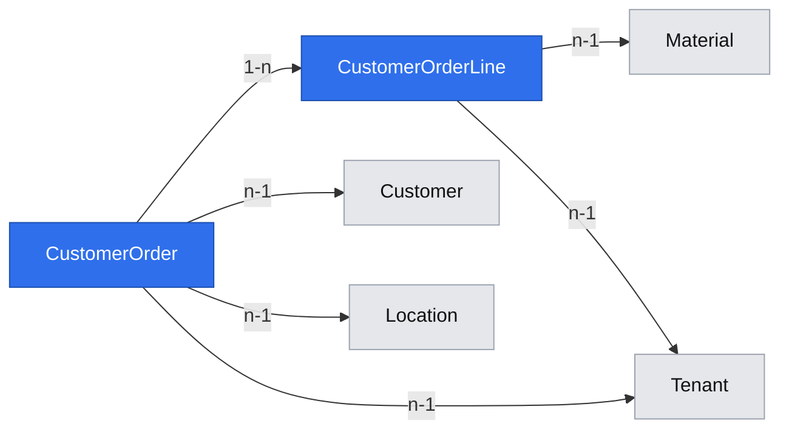

# Customer orders with one location and dated lines

**Status:** implemented
**Created:** 2026-10-20 16:35 UTC
**Issue:** #83 (E08-S01), epic #74
**Design authority:** `product-brief.md` (R02, R03, R05, R07, R08, D02, D04, D06, N01), `research/CPG-prd001.pdf` §02, §03 (Multi-line document model, Operational edits, Four-state lifecycle), §06; `research/CPG-prd-datamodel.pdf` (customer order header/line); `research/CPG-prd-decisions.pdf` §02–03; `research/CPG-acceptance.md` SAL-001…005, SAL-019, SAL-025, LFC-001, LFC-014, LFC-020. Builds on materials, named masters, tenants, audit and idempotency.

## 📝 TLDR
Both roles need to record customer demand before it can be shipped or planned. This proposal adds tenant-scoped customer orders with one customer, one header location and multiple material/quantity/date lines, starting Open. The same audited create/read/edit behaviour is available in the UI and bearer-token API. No stock is posted by entering or editing an order.

## Resolved assumptions (autonomous defaults)

| # | Question | Chosen answer | Rationale |
|---|---|---|---|
| Q1 | Split entry, integrity, API and UI? | Keep one capability together. Shipments/GI (#84), terminal commands (E11-S01), forecasts and MRP remain separate. | Integrity and UI/API parity are requirements from the first order. None of these parts offers a complete independent order-entry capability. |
| Q2 | Identifiers and lines? | Header has internal UUID, immutable tenant-local eight-digit `code`, version, created/updated timestamps. Each line has stable UUID and position. Updates send the full document, retain existing line IDs and omit IDs on new lines. Omitted unfulfilled lines are hidden as historical references; a replaced material retains a hidden old-line snapshot while the visible line keeps its ID. Unknown/repeated line IDs are refused. | Stable identity is needed by future shipments. Reuse `nextSequentialId`; no hard-delete of orders or code reuse. |
| Q3 | Which edits? | Open orders only. Customer/location and any unfulfilled line may change; same customer/location may remain inactive. An inactive customer/location cannot be newly selected. New lines/material replacements require an active material; existing references remain usable. Customer and header location lock after any GI. A fulfilled line cannot be removed or change material, entered unit or original required date; quantity cannot drop below fulfilled plus abandoned. Non-Open lines are retained unchanged. | PRD operational edits and existing-document processing (SAL-025, LFC-020); enforcing these guards now leaves the next story a safe extension point without implementing postings. |
| Q4 | Historical unit conversions? | Store exact six-place BUoM quantity plus entered quantity/unit/numerator/denominator. An existing line with same material, unit and normalized entered quantity retains its stored conversion even if the current factor changed or disappeared. A real quantity/unit/material change converts once with current factor. | R03 and MAT-027/028. Re-sending an edit must not revalue history. |
| Q5 | Limits, dates and duplicates? | 1–100 lines; positive decimal strings using existing quantity limits. Real ISO calendar date, historical or future; no invented today restriction. Same material may appear more than once, including different dates. No line location field: any override is a validation error. | Multiple dated lines are explicit; unlike a BOM, a repeated material can be separate demand. A bounded request is consistent with BOMs. |
| Q6 | Lifecycle and quantities? | Store header/line state (`open`, `completed`, `closed-early`, `cancelled`); new header/lines are `open`, fulfilled/abandoned `0.000000`. Only fulfilled/abandoned quantities define progress; no extra partial state. Clients cannot write lifecycle/progress. | Required data model; posting and terminal-state transitions belong to later stories. |
| Q7 | Reference locks and deactivation? | Any order reference locks material type/BUoM. An Open line with ordered > fulfilled + abandoned blocks material deactivation naming the order. An Open order blocks location deactivation naming the order. Customer deactivation remains allowed. | PRD §02/§06: operational references lock type/BUoM and unfinished direct references block material/location deactivation. SAL-025 explicitly treats customers differently. |
| Q8 | Demo? | One Test order for seeded customer/location 00000001, two seeded materials with distinct required dates. Seed only when no orders and tenant writable; skip cleanly if references were removed/deactivated or conversions invalid. No Prod data and no seed audit. | D06, existing seed conventions. |

Defaults add no product scope or weakened protection. No unresolved product decision requires confirmation.

## 📝 Problem Statement
The app has masters and recipes but no customer demand. #83 requires order entry for both roles with dated lines and exact quantities, tenant isolation, read-only enforcement, audit and concurrent-edit protection. The catalogue defines new orders as Open, one shared location, and missing or inactive new references as refusals. GI and forecast scenarios cannot be fully executed until later stories; this change must not claim those outcomes.

## 📝 Proposed Solution
Add a `customer-orders` concept following existing concept folders. Reuse shared date/decimal validators, conversion helper, sequential IDs, tenant scopes, `tenantServerAction`, `tenantApiWrite`, audit recorder and optimistic-lock errors. Order entry is one atomic save of the header and full line set. A true no-op changes neither version nor audit. Use leaf usage functions for cross-concept integrity, as materials already do for BOMs; do not create service dependency cycles.

Market check (2026-10-20): [ERPNext Sales Order](https://docs.frappe.io/erpnext/sales-order) supports individual delivery dates and order-to-delivery progress. [ERPNext amendments](https://docs.frappe.io/erpnext/amending-sales-order-after-submit) constrain updates once linked fulfilment exists. CPG uses dated rows and protects posted history; it omits prices, invoicing, submission/approval and commercial terms (N01, N05). These sources inform the comparison, not additional requirements.

## 📝 Architecture
- `db`: `entities/customer-orders/customer-order.entity.ts`, `customer-order-line.entity.ts`; register/export them and generate one additive migration, snapshot and index. Both entities are `tenantOwned()`, reference loaded masters, and use UUID keys. Tenant+code is unique. Line positions are not a database unique key: the service assigns them from the full validated array, avoiding transient unique collisions when reordering or removing lines.
- `core`: validators under `validators/customer-orders/`; `CustomerOrderService` (`list`, `get`, `create`, `update`, `seedDemo`), scoped DI binding and export; leaf `customer-order-usage.ts` for MaterialService and LocationService/NamedRecords. Exact arithmetic uses `decimal.ts`. No new dependency or framework.
- `app`: tenant list/detail pages, actions and collection/item API routes; domain components, English/Polish messages, help and a Transactions > Customer orders navigation item. All reads through services with `connection()` inside Suspense.
- Seed after materials/customers/locations; startup reports its count with existing demo kinds. No inventory ledger or shipment entity.

## 📝 Data Model
`CustomerOrder`: UUID `id`, tenant, `code`, customer FK, location FK, status enum, createdAt, updatedAt and integer optimistic version.

`CustomerOrderLine`: UUID `id`, tenant, order FK, integer position, removed flag (default false), material FK, quantity text (BUoM), enteredQuantity/unit/numerator/denominator text, requiredDate ISO text, fulfilled/abandoned exact quantity text and status enum. The line has no location. Header version guards the whole aggregate; every real line-only change touches header updatedAt (strictly later than its prior value).

The migration adds tables/indexes/FKs only. The old application continues to run on the expanded database. Rollback drops lines before headers and loses orders, so rollback is only a disposable-test operation; production rolls back the image against the expanded schema. No PII fields are added beyond existing customer references.

## 📝 API Contracts
Paths are `/api/tenants/{tenant}/customer-orders` and `/{id}`; `id` is the eight-digit code. Reads allow signed-in session or bearer token. Writes require bearer, Idempotency-Key, Test Dataset-Generation and a writable tenant, for both roles. Shared envelope and existing statuses remain unchanged.

- GET collection → order views by ID in fixed pages of 100 (`?page=1`, integer 1–1000000, default 1); the data stays an array and API consumers stop at a page shorter than 100. Invalid/unknown query fields are 400. UI shows translated previous/next controls, clamps a stale out-of-range page to the last page and uses 404 for malformed page values. Header query and corresponding line payload are bounded; lines are grouped once per page. GET item → one view, 404 `CUSTOMER_ORDER_NOT_FOUND` (malformed/other-tenant IDs included).
- POST → `{ customer, location, lines: [{ material, quantity, unit, requiredDate }] }`, returns view (200 through the existing shared wrapper).
- PATCH item → `{ version, customer, location, lines: [{ id?, material, quantity, unit, requiredDate }] }`, full aggregate, returns view. Existing IDs belong to this order; unknown/repeated IDs are 400 field errors.
- View: `{ id, customer, location, status, version, createdAt, updatedAt, lines: [{ id, material, quantity, enteredQuantity, enteredUnit, numerator, denominator, requiredDate, fulfilled, abandoned, status }] }`. All quantities JSON strings, authoritative values fixed six places. No internal master UUIDs or actor secrets.
- Request objects are strict: immutable `id`, lifecycle/progress fields, line location and other unknown keys are errors. Validation uses full dotted line field paths. Quantities normalize entered input, reject zero/negative/exponent/overprecision, unconvertible units, rounding to zero or overflow before writing.
- Missing master → its existing 404 code; inactive newly selected master → 409 `{KIND}_INACTIVE`. Stale version/optimistic flush refusal → 409 `VERSION_CONFLICT`; non-Open/posted-field edit → 409 `CUSTOMER_ORDER_LOCKED`; too-low quantity → line quantity validation error. Exhausted IDs → 409 `CUSTOMER_ORDER_IDS_EXHAUSTED`; unique create race → 409 `CUSTOMER_ORDER_ID_RACE` after standard stale-snapshot retry.
- Audit actions `customer-orders.customer-order.created` / `.updated`, subject CustomerOrder/code. Allowlisted snapshots include customer/location/status and the full ordered line records serialized to one JSON-text scalar (stable IDs and progress; the shared audit contract accepts scalar values only), before/after for edits, null before for creates. No-op and failed saves write no entry. Shared actor provides account/channel/session.

## 📝 UI/UX
Standard tenant list/detail pattern, available to normal users and admin. List uses DataTable with ID link, customer, location, status and line count. Detail shows header and line DataTable with material, ordered BUoM quantity, entered amount/unit, original required date, fulfilled quantity and state. Long values wrap and secondary columns hide on small screens.

Create opens a scrollable dialog; Edit on detail opens the same form with stable line IDs. Header selects customer/location once. Rows contain material, quantity, unit and required date, with accessible row/field labels, add/remove controls, per-row errors, pending and cancel states. A bespoke aggregate form is justified because CrudForm has no editable array field (same precedent as the BOM recipe form); compose existing shadcn inputs/selects/buttons and ErrorMessage. No per-line location control. Keep inactive existing choices visible when editing; only active new choices. Server validates everything again.

Empty list explains that orders record demand and offers Create when writable. Read-only tenant shows the standard banner and hides write controls; a stale open dialog retains the refusal explanation. Stale version shows translated conflict, refreshes the record without silently retrying an overwrite. Missing detail uses standard not-found. Static fallbacks are text-free, dictionary resolved inside request-time content. Help explains one location, per-line dates, units, Open/progress, inactive customers, and that entering an order moves no stock. Polish/light/dark/mobile follow existing tokens. No external service call.

Visuals: the shared test-env descriptor is absent in this checkout; om-auto-write-spec permits text-only design evidence. Live implementation evidence is still required by the implementation flow.

## 📝 Edge Cases & Failure Scenarios
- Another tenant's customer/material/location/line ID never resolves; no partial header, line or audit remains.
- Two clients edit one version: second refuses, first persists. Lines changing alone must advance the aggregate version.
- Duplicate material rows on different dates stay separate; stable IDs survive reorder. No duplicate or stolen line identity.
- Changing a conversion cannot alter unchanged order lines, including when only the date or customer changes.
- Customer deactivation succeeds with existing orders. Editing that order keeps its inactive customer, while a new order selecting it fails.
- Material/location deactivation blocker is specific to outstanding demand; completed/resolved order history still locks material type/BUoM.
- Seed is idempotent, tenant-local and tolerates an edited Test dataset; no startup overwrite of users' orders.
- Posting, terminal commands, MRP and forecast consumption are not implemented or claimed as tested by this story.

## 📝 Risks & Impact Review
Risk-high: additive schema plus new tenant writes and aggregate API. Main risks are accidental history revaluation, child identity substitution and a line-only save missing optimistic protection. Real SQLite and HTTP tests cover all three. Cross-concept locks are required consequences of introducing the first operational reference. No deployment/config/auth contract changes. Add the new endpoints/errors to BACKWARD_COMPATIBILITY.md alongside implementation.

## 📝 Decisions in play
R02 material locks; R03 exact quantities; R05 tenant isolation/read-only; R07 UI/API parity/key/generation/version; R08 atomic audit; D02 manual documents before MRP; D04 smallest baseline; D06 Test demo. N01 finance stays excluded. No superseding product decision proposed.

## Implementation Plan
### Phase 1 — Aggregate and integrity
- Step 1.1: Add tenant-owned entities, generated migration/snapshot/index, migration up/down and isolation tests.
- Step 1.2: Add strict input validators with date/quantity/identity tests.
- Step 1.3: Build audited/versioned CustomerOrderService and SQLite behavioural tests for entry, editing, rollback, identity, conversion history, inactive masters and locks.
- Step 1.4: Add material/location usage protections and Test seed, with regression tests for existing masters and startup seed.
### Phase 2 — API and screens
- Step 2.1: Add collection/item routes and server actions with wrapper/auth/forwarding tests, document protected contract.
- Step 2.2: Add translated list/detail screens, aggregate form, navigation/help and component/page tests.
- Step 2.3: Add real browser/API integration journeys for both roles, dated lines, edit/no-op/version, read-only, missing/other-tenant masters, inactive customer and material demand protection.
### Phase 3 — Verification and publication
- Step 3.1: Reach 100% behavioural unit coverage and run lint/typecheck/build/integration gate; verify live mobile and desktop flow and capture evidence.
- Step 3.2: Review diff against standards/compatibility, fix findings, publish implementation PR referring to this design and #83; manual QA/approval remains required.

## Implementation notes
- 2026-10-20 — Code review proved that preserving only omitted lines loses a replaced material’s FK. Hidden historical line copies preserve that reference too, keeping R02’s permanent type/BUoM lock without exposing history as active demand.
- 2026-10-20 — POST uses the shared API wrapper’s existing HTTP 200, correcting the proposal’s 201 wording. Audit lines are allowlisted view records serialized as JSON text, preserving the scalar snapshot contract rather than widening shared audit infrastructure.
- 2026-10-20 — Edit dialogs capture their opening aggregate/version until closed. A conflict refresh cannot silently pair old form values with a new version; reopening loads the latest saved order.

- Final performance review made the collection bound explicit before its first release: 100-order pages, shared DataTable pagination slot, and linear line grouping. The array envelope and create/edit behaviour are unchanged.
- Material-demand checks scan fixed-size detached keyset batches under the current tenant transaction; a separate additive composite-index migration supports the equality filters and ID cursor without repeated temporary sorts. The first published table migration is not edited.
- Implemented and verified in #102 on 2026-10-20: lint/typecheck/build pass,1,970 unit tests at100%,221 integration tests pass with one Docker-only startup skip. Manual production UI matrix passes; screenshot publication awaits the user Guard decision. Formal review and manual QA approval remain required before merge.
