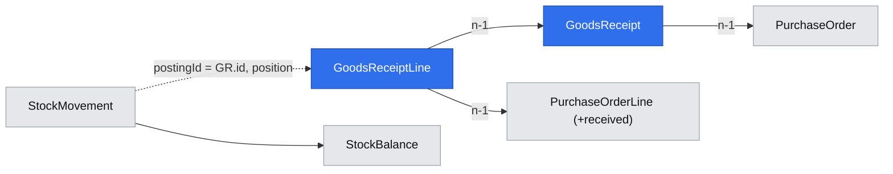

# A user posts goods receipts against one purchase order, partially, repeatedly or in excess, and stock rises atomically with the order's progress

**Status:** implemented
**Created:** 2026-10-20 19:33 UTC
**Issue:** #87 (E09-S02), epic #75 · **Builds on:** `implemented/2026-10-20--1636UTC-purchase-requisitions-orders.md` (#86: purchase orders and their lines), `implemented/2026-10-20--1634UTC-stock-ledger-corrections.md` (#80: the ledger, the balance and the atomic posting primitive), `implemented/2026-10-19--2018UTC-read-only-tenants.md`, `implemented/2026-10-19--1548UTC-api-idempotency.md`, `implemented/2026-10-19--1050UTC-audit-log.md` · **Design authority:** `.ai/specs/product-brief.md` (R03, R05, R07, R08, R09, D02), `.ai/specs/research/CPG-prd001.pdf` §03 "Receipt and issue" and "Operational edits", `CPG-prd-datamodel.pdf` (goods receipt header and line), `CPG-acceptance.md` (BUY-010…016, BUY-020…024, INV-002, INV-010, INV-012, INV-024, AUD-018, AUD-030, LFC-002, LFC-003, LFC-009, MAT-031, API-021)

## 📝 TLDR

Purchase orders can be placed, but nothing can be received, so stock never rises from a delivery. This spec adds the **goods receipt** (GR): one document against one purchase order, with one or more lines, each naming a PO line and the quantity that arrived. Posting it, in one transaction, raises physical stock at the PO's location through the ledger's posting primitive, adds to each PO line's **received** quantity, and moves the PO to **Completed** once every line has received at least its quantity. A receipt may be partial, repeated or in excess: an excess is accepted and reported as a warning, and outstanding never goes negative. Any signed-in user posts receipts, in the UI (from the purchase order's page) and the API. Reversals, Close Early and MRP are other stories.

## Resolved assumptions (autonomous defaults)

| # | Question | Chosen answer | Rationale |
|---|---|---|---|
| Q1 | What does a receipt hold? | A header with an eight-digit business ID (`code`, sequential per tenant from `00000001`, never reused), its purchase order, the business date it was posted on and its creation timestamp; and 1 to 100 lines, each naming one line of that PO by its line number, with the received quantity entered in any unit the material converts and stored as the six-decimal base quantity with the entered quantity, unit and factor kept (`convertToBaseQuantity`, R03, MAT-019). Material and location are the PO line's and the PO's: a receipt never names them. Receipts and their lines are immutable (update-abort triggers, like stock movements). | The datamodel's GR header ("one PO, time of actual posting") and GR line ("references one PO line, actual quantity"). Reversal (E11-S02) will append, never rewrite. |
| Q2 | One PO per receipt (BUY-013)? | The PO is the header's. A line may state its own `purchaseOrder`; when it differs from the header's, the receipt is refused with the field error `lines.N.purchaseOrder` and nothing is written. A PO line may appear once per receipt (`lines.N.line`: "listed twice"). A line number the PO doesn't have is the field error `lines.N.line`. | The same shape as BUY-007's one-location rule; the API makes the refusal observable because a client can name a line's order. |
| Q3 | Which POs take receipts? | Only an Open PO (409 `PURCHASE_ORDER_NOT_OPEN` for a Completed one: LFC-008, no reopening). Within an Open PO any line takes receipts, including a line that is already fully received (the excess is a warning, Q5). An unknown PO, another tenant's included, is 404 `PURCHASE_ORDER_NOT_FOUND` (TEN-014). | PRD §03: "PO receipt may be partial or in excess of ordered quantities (warn, not block)". |
| Q4 | Atomic posting (BUY-012, AUD-018, INV-002, R09)? | One transaction writes the receipt and its lines, every PO line's new received quantity, the PO's status, one stock movement per receipt line (type `goods-receipt`, posting ID = the receipt's UUID, position = the line's index, reason naming the receipt and the PO) with its balance, and the audit entries. Every line is checked before anything is written; any failure (a field error, an inactive material or location, a quantity out of range) writes nothing. The ledger's private `write` becomes the exported leaf `postStockMovements(em, …)` in `services/stock/stock-posting.ts`, which `StockService` and `GoodsReceiptService` both call on their own transaction's `em`. | The issue: "posted through E07-S01's posting entry point in the same transaction". A leaf function, like `find-material.ts`, keeps the receipt from importing another concept's service and keeps one transaction. |
| Q5 | Excess (BUY-015)? | Accepted. A line's **excess** is the part of this receipt beyond what was still outstanding before it. The result carries `warnings: [{ code: "OVER_RECEIPT", line, excess }]`, one per line with an excess; the screen shows them after posting. Outstanding is `max(0, quantity − received)`, never negative. | "Warn, not block." |
| Q6 | Status (BUY-014, BUY-016, LFC-002, LFC-003, LFC-009)? | A PO line is **completed** when its received ≥ its quantity, otherwise **open**; it is derived, not stored. The PO header becomes `completed` when every line is completed, in the receipt's transaction, and stays `open` otherwise. No user action reopens it. | The catalogue's header-from-lines rule; Close Early (BUY-017) is E11-S01. |
| Q7 | Dates (INV-010, AUD-030)? | The receipt and its movements carry the server's UTC date at posting (the ledger's existing business date); no client date is accepted. The PO's planned dates never change on receipt. The audit entry keeps its own timestamp. | Same rule as corrections (stock spec Q2). |
| Q8 | PO edits after a receipt (BUY-020…024)? | Unchanged from E09-S01 Q8, with one addition. The supplier, the header location and every line's material, unit and quantity can't change on any PO (the API refuses `supplier` and `location`, and now also a line's `material`, `unit` and `quantity`, which it used to drop silently), so a received PO's are locked and a quantity can never fall below what was received. A line's planned date stays editable, audited, while the PO is Open. A **Completed** PO refuses date edits too (409 `PURCHASE_ORDER_NOT_OPEN`): nothing of it is still planned. Quantity edits (raise, or lower down to the received) are not added here: a line that converted a requisition would have to give back or take more of it, which is document-lifecycle work for E11. | The issue's criteria hold, and are tested on a received PO; the smallest rule set that keeps a received quantity meaningful. |
| Q9 | MAT-031? | Already holds: once a requisition or PO line references a material, its base unit can't change (`hasProcurementDocuments`, E09-S01 Q10), before any posting. This story adds a regression test on a PO line with no receipt. | Built by #86. |
| Q10 | Who may post, and API rules (R05, R07, API-021)? | Any signed-in account ("both roles"). A read-only tenant refuses the receipt with no movement. API writes need a bearer token, an idempotency key and, in Test, the dataset generation; a retry with the same key and body returns the original receipt, posting nothing twice. | The shared write gates. |
| Q11 | Audit (R08)? | `goods-receipts.goods-receipt.posted` (the receipt: ID, PO, business date, lines as one text value), `purchase-orders.purchase-order.received` (per PO: each touched line's received before and after, and the status before and after), and the ledger's own `stock.movement.posted` per line, all in the receipt's transaction. | Every change is audited, with an allowlisted snapshot. |
| Q12 | Screens? | The purchase order's page gains, per line, **Received**, **Outstanding** and a line status; a **Post goods receipt** button (any user; hidden while the tenant is read-only or the PO is Completed) opening a dialog with one row per PO line (its outstanding, a quantity left empty to skip the line, and a unit among the material's units, the base unit first); and a **Goods receipts** section listing this PO's receipts with their date and lines. No separate receipts page or sidebar entry: a receipt is always reached through its PO. | Fewer screens; the sidebar is already long (E09-S01 Q13). |
| Q13 | API? | `GET|POST /api/tenants/{tenant}/goods-receipts` (`GET ?purchaseOrder=00000001` filters), `GET …/goods-receipts/{id}`. The PO view gains `received`, `outstanding` and `status` per line and `completed` as a header status (additive). Added to `BACKWARD_COMPATIBILITY.md` §4. | R07. |
| Q14 | Demo data? | None in this story: a demo receipt would post stock before the Test openings' "untouched stock" check and skip them. | D06 is met by the PO and stock demos; a later story can order the seeds. |

## 📝 Architecture

- **db:** `entities/goods-receipts/goods-receipt.entity.ts` and `goods-receipt-line.entity.ts` (tenant-owned, update-abort triggers); `PurchaseOrderLine.received` (text, default `0.000000`); `PURCHASE_ORDER_STATUSES` gains `completed`. One migration `goods_receipts`.
- **core:** `domain/goods-receipts/receipt-quantity.ts` (pure: received after, excess, outstanding, line and order completion); `validators/goods-receipts/goods-receipt.schema.ts`; `services/stock/stock-posting.ts` (the extracted posting primitive); `services/goods-receipts/goods-receipt.service.ts`; `PurchaseOrderService` views with received/outstanding/status and the Completed-PO date refusal; container, cradle and index lines.
- **app:** `api/tenants/[tenant]/goods-receipts/route.ts` and `[id]/route.ts`; `admin/[tenant]/purchase-orders/[id]/actions.ts` (`postReceipt`); `components/goods-receipts/` (dialog, form, table, labels); the PO screen's new columns and sections; both dictionaries and the PO help topic.

## Requirements

- [x] A receipt posts against one Open PO, raises stock at the PO's location by the base quantity of each line, adds to each PO line's received, and completes the PO when every line is received in full, atomically (BUY-010, BUY-011, BUY-012, BUY-016, INV-002, INV-024, LFC-002, LFC-003, LFC-009, AUD-018).
- [x] A line from another PO is refused (BUY-013); a short delivery leaves the PO Open with the remainder outstanding (BUY-014); an excess is accepted with a warning and no negative outstanding (BUY-015).
- [x] Movements are dated today's business date; the PO keeps its planned dates; the audit keeps its own timestamp (INV-010, AUD-030, INV-012).
- [x] On a received PO the supplier, location, line material, unit and quantity are refused; an Open PO's planned dates stay editable and audited (BUY-020…024). MAT-031 holds before any posting.
- [x] Read-only tenants refuse receipts with no movement; API writes need a key, and a replay returns the original receipt (R05, R07, API-021).
- [x] The PO page shows received, outstanding and status per line, the receipts, and the Post goods receipt dialog.

## Out of scope

Receipt reversal (E11-S02); Close Early (E11-S01, BUY-017); overdue supply in MRP (BUY-019); PO quantity edits; demo receipts; transfer receipts.

## Acceptance criteria

The issue's eight criteria (#87), each covered by a unit test and, for the screen and the API, an integration test.

## 📋 Implementation Plan

1. db: entities, `received`, `completed`, migration and its up/down test.
2. core: the posting leaf, receipt rules, schema, `GoodsReceiptService`, PO view and date rule, registration; unit tests against real SQLite.
3. app: routes, action, components, PO screen, messages, help; unit tests.
4. Integration tests (API and UI), `BACKWARD_COMPATIBILITY.md`, full gate.

## Implementation notes

- One branch and one PR carry the spec and the implementation (the cezar task owns one branch), as for #86.
- Q8 tightened the PO `PATCH`: a line's `material`, `unit` or `quantity` is now 400 instead of silently dropped, so BUY-022/023's "refused" is observable. Other view-only line fields are still dropped.
- A received total that would not fit is the field error `lines.N.quantity` (collected with the other line errors), not a bare `QUANTITY_OUT_OF_RANGE`.
- Known gap, outside this story: a location can be deactivated while an Open PO delivers to it (no rule from E09-S01 blocks it). Every receipt on that PO is then refused with `LOCATION_INACTIVE` until the location is reactivated. Follow-up: block location deactivation with an Open PO, alongside LFC-018. Filed as E09-S03 (#141).

