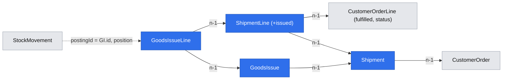

# A user ships against one customer order and posts goods issues that lower stock and fulfil its lines, and the exact final issue completes the order

**Status:** implemented
**Created:** 2026-10-20 20:45 UTC
**Issue:** #84 (E08-S02), epic #74 · **Builds on:** `implemented/2026-10-20--1635UTC-customer-orders.md` (#83: orders, stable line IDs, fulfilled quantities and the posted-line locks), `implemented/2026-10-20--1634UTC-stock-ledger-corrections.md` (#80: the ledger and its posting primitive), `implemented/2026-10-20--1933UTC-goods-receipts.md` (#87: the reference for "post a movement group and update the source document"), `implemented/2026-10-19--2018UTC-read-only-tenants.md`, `implemented/2026-10-19--1548UTC-api-idempotency.md`, `implemented/2026-10-19--1050UTC-audit-log.md` · **Design authority:** `.ai/specs/product-brief.md` (R03, R05, R07, R08, R09, D02, N02), `.ai/specs/research/CPG-prd001.pdf` §03 "Multi-line document model", "Receipt and issue", "Operational edits", `CPG-prd-datamodel.pdf` (outgoing shipment header, shipment line / goods issue line posting), `CPG-prd-decisions.pdf` ("Receipts vs shipments", "Customer no over-delivery", "Outgoing shipment composition"), `CPG-acceptance.md` (SAL-006…013, SAL-018, SAL-020…022, INV-003, INV-005, INV-010, INV-011, INV-021, AUD-026, AUD-030, LFC-002, LFC-003, LFC-010, TEN-017, API-020, API-021)

## 📝 TLDR

Customer orders can be recorded, but nothing can leave the warehouse against them. This spec adds two documents:

- **Shipment.** A planned dispatch against one Open customer order. Its lines name order lines and the quantity planned to go. Creating a shipment moves no stock (SAL-009).
- **Goods issue (GI).** What actually left, posted against one shipment. One transaction lowers physical stock at the order's location through the ledger's posting primitive, adds to each order line's **fulfilled** quantity and to the shipment line's **issued**, and completes the line, the order and the shipment when nothing is left.

A GI never goes beyond what is outstanding on the order line or still to issue on the shipment line (SAL-012, SAL-018). It never goes beyond the stock on hand either (INV-005, R09). Both roles use the order's page and the shipment's page in the UI, and the API. Reversals (E11-S02), Close Early (E11-S01), forecast consumption and MRP are other stories.

## Resolved assumptions (autonomous defaults)

| # | Question | Chosen answer | Rationale |
|---|---|---|---|
| Q1 | What is a shipment? | A header with an eight-digit `code` (sequential per tenant, never reused), its customer order, a planned date (any real ISO date, as the order's required dates) and a status (`open`, `completed`). Its 1 to 100 lines each name one visible line of that order by the line's stable ID, with a planned quantity in any unit the material converts, stored as the six-decimal base quantity with the entered quantity, unit and factor (R03). Each line also stores its `issued` base quantity. The location is the order's; a shipment never names one. Shipments aren't edited in this story: no version. | The datamodel's "Outgoing shipment header: one customer order and location, planned date and status; may contain multiple lines". The decision register: "Shipment is context, not a posting". |
| Q2 | One order per shipment (SAL-006…008)? | The order is the header's. A line may state its own `customerOrder`. When that differs from the header's, the shipment is refused with the field error `lines.N.customerOrder`. An order-line ID that isn't a visible line of the header's order (another order's line included) is `lines.N.orderLine`. An order line may appear once per shipment. | The same shape as BUY-013 on goods receipts, so the refusal is observable through the API. |
| Q3 | Which orders take shipments, and how much? | Only an Open order (409 `CUSTOMER_ORDER_NOT_OPEN`). A line's planned quantity can't exceed the order line's **outstanding** (quantity − fulfilled − abandoned) at creation (`lines.N.quantity`), so a fulfilled line can't be planned. Several shipments may plan the same outstanding: only the GI is binding. | "Outbound quantities must never exceed outstanding customer-order line amounts" (PRD §03), while a plan is context, not a reservation. |
| Q4 | What is a goods issue? | A header with an eight-digit `code`, its shipment, the business date it posted on and its creation timestamp. Its 1 to 100 lines each name one shipment line by its 1-based number, with the issued quantity in any unit the material converts. Issues and their lines are immutable (update-abort triggers, like receipts). A line may state its own `shipment`; one other than the header's is `lines.N.shipment`. | The datamodel's "Shipment line / goods issue line posting: references customer order line, dispatched quantity and posting date". |
| Q5 | How much may a GI line issue (SAL-012, SAL-018)? | At most its line's **to issue**: the smaller of what the shipment line still plans (planned − issued) and what the order line still has outstanding. Anything more is the field error `lines.N.quantity`, whatever the stock (SAL-018). The rule is the same on a completed line, where the outstanding is 0. | The decision register's "Customer no over-delivery": "increase order via audited edit first". |
| Q6 | Atomic posting (INV-003, INV-005, R09)? | One transaction writes everything below. Every line is checked first, and any refusal (a field error, `INSUFFICIENT_STOCK` naming the available and requested quantities) writes nothing. | The issue: "posted through E07-S01's posting entry point in the same transaction". |
| Q7 | Concurrency (INV-021, AUD-026)? | Two GIs racing on one balance meet SQLite's single writer. The second is refused as a stale snapshot and retried once by the request wrappers. The retry reads the new balance and outstanding, and refuses with `INSUFFICIENT_STOCK` (or the over-issue field error). The order's version advances on every GI, so a concurrent order edit from an older copy is a `VERSION_CONFLICT`. | The ledger's existing rule, proved with two ORMs on one file as for corrections. |
| Q8 | Status (SAL-013, LFC-002, LFC-003, LFC-010)? | An order line becomes `completed` once fulfilled ≥ its quantity; the order becomes `completed` once every visible line is completed; otherwise both stay `open`. After a GI, each Open shipment of the order becomes `completed` once none of its lines has anything left to issue. No user action reopens anything. An order edit that lowers a delivered line's quantity to exactly its fulfilled quantity completes that line (and the order, when it was the last), so an order is never left Open with nothing left to issue. | The PRD's order aggregation: "Completed if all fulfilled". |
| Q9 | Dates (INV-010, INV-011, AUD-030)? | A GI and its movements carry the server's UTC date at posting; the input has no date, and a client-sent date is ignored. The order's required dates and the shipment's planned date never change on issue. The audit entry keeps its own timestamp. | Same rule as receipts and corrections. |
| Q10 | Order edits after an issue (SAL-020…022)? | #83's locks already hold: after a GI, the customer and the header location are locked, a delivered line keeps its material, unit and required date, and its quantity can't fall below fulfilled. This story adds one lock: a line that a shipment names can't be removed and can't change its material (`CUSTOMER_ORDER_LOCKED`), so a planned dispatch always means the material it was planned for. | The locks are now tested with real issues; the shipment lock keeps a plan's meaning without edit machinery. |
| Q11 | Who may write, and API rules (R05, R07, TEN-017, API-020, API-021)? | Any signed-in account, both roles. A read-only tenant refuses shipments and issues with no movement or order change. API writes need a bearer token, an idempotency key and, in Test, the dataset generation. A retry with the same key and body returns the original document and posts nothing twice. | The shared write gates. |
| Q12 | Audit (R08)? | Each change is audited in its own transaction: • creating a shipment: `shipments.shipment.created`; • posting a GI: `goods-issues.goods-issue.posted`, plus `customer-orders.customer-order.fulfilled` (each touched line's fulfilled and status before and after, and the order's status), plus `shipments.shipment.issued` (each touched line's issued before and after), plus the ledger's own `stock.movement.posted` per line; • each shipment that completes, after an issue or an order edit: `shipments.shipment.completed` (status before and after); • an order edit that completes lines: its existing `customer-orders.customer-order.updated` entry. | Every change is audited, with an allowlisted snapshot. |
| Q13 | Screens? | The customer order's page gains: • an **Outstanding** column; • a **Create shipment** button (any user; hidden while the tenant is read-only, the order isn't Open or nothing is outstanding), opening a dialog with a planned date and one row per outstanding line; • a **Shipments** section listing the order's shipments.  A new shipment page `/admin/[tenant]/shipments/[id]` shows the header (order link, customer, location, planned date, status) and the lines (planned, issued, to issue). It has a **Post goods issue** button (hidden while read-only or the shipment is Completed), opening a dialog with one row per line that has anything to issue, and lists the shipment's goods issues. There is no list page and no sidebar entry: a shipment is reached through its order. The receipt dialog's row form becomes the shared `components/forms/line-quantities-form.tsx`, which all three dialogs use. | Mirrors the receipt flow; the sidebar must stay within 1280×800 (lesson). |
| Q14 | API? | Shipments: • `GET|POST /api/tenants/{tenant}/shipments` (`?customerOrder=00000001` filters, `?page=2` pages by 100); • `GET …/shipments/{id}`.  Goods issues: • `GET|POST /api/tenants/{tenant}/goods-issues` (`?shipment=00000001` filters, `?page=2` pages by 100); • `GET …/goods-issues/{id}`.  The customer order view is unchanged. Added to `BACKWARD_COMPATIBILITY.md` §4. | R07. |
| Q15 | Demo data? | None: D06 is met by the order demo, and a demo issue would post stock before the Test openings' "untouched stock" check. | As for receipts. |

## 📝 Architecture

- **db:** `entities/shipments/shipment.entity.ts`, `shipment-line.entity.ts` (`issued` text, default `0.000000`), `entities/goods-issues/goods-issue.entity.ts`, `goods-issue-line.entity.ts` (update-abort triggers). All tenant-owned. One migration, `shipments_goods_issues`.
- **core:**
  - `domain/goods-issues/issue-quantity.ts` (pure: outstanding, to issue, line fulfilment, order and shipment completion);
  - `validators/shipments/shipment.schema.ts` and `validators/goods-issues/goods-issue.schema.ts`;
  - the leaf `services/customer-orders/order-records.ts` (find an order, refuse a non-Open one), shared by three services;
  - the leaf `services/shipments/shipment-usage.ts` (which order lines a shipment names), for `CustomerOrderService`;
  - `ShipmentService` and `GoodsIssueService`, which posts through `postStockMovements`;
  - container, cradle and index lines.
- **app:**
  - routes `api/tenants/[tenant]/shipments/…` and `goods-issues/…`;
  - the `createShipment` action next to the customer order page, and `postIssue` next to the new shipment page;
  - `components/shipments/` and `components/goods-issues/`, and the shared line-quantities form;
  - messages, help, and the stock ledger's "Goods issue" source label.

Takeaway: the shipment is the plan, and only the goods issue reaches the ledger.

## Requirements

- [x] A shipment references exactly one Open order and its matching lines; a line of another order is refused; creating one moves no stock and fulfils nothing (SAL-006…009).
- [x] A GI lowers stock at the order's location for its lines only, adds to their fulfilled quantities, accumulates over repeated issues and leaves the order Open while anything is outstanding (SAL-010, SAL-011, INV-003, LFC-002).
- [x] A GI beyond the outstanding is refused with no stock or demand change. The exact final GI completes the line, and the order once every line is complete (SAL-012, SAL-013, SAL-018, LFC-003, LFC-010).
- [x] A GI beyond the stock is refused naming the available and required quantities. Two concurrent issues can't both commit, and stock never goes negative (INV-005, INV-021, AUD-026).
- [x] A GI's movement is dated today; the order's required date is untouched (INV-010, INV-011, AUD-030).
- [x] After a GI, an order edit of the line's material or date, of the header location, or of the quantity below the delivered quantity is refused (SAL-020…022).
- [x] A read-only tenant refuses a GI through the API, with no movement or order change (TEN-017). A keyed GI retried with the same key and body returns the original and posts once (API-020, API-021).
- [x] The order page shows the outstanding quantities and the order's shipments, and offers Create shipment. The shipment page shows its lines and goods issues, and offers Post goods issue.

## Out of scope

Goods-issue reversal (E11-S02); Close Early and cancellation (E11-S01); forecast consumption and overdue demand (SAL-014…017); shipment edits or cancellation; customer returns (N02); demo shipments.

## Acceptance criteria

The issue's nine criteria (#84). Each is covered by a service test against real SQLite. The screens and the API are covered by integration tests.

## 📋 Implementation Plan

1. db: four entities, the migration and its up/down test.
2. core: the pure issue rules, the two schemas, the order-records and shipment-usage leaves, `ShipmentService`, `GoodsIssueService`, the order-edit completion and shipment lock, and registration. Unit tests run against real SQLite, including the two-ORM race.
3. app: the routes, the two actions, the shared line-quantities form (the receipt dialog moves onto it), the order page's additions, the shipment page, the messages and help. Unit tests.
4. Integration tests (API and UI), `BACKWARD_COMPATIBILITY.md`, then the gate.

## Implementation notes

- One branch and one PR carry the spec and the implementation, as for #86 and #87.
- An independent review found no blocker. Four of its points were changed:
  - Both lists page by 100 (`?page=`), newest first, following the lesson "Bound a new document collection from its first release". The screens show the first page. The goods-receipt list predates that lesson and is still unbounded: follow-up #115.
  - The shipment lock is one count over the lines an edit removes or replaces.
  - Q12 now lists the `shipments.shipment.completed` entry.
  - A two-connection race on the outstanding was added (two shipments, plenty of stock): the loser is refused with `SHIPMENT_NOT_OPEN`.
- Known gap for E11-S01. A line completes on `fulfilled ≥ quantity`, while outstanding also subtracts `abandoned`. When Close Early starts setting `abandoned`, it must set the line and order statuses (`closed-early`) in the same step. Nothing sets `abandoned` today.
  - Resolved by E11-S01 (#90, PR #123): outstanding honours the line status, and Close Early sets the line and order states and completes the shipments (`tests/integration/document-lifecycle.test.ts`).
- Implemented in PR #112 (883459a). Editing or cancelling a shipment stays out of scope, as this spec says. E08-S05 (#147) adds it: spec `2026-10-23--2006UTC-shipment-edit-cancel`, design PR #180, implementation PR #182.

