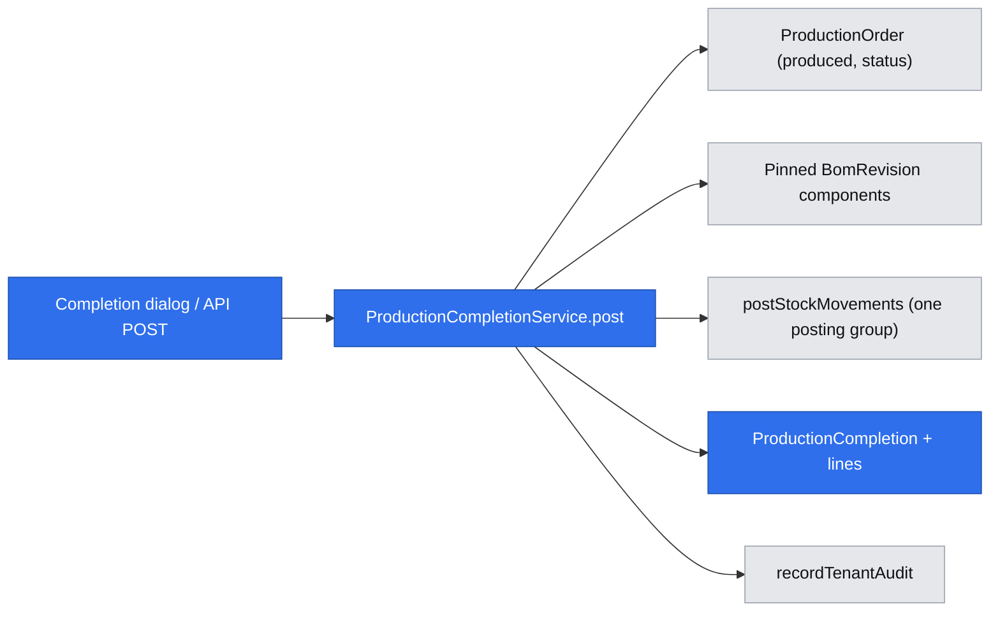
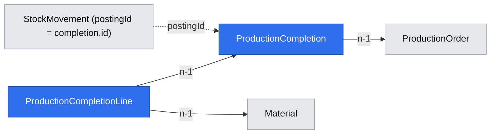
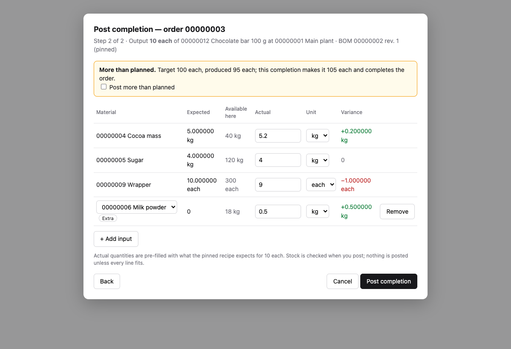
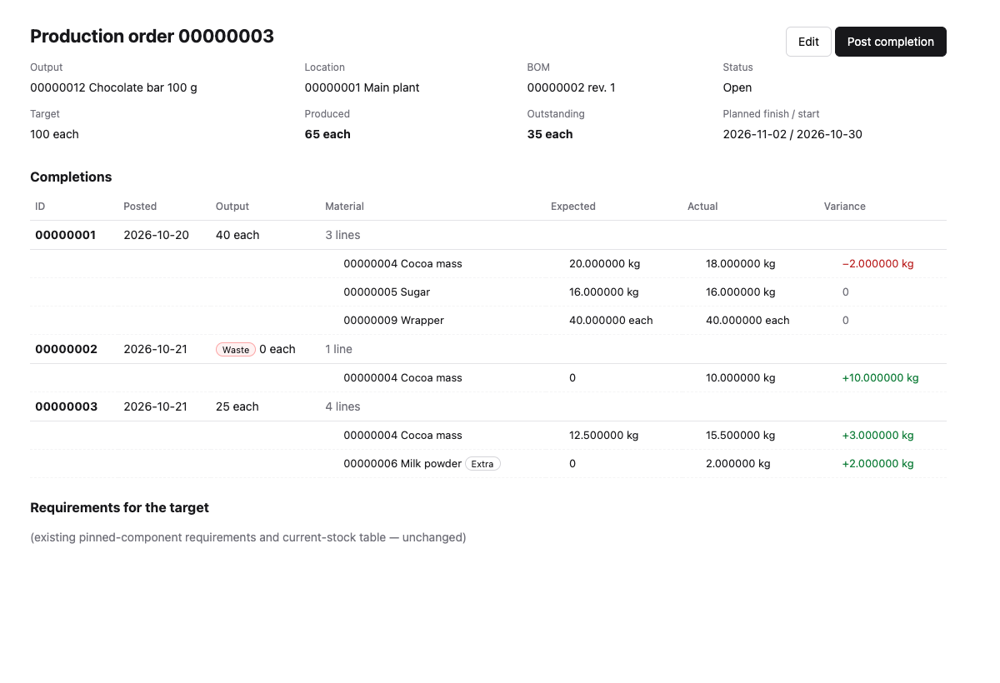

# Production completions

**Status:** implemented
**Created:** 2026-10-20 22:21 UTC
**Issue:** #89 (E10-S02)

## 📝 TLDR
Both roles can plan a production order (#88), but nothing records what production actually made and used, so a planned order can never finish. This proposal adds the **production completion**. It is an immutable posting against one Open order, with an output quantity (zero is allowed, for waste) and one actual-consumption line per pinned recipe component, plus any extra raw or intermediate inputs. The form pre-fills each line with the expected quantity, scaled from the pinned revision. Posting adds the output, consumes the actual inputs at the order's location, records expected, actual and variance per line, and advances the order's produced quantity and state. All of it is one stock posting group and one transaction, in the UI and in the API.

## Resolved assumptions (autonomous defaults)
| # | Question | Applied default | Rationale |
|---|---|---|---|
| Q1 | How is the pre-filled expected consumption rounded? | Pinned per-output BUoM quantity × completed output BUoM, **rounded upward once to six decimals**: the existing `componentRequirement` arithmetic that order requirements already use. Extra inputs and zero-output completions expect 0. | PRD §02/§04 round calculated component needs upward. BOM-007 (0.125 × 4 = exactly 0.5) and PRD-010 hold exactly. The baseline names no other rule, and reusing one function keeps the order's requirement and the completion's expectation identical. |
| Q2 | How does the user accept overproduction (PRD-019 "warn… if accepted"), in the UI and the API? | When the order's produced quantity plus this output would exceed its target, the request must carry `acceptOverproduction: true`. Without it the post is refused with `PRODUCTION_OVERPRODUCTION` (409, parameters `produced`, `target`, `output`, `unit`) and writes nothing. The preview reports `exceedsTarget`; the form then shows the warning and a required "Post more than planned" checkbox. | An explicit acknowledgement makes "warn, then accept" identical over UI and API (R07). An API caller can never overproduce by accident. The check runs against the fresh order inside the posting transaction, so a concurrent completion cannot bypass it. |
| Q3 | Which order states accept a completion? | **Open only.** A Completed order (produced ≥ target) refuses further completions with the existing `PRODUCTION_ORDER_LOCKED`. Reopening is not a user action. | The lifecycle has no manual reopen (LFC-008). PRD-019 overproduces from an Open order in one posting. This is the smallest surface; a later story can relax it without a data change. |
| Q4 | Must the request list every pinned component? | **Yes.** Every pinned component appears exactly once (an actual of `0` is allowed). Extra inputs are optional additional lines. A missing pinned component is refused with a field error. | Fail closed: an API caller who forgets a component must not silently record "nothing consumed". The UI always sends every line. |
| Q5 | Which extra inputs are allowed? | Active **raw or intermediate** materials that are not already pinned components and not the order's output, with a positive actual. A finished material is refused with a field error on its line (`components.N.material`, under `VALIDATION_FAILED`). | PRD-015/016/017 and R02. §06 says new entries cannot select inactive masters. Consuming the output itself would be a disguised cycle. |
| Q6 | What about a pinned component that has since been deactivated? | Its line stays, with its expected quantity. An actual of 0 posts nothing and records the variance. The service refuses a positive actual itself, as a field error on `components.N.quantity`, before the ledger runs. In practice that never applies, because a material can only be deactivated at zero stock. | LFC-022 and §06 ("existing documents may complete… with inactive masters"). Deactivation already requires zero physical stock, so no consumable quantity can exist. |
| Q7 | Does a completion need the order's `version`? | **No.** A completion appends; it does not edit a loaded copy. It reads the order fresh (`refresh: true`) in its transaction, and a concurrent completion or edit serialises through SQLite's single writer and the shared stale-snapshot retry. **A double submit from the UI** is caught instead by a `submission` UUID: the dialog generates one when it opens, and the action sends it. A unique `(tenant, submission)` index on the completion makes a repeat return the completion already posted. API callers use the `Idempotency-Key` and send no submission. | The same pattern as goods issues against an order. Requiring the version would make two operators posting shifts on one order conflict for no business reason. The standards (idempotency: "a double-click… a transaction plus a unique constraint") and PRD §06 ("UI guards duplicate submission") require the UI guard. |
| Q8 | What happens when an edit lowers the target to exactly the produced quantity? | The edit **completes the order**. One rule decides the state on every write: Open while produced < target, Completed once produced ≥ target. `ProductionOrderService.update` applies it, and its audit `after` shows the new status. | PRD-026 forbids only going *below* produced. Leaving an Open order with zero outstanding would make every further completion an overproduction. A single rule keeps E11-S03's later recalculation simple. |

These defaults change no active product decision, permission or existing API. They are posted on #89 for owner override before merge.

## 📝 Problem Statement
Issue #89 (PRD §03 "Production postings" and "Operational edits", D02) names the gap: a production order cannot be finished. No posting adds the output, consumes the components or records how actual usage differed from the recipe. The baseline asks for:
- partial completions that pre-fill expected inputs from the pinned BOM;
- actual consumption that may differ from the recipe or add raw/intermediate materials;
- zero-output waste;
- overproduction with a warning;
- one atomic change of order progress and stock, dated today, never negative (R09; §06 "Atomic business operations").

The data model already names the records: "Production completion posting — actual output (zero permitted), posted date, component-usage lines, planned/actual variance; each posting reversed as a whole once" and "Actual component usage — material, exact actual consumed BUoM quantity and expected BOM quantity, including added raw/intermediate inputs".

Out of scope: completion reversal (E11-S03, #92); Close Early and Cancel (E11-S01); the variance report (E13-S02); MRP's treatment of the remaining balance (PRD-028, slice 3). This design leaves room for all four (see Risks).

## 📝 Proposed Solution
Add `ProductionCompletion` and `ProductionCompletionLine` to the `production-orders` concept, plus a `ProductionCompletionService` that posts one completion. Inside one transaction on the request `em`, the service:
1. re-reads the order (it must be Open);
2. converts the output and every line to BUoM;
3. computes the expected consumption from the order's **pinned** revision (never the current one);
4. validates the lines;
5. checks overproduction;
6. calls the ledger's `postStockMovements` once: the output as a positive movement and every positive actual as a negative movement, all at the order's location, under the completion's UUID as the posting ID;
7. writes the completion and its lines;
8. advances `produced` and sets `completed` once produced ≥ target;
9. records the audit entries.

Any refusal, including the ledger's `INSUFFICIENT_STOCK`, rolls everything back.

Alternatives considered:
- **Variance derived on read instead of stored.** It loses the "recorded" property the issue asks for, and the later variance report would recompute history from mutable rules. The completion stores expected, actual and variance; all three are immutable.
- **One posting per component.** It breaks INV-004's single posting group and makes the E11-S03 whole-completion reversal harder.
- **Pre-fill calculated in the browser.** Client code cannot use core's decimal arithmetic. A server preview (GET) keeps one implementation and works in read-only tenants.

Market check (2026-10-20, from the products' manufacturing documentation as the author knows it; not re-fetched in this run):
- ERPNext's "Manufacture" stock entry posts consumed raw materials and finished goods in one voucher, pre-filled from the BOM and editable before submit.
- Odoo MRP's produce step records the quantity produced, with consumed quantities defaulting to the BOM and allowing extra component lines. It also warns on overproduction.

CPG adopts the single voucher and the editable pre-fill. Costing, lots and work centres are excluded by N01/N04.

## 📝 Architecture
- **db** (`entities/production-orders/`):
  - `production-completion.entity.ts` holds `ProductionCompletion` and `ProductionCompletionLine`. Both are tenant-owned, with update-abort triggers in the goods-issue style.
  - Register and export both, then generate one additive migration with its snapshot and index.
- **core, domain** (`domain/production-orders/production-completion.ts`): pure functions.
  - `expectedConsumption(perOutput, output)` reuses `componentRequirement`'s upward rounding.
  - `consumptionVariance(expected, actual)` gives a signed six-decimal string.
  - Progress: `producedAfter`, `exceedsTarget`, `isOrderFulfilled`.
- **core, validators** (`validators/production-orders/production-completion.schema.ts`):
  - `productionCompletionCreateSchema`: strict `{ quantity, unit, components: [{ material, quantity, unit }] (1..100), acceptOverproduction? }`.
  - An action variant adds `order` (bound by the page) and the required `submission` UUID (Q7).
  - `productionCompletionPreviewSchema` (`quantity`, `unit`) and the list schema (`page`).
  - Duplicate materials are refused.
- **core, service** (`services/production-orders/production-completion.service.ts`): `ProductionCompletionService({ em })` with `preview(order, input)`, `list(order, page)` and `post(order, input, actor)`.
  - It shares `findProductionOrder`, `productionOrderView`, `productionSnapshot` and `productionSubject` with `ProductionOrderService` through `production-order-records.ts`.
  - It posts through the leaf `postStockMovements`, never `StockService`. It never resolves `ProductionOrderService`.
  - It is registered in `container.ts` and `cradle.ts` and exported from `index.ts`.
- **core, order service:** `productionOrderView` (summary and detail) adds `outstanding` (target − produced, at least zero).
  - The existing update rules already lock output, location and revision.
  - They already refuse a target below produced and allow raising it while Open.
  - `update` gains one change, the Q8 state rule: a target equal to produced completes the order.
  - This story adds regression tests with real produced quantities (PRD-024/025/026/027).
- **app:**
  - API: `api/tenants/[tenant]/production-orders/[id]/completions/route.ts` (GET list, POST create) and `…/completions/preview/route.ts` (GET).
  - A `postProductionCompletion` server action in `admin/[tenant]/production-orders/[id]/actions.ts` (or the existing actions file), through `tenantServerAction` plus `refreshAfterWrite` of the order, the list and the stock pages.
  - Components in `components/production-orders/`: `completion-dialog.tsx`, `completion-form.tsx` and `completion-history.tsx`. The order detail screen gains a Post completion button, progress fields and the completion history.
  - EN/PL strings, help-topic text for completions on the order page (UX-013), and error codes with their parameters.
- **Unchanged:** stock pages and the ledger, which show the new movement type through their existing rendering (the type label needs EN/PL text); BOMs; masters. Type and BUoM locks already follow from stock movements (`MATERIAL_HAS_MOVEMENTS`) and the order's output reference.

The completion service is the only new writer. It changes the order and the ledger in the same transaction, through the existing primitives.

## 📝 Data Model
- `ProductionCompletion`:
  - UUID `id`, which is also the `postingId` of its stock movements;
  - tenant FK;
  - unique tenant-local eight-digit `code`, assigned in sequence;
  - `order` FK to ProductionOrder (indexed);
  - `businessDate` (ISO, from the ledger posting: today, UTC);
  - output `quantity` (BUoM text, `0.000000` for waste);
  - `enteredQuantity`, `enteredUnit`, `numerator`, `denominator` (as on other documents);
  - `submission` (nullable UUID; a UI completion's duplicate-submit guard, Q7). It sits behind a unique `(tenant, submission)` index, under which SQLite allows several nulls;
  - `createdAt`.
- `ProductionCompletionLine`:
  - UUID `id`, tenant FK, `completion` FK, `position` (pinned components first, in pinned order, then extras in request order), `material` FK;
  - `expected` (BUoM text; `0.000000` for extras and waste);
  - `actual` (BUoM text, may be 0 only on a pinned line);
  - `variance` (signed six-decimal text, actual − expected);
  - the entered quantity, unit and factor of the actual;
  - `extra` (boolean: not in the pinned revision).
  - Unique `(completion, position)` and `(completion, material)`.
- `ProductionOrder` gets no schema change. `produced` (existing text column) advances, and `status` moves to `completed`.
- Indexes:
  - `(tenant, order, code)` for the order's history paging;
  - a material index on lines for later usage and reporting.

Both new tables are append-only history. Migration down drops them; it is for disposable test databases only, and the production rollback keeps the additive schema. The Test reset derives the new tables from ORM metadata. No personal or credential data is added; the audit already records the actor.

## 📝 Business rules
- **Order.** It must exist in the tenant and be `open`; otherwise `PRODUCTION_ORDER_NOT_FOUND` or `PRODUCTION_ORDER_LOCKED`. It is read fresh in the transaction.
- **Output.** A non-negative `quantity` in the output material's base unit or a convertible unit, converted half-up once (`convertToBaseQuantity`).
  - Zero is a waste posting: no output movement, produced unchanged, the order stays Open (PRD-018).
  - A completion with zero output **and** every actual zero is refused (`PRODUCTION_COMPLETION_EMPTY`).
- **Expected.** Taken from the order's pinned revision (BOM-026, LFC-022, E2E-004): for each component, its per-output BUoM quantity × output BUoM, rounded upward to six decimals.
- **Lines.**
  - Every pinned component exactly once; extras may follow; at most 100 request lines (pinned count ≤ `BOM_COMPONENTS_MAX`).
  - The ledger takes at most 100 movements per posting (`stockPostingSchema`). The positive actuals plus the output, when positive, must therefore not exceed 100. Otherwise the post is refused with a field error on `components` ("at most 100 stock movements per completion").
  - Each actual is a non-negative quantity in that material's base unit or a convertible unit.
  - Extras must be positive, active, raw or intermediate, not the output and not pinned (Q5).
  - **The service resolves and validates every line itself, before the ledger runs.** It loads the material in the scope, converts the quantity, and applies the type, activity, duplicate and pinned rules. It collects every failure as a field error (`components.N.material` / `components.N.quantity` / `components.N.unit`) in one `ValidationError`, as goods issues do with `lineError`. A missing pinned component is reported on `components` with its material code.
  - The ledger then receives base-unit quantities only, so its own refusal can only be `INSUFFICIENT_STOCK`.
  - `variance = actual − expected` (PRD-013: −2; PRD-014: +3).
- **Overproduction.** When `produced + output > target`, the request needs `acceptOverproduction: true` (Q2); otherwise it is refused with `PRODUCTION_OVERPRODUCTION`. The flag is ignored when the target is not exceeded.
- **Range.** `produced + output` above the largest storable quantity is refused with `QUANTITY_OUT_OF_RANGE`.
- **Stock** (one call to `postStockMovements`, type `production-completion`, reason `Production completion {code} for production order {order}`):
  - the output `+quantity` at the order's location, when positive;
  - each positive actual as `−actual` at the same location.
  - The ledger's cumulative, fresh-read check refuses any overdraw with `INSUFFICIENT_STOCK` for the first short material. Nothing of the completion is written (PRD-020, PRD-021, R09).
  - In-transit stock is not a location balance, so it is never consumable (TRF-011).
  - The posting date is the ledger's today (PRD-023, INV-010).
- **Progress.** `produced += output`. The state follows the Q8 rule: `completed` once `produced ≥ quantity` (PRD-019 → 105 Completed; PRD-030/LFC-003 → exactly 100, outstanding 0), otherwise `open`. `updatedAt` advances and `version` increments, so an open edit dialog sees a version conflict instead of overwriting progress.
- **Edits after a completion.**
  - Unchanged code paths already refuse output, location and revision changes (strict PATCH) and a target below produced (PRD-024, PRD-026).
  - Raising the target and moving the finish are allowed and audited while Open (PRD-025, PRD-027).
  - A target lowered to exactly produced completes the order (Q8).
  - Material type and BUoM lock through the movements and the order reference (MAT-012).
- **Audit**, all in the same transaction:
  - `production-orders.production-completion.posted`, with subject `ProductionCompletion`, the code and the label `{code} — {order} {output}`.
    - The allowlisted flat scalar snapshot holds `order`, `output`, `location`, `bom`, `revision`, `quantity`, `enteredQuantity`, `enteredUnit`, `businessDate` and `lines` (the count).
    - Per line `n` (1-based) it also holds `line{n}Material`, `line{n}Expected`, `line{n}Actual`, `line{n}Variance` and `line{n}Extra`, in camelCase like `line1Fulfilled` on goods issues.
    - That is at most 10 + 5 × 100 keys.
  - `production-orders.production-order.progressed`, with the order's before/after `produced`/`status`. It is a separate action from the user's `…updated` edits.
  - The ledger's own `stock.movement.posted` entries, at most 100.
  - A refused completion records nothing.
- **Concurrency and idempotency.**
  - The order is read with `refresh: true`. The shared stale-snapshot retry re-runs the whole transaction once against fresh balances. A competing issue that took the stock then refuses the completion (AUD-017). No orphan output exists, because output and inputs share one flush.
  - An `OptimisticLockError` on the order's versioned update maps to `PRODUCTION_ORDER_CHANGED` (409, "the order changed while posting; try again"), never to `VERSION_CONFLICT`, because the caller sent no version.
  - The completion code race maps to `PRODUCTION_COMPLETION_ID_RACE`, behind the tenant/code unique index.
  - An API replay of the same key returns the original result without posting again (INV-025).
  - A UI repeat of the same `submission` returns the already-posted completion and the current order without posting again. A submission already used on another order is refused as a validation error.
- **Permissions.** Both roles: the same gates as other tenant transactions (writable tenant, generation, key).

## 📝 API Contracts
Base `/api/tenants/{tenant}/production-orders/{id}/completions`. `{id}` is the order's business code. The shared envelope applies; quantities are JSON strings.

- **GET `/preview?quantity=4&unit=each`.** An authenticated read with a strict query. It returns:
  - `{ order, quantity, baseQuantity, baseUnit, produced, target, producedAfter, exceedsTarget, location, components: [{ material, name, baseUnit, units, active, perOutput, expected, available }] }`;
  - `available` is the current physical balance at the order's location: advisory, rechecked on post;
  - `units` is the component's base unit first, then the units it converts, so the form can offer them.
  - It refuses a non-Open order with `PRODUCTION_ORDER_LOCKED` and works in read-only tenants.
- **POST** with body `{ quantity, unit, components: [{ material, quantity, unit }], acceptOverproduction? }`.
  - It goes through `tenantApiWrite` (bearer, `Idempotency-Key`, Test `Dataset-Generation`, writable tenant).
  - The request is strict: an unknown field (`order`, `businessDate`, `expected`, `variance`, `location`, …) is refused.
  - It returns the created completion view and the updated order summary: `{ completion, order }`.
- **GET `?page=1`.** The order's completions, **20 per page, newest first** (descending code, as goods issues list). With at most 100 lines each, a page holds at most 2,000 lines. Each completion holds its lines: `{ id: code, order, businessDate, quantity, enteredQuantity, enteredUnit, baseUnit, waste, createdAt, lines: [{ material, baseUnit, expected, actual, variance, enteredQuantity, enteredUnit, extra }] }`. `waste` is derived (quantity = 0). Internal UUIDs and the submission token are never exposed.
- **Order detail and summary views** gain `outstanding` (an additive field).
- **New error codes:**
  - `PRODUCTION_OVERPRODUCTION` (409, params `produced`, `target`, `output`, `unit`);
  - `PRODUCTION_COMPLETION_EMPTY` (400);
  - `PRODUCTION_ORDER_CHANGED` (409);
  - `PRODUCTION_COMPLETION_IDS_EXHAUSTED`;
  - `PRODUCTION_COMPLETION_ID_RACE`.

  Line problems are field messages under the existing `VALIDATION_FAILED`: a finished extra input, an inactive extra, an inactive pinned component with a positive actual, a missing or duplicate pinned component, an extra that is pinned or the output, too many movements, and unit/rounding errors on the line.

  Reused codes: `PRODUCTION_ORDER_NOT_FOUND`, `PRODUCTION_ORDER_LOCKED`, `INSUFFICIENT_STOCK` (material, location, available, requested, unit), `QUANTITY_OUT_OF_RANGE`. Every code and field message has EN/PL text that keeps its parameters.
- **`BACKWARD_COMPATIBILITY.md` §4:** record the new paths and the movement type `production-completion`. Explicitly amend the production-orders sentence "no production-order write changes stock": order create/update still change no stock, and completions are the one production write that does.

## 📝 UI/UX
On the order detail page:
- **Progress.** The definition list adds *Produced* and *Outstanding* (BUoM).
- **Post completion.** A primary button, shown when the tenant is writable and the order is Open.
- **Completions section.** Below the requirements, a table per completion: ID, date, output (or a *Waste* badge), and its lines with material, expected, actual and signed variance. It has an empty state and previous/next paging.

The completion dialog is scrollable (`TALL_DIALOG`) and has two steps, like the order create dialog:
1. **Output.** The output quantity and unit (`CrudForm`, `0` allowed, with a hint that 0 records waste). *Continue* fetches the preview.
2. **Consumption.** A row per pinned component holds the material, base unit, *Expected* (read-only), *Available here* (current, advisory) and an *Actual* quantity field pre-filled with the expected value (PRD-010), plus a unit select.
   - *Add input* appends an extra row with the existing active-only material picker, filtered to raw/intermediate, plus quantity and unit. Rows can be removed; pinned rows cannot.
   - The variance per row updates as the user types; it is display only, and the server recomputes it.
   - When `exceedsTarget`, a warning banner names the target, produced and resulting quantities, and a required checkbox *Post more than planned* gates *Post*.
   - *Back* returns to step 1 and keeps the entered output.
   - Server field errors land on their row (`components.N.*`). An `INSUFFICIENT_STOCK` refusal names the material, the available and requested quantities, and the unit.

The consumption step is a bespoke `completion-form.tsx` in `components/production-orders/`. It follows `CrudForm` conventions (pending state, Ctrl/Cmd+Enter, Escape, error envelope) but needs fixed pinned rows plus variable extra rows, a shape neither `recipe-form.tsx` (all rows variable) nor `line-quantities-form.tsx` (all rows fixed) has.
- It reuses the shared active-only material picker and `toFieldErrors` mapping, without copying either form.
- Promoting a variable-line form to `ui/backend/forms/` stays deferred: three different row shapes don't yet show one shared abstraction, and forcing one now would widen this risk-high change.

A successful post closes the dialog, refreshes the page and announces "Completion {code} posted" in a status message. The dialog's `submission` UUID is created when it opens and kept until it closes, so a double click or a retried action posts once.

Other states:
- Read-only tenants see the progress and history but not the button.
- A Completed order shows a *Completed* status and no button.
- All strings are EN/PL; help gets a "Posting a completion" paragraph with an example (UX-013).
- The shortage banner's "stock is checked when a completion is posted (future story)" wording loses "future".

Prototype: `.ai/specs/assets/production-completions/mockup-01-completion-dialog.html`, `.ai/specs/assets/production-completions/mockup-02-order-detail.html`

## 📝 Edge Cases & Failure Scenarios
- **Stock short for one line** (stock 5, actual 6): `INSUFFICIENT_STOCK` names A. No movement for any material, no completion row, produced unchanged (PRD-020/021). The dialog stays open with the error.
- **Concurrent issue takes stock first:** the stale-snapshot retry re-reads 4 left, then refuses. Under any ordering, one of the two writes wins entirely (AUD-017).
- **Two completions racing on one order:** both serialise. The second sees the first's produced value and its own overproduction check. Codes are sequential, with a unique-index backstop.
- **Overproduction raced:** a preview said within target, but another completion landed first. The post is refused with `PRODUCTION_OVERPRODUCTION`; the dialog shows the warning and checkbox from that error's parameters.
- **Pinned revision superseded or BOM deactivated:** the completion still uses the pinned components (LFC-022).
- **Component deactivated:** its row shows "inactive". An actual of 0 is allowed; a positive actual is refused on its row (Q6).
- **Alternate units:** a 1 kg = 1000 g conversion lets "500 g" record 0.5 kg actual. A unit without a conversion is a field error on that line's `unit`, raised by the service's own conversion. A tiny positive value that rounds to zero is refused on its `quantity`.
- **Double click or retried action:** the same `submission` returns the posted completion; stock moves once.
- **Order edited while the dialog is open:** the completion is not version-bound (Q7). It uses the fresh target and status at post time. A Completed or edited state refuses cleanly with a translated message.
- **Read-only toggled or Test reset between preview and post:** the shared gates refuse with no partial movement (E2E-011). Replaying a key after a reset is refused by the generation check.
- **Material type change after a completion:** refused by the existing movement lock (MAT-012).
- **Location deactivation:** already refused while the order is Open. A Completed order no longer blocks it, and its history keeps the reference.
- **Expected-rounding drift across partial completions:** upward rounding per completion can sum slightly above the single-shot requirement (at most 0.000001 per line per completion). This is documented; the variance stays against each completion's own expectation.

## 📝 Risks & Impact Review
This is a risk-high change: the first document that both adds and removes stock in one posting, and it mutates order progress. The main risks:
- partial postings;
- revision drift (expected from the current recipe instead of the pinned one);
- double posting on retry (the API key, and the UI submission behind a unique index);
- an overproduction bypass.

Real-SQLite service tests (including a two-connection race), API tests and a browser journey cover each.

Contracts: additive tables, a new movement type, new API paths and error codes, and an additive `outstanding` field. No existing response changes shape.

Room left for later stories:
- **E11-S03 reversal** reverses a whole completion through its `postingId` group and the stored actual lines. It recomputes `produced` and status from the unreversed completions; nothing here precludes a `reversed` link table.
- **E11-S01** can refuse Cancel once any completion exists (a physical posting) and close an order early from `produced`.
- **E13-S02** reads the stored expected, actual and variance lines and the derived `waste`.

Nothing here touches finance, capacity, authentication or deployment.

## 📝 Decisions in play
- R02: input material types.
- R03: exact decimals.
- R04: the pinned immutable revision.
- R05: tenant isolation and read-only.
- R07: UI/API parity, idempotency, generation.
- R08: audit.
- R09: never negative, today only.
- D02: manual documents before MRP.
- D04: the simplest consistent behaviour, which grounds Q1–Q8.

N01/N04 exclude costing and capacity. No product decision is superseded.

## Implementation Plan
### Phase 1 — Domain and persistence
- Step 1.1: Add the `ProductionCompletion` and `ProductionCompletionLine` entities with immutable triggers. Register and export them, then add the migration, snapshot and index. Cover the migration up/down, older rollback tests, tenant ownership/reset coverage, the immutability triggers and the smoke migration count.
- Step 1.2: Add the pure functions `expectedConsumption`, `consumptionVariance` and the progress helpers, and the strict schemas (create/form/preview/list), with tests:
  - BOM-007, PRD-010 and the rounding boundaries;
  - signed variance;
  - duplicates, strictness and the 100-line limit.
### Phase 2 — Service
- Step 2.1: `ProductionCompletionService.preview` and `list`, on pinned components with location balances, with pagination, tested on real SQLite (pinned revision after a BOM change, inactive component, read-only readable).
- Step 2.2: `ProductionCompletionService.post`, with real-SQLite tests for:
  - PRD-011/012/013/014/015/016/017/018/019/020/021/023;
  - INV-004/025;
  - TRF-011;
  - LFC-003/022;
  - BOM-026;
  - rollback after a late failure (audit mock), and a two-ORM concurrent issue (AUD-017);
  - audit entries;
  - the code race.
  - the submission replay and a submission reused on another order;
  - the 100-movement limit, the produced overflow and `PRODUCTION_ORDER_CHANGED`.
- Step 2.3: Register the service (container/cradle/index), add `outstanding` to the order views, and apply the Q8 state rule in `update`. Add the PRD-024/025/026/027, Q8 and MAT-012 regression tests with real produced quantities.
### Phase 3 — Delivery surfaces
- Step 3.1: The completions collection and preview routes and the server action, with wrapper, auth, forwarding, key and read-only tests. Document the protected contract in `BACKWARD_COMPATIBILITY.md`.
- Step 3.2: EN/PL strings, error texts and the movement type label, the completion dialog (two steps, pre-fill, extras, variance display, overproduction checkbox, row errors), the history table and progress fields, the help text, and the banner wording, all with component/page tests.
- Step 3.3: An integration test `tests/integration/production-completions.test.ts` covering:
  - an API partial completion, a second completion, waste, overproduction acceptance, an insufficient-stock refusal with no movement, and an idempotent replay;
  - a browser journey: post from the order page with pre-filled lines, an extra input and the variance shown;
  - the read-only refusal.
### Phase 4 — Verification and publication
- Step 4.1: Run lint, typecheck, `test:coverage` at 100%, build, the touched integration files and `smoke.test.ts`, and live UI checks with screenshots. Review against the engineering standards and the compatibility rules, fix the findings, and publish the implementation PR (`Closes #89`, `Refs` this spec's PR). The full integration suite runs in CI.

## Implementation notes

- Design PR #117 (`bb145f3`), implementation PR #119 (`c6bfcda`), both merged on 2026-10-21; #89 closed. Plan: `.ai/pipeline/runs/2026-10-20--2235UTC-production-completions.md`.
- The plan's "Deviations from the spec" records seven deviations. Among them: the form shows no live per-row variance (the server records it), an added input's errors land on its row, and the ledger keeps each line's entered quantity and unit.
- Closure follow-up (2026-10-21): an added component is labelled "Added" here but "Extra" in the variance report. The two unconfirmed deviations (no live per-row variance on the form; a missing pinned component refused without naming the material) await the owner's decision in E10-S04 (#153).
- E10-S04 (#153, PR #174, 2026-10-23), decided with the issue's defaults and posted on #153 for the owner to override:
  - The flag is "Extra" / "Dodatkowy" on the completion form, the completion history and the variance report. The form's added rows read "Extra input N" / "Dodatkowy materiał N".
  - Q1 kept: no live per-row variance on the form. The history shows each line's variance once the completion is posted.
  - Q2 built: a completion that leaves out a pinned component answers 400 `VALIDATION_FAILED`, still keyed on `components`, with `params.material` naming every missing code in recipe order (comma-separated). The form translates it in EN and PL. `ValidationError` now carries optional message parameters through both wrappers.
