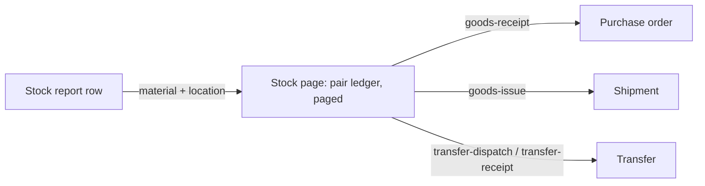

# A user opens the current stock report: physical on-hand and in-transit per material and location, with filters, a drill-down into the signed ledger and its source documents, and the same through the API

**Status:** implemented
**Created:** 2026-10-20 22:21 UTC
**Issue:** #94 (E13-S01), epic #79 · **Builds on:** `implemented/2026-10-20--1634UTC-stock-ledger-corrections.md` (#80: balances, the ledger and the Stock page), `implemented/2026-10-20--2046UTC-transfers.md` (#82: in-transit stock), `implemented/2026-10-20--1933UTC-goods-receipts.md`, `implemented/2026-10-20--2045UTC-shipments-goods-issues.md` (the documents behind movements), `implemented/2026-10-19--2018UTC-read-only-tenants.md`, `implemented/2026-10-19--0913UTC-test-prod-tenants.md` · **Design authority:** `.ai/specs/product-brief.md` (R05, R07, R11, D02), `.ai/specs/research/CPG-prd001.pdf` §07 "Current stock report", `CPG-acceptance.md` (UX-017, INV-009, INV-012, API-014, UX-021, TEN-018, UX-013)

## 📝 TLDR

The ledger holds every movement, but no screen answers "what do we have, where, and what is on the road". This spec adds the **stock report**: one row per material and location with the physical **on-hand** quantity and what is **in transit** from and to that location, in the material's base unit. In-transit stock is shown apart and never added to on-hand, because neither site can use it. Filters narrow it by material and location, and a toggle shows rows that are all zero. Each row opens the existing **Stock** page for that pair. That page shows the pair's signed ledger, which now pages through its whole history. Each movement shows its source document, linked: a goods receipt to its purchase order, a goods issue to its shipment, a transfer posting to its transfer. Both roles read the report, in the UI and through `GET /api/tenants/{tenant}/reports/stock`, under the same authorisation. A read-only tenant still opens it. Nothing is written, so there is no migration and no audit entry.

## Resolved assumptions (autonomous defaults)

The run is autonomous (cezar, `/om-auto-fix-issue 94`). Each choice is the most reversible one the sources allow, published here for override.

| # | Question | Chosen answer | Rationale |
|---|---|---|---|
| Q1 | Which rows does the report hold? | One row per material and location pair that has a **balance record** (anything was ever posted there) or has stock **in transit** from or to it on an Open transfer. A pair with no history and no transit is exact zero and isn't a row. The Stock page still shows any pair. | Listing every material × location would be mostly empty rows. A touched pair is the one that can hold a non-zero balance. |
| Q2 | What does a row show? | The material (ID, description, base unit, inactive marker), the location (ID, name, inactive marker), **On hand** (the physical balance now), **In transit out** (dispatched from this location and not yet received or written off) and **In transit in** (dispatched to this location and not yet received). All are six-decimal base-unit strings, displayed as on the Stock page. No "available" or projected figure. | PRD §07: "today's physical on-hand by material/location; in-transit amounts separately". UX-017: no accidental destination availability. Projections are slice 3. |
| Q3 | Filters? | `material` and `location`, each one eight-digit ID, offered on the page as selects (inactive ones marked). An unknown ID, the other tenant's included, is 404 `MATERIAL_NOT_FOUND` / `LOCATION_NOT_FOUND`, as everywhere else. `includeZero` (`true`/`false`, default `false`) adds rows whose on-hand and both transit figures are all zero. | Issue criterion 3. Hiding zero rows by default keeps the report about stock that exists. Not-found keeps tenant scoping explicit (R05). |
| Q4 | Order and paging? | By material ID, then location ID. 100 rows per page (`page`, from 1), as the other lists. The page shows the last page for one past the end, and the API returns an empty `rows` with the `total`. | Same as the other lists. A bounded response. |
| Q5 | How is it computed? | Read at request time, nothing stored. Balance records are read in batches of 500 and Open transfers in batches of 100, without the identity map. Transit uses the transfers' own `inTransit` (dispatched − received − written off). Rows are merged in memory, then filtered, sorted and sliced. Memory grows with the touched pairs plus the Open transfers, not with the ledger's length. | Same as `transitAt`. The PRD sets no numeric performance target (§07 "best effort"). No migration is needed. |
| Q6 | The drill-down (INV-012)? | A row's material and location link to `/admin/{tenant}/stock?material=…&location=…`, the existing pair view: balance, transit with the transfers holding it, corrections. Its ledger now pages: 100 movements per page, newest first, with `page` and Previous/Next. It always shows date, type, signed quantity and reason. A new **Source** column shows the document each movement came from: a goods receipt's ID linked to its purchase order, a goods issue's ID linked to its shipment, a transfer dispatch or receipt linked to its transfer. A correction (manual, or the demo opening balance) shows "Correction", because it is its own document. The Stock page links back to the report. | One pair view rather than two. The receipt and issue have no page of their own: they are listed on the purchase order and the shipment. |
| Q7 | API (R07, API-014, UX-021)? | `GET /api/tenants/{tenant}/reports/stock?material=&location=&includeZero=&page=` returns `{ asOf, page, pageSize, total, rows: [{ material, materialDescription, materialActive, baseUnit, location, locationName, locationActive, quantity, inTransitFrom, inTransitTo }] }`. `asOf` is the server's UTC date. The field names match the Stock `GET`. Another query parameter is 400. The pair's ledger is the existing `GET /api/tenants/{tenant}/stock`, which gains `page` (default 1) and `movementCount`, and each movement gains `source: { id, document }`. `id` is the receipt's, issue's or transfer's business ID, and null for a correction. `document` is `{ type: "purchase-order" \| "shipment" \| "transfer", id }`, or null. Both are additive. | The page and the API call the same service with the same query. |
| Q8 | Who and which tenant (R05, TEN-018)? | Any signed-in account, both roles: the page through `requireUser`, the API through `requireApiUser` (bearer token, or the session cookie for `GET`). Everything is read through `tenantScope`, so Test never shows a Prod row. A read-only tenant opens the report and the ledger as usual: they write nothing. | The shared read gates. |
| Q9 | Where is it? | `/admin/{tenant}/reports/stock`, a flat **Stock report** entry right after **Stock** in the sidebar. A Reports group can come with the next report. | The sidebar must fit 1280 × 800 without scrolling (lesson 2026-10-20). |
| Q10 | Help, language, footer (R11, UX-013)? | A `stock-report` help topic in English and Polish. All strings EN/PL. The root layout's footer is already on every page. | `tests/every-page-has-help.test.ts`. |
| Q11 | Audit? | Reads are not audited, as for every other read. | R08 covers changes. |

## 📝 Architecture

- **core:**
  - `validators/reports/stock-report.schema.ts`: `stockReportQuerySchema` (strict) and `STOCK_REPORT_PAGE_SIZE`.
  - `domain/reports/stock-report-rows.ts`: pure. Merges balances and transit into rows, filters zeros, sorts and slices.
  - `services/reports/stock-report.service.ts`: `StockReportService.read(query)`. It resolves the filters through `findMaterial`/`findLocation`, reads balances and Open transfers in batches, and builds the rows.
  - `services/stock/movement-sources.ts`: a leaf. It resolves a page of movements' `postingId`s to their goods receipts, goods issues and transfer postings in one query per kind.
  - `StockService.get`: takes `page`, and returns `movementCount` and each movement's `source`.
  - `validators/stock/stock-correction.schema.ts`: gains `stockLedgerQuerySchema` and `STOCK_LEDGER_PAGE_SIZE`.
  - Container, cradle and index lines.
- **app:**
  - `api/tenants/[tenant]/reports/stock/route.ts`.
  - `admin/[tenant]/reports/stock/page.tsx`.
  - `components/reports/` (screen, filters, labels).
  - The Stock screen's Source column, ledger paging and report link. The stock `GET` passes `page`.
  - The sidebar entry and icon, both dictionaries and the help topic.
- **No db change.**

The report lists pairs, the Stock page is the pair's history, and every movement leads to the document that caused it.

## Requirements

- [x] Rows per Q1–Q2: on-hand and in transit out and in shown apart, in the base unit. A dispatched, unreceived transfer shows at the source as lower on-hand plus in transit out, and at the destination as in transit in with its on-hand unchanged (UX-017, INV-009).
- [x] Filters by material and location, and a zero-balance toggle (Q3). Paging (Q4).
- [x] The drill-down: the Stock page's ledger, paged, with a linked Source column (Q6, INV-012).
- [x] `GET /api/tenants/{tenant}/reports/stock` and the additive Stock `GET` fields (Q7), documented in `BACKWARD_COMPATIBILITY.md` §4.
- [x] Both roles, both channels, tenant-scoped. A read-only tenant opens the report (Q8, API-014, UX-021, TEN-018, R05, R07).
- [x] Sidebar entry, EN/PL strings and help (Q9–Q10, R11, UX-013).
- [x] Unit tests at 100%, and integration tests for the page and the API.

## Out of scope

Projected stock and the last-MRP report (slice 3); export formats; costs (N01); totals across locations; a Reports group in the sidebar.

## Acceptance criteria

The six criteria of issue #94.

## 📋 Implementation Plan

1. core: the query schema, the pure row builder, `StockReportService`, movement sources, the paged pair ledger, DI and the index. Unit tests on a real SQLite file.
2. app: the report route and page, `components/reports/`, the Stock screen's Source column, paging and report link, the stock route's `page`, the sidebar, EN/PL and help. Unit tests.
3. Integration: `stock-report.test.ts` (UI: transit apart, filters, the zero toggle, the drill-down to a linked source, read-only) and `stock-report-api.test.ts` (normal user and admin parity, Prod rows absent in Test, filters, 404s). Update the stock and navigation tests as needed.
4. Docs: `BACKWARD_COMPATIBILITY.md` §4. Move the spec to `implemented/`.

## Implementation notes

- A movement already carries its `type`, so `source` holds only `id` and `document`. A movement whose document can't be found shows no source rather than failing the page. That can't happen today: a document and its movements are written in one transaction and never deleted.
- The page links of the report and of the Stock page's ledger share `PageLinks` (`components/layout/page-links.tsx`). The zero toggle is shadcn's `checkbox`, added to `@cpg/ui`.
- Each row opens its ledger through a **Ledger** button in the row-actions column, labelled "Ledger of {material} at {location}". It links where Q6 says, but the material and location text itself isn't a link.
- The report loads the tenant's materials and locations whole, as every page with master pickers already does. Only balances and transfers are read in batches. A movement whose document isn't found, which can't happen for a non-correction today, shows "—" rather than "This correction".
- The Stock `GET` used to ignore a `page` parameter. Now it validates it: a malformed one is 400, and `page=2` returns the second hundred.
- Production completions (#89) and stock imports (#81) merged into `main` while this PR was open. A completion's movements link to their production order (`document.type` `"production-order"`). An import posts corrections, so its movements are their own source.
- The Stock page's ledger table is now named "Stock movements" (it was "Recent stock movements"), since it pages through the whole history.
