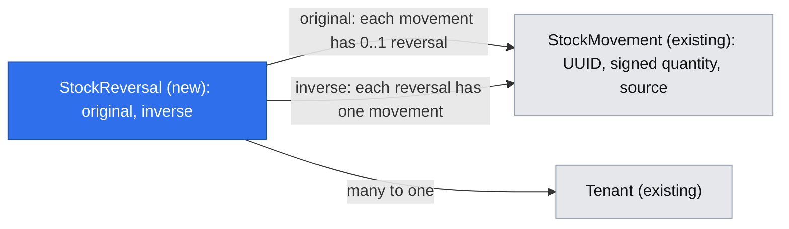
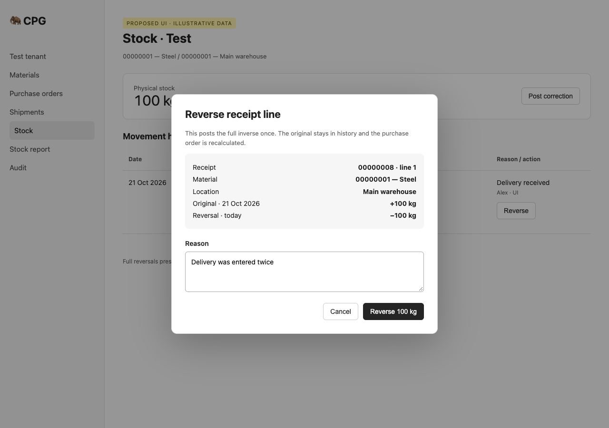
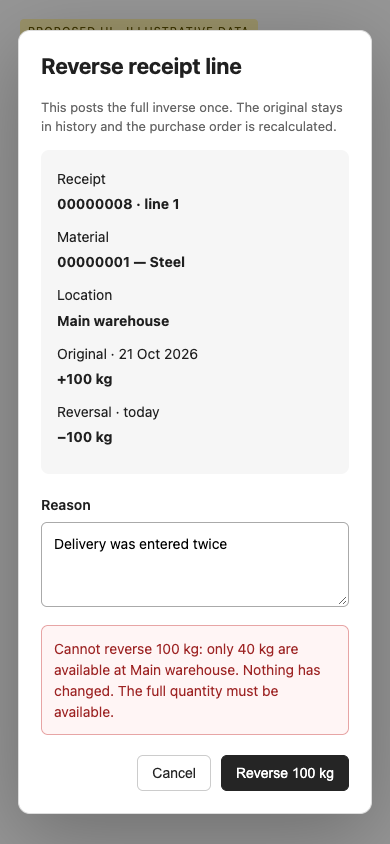
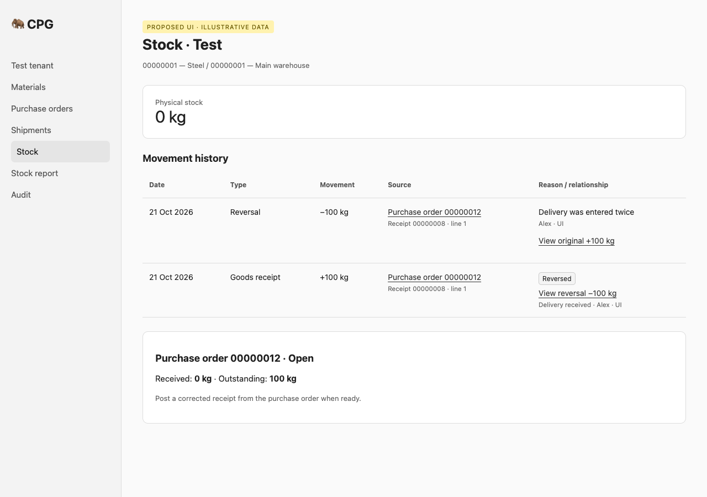

# Receipt, issue and correction reversals

**Status:** implemented
**Created:** 2026-10-21 07:06 UTC
**Issue:** #91 (E11-S02)

## TLDR
Both roles need to undo an erroneous goods receipt line, goods issue line or stock correction without erasing history. This proposal appends its entire exact inverse once, today, with a reason and original link; stock, document progress and audit change atomically. Production and transfer reversals remain #92.

## Resolved assumptions (autonomous defaults)

| Question | Chosen answer | Rationale |
| --- | --- | --- |
| Q1 — Split receipt, issue and correction reversal? | Keep one reversal capability with three source adapters. | One user command, ledger invariant, link model, audit and UI pattern. Separate adapters are implementation steps; the original issue explicitly asks for all three. No lifecycle commands or production/transfer reversal enter this spec. |
| Q2 — Where is the reversed marker stored? | A new immutable `StockReversal` connects original and inverse movements; read models derive `reversedBy` and `reverses`. Never update original history. | Existing movement and GR/GI update-abort triggers are protected history. A separate link avoids modifying old movements or weakening those guards. |
| Q3 — Current or captured conversion? | Invert the stored six-decimal base quantity exactly, using its historical material/location even when inactive. | PRD §06 explicitly permits reversal with inactive masters. Current conversions can change; using them would not undo the recorded quantity. |
| Q4 — Three APIs or one? | One UUID movement-addressed reverse endpoint, shared reason dialog on existing ledger and document screens. | Each scoped GR/GI line or correction already corresponds to one immutable movement; this is the smallest uniform command. Existing business-ID APIs remain stable. |
| Q5 — Other lifecycle states? | Recompute supported Open/Completed states and all affected shipments; preserve existing explicit closure/cancellation and abandoned quantities. No lifecycle commands are added. | REV-016 says “unless explicitly closed”; #90 owns the remaining lifecycle commands and their integration. Current POs and shipments expose only Open/Completed. |
| Q6 — Imports and seed openings? | Corrections, including XLS differences and demo opening balances, are reversible individually. | Imports post the same correction type; the stock-import spec defers their reversals to this story. A seeded opening is still a signed correction; its reversal has the current user’s provenance without rewriting the seed. |

No new product direction is inferred from the brief's untested manufacturer-demand premise (A01). This remains D01's owner-requested showcase build.

## Problem and scope

There is no reversal service, link or endpoint. `StockMovement`, `GoodsReceipt(Line)` and `GoodsIssue(Line)` are immutable; a manual opposite correction loses the original relationship and fails to update order quantities. The current posting primitive resolves active masters and converts entered quantities on every call, which cannot safely implement a historical inverse.

Authority: issue #91; `research/CPG-prd001.pdf` §03 and §06; `research/CPG-prd-decisions.pdf` §03; `research/CPG-prd-datamodel.pdf` posting relationships; `research/CPG-acceptance.md` REV-001–010, REV-015–017, REV-019–021, AUD-004, API-016 and LFC-008. Manual input follows decision D07; it stays a signed delta.

Out of scope: partial reversals, reversing an inverse, production completions, transfer legs, automated temporary-stock workarounds, Close Early/Cancel commands (#90), customer returns, finance, MRP, new permissions or dependencies. Correcting 100 to 80 remains two explicit operations: reverse 100, post 80.

## Research and alternatives

[ERPNext's immutable ledger](https://docs.frappe.io/erpnext/immutable-ledger-in-erpnext) retains original entries and uses linked reverse entries for cancellation. That supports CPG's existing append-only direction. CPG does not adopt accounting, valuation or historical reposting. [Odoo's stock-movement documentation](https://www.odoo.com/documentation/19.0/applications/inventory_and_mrp/inventory/inventory_valuation/operations_valuation.html) ties a return to its original delivery. CPG takes the traceability pattern only: no return workflow or partial-quantity selector (N01/N02).

Rejected alternatives: editing the original quantity or audit destroys history; a generic opposite correction omits document progress; routing by material/location alone cannot identify the mistaken posting; re-running the old entered conversion can produce a different inverse. A new reversal list/menu/page adds navigation without helping this task; users already have the source line and ledger.

## Architecture

`StockReversalService` in `core/src/services/stock/`, registered explicitly in the Awilix cradle, owns `reverse(movementId, input, actor)` and the transaction. It parses the input itself, re-reads original and link inside the transaction, checks the allowlist, posts the inverse using the ledger's shared balance/audit machinery, inserts the link and recalculates the owning document before committing. It joins the existing request transaction via the established savepoint pattern. Read-only and current-generation checks remain in `tenantServerAction`/`tenantApiWrite`; the direct service also rejects a read-only scope before writing.

Refactor `stock-posting.ts` minimally: separate master/conversion resolution from applying already-resolved lines. Normal posting keeps its current active-master and conversion checks. An internal historical-inverse function accepts the original tenant-loaded movement, verifies its stored base unit against the immutable material base unit, and constructs exactly one inverse. It never accepts arbitrary client-provided material, quantity or source. Both paths share the same nonnegative/upper-bound check, movement creation and audit. Historical inverse provenance uses base quantity/base unit and factor 1/1; the original retains the originally entered unit/factor.

Do not introduce asynchronous events or service cycles for atomic document changes. Owning-concept leaf modules (`goods-receipts/receipt-reversal.ts`, `goods-issues/issue-reversal.ts`) perform the owning document checks/recalculation using the transaction's `em`, just as existing posting and shipment-usage helpers do. The central reversal service dispatches exactly these types plus correction. Unsupported kinds fail closed.

### Transaction sequence

1. Parse UUID and strict `{ reason }` (trimmed, 1–500 characters). Reject quantity, date, material, location, source and other unknown keys.
2. Within the transaction, enforce writable tenant, load the original and its historical references through the scoped `em`, and check no reversal exists. Unknown and other-tenant IDs share 404.
3. Refuse an inverse, production/transfer movement, unsupported source. For GR/GI, resolve the immutable source line by source UUID and zero-based movement position, verify material/location/sign/base quantity match; inconsistent history refuses before any posting.
4. Compute `-original.quantity` using bigint micro-units, date it with the same server UTC business date used by all stock writes, and apply the single balance delta. Insufficient stock, overflow or inconsistent history aborts the transaction.
5. Append the new movement with type `reversal`, a new posting UUID and position 0; insert `StockReversal(original, inverse)`. Record original/reversal linkage and reason in a separate audit event without changing the original audit event.
6. Recalculate affected document quantities/states, advance versioned headers, record their allowlisted before/after audit snapshots, flush and commit. A failure after the balance flush must roll everything back, including idempotency storage.

The unique original constraint is the final once-only guard. Map a duplicate link to 409 `STOCK_ALREADY_REVERSED`; use existing stale-snapshot retry and optimistic-lock mapping. Same API key replays the original successful response; a new key and a repeated UI submission refuse the second reversal. No retry may duplicate a movement or audit event.

## Data Model

Add `db/src/entities/stock/stock-reversal.entity.ts`, registered in the entity index:

| Field | Shape |
| --- | --- |
| id | UUID primary key |
| tenant | `tenantOwned()` relation and default filter |
| original | required many-to-one `StockMovement`; unique `(tenant, original)` |
| inverse | required many-to-one `StockMovement`; unique `(tenant, inverse)` |

Date, reason, actor and quantity remain on the inverse movement rather than being copied into a competing source of truth. Add an update-abort trigger to the link; existing movement/document/audit immutability triggers remain untouched. There is no application update/delete operation. The controlled Test reset discovers and deletes the tenant-owned link alongside its movements. The runtime tenant guard validates both references.

Generate the migration from the entity and commit migration, `.snapshot.json` and migration index together. It is additive and needs no ledger backfill. Test up/down against a fresh database and upgrading an already-migrated current schema with existing postings. Down drops link/trigger only; it cannot undo posted inverses or recomputed quantities. Production rollback after use requires backup/forward repair, never running down and pretending history disappeared. Rolling the application back loses reversal-aware display/guards, so it is unsafe after use without an explicit recovery procedure.

## Document recalculation and preserved history

### Goods receipt

Resolve `GoodsReceiptLine` by `{ receipt: original.postingId, position: original.position }`. Its stored quantity must equal the positive original quantity. Subtract precisely that quantity from `PurchaseOrderLine.received`; it cannot become negative. Other lines are untouched. The PO is Completed iff every line remains fully received, otherwise Open, preserving any future explicit closure. An over-receipt reversal can leave the PO Completed. Advance `updatedAt` monotonically to advance its optimistic version, including when status stays unchanged. Receipt and receipt lines are never edited.

### Goods issue

Resolve `GoodsIssueLine` by issue UUID and movement position; it must match the negative original quantity. Decrement only that line's `ShipmentLine.issued` and `CustomerOrderLine.fulfilled`; neither may become negative. Preserve `abandoned`. Recalculate affected customer-line state, order header and **all affected shipments**, including siblings previously auto-completed when the order had no outstanding quantity. A completed sibling with remaining planned quantity becomes Open when the reversed fulfillment makes quantity issuable again. Do not change sibling movements or issued totals. Explicit closure/cancellation markers stay authoritative; this story creates none.

The existing `completeFinishedShipments` only considers Open shipments and says they never reopen. Extend the owning shipment helper to support recalculation after reversal, retaining the existing completion-only behavior for its existing callers. Query in bounded batches for orders with many shipments; do not add per-line database lookups or load an unbounded movement history.

### Historical edit locks

Net progress can return to zero; the fact that physical posting occurred cannot. After full GI reversal, keep original order customer/location and posted line material/unit/original due date protected. Current guards use `fulfilled > 0`; replace the relevant historical predicates with existence checks on immutable GI source lines (and expose the same predicate to UI controls). Keep shipment-reference locks and archived-line identity. Test a fully reversed line explicitly: changing its historical identity must still refuse. Quantity/date edits already allowed by the product retain their documented behavior; no unrelated master-edit restrictions change.

## API Contracts

Add `POST /api/tenants/{tenant}/stock/movements/{id}/reverse`, where `{id}` is the movement UUID exposed in ledger data. Body: strict `{ "reason": "Wrong delivery quantity" }`. Use `tenantApiWrite`, bearer authentication, 24-hour idempotency and current dataset-generation behavior. Both roles may call it. Return the shared success envelope containing `{ original: <UUID>, movement: <StockMovementView> }`; existing decimal-string and timestamp serialization remain unchanged.

Add `GET /api/tenants/{tenant}/stock/movements/{id}` for authenticated, tenant-scoped detail, returning a ledger movement with its source and reversal metadata. The UI can link to a movement older than the current ledger page: `/admin/{tenant}/stock?material=...&location=...&movement=<UUID>` shows a selected-movement detail with the original/inverse relationship above the normal paged ledger. Validate that the selected movement belongs to the selected pair; mismatched selection returns not-found. No change to existing page ordering or pagination.

Additive read metadata:

- `LedgerMovementView`: `reverses: string | null`, `reversedBy: string | null`, `canReverse: boolean` (source eligibility only; writable-tenant UI gate remains separate).
- Receipt and issue line views: `movementId` and `reversedBy`, resolved in bounded bulk queries by posting/position, never by the possibly changed material label alone. Original quantities remain original; a reversed badge explains why the current order total differs.
- Reversal source navigation resolves the original's document and business ID. A reversal's own posting UUID is not misidentified as a GR/GI document UUID.

Ledger/GI read maps are page-bounded; GR lists retain their existing unpaged response contract but enrich in bounded query batches. Do not silently paginate receipts in this change. Original/inverse detail remains reachable across ledger pages. Failure codes: 404 `STOCK_MOVEMENT_NOT_FOUND`; 409 `STOCK_ALREADY_REVERSED`, `STOCK_REVERSAL_UNSUPPORTED`, `STOCK_REVERSAL_INCONSISTENT`, `INSUFFICIENT_STOCK`, `TENANT_READ_ONLY`, existing generation/version/idempotency codes; 400 `VALIDATION_FAILED` or `QUANTITY_OUT_OF_RANGE` (the existing stock contract). Errors carry public context needed for EN/PL explanations, never raw database details. A same-key replay after a tenant becomes read-only follows the existing idempotency contract.

Register the new route and additive fields in `BACKWARD_COMPATIBILITY.md`. All existing paths, envelopes, codes, decimal strings and master-active rules for ordinary new postings remain unchanged.

## UI/UX

Use the existing Stock ledger, PO receipt table and shipment goods-issue table. A `Reverse` row action appears for eligible unreversed originals when the tenant is writable. Both roles see it; inactive historical masters do not hide it. Production/transfer/inverse rows offer no action. Reversed originals show a text badge and navigable inverse link; inverse rows identify and link the original. The labels name receipt/issue business ID and line, material, location and signed quantity rather than showing only UUIDs.

One shared `ReversalDialog` in `app/src/components/stock/` uses shadcn Dialog, `CrudForm` and the shared schema. It displays the immutable source, original date, full inverse quantity and today's date, then requires a reason. There is no quantity, unit or date input. Explain that other lines remain unchanged and insufficient stock blocks the entire operation. Submit disables while pending; cancel/escape restores focus. Retain the selected immutable movement while open; a refresh must not retarget the confirmation.

On success, refresh the current document and stock views and show the link. On refusal keep the dialog and reason visible with the actionable error; do not refresh away a read-only refusal. A stale already-reversed result identifies the existing reversal after refreshing explicitly. Show the standard loading/empty/error feedback; empty ledger has no reversal controls. Long reasons wrap, numeric quantities stay legible, tables scroll within their container at 360px. Keyboard-only operation and EN/PL text are required. Update contextual stock, purchase-order and shipment help: full reversal then corrected posting; no partial reversal; temporary-stock workaround is manual and must be balanced by reversing that temporary correction.

Prototype assets: `../assets/stock-reversals/` (illustrative examples).

Current-screen evidence: [stock](../assets/stock-reversals/current-01-stock.png), [receipt](../assets/stock-reversals/current-02-receipt.png), [issue](../assets/stock-reversals/current-03-issue.png). Captured against this checkout in development mode with disposable fixtures; Docker image build was unavailable because Docker storage was full. UI changes are subject to real-browser QA in the implementation PR.

## Edge cases and validation

- **Captured conversion:** after changing/removing a conversion, reversing its old GR restores exactly the base quantity that posted, including six-decimal rounding.
- **Inactive masters:** a negative correction or GI can be reversed even after deactivation when stock is zero; a normal new correction still refuses inactive masters.
- **No negative stock:** +100 original with 40 available refuses without a link, inverse, progress or audit change. −5 reversal fails on balance overflow without partial changes.
- **No partial record mutation:** fail document audit after ledger flush to prove balance, inverse, link, source progress and idempotency receipt all roll back.
- **Repeat/race:** repeat original under a new key, duplicate click and two scoped connections cannot produce two links; same-key response is byte-equivalent under the existing envelope contract.
- **Tenant/reset:** foreign UUID reads/writes return not-found, link references cannot cross tenants, old-generation submissions refuse, Test reset clears reversals while Prod stays unchanged.
- **Original immutability:** original and inverse movement fields and GR/GI records refuse updates. Audit has separate original, inverse and reversal-link events with reason and balance/document before/after.
- **Rare correction journey:** +100 receipt, −80 issue, +80 temporary correction, −100 receipt reversal, +90 corrected receipt, −80 temporary-correction reversal leaves exactly 10 and every step nonnegative (REV-021).
- **History remains locked:** full reversal to zero does not permit reassignment of posted order/line identity; a stale edit conflicts with the advanced order version.
- **Page boundary:** link from a recent inverse reaches the older original even if it is several ledger pages back; queries remain bounded.

## Risks and decisions in play

R02/R03/R05/R07/R08/R09, D01/D02/D04/D06/D07 and N01–N06 stay in force. This is risk-high because it adds a migration and changes stock, document state and a shared API. Require migration/isolation/concurrency/idempotency tests, full coverage and a separate review; user-facing QA remains `needs-qa` without automatic sign-off. No financial operations, production access or new credential surface is needed.

#90 owns four-state lifecycle commands; #92 must later use a group-aware reversal design, not call this line command on production or transfer movements. Check new base commits before implementation: if either changes these contracts, reconcile the spec explicitly rather than silently expanding this slice. The once-only link table can be reused per physical movement, but that is not a promise that multi-movement/transit reversal is solved here.

## Implementation Plan

### Phase 1 — immutable reversal engine

1. Add `StockReversal`, indexes, trigger, migration, entity registry and up/down/reset/tenant-isolation tests. Existing behavior stays unchanged.
2. Extract shared resolved-line posting; add the internal exact inverse path, preserving normal active-master validation. Cover changed/removed conversions, inactive references, range and stock refusals.
3. Add `StockReversalService`, strict schema, cradle binding and exports; correction reversal, link/audit, once-only/racing cases and transaction rollback tests.
4. Add GR/GI owning adapters and shipment-state recalculation; preserve historical edit locks and header versions. Exercise all multi-line, over-receipt, sibling-shipment and failure cases.

### Phase 2 — one UI/API operation

5. Add bounded read metadata/detail and authenticated GET/POST adapters plus tenant server action. Test every error mapping, key replay, stale generation and wrong tenant. Document protected API additions.
6. Add shared reason dialog, ledger selected-detail/links and receipt/issue row controls, EN/PL labels and contextual help. Unit-test all states and keyboard/form behavior at 100% coverage; no new menu item.

### Phase 3 — verification and delivery

7. Add `tests/integration/stock-reversals.test.ts` covering both roles via UI/API, full GR/GI/correction flow, idempotency/denials and REV-021. Update migration smoke and existing touched integration files; run only those locally. Verify real browser wide/narrow and read-only/error states with screenshots.
8. Run configured lint → typecheck → test:coverage → build, review the complete diff, publish implementation PR referencing this design and closing #91, check full CI, attach QA evidence and update run/spec status. Move this spec to implemented only after complete verification; design PR stays design-only.

## Design review

Fresh-context scope/architecture review: cohesive capability; no split needed. Corrected two P2 contract gaps: overflow remains HTTP 400, and existing unpaged GR reads enrich in bounded batches without changing their response contract. This review did not execute an implementation.

## Implementation notes

Implemented on [PR #125](https://github.com/Piotr12/CPG/pull/125), source head `b3ec0eb`. This design PR remains documentation-only. The implementation adds a tenant/order/code cursor index and flushes/releases each sibling-shipment batch inside the same transaction; a late-batch failure test verifies rollback. Three touched data routes now use the shared loading skeleton.

Verification: independent final review approved; lint, typecheck, build and 2,858 unit tests pass with 100% coverage in every measure. The four touched integration files pass locally (11 tests). [Full Docker CI](https://github.com/Piotr12/CPG/actions/runs/39567497535) passes all five jobs, including 339 integration tests. Real-browser checks cover both roles, linked history, refusal, read-only, long content, keyboard, English/Polish and 360px states. Eleven reviewed screenshots and the [PASS QA report](https://github.com/Piotr12/CPG/pull/125#issuecomment-6311632759) are published on the implementation PR. Human review and QA sign-off remain separate merge gates.
