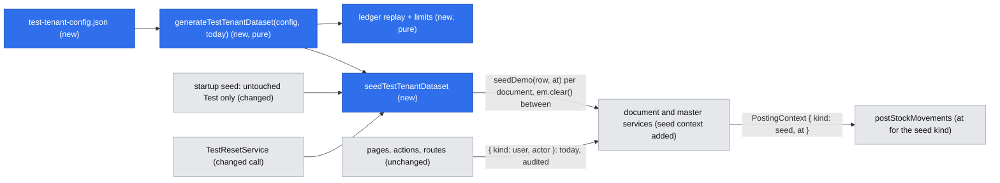

# A realistic Test tenant dataset: two years of history, a year of forecast

**Status:** implemented (PR #136)
**Amended by:** `2026-10-22--0902UTC-test-tenant-two-datasets.md` (#163): this two-year dataset is now the **realistic** one, written only by a reset that asks for it; the startup seed and a default reset write a **tiny** dataset, the same generator over two history months.
**Amended by:** `2026-10-25--0848UTC-single-site-daily-dataset.md` (#237): the business is now one plant, five furniture types in twelve colour SKUs, two suppliers and four customers; demand, forecasts and orders are daily and production and purchasing weekly. This spec's architecture (a pure generator, the replay, the seeder) and its "Today: what is open" rules stay.
**Created:** 2026-10-21 07:18 UTC
**Issue:** #126 (E12-S02), epic #78
**Design authority:** `.ai/specs/product-brief.md` (D04, D06, R01–R05, R08, R09, N03, N04, N06), `.ai/specs/research/CPG-prd001.pdf` §05 (Test starts with demonstration records), `.ai/specs/research/CPG-acceptance.md` TEN-001, TEN-022…TEN-029, INV-010, INV-011, the seeder contract in `implemented/2026-10-19--0913UTC-test-prod-tenants.md` (Q4) and the atomic Test reset (#93). The owner's requirements for this dataset were given directly in the session that produced this spec (2026-10-21) and are recorded verbatim in "Owner's requirements".

## 📝 TLDR

Test's demonstration data today is six materials, three BOMs, four forecasts on consecutive days, one customer order, one production order, two requisitions, one purchase order and six opening balances. It proves each screen works; it does not look like a business. This spec replaces it with a **generated, deterministic dataset of a small Polish steel-furniture manufacturer**: four plants, ten customers, six suppliers, ten finished products (five made from raw materials only, five built from four intermediates plus a few raw materials), one active BOM per made material except one simple product with three prioritised alternates, planning parameters and safety-stock targets for every pair that is planned, **24 months of fully posted history** (customer orders → shipments → goods issues; purchase orders → goods receipts; production orders → completions, variances and one waste posting per plant), **12 monthly forecast buckets** per product, and documents of every kind open as of today, some of them partially processed.

The shape numbers live in one file, `packages/core/src/domain/demo/test-tenant-config.json`, with every period expressed in months. A pure generator turns that file and today's date into the dataset; the seeder writes it through the normal services. The Test reset regenerates it; the startup seed creates it on an untouched Test only. No schema changes, no new API, no new screen.

## Owner's requirements

Given by Piotr12 on 2026-10-21, paraphrased only where needed. They are the source of the shape; the design below says how they are met.

1. Historical shipments for the last two years; forecast for a year ahead.
2. Four locations, all manufacturing; ten customers.
3. Those numbers hardcoded in a `test_tenant_config.json` somewhere, with periods in months, not years.
4. Ten finished products: five simple (raw materials only), and four intermediates which, with a few raw materials, make the remaining five.
5. No BOM proliferation: one active BOM is enough, except one simple finished product that has three alternates, with priorities.
6. Safety stock, inventories, some open orders from customers and some open purchases.
7. A real working system rather than sample records that announce "this is not a real business scenario".
8. No intermediate product brief: a spec and an issue that links it.

## Resolved assumptions (autonomous defaults)

The owner set the shape; these are the design choices made to fit it into the baseline. Those marked ⚠ change how an existing rule reads or pick one of two readings of a requirement, and the owner should confirm them on the PR.

| # | Question | Chosen answer | Rationale |
|---|---|---|---|
| Q1 | Where do the hardcoded numbers live, and what else is in the file? | `packages/core/src/domain/demo/test-tenant-config.json` (kebab-case, as every file here; the owner's `test_tenant_config.json` names the same file). It holds the **shape** (counts and horizons, all periods in months), the **demand and supply parameters**, the **limits** the dataset must stay under, and the **catalogue** (named plants, customers, suppliers, materials with units and conversions, recipes, per-material planning values, demand weights). A Zod schema parses it at load and cross-checks the catalogue against the shape, so the numbers stay the single statement of the shape and a catalogue that disagrees fails the unit tests. | Numbers alone cannot produce believable names (requirement 7), and names alone would make the numbers implicit. Keeping both in one validated file satisfies requirement 3 without a second source of truth. |
| Q2 | How can two years of goods issues, receipts and completions be posted when every actual posting is dated today (R09, INV-010, INV-011)? | The ledger's `PostingContext` gains, for the `seed` kind only, an `at: Date`: the movement's `businessDate`, `occurredAt` and the document's `createdAt`/`updatedAt` come from it. The user kind (`{ kind: "user", actor }`) keeps dating today and is unchanged. The document services expose their posting paths to the seeder with a `PostingContext`, exactly as `postStockMovements` already does; a repo-wide test pins the seed kind's constructors to `services/demo/` and the services' `seedDemo` methods, so no page, action or route can backdate anything. ⚠ NEEDS HUMAN CONFIRMATION | R09 and INV-010/011 constrain what a **user** posts through the UI and the API, and that is untouched. The demonstration history is the past the tenant starts with, created by the server before anyone acts, under the existing `seed` channel. The alternative (history as documents only, with no ledger behind it) is rejected below. |
| Q3 | How does the dataset relate to the calendar? | Relative to the seed date, in UTC. The **anchor** is the first day of the current month. History covers the 24 months before the anchor and the current month up to yesterday; a **setup month** before the history holds the masters' creation, the opening balances and the creation of the first month's documents, so nothing is created before the masters exist. Documents dated today or later are open. Forecasts cover the 12 months after the current one. The generator takes today as an argument and is otherwise deterministic: a fixed random seed in the config, and every random draw keyed by the calendar month it belongs to, so the same day always yields the same dataset and a later seed never rewrites an earlier month. | "Last two years" and "a year ahead" are relative to today; a fixed year would go stale. Determinism keeps the reset reproducible and the tests exact. |
| Q4 | What does the startup seed do now that the dataset is one interdependent whole? | **All or nothing on an untouched Test**: when Test has no materials and no tenant audit entries, the whole dataset is seeded in one transaction; otherwise nothing is seeded. A failure rolls everything back, is logged, and the next start retries. The reset always regenerates. Existing deployments adopt the dataset by running the Test reset once. ⚠ NEEDS HUMAN CONFIRMATION | The current rule "fill each kind Test has none of" exists because kinds were added story by story; applied to a generated timeline it would seed fragments into an edited tenant. Materials are referenced by everything, and every user write audits while seeds do not, so "no materials and no audit" is exactly "untouched". |
| Q5 | How much history, in documents? | One customer order per customer, plant and month (the lines are that customer's products made at that plant), shipped in one shipment and one goods issue (every ninth order in two); one production order and completion per made material, plant and month; one purchase order per supplier, plant and month, received in one receipt. The generator asserts the totals stay under `limits` in the config (documents 5,000, stock movements 7,000). | Monthly granularity is the owner's unit (requirement 3). The counts land around 3,700 documents and 4,000 movements, which the chunked seeding pattern handles in seconds (lessons of 2026-10-20 on bulk runs); see "Seed duration" in Risks for the cost. The caps make growth deliberate. |
| Q6 | What does "three alternates" mean for the key cabinet? | **Three BOMs in total** for that product, priorities 1, 2 and 3, all active and valid from the history start with no end. Every other made material has exactly one active BOM, so the dataset has 16 BOMs. ⚠ NEEDS HUMAN CONFIRMATION (the other reading, one BOM plus three alternates, is 17) | "One active is enough apart from one … that shall have 3 alternates" reads as three alternative recipes for that product. Changing to four is one more catalogue entry. |
| Q7 | Which plant makes what, and are there transfers? | Each plant specialises (see "Where things are made"); every finished product is made at one plant, and a customer who buys from two plants places two orders a month. Intermediates are made where they are consumed, except the powder-coated shelf, which Poznań buys from a supplier (an intermediate that is Make at one site and Buy at another, MAT-015). **No transfers** are seeded. | Four manufacturing locations with independent supply keep the generator's stock model per plant. Transfers were not asked for and would add in-transit stock to every month's balance check. |
| Q8 | Are production orders and requisitions part of the dataset although the owner listed customer and purchase orders? | **Yes.** Production orders and completions are what turns raw materials into the shipped goods, so the history needs them, and a few open ones exist today. Requisitions: three open and two converted into purchase-order lines. | A working system (requirement 7) has every document kind in flight. The current seed already has one production order and two requisitions. |
| Q9 | Do the first business IDs keep their meaning? | **Yes, where the new business allows it.** Materials 00000001–00000006 stay what they are today (steel sheet 2 mm, bolt M8, red paint, painted side panel, red cabinet, cardboard box), location 00000001 stays the main plant in Wrocław, customers 00000001–00000004 and suppliers 00000001–00000003 keep their names. New records continue from 00000007, 00000002, 00000005 and 00000004 respectively. Locations 00000002 and 00000003 are renamed (they were a warehouse and a contract packer; every location is a plant now). | Dozens of tests pin those first records. Keeping them cuts the test churn to the assertions that count or enumerate records. |
| Q10 | What timestamps do seeded records carry? | Their own date: a document's `createdAt`/`updatedAt` and a movement's `occurredAt` are the document's date at a plausible time of day, never the seed's run time. MikroORM's `onCreate` only fills a missing value (`??=`), so the services can pass the context's `at`. | A list of 3,700 documents all "created" at the same second would announce itself as generated (requirement 7), and the ledger orders by `occurredAt`. |
| Q11 | Where are forecast buckets placed? | One `Forecast` row per finished product at its plant per month, dated the **first day** of the month, for the 12 months after the current one. | The entity is per date and MRP (slice 3) buckets by day; a monthly figure due at the start of its month is the common convention, and the simplest consistent behaviour (D04). |
| Q12 | Does the seed write audit entries? | **No**, as today: the seed is the dataset's starting state, not a change by an account. Movements carry channel `seed` and actor "Demo seed". | The startup rule in Q4 relies on it, and 3,700 unaudited documents keep the Test audit readable for what users do. |
| Q13 | What happens to the current `demo-*.ts` constants and per-kind `seedDemo()` methods? | The constants and their tests are deleted. Each service keeps a `seedDemo` entry point, but it now takes generated rows and the seed context instead of reading a constant, and the seeder orchestrates one chronological timeline across kinds. | The timeline interleaves kinds (a receipt, then a completion, then an issue on the same day), which a kind-by-kind registry cannot express. |
| Q14 | Which lists must be checked against the volume? | The **purchase-order list is paged by 100** in this change (service, API `?page=`, `PageLinks`), as customer orders and shipments are: its `list()` loads every order with every line, and the dataset gives it about 470. Every other list screen and list API is exercised with the dataset before the implementation PR is called done; the paged ones (customer orders, shipments, goods issues, production orders, completions, transfers, the stock ledger and report) by paging, the unpaged ones (requisitions, receipts by order, materials, BOMs, planning parameters, safety stock, forecasts by filter) by rendering within the usual time, with a follow-up filed for any that fails. | Lesson of 2026-10-20: bound a document collection before it grows, and this change is what grows it. #115 already tracks paging the receipt list API. Paging the small lists speculatively is YAGNI; measuring is not. |
| Q15 | Which touches of realism beyond the owner's list are in? | Six, each one generator branch, each strikeable without affecting the rest: (a) consumption variances on every seventh and eleventh completion and (b) one zero-output waste completion per plant, so the variance report (E13-S02) has content; (c) two safety-stock targets that rise three months after the anchor, so a target series exists (DEM-016); (d) hinges and locks alternating between two suppliers by month; (e) the export distributors ordering in whole pallets or cases (MAT-019); (f) one overdue top-up purchase order per plant, so overdue supply exists (BUY-019). | Requirement 7 asks for a system that looks run, and each item is what a planner would see in one. None adds a feature (D04). The owner may strike any; (f) and (c) are the least consequential. |
| Q16 | How long may the reset hold the database, and who waits? | The reset seeds inside its one write transaction. SQLite has one writer, better-sqlite3 waits for the lock synchronously and the project sets no busy timeout (its default is 5 s), so while the reset runs, a **write from another bundle** (a Prod document, a sign-in session, a preference, an API idempotency key) blocks its event loop for up to 5 s and then fails "database is locked"; Test writes are refused at once because the reset first flags Test read-only, and reads are unaffected (WAL). The budget is a seed of **≤ 15 s**, so that window is at most 15 s per reset, an admin-only operation on a demonstration tenant; the implementation measures a concurrent Prod write during a reset in the image and records the result. ⚠ NEEDS HUMAN CONFIRMATION | Atomicity (TEN-027) requires one transaction; a chunked reset would leave a half-seeded Test on failure. The alternative is a smaller shape, which is the owner's to change. |

## 📝 Problem Statement

PRD §05 and TEN-001 require Test to start with demonstration records, and D06 made the first slices seed a handful of fixed rows per kind. That served the stories as they were built. Now that every document type, the ledger and the reset exist, those rows are the weakest part of a demonstration:

- there is no history, so the stock report shows six opening balances and nothing behind them, and the variance report (E13-S02) and the audit history (E13-S03) will have nothing to show;
- the four forecasts fall on three consecutive days of one month, so slice 3's MRP has no demand curve to plan against;
- one customer order, one production order and one purchase order cannot show a planner the state of a business;
- the "warehouse" and "contract packer" locations and the red-cabinet-only recipes are a sketch, not a manufacturer.

The owner's requirement is a dataset that behaves like a real working system: two years of monthly history, a year of monthly forecast, four plants, ten customers, ten products with a sensible BOM structure, safety stock, inventories and open documents, all driven by hardcoded numbers in a config file.

## 📝 Proposed Solution

Three parts, each small on its own:

1. **A configuration file and a pure generator.** `test-tenant-config.json` states the shape, the parameters and the catalogue. `generateTestTenantDataset(config, today)` in `core/src/domain/demo/` turns it into a `TestTenantDataset`: the masters, the forecasts, and a **timeline** of dated documents (creations and postings) in chronological order, plus the open documents as of today. The generator replays its own ledger and refuses to produce a dataset in which any balance would go negative or any limit would be exceeded, so a bad configuration fails in a unit test, never at startup.
2. **A seed context in the posting paths.** `PostingContext`'s `seed` kind carries `at`, and the document services take a `PostingContext` on the paths the seeder uses, skipping audit and using `at` for dates, as `postStockMovements` already does for movements. The user paths are untouched.
3. **A timeline seeder.** `seedTestTenantDataset(services, today)` in `core/src/services/demo/` writes the dataset through the services, one document per call, clearing the identity map between documents (the import's `runRow` pattern), inside the caller's transaction. Startup calls it for an untouched Test; the reset calls it in place of `seedResetDemoData`.

**Alternatives considered:**

- **History as documents only.** Completed orders with `fulfilled` quantities, received purchase-order lines and completed production orders, with no goods issues, receipts, completions or movements behind them, and today's stock as one opening correction. Rejected: the ledger would be empty for two years, every "fulfilled" line would have no document that fulfilled it (INV-012), the variance and audit reports would be empty, and the dataset would be exactly the kind of sample the owner rejects.
- **A fixed calendar (history 2024-10 … 2026-09).** Rejected: it goes stale within a month, and "open orders" would soon be overdue by years.
- **Writing rows directly from the seeder (bypassing the services).** Faster, but it would re-implement the services' invariants (fulfilment, received quantities, produced quantities and states, ID sequences, conversions) in a second place, and drift would be invisible. Rejected; the services' leaf paths are used, with a seed context.
- **A spreadsheet dataset loaded through the import.** The import covers masters, BOMs and desired stock, not documents or history. Rejected.
- **Keeping the per-kind fill-in at startup.** Rejected (Q4).

**Market check.** Odoo's demo data (`demo` XML per module) and ERPNext's demo setup both generate a coherent company with a backdated history of orders, deliveries and invoices rather than a few rows per table, and both make the data deterministic and reloadable. Their gap, shared here until now, is that the volume is fixed in code; CPG keeps the shape in a config file. Skipped: pricing, invoices and accounting demo data (N01).

## 📝 Architecture

- **`core/src/domain/demo/`** (pure, no database):
  - `test-tenant-config.json`: the file from Q1.
  - `test-tenant-config.schema.ts`: the Zod schema, `TEST_TENANT_CONFIG` (parsed at import), and the cross-checks (catalogue sizes equal the shape; every recipe component exists and is raw or intermediate; every finished material has a making plant; every raw material has a supplier; demand weights per product sum to 1).
  - `calendar.ts`: month arithmetic in UTC, weekday selection, "the n-th weekday of a month".
  - `random.ts`: a small seeded generator (`mulberry32`, about ten lines; no dependency).
  - `demand-plan.ts`, `supply-plan.ts`, `timeline.ts` and `generate-dataset.ts`: the model in "The dataset" below, ending in `generateTestTenantDataset(config, today): TestTenantDataset`.
  - `replay.ts`: the ledger replay that proves non-negative balances and counts documents and movements against `limits`.
- **`core/src/services/demo/`**:
  - `seed-demo-data.ts` becomes the timeline seeder: `seedTestTenantDataset(services, today)` and `isUntouchedTest(em)`. `DemoServices` gains `shipmentService`, `goodsIssueService`, `goodsReceiptService` and `productionCompletionService`.
  - `demo-references.ts`: `isUntouchedKind` and `activeDemoReferences` are no longer needed and are removed with the per-kind seeds.
- **`core/src/demo-data.ts`** (startup): opens its short-lived ORM as today, checks `isUntouchedTest`, runs the seeder in one transaction on the Test scope, and returns the counts per kind for the startup log.
- **`core/src/services/tenants/test-reset.service.ts`**: calls `seedTestTenantDataset` in place of `seedResetDemoData`, inside its existing savepoint; its dependency list follows `DemoServices`.
- **`core/src/services/stock/stock-posting.ts`**: `PostingContext = { kind: "user"; actor } | { kind: "seed"; at: Date }`; `businessDate` and `occurredAt` come from `at` for the seed kind.
- **Document services** (`customer-orders`, `shipments`, `goods-issues`, `purchase-requisitions`, `purchase-orders`, `goods-receipts`, `production-orders` incl. completions, `stock` for the opening balances): the create/post path becomes an internal function taking `(em, input, context)`; `create`/`post(input, actor)` call it with the user kind, and `seedDemo(row, at)` with the seed kind. Audit calls are conditional on the kind as in `postStockMovements`, and the leaf helpers that record audit and set `updatedAt = new Date()` today (`fulfil` and `issueShipment` in the goods-issue service, `completeFinishedShipments` in `shipment-usage.ts`, `receive` in the receipt service, `progress` in the completion service) take the context and use its `at`. Masters (`materials`, named records, `planning-parameters`, `safety-stock`, `boms`, `forecasts`) keep a `seedDemo(rows)` that takes the generated rows.
- **Tooling:** `tests/seed-context-callers.test.ts` scans `packages/core/src` and `packages/app/src` and fails when `kind: "seed"` is constructed outside `services/demo/` and a service's `seedDemo` method; `tests/every-list-handles-dataset` is not a test but a checklist item in the Implementation Plan (Q14).

Takeaway: everything that knows about the business lives in the pure generator and its config; the services learn one thing, a seed context with a date, and every user path keeps today's date and its audit.

## 📝 Data Model

**No schema change and no migration.** Every seeded record is an existing entity. What changes is only which values the seed supplies:

| Entity | Field | Seed value |
|---|---|---|
| `StockMovement` | `businessDate`, `occurredAt`, `channel`, `actorUsername` | the document's date and time; `seed`; "Demo seed" (channel and actor as today) |
| every document header (`CustomerOrder`, `Shipment`, `GoodsIssue`, `PurchaseRequisition`, `PurchaseOrder`, `GoodsReceipt`, `ProductionOrder`, `ProductionCompletion`) | `createdAt`, `updatedAt` where present, `businessDate` where present | the document's date and time (Q10) |
| masters (`Material`, `Location`, `Customer`, `Supplier`, `Bom`, `BomRevision`) | `createdAt` | the first day of the setup month (Q3) |
| `ProductionCompletion` | `submission` | `null` |

Sensitive data: none. Customer and supplier names are fictional companies.

### The configuration file

`test-tenant-config.json`, validated by `testTenantConfigSchema`. Every horizon is in months; lead times are calendar days (as the planning parameters store them) and the `*Every` counters count documents. The shape counts duplicate what the catalogue implies, deliberately: the owner asked for the numbers to be stated, and the cross-checks keep the two honest. (The leaner alternative, a catalogue plus horizons with the counts pinned only by a test, was considered and set aside for that reason.)

| Key | Content | Example |
|---|---|---|
| `randomSeed` | integer seed of the deterministic generator | `20261021` |
| `horizon.historyMonths` | full months of posted history before the current month | `24` |
| `horizon.forecastMonths` | monthly forecast buckets after the current month | `12` |
| `shape.locations`, `shape.customers`, `shape.suppliers` | counts; the catalogue arrays must have exactly these lengths | `4`, `10`, `6` |
| `shape.rawMaterials`, `shape.intermediates`, `shape.finishedProducts.simple`, `shape.finishedProducts.composed` | counts by type; the catalogue's materials must match | `12`, `4`, `5`, `5` |
| `shape.alternateBoms` | `{ product, count }`: the one simple finished product with alternates and how many BOMs it has in total | `{ "product": "00000026", "count": 3 }` |
| `limits.documents`, `limits.movements` | the generator refuses a larger dataset | `5000`, `7000` |
| `demand.growthPerYear`, `demand.noise` | linear growth from history start; uniform noise amplitude per product-month | `0.04`, `0.12` |
| `demand.seasonality` | named 12-value multiplier profiles (January first) | `flat`, `backToSchool`, `spring` |
| `demand.products[]` | per finished product: `material`, `monthlyBase` (base units), `profile`, `enteredIn` (`base` or a conversion unit for customers who order in pallets or cases) | see "Demand" |
| `demand.customers[]` | per customer: `name` and `shares` (product → weight); weights per product sum to 1 | see "Demand" |
| `supply.partialShipmentEvery`, `supply.varianceEvery`, `supply.underConsumptionEvery` | every n-th order ships in two; every n-th completion consumes more, every m-th less | `9`, `7`, `11` |
| `supply.safetyStock` | coverage factors: `finishedMonths`, `intermediateMonths`, `rawLeadTimeFactor`, and the `laterIncreases[]` (`material`, `location`, `monthsAfterAnchor`, `factor`) | `0.5`, `0.25`, `1.2`, two entries |
| `catalogue.locations[]`, `catalogue.customers[]`, `catalogue.suppliers[]` | names, in ID order | see "The business" |
| `catalogue.materials[]` | in ID order: `type`, `description`, `baseUnit`, `conversions[]`, and for raw materials `buy: { leadTimeDays, minimumQuantity, lotMultiple, suppliers[] }` (two suppliers alternate by month) | see "Materials" |
| `catalogue.boms[]` | `output`, `priority`, `components[] { material, quantity, unit }` | see "Recipes" |
| `catalogue.production[]` | made pairs: `material`, `location`, `leadTimeDays`, `minimumQuantity`, `lotMultiple` | see "Where things are made" |
| `catalogue.purchasedIntermediates[]` | intermediates bought at a plant: `material`, `location`, `buy { … }` | the shelf at Poznań |

The cross-checks in Q1 and Architecture make the shape authoritative: a catalogue of eleven customers with `shape.customers: 10` fails `test-tenant-config.schema.test.ts`.

## 📝 The dataset

### The business

A small manufacturer of steel cabinets, lockers and sheet-metal goods, with four plants in Poland. Names are fictional. IDs are the sequence the seed produces on a fresh generation.

**Locations (4, all manufacturing):**

| ID | Name | Makes |
|---|---|---|
| 00000001 | Main plant, Wrocław | painted side panels, doors, powder-coated shelves; the red cabinet, the grey office cabinet, the workshop cabinet |
| 00000002 | Lockers plant, Poznań | doors, welded locker frames; the 2- and 4-compartment lockers (buys its shelves) |
| 00000003 | Sheet-metal plant, Łódź | the shelf unit, the letterbox, the tool tray |
| 00000004 | Small goods plant, Gdańsk | the document box, the key cabinet |

**Customers (10):** 00000001 Hardware Store Chain Sp. z o.o.; 00000002 Office Interiors S.A.; 00000003 Online shop (direct sales); 00000004 Export distributor (DE); 00000005 School Furniture Partners Sp. z o.o.; 00000006 Regional Hospital Procurement; 00000007 Logistics & Warehousing Group S.A.; 00000008 FitZone gym chain; 00000009 Construction Wholesale Hub Sp. z o.o.; 00000010 Export distributor (CZ/SK).

**Suppliers (6):** 00000001 Steel Service Centre Sp. z o.o. (sheets); 00000002 Fasteners Wholesale (bolts, clips, hinges, locks); 00000003 Packaging Supplies Ltd. (boxes); 00000004 Coatings & Paints S.A. (paints, powder coat); 00000005 Metal Components Nord (welding wire, bought shelves); 00000006 Fittings Direct GmbH (hinges and locks, alternating with Fasteners Wholesale by month).

### Materials (26: 12 raw, 4 intermediate, 10 finished)

Quantities are in each material's base unit; conversions are `1 unit = n base units` (MAT-019/020). Buy parameters apply at every plant that consumes the material; lead times are calendar days (MAT-018).

| ID | Type | Description | Base | Conversions | Buy: lead / min / multiple | Supplier(s) |
|---|---|---|---|---|---|---|
| 00000001 | raw | Steel sheet 2 mm | kg | t = 1000 | 14 / 500 / 100 | 1 |
| 00000002 | raw | Bolt M8 | each | case = 12, box = 100 | 7 / 1000 / 100 | 2 |
| 00000003 | raw | Paint, red | l | ml = 0.001 | 10 / 20 / 5 | 4 |
| 00000004 | intermediate | Painted side panel | each | — | made (Wrocław) | — |
| 00000005 | finished | Cabinet, red | each | pallet = 20 | made (Wrocław) | — |
| 00000006 | raw | Cardboard box | each | bundle = 25 | 5 / 100 / 25 | 3 |
| 00000007 | raw | Steel sheet 1.0 mm | kg | t = 1000 | 14 / 1000 / 250 | 1 |
| 00000008 | raw | Paint, grey | l | ml = 0.001 | 10 / 20 / 5 | 4 |
| 00000009 | raw | Powder coat, grey RAL 7035 | kg | bag = 25 | 12 / 50 / 25 | 4 |
| 00000010 | raw | Hinge, steel | each | box = 50 | 10 / 200 / 50 | 2, 6 |
| 00000011 | raw | Cam lock with two keys | each | box = 20 | 10 / 100 / 20 | 2, 6 |
| 00000012 | raw | Shelf support clip | each | bag = 200 | 7 / 2000 / 200 | 2 |
| 00000013 | raw | Galvanised steel sheet 0.8 mm | kg | t = 1000 | 21 / 500 / 100 | 1 |
| 00000014 | raw | Welding wire 0.8 mm | kg | spool = 15 | 7 / 30 / 15 | 5 |
| 00000015 | intermediate | Door, assembled | each | — | made (Wrocław, Poznań) | — |
| 00000016 | intermediate | Locker frame, welded | each | — | made (Poznań) | — |
| 00000017 | intermediate | Shelf, powder-coated | each | — | made (Wrocław); bought at Poznań: 10 / 100 / 50 | 5 |
| 00000018 | finished | Office cabinet, grey, 2 doors | each | pallet = 12 | made (Wrocław) | — |
| 00000019 | finished | Locker, 2 compartments | each | pallet = 8 | made (Poznań) | — |
| 00000020 | finished | Locker, 4 compartments | each | pallet = 8 | made (Poznań) | — |
| 00000021 | finished | Workshop cabinet, 4 shelves | each | pallet = 10 | made (Wrocław) | — |
| 00000022 | finished | Steel shelf unit, 5 shelves | each | pallet = 10 | made (Łódź) | — |
| 00000023 | finished | Letterbox, galvanised | each | case = 6 | made (Łódź) | — |
| 00000024 | finished | Tool tray, powder-coated | each | case = 10 | made (Łódź) | — |
| 00000025 | finished | Document box, A4 | each | case = 12 | made (Gdańsk) | — |
| 00000026 | finished | Key cabinet, wall-mounted | each | case = 6 | made (Gdańsk); **three alternates** | — |

The five **simple** finished products (raw materials only) are 00000022–00000026. The five **composed** ones (intermediates plus a few raw materials) are 00000005 and 00000018–00000021.

### Recipes (16 BOMs)

Per one `each` of output, quantities as entered (so the seed shows converted lines, MAT-019). All valid from the history start with no end; one revision each.

| Output | Priority | Components |
|---|---|---|
| 00000004 Painted side panel | 1 | 4.5 kg steel 2 mm; 250 ml paint, red |
| 00000015 Door, assembled | 1 | 3.2 kg steel 1.0 mm; 2 hinges; 1 cam lock; 150 ml paint, grey |
| 00000016 Locker frame, welded | 1 | 9 kg steel 1.0 mm; 0.3 kg welding wire; 0.4 kg powder coat |
| 00000017 Shelf, powder-coated | 1 | 1.8 kg steel 1.0 mm; 0.12 kg powder coat; 4 shelf support clips |
| 00000005 Cabinet, red | 1 | 4 painted side panels; 1 door, assembled; 16 bolts (entered as 16 each); 1 cardboard box |
| 00000018 Office cabinet, grey | 1 | 18 kg steel 1.0 mm; 2 doors; 2 shelves; 2 cases of bolts (24 each); 400 ml paint, grey; 1 cardboard box |
| 00000019 Locker, 2 compartments | 1 | 1 locker frame; 2 doors; 1 shelf; 12 bolts; 1 cardboard box |
| 00000020 Locker, 4 compartments | 1 | 1 locker frame; 4 doors; 3 shelves; 20 bolts; 1 cardboard box |
| 00000021 Workshop cabinet | 1 | 22 kg steel 2 mm; 4 shelves; 2 doors; 32 bolts; 600 ml paint, grey; 1 cardboard box |
| 00000022 Steel shelf unit | 1 | 24 kg steel 1.0 mm; 40 bolts; 20 shelf support clips; 0.9 kg powder coat; 1 cardboard box |
| 00000023 Letterbox | 1 | 2.4 kg galvanised sheet; 1 cam lock; 4 bolts; 1 cardboard box |
| 00000024 Tool tray | 1 | 1.6 kg steel 1.0 mm; 0.08 kg powder coat; 1 cardboard box |
| 00000025 Document box | 1 | 1.1 kg steel 1.0 mm; 60 ml paint, grey; 1 cardboard box |
| 00000026 Key cabinet | **1** | 2.2 kg steel 1.0 mm; 0.1 kg powder coat; 2 hinges; 1 cam lock; 1 cardboard box |
| 00000026 Key cabinet | **2** | 2.2 kg steel 1.0 mm; 120 ml paint, grey (wet paint when the powder line is busy); 2 hinges; 1 cam lock; 1 cardboard box |
| 00000026 Key cabinet | **3** | 3.8 kg steel 2 mm (heavier gauge when 1.0 mm sheet is short); 150 ml paint, grey; 2 hinges; 1 cam lock; 1 cardboard box |

No cycles (R04); no finished material is a component (R02); R04 forbids only equal priorities over overlapping validity, so three priorities over the same validity are allowed. History production of the key cabinet uses priority 1 only; the alternates are planning options, and their components are planned and stocked at Gdańsk (steel 2 mm included) so MRP can propose any of them without missing parameters (MAT-017).

### Where things are made (15 made pairs)

Make parameters: lead time in days, minimum lot, lot multiple, in base units.

| Plant | Material | Lead / min / multiple |
|---|---|---|
| Wrocław | 00000004 side panel | 2 / 50 / 10 |
| Wrocław | 00000015 door | 3 / 40 / 10 |
| Wrocław | 00000017 shelf | 2 / 100 / 50 |
| Wrocław | 00000005 red cabinet | 3 / 20 / 10 |
| Wrocław | 00000018 office cabinet | 4 / 10 / 5 |
| Wrocław | 00000021 workshop cabinet | 4 / 10 / 5 |
| Poznań | 00000015 door | 3 / 40 / 10 |
| Poznań | 00000016 locker frame | 3 / 20 / 10 |
| Poznań | 00000019 locker, 2 | 4 / 20 / 10 |
| Poznań | 00000020 locker, 4 | 5 / 10 / 5 |
| Łódź | 00000022 shelf unit | 3 / 20 / 10 |
| Łódź | 00000023 letterbox | 2 / 50 / 25 |
| Łódź | 00000024 tool tray | 2 / 50 / 25 |
| Gdańsk | 00000025 document box | 2 / 100 / 50 |
| Gdańsk | 00000026 key cabinet | 3 / 20 / 10 |

The generator derives the **buy pairs** from the recipes, alternates included: every raw material a plant's recipes consume gets a Buy parameter set at that plant with the material's buy values. That is 32 pairs (Wrocław 10: materials 1, 2, 3, 6, 7, 8, 9, 10, 11, 12; Poznań 8: 2, 6, 7, 8, 9, 10, 11, 14; Łódź 7: 2, 6, 7, 9, 11, 12, 13; Gdańsk 7: 1, 6, 7, 8, 9, 10, 11), plus the shelf bought at Poznań: 33 buy pairs, and with the 15 made pairs **48 planned pairs**, each with a planning parameter set (MAT-016), a safety-stock target and an opening balance. Raw materials are Buy-only (R02, MAT-014). MRP will report no missing parameters for anything in a recipe (MAT-017).

### Demand

For product `p` in month `m`: `D(p, m) = monthlyBase(p) × season(profile(p), calendarMonth(m)) × (1 + growthPerYear × yearsSinceHistoryStart) × (1 + noise)`, with `noise` uniform in `[−0.12, +0.12]` from a generator seeded by (`randomSeed`, calendar year and month, product), so a month's figure is the same whichever day the dataset is generated on. The total is split over the customers by their weights, each line rounded to a whole base unit (at least 1); the export distributors (00000004, 00000010) round to whole pallets or cases and enter their quantities in that unit.

| Product | Monthly base | Profile | Customers and weights |
|---|---|---|---|
| 00000005 Cabinet, red | 60 | flat | 00000002 0.3; 00000003 0.2; 00000006 0.2; 00000009 0.3 |
| 00000018 Office cabinet | 45 | flat | 00000002 0.5; 00000004 0.3; 00000005 0.1; 00000006 0.1 |
| 00000019 Locker, 2 | 80 | backToSchool | 00000004 0.2; 00000005 0.35; 00000006 0.15; 00000008 0.3 |
| 00000020 Locker, 4 | 50 | backToSchool | 00000005 0.4; 00000006 0.2; 00000007 0.3; 00000008 0.1 |
| 00000021 Workshop cabinet | 30 | flat | 00000007 0.3; 00000009 0.7 |
| 00000022 Shelf unit | 120 | spring | 00000001 0.35; 00000004 0.3; 00000007 0.2; 00000009 0.15 |
| 00000023 Letterbox | 200 | spring | 00000001 0.3; 00000003 0.3; 00000009 0.2; 00000010 0.2 |
| 00000024 Tool tray | 150 | flat | 00000001 0.4; 00000003 0.3; 00000004 0.3 |
| 00000025 Document box | 300 | flat | 00000001 0.2; 00000002 0.3; 00000003 0.3; 00000010 0.2 |
| 00000026 Key cabinet | 90 | flat | 00000001 0.2; 00000002 0.2; 00000003 0.2; 00000008 0.2; 00000010 0.2 |

Profiles (January first): `flat` all 1.0; `backToSchool` 0.8, 0.85, 0.95, 1.0, 1.05, 1.15, 1.35, 1.4, 1.1, 0.9, 0.8, 0.75; `spring` 0.8, 0.9, 1.2, 1.3, 1.25, 1.1, 1.0, 0.95, 0.95, 0.9, 0.8, 0.85. Every customer buys two to five products, from one to three plants.

**Customer orders.** One order per customer, plant and month, with one line per product of that plant the customer buys and one required date for the whole order. That is 23 orders a month. Placement is deterministic:

- the order is created in the **previous** month, on its weekday `12 + (customerIndex mod 5)` (weekdays are numbered from 1 within a month; the customer index is 0-based), never earlier than the history start: customers order two to six weeks ahead, so open orders exist on every day of a month;
- its required date is weekday `10 + ((customerIndex + 3 × monthIndex) mod 11)`, so required dates fall in the **shipping band** (weekdays 10–20, roughly the 14th to the 28th) and move from month to month;
- every ninth order in creation sequence ships in two shipments (60 % of each line rounded down to whole base units, at least 1, on the required date; the rest three weekdays later, capped at the month's last weekday); every other order ships in one shipment on its required date. A shipment is created two weekdays before its date and issued in full on the date (SAL-006…009).

Orders are placed in the second half of the previous month and delivered in the second half of their month: a make-to-order cadence, and the reason the month's production can precede its shipments (see "Order within a month").

### Supply

The generator keeps a stock model per material and plant and plans each month the way the slice 3 MRP will: **order up to safety**.

- **Safety-stock targets** (DEM-015/016), effective from the history start: finished at its plant, `0.5 ×` average monthly demand rounded up to the lot multiple; intermediates, `0.25 ×` average monthly use; raw materials, `leadTimeDays / 30 × average monthly consumption × 1.2`, rounded up to the lot multiple, at least one lot multiple. Two later increases make a series over time: locker 2 at Poznań and the letterbox at Łódź rise by 25 % effective three months after the anchor.
- **Opening balances**, one correction posting per plant dated the first day of the setup month, right after the masters ("Demonstration opening balance", channel `seed`): each of the 48 planned pairs starts at its safety target plus one minimum lot (intermediates' and finished products' safety rounded up to their lot multiple).
- **Production** per made pair and month: `Q = roundUpToLot(max(0, demand(m) + safety − stockAtStart))`, at least the minimum lot when positive, where a finished product's demand is the month's order lines and an intermediate's demand is the explosion of the plant's finished production that month. One production order per pair and month on the priority-1 current revision; the planned finish is in the **completion band**: intermediates on weekday `4 + (pairIndex mod 3)`, finished products on weekday `7 + (pairIndex mod 3)`; planned start = finish − lead time (which may fall in the previous month). All of a month's production orders are **created on weekday 8 of the previous month**, the plant's monthly production planning run, so open production orders exist on every day. One completion on the planned finish for the full quantity (PRD-011, PRD-012). **Variances** (PRD-013/014): every seventh completion per plant consumes 3 % more, and every eleventh 2 % less, of its first component measured in kg or l (sheet, paint, powder coat, wire), rounded up to 0.1; when both rules apply the eleventh wins; completions with no such component are skipped by both rules. **Waste** (PRD-018): once per plant, seven months before the anchor, a zero-output completion is posted on the plant's waste order the weekday before that order's full completion: Wrocław's workshop cabinet order with one lot multiple of steel 2 mm, Poznań's locker-frame order, Łódź's shelf-unit order and Gdańsk's document-box order each with one lot multiple of steel 1.0 mm; every pinned component is listed with an actual of 0 except that sheet.
- **Purchases** per raw material and plant per month: `Q = roundUpToLot(max(0, consumption(m) + safety − stockAtStart))`, at least the minimum lot when positive, where consumption is the month's production explosion including the variance and waste extras. Lines are grouped into **one purchase order per supplier and plant per month** (hinges and locks alternate between suppliers 00000002 and 00000006 by month), planned in the **receipt band**, weekday `1 + (supplierIndex mod 3)`, and received in full on the planned date in one goods receipt (BUY-013). All of a month's purchase orders are **created on weekday 2 of the previous month**, the plant's monthly purchasing run, so open purchase orders exist on every day; lead times stay planning parameters for MRP. Poznań's shelves are bought the same way.
- **Order within a month.** The bands are disjoint and ordered: receipts (weekdays 1–3), intermediate completions (4–6), finished completions (7–9), shipments (10–20); creations fall where their dates put them. So every month's purchases arrive before its production consumes them, intermediates are made before the finished products that use them, and finished products are made before they ship. With order-up-to planning, stock after the month's receipts is at least the month's consumption plus safety, stock after the month's completions at least the month's shipments plus safety, and every balance stays at or above its safety target at month end, give or take the variance extras, which the raw safety margin (at least one lot multiple and the 1.2 factor) absorbs. `replay.ts` proves it for every generated dataset, and the unit tests run it for every calendar day of a two-year window (R09). Within a day, events run in band order, then creations.
- **Times of day (UTC).** Creations at 08:00, opening balances at 08:30, receipts at 09:00, completions at 13:00, goods issues at 15:00, each plus the event's index within that hour in seconds, so `occurredAt` and `createdAt` are unique and increase along the timeline the way the ledger and the lists sort.

### Today: what is open

Everything dated before today is posted as described. Then, as of today:

- **Customer orders** whose required date is today or later are open with nothing shipped, except, per plant: the first such order (by required date, then code) is **partially shipped** (a shipment for half of every line, rounded down to whole base units, at least 1, created and issued today), and the second has an **open shipment** (created today for its required date, nothing issued). Next month's orders exist once their creation dates (the second half of the current month) have passed. So early in a month the open orders are most of the current month's; late in a month, the current month's last ones and all of next month's.
- **Purchase orders** planned today or later are open; per plant the first one (by planned date, then code) is **partially received** (first line received today, the others open). Next month's orders exist from weekday 2 of the current month, while the current month's are still arriving, so there is always something open. One **urgent top-up order** per plant (one lot multiple of the plant's main sheet, created and planned three weekdays before today, not received) is overdue supply (BUY-019); the generator excludes it from the stock model, so nothing depends on it.
- **Production orders** with a planned finish today or later are open; next month's exist from weekday 8 of the current month, so there is always something open. Per plant, the first order **in progress** today (planned start ≤ today ≤ planned finish, by planned finish then code) is **partially completed** (a completion for half its quantity, rounded down to the lot multiple, at least one lot multiple, dated today). An order in progress exists on the completion band's days and around month ends; on other days there is none, and the partial completion is simply absent.
- **Requisitions** (BUY-001…004): three open, created two weekdays ago, required on the first weekday of next month plus seven days (1,000 kg steel 1.0 mm at Gdańsk, 500 kg galvanised sheet at Łódź, 30 kg welding wire at Poznań); they are planning input only and stay out of the stock model. Two more, created on weekday 1 of the current month, the day before the purchasing run, are **converted in full** by next month's purchase orders of Wrocław (steel 2 mm) and Poznań (powder coat) (BUY-003): the supply plan's quantity for that material and plant next month is raised to at least one lot multiple, the requisition takes exactly that quantity, and the purchase-order line references it and converts it in full, so the requisition is Completed. The purchase-order service refuses a converting line larger than the requisition's outstanding quantity, which is why the quantities are made equal.

Postings dated today use the real UTC date, so the partial documents look exactly like a user posted them this morning.

### Forecasts (120 rows)

For each finished product at its plant and each of the 12 months after the current one: quantity = the mean of the product's last 12 history months' order lines × the target month's seasonal factor × `(1 + growthPerYear)`, rounded to a multiple of 5, dated the first day of the month (Q11). No forecast carries a customer (DEM-001).

### Volumes

For the configured shape, about: 598 customer orders with 990 lines (38 customer–product pairs a month), 660 shipments and goods issues, 390 production orders and 394 completions, 470 purchase orders with 800 lines and 470 receipts plus 4 top-ups, 5 requisitions, 48 opening-balance movements and 4,000 stock movements in total; 26 materials, 16 BOMs, 48 planning parameter sets, 50 safety-stock targets, 120 forecasts. The caps in `limits` leave headroom of about a third.

## 📝 API Contracts

**No new or changed endpoint.** `POST /api/tenants/test/reset` keeps its contract (`BACKWARD_COMPATIBILITY.md` §4); only the dataset it seeds and the time it takes change. The seed context is internal to `core` and unreachable from any route or action (Architecture, `tests/seed-context-callers.test.ts`). `GET /api/tenants/test` is unchanged.

## 📝 UI/UX

**No new screen.** What changes is what every Test screen shows: a plausible manufacturer instead of six rows. Two things to check in the running app (Q14):

- every list screen with the dataset: paged lists page, unpaged lists render in the usual time, filters narrow;
- the stock report and a pair's ledger show two years of movements with their source documents, newest first.

The reset dialog's texts ("reseed demonstration data") stay true and need no change. The tenant home's description "Demonstration data, safe to experiment" stays.

Prototype: none; no screen is designed here.

## 📝 Edge Cases & Failure Scenarios

| Case | Behaviour |
|---|---|
| The server starts against a Test that already has data (every existing deployment, including cpg.baby) | Nothing is seeded; the startup log says so. The admin runs the Test reset to get the new dataset. |
| The server starts against an empty Test (a fresh install, every integration run) | The whole dataset is seeded in one transaction before the server answers requests; the log reports the counts per kind. |
| The startup seed fails midway (a bug, a full disk) | The transaction rolls back, Test stays empty, the error is logged, the server still starts (as today), and the next start retries. |
| Test is read-only and empty at startup | Nothing is seeded (R05; `isScopeReadOnly`), as today. |
| The Test reset runs | `resetTestData` wipes Test, the generation advances, the dataset is generated as of the reset date and seeded in the reset's savepoint; a failure rolls the whole reset back (TEN-027). |
| A user posts a goods issue, receipt or completion | Dated today, audited, exactly as before (INV-010/011): the user kind never carries `at`. |
| The config file names eleven customers but `shape.customers` is 10, a component that is a finished material, a weight set that doesn't sum to 1 | `testTenantConfigSchema` refuses it; `test-tenant-config.schema.test.ts` and every test importing the config fail. The server never sees it. |
| A configuration that would drive a balance negative or exceed `limits` | `generateTestTenantDataset` throws; the unit tests catch it on the committed config, and at runtime the seed fails closed (nothing written, logged). |
| Today is the 1st of a month | History ends yesterday (the last day of the previous month); the current month's receipts, completions and shipments are all still to come, so this month's customer orders (created last month), purchase orders and production orders are open, and the partial documents are made from them today. Next month's documents don't exist yet. |
| Today is a weekend day | Nothing in the dataset is dated on a weekend except today's partial postings and creations, which use today's date as a user would. |
| The seed runs at 23:59:59 UTC and the server's clock crosses midnight during it | The generator took one `today`; the dataset is internally consistent for that date. Postings "today" may then be dated yesterday relative to the clock, which is harmless. |
| Two seeds race (two server processes starting on one fresh database) | Both see an untouched Test; SQLite's single writer serialises them, and the second fails at its first write as a stale snapshot or "database is locked" (lesson of 2026-10-19), with the unique indexes as the backstop; its rollback leaves the first dataset intact, and the error is logged. |
| A Prod or global write arrives while the reset is seeding | It waits on SQLite's write lock for up to the 5 s default busy timeout, blocking its bundle's event loop meanwhile, then fails "database is locked" if the reset is still running (Q16). Test writes are refused at once as read-only. Reads proceed. |
| A Test on an old generation holds the old six-material dataset and a client holds an old-generation idempotency key | Unchanged: the reset's generation handling (TEN-030, API-033/034) applies regardless of what was seeded. |

## 📝 Risks & Impact Review

- **R09's wording versus the seed exemption (Q2).** "Actual postings use today's business date only" stays true for every user and API posting; the seed is server-only and writes the tenant's starting history. This is the one design call that touches an active business rule's reading, so the owner confirms it on the PR. If declined, the fallback is "history as documents only", which the owner's requirement 7 argues against.
- **Startup semantics change (Q4).** Deployed instances keep their current Test data until the admin resets Test. The PR body says so, and the run log records the reset on cpg.baby if the owner wants it done at deploy time. Reversible: reverting the code brings back the per-kind fill-in, which then finds Test populated and does nothing.
- **Broad but shallow service changes.** Nine services gain a seed-context path (the eight document services and the stock opening), five leaf helpers take the context for their audit and `updatedAt` (Architecture), and six master services take generated rows. Each change is mechanical (a context parameter, conditional audit, `at` for dates), but it touches the posting paths of every document. Mitigations: the user paths keep their signatures and their tests; a repo-wide test pins the seed kind's constructors; coverage stays 100 %, so every new branch is tested; the integration suite exercises every document flow against the new dataset.
- **Seed duration and the lock window.** About 3,700 service calls in one transaction, each with several lookups, an ID query, a posting and a flush: heavier than the import's rows (0.4 s for 2,000) or the stock import's lines (1.2 s for 2,000), so 10–25 s in Docker is the honest expectation before measuring. Budget: the full seed completes in **≤ 15 s** inside the production image on the CI runner (the reset API test's timeout is 60 s, the container startup wait is 5 min). It is measured **at the end of Phase 2 as a spike**, before the timeline seeder is built on it, and again at the end; both figures go in the run log (lesson of 2026-10-20: measure a bulk write at its cap). While the reset seeds, Prod and global writes from other bundles wait on SQLite's write lock and can fail (Q16); the implementation measures one such write during a reset in the image. If the budget is missed, the levers are, in order: fewer queries per document on the seed path (one flush per document is the floor; the ID lookups are the next), then the shape, which is the owner's to change. Unit tests use a reduced configuration (`historyMonths: 2`, the same catalogue) except one full-configuration run of the seeder, so the suite stays fast.
- **Test churn.** Every unit and integration test that pins the old fixtures changes: counts of demo records, the three demo BOMs, the single customer order, the warehouse and contract-packer names. Q9 limits it. The Implementation Plan lists the files found by searching for the old fixtures.
- **List volume.** The purchase-order list is paged in this change (Q14; it loads every order with every line today, and the dataset gives it about 470). The other unpaged lists (requisitions, receipts by order, masters, forecasts by filter) are checked in the running app; paging them is a follow-up only if needed (#115 already covers the receipt list API).
- **Date-relative data in integration tests.** Assertions should be date-independent (counts of masters, BOMs and forecasts; "the first customer order"; "an open order exists") rather than derived from a second run of the generator in the test process, whose `today` could differ from the container's across a UTC midnight.
- **Not a protected surface.** No schema, URL, config or command changes; the reset route's semantics are preserved. The lint rule against `filters`/raw SQL is unaffected: the seeder writes only through services.
- **Rule vs direction.** Q2, Q4 and Q16 are owner decisions; Q6 is a reading of the requirement; Q5, Q7, Q8, Q11, Q14 and Q15 are the agent's defaults within D04 (simplest consistent behaviour), each reversible.

## 📝 Decisions in play

- **D04** (no additional business requirements): the dataset adds data, not features; the seed context is internal.
- **D06** (demo data seeded; the reset regenerates it): extended to the generated dataset; the seeder contract of the tenants spec (Q4 there: "created by code, through a seeder, using the normal services, never by a migration") is kept.
- **R01** (IDs sequential per generation, from 00000001): the timeline creates documents in date order, so IDs ascend with time, and the reset restarts them.
- **R02** (type rules), **R03** (exact quantities), **R04** (immutable revisions, no equal-priority overlap, no cycles): the catalogue is checked against them by the config schema and by the services that write it.
- **R05** (Test only; read-only refuses writes): Prod is never seeded; a read-only Test is not seeded at startup.
- **R08** (audit): the seed records none, as today; user postings keep theirs.
- **R09** (no negative stock; actual postings dated today): non-negativity is proven by the generator's replay and enforced by the ledger; the "today" clause is read as applying to user postings, with the seed exempt by construction (Q2, ⚠ owner).
- **N03, N04, N06**: no batches, bins, calendars, capacities or source lists are introduced; alternating suppliers is a generator choice, not a source list.

Nothing is superseded.

## 📋 Phasing

- **Phase 1 — Config and generator.** The JSON, its schema, the calendar and random helpers, the demand and supply model, the timeline, the replay, and their tests. Pure code; nothing visible changes.
- **Phase 2 — The seed context.** `PostingContext.at`, the seed paths in the document services, the repo-wide callers test. The app behaves exactly as before for users.
- **Phase 3 — The timeline seeder.** `seedTestTenantDataset`, the untouched-Test startup rule, the reset wired to it, the old constants and per-kind seeds removed. Test gets the new dataset.
- **Phase 4 — Suites, checks and docs.** Unit and integration tests adapted, every list checked with the dataset, the seed timed, standards and compatibility notes updated.

## 📋 Implementation Plan

### Phase 1 — Config and generator

1. **`test-tenant-config.json` and `test-tenant-config.schema.ts`** in `core/src/domain/demo/`: the file with the shape, parameters and catalogue from "The dataset"; the Zod schema with the cross-checks (Q1); `TEST_TENANT_CONFIG` parsed at import. Tests: the committed file parses; each cross-check refuses a mutated copy (one test per check); the shape counts equal the owner's numbers (4, 10, 6, 12, 4, 5, 5, 3, 24, 12).
2. **`calendar.ts` and `random.ts`.** UTC month arithmetic, `monthsBefore/After`, `nthWeekday`, `weekdaysBetween`; `mulberry32(seed)`. Tests pin the values (a known month's weekdays; the first ten outputs of a seed).
3. **`demand-plan.ts`.** `D(p, m)` and the customer split, with rounding and `enteredIn` handling for the export distributors. Tests: a flat product's 24 months stay within `±noise` of base × growth; weights split a total exactly; pallet rounding yields whole pallets.
4. **`supply-plan.ts`.** The stock model: safety targets, opening balances, order-up-to production and purchases, lot rounding, the explosion over the priority-1 current revision, supplier alternation, variance and waste rules. Tests: lot rounding; an intermediate's demand equals the explosion of its users' production; safety for a raw material covers lead-time consumption.
5. **`timeline.ts` and `generate-dataset.ts`.** The dated event list (creations and postings), the day ordering, the "as of today" split into posted history and open documents, the partial documents, the top-up orders, the requisitions, the forecasts. `generateTestTenantDataset(config, today)` returns `{ masters, forecasts, timeline, summary }`. Tests: the same `today` yields identical output twice; two different `today`s differ only where the calendar moves; on the 1st of a month next month's documents are absent; the key cabinet has exactly `shape.alternateBoms.count` BOMs; each open-document rule produces its document.
6. **`replay.ts`.** Replays the timeline's postings over the opening balances and throws on a negative balance or a `limits` breach; `generateTestTenantDataset` calls it. Tests: the committed config passes for **every calendar day of a two-year window** (pure code; a few seconds), February and month ends included, and every open-document rule yields its document on every day it says it does; a config with one lot multiple raised past the limit fails with the limit named; a config with an opening balance of zero fails on the first negative pair, named.

### Phase 2 — The seed context

7. **`stock-posting.ts`.** `PostingContext` seed kind gains `at: Date`; `businessDate` and `occurredAt` derive from it for the seed kind only. Tests: a user posting is dated today with `occurredAt` now; a seed posting carries `at`'s date and time; audit still only for the user kind.
8. **Document services.** For `CustomerOrderService` (create), `ShipmentService` (create), `GoodsIssueService` (post), `PurchaseRequisitionService` (create), `PurchaseOrderService` (create, including converted requisition lines), `GoodsReceiptService` (post), `ProductionOrderService` (create) and `ProductionCompletionService` (post): move the body of the public method into an internal function `(em, input, context, …)`; the public method passes `{ kind: "user", actor }` and keeps its signature, behaviour and tests; a new `seedDemo(input, at)` passes `{ kind: "seed", at }`. Audit recording, `updatedAt` bumps and `submission` follow the kind, in the leaf helpers too (`fulfil`, `issueShipment`, `completeFinishedShipments`, `receive`, `progress`); `createdAt`/`updatedAt`/`businessDate` come from `at` for the seed. Update the comments that pin "the server's UTC date" in `goods-issue.entity.ts`, `goods-receipt.entity.ts`, `production-completion.entity.ts` and `stock-posting.ts` to say "for a user; the seed supplies its date". Tests per service: the seed path writes no audit, dates every timestamp from `at`, applies the same business rules (a seed issue over stock is still `INSUFFICIENT_STOCK`); the user path is unchanged (existing tests). `StockService.seedDemo` takes the generated opening rows and `at`.
9. **Masters.** `MaterialService`, the named-record services, `PlanningParameterService`, `SafetyStockTargetService`, `BomService` and `ForecastService`: `seedDemo(rows)` takes generated rows (with `createdAt` where the entity has it), replacing the constants. Tests adapt.
10. **`tests/seed-context-callers.test.ts`.** Fails when `kind: "seed"` appears outside `packages/core/src/services/demo/` and the `seedDemo` methods of `packages/core/src/services/*`; never in `packages/app`. Exempt: the type definition in `stock-posting.ts` and `*.test.ts` files. A fixture string proves it fires.

**Spike, end of Phase 2.** Before Phase 3, time a throwaway run of the full generated timeline through the new seed paths against a real SQLite file and in the production image (`npm run build`, the standalone server with a fresh `DATA_DIR`); record the figures in the run log. If the 15 s budget is missed, pull the levers in Risks before building the seeder, and raise the shape with the owner only if they are not enough.

### Phase 3 — The timeline seeder

11. **`services/demo/seed-demo-data.ts`.** `seedTestTenantDataset(services, today)`: masters in dependency order, forecasts, then the timeline event by event through the services' `seedDemo`, `em.clear()` after every document; returns the counts per kind. `isUntouchedTest(em)`: no `Material` and no `TenantAuditEvent`. `DemoServices` and `TestResetService`'s constructor gain the four posting services. Remove `demo-references.ts`, the `demo-*.ts` constants and their tests. Tests against a real SQLite file: a full seed yields the generator's summary counts; every stock balance is non-negative and equals the replay's; every completed order line's `fulfilled` equals its issues; a second call on a seeded Test does nothing; a read-only Test gets nothing; an injected failure in the middle leaves nothing (transaction).
12. **Startup (`core/src/demo-data.ts`).** Seeds only an untouched Test, in one transaction on the Test scope, logging the counts or the single error; `instrumentation.ts` prints one summary line. Tests adapt (`demo-data.test.ts`: untouched Test seeded fully, Prod never, populated Test untouched, failure rolled back and reported).
13. **Reset.** `TestResetService.replace` calls `seedTestTenantDataset(this.seeds, new Date())`; its tests assert the new dataset's counts and that an injected seed failure still rolls back everything (TEN-027).

### Phase 4 — Suites, checks and docs

14. **Unit tests pinned to the old fixtures.** Adapt the files found by searching for `Steel sheet 2 mm`, `Cabinet, red`, `Finished goods warehouse`, `Contract packer`, `Hardware Store`, the demo IDs and `DEMO_` imports (about 60 files under `packages/`, listed by `grep -rl` in the run log). Keep the first records' identities (Q9); replace counts with the config's or the dataset's.
15. **Integration tests.** Adapt `tests/integration/{boms,boms-api,customer-orders,forecasts,forecasts-api,materials,materials-api,named-records,named-records-api,navigation,planning-parameters,planning-parameters-api,production-orders,production-completions,purchasing,purchasing-api,shipments,shipments-api,stock,stock-report,stock-report-api,tenant-isolation-api,test-reset,test-reset-api}.test.ts` where they count or name demo records; prefer date-independent assertions (Risks). Add to `test-reset.test.ts`: after the reset, the dataset's masters are present and the first customer order is 00000001 again. Add to `stock-report.test.ts`: the ledger of material 00000007 at location 00000001 lists receipts and completions with linked documents over more than one page.
16. **Page the purchase-order list (Q14).** `PurchaseOrderService.list(page = 1)` by 100 with lines fetched for that page only and grouped once (as `shipment-records.ts` does), `GET /api/tenants/{tenant}/purchase-orders?page=` (additive; page 1 is the current response), and `PageLinks` on `/admin/[tenant]/purchase-orders`. Tests as for shipments; `BACKWARD_COMPATIBILITY.md` §4 gets the parameter.
17. **Every list with the dataset (Q14).** Run the production image locally, open each tenant list (UI) and list API with the dataset, record render times and row counts in the run log; file a follow-up for any unpaged list that needs paging.
17a. **Timing and the lock window.** Measure the full seed at startup and the reset in the image (a fresh data directory; `time` around startup and the reset API call), and one Prod write issued during a reset (its wait and outcome); record all three in the run log; the seed must meet the budget in Risks.
18. **Docs.** `engineering-standards.md` adoption status: the seed context and the generator; `BACKWARD_COMPATIBILITY.md` §4 reset entry: a note that the reset seeds the generated dataset and takes seconds; `.ai/lessons.md`: anything learned; this spec moves to `implemented/` with the implementation PR, with a note of the measured timings and any deviation.

Then the full gate: lint, typecheck, `test:coverage` (100 %), build, the integration files touched, and the PR's CI run.

## Implementation notes

Implemented by PR #136 (run folder `.ai/pipeline/runs/2026-10-21--1237UTC-test-tenant-dataset/`). The design held. These are the measurements and the places where the implementation reads the spec differently:

- **Measured** (`timings.md`, production standalone build on the dev Mac; Docker was unavailable there, so the CI image is covered by the PR's integration run):
  - the startup seed takes 9.0–9.3 s and the reset 9.4–10.2 s, within the 15 s budget;
  - the dataset for 2026-10-21 holds 589 customer orders, 640 shipments, 630 goods issues, 466 purchase orders (4 of them top-ups), 450 receipts, 390 production orders, 379 completions and 5 requisitions: 3,549 documents and 3,748 movements.
- **The lock window is wider than Q16 assumed, and safer.** During a reset the whole server answers nothing else, because better-sqlite3's synchronous statements never yield to the event loop. Every request issued meanwhile waits and then succeeds: a Prod write through the API and through the UI, reads, `/up` and static files, about 7.7 s each when issued 2 s in. None failed "database is locked". This is kept as is and documented in `BACKWARD_COMPATIBILITY.md` §4.
- **Step 15's ledger example.** 00000007 at 00000001 has 97–100 movements depending on the seed date, so it doesn't always reach a second page. The integration test proves receipt and completion links on that pair, and proves paging on 00000005 at 00000001 (131+ movements on every day of a two-year window).
- **Configuration.** The committed config is the container value `testTenantConfig`. Tests register a two-month history over it (`REDUCED_TEST_TENANT_CONFIG`). Demand entries name customers by ID with a `wholePacks` flag, and the rule parameters (variances, waste, requisitions, top-ups) are config keys beside the spec's. Forecasts average every history month when the history is shorter than a year.
- **Generator readings:**
  - The first history month's documents are created in the setup month (Q3).
  - Today's partial and open shipments go to each plant's first and second open orders that have no shipment yet. Poznań gets no open shipment on about 8 days in two years.
  - Partial postings dated today are capped by the stock on hand at that moment.
  - Creations planned for today itself are not written; only those dated before today are. So next month's purchase, production and customer orders appear once weekday 2, 8 and 12 have passed, and the two requisitions exist once weekday 1 has passed and are converted once weekday 2 has, not on those days themselves.
  - Today's partial documents keep the order of their time slots but are stamped no later than the seed's clock (`notAfter` in `timeline.ts`). A seed at 06:00 UTC therefore writes no 15:00 goods issue that a user's later posting would sort before (review of #136).
- **Names.** The spec's `DemoServices` is `DatasetServices`, and the seeder takes an optional configuration. The old per-kind fixture seeds were renamed `seedFixtures()` during Phase 2 so that every commit stayed green, then deleted with the constants. The fixture rows that unit tests still use live in `tests/setup/demo-fixtures.ts`.
- **Behaviour removed with the per-kind seeds:** "a removed demo row is never brought back" and the tolerance of edited masters. Startup now seeds only an untouched Test (Q4), all or nothing.
- **Purchase-order list.** It pages by 100 in the UI and the API (`?page=`, additive). Every other list was checked with the dataset (`lists-check.md`). The goods-receipt list API (450 receipts, 209 KB, 105 ms unpaged at the time of measuring) has since been paged by #115, merged into this branch. No new follow-up was needed.
