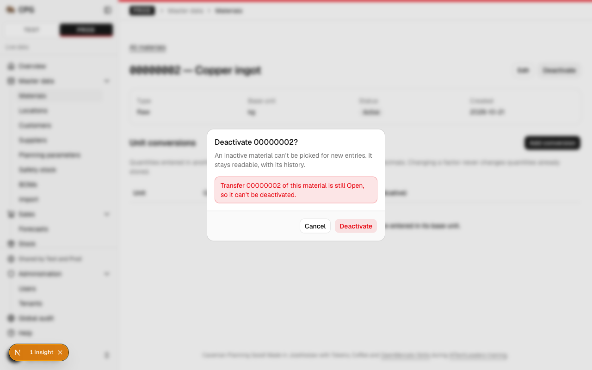
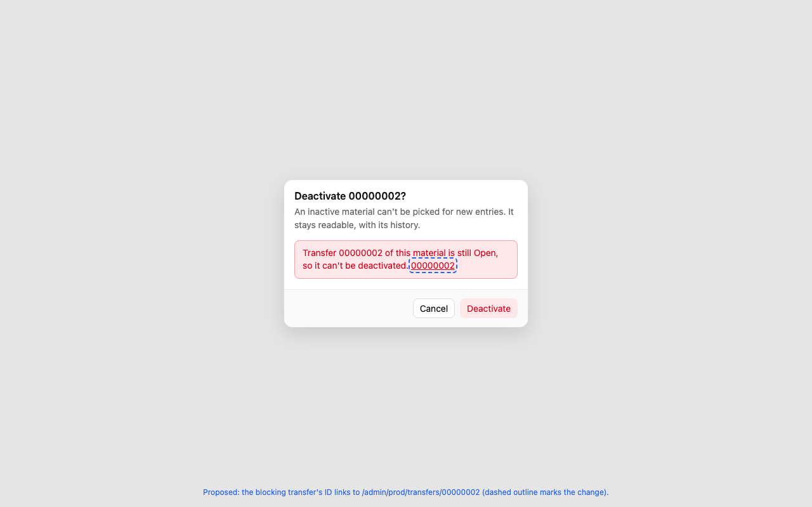

# A user refused a deactivation by an Open transfer opens that transfer from the message, and the stock import's remaining scenarios are proven

**Status:** implemented
**Created:** 2026-10-21 20:35 UTC
**Issue:** #139 (E07-S04), epic #73 · **Builds on:** `implemented/2026-10-20--2046UTC-transfers.md` (#82: `LOCATION_HAS_OPEN_TRANSFERS`, `MATERIAL_IN_OPEN_TRANSFER`), `implemented/2026-10-20--2047UTC-production-orders.md` (#88: the production-order blocker link this reuses), `implemented/2026-10-20--2225UTC-stock-import.md` (#81), `implemented/2026-10-20--1634UTC-stock-ledger-corrections.md` (#80: `STOCK_NOT_EMPTY`) · **Design authority:** `.ai/specs/product-brief.md` (R08, D04), `.ai/specs/research/CPG-acceptance.md` (LFC-016, LFC-018, STX-006, STX-018)

## 📝 TLDR

When an Open transfer blocks deactivating a location or a material, the refusal today names the transfer's ID as plain text, while a production-order refusal links to the blocking order. After this change the transfer refusal links to `/admin/{tenant}/transfers/{id}` too, in English and Polish, on the location and material screens, through the same formatter the production-order refusals use. It also adds the three tests the E07 closure found missing: a stocked site the stock-import workbook leaves out (STX-006), the admin's own attribution on a UI stock-import commit (STX-018), and the location `STOCK_NOT_EMPTY` refusal's parameters (LFC-016). No rule, contract or schema changes.

## Resolved assumptions (autonomous defaults)

The run is autonomous (cezar, `/om-auto-fix-issue 139`). Each choice is the most reversible one the issue allows, published here for override.

| # | Question | Chosen answer | Rationale |
|---|---|---|---|
| Q1 | Generalise or copy the production-order link? | Generalise. `components/production-orders/production-blocker-error.tsx` becomes `components/master-data/deactivation-blocker-error.tsx` (`deactivationBlockerError`), driven by one `Map` from refusal code to the parameter naming the document and the route segment that opens it (a `Map`, so an inherited key such as `constructor` never matches). Its two callers (`material-controls.tsx`, `named-record-actions.tsx`) switch to it. | D04 and the issue: reuse the production-order link. The formatter serves master deactivation, not production orders, so it moves next to the other cross-master UI (`master-data/references.tsx`). A second copy would be two places to keep in step. |
| Q2 | Change the message copy? | No. The link is the transfer ID appended after the translated message, as for production orders (`… still Open from or to this location. 00000003`). | Smallest visible change; the message already names the ID, and both languages keep their wording. |
| Q3 | Where else could a transfer refusal appear? | Out of scope: the API keeps returning `code` and `params.transfer` (already the case), and the master-data import's report keeps its text. Only the two Deactivate confirmations show it. The edit forms share the formatter but never send `active: false`, so they can't receive these refusals. | The issue names the location and material screens. |
| Q4 | Include the optional LFC-016 assertion? | Yes: a `messageParams` assertion on the location `STOCK_NOT_EMPTY` refusal, beside the material one in `stock.service.test.ts`. | Test-only and one line; it lets LFC-016 cite a location-side assertion. |
| Q5 | How is STX-018 proven for the admin? | STX-018 is a "Both" scenario, so on both channels. UI: the commit action, given an admin session, passes the admin's `uiActor` (account, session, `ui`) to the service; and an integration test commits as the admin in the browser, then reads the tenant audit API from the admin's signed-in session and finds `admin`, channel `ui` and a session ID on each of its movement entries. API: the admin's existing token commit in `stock-import-api.test.ts` also asserts its movements name `admin` and channel `api`. No new service test: the service never sees the role, and its actor pass-through is already proven with the normal user's actor. | The normal user is proven by the service test, the action test and the API integration test. `sessionId: expect.any(String)` is the established integration check (`stock.test.ts`, `test-reset.test.ts`). |
| Q6 | Where is STX-006 proven? | A service test with three locations holding stock and a workbook listing positions at one of them: the other two locations' balances are unchanged and get no movement. | Same level as STX-007's evidence; the commit rule doesn't depend on the channel. |

## 📝 Problem Statement

`CPG-acceptance.md` leaves three E07 scenarios at `Partially verified`:

- **LFC-018** asks for "blocking document links". The refusal names the transfer (`params.transfer`, the eight-digit business ID) but the dialog shows it as text, so the user must go to Transactions → Transfers and find it by hand. Production-order refusals already link.
- **STX-006** asks that sites the workbook leaves out stay exactly unchanged. The tests use two locations, so a site absent from the workbook is never asserted.
- **STX-018** asks that both roles commit with their own attribution. Only the normal user's is asserted.

## 📝 Proposed Solution

```tsx
// components/master-data/deactivation-blocker-error.tsx
const BLOCKERS = new Map([
  ["MATERIAL_HAS_PRODUCTION_ORDERS", { param: "order", route: "production-orders" }],
  ["LOCATION_HAS_PRODUCTION_ORDERS", { param: "order", route: "production-orders" }],
  ["LOCATION_HAS_OPEN_TRANSFERS", { param: "transfer", route: "transfers" }],
  ["MATERIAL_IN_OPEN_TRANSFER", { param: "transfer", route: "transfers" }],
]);
```

`deactivationBlockerError(labels, tenant)` returns the same `formatError` function shape as today: the translated text, followed by a `next/link` to `/admin/{tenant}/{route}/{id}` when the code is in the map and its parameter matches `BUSINESS_ID_PATTERN`. Any other code, a missing parameter or a malformed one renders the text alone, as today (the pattern check keeps a crafted parameter out of the URL).

Alternative rejected: a second `transferBlockerError` composed with the first. Two formatters chained in two callers for one rule.

## 📝 UI/UX

The refusal in the Deactivate confirmation on a location's row menu and on a material's page:

- before: "Transfer 00000003 is still Open from or to this location."
- after: "Transfer 00000003 is still Open from or to this location. [00000003](/admin/prod/transfers/00000003)"

Polish: "Przesunięcie 00000003 z tej lub do tej lokalizacji jest nadal otwarte. [00000003]". Same underline style as the production-order link.

Today, on a material's page (dev server, an Open transfer of a material with no stock):



Proposed (illustrative mockup, the dashed outline marks the change):



Prototype: `../assets/transfer-refusal-links/mockup-01-material-refusal.html`

## 📝 Edge Cases & Failure Scenarios

- The transfer was completed between the refusal and the click: its page opens and shows it Completed; retrying the deactivation succeeds.
- A refusal from an older server without `params.transfer`: the text alone, as today.
- A parameter that isn't an eight-digit ID: no link (existing test case, kept).

## 📝 Risks & Impact Review

Client-only change to one component and its two imports, plus tests. No API, schema, permission or audit change; no `BACKWARD_COMPATIBILITY.md` surface is touched (the moved component is internal to `@cpg/app`). Rollback is a revert.

## 📝 Decisions in play

- **R08** (append-only audit with account, session and channel): STX-018's tests prove it for the admin's import commit; nothing new is written.
- **D04** (the simplest consistent behaviour wins): the transfer link reuses the production-order link.

## 📋 Implementation Plan

### Phase 1 — Link transfer refusals (LFC-018)

1. Move `production-blocker-error.tsx` and its test to `components/master-data/deactivation-blocker-error.tsx`, generalised to the code map above; switch `material-controls.tsx` and `named-record-actions.tsx`. Unit test: each of the four codes links to its route; other codes (an inherited key such as `constructor` included), missing and malformed parameters don't; English and Polish messages render with the link.
2. Integration (`tests/integration/transfers.test.ts`): deactivation checks physical stock before transfers (`location.service.ts`, `material.service.ts`), so the test uses its own material and two locations with no physical stock anywhere, and an Open transfer between them that is never dispatched. The admin's Deactivate on the source location's row and on the material's page is refused, and the alert's link is `/admin/prod/transfers/{id}`.

### Phase 2 — Prove the stock import's remaining scenarios (STX-006, STX-018, LFC-016)

3. `stock-import.service.test.ts`: a third location; stock at all three, a workbook listing only one, the other two unchanged with no new movement (STX-006).
4. `stock-import/actions.test.ts`: an admin session commits with the admin's `uiActor` (STX-018).
5. `tests/integration/stock-import.test.ts` (STX-018, UI): the `dryRun`/`table` helpers take the browser they drive instead of always `sam`, and the admin's browser stays open for the file. The admin commits a workbook for a material of its own (so `sam`'s positions don't move) with a reason only this test uses. The test then reads `GET /api/tenants/prod/audit` from the admin's signed-in session (cookie `GET`s need no token), keeps the `stock.movement.posted` entries with that reason, and asserts each names `admin`, channel `ui` and a session ID. The audit API has no action or reason filter and other files post movements in Prod, so the test filters the entries itself, and never by account or channel, which would make the assertion vacuous.
6. `tests/integration/stock-import-api.test.ts` (STX-018, API): the admin's existing token commit also asserts its movements name `admin` and channel `api`.
7. `stock.service.test.ts`: the location `STOCK_NOT_EMPTY` refusal carries `messageParams` (LFC-016).

The two phases land as separate commits on one PR, so either can be reverted alone.

### Phase 3 — Paperwork

8. `CPG-acceptance.md`: LFC-018, STX-006 and STX-018 become `Passed (automated)` with Evidence naming the new tests; LFC-018's Evidence replaces the moved `production-blocker-error.test.tsx` path; LFC-016's Evidence adds the location assertion. Move this spec to `implemented/`.

## Implementation notes

- Implemented on PR #151 (`feat/transfer-refusal-links`, based on this spec's PR #149), as planned.
- After the refusal's link is followed, Next.js keeps the material page mounted but hidden (`display: none`, React Activity), with its open Deactivate dialog. The transfer page shows and stays interactive. So `transfers.test.ts` waits for the transfer's shown heading, not for the dialog to disappear.
- STX-018's UI test also checks that the admin's session differs from the normal user's, to show that the admin's attribution uses the admin's own session.
