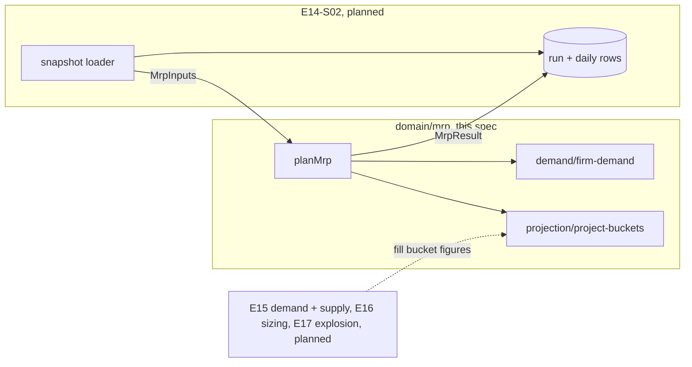

# MRP engine: 90 daily buckets from physical stock and open customer-order demand

**Status:** implemented
**Created:** 2026-10-27 05:25 UTC
**Issue:** #273 (E14-S01, epic #266) · **Depends on:** customer orders (`implemented/2026-10-20--1635UTC-customer-orders.md`, #83), the stock ledger (`implemented/2026-10-20--1634UTC-stock-ledger-corrections.md`, #80), the document lifecycle (`implemented/2026-10-21--0707UTC-document-lifecycle.md`), the demand review's time axis and D08 netting (`implemented/2026-10-25--0913UTC-demand-review.md`) · **Design authority:** `.ai/specs/product-brief.md` (R03, R09, R10, D02, D08, N01, N04), `research/CPG-prd001.pdf` §04, `research/CPG-acceptance.md` MRP-003/004/007/008, INV-008, SAL-004/017

## 📝 TLDR

Slices 1 and 2 record stock and demand, but nothing projects them forward, so nobody can see when a material at a location will run short. This spec adds the pure, framework-free core of MRP to `@cpg/core`: `planMrp(inputs, today)`. It takes a snapshot of physical stock and customer-order lines and returns exactly 90 daily buckets, today through day 89, for every material and location the snapshot names. Each day's balance starts from today's physical stock and subtracts the outstanding demand of open order lines. The balance may go negative; the snapshot is never changed.

The spec also fixes the shapes every later MRP story builds on (E14-S02 stores them, E15–E17 fill them, E18 reports them): `MrpInputs`, `MrpResult`, the bucket's figures, and the seam folders, so those stories can be built in parallel.

## 📝 Problem Statement

Planning needs one calculation with fixed input and output shapes. Without it, E14-S02 (run and store), E15 (forecast, supply), E16 (proposals, exceptions), E17 (BOM explosion) and E18 (report) would each invent their own projection, or wait for each other. PRD §04 fixes the rules this story owns:

- 90 daily buckets starting today, with no extra buckets for later dates (MRP-003, MRP-004);
- the projection starts from physical stock (MRP-007) and may go negative while physical stock stays put (MRP-008, INV-008, R09);
- overdue unfulfilled order demand moves to today and keeps its original date (SAL-017);
- quantities are exact six-decimal decimals (R03), and an internal stable-ID tie-breaker keeps results deterministic (PRD §04 closure defaults).

## Resolved assumptions (autonomous defaults)

The issue's open questions and the gaps between its notes and the later stories, answered with the most reversible choice. Nothing is stored yet, so each can still change before E14-S02 lands.

| # | Question | Applied default | Why |
|---|---|---|---|
| Q1 | Which material × location pairs does a run plan? | The pairs the snapshot names: the union of pairs with a stock row (even of zero) and pairs with at least one firm-demand item inside the horizon. A pair whose only lines are fully issued, closed or beyond day 89 isn't planned. Each later seam adds the pairs its own inputs name (supply, forecasts, safety targets, planning parameters). The engine plans no pair the snapshot doesn't name. | Keeps stored rows proportional to real data (≤ 30 pairs on the realistic dataset, not materials × locations). E14-S02's loader decides which stock rows it passes, so "every active pair" stays a loader change, not an engine change. |
| Q2 | Is the shortage below zero only, or below the safety target too? | Below zero only: `shortage = max(0, −projectedBefore)`. | PRD §04: "negative projected balance with deficit". The safety-target gap is E15-S01's and E16-S01's, sized against `safetyTarget`. |
| Q3 | Are the result's figures strings or `bigint`? | `bigint` micro-units, as `netForecasts` uses. E14-S02 formats them with `formatDecimal(…, { fixed: true })` when it stores them. | R03 arithmetic stays in `bigint` end to end; strings belong at the storage and HTTP boundaries. |
| Q4 | Does the bucket's list of figures cover E15–E17? | The issue's list misses three figures later stories fill: `dependentDemand` (component needs of open production orders, E15-S03, and of Make proposals, E17-S01), `transferOut` and `transferIn` (planned dispatch at the source and receipt at the destination, E15-S03). They are added. The issue's "safety demand" is `safetyTarget`, a level the balance is compared with, not a flow subtracted from it. | The issue's own criterion: the bucket already carries every figure E15–E17 fill, so E14-S02's table never changes shape. |
| Q5 | Does at-risk supply count in the projected balance? | No. `atRiskSupply` is shown, but the balance counts only tentative, dependable and transfer receipts. | PRD §04 excludes an at-risk order's output "from dependable inventory". E17-S03 owns how it suppresses replacement proposals. |
| Q6 | Does the input carry removed and closed lines? | Yes, flagged (`removed`, `status`), and the firm-demand seam filters them. | E15-S01 needs every non-removed line, whatever its status, to consume forecasts (`ConsumingOrderLine`); one input list serves both. |
| Q7 | Reuse `outstandingQuantity` on strings, or `bigint`? | Extract the arithmetic as `outstandingMicro(quantity, processed, abandoned)` on `bigint` in `lifecycle.ts`: `quantity − processed − abandoned`, never below zero. `outstandingQuantity` keeps its signature and its Cancelled/Closed Early rule, and delegates the rest. | One rule for the remainder, without formatting and re-parsing every line. E15-S02 and E15-S03 reuse it too. |
| Q8 | Split the story? | No. The types and the projection are one capability: neither works without the other. | Spec-writing's split check. |

## 📝 Proposed Solution

A pure module in `packages/core/src/domain/mrp/`. No database, no services, no Next.js: it imports only `domain/quantities`, `domain/document-lifecycle` and `domain/demand`.

```
domain/mrp/
  plan-mrp.ts          planMrp(inputs, today): MrpResult — wires the seams
  mrp-inputs.ts        MrpInputs and the input row types
  mrp-result.ts        MrpResult, MrpPlan, MrpBucket, MrpFirmDemand, MrpProposal
  projection/
    horizon.ts         MRP_HORIZON_DAYS = 90, horizonDates(today)
    pairs.ts           pairKey(material, location), comparePairs
    project-buckets.ts MrpFlows, emptyFlows(date), projectBuckets(physical, flows): MrpBucket[]
  demand/
    firm-demand.ts     firmDemand(orderLines, dates): MrpFirmDemand[]
```

`supply/`, `sizing/`, `exceptions/` and `explosion/` are created by the stories that fill them. Each later story adds its input list as one property of `MrpInputs`, its figures through its own module, and one call in `planMrp`. Those two lines are the only places it shares with another story.

**Alternatives considered.**
- *One `bucket` row per figure (long format).* It's flexible, but the report and the weekly fold would pivot every read. A fixed set of named figures is what E14-S02 stores and E18 shows.
- *Results keyed by UUID.* Rejected: the lesson "Sort and page by business ID" (2026-10-21). The engine sees only material and location codes and order codes.
- *Folding beyond-horizon demand into day 89.* Rejected by MRP-004. Day-90 demand is in no bucket.

## 📝 Architecture

### Inputs

```ts
/** What the engine plans from; every quantity is base-unit micro-units (R03), every date ISO `YYYY-MM-DD`. */
export interface MrpInputs {
  stock: readonly MrpStock[];
  orderLines: readonly MrpOrderLine[];
}

/** Physical on-hand of one material at one location today; in-transit is never physical. */
export interface MrpStock {
  material: string;   // material code
  location: string;   // location code
  physical: bigint;
}

/** A customer-order line with its order's location (SAL-004), any status, removed lines included. */
export interface MrpOrderLine {
  order: string;      // order code (business ID)
  position: number;   // line position: (order, position) is the line's business ID
  material: string;
  location: string;
  requiredDate: string;
  quantity: bigint;
  fulfilled: bigint;
  abandoned: bigint;
  status: DocumentState;
  removed: boolean;
}
```

`MrpOrderLine` is assignable to `ConsumingOrderLine` (`domain/demand/forecast-netting.ts`), so E15-S01 passes the non-removed lines to `netForecasts` unchanged.

### Firm demand (`demand/firm-demand.ts`)

A line adds firm demand when it is `open` and not `removed` (the status filter is the rule; only open lines reach the arithmetic). Its outstanding quantity is `outstandingMicro(quantity, fulfilled, abandoned)`: `quantity − fulfilled − abandoned`, never below zero, so a fully issued or over-issued line adds nothing. A line with zero outstanding is dropped. The demand is placed on `max(requiredDate, today)`: an overdue line counts today and keeps its `requiredDate` (SAL-017). A line placed after the horizon's last day is in no bucket (MRP-004). Lines of one pair on one day add up, and each stays in the plan's `firmDemand` list.

```ts
export interface MrpFirmDemand {
  order: string;
  position: number;
  material: string;
  location: string;
  requiredDate: string; // the original date, kept for D08 forecast consumption (E15-S01)
  date: string;         // the bucket it counts in: requiredDate, or today when overdue
  quantity: bigint;     // outstanding, > 0
}
```

### Projection (`projection/`)

`horizonDates(today)` returns the 90 dates `today … today + 89` through `addDays` (`domain/demand/demand-buckets.ts`, UTC days). For 1 October 2026 that is 1 October through 29 December.

`projectBuckets(physical, flows)` turns 90 days of flows into buckets. `MrpFlows` is a bucket without its three derived figures (`Omit<MrpBucket, "projectedBefore" | "projectedAfter" | "shortage">`), and `emptyFlows(date)` is one with every figure zero. `planMrp` starts each pair's 90 days from `emptyFlows` and adds each firm-demand item to its day's `firmDemand`; later seams add their figures the same way. A bucket carries every figure the MRP stories fill. This story fills `firmDemand` and the balances; the others are zero. The figure list is provisional until E14-S02 stores it as columns:

```ts
export interface MrpBucket {
  date: string;
  firmDemand: bigint;        // E14-S01: open customer-order lines (overdue ones today)
  forecastDemand: bigint;    // E15-S01: forecast residual after D08 netting
  dependentDemand: bigint;   // E15-S03 open production orders' components, E17-S01 Make proposals' components
  transferOut: bigint;       // E15-S03: planned dispatch at the source
  tentativeSupply: bigint;   // E15-S02: open purchase requisitions
  dependableSupply: bigint;  // E15-S02 purchase orders, E15-S03 executable production output
  atRiskSupply: bigint;      // E17-S03: shown, never counted in the balance
  transferIn: bigint;        // E15-S03: planned receipt at the destination
  proposedReceipts: bigint;  // E16-S01: proposals received this day
  safetyTarget: bigint;      // E15-S01: the target in force this day, a level
  projectedBefore: bigint;   // the balance at the end of the day, before proposals
  projectedAfter: bigint;    // projectedBefore plus every proposed receipt up to this day
  shortage: bigint;          // max(0, −projectedBefore)
}
```

The balance, day by day, with `previous` being `physical` on day 0:

```
projectedBefore = previous + tentativeSupply + dependableSupply + transferIn
                           − firmDemand − forecastDemand − dependentDemand − transferOut
projectedAfter  = projectedBefore + Σ proposedReceipts of days 0…d
shortage        = max(0, −projectedBefore)
```

So same-day receipts offset same-day demand (PRD §04 closure defaults). With no supply and no proposals, `projectedAfter` equals `projectedBefore`.

### Result

```ts
export interface MrpResult {
  today: string;
  dates: readonly string[];          // the 90 horizon dates
  plans: readonly MrpPlan[];         // one per planned pair, by material code then location code
  proposals: readonly MrpProposal[]; // empty until E16-S01
}

export interface MrpPlan {
  material: string;
  location: string;
  physical: bigint;                      // today's physical stock: the opening balance of day 0
  buckets: readonly MrpBucket[];         // exactly 90, in date order
  firmDemand: readonly MrpFirmDemand[];  // the items behind the buckets' firmDemand
}

/** A proposed receipt. E16-S01 adds its kind, need date and lead time; E16-S02 its timing marks. */
export interface MrpProposal {
  material: string;
  location: string;
  date: string;
  quantity: bigint;
}
```

`planMrp` groups the stock rows (several rows of one pair add up) and the firm demand by `pairKey`. It plans the union of their pairs (Q1) and sorts the plans with `comparePairs`: material code, then location code, by code-unit order (`<`), never `localeCompare`. A pair with demand but no stock row starts from zero. `firmDemand` items sort by `date`, `requiredDate` and `order` (code-unit order), then `position` (numeric), so the result never depends on input order. The engine reads its inputs and never writes them (R09, R10).

Dates are zero-padded ISO `YYYY-MM-DD` texts, which compare correctly as strings; that is a precondition of the snapshot and of `today`, which E14-S02 takes from the server's UTC date, as `DemandReviewService` does.



This spec builds the middle box. The planned stories plug into it without changing the shapes it fixes.

## 📝 Data Model

None. No entity or migration; E14-S02 stores the result.

## 📝 Edge Cases & Failure Scenarios

- **Overdue line (SAL-017).** 50 due 30 September, 20 issued, today 1 October: 30 counts on 1 October, `requiredDate` stays 30 September.
- **Day-90 line (MRP-004).** Due 30 December with today 1 October: in no bucket and not in `firmDemand`. With no other data for the pair, the pair isn't planned (Q1). E16-S02's Beyond Horizon proposals are a separate list.
- **Closed early, cancelled, removed, fully issued, over-issued.** No demand. Over-issue clamps to zero rather than adding supply.
- **Rounding (R03).** Physical 0.3 minus three lines of 0.1 is exactly `0n`; there is no float anywhere.
- **Year boundary.** `horizonDates("2026-12-15")` crosses into 2027 through UTC day arithmetic, with no daylight-saving shift.
- **Malformed snapshot.** The loader (E14-S02) builds the snapshot from validated stored data, so the engine doesn't re-validate dates or quantities. A missing parameter or an unconvertible unit is E16-S03's exception seam, not a throw here.
- **Size.** Pairs × 90 buckets, linear in lines. On the realistic dataset (≤ 30 pairs) that is under 3,000 buckets. E14-S02 measures the whole run.

## 📝 Risks & Impact Review

- **The shapes are an internal contract for about fifteen stories.** They are TypeScript types inside `@cpg/core`, not an API, schema or `BACKWARD_COMPATIBILITY.md` surface. Changing them before E14-S02 stores them costs only code; after that, each figure is a column. That is why the bucket carries every figure now (Q4).
- **`outstandingQuantity` gains a `bigint` twin.** Its signature and behaviour are unchanged; its existing tests still pass.
- **Rollback.** Pure code with no data: reverting the PR removes it.

## 📝 Decisions in play

R03 (exact six-decimal quantities), R09 (physical stock never negative; MRP may project negative), R10 (MRP never rewrites documents), D02 (MRP only after every document works manually), D08 (forecast consumption by calendar month: not applied here, but the order-line input keeps what E15-S01 needs), N01 (no costs), N04 (no capacity, calendars or hard reservations). None is superseded.

## 📋 Phasing

One phase, one PR: the engine, its types and its unit tests. No route, screen or migration, so no integration test (E14-S02 adds those).

## 📋 Implementation Plan

1. **`outstandingMicro`.** In `domain/document-lifecycle/lifecycle.ts`, add `outstandingMicro(quantity, processed, abandoned)` on `bigint`. Make `outstandingQuantity` keep its Cancelled/Closed Early rule, then parse, delegate and format. Tests in `lifecycle.test.ts`: the remainder, clamped at zero after over-processing; `outstandingQuantity`'s existing tests unchanged.
2. **Types.** Add `mrp-inputs.ts` and `mrp-result.ts` as written above, with doc comments naming the story that fills each figure. A type-level test (`expectTypeOf<MrpOrderLine>().toExtend<ConsumingOrderLine>()`) pins the netting reuse E15-S01 relies on.
3. **Horizon and pairs.** Add `projection/horizon.ts` (`MRP_HORIZON_DAYS`, `horizonDates`) and `projection/pairs.ts` (`pairKey`, `comparePairs`). Tests: 1 October gives 90 dates through 29 December, with no gap or repeat (MRP-003); a horizon that crosses a year boundary; pair order by material, then location.
4. **Firm demand.** Add `demand/firm-demand.ts`. Tests: open/removed/status filtering, outstanding clamped at zero, overdue placed today with its original date (SAL-017), day 90 excluded (MRP-004), items sorted by date, required date, order and position.
5. **Projection.** Add `projection/project-buckets.ts` with `MrpFlows` and `emptyFlows(date)`. Tests: every flow figure in the balance formula with its sign, at-risk not counted, cumulative proposed receipts in `projectedAfter`, shortage only below zero.
6. **`planMrp`.** Add `plan-mrp.ts`, wiring horizon, firm demand and projection. One test per acceptance criterion of #273, with today fixed at 1 October 2026: 90 dated buckets per pair; day-90 demand in no bucket; 100 − 40 on 15 October (MRP-007); 5 − 20 → −15 and a frozen snapshot still at 5 (MRP-008, INV-008); the overdue 30 (SAL-017); the closed, cancelled, removed and over-issued lines; two same-day lines summed and a third on its own day; 0.3 − 3 × 0.1 = `0n` with every figure a `bigint` (R03); a shuffled snapshot giving an equal result; zero figures and `projectedAfter = projectedBefore` with no supply. Pairing cases too: two stock rows of one pair summed; a demand-only pair starting at zero; a stock-only pair; plans in code-unit order; an empty snapshot giving no plans; a pair whose only line is beyond day 89 or fully issued staying unplanned.
7. **Docs.** In `.ai/docs/engineering-standards.md`, next to the demand bullet, add one bullet on `domain/mrp/`: the seams, the shapes and the one-property, one-call rule for later stories. Move this spec to `implemented/`.

Each step leaves the suite green. Run `npm run lint`, `npm run typecheck`, `npm run test:coverage` (100%) and `npm run build`.

## Implementation notes

Implemented on #295 (stacked on the spec PR #294), as written:
- `packages/core/src/domain/mrp/`: `plan-mrp.ts`, `mrp-inputs.ts`, `mrp-result.ts`, `projection/{horizon,pairs,project-buckets}.ts`, `demand/firm-demand.ts`;
- `outstandingMicro` in `domain/document-lifecycle/lifecycle.ts`.

`projection/pairs.ts` also exports `compareCodes`, the code-unit comparison that the pair order and the firm-demand order share.

Each acceptance criterion of #273 has its own test in `plan-mrp.test.ts`, with today fixed at 1 October 2026. `firm-demand.test.ts` pins `MrpOrderLine` as a `ConsumingOrderLine` with `expectTypeOf`, which `npm run typecheck` checks.

No acceptance-catalogue row moves: MRP-003/004/007/008, INV-008 and SAL-017 are "Both"-channel scenarios, which run once E14-S02 exposes a run through the UI and API.

