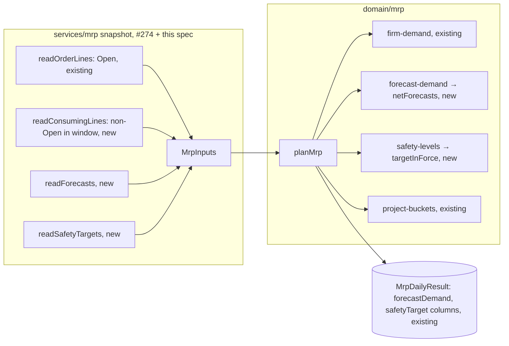

# MRP demand: forecast residual by calendar month, overdue orders today, and each day's safety-stock target

**Status:** implemented
**Created:** 2026-10-31 09:02 UTC
**Issue:** #275 (E15-S01, epic #267) · **Depends on:** the MRP engine (`implemented/2026-10-27--0525UTC-mrp-engine-projection.md`, #273), MRP runs and the snapshot loader (`implemented/2026-10-27--0556UTC-mrp-runs.md`, #274), forecasts (`implemented/2026-10-20--1700UTC-forecasts.md`, #85), safety-stock targets (`implemented/2026-10-20--0532UTC-planning-parameters-safety-stock.md`), the demand review's D08 netting (`implemented/2026-10-25--0913UTC-demand-review.md`, #240) · **Design authority:** `.ai/specs/product-brief.md` (R03, R05, R10, D04, D08, N01), `research/CPG-prd001.pdf` §04 "Demand and forecast consumption", "Overdue demand and priority", "Projection and safety stock", `research/decisions/D08-statistical-unit-and-demand-review.md`, `research/CPG-acceptance.md` DEM-002…016, DEM-024/025, MRP-043/048, SAL-014…016/019, REV-015

## 📝 TLDR

Today an MRP run projects physical stock against open customer orders only. A material with a forecast and no orders looks covered, and the safety-stock target is always zero. After this change every run also plans the forecast not yet ordered, netted by calendar month exactly as the demand review nets it (D08, `netForecasts`), and carries the safety-stock target in force each day. The projected balance and its shortages then reflect the forecast, and a pure `safetyGap` shows how far each day's balance falls below its target. No migration, route or screen changes: the stored run already has the `forecastDemand` and `safetyTarget` columns, which stop being always zero.

## 📝 Problem Statement

E14-S01 (#273) left two bucket figures for this story: `forecastDemand` ("forecast residual after D08 netting") and `safetyTarget` ("the target in force this day, a level"). E14-S02 (#274) stores both and the API returns them, but nothing fills them yet. Two things go wrong while that lasts:

- **Forecast-only demand is invisible.** A finished product forecast at 100 with no orders has no plan at all (#273 Q1 plans only pairs with stock or firm demand). With stock, its balance never falls. PRD §04 plans firm demand plus the forecast residual.
- **MRP and the demand review would disagree.** D08 changed the consumption window from the forecast's own date to its calendar month. The demand review (#240) nets that way in `domain/demand/forecast-netting.ts`, and its spec says MRP inherits D08 from that function. A second netting rule in MRP would bring back the overstatement D08 fixed.

Overdue firm demand already moves to today with its original date kept (SAL-017, `demand/firm-demand.ts`). This story keeps that and adds the forecast side of the past-day rules: an overdue order still consumes its own month's forecast (DEM-013), an earlier residual of the current month counts today, and the forecasts of ended months expire (DEM-025 and MRP-048 as D08 restates them).

## Resolved assumptions (autonomous defaults)

The issue's open questions, plus the gaps between its notes and the shipped engine and loader, each answered with the most reversible choice. Nothing here adds a stored column, a route or a public contract.

| # | Question | Applied default | Why |
|---|---|---|---|
| Q1 | DEM-025 and MRP-048 say a residual dated before today always expires; D08 decision 3 and `netForecasts` count a residual of the **current month** dated before today as due today. Which does MRP follow? | D08, unchanged: `netForecasts` decides. A residual of an ended month expires; one earlier in the current month counts today. DEM-025 and MRP-048 get a "**Superseded by D08 (2026-10-25):**" note in `CPG-acceptance.md`, worded as DEM-007's is, pointing at D08 decision 3. The owner confirms on the PR. | D08 decision 3 says so in plain words, and the demand review already ships it. MRP planning another figure than the review is the defect D08 fixed. The criteria in #275 already follow D08. |
| Q2 | Is the safety gap (target minus projected balance, never below zero; MRP-043) a stored figure? | No. A pure `safetyGap(bucket)` = `max(0, safetyTarget − projectedBefore)` in `projection/`, tested on `planMrp`'s buckets. `shortage` stays "below zero only" (#273 Q2), and the target never enters the balance (#273 Q4). | No migration, no API field. E16-S01 sizes proposals from the gap in memory. E18-S01 can show it from the two stored figures, or add a column if the report needs one. |
| Q3 | Which pairs do forecasts and targets add to a run (#273 Q1: "each later seam adds the pairs its own inputs name")? | A pair is planned when it has a forecast item, meaning a residual above zero placed inside the horizon. A pair is also planned when a safety target is in force on at least one horizon day, whatever its quantity. A fully consumed or expired forecast names no pair, as a fully issued line names none. | The same rules #273 Q1 gives stock rows (even of zero) and firm demand (only above zero). A target-only pair must be planned: its gap is what E16-S01 proposes against. |
| Q4 | Does the plan list the forecasts behind `forecastDemand`, as it lists `firmDemand` items? | Yes. `MrpPlan.forecastDemand` holds one `MrpForecastDemand` per counted residual, in memory only. The run stores only buckets, as it does for `firmDemand`. | E16-S02's priority order (customer order, then forecast, then safety stock) and E18-S01's explanation need the items. The same pattern as `firmDemand`, and nothing is stored. |
| Q5 | How does the loader read the lines that consume forecasts, given #274's lesson on `required_date` ranges? | Two reads. The existing Open-line read stays as it is, and only its in-code cut-off moves: from the day after the horizon to the end of the horizon's last month. A new read takes the non-Open, non-removed lines due in the consumption window: from the first day of today's month to the end of day 89's month. It runs one calendar month per query through `(tenant, required_date)`, with a yield between queries. A plan test pins the index. The fallback, should the plan start from the `customer_order` join and walk the tenant, keeps the `(tenant, required_date)` range, drops `populate: ["order"]`, and reads the orders' `code` and `location` in a separate `id $in` read (lesson 2026-10-25: "read it in its own query when that join walks"). #274's material-chunk fallback is not used here, because with the date checked in code it would hydrate every Completed line ever. | The Open read is tuned and measured, so this change doesn't touch it. The new read is a bounded date range of at most four months, the shape `(tenant, required_date)` serves. Monthly queries keep each event-loop stall short. |
| Q6 | How does the engine take safety targets, given `safetyTargetOn` works on six-decimal texts? | As `MrpSafetyTarget { material, location, effectiveFrom, quantity: bigint }`. `targetInForce` widens its type parameter to any `{ effectiveFrom: string }`, so the engine reuses the one rule. `safetyTargetOn` and `targetStatus` keep their signatures and behaviour. | One effective-date rule (DEM-015/016), and `bigint` arithmetic end to end in the engine (#273 Q3). |
| Q7 | Split forecast netting and safety targets into two stories? | No. | They are one backlog story (E15-S01). Both add an input to `MrpInputs`, a read to the snapshot loader and a call in `planMrp`, and each is small. A split costs a second spec and PR round for no independent value. |
| Q8 | Does user-visible copy change? | Yes, only the MRP help topic (EN and PL). Its first paragraph says a run takes away "what open customer orders still need". It gains the forecast not yet ordered, the month rule, and the safety-stock target. | The help would otherwise describe the run wrongly. No screen shows the new figures until E18-S01. |
| Q9 | An integration test, though the issue expects none? | Yes, one API test in `tests/integration/mrp-run-api.test.ts`. It creates a forecast and a safety target through the API, runs MRP and reads `forecastDemand` and `safetyTarget` back from the latest run. | The production image is the only proof that the loader's new reads reach the stored run. It adds no new page. |

## 📝 Proposed Solution

Two engine seams, three loader reads, and no storage change:

```
domain/mrp/
  mrp-inputs.ts           + forecasts: MrpForecast[], safetyTargets: MrpSafetyTarget[]
  mrp-result.ts           + MrpForecastDemand, MrpPlan.forecastDemand
  plan-mrp.ts             + one call per seam
  demand/
    forecast-demand.ts    forecastDemand(forecasts, orderLines, dates): MrpForecastDemand[]   (new)
    safety-levels.ts      safetyLevels(targets, dates): MrpSafetyLevels[]                      (new)
  projection/
    safety-gap.ts         safetyGap(bucket): bigint                                            (new)
domain/safety-stock/
  target-on.ts            targetInForce<T extends { effectiveFrom: string }>                   (widened)
services/mrp/
  mrp-snapshot.service.ts + two lines in load()
  snapshot/
    order-lines.ts        Open read cut-off → end of day 89's month; + readConsumingLines      (changed)
    forecasts.ts          readForecasts                                                        (new)
    safety-targets.ts     readSafetyTargets                                                    (new)
```

**Alternatives considered.**
- *Re-implementing netting inside `domain/mrp/`.* Rejected: D08 and the demand review spec make `netForecasts` the one rule. A copy would drift.
- *Storing a `safetyGap` column.* Deferred (Q2): it's derivable from two stored figures, and a column means a migration and an API change before any consumer exists.
- *Subtracting the safety target from the balance.* Rejected by #273 Q4 and PRD §04: the target is a level the balance is compared with, not demand that consumes stock.

## 📝 Architecture

### Inputs (`mrp-inputs.ts`)

```ts
export interface MrpInputs {
  stock: readonly MrpStock[];
  orderLines: readonly MrpOrderLine[];
  /** E15-S01: forecasts from the first day of today's month through day 89. */
  forecasts: readonly MrpForecast[];
  /** E15-S01: every safety-stock target effective on or before day 89. */
  safetyTargets: readonly MrpSafetyTarget[];
}

/** A forecast by business IDs: assignable to `DemandForecast`, so it goes to `netForecasts` unchanged. */
export interface MrpForecast {
  material: string;
  location: string;
  date: string;
  quantity: bigint;
}

/** One effective-dated safety-stock target (DEM-015/016). */
export interface MrpSafetyTarget {
  material: string;
  location: string;
  effectiveFrom: string;
  quantity: bigint;
}
```

`orderLines` still carries every status and the `removed` flag (#273 Q6). The loader now includes the non-Open lines of the consumption window (Q5).

### Forecast demand (`demand/forecast-demand.ts`)

`forecastDemand(forecasts, orderLines, dates)`, with `today = dates[0]` and `last = dates.at(-1)`:

1. Pass `forecasts` and the **non-removed** `orderLines`, whatever their status, to `netForecasts(forecasts, lines, today)`. The engine drops removed lines itself rather than trusting the loader (R05 and DEM-005/006 isolation stay `netForecasts`' material, location and month key).
2. Keep each netted forecast with `placedOn !== null`, `placedOn <= last` and `residual > 0n`. `placedOn` is the forecast's own date, or `today` for a residual of the current month dated before today. Forecasts of ended months come back with `null` and are dropped.
3. Return items sorted by `date`, `forecastDate`, material, then location (`compareCodes`), whatever the input order.

```ts
export interface MrpForecastDemand {
  material: string;
  location: string;
  /** The forecast's own date, kept when its residual counts today. */
  forecastDate: string;
  /** The bucket it counts in: `forecastDate`, or today for an earlier residual of this month. */
  date: string;
  /** The forecast as entered, before consumption. */
  forecastQuantity: bigint;
  /** The residual counted on `date`: > 0, at most `forecastQuantity`. */
  quantity: bigint;
}
```

Firm demand is unchanged. An open line adds `outstandingMicro(quantity, fulfilled, abandoned)` on `max(requiredDate, today)` (SAL-017, DEM-012). Consumption uses `quantity − abandoned` (inside `netForecasts`), so the two never double count: DEM-008 gives 30 firm plus 40 residual. Shipping never restores a forecast (DEM-009), and an edit counts from the current documents (SAL-019).

### Safety levels (`demand/safety-levels.ts`) and the gap (`projection/safety-gap.ts`)

`safetyLevels(targets, dates)` groups targets by `pairKey`. For each pair it returns `{ material, location, levels }`, with `levels[d] = targetInForce(pairTargets, dates[d])?.quantity ?? 0n`, and keeps only pairs with a target in force on at least one day (Q3). A rise from 20 to 40 on day 30 gives 20 on days 0–29 and 40 from day 30 on (MRP-043, DEM-016). A target superseded before today never shows (DEM-015).

`safetyGap(bucket) = max(0n, bucket.safetyTarget − bucket.projectedBefore)` is exported for E16-S01 and the tests. A pair without a target has `safetyTarget = 0n` on every day, so its gap is never above its shortage (DEM-014).

### `planMrp`

Two more loops after firm demand, each adding pairs through the existing `pairOf`:

```ts
for (const item of forecastDemand(inputs.forecasts, inputs.orderLines, dates)) {
  const pair = pairOf(item.material, item.location);
  pair.flows[dayOf.get(item.date)!].forecastDemand += item.quantity;
  pair.forecastDemand.push(item);
}
for (const { material, location, levels } of safetyLevels(inputs.safetyTargets, dates)) {
  const pair = pairOf(material, location);
  levels.forEach((level, day) => (pair.flows[day].safetyTarget = level));
}
```

`projectBuckets` is unchanged: it already subtracts `forecastDemand` and leaves `safetyTarget` out of the balance. `MrpPlan` gains `forecastDemand: readonly MrpForecastDemand[]`.

### Snapshot loader

`load(today)` computes `last = addDays(today, 89)`, `from = monthStart(today)` and `before = addMonths(monthStart(last), 1)`: the consumption window `[from, before)` covers every month a counted forecast can fall in, so the orders later in day 89's month still consume it.

- **`readOrderLines(em, codes, before)`** keeps its query. Only its in-code cut-off is now `before`, not `addDays(today, 90)`. Open lines between day 90 and the end of that month consume forecasts but add no firm demand: `firmDemand` already drops lines dated after `last`.
- **`readConsumingLines(em, codes, from, before)`** (new, in `order-lines.ts`): `{ removed: false, status: { $ne: "open" }, requiredDate: { $gte: monthStart, $lt: nextMonth } }`, one query per calendar month of `[from, before)`, with the same partial fields, `populate: ["order"]` and a `yieldToEventLoop()` after each. Completed, Closed Early and Cancelled lines consume `quantity − abandoned` (DEM-009/010/011). They never add firm demand, because the engine's status filter drops them.
- **`readForecasts(em, codes, from, last)`** (new, `snapshot/forecasts.ts`): `{ date: { $gte: monthStart, $lt: min(nextMonth, addDays(last, 1)) } }` per calendar month, through `(tenant, date)`, fields `material`, `location`, `date`, `quantity`, yielding between months. A forecast after day 89 is never read. Excluding it changes nothing earlier: `netForecasts` allocates a month's consumption in date order.
- **`readSafetyTargets(em, codes, last)`** (new, `snapshot/safety-targets.ts`): one partial read of the tenant's targets through `(tenant_code)`, `{ effectiveFrom: { $lte: last } }`, fields `material`, `location`, `effectiveFrom`, `quantity`. Targets are few: one per pair per change.

Every read goes through the request-scoped, tenant-filtered `em`, so a run reads only its own tenant (R05). Codes map through `readCodes`, as today.



The stored run, its API and its page are untouched. Two of the stored figures stop being always zero.

## 📝 Data Model

None. No entity, migration or index. `MrpDailyResult.forecastDemand` and `.safetyTarget` already exist (#274), and the reads use the existing indexes `customer_order_line(tenant, required_date)`, `forecast(tenant, date)` and `safety_stock_target(tenant_code)`.

## 📝 API Contracts

No shape change. `GET /api/tenants/{tenant}/mrp/runs/latest` returns the same fields. `forecastDemand` and `safetyTarget` now carry real values, and `projectedBefore`, `projectedAfter` and `shortage` reflect the forecast. A run may plan more pairs than before: pairs with only a forecast or only a target.

## 📝 UI/UX

No screen changes. The MRP help topic's first paragraph (`packages/app/src/help/topics.ts`, EN and PL) is rewritten to cover what a run now subtracts. Proposed EN text, with PL to match:

> MRP in the tenant menu plans every location of the tenant over the next 90 days, today included. For each material and location it starts from today's physical stock and takes away, day by day, what open customer orders still need and the forecast not yet ordered. An order line that is already overdue counts today. A forecast is reduced by the orders of its material and location due in its calendar month; what is left of an earlier forecast this month counts today, and forecasts of past months expire. Each day also carries the safety-stock target in force that day, which the balance is compared with but which takes nothing away. A projected balance can go below zero: that is a shortage to plan for, not a change to stock.

## 📝 Edge Cases & Failure Scenarios

All with today fixed in the tests:

- **Forecast-only pair.** Forecast 100 on day 5, no stock, no orders: the pair is planned and `projectedBefore` reaches −100 on day 5, with shortage 100 (DEM-004).
- **Fully consumed forecast.** Forecast 100, orders 120 in its month: residual 0, no forecast item, so the forecast names no pair (Q3) and firm demand is 120 (DEM-003).
- **Order later in the month, or in the next month.** A Tuesday order consumes Monday's forecast. One due on the 1st of the next month consumes none of it (DEM-007 per D08).
- **Allocation order.** Forecasts of 50 on the 1st and 50 on the 15th with orders of 70: residuals 0 and 30 (D08).
- **Consumer past the horizon.** Today 1 October, horizon to 29 December. A forecast of 100 on 20 December and an order of 60 due 30 December give a residual of 40 on 20 December. This is why the window runs to the end of day 89's month.
- **Forecast after day 89.** Not read, and it adds nothing (MRP-004).
- **Earlier residual this month.** A forecast of 100 on 5 October, with an order of 60 in October and today 20 October, gives a residual of 40 in today's bucket, with `forecastDate` 5 October (D08 decision 3).
- **Month end.** Forecast 100 on 31 August 2026 and an order of 60 due that day with 30 shipped; run 2 September: 30 firm today, and August's residual expired, so today's demand is 30 (DEM-025 per D08). Forecast 100 on 30 September and an order of 60 due 30 September with 20 fulfilled; run 1 October: 40 firm today, no forecast (MRP-048 per D08).
- **Closed Early, Cancelled, removed.** Forecast 100. An order of 60 with 30 issued and the rest closed early: firm 0, residual 70 (DEM-010). Cancelled before any issue: residual 100 (DEM-011). A removed line of 60 in the forecast's month consumes nothing: residual 100. The status-filter lesson (2026-10-27) applies. Closing early sets `abandoned` to the outstanding quantity (`lifecycle.ts`), so the DEM-010 line has nothing left by arithmetic. A second fixture therefore takes a Closed Early line whose issue was reversed (`fulfilled` 10, `abandoned` 30, a remainder of 20): firm demand stays 0 only through the status filter, and the residual stays 70. The removed fixture has a non-zero quantity in the forecast's month, so deleting the `removed` filter changes the residual.
- **Reversed final issue (REV-015).** The line is Open again with `fulfilled` lowered: firm demand counts the outstanding quantity again, and consumption is unchanged.
- **Safety targets.** No record: 0 on every day, gap never above the shortage (DEM-014). A target of 100 from 1 January: 100 on 1–15 January (DEM-015). 100 from 1 January and 150 from 1 February: the days switch at the boundary (DEM-016). A rise from 20 to 40 inside the horizon: the gap uses 20, then 40 (MRP-043). A target effective after day 89 names no pair.
- **Other tenant, other location, other material.** Contributes nothing (R05, DEM-005/006). The loader test seeds both tenants.
- **Rounding (R03).** Forecast 0.3 with three orders of 0.1 leaves exactly `0n`, and every figure is a `bigint`.
- **Size.** The benchmark's budgets hold with the new reads (Risks).

## 📝 Risks & Impact Review

- **Two stored figures change meaning from "always zero" to real values.** `forecastDemand` and `safetyTarget` exist in the API since #274, documented as E15-S01's. No client depends on them being zero. `BACKWARD_COMPATIBILITY.md` lists the route and its fields, not their values. The balances and shortages of pairs with forecasts change too: that is the point of the story.
- **More planned pairs.** Forecast-only and target-only pairs now get 90 stored rows each. On the realistic dataset every forecast pair already has stock, so the count stays at about 30.
- **Run time.** The benchmark (`mrp-run-timing.test.ts`) already seeds 3,100 and 31,000 forecasts for this story. It gains the non-Open lines of the window (already seeded: half the lines are Completed) and one safety target per pair plus one change inside the horizon. The budgets are unchanged: 1 s realistic, 5 s at ten times, and the longest event-loop stall under 250 ms. `planMrp` itself is one synchronous call: `netForecasts` keys every Open line, which has no lower date bound, and sorts about 29,000 forecasts at ten times, so the benchmark prints its time apart from the reads' stalls. If a monthly forecast read, or `planMrp`, at ten times stalls longer, split the read into half-months or drop lines of ended months before netting, before shipping (lesson 2026-10-22, "Measure a bulk write at its row cap").
- **Query plans.** `readConsumingLines` and `readForecasts` are new reads under the tenant filter. Their plans are pinned with the captured-SQL `EXPLAIN` pattern (lesson 2026-10-25, "EXPLAIN the query MikroORM really sends"), with the fallback in Q5.
- **Rollback.** Pure code with no data change. Reverting the PR returns the two figures to zero on the next run; stored runs keep whatever they planned.

## 📝 Decisions in play

R03 (exact six-decimal quantities), R05 (a run reads only its tenant), R10 (MRP runs on demand and never rewrites documents), D04 (simplest consistent behaviour where unspecified: Q2, Q3), D08 (calendar-month consumption, current-month residual today, ended months expire: applied unchanged through `netForecasts`), N01 (no finance). None is superseded. Q1 adds "Superseded by D08" notes to DEM-025 and MRP-048 under D08 decision 3, which the owner (Piotr12) confirms on the spec PR.

## 📋 Phasing

One phase, one PR: the two engine seams, the loader reads, the benchmark, one API integration test, the help copy and the catalogue notes. No migration, route or screen.

## 📋 Implementation Plan

1. **`targetInForce` widened.** In `domain/safety-stock/target-on.ts`, change the type parameter to `T extends { effectiveFrom: string }`. `safetyTargetOn` and `targetStatus` keep `DatedTarget`. Add a test in `target-on.test.ts` with `bigint` quantities. The existing tests are unchanged.
2. **Types.** Add `MrpForecast` and `MrpSafetyTarget`, and `forecasts` and `safetyTargets` on `MrpInputs`. Add `MrpForecastDemand` and `MrpPlan.forecastDemand`. A type test pins `MrpForecast` as a `DemandForecast` (`expectTypeOf`). Pass empty lists from `MrpSnapshotService.load` and every existing test fixture, so the suite stays green.
3. **Forecast demand.** Add `demand/forecast-demand.ts` with tests: a removed line of non-zero quantity in the forecast's month dropped before netting (the residual changes without the filter), a Closed Early line with a remainder (reversed issue: `fulfilled` 10, `abandoned` 30) consuming `quantity − abandoned` and adding no firm demand, expired and beyond-day-89 forecasts dropped, residual 0 dropped, the earlier residual of the current month placed today with its `forecastDate`, items sorted whatever the input order.
4. **Safety levels and gap.** Add `demand/safety-levels.ts` and `projection/safety-gap.ts`. Tests: no target means no pair; levels across a change inside the horizon (MRP-043); a target superseded before today; a target starting after day 89 names no pair; a gap of zero at or above the target and `target − balance` below it, also for a negative balance.
5. **`planMrp`.** Wire both seams. In `plan-mrp.test.ts`, one test per acceptance criterion of #275, asserting on `planMrp`'s result: DEM-002/003/004/005/006/007/008/009/010/011, the D08 allocation, SAL-019 (two runs over an edited snapshot), REV-015, DEM-012/013, DEM-025 and MRP-048 across a month end, the current-month residual today, a forecast after day 89, DEM-014/015/016, MRP-043 through `safetyGap`, the other-tenant, removed-line and other-location isolation, and R03. Add pairing cases: forecast-only and target-only pairs planned from zero, a fully consumed forecast naming no pair, and a shuffled snapshot giving an equal result.
6. **Snapshot loader.** Move the Open read's cut-off, and add `readConsumingLines`, `readForecasts` and `readSafetyTargets` with two lines in `load`. Tests in `mrp-snapshot.service.test.ts` against a real SQLite file with the migrations applied:
   - both tenants seeded, only the scope's read;
   - a removed line is not read, and a cancelled and a closed-early order's lines are read with their `abandoned`;
   - an Open line due after day 89 but in its month is read, and one in the following month is not;
   - a Completed line of last month is not read;
   - forecasts of last month and after day 89 are not read;
   - a target effective after day 89 is not read.

   Rewrite the existing tests this changes, with `TODAY = "2026-10-01"`:
   - the test that no non-Open or later line is read becomes two: the Open read now keeps the 2026-12-30 line (before 2027-01-01), and the consuming read returns the Closed Early, Cancelled and Completed lines dated 2026-10-02 with their `abandoned`;
   - the plan test that counts one `customer_order_line` query filters the captured SQL per read (`status = ?` versus `status != ?`);
   - the empty-tenant test expects `forecasts: []` and `safetyTargets: []` too.

   Add a plan test per new read (captured SQL, `explain query plan`), pinning `(tenant, required_date)` and `(tenant, date)`. In `mrp-run.service.test.ts`, add one test: a run stores a forecast-only pair's `forecastDemand` and `safetyTarget` rows.
7. **Benchmark.** Extend `mrp-run-timing.test.ts`: forecasts from the first day of the pinned month, one safety target per pair and one change on day 30. Keep the budgets. Print the run time, the longest stall, and `planMrp`'s own synchronous time separately, since `netForecasts` keys every Open line (two years of history in the seed) and sorts the forecasts in one call. Record the isolated figures in the PR.
8. **Integration test.** In `tests/integration/mrp-run-api.test.ts`, add one test. It creates a material and location of its own, with a safety target of 30 from today, through the API. It also creates a forecast of 100 on the 2nd of next month and an order of 60 due on the 4th of next month. Both always fall between day 2 and day 34 and in one calendar month, whatever day CI runs: `day()` counts from the server's UTC today, so offsets such as day 10 and day 12 straddle a month end on some days. It runs MRP and asserts on the latest run's plan for that pair: `forecastDemand` "40.000000" on the 2nd, `firmDemand` "60.000000" on the 4th, and `safetyTarget` "30.000000" on every day. Run `npm run test:integration -- tests/integration/mrp-run-api.test.ts`.
9. **Copy, docs, catalogue.**
   - Rewrite the MRP help topic's first paragraph in EN and PL (UI/UX). The help tests and glossary guards stay green.
   - In `.ai/docs/engineering-standards.md`, extend the MRP bullets: the demand seams reuse `netForecasts` and `targetInForce`, and the loader's consumption window runs from today's month start to the end of day 89's month.
   - In `research/CPG-acceptance.md`, add "**Superseded by D08 (2026-10-25):**" notes to DEM-025 and MRP-048, worded as DEM-007's (Q1), and update the Evidence lines of the rows this PR asserts. A status moves only when every clause, channel included, is asserted (lesson 2026-10-21, "Cite a scenario only where a test asserts it").
   - Move this spec to `implemented/` with implementation notes.

Each step leaves the suite green. Run `npm run lint`, `npm run typecheck`, `npm run test:coverage` (100%) and `npm run build`.

## Implementation notes

Implemented on #308, branched from `main` (the spec PR #302 stays design-only), as written:
- `packages/core/src/domain/mrp/`: `demand/forecast-demand.ts`, `demand/safety-levels.ts`, `projection/safety-gap.ts`, the new types in `mrp-inputs.ts` and `mrp-result.ts`, and two loops in `plan-mrp.ts`;
- `targetInForce` in `domain/safety-stock/target-on.ts` reads only `effectiveFrom`;
- `packages/core/src/services/mrp/snapshot/`: `readConsumingLines` (in `order-lines.ts`), `forecasts.ts` and `safety-targets.ts`. The Open read keeps its query, and its cut-off is now the end of day 89's month.

The plan tests pin `(tenant, required_date)` for the consuming lines, `(tenant, date)` for the forecasts, and the existing `(tenant, material, removed, status)` for the Open lines. The Q5 fallback wasn't needed.

The benchmark, fastest of three, run alone:

| Size | Run | Longest stall | `planMrp` alone |
|---|---|---|---|
| Realistic | 181 ms | 34 ms | 3 ms |
| Ten times | 1,751 ms | 103 ms | 33 ms |

The budgets are unchanged: 1 s and 5 s, and 250 ms for a stall.

Every #275 acceptance criterion has its own test in `plan-mrp.test.ts`. `CPG-acceptance.md` cites them in the rows' Evidence lines, and DEM-025 and MRP-048 carry the Q1 "Superseded by D08" note. No row is promoted to `Passed (automated)`: they are "Both"-channel scenarios, and the screen columns come with E18-S01 (#284).
