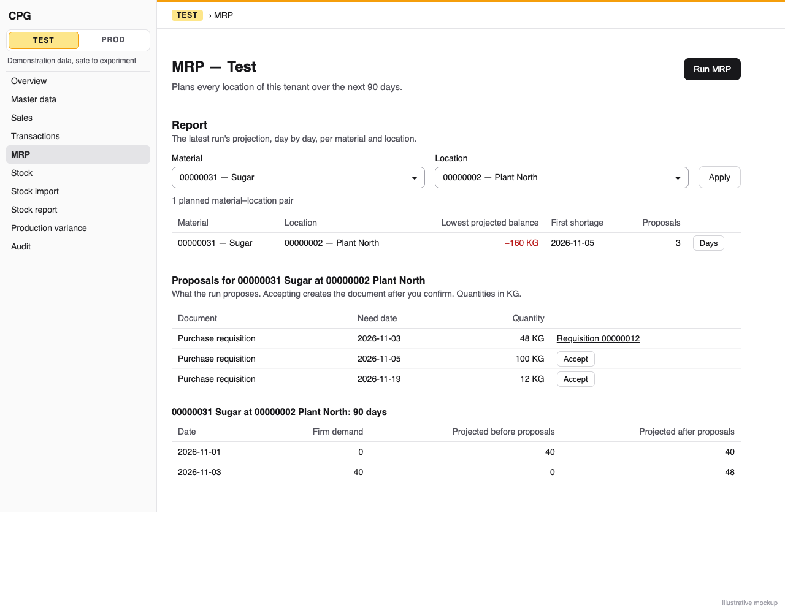
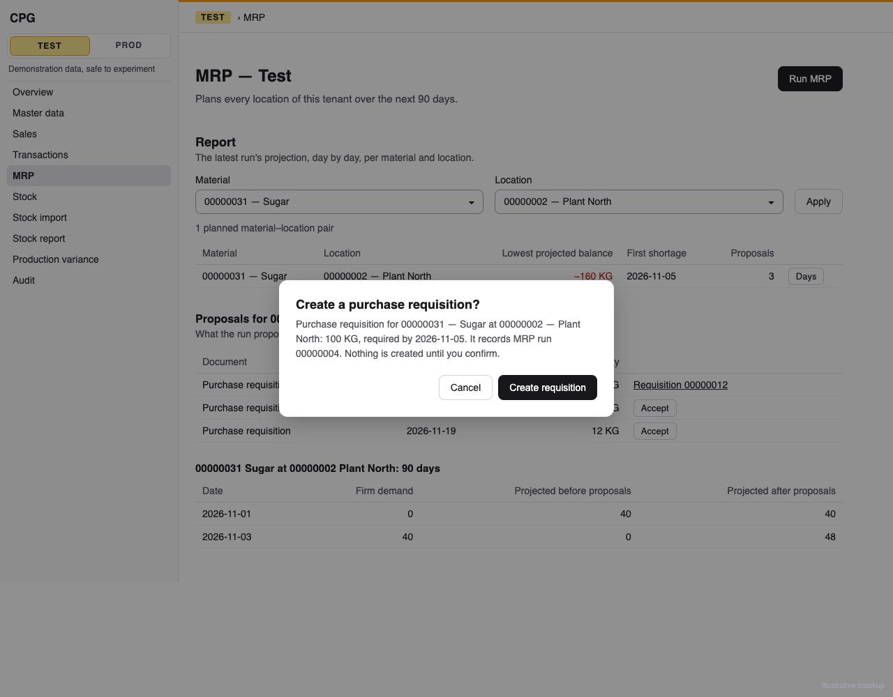

# MRP proposal acceptance: one click, after confirmation, turns a Buy proposal into a purchase requisition tagged with its run, and a stale proposal is refused

**Status:** implemented
**Created:** 2026-11-01 07:37 UTC
**Issue:** #287 (E19-S01, epic #271) · **Depends on:** MRP runs (`implemented/2026-10-27--0556UTC-mrp-runs.md`, #274), replenishment proposals (`implemented/2026-10-31--2054UTC-mrp-replenishment-proposals.md`, #278), the MRP report (`implemented/2026-10-31--0907UTC-mrp-report.md`, #284), purchase requisitions (`implemented/2026-10-20--1636UTC-purchase-requisitions-orders.md`, #86), API idempotency (`implemented/2026-10-19--1548UTC-api-idempotency.md`) · **Design authority:** `.ai/specs/product-brief.md` (R03, R05, R07, R08, R10, N06), `research/CPG-prd001.pdf` §04 "Manual/auto creation", "Stale and concurrent", §05 "Optimistic edits and freshness", §06, `research/CPG-prd-datamodel.pdf` ("Purchase requisition", "MRP recommendation"), `research/CPG-acceptance.md` BUY-001, RUN-003, RUN-004, RUN-005, RUN-017, RUN-022

## 📝 TLDR

Since #278 every MRP run proposes replenishment, but a planner who agrees with a proposal has to retype it as a requisition. After this change each Buy proposal of the tenant's latest run will have an **Accept** action on the MRP page and in the API. After a confirmation that names the document, material, location, quantity and date, it creates one Open purchase requisition carrying the run's ID. Just before the document is written, the proposal is planned again from the tenant's current data. A proposal that would now come out differently, or belongs to a superseded run or an earlier day, is refused as stale with advice to run MRP again. An accepted one is refused the second time, and nothing ever changes an existing document (R10). Make proposals stay visible but can't be accepted yet: a production order needs the BOM that E17-S02 (#282) will choose, so the Make half moves to its own follow-up story (Q1).

## 📝 Problem Statement

`MrpRunService` stores each proposal as an `MrpRecommendation`, and `GET …/mrp/runs/latest` lists them, but nothing turns one into a document. PRD §04 "Manual/auto creation" makes a user-confirmed one-click creation the default. A Buy proposal creates a purchase requisition and a feasible Make proposal a production order, each tagged with the run, and no existing document is changed. §04 "Stale and concurrent" adds that a proposal is checked again against present demand, stock and documents just before it is created, and refused when it no longer holds. Today:

- **No proposal reaches a document.** RUN-004, RUN-005 and BUY-001 can't execute, and nothing on the screen lists proposals at all: the day table shows only their daily sum ("Projected after proposals").
- **Nothing ties a requisition to the run that suggested it.** The data model gives the purchase requisition an optional source MRP run. E19-S02 (#288) nets accepted documents in later runs and needs that link.
- **The freshness rule has no home.** Runs are kept but only the latest keeps its recommendations, and nothing compares a proposal with the data behind it.

## Resolved assumptions (autonomous defaults)

The issue's two open questions, plus the gaps between its notes and the shipped code, each answered with the most reversible choice. The schema changes are two nullable text columns, added with `alter table … add column` (Q5, Q6). The contract changes are one new route, a per-proposal `id`, `executable` and `document` in the latest-run API, and an `mrpRun` field on requisitions.

| # | Question | Applied default | Why |
|---|---|---|---|
| Q1 | The Make half (RUN-006) needs E17-S02's BOM choice (#282, still open, after #281). What does this story ship? | **Buy acceptance in full, Make deferred.** Every rule here (confirmation, stale check, double accept, tenant, read-only, idempotency, audit) is built once and applies to both kinds. A Make proposal is listed with no Accept action, and the API refuses it with 409 `MRP_PROPOSAL_NOT_EXECUTABLE`, as the issue already specifies for a Make proposal whose BOMs are all infeasible. The production-order half, pinned to the proposal's BOM revision, becomes a follow-up story blocked on #282. | Today a Make proposal carries no BOM, so an accepted one would need a BOM rule of its own: the production dialog's physical-stock preselection, which E17-S02 replaces. Building that would ship behaviour planned for replacement. Building the Make branch against a BOM field nobody fills would ship code no run can reach. The issue lists #282 as the Make half's dependency. The owner approved this split for the autonomous run. |
| Q2 | How narrow is "stale"? | Accepting plans the tenant again from a fresh snapshot, `planMrp(load(today), today)`, inside the write. The proposal is stale when that plan has no proposal for its material, location and need date, or one of another kind or quantity. It is also stale when the run isn't the tenant's latest any more, or started on an earlier UTC day. Requisitions created from this run stay in the fresh snapshot as ordinary tentative supply. | Planning again is the only check that sees everything a proposal depends on: stock, orders, forecasts, documents, transfers, other pairs' production components and the lot rules. A fingerprint would need the same reads and miss the lot rounding. An accepted requisition has the proposal's quantity on the proposal's date, so it gives the later days of that pair the balance its proposal gave them. Later proposals of the run then come out unchanged, and accepting one never makes the next stale (worked example under Architecture). A change that leaves the proposal as it was isn't a reason to refuse it. |
| Q3 | Which date does the requisition take? | The proposal's `needDate` as its `requiredDate`. | It is the only date a proposal stores today. E16-S02 (#279) adds late-supply timing. When it stores a separate receipt date, the requisition should take that date, the issue's default of the feasible date, and that story changes this one line. |
| Q4 | How does the API name a proposal? | `POST /api/tenants/{tenant}/mrp/runs/{run}/proposals/{proposal}/accept`, where `{run}` is the run's eight-digit ID and `{proposal}` the recommendation's UUID. The latest-run read gains each proposal's `id`. | A recommendation has no business ID, and a run-local number would repeat in the other tenant. A UUID never collides across tenants, so a Test proposal's ID can only be not found in Prod (RUN-022, R05). The run in the path is what makes a superseded proposal stale rather than unknown. |
| Q5 | How does a requisition record its run? | A nullable `mrp_run` text column on `purchase_requisition` holding the run's eight-digit ID (`PurchaseRequisition.mrpRun`), not a foreign key. `RequisitionView.mrpRun` is `string \| null`, and the creation audit entry carries `mrpRun` when it is set. | Runs are never deleted in Prod, and a Test reset deletes Test's requisitions together with its runs, so the ID never dangles. A text column adds with a plain `alter table`. A new foreign key on a referenced table is what `db:migration:create` has rebuilt before (lesson 2026-10-23), and an older image's Test reset would have to delete in the right order. The ID is what the screen, the API and the audit show. |
| Q6 | Where is "already accepted" kept? | A nullable `accepted_document` text column on `mrp_recommendation`: the created requisition's ID, set in the same transaction. A newer run deletes the recommendations as before, and an older run's proposals are stale anyway. | Additive, and it lives exactly as long as the proposal can be accepted. The requisition's `mrp_run` keeps the lasting link. |
| Q7 | Is a run from yesterday still acceptable? | No: a run whose `startDate` isn't today's UTC date is stale. | Its horizon starts a day early, so planning again would put yesterday's demand in today's bucket and refuse most of it anyway. The rule is easy to explain and test: run MRP again. |
| Q8 | Where does the Accept action live? | In the one-pair view. When the filters leave one pair, a **Proposals** table appears above its 90 days, listing the pair's proposals: document, need date, quantity, and Accept, the created requisition, or why it can't be accepted. The pairs table gains a **Proposals** column with each pair's count, so a planner sees where to look. | Acceptance needs a place on the screen. One pair has at most 90 proposals, while the page's 25 pairs could have 2,250 rows of buttons (#278's worst case). The data is already in the page's read, so nothing new is read. Explaining proposals (rejected BOMs, exceptions) is E18's job (out of scope). |
| Q9 | Does a read-only tenant show Accept? | No. Like Run MRP (`mrp-run-screen.tsx`, BACKWARD_COMPATIBILITY.md "Run MRP is offered while the tenant is writable"), Accept appears only while the tenant is writable. The server still refuses a page rendered before the flag changed: `TENANT_READ_ONLY`, shown in the dialog. | One rule for every write control, and the shared gate (`tenantServerAction`, `tenantApiWrite`) refuses the admin too (R05). |
| Q10 | What does accepting answer? | `200 { proposal, document }`. `proposal` is the proposal as the latest-run read now shows it (`document` set), plus `run`, `material` and `location`, since it stands alone here. `document` is the created requisition (`RequisitionView`). | The client needs the new requisition's ID. Keeping the proposal's `kind` beside the document lets the Make follow-up return a production order in `document` without a second shape. |
| Q11 | Inactive material or location, or a quantity above the entry limit? | Refused as a manual requisition would be: `MATERIAL_INACTIVE` / `LOCATION_INACTIVE` (409), and `VALIDATION_FAILED` on `quantity` above `MAX_QUANTITY`. Accepting sends the proposal through `requisitionCreateSchema` and `PurchaseRequisitionService.create`. | The proposal stores what it plans (#278 Q6). The document rules stay in one place. |
| Q13 | What does the screen show for a run from an earlier day? | No Accept buttons. The Proposals table says "This run is from an earlier day. Run MRP again to accept its proposals." The page compares the run's `startDate` with the server's UTC date. | The server would refuse every one as stale (Q7), so the screen says so up front. |
| Q12 | Integration tests? | Two files, as the issue proposes: `tests/integration/mrp-accept.test.ts` (the browser flow) and `tests/integration/mrp-accept-api.test.ts` (the API), each on its own materials. | Every user-visible flow gets a browser test, and the image is the only proof that the migration, the route and the snapshot meet. |

## 📝 Proposed Solution

One acceptance service, one route, one server action, one screen table:

```
db/entities/
  purchase-requisitions/purchase-requisition.entity.ts   + mrpRun (nullable text, 8)
  mrp/mrp-recommendation.entity.ts                       + acceptedDocument (nullable text, 8)
db/migrations/                                           + Migration…_mrp_acceptance (two add column)
core/services/
  purchase-requisitions/purchase-requisition.service.ts  create(input, actor, { mrpRun }?)
  purchase-requisitions/requisition-records.ts           view + snapshot carry mrpRun
  mrp/mrp-acceptance.service.ts                          MrpAcceptanceService.accept   (new)
  mrp/mrp-run.service.ts                                 latest(): proposal id, executable, document
  mrp/mrp-run-view.ts                                    MrpProposalView + id, executable, document
core/domain/audit/audit-fields.ts                        + "mrpRun"
core/validators/mrp/mrp-proposal-accept.schema.ts        path IDs and the empty body (new)
core/container/                                          + mrpAcceptanceService
app/api/tenants/[tenant]/mrp/runs/[run]/proposals/[proposal]/accept/route.ts   (new)
app/admin/[tenant]/mrp/actions.ts                        + acceptMrpProposal
app/routing/refresh-after-write.ts                       + optional extra refreshing codes
app/components/mrp/mrp-proposals.tsx                    Proposals table + ConfirmDialog (new)
app/components/mrp/mrp-report.tsx                        a Proposals count column; renders it in the one-pair view
app/admin/[tenant]/purchase-requisitions/page.tsx        + "MRP run" column
```

**Alternatives considered.**
- *Fingerprint the proposal's inputs at run time and compare it at acceptance.* Rejected (Q2). It needs the same reads as planning again, misses dependencies through transfers and other pairs' production components, and a fingerprint of the whole tenant would make every acceptance after the first stale.
- *Plan one pair from a filtered snapshot.* Rejected for now. A pair's balance depends on transfers from other sites and on other materials' production orders, and a second loader would have to track every input story (E15–E17). The full plan's cost is measured instead (Risks), and a narrower loader can replace it behind the same service.
- *Exclude this run's own requisitions from the fresh snapshot.* Rejected: it gives the same answer (Q2) and needs a filter the loader doesn't have.
- *Ship Make with the dialog's physical-stock BOM.* Rejected (Q1).

## 📝 Architecture

### `MrpAcceptanceService.accept(runId, proposalId, actor)`

Runs inside the caller's write transaction: `tenantServerAction`, or `IdempotencyService.run` behind `tenantApiWrite`. These have already refused a stale or missing Test generation and a read-only tenant, and they retry a stale SQLite snapshot once, so the method must be safe to repeat. In order:

0. **Path IDs.** A run ID that isn't eight digits (`/^\d{8}$/`), or a proposal ID that isn't a UUID, is 404 `MRP_PROPOSAL_NOT_FOUND` at once. Both come from the path, so they are never a 400. Without this check, `"0"` would sort below every run ID and read as stale. The body schema checks only the body.
1. **Gate.** `holdWriteGate(em)` first, as `MrpRunService.run` does. The snapshot yields to the event loop (lesson 2026-10-24), and a second accept or a run on another connection then waits for this one instead of interleaving. On one connection the transactions queue whole, so the second accept sees the first one's mark in step 4. Across connections the waiter's snapshot was taken by its wrapper before the gate (`write-gate.ts`), so it passes step 4 on old data and plans the tenant. Its first write then meets `SQLITE_BUSY_SNAPSHOT`, and the wrapper's single retry refuses it with `MRP_PROPOSAL_ACCEPTED`. That is correct but costs a second plan. A third writer committing during that retry would leave the request failed with nothing written; this is an accepted risk, like every other write on SQLite. The race test counts the attempts.
2. **Run.** `latest = findOne(MrpRun, {}, { orderBy: { code: "desc" } })`. No run, or `runId` above `latest.code` → 404 `MRP_RUN_NOT_FOUND` (the existing code and text). `runId` below it → 409 `MRP_PROPOSAL_STALE`: a newer run superseded it and deleted its proposals. A run ID from the other tenant answers by this tenant's own run numbering, so nothing leaks.
3. **Proposal.** `findOne(MrpRecommendation, { id: proposalId, run: latest })`, through the tenant filter. None → 404 `MRP_PROPOSAL_NOT_FOUND`. That covers another tenant's proposal under this tenant's latest run (RUN-022).
4. **Accepted.** `acceptedDocument` set → 409 `MRP_PROPOSAL_ACCEPTED`, params `{ document, kind }`.
5. **Executable.** `kind !== "purchase-requisition"` → 409 `MRP_PROPOSAL_NOT_EXECUTABLE`, params `{ material, location, kind }` (Q1). The rule is one exported predicate, `isExecutableProposal(kind)`, which the read in `latest()` uses too, so the screen and the API never disagree.
6. **Fresh.** `today` is the server's UTC date. If `latest.startDate !== today` → stale (Q7). Otherwise `planMrp(await mrpSnapshotService.load(today), today)`, and the proposal with the same material, location and `needDate`. None, another kind, or `formatDecimal(quantity, { fixed: true }) !== stored.quantity` → 409 `MRP_PROPOSAL_STALE`, params `{ material, location }`.
7. **Create.** The material's base unit through `findMaterial`. `parseInput(requisitionCreateSchema, { material, location, quantity, unit: baseUnit, requiredDate: needDate })`, then `purchaseRequisitionService.create(input, actor, { mrpRun: latest.code })`. The quantity is in the base unit, so it is stored unconverted (factor 1/1). The requisition's audit entry is written in the same transaction (R08). Inactive masters and over-limit quantities are refused there (Q11).
8. **Mark.** `acceptedDocument = requisition.id`, flush. Return `{ proposal: view, document: requisition }`.

Read first, write last: steps 2–6 only read, so a refusal writes nothing, and step 7's insert is the transaction's first write.

**Why an accepted requisition keeps the run's later proposals as they were (Q2).** For a pair, sizing walks the days with `carried`, the sum of earlier proposals: `need = safetyGap(target, projectedBefore + carried)`. Accepting the day-d proposal of quantity q adds a tentative supply of q on day d. On day d the balance becomes `projectedBefore + q`, and since `q ≥ need` the gap is zero, so that day proposes nothing. On every later day `projectedBefore` is higher by q and `carried` lower by q, so their sum, and each later proposal, is unchanged. Earlier days don't see a later receipt. Accepting in any order therefore leaves the run's other proposals acceptable. A test accepts a pair's two proposals, later one first.

### Errors

| Code | HTTP | Params | EN message (fixed text, lesson 2026-10-23) |
|---|---|---|---|
| `MRP_PROPOSAL_NOT_FOUND` | 404 | — | "There is no such proposal in the latest MRP run of this tenant." |
| `MRP_PROPOSAL_STALE` | 409 | `material`, `location` | "This proposal is out of date: stock, documents or plans changed since the MRP run. Run MRP again." |
| `MRP_PROPOSAL_ACCEPTED` | 409 | `document`, `kind` | "This proposal has already been accepted." |
| `MRP_PROPOSAL_NOT_EXECUTABLE` | 409 | `material`, `location`, `kind` | "MRP can't create this proposal's document." |

The not-executable text is neutral, so it stays true once the Make follow-up refuses a proposal with no feasible BOM for another reason. The screen gives the current reason, production orders, from `kind`. Each gets EN and PL texts in the screen's error map, with a parameterised form naming the material and location, or the document, and the unparameterised fallback. Superseded runs reuse `MRP_PROPOSAL_STALE`, as the issue asks (RUN-017), not `MRP_RUN_SUPERSEDED`, which stays the latest-run read's paging refusal.

### Reads

`latest()` adds three fields per proposal from the same recommendation read: `id`, `executable` (`isExecutableProposal(kind)`) and `document` (`acceptedDocument ?? null`). The read's `fields` gain `id` and `acceptedDocument`. Its plan, pinned in `mrp-report-reads.test.ts`, is unchanged.

### Container

`mrpAcceptanceService: asClass(MrpAcceptanceService).scoped()`, one line in `container.ts` and its type in `cradle.ts`. It takes `{ em, mrpSnapshotService, purchaseRequisitionService }`.

## 📝 Data Model

```ts
// PurchaseRequisition (additive)
/** The MRP run whose proposal created it (E19-S01): its eight-digit ID, or null when entered by hand. */
mrpRun: p.string().length(8).nullable(),

// MrpRecommendation (additive)
/** The document accepting this proposal created (E19-S01): its business ID, or null while not accepted. */
acceptedDocument: p.string().length(8).nullable(),
```

One migration, `npm run db:migration:create -- mrp_acceptance`, which must read `alter table \`purchase_requisition\` add column \`mrp_run\` text null;` and the same for `mrp_recommendation.accepted_document`, with the two `drop column`s in `down()`. If the generator rebuilds either table, hand-write those four statements (lesson 2026-10-23), and assert that `orm.schema.getUpdateSchemaSQL()` mentions neither table. Test the upgrade on a populated database: an existing requisition reads `mrpRun: null`, and an existing recommendation reads not accepted. Also test an old-style insert, without the column, after the migration (lesson 2026-10-21).

`RequisitionView` gains `mrpRun: string | null` (`?? null`, lesson 2026-10-19). `requisitionSnapshot` adds `mrpRun` only when it is set, so manual requisitions' audit entries keep their shape. The same snapshot feeds the cancel, close-early and purchase-order conversion entries, so a requisition from MRP carries `mrpRun` in their before and after too; a conversion test asserts it. `AUDIT_FIELDS` gains `"mrpRun"`, labelled "MRP run" / "Przebieg MRP" (`tests/audit-labels.test.ts`).

Previous image during a deploy: it ignores both columns. Its requisition creates leave `mrp_run` null, and its runs delete recommendations, accepted ones included, as before. Rollback is the migration's `down()`. Requisitions then lose their run link, and nothing else changes.

## 📝 API Contracts

**New:** `POST /api/tenants/{tenant}/mrp/runs/{run}/proposals/{proposal}/accept`, built with `tenantApiWrite`: a bearer token for either role, `Idempotency-Key`, and in Test the `Dataset-Generation` header. The body is empty or `{}` (`mrpProposalAcceptSchema`, strict). It answers `200`:

```json
{
  "proposal": { "id": "6f1c…", "run": "00000004", "material": "00000031", "location": "00000002", "kind": "purchase-requisition", "needDate": "2026-11-05", "quantity": "100.000000", "executable": true, "document": "00000012" },
  "document": { "id": "00000012", "material": "00000031", "location": "00000002", "quantity": "100.000000", "requiredDate": "2026-11-05", "status": "open", "mrpRun": "00000004", "…": "…" }
}
```

A replay with the first key and the same request answers the stored result with `Idempotent-Replayed: true` and writes nothing. A new key on an accepted proposal is 409 `MRP_PROPOSAL_ACCEPTED` (R07). Refusals are listed under Errors, plus the wrapper's own: `TENANT_READ_ONLY`, `GENERATION_REQUIRED` / `GENERATION_STALE`, the idempotency codes, `MATERIAL_INACTIVE`, `LOCATION_INACTIVE`, `VALIDATION_FAILED`.

**Additive:**
- `GET …/mrp/runs/latest`: each `plans[].proposals[]` gains `id`, `executable` and `document`.
- Every requisition read (`GET …/purchase-requisitions`, `…/{id}`, and the write answers) gains `mrpRun`.

`BACKWARD_COMPATIBILITY.md` lists the route under §4 and the two additive fields under "Additive since E19-S01", with the migration's rollback note (§1). `tests/api-writes.test.ts` picks the route up as a `tenantApiWrite`.

## 📝 UI/UX

The pairs table gains a **Proposals** column, priority 2, with each pair's proposal count (`data-mrp-proposal-count`). When the filters leave one pair, a **Proposals** table (`MrpProposals`, a `DataTable`) appears above its days, by need date (Q8):

| Column | Content |
|---|---|
| Document | "Purchase requisition" / "Production order" |
| Need date | `2026-11-05` |
| Quantity | locale quantity and base unit, `100 kg` |
| Action | **Accept** (an outline button, `data-mrp-accept`), or "Requisition 00000012", linking to `/admin/{tenant}/purchase-requisitions?q=00000012`, or the visible muted text "Production orders can't be accepted yet" |

With no proposals, the table says "This pair has no proposals." On a read-only tenant there is no Accept (Q9). For a run from an earlier day the table has no Accept and says "This run is from an earlier day. Run MRP again to accept its proposals." (Q13). `MrpReport` is a server component, so the page passes it the bound `acceptMrpProposal`, the tenant's `readOnly` flag and today's UTC date. Its labels are plain data (lesson 2026-10-24).

**Accept** opens a `ConfirmDialog` (not destructive):
- **Title:** "Create a purchase requisition?"
- **Description:** "Purchase requisition for 00000031 — Sugar at 00000002 — Plant North: 100 kg, required by 2026-11-05. It records MRP run 00000004. Nothing is created until you confirm."
- **Buttons:** "Create requisition" (pending: "Creating…") and "Cancel".

Confirming calls `acceptMrpProposal`, a `tenantServerAction` bound to the page's tenant and generation, then `refreshAfterWrite`, so the row then shows its requisition. A refusal stays in the dialog, translated by code: stale with the "Run MRP again" advice, already accepted, read-only, generation. Following the dialog lesson (2026-10-21), the dialog captures the proposal it opened with, and the page refreshes after a refusal only when the row survives. `refreshAfterWrite` today refreshes only on success and `VERSION_CONFLICT`, so it gains an optional list of extra refreshing codes. The action passes `["MRP_PROPOSAL_ACCEPTED"]`: the row then shows the requisition another session created. `MRP_PROPOSAL_STALE` doesn't refresh, so the advice stays readable. Cancel and Escape create nothing (RUN-004).

The Purchase requisitions list gains an **MRP run** column, priority 2, showing the run ID or "—". The MRP help topic (EN, PL) gains a paragraph on accepting and its API, and a sentence on stale proposals.

> Each Buy proposal has an Accept action. After you confirm, it creates an Open purchase requisition for the proposal's quantity on its need date, which records the run's ID. Before creating it, CPG plans again from the current stock and documents: if the proposal would now be different, or a newer run has replaced this one, or the run is from an earlier day, it is refused and you run MRP again. A proposal can be accepted once. Production-order proposals can't be accepted yet. The API: POST /api/tenants/{tenant}/mrp/runs/{run}/proposals/{proposal}/accept with a bearer token, an Idempotency-Key and, in Test, the Dataset-Generation header; the proposal's id comes from GET …/mrp/runs/latest.

Mockups: `assets/mrp-proposal-acceptance/mockup-01-mrp-proposals.png` (the one-pair view) and `mockup-02-accept-dialog.png` (the dialog). The page as it is today, with no list of proposals, is #284's `assets/mrp-report/current-01-mrp-page.png`.





## 📝 Edge Cases & Failure Scenarios

All with today fixed in the tests:

- **Default run creates nothing (RUN-003, R10).** A run leaves the counts of requisitions, purchase orders and production orders unchanged, read across every page of each list.
- **Exactly 100 kg (BUY-001, R03).** A Buy need of exactly 100 at L gives one Open requisition of `100.000000` kg at L on the need date, with nothing converted and `mrpRun` the run's ID. No purchase order is created.
- **50 (RUN-005).** The requisition reads `mrpRun` through the API and the list shows it, and the purchase-order count is unchanged.
- **Confirm or cancel (RUN-004).** The dialog names the document, material, location, quantity in the base unit, and date. Cancel creates nothing.
- **Audit (R08).** The creation entry carries `mrpRun`, the account, the session and the channel: UI with a session, API with the token. A rolled-back accept leaves no entry.
- **Stale by stock (RUN-017).** After the run, another user posts a stock correction at the pair that changes the proposal's quantity. Accepting answers 409 `MRP_PROPOSAL_STALE` with the material and location, and creates nothing. The same holds for a changed open order line, or a requisition at the pair edited or cancelled. A change elsewhere in the tenant that leaves the proposal as it was doesn't refuse it.
- **Superseded, or an earlier day.** A newer run, or a run whose start date isn't today, gives `MRP_PROPOSAL_STALE`.
- **Two proposals of one pair.** Accepting the later one first, then the earlier one, gives two requisitions. Accepting the earlier one first leaves the later one acceptable (Q2's example). Each accept runs in its own wrapper transaction, as in production: the loader reads with `disableIdentityMap` (lesson 2026-10-23).
- **Double accept (R07).** A second click, a second session, or the API with a new key gives 409 `MRP_PROPOSAL_ACCEPTED` naming the requisition, and exactly one exists. Two accepts that start on two ORMs over one file in the same tick give one requisition and one refusal (lesson 2026-10-19), and the loser's retry is counted (step 1). A replay with the first key gives the original requisition.
- **Tenants (RUN-022, R05).** A Test proposal's ID under `/api/tenants/prod/`, with Prod's own latest run ID, answers 404 `MRP_PROPOSAL_NOT_FOUND`, and neither tenant gains a document. A Prod page lists only Prod's proposals, and the Test page's action is bound to Test, so the UI can't cross tenants. A Test reset since the run: the old generation answers `GENERATION_STALE`. Even with the current generation, the reset deleted the run, so the answer is `MRP_RUN_NOT_FOUND`.
- **Malformed path IDs.** `"0"`, `""`, `"00000004x"` as the run, or a non-UUID proposal, answer 404 `MRP_PROPOSAL_NOT_FOUND` (step 0).
- **Read-only (R05).** No Accept on screen. Through a page rendered before the flag changed, or the API, accepting is `TENANT_READ_ONLY` for a user and for the admin. The report stays readable.
- **Both roles (R07).** A user's token and the admin's token both accept.
- **Make, and inactive masters.** A Make proposal has no Accept, and the API answers 409 `MRP_PROPOSAL_NOT_EXECUTABLE`. An inactive material or location gives the requisition service's own refusal (Q11).
- **Stale-snapshot retry.** A write committed on another connection between the snapshot and the insert makes SQLite refuse the transaction. The wrapper retries it once, and the retry plans again from the new data, so it is accepted or refused on current facts.

## 📝 Risks & Impact Review

- **Cost of planning again.** Each accept loads the whole snapshot and plans the tenant while holding the write gate, so other writes wait for it, as they wait for a run. Its cost is the run's minus the writes. Budgets, measured in `mrp-run-timing.test.ts` beside the run, fastest of three: under 1 s on the realistic dataset, under 5 s at ten times, and the longest event-loop stall under 250 ms. A plan that misses them gets a narrower snapshot behind the same service, never a weaker freshness rule.
- **Schema.** Two nullable columns on existing tables, added with `alter table`. Rollback is `down()`. Lesson 2026-10-23 applies: check the generated SQL, add the populated upgrade test, and update the migration lists and counts in `orm.test.ts`, `core/src/database.test.ts`, `system-status.service.test.ts` and `smoke.test.ts`.
- **Shared contract.** One new write route, and additive fields on two reads. The requisition snapshot changes only for requisitions from MRP.
- **Seam with E19-S02 (#288).** Later runs net accepted documents. The requisition's `mrpRun` and the `MRP_PROPOSAL_STALE` rule are its inputs, and nothing here prevents a later run from planning an accepted requisition as tentative supply, which it already does.
- **Seam with E16-S02, E16-S03, E17-S02.** Timing changes the date (Q3), exceptions don't produce proposals, and the Make follow-up flips `isExecutableProposal` and adds a production-order branch to step 7.

## 📝 Decisions in play

R03 (the requisition takes the proposal's exact six-decimal quantity, unconverted), R05 (tenant-scoped IDs and reads, read-only gate, Test generation), R07 (API parity, an idempotency key, the generation), R08 (the creation audit entry in the document's transaction), R10 (accepting creates and never changes an existing document), N06 (no purchase orders or transfers from MRP). None is superseded.

## 📋 Phasing

One phase, one PR: the columns and migration, the requisition's run link, the acceptance service, the route and the server action, the Proposals table and dialog, the requisitions column, copy, docs, the benchmark and two integration files. The Make half is a follow-up story blocked on #282 (Q1).

## 📋 Implementation Plan

1. **Columns and migration.** `PurchaseRequisition.mrpRun` and `MrpRecommendation.acceptedDocument`, then `npm run db:migration:create -- mrp_acceptance`. Review the SQL (add column only), then add the populated upgrade and old-style insert tests and update the migration lists and counts.
2. **Requisition run link.** `PurchaseRequisitionService.create(input, actor, origin?)` with `origin.mrpRun`. `RequisitionView.mrpRun`, `requisitionSnapshot` with `mrpRun` when set, `AUDIT_FIELDS` and labels. Tests: a manual requisition reads `mrpRun: null` with an unchanged audit snapshot, and one created with a run reads it back through the same `em` and in the audit.
3. **Proposal view.** `MrpProposalView` gains `id`, `executable` and `document`. `isExecutableProposal` goes in `domain/mrp/`, and `latest()` reads the two new fields. Update every exact comparison of `latest()` proposals in core (`mrp-run.service.test.ts`, `mrp-report-reads.test.ts`) and the view literals in the app tests, and keep the read's pinned plan.
4. **Acceptance service.** `MrpAcceptanceService` with the eight steps, its errors, and registration. Tests on a real SQLite file with a fixed clock: every Edge Case line not specific to the UI or the image. That covers BUY-001, RUN-005, RUN-017 (stock, order line, requisition, superseded, earlier day, an unrelated change), the two-proposal order, double accept, the two-ORM race (`mrp-acceptance-concurrency.test.ts`), RUN-022 not found, Make, inactive masters, an over-limit quantity, and the audit entry. The audit check includes rollback on a refused accept and a retried stale snapshot that commits once.
5. **Route.** `app/api/tenants/[tenant]/mrp/runs/[run]/proposals/[proposal]/accept/route.ts` with `tenantApiWrite`, plus its route test (wiring, path params to the service, the empty body). Update `tests/api-writes.test.ts`'s expectations if it lists routes.
6. **Server action and screen.**
   - `refreshAfterWrite` gains its optional extra refreshing codes, with tests.
   - `acceptMrpProposal` goes in `admin/[tenant]/mrp/actions.ts`.
   - Add `MrpProposals` with its dialog, rendered by `MrpReport` in the one-pair view. The page threads in the bound action, `readOnly` and today. Add the pairs table's count column and the requisitions list's MRP run column.
   - Messages in EN and PL: column names, statuses, the dialog, the earlier-day note, and the four error codes with params. Add the help paragraph.
   - Component tests:
     - the three action states;
     - read-only and earlier-day runs showing no Accept;
     - the dialog's text, and Cancel;
     - error translation;
     - refresh on `MRP_PROPOSAL_ACCEPTED` only;
     - no function-valued labels.
7. **Benchmark.** Time `accept` beside the run in `mrp-run-timing.test.ts` at realistic and ten-times counts, print the figures, and assert the budgets (Risks).
8. **Integration tests.** `tests/integration/mrp-accept-api.test.ts`, on its own Buy material and location with planning parameters (minimum 0, multiple 1) and an order of 100:
   - accept → 200 with `mrpRun`;
   - replay → `Idempotent-Replayed`;
   - new key → `MRP_PROPOSAL_ACCEPTED`;
   - a second order and a stock correction after a fresh run → `MRP_PROPOSAL_STALE`;
   - the Test proposal's ID under prod, with Prod's latest run ID → 404 `MRP_PROPOSAL_NOT_FOUND`, with counts unchanged across all pages (`allPages`);
   - every run-then-accept sequence runs under a `withinOneDay`-style re-run (`test-reset-api.test.ts`), since a run from another UTC day is stale (Q7);
   - a user's and the admin's token;
   - read-only refused, then restored.

   `tests/integration/mrp-accept.test.ts`: filter the MRP page to its own pair, Accept, check the dialog's text, Cancel and see nothing created, Accept and confirm, see "Requisition …" in the row and the run ID in the requisitions list. Also RUN-003: a run with counts unchanged across all pages. Run both files, and `smoke.test.ts` for the migration count.
9. **Docs and catalogue.**
   - `BACKWARD_COMPATIBILITY.md`: the route (§4), the additive fields and the rollback note (§1).
   - `.ai/docs/engineering-standards.md`: an MRP bullet. Acceptance plans again through `planMrp` under the write gate, and `isExecutableProposal` is the one executability rule.
   - `CPG-acceptance.md`: Evidence lines for BUY-001, RUN-003, RUN-004, RUN-005, RUN-017 and RUN-022, moving a status only when every clause and channel is asserted (lesson 2026-10-21).
   - File the Make follow-up story (RUN-006, blocked on #282) and cite its number here.
   - Move this spec to `implemented/` with implementation notes.

Each step leaves the suite green. Run `npm run lint`, `npm run typecheck`, `npm run test:coverage` (100%) and `npm run build`.

## Implementation notes

Implemented on #319, branched from `main` (the spec PR #318 stays design-only), as written, except:

- **The run on the requisitions list sits under the requisition's ID, not in its own column.** At 1280 px a priority-2 column after Required sat past the table's visible width (QA screenshot), and moving it last shifted no index but left it out of view. Under the ID it is in view at every width, and no other column moves (`requisitions-table.tsx`, `fromMrpRun`). Requisitions entered by hand show nothing there.
- **The screen's stale and not-executable texts don't name the material and location.** The dialog already names them, and `MRP_PROPOSAL_STALE` from a superseded run has no params, which `errorMessage` would answer in the server's English. `MRP_PROPOSAL_ACCEPTED` names its document. The API keeps every param the spec lists.
- **The earlier-day note** shows only on a writable tenant, for a pair with proposals: a read-only tenant offers no Accept to explain.
- **`refreshAfterWrite` is unchanged; the dialog refreshes the page itself, on close, after `MRP_PROPOSAL_ACCEPTED`** (`accept-proposal-button.tsx`). The code review found that a server-side refresh on that refusal replaced the row's Accept button with its document link, and the open dialog with it, so the refusal was never read (lesson 2026-10-21).
- **The dialog also translates `MATERIAL_INACTIVE`, `LOCATION_INACTIVE` and `VALIDATION_FAILED`** (an over-limit quantity), which Q11's refusals reach.
- **The Make half** is #320, blocked on #282.

Notes:
- `MrpAcceptanceService` (`core/src/services/mrp/`) follows the spec's steps 0–8. Its tests cover every edge case line with a fixed clock. The two-ORM race test (`mrp-acceptance-concurrency.test.ts`) gives one requisition and an `MRP_PROPOSAL_ACCEPTED` refusal after two plannings in all.
- Test fixes, not code fixes: a same-pair order line a day *before* the need date leaves the proposal unchanged, since planned again that day gets a proposal of its own, so RUN-017's line goes on the need date. A material with open demand can't be deactivated, so Q11's test sets the flag directly.
- Migration `Migration20261101075151_mrp_acceptance`: the generator wrote two `add column`s. `mrp-acceptance-migration.test.ts` checks that each table's definition is the old one with the column added, the populated upgrade, old-style inserts, and `down()`.
- Seams found by the integration files and fixed here: `mrp-run-api.test.ts` compared #278's proposals exactly, and `mrp-report.test.ts` read the first `main h3`, now the Proposals heading, so it reads `[data-mrp-plan-heading]`.
- Benchmark (`mrp-run-timing.test.ts`), fastest of three, run alone, budgets unchanged:

  | Size | Accept | Its longest stall | The run, for comparison |
  |---|---|---|---|
  | Realistic | 135 ms | 26 ms | 241 ms |
  | Ten times | 1,394 ms | 83 ms | 2,579 ms |

