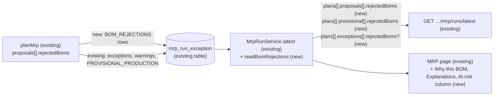
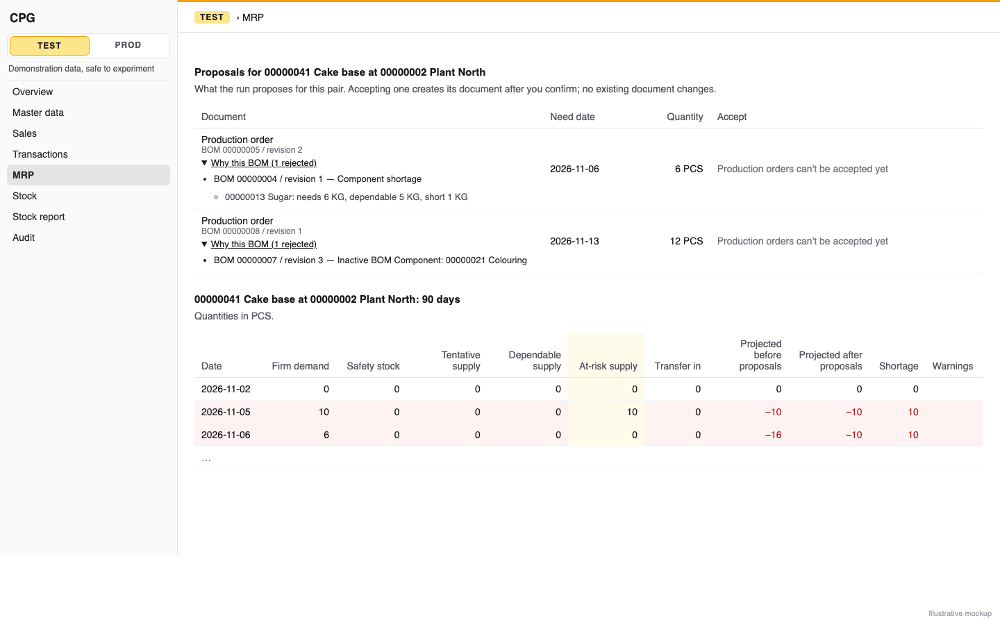
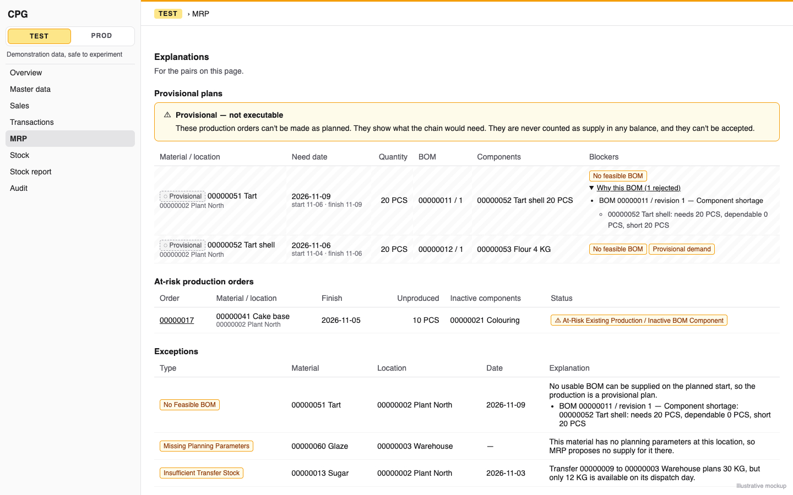

# MRP report explanations: each Make proposal shows its chosen BOM and every rejected one with its exact shortages, and the report lists at-risk orders, planning exceptions and provisional plans apart from executable proposals

**Status:** in progress
**Created:** 2026-11-02 06:52 UTC
**Issue:** #286 (E18-S03, epic #270) · **Depends on:** the last MRP report (`implemented/2026-10-31--0907UTC-mrp-report.md`, #284), planning exceptions (`implemented/2026-11-01--0737UTC-mrp-planning-exceptions.md`, #280), BOM choice (`implemented/2026-11-01--1918UTC-mrp-bom-choice.md`, #282), at-risk production and provisional plans (`implemented/2026-11-01--2049UTC-mrp-at-risk-and-provisional-plans.md`, #283), weeks and marks (`implemented/2026-11-01--1105UTC-mrp-report-weeks.md`, #285), all merged · **Design authority:** `.ai/specs/product-brief.md` (R03, R04, R05, R07, R10, D03, N01, N04), `research/CPG-prd001.pdf` §04 "BOM choice and explanation", "Multilevel explosion", §07 "Last MRP report", `research/CPG-prd-datamodel.pdf` "MRP recommendation / exception", `research/CPG-acceptance.md` UX-020, MRP-025, MRP-047, MRP-050, MRP-051, LFC-026, LFC-027

## 📝 TLDR

Since E16-S03 and E17, an MRP run decides a lot that no screen shows. It falls back to a lower-priority BOM, rejects a BOM for a shortage or an inactive component, reports an open production order at risk, raises planning exceptions and keeps provisional multilevel plans. The latest-run API already lists the exceptions and provisional actions. The MRP page shows none of them, and nothing stores *why* a Make proposal that fell back passed over its higher-priority BOMs (E17-S02 Q6 left that to this story).

After this change the MRP page and `GET …/mrp/runs/latest` explain the latest run:

- **Each production-order proposal** names its chosen BOM and revision, as it does today. Under it, a **Why this BOM** disclosure lists every rejected BOM with its reason. A shortage lists each short component: "00000013 Sugar: needs 6 KG, dependable 5 KG, short 1 KG". An inactive component reads "Inactive BOM Component" and names the material. The run stores these rejections. The API adds `rejectedBoms` with six-decimal texts.
- **An Explanations part** at the end of the report covers the pairs on the current page. Its three lists are:
  - provisional plans, under a "Provisional — not executable" callout, with no Accept and never in a supply column;
  - at-risk production orders;
  - planning exceptions, translated by code in English and Polish.
- **The day and week tables** gain an **At-risk supply** column beside dependable supply.

## 📝 Problem Statement

- **The BOM choice is unexplained.** PRD §04 "BOM choice and explanation" requires each fallback to name the rejected higher-priority BOMs and their exact shortages, and UX-020 asserts it on the report. `chooseBom` (E17-S02) computes `rejectedBoms` for every proposal, but `MrpRunService.writeResults` stores only `bom` and `bomRevision`. A planner sees "BOM 00000005 / revision 2" and not why priority 1 was skipped. MRP-025 and MRP-050 are Partially verified, waiting on this screen.
- **Exceptions are API-only.** The API has listed `plans[].exceptions` since E16-S03, but the page shows none. A Make pair with `MISSING_USABLE_BOM` just shows no proposal, with no reason (LFC-026).
- **Provisional plans and at-risk orders are API-only.** E17-S03 stores provisional actions and `AT_RISK_PRODUCTION`, and `atRiskSupply` now has values. But the day table has no at-risk column, and nothing on the page lists provisional plans or at-risk orders. MRP-047 and MRP-051 are Partially verified ("the screen is E18-S03").

## Resolved assumptions (autonomous defaults)

The issue's open questions, plus the gaps between its notes and the stored run, each answered with the most reversible choice. **There is no schema change.** The contract grows additively. It adds `rejectedBoms` to proposals, provisional actions and the two BOM exceptions, an `order` key on the rejection notation, and one stored row code.

| # | Question | Applied default | Why |
|---|---|---|---|
| Q1 | Where are a feasible fallback's rejections stored? The issue says "no migration, ideally", and E17-S02 Q6 left their storage to this story. | In **`mrp_run_exception`**, as a new row code **`BOM_REJECTIONS`**, one per executable production-order proposal whose `rejectedBoms` isn't empty. The rows come after the provisional rows. `date` is the proposal's need date. `details` holds E17-S02's `rejectionDetails` notation: `missing`, `inactive` when there are inactive rejections, and `order` (Q3). The read attaches it to the proposal with the same material, location and need date. `mrp_recommendation` is unique on `(tenant, run, material, location, needDate)`, so the match is exact. It is never listed as an exception, a warning or a mark. | No migration. The table already takes any code (#280 Q6) and already holds the run's warnings (E18-S02) and provisional actions (E17-S03). The notation is the one `NO_FEASIBLE_BOM` and provisional actions already store, so one parser reads all three. |
| Q2 | What does the API return for rejections? | A structured **`rejectedBoms`** list, parsed from the notation by the read, on three things: every proposal (`[]` for a requisition or a first-choice BOM), every provisional action, and the `NO_FEASIBLE_BOM` and `MISSING_USABLE_BOM` exceptions (absent on other codes). Each entry is `{ bom, revision, reason: "inactive-component", materials }` or `{ bom, revision, reason: "shortage", shortages: [{ material, required, available, shortage }] }`, quantities as six-decimal BUoM texts. The existing `missing`, `inactive` and `params` stay unchanged. | The screen and clients read one shape, and no client has to parse the notation. Additive only (BACKWARD_COMPATIBILITY.md §4). The app can't import core's domain helpers (only `.` and `validators/*` are exported), so the parse belongs in the read. |
| Q3 | In what order are rejected BOMs listed? | **In the order `chooseBom` tested them**, which is priority order. `rejectionDetails` gains an `order` key (`00000004/1, 00000006/1`, the BOM/revisions in engine order). So every row written from now on carries it: `BOM_REJECTIONS`, `NO_FEASIBLE_BOM`'s params, and provisional actions. `MISSING_USABLE_BOM`'s `inactive` is already in that order. A row an older image wrote has no `order`, and is listed by BOM ID, then revision. | The notation keeps priority order within `missing` and within `inactive`, but not between them, and the acceptance criteria are phrased in priorities. One additive key restores the order at no schema cost. Priority itself isn't shown, since the stored rows don't carry it. |
| Q3a | Which provisional actions store their rejections? | **Every one whose `rejectedBoms` isn't empty.** Today only `no-feasible-bom` actions store them (`toStoredProvisional`). A `provisional-demand` action whose chosen BOM was a fallback stores them too, so its explanation isn't lost. The API's `missing`, `inactive` and `order` are given whenever there are rejections. | PRD §04 requires every fallback to be explained, a provisional one included. It is additive: a key that was absent may now be present. |
| Q4 | Where do the explanations sit (issue open question)? | **Two places.** (a) A proposal's BOM explanation sits in its own row of the one-pair Proposals table, as a `Collapsible` under the BOM line, closed by default. (b) An **Explanations** part sits at the end of the report section, after the pairs table and after the one-pair days or weeks. It holds the three lists, for the plans on the current page, in this order: provisional plans, at-risk orders, exceptions. A list with no rows is left out. When all three are empty, the part shows one sentence. | PRD §07 puts them in the same report. A page-scoped list comes from the read the page already makes, so the material and location filters narrow it for free, and the API (`plans[]` on the same page) has the same content. Putting it last keeps every existing heading and table where the integration tests find them (lesson 2026-11-01, seams). |
| Q5 | Is an `AT_RISK_PRODUCTION` exception also in the exceptions list? | **No.** It has its own at-risk list, so the exceptions list shows every other code, including codes this image doesn't know (fallback text). The API's `exceptions` still lists it. | It avoids showing it twice. The issue lists at-risk orders and planning exceptions as two lists. |
| Q6 | Where does the at-risk supply figure appear on screen? | As an **At-risk supply** column right after **Dependable supply** in the Day table, and in the same place in the Week table (the week already sums `atRiskSupply`). | MRP-051 wants it "apart from dependable supply". Figure cells are read by `data-mrp-figure`, not by column index, so the new column moves no existing test. The implementation greps the integration tests for index-based cell reads to make sure. |
| Q7 | In which unit are component quantities shown? | **The component's own base unit**, from the tenant's materials the page already loads for its filters (`materialService.list()`), with the code and description. The API keeps material codes only, and the unit is the material's base unit, as for every MRP figure. | The page already holds every material. Resolving units in the read would add a field the API doesn't need. |
| Q8 | Integration tests? | The setups share one **new location** that the test creates, and the report is read filtered by it. Only the test's own pairs are then listed, all on page 1, and they never mix with the demo tenant's pairs. Each setup builds its own materials, BOMs, stock and orders through the API before it runs MRP (lessons 2026-10-22, 2026-10-25). None deactivates a shared demo material. There are four setups:<br>• **Fallback**: F has BOM priority 1 needing A and priority 2 needing B, with a lot-adjusted need of 6 and 5 A in stock. A second Make G has a priority 1 BOM using its own raw R, which is deactivated through the API.<br>• **No usable BOM** (LFC-026): a Make H whose every BOM uses its own raw material, deactivated.<br>• **Chain**: F2 needs I, I needs R2 (Buy), with no stock. F2 is also the parent planning exception.<br>• **At risk**: a G2 order pinning raw S, then S is deactivated, then there is G2 demand. `mrp-report-api.test.ts` asserts the API shapes. `mrp-report.test.ts` asserts the screen: the disclosure lines, the three lists, the callout, no Accept on provisional rows and the at-risk column. Both languages are covered once, on the exceptions list. | It is the issue's test plan. The production image is the only proof that the stored row, the read and the screen agree. |

The issue's Q05 (the showcase) doesn't bear on this design. Its dependency question is settled: E16-S03 (#280) has merged, so every exception type is shown.

## 📝 Proposed Solution

Present, don't calculate. No engine change: the run already computes everything. The changes are one stored row code, one read-side parser, three additive API fields, and the screen.

```
core/src/domain/mrp/
  exceptions/stored-exception.ts  rejectionDetails + order (Q3)
  provisional/stored-provisional.ts  rejections stored whenever present (Q3a)
  report/bom-rejections.ts      MRP_BOM_REJECTIONS_CODE, isMrpBomRejectionsCode, toStoredBomRejections(proposal),
                                readBomRejections({ missing?, inactive? }) → MrpBomRejectionView[] (new)
core/src/services/mrp/
  mrp-run.service.ts            writeResults: BOM_REJECTIONS rows after the provisional rows;
                                exceptionsOf: keep them apart, keyed by pair and date; proposalsOf/describe: attach them;
                                provisional and the two BOM exceptions: rejectedBoms from their stored notation
  mrp-run-view.ts               MrpBomRejectionView; MrpProposalView + rejectedBoms;
                                MrpProvisionalView + rejectedBoms; MrpExceptionView + rejectedBoms?
app/src/components/mrp/
  mrp-bom-rejections.tsx        one rejected-BOM list, shared by proposals, provisional rows and exceptions (new)
  mrp-proposals.tsx             a production order's Why this BOM disclosure (Collapsible)
  mrp-explanations.tsx          the Explanations part: provisional, at-risk, exceptions (new)
  mrp-exception-text.ts         an exception's label and text from code + params, EN/PL (new, pure)
  mrp-report.tsx                At-risk supply column (days, weeks); renders <MrpExplanations> last
app/src/i18n/messages/en.ts, pl.ts   mrp.explanations.*, mrp.proposals.why*, figures.atRiskSupply
app/src/help/topics.ts               the mrp topic's new paragraphs, EN and PL
```

**Alternatives considered:**

- *A `rejected_boms` column on `mrp_recommendation`.* Attaching the rejections to the row they explain is cleaner, but it costs a migration and a table change for data the exceptions table can hold with an exact key (Q1). If the exceptions table ever grows heavy, this can still be done later.
- *Recompute the rejections at read time.* That would re-run `chooseBom` against today's data, not the run's snapshot, and could explain a choice the run didn't make.
- *A separate Explanations API or a run-wide paged list.* That is a new endpoint and new paging. The per-page lists come from the read the page already makes, and the filters narrow them.
- *Explanations only on the one-pair view.* A provisional chain spans pairs (F, then I, then R), so a one-pair view can never show it "down to R".

## 📝 Architecture



The page and the API read the same `MrpRunService.latest`, so parity holds by construction (R07). A read-only tenant reads them unchanged (R05). Every new screen element is read-only: provisional rows have no action column, and Accept stays as it is (E19-S01).

- **Write.** In `writeResults`, after the provisional loop, each `proposal` with `kind === "production-order"` and `rejectedBoms.length > 0` writes `{ code: BOM_REJECTIONS, material, location, date: needDate, details: rejectionDetails(rejectedBoms) }`. Its position is `exceptions.length + warnings.length + provisional.length + index`, so every earlier row keeps its position. Since E17-S03 every proposal in `result.proposals` is feasible (provisional ones moved to `result.provisional`), so only real fallbacks write a row. The view's `executable` is a different flag: it is still false for every production order until E19. A first-choice BOM writes none.
- **Read.** `exceptionsOf` gains a fourth map: by pair, then need date, to `MrpBomRejectionView[]`. `proposalsOf` (or `describe`) sets `rejectedBoms` from it, or `[]`. `readStoredProvisional`'s `missing` and `inactive`, and the `NO_FEASIBLE_BOM` and `MISSING_USABLE_BOM` params, go through `readBomRejections`. The page's rows are already read, so the read sends no new query.
- **Parser.** `readBomRejections` splits on `; `, then on `: `. A `missing` entry becomes `{ reason: "shortage", shortages }`, each shortage four tokens. An `inactive` entry becomes `{ reason: "inactive-component", materials }`. An empty `missing` (`""`, which an inactive-only rejection writes today) means no shortage entries. The entries follow `order` when it is present, or BOM then revision when it isn't (Q3). It is the inverse of `rejectionDetails` and is tested round-trip against it. An entry it can't read, written by a newer image, is dropped, as `readStoredProvisional` drops an unknown blocker.

## 📝 Data Model

No schema change. One new value of `mrp_run_exception.exception_code`, `BOM_REJECTIONS`, documented on the entity's comment beside the warnings and `PROVISIONAL_PRODUCTION`. Only the latest run keeps it, and a Test reset clears it with the runs. The table is already covered by `tests/tenant-ownership.test.ts`.

## 📝 API Contracts

`GET /api/tenants/{tenant}/mrp/runs/latest`, additive only. Query, paging, filters and errors are unchanged.

```ts
type MrpBomRejectionView =
  | { bom: string; revision: number; reason: "inactive-component"; materials: string[] }
  | { bom: string; revision: number; reason: "shortage"; shortages: { material: string; required: string; available: string; shortage: string }[] };

plans[].proposals[]   + rejectedBoms: MrpBomRejectionView[]       // [] for a requisition or a first-choice BOM
plans[].provisional[] + rejectedBoms: MrpBomRejectionView[]       // parsed from its missing/inactive/order; [] when it chose its first BOM
plans[].exceptions[]  + rejectedBoms?: MrpBomRejectionView[]      // NO_FEASIBLE_BOM and MISSING_USABLE_BOM only
```

Params and stored details gain `order`, as an additive key (Q3). It appears on `NO_FEASIBLE_BOM` exceptions, and on provisional actions, which also carry `missing` and `inactive` whenever they have rejections (Q3a).

`required`, `available` and `shortage` are exact six-decimal texts in the component's base unit (R03). `available` is never below zero, as in the notation. UX-020's example through the API is priority 2 chosen (`bom`, `bomRevision`), with `rejectedBoms: [{ bom: "<p1>", revision: 1, reason: "shortage", shortages: [{ material: "<A>", required: "6.000000", available: "5.000000", shortage: "1.000000" }] }]`.

## 📝 UI/UX

Prototype: `.ai/specs/assets/mrp-report-explanations/mockup-01-proposal-why-bom.png` (the one-pair view: Why this BOM opened, the At-risk supply column) and `.ai/specs/assets/mrp-report-explanations/mockup-02-explanations.png` (the Explanations part with all three lists). Both are rendered from the static HTML beside them.





- **Why this BOM** (`mrp-proposals.tsx`). The `Collapsible` trigger is a text button, "Why this BOM (1 rejected)", under the existing "BOM {bom} / revision {revision}" line. It appears only when `rejectedBoms` isn't empty. It carries `data-mrp-why-bom`. Its content is `MrpBomRejections`, a list with one item per BOM:
  - "BOM 00000004 / revision 1 — Component shortage", then one line per component: "00000013 Sugar: needs 6 KG, dependable 5 KG, short 1 KG";
  - "BOM 00000006 / revision 1 — Inactive BOM Component: 00000021 Colouring".

  Quantities are in the reader's locale (`localeQuantity`), each in its component's base unit (Q7).
- **Explanations** (`mrp-explanations.tsx`): an `h3` "Explanations" (`data-mrp-explanations`), with the intro "For the pairs on this page." Then, each only when it has rows:
  1. **Provisional plans**: a warning-toned `Callout`, titled "Provisional — not executable", reading "These production orders can't be made as planned. They show what the chain would need. They are never counted as supply in any balance, and they can't be accepted." Under it is a `DataTable` (`data-mrp-provisional`) with these columns:
     - Material / location;
     - Need date, with the planned start–finish under it;
     - Quantity in the BUoM;
     - BOM / revision;
     - Components, each code, description, quantity and unit;
     - Blockers, as `StatusBadge`s: "No feasible BOM" and "Provisional demand".

     Each row's first cell starts with a neutral, dashed "Provisional" `StatusBadge`, so the rows read differently from proposals without relying on colour (design system v1). Each component code links to that component's pair (`?material={component}&location={location}`, keeping the view). A chain therefore stays walkable when a material filter leaves only its parent on the page: the lists follow the filters (Q4), and the link takes the reader to the next level. A row with rejections has the same Why this BOM disclosure, closed by default. The matching `NO_FEASIBLE_BOM` exception shows the same list, so neither hides it. There is no action column.
  2. **At-risk production orders**: a `DataTable` (`data-mrp-at-risk`) built from the `AT_RISK_PRODUCTION` exceptions, with these columns:
     - the order ID, linking to Production orders searched by it;
     - material / location;
     - the finish date;
     - the unproduced balance in the BUoM;
     - the inactive components, by code and description;
     - a warning `StatusBadge` labelled "At-Risk Existing Production / Inactive BOM Component".
  3. **Exceptions**: a `DataTable` (`data-mrp-exceptions`) of every other exception, in run order, with these columns:
     - Type, a warning `StatusBadge` with the code's label;
     - Material and Location;
     - Date, or "—";
     - Explanation, the code's text with its params filled, plus `MrpBomRejections` for the two BOM codes.

  When all three are empty, a single line reads "No provisional plans, at-risk orders or exceptions for the pairs on this page."
- **Exception labels and texts** (`mrp-exception-text.ts`, keyed by code under `messages.mrp.explanations.codes`). IDs and quantities come from `params`, never from the API's English `message` (lesson 2026-10-23). Each code also has an unparameterised fallback. An unknown code shows "MRP raised an exception for this material at this location."

  | Code | Label (EN) | Text (EN) |
  |---|---|---|
  | `MISSING_PLANNING_PARAMETERS` | Missing Planning Parameters | by `reason`: no planning parameters here / a raw material set to Make / an unusable set; so MRP proposes no supply |
  | `MISSING_BOM` | Missing BOM | No active BOM has a current revision valid on {date}, so MRP proposes no production. |
  | `MISSING_USABLE_BOM` | Missing Usable BOM | Every BOM valid on {date} has an inactive component, so MRP proposes no production. + rejections |
  | `INVALID_UOM_CONVERSION` | Unit not convertible | A stored {record} (by kind){document? " {document}"} can't be read, so MRP proposes no supply for this material. |
  | `CYCLIC_BOM` | BOM cycle | This material is on a cycle of BOMs: {path}. |
  | `NO_FEASIBLE_BOM` | No Feasible BOM | No usable BOM can be supplied on the planned start, so the production is a provisional plan. + rejections |
  | `INSUFFICIENT_TRANSFER_STOCK` | Insufficient Transfer Stock | Transfer {transfer} to {destination} plans {planned} {unit}, but only {available} {unit} is available on its dispatch day. The quantities are in the locale, in the plan's base unit. |

  Polish texts follow the same keys. The texts say BOM, never recipe (`messages.test.ts`, `tests/api-messages-glossary.test.ts`).
- **At-risk supply column** (Q6): `figures.atRiskSupply` "At-risk supply" (PL "Zagrożona podaż"), after `dependableSupply` in `DAY_FIGURES` and `WEEK_FIGURES`.
- **Help** (`help/topics.ts`, `mrp`, EN and PL). There are three new paragraphs:
  - BOM fallback and Why this BOM;
  - at-risk orders and the At-risk supply column;
  - provisional plans and the exceptions list, and that they cover the page's pairs.

  The API paragraph names `rejectedBoms`.
- **Layout** (lesson 2026-10-20). Long cells (`Explanation`, `Components`) are `whitespace-normal`, and IDs stay `whitespace-nowrap`. At 390 px the tables scroll in their own region, and nothing overflows the page.

## 📝 Edge Cases & Failure Scenarios

- **A row from a previous image during a deploy.** A previous image lists a stored `BOM_REJECTIONS` row among a plan's exceptions with the fallback message, until the next run of this image, as E18-S02 and E17-S03 accepted for their codes. That plan keeps its proposals, so for that window it breaks the documented rule that a plan with such an exception has `proposals: []` (BACKWARD_COMPATIBILITY.md, E16-S03 bullet). The new bullet says so, as the warnings bullet does. A run the previous image writes has no `BOM_REJECTIONS` rows, so its proposals read `rejectedBoms: []` and show no disclosure. The page is still correct, just less explained.
- **A notation entry this image can't parse** is dropped from `rejectedBoms`. `params` keep the raw text, so nothing is lost through the API.
- **A component material whose summary is missing.** Masters are never deleted, so the unit always resolves. As a guard, the line shows the code without a unit.
- **Many exceptions on a page.** On the realistic Test dataset a page can list dozens of `NO_FEASIBLE_BOM` rows. The tables are plain `DataTable`s, and the rows are already read. The read's cost is measured in the timing test, which counts rows by code (lesson 2026-11-01).
- **A provisional action without `no-feasible-bom`** (provisional demand only) has `rejectedBoms: []` and no disclosure.
- **Read-only tenant.** Everything shows, and nothing writes.

## 📝 Risks & Impact Review

- **Contract (BACKWARD_COMPATIBILITY.md §4, the latest-run read).** The change is additive: three `rejectedBoms` fields, and one stored code clients never see as an exception. List them under a new "Additive since E18-S03" bullet, with the deploy-overlap note above.
- **Seams (lesson 2026-11-01).**
  - The Day and Week tables gain a column. The integration tests read figures by `data-mrp-figure` and compare picked fields (`mrp-report.test.ts:167-169`), so they don't move. The tests that pin columns are the unit tests: `mrp-report.test.tsx` and the page test. Run every MRP integration file anyway.
  - The Explanations headings come after every existing `h3`, and each carries a data hook.
  - `mrp-run-timing.test.ts`'s row total (labelled "exception, warning and provisional rows") starts including `BOM_REJECTIONS`. Relabel it and count each code separately. `mrp-report-reads.test.ts` seeds synthetic exception rows to prove the read's index and budget, so seed `BOM_REJECTIONS` rows there too.
- **Reversibility.** It all sits behind the read. Dropping the code or the fields later is a documented contract change, with no data to migrate.
- **Product direction, not a defect.** The lists cover the current page, not the whole run (Q4). A run-wide exceptions view is a reasonable later story.

## 📝 Decisions in play

Relies on:

- R03: exact six-decimal BUoM shortages.
- R04: the report names the revision MRP used.
- R05: a read-only tenant still reads.
- R07: API parity through one read.
- R10: at-risk orders are reported, never replaced.
- D03: EN and PL screen by screen.
- N01: no cost comparison between BOMs.
- N04: no capacity reasons.

Supersedes none. No assumption needs the owner's confirmation before merge.

## 📋 Phasing

One phase, one implementation PR, as the issue scopes it. The stored row, the API fields and the screen prove the acceptance criteria only together.

## 📋 Implementation Plan

1. **Rejections: store and parse.** `rejectionDetails` gains `order` (Q3). `toStoredProvisional` stores the rejections whenever there are some (Q3a). `domain/mrp/report/bom-rejections.ts` holds the code, `isMrpBomRejectionsCode`, `toStoredBomRejections` (reusing `rejectionDetails`) and `readBomRejections`. Tests cover:
   - a round trip with shortage-only, inactive-only (`missing: ""`) and mixed rejections, in engine order;
   - a row without `order` lists by BOM then revision;
   - an unreadable entry is dropped;
   - a requisition or a first-choice proposal writes nothing;
   - a `provisional-demand` action that fell back stores its rejections.
2. **Service.** `writeResults` adds the rows after the provisional ones. `exceptionsOf` keeps them apart, and `rejectedBoms` goes on proposals, provisional actions and the two BOM exceptions. `mrp-run-view.ts` gets the types. In `mrp-run.service.test.ts`, against a real SQLite file:
   - **UX-020 / MRP-025.** BOM priority 1 of F needs 1 A per unit, and priority 2 needs B. The lot-adjusted output is 6, with 5 A dependable. The stored row is checked, and the view's proposal shows priority 2 chosen and priority 1 rejected with A 6.000000 / 5.000000 / 1.000000.
   - **MRP-050.** Priority 1 uses R, deactivated through `MaterialService`, and is rejected as `inactive-component` naming R.
   - **LFC-026.** `MISSING_USABLE_BOM`'s `rejectedBoms`.
   - **No feasible BOM.** The `NO_FEASIBLE_BOM` exception and the provisional action carry the same `rejectedBoms`.
   - **Exclusion.** A `BOM_REJECTIONS` row is never in `exceptions` or `marks`, and every earlier row keeps its position.
   - **Row counts.** The timing test counts by code and prints the new rows. `mrp-report-reads.test.ts` seeds `BOM_REJECTIONS` rows and keeps its plan and budget assertions.
3. **Copy.** EN/PL `mrp.explanations.*`, `mrp.proposals.whyBom*`, `figures.atRiskSupply`, and the code labels and texts with their fallbacks. `messages.test.ts` passes: same keys, no "recipe", no identical strings. `mrp-exception-text.ts` gets a unit test covering every code, both languages, each `reason` and `record`, the optional `document`, and an unknown code.
4. **Screen.**
   - `mrp-bom-rejections.tsx`.
   - The Why this BOM disclosure in `mrp-proposals.tsx`.
   - `mrp-explanations.tsx`.
   - The At-risk supply column and `<MrpExplanations>` in `mrp-report.tsx`.

   Component tests sit next to each file:
   - the disclosure shows only with rejections, with the exact UX-020 line in A's unit;
   - provisional rows have the Provisional badge and no button;
   - the at-risk row shows the order, balance, component and label;
   - the exceptions list leaves out `AT_RISK_PRODUCTION`;
   - the all-empty sentence;
   - the Week table's column.

   Update `mrp-report.test.tsx` and the page test for the new column.
5. **Help.** The `mrp` topic's paragraphs, EN and PL, and the `topics.test.ts` assertions.
6. **Integration.**
   - `tests/integration/mrp-report-api.test.ts` gets the Q8 setups through the API, filtered by the test's own location: a normal user's token and the admin's, and a read-only tenant read.
   - `tests/integration/mrp-report.test.ts` checks the screen for the same setups, filtered by that location:
     - the disclosure text;
     - the provisional callout, and its rows with no Accept;
     - F2 and I listed, with R2 as I's component, linking to R2's pair;
     - R2's requisition among the proposals;
     - H's Missing Usable BOM row, with its rejections;
     - the at-risk list and column;
     - one exceptions row in English and in Polish.
   - Run those two files and the other MRP files (`mrp-run`, `mrp-run-api`, `mrp-accept`, `mrp-accept-api`).
7. **Docs and catalogue.**
   - `BACKWARD_COMPATIBILITY.md` (Risks).
   - The `MrpRunException` entity comment.
   - `CPG-acceptance.md`:
     - UX-020 to Passed (automated);
     - MRP-025, MRP-047, MRP-050, MRP-051, LFC-026 and LFC-027 gain the screen evidence, and each moves only when every clause, channel included, is asserted (lesson 2026-10-21).
   - Move this spec to `implemented/` with implementation notes.

Each step leaves the suite green. Run `npm run lint`, `npm run typecheck`, `npm run test:coverage` (100%) and `npm run build`.

## Spec review

A fresh-context review found nothing Critical. Its findings are folded in:

- **High.** A provisional chain could span pages or be cut by a material filter. The integration tests now filter by a location of their own, and component codes link to their pairs.
- **Medium.**
  - The rejections are now listed in engine order (`order`, Q3), not by ID.
  - A `provisional-demand` fallback keeps its rejections (Q3a).
  - Missing Usable BOM gets an integration setup (H).
  - The reads benchmark seeds the new rows.
- **Low.**
  - "Feasible", not "executable".
  - The integration tests read figures by attribute.
  - An empty `missing` is parsed as no shortage entries.
  - The deploy-overlap note.
  - Units on the transfer text.
  - The rejection list is shown under both the provisional row and its exception.
