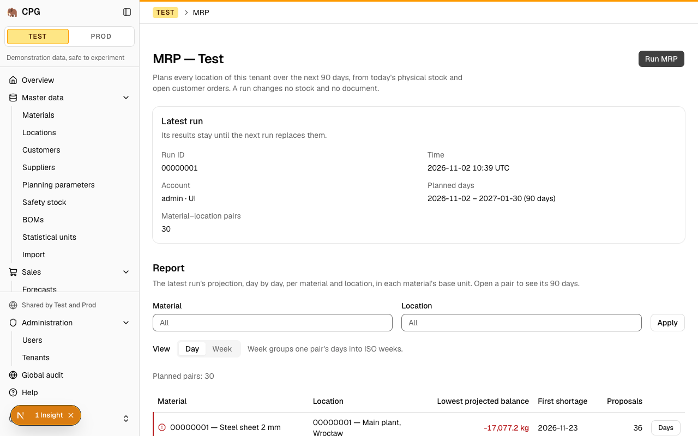
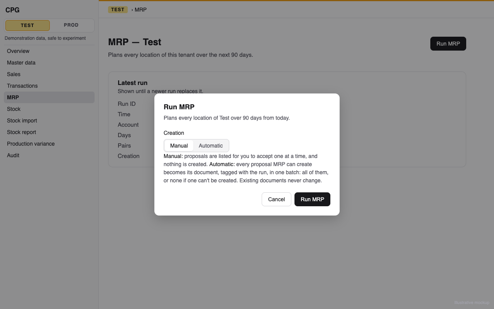
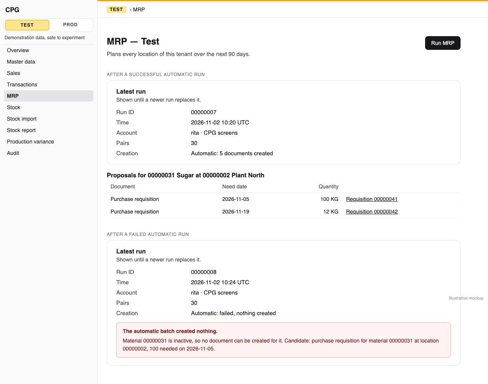

# MRP automatic mode: a run started as Automatic creates every executable proposal in one all-or-nothing batch tagged with the run, one batch at a time per tenant, and an API replay never creates twice

**Status:** implemented
**Created:** 2026-11-02 10:31 UTC
**Issue:** #289 (E19-S03, epic #271) · **Depends on:** MRP runs (`implemented/2026-10-27--0556UTC-mrp-runs.md`, #274), proposal acceptance (`implemented/2026-11-01--0737UTC-mrp-proposal-acceptance.md`, #287), at-risk and provisional plans (`implemented/2026-11-01--2049UTC-mrp-at-risk-and-provisional-plans.md`, #283), the rerun (`implemented/2026-11-02--0651UTC-mrp-rerun.md`, #288), the atomic Test reset (#93), API idempotency (`implemented/2026-10-19--1548UTC-api-idempotency.md`) · **Related:** the Make half of acceptance (#320, open), which makes production-order proposals executable · **Design authority:** `.ai/specs/product-brief.md` (R05, R07, R08, R10, N06), `research/CPG-prd001.pdf` §04 "Manual/auto creation", "Stale and concurrent", "Multilevel explosion", "Transfers", §05, §06, `research/CPG-acceptance.md` RUN-003, RUN-007, RUN-008, RUN-010, RUN-013, RUN-014, RUN-015, RUN-016, RUN-018, RUN-019, RUN-021, RUN-023, RUN-024, RUN-025, API-027, AUD-023

## 📝 TLDR

Since #287 a planner turns MRP proposals into documents one at a time, with Accept. After this change, **Run MRP** will open a small dialog with a **Creation** choice: **Manual**, the default, or **Automatic**. The run API takes the same choice as an optional `mode`. An automatic run stores its results as a manual run does. Then, in the same request, it creates the document of every executable proposal through the same code Accept uses, each document tagged with the run. If any one of them can't be created, none is. The run keeps its results and records the failure, naming the cause and the candidate. Automatic runs are serialised by SQLite's single writer and the write gate, so a second one plans against the first one's documents and never covers a need twice. An API replay with the same key returns the stored run and document IDs. Provisional parents, exceptions and transfers are never candidates. Production orders join the batch when #320 makes Make proposals executable (Q1).

## 📝 Problem Statement

PRD §04 "Manual/auto creation" offers an explicit automatic mode, chosen when the run starts. It creates every eligible requisition and every feasible, lot-rounded production order, tagged with the run. It is all-or-nothing, and on failure it keeps the calculation and its exceptions without creating any document. §04 "Stale and concurrent" asks that each candidate be revalidated just before the batch commits, that only one automatic creation run per tenant at a time, and that optimistic locking, atomicity and idempotency protect retries. §05 and §06 list the automatic batch among the atomic operations and the keyed API writes. Today:

- **There is no way to choose a mode.** `mrpRunSchema` is `z.strictObject({})`, so `{ "mode": "automatic" }` is 400 `VALIDATION_FAILED` (`mrp-run-gate.test.ts`). `MrpRun.mode` exists, checked as `manual | automatic`, but only `manual` is ever written (#274 Q8). The page's Run MRP button runs at once, with no dialog.
- **Creating documents is per proposal.** `MrpAcceptanceService.accept` creates one requisition, planning the tenant again first. Accepting a realistic run's proposals one by one means one click and one full plan per proposal.
- **Nothing records a batch's outcome.** A run has no field saying what its creation did, so RUN-015, RUN-023 and AUD-023 have nowhere to show their failure explanation.

RUN-007, RUN-014, RUN-015, RUN-018, RUN-019, RUN-023, RUN-024, RUN-025, API-027 and AUD-023 are Not executed. The automatic halves of RUN-003, RUN-008, RUN-010, RUN-013, RUN-016 and RUN-021 are open.

## Resolved assumptions (autonomous defaults)

The issue's open questions, plus the gaps between its notes and the shipped code. Each is answered with the most reversible choice. The schema change is one nullable JSON column, added with `alter table … add column`. The contract changes are additive: an optional `mode` in the run body, `creation` on every run view, and `documents` in an automatic run's answer.

| # | Question | Applied default | Why |
|---|---|---|---|
| Q1 | Make proposals aren't executable yet: #320, the Make half of E19-S01, is open. Does this story create production orders? | **The batch's candidates are exactly the proposals `isExecutableProposal` admits**, which today means Buy proposals only. Each one is created by the same per-proposal step Accept uses (`MrpProposalDocumentService.create`, extracted here). When #320 adds the production-order branch to that step and flips `isExecutableProposal`, production orders join the batch with no change to the batch. #320 then owes the production-order halves of RUN-007 and RUN-014, and RUN-015's "BOM component deactivated" case. A comment on #320 records this. | One executability rule for Accept, the read and the batch (`executable-proposal.ts`). Building production-order creation here would duplicate #320's story (scope cohesion), and building the batch against a Make branch that doesn't exist yet would ship code no run can reach. A Make proposal in an automatic run creates nothing and keeps its row in the Proposals table, as in a manual run, so nothing is hidden. |
| Q2 | Three transactions (calculate, store, batch) or one? | **One: the request's own write transaction**, as a manual run uses today (`tenantServerAction`, or `IdempotencyService.run` behind `tenantApiWrite`). In order: the write gate, the plan, the stored run and its results, then the batch inside a savepoint (`inRequestSavepoint`). A candidate that fails rolls the savepoint back, taking every document, every document audit entry and every proposal mark with it. The run then records the failure, and the transaction commits the run, its results, the failure and the idempotency key together. | The idempotency key must commit in the same transaction as what it guards (`IdempotencyService`, spec Q6). With a committed run and a separate batch transaction, a crash between them would leave a run with no key, and a replay would plan and create again. A savepoint gives the batch its own all-or-nothing without a second root transaction. A failed batch keeps its results (AUD-023), and the request stays as atomic as every other write. |
| Q3 | "Immediately before the batch commits, every candidate is revalidated." How, and what does RUN-018 mean here? | **The run takes SQLite's write lock before it reads anything it plans from, so the calculation and the batch see one state that no other writer can change before the commit, and there is no second plan.** The run takes the write gate, then **writes first**: it deletes the previous run's rows, which today happens after the plan. These steps move before the snapshot, as `TestResetService` takes its lock with its first `nativeUpdate`. SQLite then guarantees one of two outcomes:<br>• a posting that committed after the request's first read makes that first write fail with `SQLITE_BUSY_SNAPSHOT` before anything is planned, and the wrapper's single retry starts again from the posting's data;<br>• a posting attempted after the first write waits: behind the gate within this process, and on SQLite's busy handler from another process.<br>Either way, no document is planned from data that changed before the commit. Late validation is what each document's own service checks at create time: active material and location, the entry limit, and later the BOM (#320).<br>**Owner decision (2026-11-02):** the owner told the run to proceed autonomously on its recommended defaults, so this reading is applied. It wasn't confirmed explicitly, so it stays visible here. RUN-018 reads "Batch revalidation fails, zero new documents created, results remain". Its precondition, a posting that changes the data between the calculation and the commit, can't arise here, so its Then is never observed. The test proves both orderings instead. A literal "fails as stale and keeps this run's results" needs the issue's three-transaction design and its replay gap (Q2). RUN-018 stays Partially verified: its Then is never observed. | A re-plan inside the same snapshot can only agree with itself. The window the PRD guards against, between a calculation and its commit, is closed by the write lock taken before the calculation. That is stronger than revalidating, and SQLite enforces it rather than our code. Accept's race test already relies on the same guarantee (#287 step 1). It is flagged because a P0 criterion's Then becomes unreachable instead of being asserted. Choosing the other reading would rewrite the transaction design. |
| Q4 | A second concurrent automatic run: refused or queued? | **Queued, with no new flag and no new code.** A run that starts while another holds the gate waits at its first transaction (`beforeTransactionStart`), so its snapshot comes after the first run's commit. A run that started in the same tick and read first waits at `holdWriteGate`, then fails its first write as stale, now before planning (Q3), and its retry starts after the commit. Either way it plans against the first run's documents, which are Open requisitions and so tentative supply (#276). It proposes nothing for the needs they cover and creates nothing for them. `MRP_AUTO_RUN_BUSY` is not added. | RUN-019 accepts either outcome ("refused … or it runs afterwards and finds nothing left to create"). Queuing reuses the gate and the rerun netting #288 proved, and it adds no state that could stay stuck after a crash. A per-tenant compare-and-set flag would need its own release path. Proven with two ORMs on one file (lesson 2026-10-19), plus a third gated writer during the retry. The wrappers retry once, so that case answers the stale-snapshot error with nothing stored, as every other SQLite write does (#287 step 1). |
| Q5 | How does a failed batch answer through the API? | **`200`, with the run, `creation: { status: "failed", … }` and `documents: []`**, the issue's proposed default (the run route answers 200, not 201). The replay returns the same failure, and the same key never creates documents later. A new key is a new run. | The run itself succeeded, and its results are stored and readable. An error status would store no key, so a retry would plan again, and might create documents under the same key. |
| Q6 | Where does the run record its creation outcome? | **One nullable JSON column, `mrp_run.creation`.** It is `null` for a manual run, `{ "status": "created", "documents": 5 }` after a successful batch, and `{ "status": "failed", "code", "message", "params"?, "fieldErrors"?, "candidate": { "proposal", "kind", "material", "location", "needDate", "quantity" } }` after a failed one. `params` and `fieldErrors` are kept when the refusal has them: `VALIDATION_FAILED`'s cause is in its field errors, and its message is only "Some fields are invalid.". The candidate names the material and location for codes that carry no params, such as `MATERIAL_INACTIVE`. A batch over the cap (Q15) records `{ "status": "failed", "code": "MRP_BATCH_TOO_LARGE", "params": { "candidates", "limit" } }` with no candidate. The batch stops at the **first** candidate that fails, in candidate order (Q14), and records that one. | It lives as long as the run record, which outlives its results (#274 Q1), so the explanation survives a newer run. One additive column. Every later candidate is rolled back anyway, so reporting the first one names a real cause without making the batch run on to collect more. |
| Q7 | How does the answer list the created documents? | An automatic run's answer adds `documents: [{ proposal, kind, id }]` in candidate order, `[]` when the batch failed. A manual run's answer is unchanged. The stored run keeps only the count (Q6). Each proposal's `document` in `GET …/mrp/runs/latest` names its document, as an accepted proposal's does. | API-027 and RUN-024 ask for "the same run ID and the same 3 document IDs" on replay. The idempotency store keeps the answer. A requisition's ID and a production order's ID can be equal, so `kind` disambiguates. Keeping the list off the run keeps every report read small. The idempotency row holds the list for 24 hours, bounded by Q15's cap at about 200 KB. |
| Q8 | Where does the choice live on screen? | **Run MRP opens a dialog.** The dialog has the **Creation** choice as a `SegmentedControl` (Manual, Automatic), checked Manual each time it opens, a short text explaining both modes, and **Run MRP** / **Cancel**. | The issue and RUN-003 speak of "the Run MRP dialog". An automatic run creates many documents, so a deliberate second click fits (RUN-007, "explicit opt-in"), and resetting to Manual on every open keeps the default. The control already exists. |
| Q9 | The report's display of a failed batch was assigned to E18-S03, which merged without it. Who shows it? | **This story, minimally.** The latest-run card gains a **Creation** field ("Manual", "Automatic: 5 documents created", or "Automatic: nothing created"). After a failed batch an alert under the card names the cause, translated by code, and the candidate's document kind, material, location, need date and quantity. | RUN-023's channel is Both, and a user who just chose Automatic must see what happened. One field and one alert in a card that already exists. |
| Q10 | Which failures are recorded, and which fail the request? | Any `AppError` a candidate's creation throws fails the batch and is recorded: `MATERIAL_INACTIVE`, `LOCATION_INACTIVE`, `VALIDATION_FAILED` above the entry limit, and #320's own codes. Two exceptions propagate instead: `REQUISITION_ID_RACE`, a transient race the held write lock rules out anyway and which must never be replayed as a permanent outcome, and anything that isn't an `AppError` (a driver error, a bug). When one propagates, the request fails, nothing is stored and the earlier run stays. | An `AppError` is a business refusal with a stable code a screen can translate. Anything else isn't safe to commit around, or to store under a key. |
| Q11 | Audit? | Each document's own creation entry, written by its service and carrying `mrpRun`, as Accept's are (R08). The run's `mrp.mrp-run.created` entry moves after the batch, so its `after` can carry the outcome. For an automatic run it gains `mode: "automatic"` and `creation`, the stored outcome: `{ status, documents }`, or `{ status, code }` and the candidate's proposal. A manual run's entry keeps its shape. A failed batch leaves no document entry (AUD-023). `AUDIT_FIELDS` gains `"mode"` and `"creation"`, labelled "Mode" / "Tryb" and "Creation" / "Tworzenie". | The documents' entries already say who, when, which channel and which run. The run's entry records the automatic kind and what its batch did, so setting `creation` is never an unaudited change. |
| Q12 | Which tenant do the integration files use? | **Test.** Both files reset Test to its startup dataset in `beforeAll` and again in `afterAll`, and assert only on their own materials. | An automatic run creates documents for every executable proposal in the tenant, other files' materials included (issue). In Test the closing reset removes them, so files run later see the state they expect (lesson 2026-11-02, #288's Prod growth). The read-only case runs in Prod, where nothing is created. |
| Q13 | Budget? | Measured in `mrp-run-timing.test.ts`, fastest of three. On the realistic fixture an automatic run, plan and batch together, takes under 3 s. A batch of exactly the cap's candidates (Q15) takes under 15 s. The longest event-loop stall is under 250 ms in both. The ten-times and worst-case fixtures print their figures without a budget; above the cap they record `MRP_BATCH_TOO_LARGE`. `test-reset-realistic.test.ts` times one automatic run on Test's realistic dataset in the image, and asserts that `/up` and a latest-run read issued during the batch both answer 200 on a reused connection (lesson 2026-10-24). | The issue asks for a stated budget and a probe during the batch. A manual run takes 241 ms and 2.6 s at these sizes (#287's notes). Test's startup dataset proposes about 400 times over its 30 pairs (370 on the first page of 25, read from a local run while writing this spec). Make proposals are part of that, but #320 will add them to the batch. The batch adds one service create per candidate. If ten times takes more than 10 s, fewer ORM calls per document is the fix (lesson 2026-10-22), never skipping the per-document checks. |
| Q14 | In which order are the candidates created? | The run's proposal order: material, location, need date. | That is the stored order through the unique `(tenant, run, material, location, need_date)` index. Document IDs then follow the report's order, and "the first failing candidate" is well defined. |
| Q15 | Is the batch bounded? | **Yes, at `MRP_BATCH_LIMIT = 2,500` candidates.** Above it, the batch creates nothing and records `MRP_BATCH_TOO_LARGE` with the count and the limit. The run and its results are kept, and Accept still works one proposal at a time. The constant lives in core, and the benchmark at the cap (Q13) may lower it before release, never raise it past the budget. | Lessons 2026-11-02 ("bound it from the first release") and 2026-10-22 ("measure a bulk write at its row cap"). The worst case is a proposal every day for every pair, about 27,000 requisitions at ten times, held under one write lock that other writers, the other container during a deploy included, wait for. That is about six times the startup dataset's ~400 proposals. A recorded failure is reversible: raise the constant. Silent partial creation is not allowed (RUN-015). |

## 📝 Proposed Solution

```
db/entities/mrp/mrp-run.entity.ts                       + creation (nullable JSON)
db/migrations/                                          + Migration…_mrp_automatic_mode (one add column)
core/validators/mrp/mrp-run.schema.ts                   { mode?: "manual" | "automatic" }, strict, nullable
core/services/mrp/
  mrp-proposal-document.service.ts                      MrpProposalDocumentService.create   (new, extracted from accept steps 7–8)
  mrp-acceptance.service.ts                             accept() uses it; behaviour unchanged
  mrp-batch.service.ts                                  MrpBatchService.createAll            (new)
  mrp-run.service.ts                                    run(actor, { mode }) → stores, then the batch when automatic
  mrp-run-view.ts                                       MrpRunView.creation, MrpRunAnswer.documents
core/domain/audit/audit-fields.ts                       + "mode"
core/container/                                         + mrpProposalDocumentService, mrpBatchService
app/api/tenants/[tenant]/mrp/runs/route.ts              passes the parsed mode
app/admin/[tenant]/mrp/actions.ts                       runMrp(tenant, generation, raw)
app/components/mrp/run-mrp-button.tsx                   opens RunMrpDialog                   (dialog new)
app/components/mrp/mrp-run-screen.tsx                   RunCard: Creation field and failure alert
```

**Alternatives considered.**
- *Calculate outside any transaction, store the run, then batch in its own transaction (the issue's note).* Rejected (Q2, Q3). It opens the window that revalidation then has to close, it needs a second full plan inside the batch, and the run and its key would commit apart.
- *A per-tenant "automatic creation running" flag with `MRP_AUTO_RUN_BUSY`.* Rejected (Q4). The gate already serialises, and a flag needs crash recovery.
- *Create documents with bulk inserts instead of the services.* Rejected. It would bypass every per-document rule and audit entry that makes a candidate "valid" (R08). Fewer ORM calls inside the services is the lever if the budget is missed.
- *Collect every failing candidate.* Rejected (Q6). The first failure is enough to explain a refusal, and continuing would cost the rest of the batch for nothing.

## 📝 Architecture

### `MrpRunService.run(actor, { mode = "manual" })`

For both modes, in this order:

1. **Lock.** `holdWriteGate`, then the first write: the three `nativeDelete`s of the previous run's results, recommendations and exceptions. These used to run after the plan, and now run before the snapshot (Q3), so a stale snapshot is refused here, before anything is planned. A yield follows, as it does today.
2. **Plan.** Today's date, the generation, `planMrp(load(today), today)`, then a yield.
3. **Store.** Insert the run (now with `mode`), then `writeResults`, unchanged.
4. **Manual.** Record `mrp.mrp-run.created` as today, flush, and return the view with `creation: null`. The answer is today's plus the new field.
5. **Automatic.** `const outcome = await mrpBatchService.createAll(run.code, actor)`. Reload the run, since the batch clears the identity map. Set `run.creation`, record `mrp.mrp-run.created` with `mode` and `creation` (Q11), flush, and return `{ ...view, creation, documents: outcome.documents }`.

The `mrp-run-timing.test.ts` stall figures are re-measured after moving the deletes. The stretch from the deletes to the yield is unchanged, so only its position in the run moves.

### `MrpBatchService.createAll(runCode, actor)`

Called only from `run`, inside the request transaction, with the gate and the write lock held.

1. **Count.** `count(MrpRecommendation, { run, kind: { $in: EXECUTABLE_PROPOSAL_KINDS } })`, where `EXECUTABLE_PROPOSAL_KINDS` is exported beside `isExecutableProposal` so both say the same. Above `MRP_BATCH_LIMIT`, return `{ status: "failed", code: "MRP_BATCH_TOO_LARGE", params: { candidates, limit } }` at once (Q15).
2. **Candidates.** Read them ordered by material, location and need date, in keyset chunks of 25 through the unique index. Use `fields` partial loads with `disableIdentityMap`, keeping only **primitives**: `{ id, kind, material, location, needDate, quantity }`. No managed recommendation entity crosses a clear (lesson 2026-10-22, "Paged recalculations").
3. **Savepoint.** `inRequestSavepoint(em, loop, { keep: true })`. For each candidate, the loop calls `mrpProposalDocumentService.create(runCode, candidate, actor)` and collects `{ proposal, kind, id }`. After each chunk of 25 it flushes, clears the identity map and awaits `yieldToEventLoop()` (lessons 2026-10-22 and 2026-10-24). The read chunk and the flush chunk are the same size, so nothing read is ever detached before it is used.
4. **Failure.** An `AppError` from a candidate leaves the loop, other than `REQUISITION_ID_RACE` (Q10). `inRequestSavepoint` rolls back to the savepoint, which removes every document, audit entry and `acceptedDocument` mark of this batch, then rethrows. `createAll` catches it and returns `{ status: "failed", code, message, params?, fieldErrors?, candidate, documents: [] }`. Any other error propagates.
5. **Success.** `{ status: "created", documents: n, list }`.

`MrpProposalDocumentService.create(runCode, candidate, actor)` is accept's steps 7 and 8, moved, and takes primitives:
- read the material's base unit;
- `parseInput(requisitionCreateSchema, …)`;
- `purchaseRequisitionService.create(input, actor, { mrpRun: runCode })`;
- mark the proposal with `em.nativeUpdate(MrpRecommendation, { id: candidate.id }, { acceptedDocument: document.id })`. A plain field, tenant-filtered, inside the transaction, so the mark rolls back with the savepoint and needs no managed entity.

It branches on `kind`, and today has only the requisition branch. A non-executable kind throws an internal error: no caller passes one. `MrpAcceptanceService.accept` keeps its own checks (steps 0–6, the fresh re-plan included), then calls it with the loaded proposal's fields and builds its answer as today. Its tests stay as they are. Accept already loads the proposal with `refresh: true`, so the native mark can't be overwritten by a stale managed copy.

Not candidates, by construction:
- exceptions and warnings, the other rows of `mrp_run_exception`;
- provisional actions, which since #283 are never proposals, so no provisional parent can be created (RUN-025);
- Insufficient Transfer Stock, which is an exception, and MRP has no transfer proposal kind (N06).

Existing documents are only read (R10): the batch only creates.

### Serialisation and staleness

The gate is in-process (`write-gate.ts`, on `globalThis`), and it covers every Next.js bundle of the server. It only holds back root transactions that begin after it is taken. Another process (the other container during a Kamal overlap, or `db:migrate`) meets SQLite's write lock instead and busy-waits up to 5 s (see Risks).

Two automatic runs on two ORMs over one file:
- **The second begins after the first holds the gate.** Its transaction waits at `beforeTransactionStart`, so it reads after the commit and is never stale.
- **Both begin in the same tick.** The second reads first, waits at `holdWriteGate`, then its first write (step 1, before any plan) is refused as stale, and its retry begins after the commit.

In both cases it plans with the first run's requisitions as tentative supply, so the needs they cover get no proposal and no document. On one ORM the two transactions queue whole on the connection's mutex.

`mrp-batch-concurrency.test.ts` starts both in the same tick and asserts:
- exactly one batch creates documents for the shared needs;
- the total is the first batch's count;
- the second run's `creation` is `{ status: "created", documents: 0 }`;
- the retry is counted.

A third case has a gated writer, an accept, take the gate between the retry's `begin` and its first write. The request then fails with the stale-snapshot error, with nothing stored, as Q4 states.

Staleness (Q3) is proven by interleaving from the caller's transaction (lesson 2026-10-23). A stock correction commits on a second ORM after the attempt's first read. The attempt fails at its first write, before `planMrp` runs (a spy on the loader counts one load in all), and stores nothing. The retry's requisition is sized to the corrected stock. A posting during the batch waiting at the gate is the gate's own behaviour, already proven in `write-gate.test.ts`, and isn't re-proven here.

### Errors

One new code, recorded on the run and never thrown: `MRP_BATCH_TOO_LARGE` (Q15). Its EN text is fixed: "This automatic run has more proposals than one batch may create. Nothing was created; accept proposals one at a time, or ask for the limit to be raised." `params` carries `candidates` and `limit`. Otherwise a failed batch's `code` is the candidate's own refusal (Q5). The route keeps every refusal it has:
- `TENANT_READ_ONLY` (no run, no document: RUN-021);
- `GENERATION_REQUIRED` / `GENERATION_STALE`;
- the idempotency codes;
- `VALIDATION_FAILED` for an unknown key or mode;
- `MRP_RUN_IDS_EXHAUSTED`.

## 📝 Data Model

```ts
// MrpRun (additive)
/**
 * What an automatic run's batch did (E19-S03): `null` for a manual run; `{ status: "created", documents }`;
 * or `{ status: "failed", code, message, params?, fieldErrors?, candidate? }` naming the first candidate that failed
 * (no candidate for `MRP_BATCH_TOO_LARGE`).
 */
creation: p.json<MrpRunCreation>().nullable(),
```

One migration, `npm run db:migration:create -- mrp_automatic_mode`, which must read ``alter table `mrp_run` add column `creation` json null;``, with the `drop column` in `down()`. If the generator rebuilds `mrp_run`, hand-write the two statements (lesson 2026-10-23), and assert that `orm.schema.getUpdateSchemaSQL()` doesn't mention the table. Test the upgrade on a populated database: an existing run reads `creation: null` (`?? null`, lesson 2026-10-19) and `mode: "manual"`. Test an old-style insert without the column after the migration (lesson 2026-10-21). Update the migration lists and counts (`orm.test.ts`, `core/src/database.test.ts`, `system-status.service.test.ts`, `smoke.test.ts`).

`mode` needs no change: its check already allows `automatic` (#274 Q8).

Previous image during a deploy: it ignores the column and writes manual runs with `creation` null, which is a manual run's value. Rollback is `down()`. Runs then lose their creation outcome. Their documents keep `mrpRun`.

## 📝 API Contracts

**`POST /api/tenants/{tenant}/mrp/runs`** (additive). The body is empty, `{}`, or `{ "mode": "manual" | "automatic" }`. A missing `mode` is manual. Any other key or value is 400 `VALIDATION_FAILED`. Every answer's run gains `creation`, and an automatic run's answer adds `documents`:

```json
{
  "id": "00000007", "mode": "automatic", "…": "…",
  "creation": { "status": "created", "documents": 3 },
  "documents": [
    { "proposal": "6f1c…", "kind": "purchase-requisition", "id": "00000041" },
    { "proposal": "8a02…", "kind": "purchase-requisition", "id": "00000042" },
    { "proposal": "c9d4…", "kind": "purchase-requisition", "id": "00000043" }
  ]
}
```

A failed batch, still `200`:

```json
{
  "id": "00000008", "mode": "automatic", "…": "…",
  "creation": {
    "status": "failed", "code": "MATERIAL_INACTIVE", "message": "…",
    "candidate": { "proposal": "6f1c…", "kind": "purchase-requisition", "material": "00000031", "location": "00000002", "needDate": "2026-11-05", "quantity": "100.000000" }
  },
  "documents": []
}
```

A replay with the first key and the same body answers the stored result with `Idempotent-Replayed: true` and writes nothing, so the tenant holds the first answer's documents and no more (API-027, RUN-024). The same key with another body, `{}` against `{ "mode": "automatic" }` included, is 409 `IDEMPOTENCY_KEY_REUSED`. After a Test reset, the old key's generation is `GENERATION_STALE` (R07). The server action `runMrp` takes the same body and answers the same shape. Fingerprints are taken over the raw body (`fingerprint.ts`), so an empty body, `{}` and `{ "mode": "manual" }` under one key are `IDEMPOTENCY_KEY_REUSED` although they mean the same run. For 24 hours after the release, a replay of a key stored by the previous image answers its stored run, which has no `creation`. Both are documented.

**`GET …/mrp/runs/latest`** (additive): `run.creation`, as above. Each proposal's `document` names the document the batch created.

`BACKWARD_COMPATIBILITY.md`: the run route's body and answer (§4, "Additive since E19-S03"), the two replay notes above, `run.creation` on the latest read, the migration and its rollback note (§1), and the page's Run MRP now opening a dialog (§4, UI line).

## 📝 UI/UX

**Run MRP** (`data-mrp-run`, still shown only while the tenant is writable) opens a dialog (`data-mrp-run-dialog`):

- **Title:** "Run MRP"
- **Description:** "Plans every location of {tenant} over 90 days from today."
- **Creation:** a `SegmentedControl` named `mode` with **Manual** and **Automatic** (`data-mrp-mode`), checked Manual each time the dialog opens. Under it, help text: "Manual: proposals are listed for you to accept one at a time, and nothing is created. Automatic: every proposal MRP can create becomes its document, tagged with the run, in one batch: all of them, or none if one can't be created. Existing documents never change."
- **Buttons:** **Run MRP** (`data-mrp-run-submit`, pending "Running…") and **Cancel**.

Confirming calls `runMrp` with `{ mode }`, then refreshes the page as today. A refusal (read-only, generation, run IDs) stays in the dialog, translated by code. Cancel and Escape run nothing.

The latest-run card gains a **Creation** field (`data-mrp-field="creation"`): "Manual"; "Automatic: {count} documents created" (plural forms, EN and PL); "Automatic: no proposals to create" for a successful batch with none; or "Automatic: failed, nothing created". After a failed batch, an alert under the card's fields (`data-mrp-creation-failure`, `role="alert"`, rendered with `ErrorSummary` when present at page load, lesson 2026-10-23) reads:

> The automatic batch created nothing. {cause} Candidate: purchase requisition for material 00000031 at location 00000002, 100 needed on 2026-11-05.

`{cause}` is the screen's text for the stored `code`: the requisition's `MATERIAL_INACTIVE` and `LOCATION_INACTIVE` texts, and `MRP_BATCH_TOO_LARGE`'s with its count and limit (that alert has no candidate sentence). `VALIDATION_FAILED` is explained from the stored `fieldErrors`: a `quantity` error reads "The quantity is more than one document can hold." Every other code falls back to the stored English `message`. The kind's name comes from the Proposals table's existing labels. The Proposals table needs no change: a proposal the batch created shows its document link, as an accepted one does.

The page's intro today ends "A run changes no stock and no document.", which an automatic run makes untrue. It becomes "A run changes no stock. A manual run creates no document; an automatic run creates the documents its proposals call for, and never changes an existing one." (EN and PL).

The MRP help topic (EN, PL) gains a paragraph:

> Run MRP asks how to create documents. Manual, the default, only lists proposals. Automatic also creates every proposal MRP can create, each tagged with the run, in one batch: if one of them can't be created, none is, and the run's card says which and why. Production-order proposals aren't created yet. A second automatic run plans against the first one's documents, so it never creates a need twice. The API takes the same choice: POST /api/tenants/{tenant}/mrp/runs with { "mode": "automatic" }.

Prototype: `.ai/specs/assets/mrp-automatic-mode/` (static mockups).







## 📝 Edge Cases & Failure Scenarios

All with today fixed in unit tests:

- **Default is manual (RUN-003).** The dialog opens on Manual. A run with the default, from the dialog or with `{}`, creates no requisition, purchase order or production order, counted across every page, and its `creation` is `null`.
- **Explicit automatic (RUN-007, RUN-014).** With 5 executable proposals, exactly 5 Open requisitions appear, each with `mrpRun` set to the run's ID, the proposal's quantity in the base unit and its need date. Each has its creation audit entry with `mrpRun`, the run's account and channel. The answer's `documents` lists the 5, each proposal's `document` in the latest read names its own, and `creation` is `{ status: "created", documents: 5 }`.
- **Make proposals (Q1).** They create nothing, keep `document: null`, and still show in the Proposals table as not yet acceptable.
- **One invalid candidate (RUN-015, RUN-023, AUD-023).** Five candidates, the third's material inactive (flag set directly, since a material with open demand can't be deactivated: #287's test), or its quantity above the entry limit. No requisition is created, no document audit entry is written, and no proposal is marked. The run's results, proposals and exceptions read back whole, and `creation` names `MATERIAL_INACTIVE` (or `VALIDATION_FAILED`), the material, the location and the third candidate. The card shows the alert.
- **Stale before the first write (RUN-018, Q3).** Proven by interleaving from the caller's transaction (lesson 2026-10-23, "Interleave a write"): a stock correction commits on a second ORM after the attempt's first read. The attempt fails at its first write, before any plan (one snapshot load in all), and stores nothing. The retry creates requisitions sized to the corrected stock, and the attempts are counted. If a second interleaved commit refuses the retry too, the request fails, no run or document is stored, and the earlier run reads back unchanged.
- **Over the cap (Q15).** With the limit set low through the container (lesson 2026-10-21, "Vary a service's configuration through the container"), the batch records `MRP_BATCH_TOO_LARGE` with the count and limit, creates nothing, and keeps the run's results.
- **A failure that isn't a refusal (Q10).** A `RAISE(ABORT)` trigger on `purchase_requisition` in the temp database makes the third insert fail with a driver error. The request fails, and no run, document or audit entry is stored. `REQUISITION_ID_RACE` propagates in the same way, checked by unit-testing the batch's error filter.
- **Every proposal marked.** A batch of 26 candidates, crossing one chunk boundary, marks each proposal with its own document, read back through the latest read.
- **Concurrent automatic runs (RUN-019, Q4).** Proven with two ORMs, as under Architecture.
- **Rerun (automatic halves of RUN-008, RUN-010, RUN-013).** An automatic rerun on unchanged data creates nothing (`documents: 0`). With demand down to 80 against an Open production order of 100, the order keeps its quantity, dates, status and version, nothing is cancelled, and `excess` is 20. Every existing document's version is unchanged, read across every page.
- **Independent exception (RUN-016).** A's Missing BOM and B's Buy proposal: B's requisition is created and A's exception stays in the report. The batch succeeds.
- **Provisional parents (RUN-025).** F made from I, I made from R, F and I with no dependable input: R's requisition is created, no production order exists for F or I, and F and I stay in the provisional plan, counted as neither supply nor hidden shortage. In Manual mode they have no Accept, and the accept API answers 404 `MRP_PROPOSAL_NOT_FOUND` for them, since a provisional action has no proposal ID.
- **Transfers (N06).** An Insufficient Transfer Stock exception creates and changes no transfer: the transfer counts and versions are unchanged.
- **Read-only (RUN-021).** No Run MRP button. An automatic run from a page rendered before the flag changed, or through the API with a user's or the admin's token, answers `TENANT_READ_ONLY`, stores no run and no document, and the earlier run stays readable.
- **Idempotency (RUN-024, API-027, R07).** Replay with K: same run ID, same document IDs, `Idempotent-Replayed: true`, and the tenant still holds 3 such requisitions. The same key with `{}` gives `IDEMPOTENCY_KEY_REUSED`. After a Test reset, the old key with the old generation gives `GENERATION_STALE`. A failed batch replays its failure and never creates later under K.
- **Mode validation.** `{ "mode": "auto" }`, `{ "mode": null }` and `{ "extra": 1 }` are 400 `VALIDATION_FAILED` and store nothing.
- **Stored before this release.** A run stored by the previous image reads `creation: null`, and the card says "Manual".

## 📝 Risks & Impact Review

- **Event-loop stalls and blocked writes.** The batch holds the gate and SQLite's write lock for its whole length, so every other write and read transaction in the process waits for it, as for a manual run. That waiting is the serialisation Q4 relies on. The batch yields every 25 candidates, so `/up` (`pingDatabase`) answers during it and queued requests complete after it. The budgets are under Q13, and Q15's cap bounds the length.
- **Deploy overlap.** Another process, such as the other container during a Kamal deploy or a `db:migrate`, doesn't see the gate. Its writes busy-wait up to better-sqlite3's 5 s timeout and then fail. A batch longer than 5 s, possible only near the cap, can therefore fail the new container's startup migration if a deploy happens to start during it. The startup guard then exits and Kamal keeps the old container, so the deploy is retried. Accepted, as for a long manual run or Test reset. Q15's benchmark is what keeps this window short.
- **Schema.** One nullable JSON column, added with `alter table`. Rollback is `down()`.
- **Shared contract.** The run body gains an optional key, which the strict schema was kept strict for (#274). Answers gain fields. Manual runs answer as before plus `creation: null`. No existing value changes meaning.
- **The Run MRP flow gains a click.** `tests/integration/mrp-run.test.ts` clicks `[data-mrp-run]` and must now confirm in the dialog. `mrp-report.test.ts` only checks that the button is hidden. Grep the integration files for the selector and update them (lesson 2026-11-01, "seam").
- **Seam with #320.** It flips `isExecutableProposal`, adds the production-order branch to `MrpProposalDocumentService.create`, and owes the automatic production-order tests (Q1). If #320 merges first, this story's batch includes Make from the start, and its tests must use Buy-only fixtures or assert the production orders.
- **Seam with #322.** If the owner moves a late Buy proposal's required date to its planned finish, the change is in `MrpProposalDocumentService.create`, and Accept and the batch follow together.

## 📝 Decisions in play

R05 (Test and Prod separate: a batch creates only in its own tenant, and read-only refuses it for the admin too), R07 (API parity, the idempotency key with the write, the Test generation), R08 (every document's creation entry, and none for a rolled-back batch), R10 (on demand only, and never edits an existing document), N06 (no transfers or purchase orders from MRP). None is superseded. Q3's reading of RUN-018 is flagged for the owner.

## 📋 Phasing

One phase, one PR: the column, the mode, the shared document step, the batch, the route and action, the dialog and card, copy and help, the benchmark, the integration files, docs and catalogue. Production orders in the batch arrive with #320 (Q1).

## 📋 Implementation Plan

1. **Column and migration.** `MrpRun.creation` and `MrpRunCreation` (in `@cpg/db`, beside `MRP_RUN_MODES`). Run `npm run db:migration:create -- mrp_automatic_mode` and review the SQL (one `add column`). Add the populated upgrade test, the old-style insert test and `down()`, and update the migration lists and counts.
2. **Mode, view and lock order.** `mrpRunSchema` gains the optional `mode`. `MrpRunView.creation` (`?? null`) through `toRunView`. `MrpRunAnswer` gives `documents` for automatic runs. `AUDIT_FIELDS` gains `"mode"` and `"creation"` with their labels. `run(actor, { mode })` writes `mode`, moves the three deletes before the snapshot (Q3), and records the run's entry last. Re-run `mrp-run-timing.test.ts` and `mrp-run-concurrency.test.ts` to check the moved deletes. The concurrency test now fails before a second plan, so assert that the snapshot is loaded once per run. Update `mrp-run-gate.test.ts` (`{ mode: "automatic" }` is now accepted, and `{ mode: "auto" }` refused) and every exact `MrpRunView` comparison in core and the app.
3. **Shared document step.** Extract `MrpProposalDocumentService.create` from `MrpAcceptanceService` and register it. Export `EXECUTABLE_PROPOSAL_KINDS` beside `isExecutableProposal`. `accept` calls the new service, and the acceptance tests stay green unchanged. Add a unit test of the new service (the requisition branch, the mark, and the internal error for a non-executable kind).
4. **Batch.** `MrpBatchService.createAll` with the count and cap, the primitive candidates read in chunks of 25, the savepoint, the chunked flush and yield, the native marks, and the failure record. Wire it into `run` for automatic mode. Tests on a real SQLite file with a fixed clock: each unit-level Edge Case line (RUN-003, 007, 014, 015 for an inactive material and an over-limit quantity, 016, 018 both orderings, 023, 025, AUD-023, the reruns, transfers, Make proposals, the cap, a trigger-raised driver error, `REQUISITION_ID_RACE` propagating, chunk boundaries at 24, 25 and 26 candidates with every proposal's mark read back) and `mrp-batch-concurrency.test.ts` (RUN-019, two ORMs, plus the third gated writer).
5. **Route and action.** The route passes the parsed body to `run`. `runMrp(tenant, generation, raw)` does the same. Route test: wiring, mode passed through, the automatic answer's shape, and replay through the real `tenantApiWrite` (`mrp-run-gate.test.ts`: RUN-024 and API-027 replay with the same documents, key reuse across modes, `TENANT_READ_ONLY` for both modes, the stale generation after a reset).
6. **Screen.** `RunMrpDialog` (the dialog, the `SegmentedControl`, the help text, pending, errors, Cancel, and Manual on every open), opened by `RunMrpButton`. Add `RunCard`'s Creation field and failure alert. Add messages in EN and PL (with the plural forms both dictionaries need, lesson 2026-11-01) and the help paragraph. Component tests cover: the default, the submitted mode, Cancel runs nothing, each Creation text, the alert's cause by code with the fallback, and labels that are plain data. Use `data-autofocus` on the dialog's first control (lesson 2026-10-25).
7. **Benchmark.** In `mrp-run-timing.test.ts`, time an automatic run on the realistic fixture, and a batch of exactly `MRP_BATCH_LIMIT` candidates. Also run the ten-times and worst-case fixtures unbudgeted. Print the run time, the candidates, the documents created and the longest stall. Assert Q13's budgets, and lower the cap if the batch at the cap misses them.
8. **Integration.**
   - `tests/integration/mrp-automatic-api.test.ts` (Test, reset before and after). It uses two own Buy materials with order lines. The failure test adds one more own material with two lines of 999,999,999,999, whose proposal exceeds the entry limit, and cancels them in a `finally`, so a failing assertion can't leave every later automatic run in the file failing. It covers:
     - RUN-007 and RUN-014: created and tagged, across every page;
     - RUN-024 and API-027: replay;
     - key reuse with `{}`;
     - RUN-015 and RUN-023: the failed batch answers 200 with the candidate, and nothing is created;
     - the automatic rerun creates nothing;
     - RUN-019: two simultaneous automatic requests with different keys leave no duplicate requisition for the own materials. Both requests run in the route-handler bundle, so this proves same-bundle queuing only; the cross-connection case is the unit two-ORM test, and the evidence says so;
     - RUN-021: read-only Prod refuses both modes for a user's and the admin's token, then is restored.
   - `tests/integration/mrp-automatic.test.ts` (Test, reset before and after). It covers:
     - the dialog opens on Manual, a manual run creates nothing, and the card says Manual;
     - Automatic creates the own pair's requisition, the card says "Automatic: N documents created", and the one-pair Proposals table links the requisition;
     - the failure alert after a failing batch, with the same `finally` clean-up.
   - `tests/integration/test-reset-realistic.test.ts`: one automatic run on the realistic dataset, timed, with `/up` and a latest-run read issued during it on a reused connection. It goes after the file's list walks, since it adds many Test requisitions.
   - Update `mrp-run.test.ts` for the dialog. Run these files, then the MRP and purchasing files after them on one server (lesson 2026-10-24, #187), and `smoke.test.ts` for the migration count.
9. **Docs and catalogue.**
   - `BACKWARD_COMPATIBILITY.md`: the route's body and answer, the latest read's `creation`, the dialog, and the migration's rollback note.
   - `.ai/docs/engineering-standards.md`: an MRP bullet. Automatic creation runs in the run's transaction, in a savepoint, through `MrpProposalDocumentService`, and `isExecutableProposal` stays the one rule.
   - `CPG-acceptance.md`: Evidence for every row in the header, moving a status only when every clause and channel is asserted (lesson 2026-10-21). Rows whose production-order half waits on #320 stay Partially verified. RUN-018 stays Partially verified (Q3).
   - Comment on #320 with what it now owes (Q1).
   - Move this spec to `implemented/` with implementation notes.

Each step leaves the suite green. Run `npm run lint`, `npm run typecheck`, `npm run test:coverage` (100%) and `npm run build`.

## Implementation notes

Implemented on #340, branched from `main`. The spec PR #339 stays design-only. The owner told the run to continue autonomously, so Q3 is applied as recommended; RUN-018 stays Partially verified until it is confirmed explicitly. The implementation follows the spec, except:

- **Candidates are read in one bounded read, not in keyset chunks of 25.** `MRP_BATCH_LIMIT` bounds the read: about 2,500 rows of six plain fields, read with `fields` and `disableIdentityMap`. They are kept as plain values, so the flush-and-clear every 25 documents detaches nothing. The review finding behind the chunked read was the lost marks, and the native mark fixes that whatever the read's shape.
- **The run's audit entry carries `mode`, `documents` and `failure` (the code), not a `creation` object.** Audit snapshots hold scalars only (`AuditValue`). `AUDIT_FIELDS` gains the three, with EN and PL labels, and `mode`'s values are translated.
- **The failure note is a `Callout` (`role="note"`), not an `ErrorSummary`.** It stays on the page as long as its run is the latest, so taking focus on every visit would be wrong. A refusal of the run itself still shows in the dialog.
- **The mode is re-declared in the validator** (`MRP_RUN_INPUT_MODES`, pinned equal to `@cpg/db`'s `MRP_RUN_MODES` by a test), so the schema stays free of the ORM for client bundles.
- **The concurrency test of #274 changed with the lock order.** It used to commit a write held open on the other connection in the middle of the run's snapshot. With the first write before the snapshot, such a write would be held open across a macrotask, which production code never does (lesson 2026-10-24). So the test now commits after the wrapper's first read, and asserts the run fails before any plan: one snapshot load in all.
- **Benchmark** (`mrp-run-timing.test.ts`, fastest of three, run alone; each attempt is rolled back, so all three start from the same data):

  | Measured | Figure | Budget |
  |---|---|---|
  | Automatic run, realistic fixture (354 requisitions) | 442 ms, longest stall 30 ms | 3 s, 250 ms |
  | Batch of exactly 2,500 requisitions, ten-times fixture | 1,322 ms, longest stall 32 ms | 15 s, 250 ms |
  | Automatic run, ten-times fixture (2,543 Buy proposals) | 2,666 ms; records `MRP_BATCH_TOO_LARGE` | printed only |

  The manual run's figures were unchanged by the deletes moving first: 248 ms and 2,699 ms, longest stall 33 ms and 103 ms. The cap stays at 2,500. At 1.3 s for a full batch it could go higher, but the other container's writes during a deploy wait at most 5 s, so the cap is kept well under that.
- **Make proposals** stay out of the batch until #320 (Q1). The comment on #320 lists what it owes the batch.
- **The dialog's first focus** is `AlertDialog`'s default, the Cancel button, rather than `data-autofocus` on the creation choice (step 6). A dialog that starts a run, and may create many documents, should land on its safest control. While a run is going the dialog can't be closed, and Cancel is disabled: the run continues on the server either way, so the dialog stays to show its outcome or refusal.
- **The realistic probe** (`test-reset-realistic.test.ts`) issues `/up` right behind the automatic run and asserts it answers first, so the run yields. It doesn't separate planning from the batch. The latest-run read is sent after `/up` answers and is asserted to answer 200; it isn't timed against the batch. The batch's own stalls are what `mrp-run-timing.test.ts` measures.
- **Review (fresh context) of #340** found no blocker or major. Its minors were fixed here:
  - the dialog can't be closed mid-run;
  - an Escape test;
  - the labels the screen passes are tested (`runMrpLabels`);
  - a failure after a flush boundary takes back every earlier chunk;
  - the Polish help says "planów tymczasowych";
  - the candidate's `kind` is typed;
  - the two help paragraphs no longer open alike.

  The empty first-run `DELETE` takes the write lock too: the stale test in `mrp-run-concurrency.test.ts` runs before any run exists.
