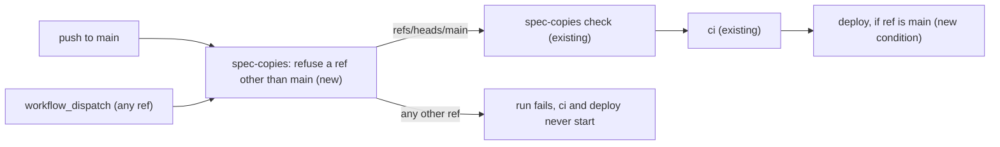

# Deploy ships main only: a hand-started Deploy on any other ref fails at its first step

**Status:** implemented
**Created:** 2026-11-03 06:33 UTC
**Issue:** #360 (follow-up of #351's spec, #359) · **Touches:** `.github/workflows/deploy.yml`, a new `tests/deploy-workflow.test.ts`, the Deployment bullet in AGENTS.md, CI/CD in `.ai/docs/engineering-standards.md`

## 📝 TLDR

Deploy can be started by hand (`workflow_dispatch`) on any branch or tag. Such a run checks out that ref, runs CI on it and, once CI passes, `kamal deploy`s it to production. After this change, Deploy's first step fails the run, with an error naming the ref, unless the ref is `refs/heads/main`. CI and the deploy then never start. The `deploy` job also gets its own `if: github.ref == 'refs/heads/main'`. A refused run gets a concurrency group of its own, so it can't cancel a `main` deploy waiting in the `deploy-production` queue. Pushes to `main` and the Deploy that `spec-copies.yml` starts on `main` run as before.

## 📝 Problem Statement

`deploy.yml` runs on `push` to `main` and on `workflow_dispatch`, which has no branch filter. GitHub's "Run workflow" button and `gh workflow run deploy.yml --ref <ref>` both accept any branch or tag. Nothing in the workflow checks `github.ref`. `actions/checkout` checks out the ref the run was started on, `ci` tests it, and `deploy` runs `kamal deploy` on it with the production SSH key and admin password. Nothing in AGENTS.md or the workflow says that is wanted. Production would then run code `main` doesn't have, and the next push to `main` silently replaces it.

#351's guard pushes and dispatches only on `main` (its spec's Q6), but Deploy itself doesn't check which ref it ships.

## Resolved assumptions (autonomous defaults)

Each answer is the most reversible one. They are posted on the PR and on #360 for override.

| # | Question | Applied default | Why |
| --- | --- | --- | --- |
| Q1 | Refuse other refs, or allow them on purpose (#360's two options)? | **Refuse.** Only `refs/heads/main` deploys. | No run log, lesson or doc asks for a branch deploy. Rolling back is a revert on `main` (or `kamal rollback` from a workstation), and both leave `main` matching production. Shipping a branch makes production differ from `main` until the next push overwrites it, which nobody would see. Allowing it later is deleting two conditions. |
| Q2 | Fail the run, or skip its jobs? | **Fail.** The first step of the first job, `spec-copies`, exits 1 with `::error::Deploy ships main only. This run was started on <ref>; start it on main.` It runs before checkout, so the branch is never checked out. `ci` needs `spec-copies`, and `deploy` needs `ci`, so neither starts. | A run whose jobs are all skipped shows as green, and whoever started it may believe it deployed. A red run with the reason in its annotation tells them. Failing first also spends no CI minutes and no place in the `deploy-production` queue beyond a few seconds. |
| Q3 | Also guard the `deploy` job itself? | **Yes:** `if: github.ref == 'refs/heads/main'` on `deploy`. | The step above stops the run only while every path to `deploy` goes through `spec-copies`. The job that holds the secrets should state the rule itself, so a later change to `needs` can't reopen it. Without a status function a job-level `if` keeps the implied `success()`, so it still waits for `ci`. |
| Q4 | Remove `workflow_dispatch` instead? | **No.** | `spec-copies.yml` starts Deploy on `main` through it (#351), and it is how to re-deploy `main` by hand. |
| Q5 | How does the step read the ref? | From the `GITHUB_REF` environment variable, not a `${{ github.ref }}` expression in the script. | A branch name may hold characters the shell would run. An environment variable is data, while an expression is pasted into the script before bash reads it. |
| Q6 | Tags, `main` in a fork, a branch named `main-hotfix`? | All refused. The test is the exact string `refs/heads/main`. | A tag or another branch is still code `main` may not have. Forks don't have the repository's secrets anyway. |
| Q7 | Do refused runs still queue in `deploy-production`? | **No.** The workflow's concurrency group becomes `${{ github.ref == 'refs/heads/main' && 'deploy-production' || format('deploy-refused-{0}', github.run_id) }}`, with `cancel-in-progress: false` kept. | GitHub keeps one pending run per group and cancels the older one when another is queued. A branch run started while a deploy runs would cancel the `main` run waiting behind it, then fail, and that `main` commit would never deploy until the next push. A group of its own per refused run keeps it out of the queue. |
| Q8 | Where is the choice pinned? | A new `tests/deploy-workflow.test.ts`, beside `tests/ci-workflow.test.ts`. | #360 asks for a test in `tests/`. `tests/spec-copies-workflows.test.ts` is about #351's guard and keeps that scope. |

## 📝 Proposed Solution

1. **`deploy.yml`, job `spec-copies`**: a new first step, before `actions/checkout`:

   ```yaml
   # A hand-started run (workflow_dispatch) may name any branch or tag. Only main deploys (#360).
   - name: Refuse a ref other than main
     run: |
       if [ "$GITHUB_REF" != refs/heads/main ]; then
         echo "::error::Deploy ships main only. This run was started on $GITHUB_REF; start it on main."
         exit 1
       fi
   ```
2. **`deploy.yml`, job `deploy`**: `if: github.ref == 'refs/heads/main'`, next to `needs: ci`.
3. **`deploy.yml`, `concurrency.group`**: `${{ github.ref == 'refs/heads/main' && 'deploy-production' || format('deploy-refused-{0}', github.run_id) }}` (Q7). `spec-copies.yml`'s test already compares its group with Deploy's; it keeps passing.
4. **`tests/deploy-workflow.test.ts`** (new) pins:
   - Deploy runs on `push` to `main` and on `workflow_dispatch`, and nothing else;
   - the first step of the first job is the refusal, before any checkout, and every job reaches `deploy` only through `spec-copies` (`ci` needs `spec-copies`, `deploy` needs `ci`);
   - the refusal step, run with `bash` under a given `GITHUB_REF`: exit 0 and no output for `refs/heads/main`; exit 1 and the error naming the ref for `refs/heads/feature`, `refs/heads/main-hotfix` and `refs/tags/v1`;
   - a ref holding shell syntax (`refs/heads/x;touch pwned`) is printed, not run;
   - the step reads `$GITHUB_REF`, and no `run` in `deploy.yml` contains `${{ github.ref`;
   - `deploy`'s `if` is exactly `github.ref == 'refs/heads/main'`;
   - the concurrency group is `deploy-production` only for `refs/heads/main`, and unique per run otherwise, with `cancel-in-progress: false`.
5. **Docs.** AGENTS.md, the Deployment bullet: "Deploy ships `main` only: a run started by hand on any other branch or tag fails at its first step (#360)." The same sentence goes in the CI/CD paragraph of `.ai/docs/engineering-standards.md`.

## 📝 Architecture



Takeaway: on `main` nothing changes but one shell step of a few milliseconds. On any other ref the run is red within seconds and production is untouched.

## 📝 Edge Cases & Failure Scenarios

- **`spec-copies.yml`'s dispatch** passes `--ref main`, so its Deploy passes the gate.
- **A push to `main`** always has `GITHUB_REF=refs/heads/main` (`on.push.branches: [main]`).
- **A run on another ref while a `main` deploy runs**: it has its own concurrency group (Q7), so it fails at once and the `main` run waiting in `deploy-production` keeps its place. Without Q7 it would have cancelled that waiting run.
- **Re-running a failed `main` run** keeps its ref, so it passes.
- **Someone needs a branch on production** (an emergency): merge it to `main`, or deploy from a workstation with `kamal deploy`, which this change doesn't touch.

## 📝 Risks & Impact Review

- Only `deploy.yml`'s behaviour for refs other than `main` changes, and it now stops instead of shipping. No app code, schema, API, UI or `BACKWARD_COMPATIBILITY.md` surface.
- Undo: delete the step and the `if`.

## Out of scope

- Branch protection, environments with required reviewers, or any other GitHub setting.
- `ci.yml`, `spec-copies.yml` and the Kamal configuration.

## 📋 Phasing

One phase, one step.

## 📋 Implementation Plan

1. **The gate, its test and the docs.** Add the step, the `if` and the concurrency group to `deploy.yml`, add `tests/deploy-workflow.test.ts` as above, and update AGENTS.md and the engineering standards. Verify with `npm run lint`, `npm run typecheck`, `npm run test:coverage` (100%) and `npm run build`. Run the refusal step's test against the step with its `exit 1` line deleted, and check that it fails.

## Implementation notes

Implemented by the implementation PR for #360 (`.ai/pipeline/runs/2026-11-03--0636UTC-deploy-main-only.md`), as planned. The refusal test also covers `refs/heads/x/refs/heads/main` and an empty `GITHUB_REF`. Deleting the step's `exit 1`, the `deploy` job's `if`, or reading the ref through `${{ github.ref }}` each fails `tests/deploy-workflow.test.ts`. The first real refusal can only happen on GitHub: start Deploy by hand on a branch once after merge.

## Acceptance criteria

- [x] A Deploy started on any ref but `refs/heads/main` fails at its first step with an error naming the ref, and neither `ci` nor `deploy` runs (#360 AC1, the refusal option).
- [x] The `deploy` job runs only when `github.ref` is `refs/heads/main`.
- [x] A refused run never enters the `deploy-production` concurrency group, so it can't cancel a `main` run waiting there.
- [x] `tests/deploy-workflow.test.ts` pins all three, and runs the refusal step for `main`, other branches, a tag and a ref holding shell syntax (#360 AC2).
- [x] AGENTS.md and the engineering standards say Deploy ships `main` only.
